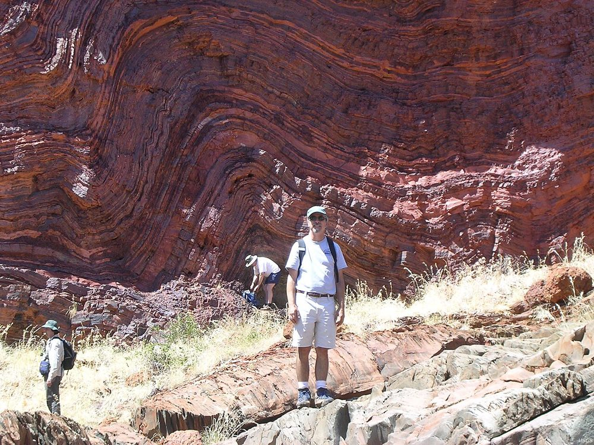

```{=html}
<style>
@import url('https://fonts.googleapis.com/css2?family=Space+Grotesk:wght@700&family=Inter:wght@400;600;800&display=swap');

.engage-box { background: linear-gradient(135deg, #00a8a5 0%, #6c5ce7 100%); color: white; padding: 25px; margin: 20px 0; border-radius: 15px; box-shadow: 0 10px 30px rgba(0, 206, 201, 0.3); }
.explore-box { background: linear-gradient(135deg, #0870c0 0%, #00876a 100%); color: white; padding: 25px; margin: 20px 0; border-radius: 15px; box-shadow: 0 10px 30px rgba(9, 132, 227, 0.3); }
.explain-box { background: linear-gradient(135deg, #5848c7 0%, #6a5cc9 100%); color: white; padding: 25px; margin: 20px 0; border-radius: 15px; box-shadow: 0 10px 30px rgba(108, 92, 231, 0.3); }
.elaborate-box { background: linear-gradient(135deg, #b8721a 0%, #c0482c 100%); color: white; padding: 25px; margin: 20px 0; border-radius: 15px; box-shadow: 0 10px 30px rgba(253, 203, 110, 0.3); }
.evaluate-box { background: linear-gradient(135deg, #d63c3c 0%, #c0461a 100%); color: white; padding: 25px; margin: 20px 0; border-radius: 15px; box-shadow: 0 10px 30px rgba(255, 107, 107, 0.3); }
.engage-box h2, .explore-box h2, .explain-box h2, .elaborate-box h2, .evaluate-box h2 { font-family: 'Space Grotesk', sans-serif; font-size: 2em; margin-top: 0; color: white !important; }
.pe-badge { display: inline-block; background: linear-gradient(135deg, #00cec9 0%, #6c5ce7 100%); color: white; padding: 8px 16px; border-radius: 20px; font-size: 13px; font-weight: 800; margin: 5px; box-shadow: 0 4px 15px rgba(0, 206, 201, 0.4); text-transform: uppercase; letter-spacing: 1px; }
.big-question { font-family: 'Space Grotesk', sans-serif; font-size: 2.5em; font-weight: 800; background: linear-gradient(135deg, #00a8a5 0%, #6c5ce7 100%); -webkit-background-clip: text; -webkit-text-fill-color: transparent; margin: 30px 0 20px 0; text-align: center; animation: slideIn 0.8s ease-out; }
.key-idea { background: linear-gradient(135deg, #ffecd2 0%, #fcb69f 100%); color: #1a1a1a; padding: 20px; margin: 20px 0; border-radius: 12px; border-left: 8px solid #ff6b6b; font-size: 1.1em; }
.student-task { background: #fff3e0; color: #1a1a1a; border-left: 5px solid #ff9800; padding: 20px; margin: 15px 0; border-radius: 0 10px 10px 0; }
.mind-blown { background: linear-gradient(135deg, #00a8a5 0%, #6c5ce7 100%); color: white; padding: 20px; margin: 20px 0; border-radius: 15px; font-size: 1.3em; font-weight: 700; text-align: center; box-shadow: 0 10px 25px rgba(0, 206, 201, 0.4); }
.check-understanding { background: linear-gradient(to right, #00a8a5, #6c5ce7); color: white; padding: 20px; margin: 20px 0; border-radius: 12px; border-left: 6px solid #fff; }
@keyframes slideIn { from { opacity: 0; transform: translateY(-20px); } to { opacity: 1; transform: translateY(0); } }
h1 { font-family: 'Space Grotesk', sans-serif !important; font-weight: 800 !important; font-size: 2.8em !important; margin-top: 40px !important; }
h2 { font-family: 'Space Grotesk', sans-serif !important; font-weight: 700 !important; color: #00a8a5 !important; }
/* co- : shared styles for this chapter's interactives (own dark background, so they read the same in light and dark mode) */
.co-card { background: #0f1b2d; color: #e9f0fa; border-radius: 14px; padding: 14px; margin: 14px 0 20px; box-shadow: 0 6px 20px rgba(0,0,0,.2); font-family: Inter, system-ui, sans-serif; max-width: 100%; overflow: hidden; }
.co-card svg, .co-card canvas { max-width: 100%; display: block; }
.co-card svg text { font-family: Inter, system-ui, sans-serif; }
.co-title { font-weight: 800; font-size: 1.08em; margin: 0 0 2px; color: #fff; }
.co-sub { font-size: .86em; color: #b9c6d8; margin: 0 0 10px; line-height: 1.4; }
.co-row { display: flex; flex-wrap: wrap; gap: 8px; align-items: center; margin: 8px 0; }
.co-btn { min-height: 44px; min-width: 44px; padding: 8px 14px; border-radius: 10px; border: 1.5px solid rgba(255,255,255,.3); background: rgba(255,255,255,.08); color: #e9f0fa; font-weight: 700; font-size: .9em; cursor: pointer; line-height: 1.2; }
.co-btn:hover { background: rgba(255,255,255,.17); }
.co-btn[aria-pressed="true"] { background: #19c2b8; border-color: #19c2b8; color: #04222a; }
.co-btn.co-primary { background: #ffb84d; border-color: #ffb84d; color: #2a1a00; }
.co-btn:disabled { opacity: .45; cursor: default; }
.co-select, .co-input { min-height: 44px; border-radius: 10px; border: 1.5px solid rgba(255,255,255,.3); background: #1b2a42; color: #e9f0fa; padding: 6px 10px; font-size: .95em; max-width: 100%; }
.co-select { width: 100%; }
.co-label { display: block; font-size: .82em; font-weight: 700; color: #b9c6d8; margin: 8px 0 4px; }
.co-read { background: rgba(255,255,255,.07); border-radius: 10px; padding: 10px 12px; font-size: .93em; line-height: 1.45; margin-top: 8px; }
.co-read ul { margin: 4px 0 8px; padding-left: 18px; }
.co-stat { display: flex; flex-wrap: wrap; gap: 8px; margin: 8px 0; }
.co-stat > div { flex: 1 1 130px; background: rgba(255,255,255,.07); border-radius: 10px; padding: 8px 10px; }
.co-stat b { display: block; font-size: 1.15em; color: #fff; }
.co-stat span { font-size: .78em; color: #b9c6d8; }
.co-model { display: inline-block; background: #ffd166; color: #2a1a00; font-weight: 800; font-size: .7em; padding: 2px 8px; border-radius: 20px; letter-spacing: .04em; text-transform: uppercase; vertical-align: middle; }
.co-range { width: 100%; min-height: 44px; accent-color: #19c2b8; touch-action: pan-y; margin: 0; }
.co-check { display: inline-flex; align-items: center; gap: 8px; min-height: 44px; font-size: .9em; font-weight: 600; cursor: pointer; padding-right: 8px; }
.co-check input { flex: 0 0 22px; width: 22px; height: 22px; accent-color: #19c2b8; }
.co-src { font-size: .78em; color: #9fb0c6; margin: 8px 0 0; line-height: 1.4; }
.co-tl-jump { display: block; width: 100%; min-height: 44px; text-align: left; background: none; border: 0; color: #fff; font-weight: 700; padding: 6px 0 2px; cursor: pointer; text-decoration: underline; text-decoration-style: dotted; text-underline-offset: 3px; font-size: 1em; }
</style>
```

<a class="quiz-jump-btn" href="#end-of-chapter-quiz">🧠 Quiz ↓</a>

<div class="big-question">🦠🌍 Did Earth Shape Life, or Did Life Shape Earth?</div>

::: {.callout-note collapse="true"}
## 📒 Using this chapter with your student packet

This chapter follows the same steps as your **Coevolution of Earth and Life 5E** packet. Missed a class or need a refresher? Jump to the matching section:

| Packet section | In this chapter |
|---|---|
| Engage: The Pace of Evolution | [Engage](#engage-the-pace-of-evolution) |
| Explore Part 1: Reconstructing Earth's Geological and Evolutionary History | [Part 1](#part-1-reconstructing-earths-geological-and-evolutionary-history) |
| Explore Part 2: Dating Fossil Layers | [Part 2](#part-2-dating-fossil-layers) |
| Explore Part 3: Oxygen in Earth's History | [Part 3](#part-3-oxygen-in-earths-history) |
| Explore: See-Think-Wonder | [See-Think-Wonder](#see-think-wonder) |
| Explain: Arguing for Coevolution of Earth and Life (video, Parts 1–2) | [Explain](#explain-arguing-for-coevolution-of-earth-and-life) |
| Explain: Signals in the Sands of Time (reading + reflection) | [Signals in the Sands of Time](#signals-in-the-sands-of-time) |
| Explain: Summary Task | [Summary Task](#explain-summary-task) |
| Elaborate: Mass Extinctions, Extinction Events and Oxygen, Arguing from Evidence | [Elaborate](#elaborate-mass-extinctions) |
| Checking your two arguments | [Evaluate](#evaluate-check-your-arguments) |
:::

```{ojs}
//| echo: false
Plot = require("@observablehq/plot")
d3 = require("d3@7")
```

```{ojs}
//| echo: false
// Shared helpers for this chapter's interactives (all names start with co)
coKit = {
  const reduced = () => !!(window.matchMedia && window.matchMedia("(prefers-reduced-motion: reduce)").matches);
  const el = (tag, cls, inner) => { const e = document.createElement(tag); if (cls) e.className = cls; if (inner != null) e.innerHTML = inner; return e; };
  const btn = (label, cls) => { const b = el("button", "co-btn" + (cls ? " " + cls : ""), label); b.type = "button"; return b; };
  // Tell the caller when the node scrolls on or off screen (used to pause animations)
  const watch = (node, cb) => {
    if (!("IntersectionObserver" in window)) { cb(true); return {stop() {}}; }
    const io = new IntersectionObserver(es => cb(es[es.length - 1].isIntersecting), {threshold: 0.05});
    io.observe(node);
    return {stop: () => io.disconnect()};
  };
  // Call cb(width) whenever the node's width changes
  const onResize = (node, cb) => {
    let last = -1;
    const fire = () => { const w = Math.round(node.clientWidth); if (w > 0 && w !== last) { last = w; cb(w); } };
    if (!("ResizeObserver" in window)) { setTimeout(fire, 0); return {stop() {}}; }
    const ro = new ResizeObserver(fire);
    ro.observe(node);
    return {stop: () => ro.disconnect()};
  };
  const fmtGa = ga => ga >= 1 ? `${+ga.toFixed(2)} billion years ago`
    : ga >= 0.001 ? `${Math.round(ga * 1000)} million years ago`
    : ga > 0 ? `about ${Math.round(ga * 1e9).toLocaleString()} years ago` : "today";
  const fmtYears = y => y >= 1e9 ? `${+(y / 1e9).toPrecision(3)} billion` : y >= 1e6 ? `${+(y / 1e6).toPrecision(3)} million` : Math.round(y).toLocaleString();
  // Read a value off the same smooth (monotone) curve that d3 draws through the points.
  // pts = [[x, y], ...] with x increasing. Returns f(x).
  const curveFn = pts => {
    const segs = []; let cur = null;
    const ctx = {
      moveTo(x, y) { cur = [x, y]; },
      lineTo(x, y) { segs.push([cur[0], cur[1], cur[1] + (y - cur[1]) / 3, cur[1] + 2 * (y - cur[1]) / 3, x, y]); cur = [x, y]; },
      bezierCurveTo(x1, y1, x2, y2, x, y) { segs.push([cur[0], cur[1], y1, y2, x, y]); cur = [x, y]; },
      closePath() {}
    };
    d3.line().curve(d3.curveMonotoneX).context(ctx)(pts);
    return x => {
      if (x <= pts[0][0]) return pts[0][1];
      if (x >= pts[pts.length - 1][0]) return pts[pts.length - 1][1];
      const s = segs.find(g => x >= g[0] && x <= g[4]);
      const t = (x - s[0]) / (s[4] - s[0]), u = 1 - t;
      return u * u * u * s[1] + 3 * u * u * t * s[2] + 3 * u * t * t * s[3] + t * t * t * s[5];
    };
  };
  return {reduced, el, btn, watch, onResize, fmtGa, fmtYears, curveFn};
}
```

```{ojs}
//| echo: false
buildQuiz = function(id, title, questions) {
  const outer = html`<div id="${id}" style="margin:18px 0 24px 0;text-align:center;">
    <button style="
      display:inline-flex;align-items:center;gap:7px;
      background:linear-gradient(135deg,#667eea 0%,#764ba2 100%);
      color:#fff;border:none;padding:9px 22px;border-radius:50px;
      font-size:.95em;font-weight:700;cursor:pointer;
      box-shadow:0 3px 12px rgba(102,126,234,.45);
      transition:transform .15s,box-shadow .15s;"
      onmouseover="this.style.transform='scale(1.04)';this.style.boxShadow='0 5px 18px rgba(102,126,234,.55)'"
      onmouseout="this.style.transform='scale(1)';this.style.boxShadow='0 3px 12px rgba(102,126,234,.45)'"
    >
      <span style="font-size:1.1em;">📝</span> ${title}
      <span class="chevron" style="transition:transform .3s;">▼</span>
    </button>
    <div class="quiz-body" style="
      max-height:0;opacity:0;overflow:hidden;
      transition:max-height .5s cubic-bezier(.4,0,.2,1),opacity .4s ease,margin-top .3s ease;
      margin-top:0;text-align:left;">
      <button class="close-btn" style="
        display:block;margin:0 auto 10px auto;
        background:rgba(102,126,234,.12);color:#667eea;border:none;
        padding:5px 18px;border-radius:50px;font-size:.85em;
        font-weight:600;cursor:pointer;">Hide Quiz</button>
      <p style="text-align:center;color:#718096;font-style:italic;font-size:.9em;margin-bottom:12px;">
        Select an answer for each question.</p>
    </div>
  </div>`;
  const toggle = outer.querySelector("button");
  const chevron = toggle.querySelector(".chevron");
  const body   = outer.querySelector(".quiz-body");
  const closeBtn = body.querySelector(".close-btn");
  function expand(){  body.style.maxHeight="2000px";body.style.opacity="1";body.style.marginTop="14px";chevron.style.transform="rotate(180deg)"; }
  function collapse(){ body.style.maxHeight="0";body.style.opacity="0";body.style.marginTop="0";chevron.style.transform="rotate(0)"; }
  toggle.onclick = () => body.style.maxHeight === "0px" || body.style.maxHeight === "" ? expand() : collapse();
  closeBtn.onclick = collapse;
  questions.forEach((qq, qi) => {
    const card = document.createElement("div");
    card.style.cssText = "background:#fff;color:#1e1b4b;border-radius:12px;padding:16px 20px;margin-bottom:14px;box-shadow:0 2px 8px rgba(0,0,0,.08);";
    card.innerHTML = `<p style="font-weight:700;margin:0 0 10px;">${qi+1}. ${qq.q}</p>`;
    qq.options.forEach((opt, oi) => {
      const btn = document.createElement("button");
      btn.textContent = opt;
      btn.style.cssText = "display:block;width:100%;min-height:44px;text-align:left;padding:10px 14px;margin:6px 0;border:2px solid #e2e8f0;border-radius:8px;background:#fff;color:#1e1b4b;cursor:pointer;font-size:.95em;transition:border-color .2s,background .2s;";
      btn.onmouseover = () => { if(!card.dataset.answered){ btn.style.borderColor="#667eea";btn.style.background="#f0f0ff"; }};
      btn.onmouseout  = () => { if(!card.dataset.answered){ btn.style.borderColor="#e2e8f0";btn.style.background="#fff"; }};
      btn.onclick = () => {
        if(card.dataset.answered) return;
        card.dataset.answered = "true";
        card.querySelectorAll("button").forEach(b => { b.style.cursor="default"; b.onmouseover=null; b.onmouseout=null; });
        if(oi === qq.correct){
          btn.style.borderColor="#48bb78";btn.style.background="#f0fff4";
          fb.innerHTML = "✅ Correct! " + qq.explanation;
          fb.style.color="#276749";fb.style.background="#f0fff4";
        } else {
          btn.style.borderColor="#fc8181";btn.style.background="#fff5f5";
          card.querySelectorAll("button")[qq.correct].style.borderColor="#48bb78";
          card.querySelectorAll("button")[qq.correct].style.background="#f0fff4";
          fb.innerHTML = "❌ " + qq.explanation;
          fb.style.color="#9b2c2c";fb.style.background="#fff5f5";
        }
        fb.style.padding="10px 14px";fb.style.marginTop="8px";
      };
      card.appendChild(btn);
    });
    const fb = document.createElement("div");
    fb.style.cssText = "border-radius:8px;font-size:.9em;transition:all .3s;";
    card.appendChild(fb);
    body.appendChild(card);
  });
  return outer;
}
```

# Engage: The Pace of Evolution

::: {.engage-box}
## ⏩ Evolution Has Been Speeding Up

**Phenomenon:** The pace of evolution has increased over the past 4.6 billion years.

For billions of years, life on Earth was nothing but single cells. Then, in the last billion years, almost everything you can picture (animals, plants, forests, dinosaurs, people) appeared. **Why did evolution start slow and then speed up?**
:::

The packet's spiral diagram shows when each group of living things first appeared. Here is the same data as a timeline. Use the buttons to zoom in on recent time, where the events crowd together.

```{ojs}
//| echo: false
paceEvents = [
  {event: "Sun ignites", ga: 4.6, kind: "Space & Earth"},
  {event: "Earth forms", ga: 4.6, kind: "Space & Earth"},
  {event: "Moon forms", ga: 4.5, kind: "Space & Earth"},
  {event: "Liquid water", ga: 4.4, kind: "Space & Earth"},
  {event: "Prokaryotes (simple cells, no nucleus)", ga: 3.8, kind: "Single cells"},
  {event: "Photosynthesis", ga: 3.4, kind: "Single cells"},
  {event: "Atmospheric oxygen", ga: 2.4, kind: "Space & Earth"},
  {event: "Eukaryotes (complex cells with a nucleus)", ga: 2.0, kind: "Single cells"},
  {event: "Multicellular life (clustered cells)", ga: 1.0, kind: "Many-celled life"},
  {event: "Sponges and fungi", ga: 0.8, kind: "Many-celled life"},
  {event: "Cambrian explosion (jellyfish, worms, arthropods)", ga: 0.54, kind: "Many-celled life"},
  {event: "Fish (vertebrates)", ga: 0.5, kind: "Many-celled life"},
  {event: "Land plants", ga: 0.47, kind: "Many-celled life"},
  {event: "Sharks", ga: 0.42, kind: "Many-celled life"},
  {event: "Insects, tetrapods (amphibians)", ga: 0.38, kind: "Many-celled life"},
  {event: "Reptiles", ga: 0.31, kind: "Many-celled life"},
  {event: "Dinosaurs", ga: 0.23, kind: "Many-celled life"},
  {event: "Mammals", ga: 0.2, kind: "Many-celled life"},
  {event: "Birds", ga: 0.15, kind: "Many-celled life"},
  {event: "Flowers and bees", ga: 0.13, kind: "Many-celled life"},
  {event: "Primates", ga: 0.055, kind: "Humans & relatives"},
  {event: "Ardipithecus ramidus", ga: 0.0043, kind: "Humans & relatives"},
  {event: "Fire", ga: 0.001, kind: "Humans & relatives"},
  {event: "Homo sapiens", ga: 0.0002, kind: "Humans & relatives"},
  {event: "Writing", ga: 0.00001, kind: "Humans & relatives"}
]
```

```{ojs}
//| echo: false
viewof paceZoom = Inputs.radio(["All 4.6 billion years", "Last 1 billion years", "Last 10 million years"], {label: "Show:", value: "All 4.6 billion years"})
```

```{ojs}
//| echo: false
{
  const maxGa = paceZoom.startsWith("All") ? 4.6 : paceZoom.includes("1 billion") ? 1.0 : 0.01;
  const shown = paceEvents.filter(d => d.ga <= maxGa + 1e-9);
  const fmtAge = g => g >= 1 ? `${g} billion years ago` : g >= 0.001 ? `${+(g * 1000).toPrecision(3)} million years ago` : `${Math.round(g * 1e9).toLocaleString()} years ago`;
  const short = s => width < 700 ? s.replace(/ \(.*/, "") : s;
  return Plot.plot({
    title: "When did each group first appear?",
    subtitle: `${shown.length} of ${paceEvents.length} events fall in this window. Hover or tap a dot for its age.`,
    width: width,
    height: 40 + shown.length * 22,
    marginLeft: Math.min(230, width * 0.42),
    marginRight: 16,
    marginBottom: 40,
    color: {domain: ["Space & Earth", "Single cells", "Many-celled life", "Humans & relatives"], range: ["#6c5ce7", "#00a8a5", "#e17055", "#d4a017"], legend: true},
    x: {label: maxGa >= 1 ? "Billion years ago (Ga)" : maxGa >= 0.5 ? "Billion years ago (Ga)" : "Million years ago", domain: [maxGa, 0], grid: true,
        tickFormat: maxGa >= 0.5 ? (d => d) : (d => +(d * 1000).toFixed(1))},
    y: {label: null, domain: shown.map(d => d.event), tickFormat: short},
    marks: [
      Plot.ruleY(shown, {y: "event", x1: maxGa, x2: "ga", stroke: "kind", strokeOpacity: 0.25}),
      Plot.dot(shown, {x: "ga", y: "event", fill: "kind", r: 6, stroke: "#333", strokeWidth: 0.5, tip: true,
        title: d => `${d.event}\n${fmtAge(d.ga)}`})
    ]
  });
}
```

::: {.key-idea}
### 💡 Reading the timeline

- **Earth formed about 4.6 billion years ago.** The first signs of life (simple cells) show up about **0.8 billion years** later.
- Simple cells had the planet to themselves for about **1.8 billion years** before complex cells with a nucleus (eukaryotes) appeared about 2 billion years ago.
- It took about **another billion years** for cells to live clustered together (multicellular life), then about **0.5 billion years** more for animals like jellyfish and worms.
- **Almost all complex life appeared in the last billion years**, which is less than a quarter of Earth's history.
:::

::: {.student-task}
### ✏️ In your packet: Pace of Evolution questions and brainstorm

- Use the diagram to answer questions 1–6: when Earth formed, and how long each step took (first life → complex cells → clustered cells → animals like jellyfish and worms → the last billion years).
- **Brainstorm 2–5 ideas** in the table for what may have influenced the **speed** of evolution of complex life, with **evidence or scientific ideas** that support each one. Think about the history of the solar system, how Earth formed, and what life needs.
:::

```{ojs}
//| echo: false
buildQuiz("pace-quiz", "⏩ Check Your Understanding: The Pace of Evolution", [
  {
    q: "Earth formed about 4.6 billion years ago and the first simple cells appeared about 3.8 billion years ago. How long did it take for the first signs of life to appear?",
    options: ["About 0.08 billion years", "About 0.8 billion years", "About 3.8 billion years", "About 8.4 billion years"],
    correct: 1,
    explanation: "Subtract the two ages: 4.6 − 3.8 = 0.8 billion years (800 million years)."
  },
  {
    q: "Switch the view to 'Last 1 billion years.' What do you notice?",
    options: ["Very few events happened in the last billion years", "Most of the groups on the timeline appeared in the last billion years", "Only single-celled life appeared recently", "Evolution stopped about a billion years ago"],
    correct: 1,
    explanation: "Most of the events (sponges, the Cambrian explosion, fish, plants, dinosaurs, mammals, humans) are packed into the last billion years. That crowding is the phenomenon: evolution sped up."
  },
  {
    q: "Which idea is the best start for explaining why evolution sped up?",
    options: ["Earth got closer to the Sun", "Conditions on Earth (like the amount of oxygen) changed over time and made complex life possible", "Living things stopped needing energy", "The Moon formed recently"],
    correct: 1,
    explanation: "Notice 'Atmospheric oxygen' at 2.4 billion years ago, right before complex cells appear. Changes in Earth's systems, especially oxygen, are what the rest of this chapter investigates."
  }
])
```

# Explore: Beginnings of Life Investigation

::: {.explore-box}
## 🔍 Reading the Fossil Record

The fossil record formed over billions of years as layers of sediment were deposited by the rock cycle. It holds clues to **biological events** (life on Earth) and **geological events** (Earth's other systems: atmosphere, oceans, rocks). Putting those events on one timeline lets you look for connections.
:::

## Part 1: Reconstructing Earth's Geological and Evolutionary History

In class, you sort event cards onto a timeline from 4 billion years ago to now: **life on Earth** on top, **other Earth's systems** on the bottom. Here is a digital version. **Tap a dot** (or use the event menu) to read its card. Arrows point to the events it may be connected to. Press **Play through time** to watch the events appear in order, and look for changes in Earth's systems that come just before changes in life.

```{ojs}
//| echo: false
timelineEvents = [
  {id: "e1", ga: 4.6, sys: "Other Earth's systems", event: "Earth forms; early atmosphere is mostly hydrogen and helium"},
  {id: "e3", ga: 4.4, sys: "Other Earth's systems", event: "Oldest mineral grains (zircons) show a solid crust and liquid water"},
  {id: "e4", ga: 3.9, sys: "Other Earth's systems", event: "Heavy asteroid bombardment slows down"},
  {id: "e5", ga: 3.8, sys: "Other Earth's systems", event: "Atmosphere is methane, ammonia, water vapor and nitrogen; almost no oxygen"},
  {id: "e6", ga: 2.5, sys: "Other Earth's systems", event: "Banded iron formations: rust-red iron layers pile up on the seafloor (about 3.8–1.85 Ga, peak about 2.5 Ga)"},
  {id: "e7", ga: 2.4, sys: "Other Earth's systems", event: "Great Oxidation Event: oxygen starts to build up in the atmosphere"},
  {id: "e8", ga: 2.3, sys: "Other Earth's systems", event: "Huronian glaciation: Earth's first major ice age"},
  {id: "e9", ga: 2.0, sys: "Other Earth's systems", event: "Red beds: iron-rich rocks on land start to rust"},
  {id: "e10", ga: 1.85, sys: "Other Earth's systems", event: "Banded iron formations stop forming"},
  {id: "e11", ga: 0.7, sys: "Other Earth's systems", event: "'Snowball Earth' ice ages (about 720–635 million years ago)"},
  {id: "e12", ga: 0.6, sys: "Other Earth's systems", event: "Second big rise in oxygen (about 850–540 million years ago)"},
  {id: "e13", ga: 0.5, sys: "Other Earth's systems", event: "Ozone layer is thick enough to shield land from UV radiation"},
  {id: "e14", ga: 0.33, sys: "Other Earth's systems", event: "Huge coal deposits form from buried swamp forests; oxygen peaks near 35%"},
  {id: "e15", ga: 0.252, sys: "Other Earth's systems", event: "Massive volcanic eruptions (Siberian Traps)"},
  {id: "e16", ga: 0.066, sys: "Other Earth's systems", event: "Asteroid impact (Chicxulub crater, Mexico)"},
  {id: "l1", ga: 3.8, sys: "Life on Earth", event: "First signs of life: chemical traces of simple cells (prokaryotes)"},
  {id: "l2", ga: 3.5, sys: "Life on Earth", event: "Stromatolites: layered mounds built by mats of microbes"},
  {id: "l3", ga: 2.7, sys: "Life on Earth", event: "Cyanobacteria release oxygen by photosynthesis (possibly earlier)"},
  {id: "l4", ga: 2.0, sys: "Life on Earth", event: "Eukaryotes: complex cells with a nucleus"},
  {id: "l5", ga: 1.0, sys: "Life on Earth", event: "Multicellular life: cells living clustered together"},
  {id: "l6", ga: 0.58, sys: "Life on Earth", event: "Ediacaran animals: first large, soft-bodied animals"},
  {id: "l7", ga: 0.54, sys: "Life on Earth", event: "Cambrian explosion: most animal body plans appear"},
  {id: "l8", ga: 0.47, sys: "Life on Earth", event: "First land plants"},
  {id: "l9", ga: 0.375, sys: "Life on Earth", event: "First forests; four-legged animals move onto land"},
  {id: "l10", ga: 0.3, sys: "Life on Earth", event: "Giant insects and other 'widespread gigantism'"},
  {id: "l11", ga: 0.23, sys: "Life on Earth", event: "Dinosaurs and first mammals appear"},
  {id: "l12", ga: 0.06, sys: "Life on Earth", event: "Mammals spread into niches left by the dinosaurs"},
  {id: "l13", ga: 0.0002, sys: "Life on Earth", event: "Homo sapiens (about 200,000 years ago)"}
]
```

```{ojs}
//| echo: false
timelineLinks = [
  {from: "l3", to: "e6", why: "Oxygen made by cyanobacteria reacted with iron dissolved in seawater, and the iron oxide (rust) settled into layers on the seafloor."},
  {from: "l2", to: "l3", why: "Many stromatolites were built by mats of cyanobacteria, so they are evidence of early photosynthesis."},
  {from: "e6", to: "e10", why: "Once most of the dissolved iron in the oceans was used up, iron layers stopped forming."},
  {from: "l3", to: "e7", why: "When the ocean's iron could no longer soak up the oxygen, the extra oxygen escaped into the air."},
  {from: "e7", to: "e9", why: "Oxygen in the air rusted iron minerals in rocks on land, turning them red."},
  {from: "e7", to: "e8", why: "Oxygen destroyed much of the methane (a strong greenhouse gas) in the air, so Earth cooled."},
  {from: "e7", to: "l4", why: "Using oxygen to release energy from food (aerobic respiration) gives far more energy than living without it, which bigger, complex cells need."},
  {from: "e12", to: "l6", why: "Large animals need a lot of oxygen; they appear soon after the second oxygen rise."},
  {from: "e12", to: "l7", why: "Higher oxygen supported active animals with shells, eyes and muscles."},
  {from: "e7", to: "e13", why: "Ozone (O₃) is made from oxygen (O₂). More oxygen in the air built up the ozone layer."},
  {from: "e13", to: "l8", why: "With ozone blocking harmful UV light, life could survive on land."},
  {from: "l9", to: "e14", why: "Forests made huge amounts of oxygen, and buried plants became coal."},
  {from: "e14", to: "l10", why: "Extra oxygen let insects with simple breathing tubes grow very large."},
  {from: "e15", to: "l11", why: "The eruptions caused the biggest extinction ever; survivors (including early dinosaurs and mammals) filled the empty niches."},
  {from: "e16", to: "l12", why: "The impact ended the dinosaurs; mammals took over the niches they left."},
  {from: "e11", to: "e12", why: "After the 'Snowball Earth' ice melted, nutrients washed into the sea, feeding algae that made more oxygen (one leading idea)."}
]
```

```{ojs}
//| echo: false
// Interactive deep-time timeline: two linked tracks, tap an event, zoom, play through time.
coTimeline = {
  const K = coKit;
  const LIFE = "Life on Earth";
  const isLife = d => d.sys === LIFE;
  const evs = [...timelineEvents].sort((a, b) => b.ga - a.ga || (isLife(a) ? 1 : 0) - (isLife(b) ? 1 : 0));
  const byId = Object.fromEntries(evs.map(d => [d.id, d]));
  const order = Object.fromEntries(evs.map((d, i) => [d.id, i]));
  const views = [{label: "All 4.6 billion years", max: 4.6}, {label: "Last 1 billion years", max: 1}, {label: "Last 600 million years", max: 0.6}];
  const C = {life: "#19c2b8", earth: "#f0a43a", cause: "#ffd166", effect: "#8fd3ff"};
  const col = d => isLife(d) ? C.life : C.earth;
  let sel = "e7", view = views[0], shown = evs.length, allLinks = false, timer = null, W = 0;

  const wrap = K.el("div", "co-card");
  const root = d3.select(wrap);
  root.append("div").attr("class", "co-title").text("Earth's geological and evolutionary history");
  root.append("div").attr("class", "co-sub").html(`<span style="color:${C.life}">●</span> Top: <strong>life on Earth</strong>. <span style="color:${C.earth}">●</span> Bottom: <strong>other Earth's systems</strong>. Tap a dot to read its card. Arrows show events that may be connected.`);

  const viewRow = root.append("div").attr("class", "co-row").attr("role", "group").attr("aria-label", "Zoom the timeline");
  const viewBtns = views.map(v => {
    const b = K.btn(v.label);
    b.onclick = () => { view = v; update(true); };
    viewRow.node().append(b);
    return b;
  });

  const svg = root.append("svg").attr("role", "img").style("width", "100%").style("touch-action", "pan-y")
    .attr("aria-label", `Timeline from 4.6 billion years ago to today with two tracks. Top track: ${evs.filter(isLife).length} events in the history of life. Bottom track: ${evs.filter(d => !isLife(d)).length} events in Earth's other systems. Most life events are crowded into the last 600 million years. Use the event menu below the timeline to read every event.`);
  const defs = svg.append("defs");
  const clipId = "co-tl-clip";
  const clipRect = defs.append("clipPath").attr("id", clipId).append("rect");
  for (const [k, c] of [["cause", C.cause], ["effect", C.effect], ["all", "#9fb0c6"]]) {
    defs.append("marker").attr("id", `co-tl-arrow-${k}`).attr("viewBox", "0 0 10 10").attr("refX", 8).attr("refY", 5)
      .attr("markerWidth", 6).attr("markerHeight", 6).attr("orient", "auto")
      .append("path").attr("d", "M0,0 L10,5 L0,10 Z").attr("fill", c);
  }
  const gAxis = svg.append("g");
  const gClip = svg.append("g").attr("clip-path", `url(#${clipId})`);
  const gCursor = gClip.append("line").attr("stroke", "rgba(255,255,255,.35)").attr("stroke-dasharray", "3,4");
  const gLinks = gClip.append("g").attr("fill", "none");
  const gDots = gClip.append("g");
  const dots = gDots.selectAll("g").data(evs, d => d.id).join("g").style("cursor", "pointer")
    .on("click", (e, d) => { stop(); pick(d.id); });
  dots.append("circle").attr("class", "co-tl-hit").attr("fill", "transparent");
  dots.append("circle").attr("class", "co-tl-dot").attr("fill", col).attr("r", 0);

  const ctl = root.append("div").attr("class", "co-row");
  const prevBtn = K.btn("◀ Earlier"), nextBtn = K.btn("Later ▶"), playBtn = K.btn("▶ Play through time", "co-primary"), linkBtn = K.btn("Show all links");
  prevBtn.setAttribute("aria-label", "Go to the earlier event");
  nextBtn.setAttribute("aria-label", "Go to the later event");
  linkBtn.setAttribute("aria-pressed", "false");
  ctl.node().append(prevBtn, nextBtn, playBtn, linkBtn);
  prevBtn.onclick = () => { stop(); pick(evs[Math.max(0, order[sel] - 1)].id); };
  nextBtn.onclick = () => { stop(); pick(evs[Math.min(evs.length - 1, order[sel] + 1)].id); };
  playBtn.onclick = () => timer ? stop() : play();
  linkBtn.onclick = () => { allLinks = !allLinks; linkBtn.setAttribute("aria-pressed", String(allLinks)); update(false); };

  root.append("label").attr("class", "co-label").attr("for", "co-tl-menu").text("Event menu:");
  const menu = root.append("select").attr("class", "co-select").attr("id", "co-tl-menu");
  menu.selectAll("option").data(evs).join("option").attr("value", d => d.id)
    .text(d => `${d.ga >= 1 ? d.ga + " Ga" : d.ga >= 0.001 ? Math.round(d.ga * 1000) + " Ma" : "200,000 yr"}: ${d.event.length > 60 ? d.event.slice(0, 58) + "…" : d.event}`);
  menu.on("change", function() { stop(); pick(this.value); });

  const card = root.append("div").attr("class", "co-read");
  card.on("click", e => { const b = e.target.closest(".co-tl-jump"); if (b) { stop(); pick(b.dataset.id); } });
  root.append("p").attr("class", "co-src").text("Events and dates: the event cards and readings in your packet (New Visions ESS Unit 2, Coevolution of Earth and Life). Arrows are scientists' proposed connections, not proof.");

  function pick(id) {
    sel = id;
    if (!timer) shown = evs.length;
    const d = byId[id];
    // If the event is outside the zoomed window, zoom out so it can be seen
    if (d.ga > view.max + 1e-9) { view = views.find(v => d.ga <= v.max + 1e-9) || views[0]; update(true); }
    else update(false);
  }
  function play() {
    if (shown >= evs.length) shown = 0;
    playBtn.innerHTML = "⏸ Pause";
    tick();
    timer = setInterval(tick, 1100);
  }
  function tick() {
    if (shown >= evs.length) return stop();
    shown++;
    sel = evs[shown - 1].id;
    if (byId[sel].ga > view.max + 1e-9) view = views[0];
    update(false);
    if (shown >= evs.length) stop();
  }
  function stop() {
    if (timer) { clearInterval(timer); timer = null; }
    playBtn.innerHTML = shown >= evs.length ? "▶ Play through time" : "▶ Keep playing";
  }

  function layout(v) {
    const r = W < 520 ? 8 : 9, step = 2 * r + 3;
    const x = d3.scaleLinear().domain([v.max, 0]).range([12 + r, W - 12 - r]);
    const pos = {}, maxK = {life: 0, earth: 0};
    for (const life of [true, false]) {
      const placed = [];
      for (const d of evs.filter(e => isLife(e) === life)) {
        const px = x(d.ga); let k = 0;
        if (d.ga <= v.max + 1e-9) {
          while (placed.some(p => p.k === k && Math.abs(p.x - px) < step)) k++;
          placed.push({x: px, k});
          const key = life ? "life" : "earth";
          maxK[key] = Math.max(maxK[key], k);
        }
        pos[d.id] = {x: px, k};
      }
    }
    return {r, step, x, pos, maxK};
  }

  function update(animate) {
    if (!W) return;
    const dur = animate && !K.reduced() ? 700 : 0;
    const full = layout(views[0]), L = layout(view), r = L.r, step = L.step;
    const lifeBase = 24 + (full.maxK.life + 1) * step + 4;
    const strip = 26, earthTop = lifeBase + strip;
    const H = earthTop + (full.maxK.earth + 1) * step + 8 + 26;
    svg.attr("viewBox", `0 0 ${W} ${H}`).attr("height", H);
    clipRect.attr("x", 2).attr("y", 0).attr("width", W - 4).attr("height", H);
    const P = {};
    for (const d of evs) {
      const p = L.pos[d.id];
      P[d.id] = {x: p.x, y: isLife(d) ? lifeBase - r - 4 - p.k * step : earthTop + r + 4 + p.k * step};
    }
    viewBtns.forEach((b, i) => b.setAttribute("aria-pressed", String(views[i] === view)));

    // Axis strip between the two tracks
    gAxis.selectAll("*").remove();
    gAxis.append("rect").attr("x", 0).attr("y", lifeBase).attr("width", W).attr("height", strip).attr("fill", "rgba(255,255,255,.08)");
    const inMa = view.max <= 1;
    const ticks = L.x.ticks(W < 520 ? 5 : 9);
    for (const t of ticks) {
      const tx = L.x(t);
      gAxis.append("line").attr("x1", tx).attr("x2", tx).attr("y1", 20).attr("y2", H - 24).attr("stroke", "rgba(255,255,255,.08)");
      gAxis.append("text").attr("x", tx).attr("y", lifeBase + strip / 2 + 4).attr("text-anchor", t === 0 ? "end" : "middle")
        .attr("fill", "#dbe5f2").attr("font-size", 11).attr("font-weight", 600)
        .text(t === 0 ? "today" : inMa ? Math.round(t * 1000) : t);
    }
    gAxis.append("text").attr("x", 8).attr("y", 15).attr("fill", C.life).attr("font-size", 11).attr("font-weight", 800).text("LIFE ON EARTH");
    gAxis.append("text").attr("x", 8).attr("y", H - 7).attr("fill", C.earth).attr("font-size", 11).attr("font-weight", 800).text("OTHER EARTH'S SYSTEMS");
    gAxis.append("text").attr("x", W - 8).attr("y", H - 7).attr("text-anchor", "end").attr("fill", "#b9c6d8").attr("font-size", 11)
      .text(inMa ? "Million years ago" : "Billion years ago");

    // Dots
    const related = new Map();
    for (const l of timelineLinks) {
      if (l.to === sel) related.set(l.from, "cause");
      if (l.from === sel) related.set(l.to, "effect");
    }
    const vis = d => order[d.id] < shown;
    dots.style("pointer-events", d => vis(d) ? "auto" : "none");
    dots.transition().duration(dur).attr("transform", d => `translate(${P[d.id].x},${P[d.id].y})`);
    dots.select(".co-tl-hit").attr("r", r + 5);
    dots.select(".co-tl-dot")
      .attr("stroke", d => d.id === sel ? "#fff" : related.has(d.id) ? C[related.get(d.id)] : "rgba(0,0,0,.45)")
      .attr("stroke-width", d => d.id === sel ? 3 : related.has(d.id) ? 2.5 : 1)
      .attr("opacity", d => d.id === sel || related.has(d.id) || !related.size ? 1 : 0.62)
      .transition().duration(K.reduced() ? 0 : 280)
      .attr("r", d => !vis(d) ? 0 : d.id === sel ? r + 2 : r);
    gCursor.transition().duration(dur).attr("x1", P[sel].x).attr("x2", P[sel].x).attr("y1", 20).attr("y2", H - 24);

    // Link arrows
    const path = l => {
      const a = P[l.from], b = P[l.to], da = byId[l.from], db = byId[l.to];
      let c1, c2;
      if (isLife(da) !== isLife(db)) {
        const mid = lifeBase + strip / 2;
        c1 = [a.x, mid]; c2 = [b.x, mid];
      } else {
        const bulge = Math.min(46, 16 + Math.abs(a.x - b.x) * 0.25) * (isLife(da) ? -1 : 1);
        c1 = [a.x + (b.x - a.x) * 0.25, Math.min(a.y, b.y) * (isLife(da) ? 1 : 0) + Math.max(a.y, b.y) * (isLife(da) ? 0 : 1) + bulge];
        c2 = [a.x + (b.x - a.x) * 0.75, c1[1]];
      }
      // stop the arrow at the edge of the target dot
      let dx = b.x - c2[0], dy = b.y - c2[1]; const len = Math.hypot(dx, dy) || 1;
      const ex = b.x - dx / len * (r + 5), ey = b.y - dy / len * (r + 5);
      return `M${a.x},${a.y} C${c1[0]},${c1[1]} ${c2[0]},${c2[1]} ${ex},${ey}`;
    };
    const links = timelineLinks.filter(l => order[l.from] < shown && order[l.to] < shown)
      .map(l => ({...l, kind: l.to === sel ? "cause" : l.from === sel ? "effect" : "all"}))
      .filter(l => allLinks || l.kind !== "all")
      .sort((a, b) => (a.kind === "all" ? 0 : 1) - (b.kind === "all" ? 0 : 1));
    gLinks.selectAll("path").remove();
    gLinks.selectAll("path").data(links).join("path")
      .attr("d", path)
      .attr("stroke", l => l.kind === "all" ? "#9fb0c6" : C[l.kind])
      .attr("stroke-width", l => l.kind === "all" ? 1.2 : 2.4)
      .attr("stroke-dasharray", l => l.kind === "cause" ? "6,4" : null)
      .attr("marker-end", l => `url(#co-tl-arrow-${l.kind})`)
      .attr("opacity", 0)
      .transition().delay(dur).duration(K.reduced() ? 0 : 250)
      .attr("opacity", l => l.kind === "all" ? 0.45 : 1);

    // Card
    menu.property("value", sel);
    prevBtn.disabled = order[sel] === 0;
    nextBtn.disabled = order[sel] === evs.length - 1;
    const ev = byId[sel];
    const causes = timelineLinks.filter(l => l.to === sel), effects = timelineLinks.filter(l => l.from === sel);
    const item = (l, other) => `<li style="margin:2px 0 8px;"><button type="button" class="co-tl-jump" data-id="${other}">${byId[other].event}</button>
      <span style="font-size:.85em;color:#b9c6d8;">${byId[other].sys} · ${K.fmtGa(byId[other].ga)}</span><br><span style="font-size:.92em;">${l.why}</span></li>`;
    card.html(`<div style="font-size:.8em;font-weight:800;color:${col(ev)};text-transform:uppercase;letter-spacing:.04em;">${ev.sys} · event ${order[sel] + 1} of ${evs.length}</div>
      <div style="font-weight:800;font-size:1.08em;color:#fff;">${ev.event}</div>
      <div style="color:#b9c6d8;margin-bottom:8px;">${K.fmtGa(ev.ga)}</div>
      <div style="font-weight:700;"><span style="color:${C.cause};">⇢</span> May have been caused or helped by:</div>
      ${causes.length ? `<ul>${causes.map(l => item(l, l.from)).join("")}</ul>` : `<p style="margin:4px 0 10px;color:#b9c6d8;">No link drawn on this timeline.</p>`}
      <div style="font-weight:700;"><span style="color:${C.effect};">→</span> May have led to:</div>
      ${effects.length ? `<ul>${effects.map(l => item(l, l.to)).join("")}</ul>` : `<p style="margin:4px 0 0;color:#b9c6d8;">No link drawn on this timeline.</p>`}`);
  }

  const ro = K.onResize(wrap, w => { W = Math.max(280, w - 28); update(false); });
  const io = K.watch(wrap, v => { if (!v && timer) stop(); });
  invalidation.then(() => { stop(); ro.stop(); io.stop(); });
  return wrap;
}
```

::: {.callout-warning}
## ⚠️ Correlation is not the same as causation

Two events that happen close together on a timeline are **correlated**. That alone doesn't prove one **caused** the other. The links above are scientists' best explanations. They get stronger when there is a **known process** (like iron reacting with oxygen to make rust) and **more than one line of evidence**.
:::

::: {.student-task}
### ✏️ In your packet: Part 1 timeline and analysis questions

- Build the timeline on chart paper (4 billion years ago → now; **Life on Earth** on top, **Other Earth's Systems** on the bottom) and sort the event cards.
- Q1: Draw lines between events you think affected each other and write a prediction for each link.
- Q2–Q3: How do Earth's systems seem to affect life? How does life seem to affect Earth's systems?
- Q4: How easy is it to tell what a fossil shows without a caption?
- Q5: Is your evidence **correlative or causative**? What extra information would make it stronger?
- Q6: Why might the rock cycle and plate tectonics make a complete timeline hard to build?
:::

```{ojs}
//| echo: false
buildQuiz("timeline-quiz", "🗓️ Check Your Understanding: The Timeline", [
  {
    q: "Pick 'Banded iron formations' in the event menu. Which life event is linked to them?",
    options: ["First land plants", "Cyanobacteria releasing oxygen by photosynthesis", "Dinosaurs appearing", "Homo sapiens"],
    correct: 1,
    explanation: "Oxygen from cyanobacteria reacted with iron dissolved in seawater. The rust settled into red layers. That is life changing the geosphere."
  },
  {
    q: "Which pair shows an Earth system affecting life?",
    options: ["Cyanobacteria → banded iron formations", "Forests → coal deposits", "Ozone layer → first land plants", "Cyanobacteria → Great Oxidation Event"],
    correct: 2,
    explanation: "The ozone layer (part of the atmosphere) blocked harmful UV light, which let life move onto land. The other three pairs are life changing Earth's systems."
  },
  {
    q: "Why is it hard to build a complete timeline of early life?",
    options: ["Scientists have not looked for old rocks", "The rock cycle and plate tectonics have melted, folded, eroded or subducted most very old rocks", "Early life left huge fossils everywhere", "Radioactive dating does not work on rocks"],
    correct: 1,
    explanation: "Billions of years of the rock cycle have destroyed or changed most ancient rocks, and early life was microscopic. Very few rocks older than 3.5 billion years are left exposed."
  }
])
```

## Part 2: Dating Fossil Layers

The dates on the timeline come from **radioactive (radiometric) dating**, the same method used to date rocks and craters from the early solar system. A radioactive **parent isotope** decays into a **daughter product** at a steady rate. The **half-life** is the time it takes for **half** of the parent to decay. Different isotopes are useful for different ages and materials.

```{ojs}
//| echo: false
isotopeData = [
  {parent: "Samarium-147", daughter: "Neodymium-143", half: 106e9, halfText: "106 billion", range: "10 million – 4.6 billion", min: 1e7, max: 4.6e9, materials: "Garnets, micas"},
  {parent: "Rubidium-87", daughter: "Strontium-87", half: 48.8e9, halfText: "48.8 billion", range: "10 million – 4.6 billion", min: 1e7, max: 4.6e9, materials: "Potassium-bearing minerals (mica, feldspar, hornblende), whole igneous or metamorphic rock"},
  {parent: "Uranium-238", daughter: "Lead-206", half: 4.5e9, halfText: "4.5 billion", range: "10 million – 4.6 billion", min: 1e7, max: 4.6e9, materials: "Uranium-bearing minerals (zircon, apatite, uraninite)"},
  {parent: "Uranium-235", daughter: "Lead-207", half: 713e6, halfText: "713 million", range: "10 million – 4.6 billion", min: 1e7, max: 4.6e9, materials: "Uranium-bearing minerals (zircon, apatite, uraninite)"},
  {parent: "Potassium-40", daughter: "Argon-40", half: 1.3e9, halfText: "1.3 billion", range: "100,000 – 4.6 billion", min: 1e5, max: 4.6e9, materials: "Potassium-bearing minerals (mica, feldspar, hornblende), igneous or volcanic rock (tuff and/or lava flows)"},
  {parent: "Carbon-14", daughter: "Nitrogen-14", half: 5730, halfText: "5,730", range: "100 – 70,000", min: 100, max: 70000, materials: "Organic materials, glacial ice containing carbon dioxide, groundwater, and ocean water"}
]
```

```{ojs}
//| echo: false
{
  const wrap = d3.create("div").style("overflow-x", "auto");
  wrap.append(() => Inputs.table(isotopeData, {
    columns: ["parent", "daughter", "halfText", "range", "materials"],
    header: {parent: "Parent isotope", daughter: "Daughter decay product", halfText: "Half-life (years)", range: "Useful dating range (years)", materials: "Datable materials"},
    width: {materials: 320},
    rows: 7,
    layout: "auto"
  }));
  wrap.append("p").style("font-size", "0.85em").style("margin-top", "6px")
    .text("Geologically Important Radioactive Elements Used for Radiometric Dating (from your packet).");
  return wrap.node();
}
```

### 🧪 Half-life simulator

This is a **model** of radioactive decay. Pick an isotope and press **Play**. Watch the parent atoms decay at random, and see how the amount left still follows the half-life rule. Then try the challenge: date a mystery sample.

```{ojs}
//| echo: false
// Half-life MODEL: 400 model atoms that each decay at random with the right probability.
coDecay = {
  const K = coKit;
  const N = 400, COLS = 20, MAXH = 6, RATE = 0.25; // RATE = half-lives per second at 1x speed
  const C = {parent: "#4da3ff", daughter: "#ff9f43"};
  let iso = isotopeData.find(d => d.parent === "Uranium-235");
  let atoms = [], t = 0, trace = [], running = false, speed = 1, raf = null, lastTs = 0, S = 0, onScreen = true, mystery = null;

  const wrap = K.el("div", "co-card");
  const root = d3.select(wrap);
  root.append("div").attr("class", "co-title").html(`Half-life simulator <span class="co-model">Model</span>`);
  root.append("div").attr("class", "co-sub").html(`Each dot is one model atom. Every moment, each <strong style="color:${C.parent}">parent atom ●</strong> has the same chance of decaying into a <strong style="color:${C.daughter}">daughter atom ○</strong>. Nobody can say which atom goes next, but half of them are gone after each half-life. The half-life values are the real ones from your packet's table.`);

  root.append("label").attr("class", "co-label").attr("for", "co-decay-iso").text("Isotope:");
  const isoSel = root.append("select").attr("class", "co-select").attr("id", "co-decay-iso");
  isoSel.selectAll("option").data(isotopeData).join("option").attr("value", d => d.parent)
    .text(d => `${d.parent} → ${d.daughter} (half-life ${d.halfText} years)`);
  isoSel.property("value", iso.parent);

  const ctl = root.append("div").attr("class", "co-row");
  const playBtn = K.btn("▶ Play", "co-primary"), stepBtn = K.btn("+1 half-life"), speedBtn = K.btn("Speed: 1×"), resetBtn = K.btn("↺ Reset");
  ctl.node().append(playBtn, stepBtn, speedBtn, resetBtn);

  const body = root.append("div").style("display", "flex").style("flex-wrap", "wrap").style("gap", "12px").style("align-items", "flex-start");
  const left = body.append("div").style("flex", "1 1 260px").style("min-width", "0").style("max-width", "380px");
  const canvas = left.append("canvas").attr("role", "img").style("width", "100%").style("border-radius", "10px").style("background", "#091322").node();
  const ctx = canvas.getContext("2d");
  const right = body.append("div").style("flex", "1 1 280px").style("min-width", "0");
  const CW = 340, CH = 264, m = {l: 40, r: 10, t: 12, b: 66};
  const chart = right.append("svg").attr("viewBox", `0 0 ${CW} ${CH}`).attr("role", "img").style("width", "100%").style("height", "auto");
  const cx = d3.scaleLinear().domain([0, MAXH]).range([m.l, CW - m.r]);
  const cy = d3.scaleLinear().domain([0, 100]).range([CH - m.b, m.t]);
  const gGrid = chart.append("g");
  for (const p of [0, 25, 50, 75, 100]) {
    gGrid.append("line").attr("x1", m.l).attr("x2", CW - m.r).attr("y1", cy(p)).attr("y2", cy(p)).attr("stroke", "rgba(255,255,255,.14)");
    gGrid.append("text").attr("x", m.l - 5).attr("y", cy(p) + 4).attr("text-anchor", "end").attr("fill", "#cfd9e6").attr("font-size", 10).text(p + "%");
  }
  const yearTicks = gGrid.append("g");
  for (let h = 0; h <= MAXH; h++) {
    gGrid.append("line").attr("x1", cx(h)).attr("x2", cx(h)).attr("y1", m.t).attr("y2", CH - m.b).attr("stroke", "rgba(255,255,255,.14)");
    gGrid.append("text").attr("x", cx(h)).attr("y", CH - m.b + 13).attr("text-anchor", "middle").attr("fill", "#cfd9e6").attr("font-size", 10).text(h);
  }
  gGrid.append("text").attr("x", (m.l + CW - m.r) / 2).attr("y", CH - 20).attr("text-anchor", "middle").attr("fill", "#cfd9e6").attr("font-size", 10.5).text("Time passed: half-lives (top row), years (bottom row)");
  gGrid.append("text").attr("x", (m.l + CW - m.r) / 2).attr("y", CH - 6).attr("text-anchor", "middle").attr("fill", "#9fb0c6").attr("font-size", 9.5).text("k = thousand, M = million, B = billion");
  const expected = d3.range(0, MAXH + 0.01, 0.05).map(h => [cx(h), cy(100 * 0.5 ** h)]);
  chart.append("path").attr("d", d3.line()(expected)).attr("fill", "none").attr("stroke", "#cfd9e6").attr("stroke-width", 1.5).attr("stroke-dasharray", "5,4");
  const legend = chart.append("g");
  legend.append("text").attr("x", cx(2.6)).attr("y", cy(82)).attr("fill", "#cfd9e6").attr("font-size", 10).text("- - expected curve (half-life rule)");
  legend.append("text").attr("x", cx(2.6)).attr("y", cy(82) - 14).attr("fill", C.parent).attr("font-size", 10).attr("font-weight", 700).text("━ this run of the model");
  const sampleLine = chart.append("line").attr("x1", m.l).attr("x2", CW - m.r).attr("stroke", "#ffd166").attr("stroke-width", 2).style("display", "none");
  const sampleText = chart.append("text").attr("x", CW - m.r - 4).attr("text-anchor", "end").attr("fill", "#ffd166").attr("font-size", 11).attr("font-weight", 700).style("display", "none");
  const tracePath = chart.append("path").attr("fill", "none").attr("stroke", C.parent).attr("stroke-width", 2.5).attr("stroke-linejoin", "round");
  const traceDot = chart.append("circle").attr("r", 5).attr("fill", C.parent).attr("stroke", "#fff").attr("stroke-width", 1.5);

  const stats = root.append("div").attr("class", "co-stat");
  const sTime = stats.append("div"), sHalf = stats.append("div"), sParent = stats.append("div"), sDaughter = stats.append("div");
  const note = root.append("div").attr("class", "co-read");

  // "Date this sample" challenge
  const ch = root.append("div").attr("class", "co-read").style("margin-top", "12px").style("border", "1.5px dashed rgba(255,209,102,.6)");
  ch.append("div").style("font-weight", "800").style("color", "#fff").html(`🔍 Challenge: date this sample <span class="co-model">Model sample</span>`);
  const chText = ch.append("div").style("margin", "4px 0 8px").text("Get a mystery sample of the isotope you picked. Read how much parent is left, use the curve to find how many half-lives have passed, then work out its age.");
  const newBtn = K.btn("🎲 New mystery sample", "co-primary");
  ch.node().append(newBtn);
  const form = ch.append("div").attr("class", "co-row").style("display", "none");
  form.append("label").attr("for", "co-decay-ans").style("font-weight", "700").style("flex", "1 1 100%").text("Your estimate of the sample's age:");
  const ans = form.append("input").attr("class", "co-input").attr("id", "co-decay-ans").attr("type", "number").attr("inputmode", "decimal").attr("step", "any").attr("min", "0").attr("placeholder", "number").style("width", "7.5em");
  const unit = form.append("select").attr("class", "co-select").attr("aria-label", "Units for your estimate").style("width", "auto");
  unit.selectAll("option").data([["years", 1], ["thousand years", 1e3], ["million years", 1e6], ["billion years", 1e9]]).join("option").attr("value", d => d[1]).text(d => d[0]);
  const checkBtn = K.btn("Check"), showBtn = K.btn("Show me how");
  form.node().append(checkBtn, showBtn);
  const fb = ch.append("div").attr("aria-live", "polite").style("margin-top", "6px");
  root.append("p").attr("class", "co-src").text("Half-lives and useful dating ranges: 'Geologically Important Radioactive Elements Used for Radiometric Dating' table in your packet. The atoms, the random decays and the mystery samples are a model, not measurements of real rocks.");

  const left400 = () => atoms.reduce((s, a) => s + (a.dec ? 0 : 1), 0);
  const shortYears = y => y === 0 ? "0" : y >= 1e9 ? `${+(y / 1e9).toPrecision(2)} B` : y >= 1e6 ? `${+(y / 1e6).toPrecision(3)} M` : y >= 1e4 ? `${+(y / 1e3).toPrecision(3)} k` : `${Math.round(y).toLocaleString()}`;

  function reset() {
    running = false; mystery = null;
    atoms = d3.range(N).map(() => ({dec: false, at: -1e9}));
    t = 0; trace = [[0, 100]];
    sampleLine.style("display", "none"); sampleText.style("display", "none");
    form.style("display", "none"); fb.html("");
    yearTicks.selectAll("*").remove();
    for (let h = 0; h <= MAXH; h++)
      yearTicks.append("text").attr("x", cx(h)).attr("y", CH - m.b + 27).attr("text-anchor", h === MAXH ? "end" : h === 0 ? "start" : "middle").attr("dx", h === MAXH ? 8 : h === 0 ? -3 : 0).attr("fill", "#cfd9e6").attr("font-size", 9.5).text(shortYears(h * iso.half));
    refresh();
  }
  function advance(dH) {
    if (dH <= 0) return;
    const p = 1 - 0.5 ** dH, now = performance.now();
    for (const a of atoms) if (!a.dec && Math.random() < p) { a.dec = true; a.at = now; }
    t += dH;
    trace.push([t, 100 * left400() / N]);
  }
  function frame(ts) {
    raf = null;
    if (running) {
      const dt = Math.min(0.1, (ts - lastTs) / 1000 || 0);
      lastTs = ts;
      advance(Math.min(dt * RATE * speed, MAXH - t));
      if (t >= MAXH - 1e-9 || left400() === 0) running = false;
      refresh();
    } else draw();
    const flashing = atoms.some(a => a.dec && performance.now() - a.at < 500);
    if ((running || flashing) && onScreen) raf = requestAnimationFrame(frame);
  }
  function kick() { if (!raf && onScreen) { lastTs = performance.now(); raf = requestAnimationFrame(frame); } }

  function draw() {
    if (!S) return;
    const dpr = Math.min(2, window.devicePixelRatio || 1);
    if (canvas.width !== Math.round(S * dpr)) { canvas.width = canvas.height = Math.round(S * dpr); canvas.style.height = S + "px"; }
    ctx.setTransform(dpr, 0, 0, dpr, 0, 0);
    ctx.clearRect(0, 0, S, S);
    const cell = S / COLS, rad = cell * 0.36, now = performance.now(), still = K.reduced();
    atoms.forEach((a, i) => {
      const x = (i % COLS + 0.5) * cell, y = (Math.floor(i / COLS) + 0.5) * cell;
      ctx.beginPath();
      if (!a.dec) { ctx.arc(x, y, rad, 0, 6.2832); ctx.fillStyle = C.parent; ctx.fill(); }
      else {
        const k = still ? 1 : Math.min(1, (now - a.at) / 500);
        if (k < 1) { ctx.arc(x, y, rad * (1 + 1.2 * (1 - k)), 0, 6.2832); ctx.fillStyle = `rgba(255,255,255,${0.5 * (1 - k)})`; ctx.fill(); ctx.beginPath(); }
        ctx.arc(x, y, rad * 0.72, 0, 6.2832); ctx.lineWidth = Math.max(1.5, rad * 0.4); ctx.strokeStyle = C.daughter; ctx.stroke();
      }
    });
  }
  function refresh() {
    const L = left400(), pct = 100 * L / N, yrs = t * iso.half;
    draw();
    tracePath.attr("d", mystery ? null : d3.line()(trace.map(d => [cx(d[0]), cy(d[1])]))).style("display", mystery ? "none" : null);
    traceDot.attr("cx", cx(t)).attr("cy", cy(pct)).style("display", mystery ? "none" : null);
    legend.style("display", mystery ? "none" : null);
    sTime.html(`<span>Time passed (years)</span><b>${mystery ? "?" : t === 0 ? "0" : K.fmtYears(yrs)}</b>`);
    sHalf.html(`<span>Half-lives passed</span><b>${mystery ? "?" : t.toFixed(2)}</b>`);
    sParent.html(`<span>Parent atoms left</span><b style="color:${C.parent}">${L} of ${N} (${+pct.toFixed(1)}%)</b>`);
    sDaughter.html(`<span>Daughter atoms</span><b style="color:${C.daughter}">${N - L}</b>`);
    canvas.setAttribute("aria-label", `Model of ${N} ${iso.parent} atoms in a grid. ${L} are still parent atoms (${+pct.toFixed(1)} percent) and ${N - L} have decayed into ${iso.daughter}.`);
    chart.attr("aria-label", mystery ? `Decay curve. A line marks the mystery sample at ${+pct.toFixed(1)} percent parent remaining.`
      : `Decay curve: percent of parent atoms left against time. After ${t.toFixed(2)} half-lives this run has ${+pct.toFixed(1)} percent left. The expected value is ${+(100 * 0.5 ** t).toFixed(1)} percent.`);
    playBtn.innerHTML = running ? "⏸ Pause" : t >= MAXH - 1e-9 ? "▶ Play again" : "▶ Play";
    stepBtn.disabled = !mystery && t >= MAXH - 1e-9;
    if (mystery) note.html(`This is a <strong>mystery sample</strong>. The clock is hidden. Use the yellow line on the curve.`);
    else if (t === 0) note.html(`<strong>${iso.parent}</strong> decays into <strong>${iso.daughter}</strong>. Half-life: <strong>${iso.halfText} years</strong>. Useful dating range: ${iso.range} years. Press <strong>Play</strong>, or step one half-life at a time.`);
    else {
      const inRange = yrs >= iso.min && yrs <= iso.max;
      note.html(`After <strong>${K.fmtYears(yrs)} years</strong>, the rule predicts ${+(100 * 0.5 ** t).toFixed(1)}% left. This run of the model has <strong>${+pct.toFixed(1)}%</strong>. Random decay makes small differences.<br>${
        inRange ? "✅ This age is inside the isotope's useful dating range."
        : yrs < iso.min ? "⚠️ Too young to date with this isotope: so little has decayed that the change is too small to measure accurately."
        : "⚠️ Too old to date with this isotope: almost all of the parent has decayed, so too little is left to measure accurately."}`);
    }
  }

  playBtn.onclick = () => {
    if (mystery || t >= MAXH - 1e-9) reset();
    running = !running; refresh(); kick();
  };
  stepBtn.onclick = () => { if (mystery) reset(); running = false; advance(Math.min(1, MAXH - t)); refresh(); kick(); };
  speedBtn.onclick = () => { speed = speed === 1 ? 3 : 1; speedBtn.innerHTML = `Speed: ${speed}×`; };
  resetBtn.onclick = reset;
  isoSel.on("change", function() { iso = isotopeData.find(d => d.parent === this.value); reset(); });

  newBtn.onclick = () => {
    reset();
    const hi = Math.min(3.5, iso.max / iso.half);
    const lo = hi < 0.3 ? hi * 0.4 : Math.max(0.25, iso.min / iso.half);
    let n, L;
    do {
      n = lo + Math.random() * (hi - lo);
      const p = 1 - 0.5 ** n;
      atoms.forEach(a => { a.dec = Math.random() < p; a.at = -1e9; });
      L = left400();
    } while (L === 0 || L === N);
    const pct = 100 * L / N, nRead = -Math.log2(L / N);
    mystery = {n, pct, nRead, age: nRead * iso.half, tries: 0, hard: hi < 0.3};
    sampleLine.attr("y1", cy(pct)).attr("y2", cy(pct)).style("display", null);
    sampleText.attr("y", cy(pct) + (pct > 85 ? 14 : -5)).text(`sample: ${+pct.toFixed(1)}% left`).style("display", null);
    form.style("display", "flex"); ans.property("value", ""); fb.html("");
    chText.html(`A model sample contains <strong>${iso.parent}</strong> (half-life ${iso.halfText} years). <strong>${L} of ${N}</strong> parent atoms are left (${+pct.toFixed(1)}%). How old is it?`);
    refresh();
  };
  const how = () => `<strong>${+mystery.pct.toFixed(1)}%</strong> left → the yellow line crosses the curve at about <strong>${mystery.nRead.toFixed(2)} half-lives</strong> → ${mystery.nRead.toFixed(2)} × ${iso.halfText} years ≈ <strong>${K.fmtYears(mystery.age)} years</strong>.`;
  checkBtn.onclick = () => {
    if (!mystery) return;
    const v = +ans.property("value") * +unit.property("value");
    if (!(v > 0)) { fb.html("Type a number and pick the units first."); return; }
    mystery.tries++;
    const err = Math.abs(v - mystery.age) / mystery.age, tol = mystery.hard ? 0.4 : 0.15;
    if (err <= tol) {
      fb.html(`✅ <strong>Good dating!</strong> ${how()}<br>The model set this sample to ${K.fmtYears(mystery.n * iso.half)} years. Random decay means a reading is never perfect. Real dates have an uncertainty range too.${mystery.hard ? "<br>Notice how few atoms had decayed. With such a long half-life, a small counting error changes the age a lot." : ""}`);
    } else {
      fb.html(`❌ Not yet. Your estimate is too ${v > mystery.age ? "old" : "young"}. Find where the yellow line crosses the dashed curve, read the number of half-lives below it, then multiply by ${iso.halfText} years.${mystery.tries >= 2 ? " Tap <strong>Show me how</strong> if you are stuck." : ""}${mystery.hard ? "<br>Hint: only a few atoms have decayed, so this one is hard to read. That is why scientists pick an isotope whose half-life is close to the age of the sample." : ""}`);
    }
  };
  showBtn.onclick = () => { if (mystery) fb.html(`💡 ${how()}`); };

  const ro = K.onResize(left.node(), w => { S = Math.min(380, w); draw(); });
  const io = K.watch(wrap, v => { onScreen = v; if (!v && running) { running = false; refresh(); } });
  invalidation.then(() => { running = false; if (raf) cancelAnimationFrame(raf); ro.stop(); io.stop(); });
  reset();
  return wrap;
}
```

### ✏️ Practice: Half-life tables

Fill in each table the way your packet asks, then check your answers. (Packet Q1 compares Uranium-235 and Rubidium-87. Q4 asks for the isotope you choose for dating early humans.)

```{ojs}
//| echo: false
{
  const wrap = d3.create("div").style("display", "flex").style("flex-wrap", "wrap").style("gap", "16px");
  const fmtYears = y => y >= 1e9 ? `${+(y / 1e9).toPrecision(4)} billion` : `${+(y / 1e6).toPrecision(4)} million`;
  const parseYears = s => {
    const t = String(s).toLowerCase().replace(/,/g, "").trim();
    const m = t.match(/^([\d.]+)\s*(billion|b|million|m)?/);
    if (!m) return NaN;
    const v = +m[1];
    if (m[2] && m[2].startsWith("b")) return v * 1e9;
    if (m[2] && m[2].startsWith("m")) return v * 1e6;
    return v;
  };
  const inputStyle = "width:7.5em;min-height:40px;padding:2px 6px;border:1px solid #94a3b8;border-radius:6px;background:var(--bs-body-bg);color:var(--bs-body-color);";
  for (const name of ["Uranium-235", "Rubidium-87", "Potassium-40"]) {
    const iso = isotopeData.find(d => d.parent === name);
    const card = wrap.append("div").style("flex", "1 1 300px").style("overflow-x", "auto");
    card.append("div").style("font-weight", "700").style("margin", "4px 0").text(`${name} (half-life ${iso.halfText} years)`);
    const table = card.append("table").attr("class", "table table-sm").style("font-size", "0.9em");
    table.append("thead").html(`<tr><th>Half-life</th><th>Original ${name} remaining (%)</th><th>Number of years</th><th></th></tr>`);
    const tb = table.append("tbody");
    for (let h = 0; h <= 4; h++) {
      const tr = tb.append("tr");
      tr.append("td").text(h);
      const pct = 100 * 0.5 ** h, yrs = h * iso.half;
      const out = tr.append("td").attr("class", "chk");
      if (h === 0 || h === 4) {
        tr.insert("td", ".chk").text(h === 0 ? "100%" : "6.25%");
      } else {
        tr.insert("td", ".chk").append("input").attr("type", "number").attr("step", "any").attr("inputmode", "decimal")
          .attr("aria-label", `${name}: percent remaining after ${h} half-lives`).attr("placeholder", "%").attr("style", inputStyle)
          .on("input", function() { this.dataset.ok = Math.abs(+this.value - pct) < 0.05 ? "1" : "0"; check(); });
      }
      if (h === 0) {
        tr.insert("td", ".chk").text("0");
      } else {
        tr.insert("td", ".chk").append("input").attr("type", "text")
          .attr("aria-label", `${name}: years after ${h} half-lives`).attr("placeholder", "e.g. 1.3 billion").attr("style", inputStyle)
          .on("input", function() { const v = parseYears(this.value); this.dataset.ok = Math.abs(v - yrs) / yrs < 0.01 ? "1" : "0"; check(); });
      }
      function check() {
        const inputs = [...tr.node().querySelectorAll("input")];
        if (inputs.some(i => i.value === "")) return out.text("");
        out.html(inputs.every(i => i.dataset.ok === "1") ? "✅" : `❌`);
      }
    }
    card.append("details").html(`<summary style="cursor:pointer;min-height:44px;">Show answers</summary>
      <div style="font-size:.9em;">${[1, 2, 3, 4].map(h => `${h} half-life${h > 1 ? "s" : ""}: ${100 * 0.5 ** h}% · ${fmtYears(h * iso.half)} years`).join("<br>")}</div>`);
  }
  wrap.append("p").style("flex-basis", "100%").style("font-size", ".85em").style("margin", "0")
    .text("Type years as a number (2852000000) or with a word (2.852 billion, 713 million).");
  return wrap.node();
}
```

::: {.student-task}
### ✏️ In your packet: Part 2 questions

- Q1: Complete the half-life tables for **Uranium-235** and **Rubidium-87** (used to date the iron band formations).
- Q2: The iron bands are about **2.5 billion years** old. (a) About how much Uranium-235 is left? (b) Why is Rubidium-87 harder to use? (c) What is an advantage of a shorter half-life?
- Q3: Early humans appeared about **200,000 years ago**. Which isotope could date their fossils? Use evidence from the chart.
- Q4: Complete a half-life table for the isotope you chose.
:::

```{ojs}
//| echo: false
buildQuiz("dating-quiz", "⏳ Check Your Understanding: Radiometric Dating", [
  {
    q: "The iron band formations are about 2.5 billion years old. About how much of the original Uranium-235 is left? (Half-life: 713 million years)",
    options: ["About 50%", "About 25%", "About 9%", "About 0.5%"],
    correct: 2,
    explanation: "2.5 billion ÷ 713 million ≈ 3.5 half-lives. After 3 half-lives 12.5% is left and after 4 it's 6.25%, so the answer is in between: about 9% (0.5^3.5 ≈ 8.8%)."
  },
  {
    q: "Why is Rubidium-87 harder to use on the same 2.5-billion-year-old sample?",
    options: ["Its half-life (48.8 billion years) is so long that only about 3.5% has decayed, so the change is tiny and hard to measure", "It decays too fast and none is left", "It is only found in living things", "It cannot be found in rocks"],
    correct: 0,
    explanation: "2.5 ÷ 48.8 ≈ 0.05 half-lives, so about 96.5% of the Rubidium-87 is still there. Measuring a small change precisely is hard. A shorter half-life gives a bigger, easier-to-measure change over the same time."
  },
  {
    q: "Early humans appeared about 200,000 years ago. Which isotope from the chart could date their fossils (or the volcanic ash layers around them)?",
    options: ["Carbon-14 (100 – 70,000 years)", "Potassium-40 (100,000 – 4.6 billion years)", "Samarium-147 (10 million – 4.6 billion years)", "Uranium-235 (10 million – 4.6 billion years)"],
    correct: 1,
    explanation: "200,000 years is inside Potassium-40's useful range (100,000 – 4.6 billion years) but is too old for Carbon-14 (up to 70,000) and too young for the isotopes that start at 10 million. Potassium-40 dates the volcanic rock (tuff, lava) layers above and below fossils."
  }
])
```

## Part 3: Oxygen in Earth's History

Using isotopes, fossils and oxidized (rusted) rocks and minerals, scientists have reconstructed how much **oxygen** was in the atmosphere over time. This is the packet's **Stages of Atmospheric Oxygen** graph. **Drag through time** to read the oxygen level, the stage, and what was alive. Turn on the timeline events to compare the graph with your timeline.

```{ojs}
//| echo: false
o2History = [
  {ga: 3.8, o2: 0}, {ga: 3.4, o2: 0}, {ga: 3.0, o2: 0}, {ga: 2.7, o2: 0}, {ga: 2.45, o2: 0},
  {ga: 2.3, o2: 1}, {ga: 2.1, o2: 2.5}, {ga: 1.95, o2: 3.5}, {ga: 1.85, o2: 3.6},
  {ga: 1.5, o2: 3.6}, {ga: 1.2, o2: 3.6}, {ga: 0.95, o2: 3.8}, {ga: 0.85, o2: 5},
  {ga: 0.75, o2: 9}, {ga: 0.63, o2: 15}, {ga: 0.5, o2: 17}, {ga: 0.43, o2: 22},
  {ga: 0.37, o2: 30}, {ga: 0.33, o2: 36}, {ga: 0.3, o2: 32}, {ga: 0.25, o2: 21},
  {ga: 0.18, o2: 20}, {ga: 0.12, o2: 23}, {ga: 0.08, o2: 22}, {ga: 0.04, o2: 20}, {ga: 0, o2: 21}
]
```

```{ojs}
//| echo: false
o2Stages = [
  {stage: "1", start: 3.85, end: 2.45, text: "Almost no oxygen in the air"},
  {stage: "2", start: 2.45, end: 1.85, text: "Oxygen is made, but most is absorbed by the oceans and seafloor rock (iron)"},
  {stage: "3", start: 1.85, end: 0.85, text: "Oxygen escapes from the oceans and is absorbed by rocks on land and by forming the ozone layer"},
  {stage: "4", start: 0.85, end: 0.54, text: "Oxygen 'sinks' are full, so oxygen builds up quickly in the air"},
  {stage: "5", start: 0.54, end: 0, text: "Oxygen rises and falls; today's air is about 78% nitrogen, 21% oxygen, 1% other gases"}
]
```

```{ojs}
//| echo: false
// Builder for the two scrubbable oxygen charts (Part 3 and Extinction Events and Oxygen).
coO2Chart = function(cfg) {
  const K = coKit;
  const wrap = K.el("div", "co-card");
  const root = d3.select(wrap);
  root.append("div").attr("class", "co-title").text(cfg.title);
  root.append("div").attr("class", "co-sub").text(cfg.sub);
  const state = Object.fromEntries((cfg.toggles || []).map(g => [g.key, g.value]));
  const svg = root.append("svg").attr("role", "img").attr("aria-label", cfg.aria).style("width", "100%").style("touch-action", "pan-y").style("cursor", "ew-resize");
  const tOld = cfg.data[0].t;                       // oldest time with data
  const yAt = K.curveFn(cfg.data.map(p => [-p.t, p.y]));
  const hasBand = cfg.data[0].lo != null;
  const loAt = hasBand ? K.curveFn(cfg.data.map(p => [-p.t, p.lo])) : null;
  const hiAt = hasBand ? K.curveFn(cfg.data.map(p => [-p.t, p.hi])) : null;
  let t = cfg.start, W = 0, H = 0, x = null, y = null, raf = null, playing = false, onScreen = true, lastTs = 0;
  const m = {l: 38, r: 12, t: 24, b: 38};

  const sl = root.append("div");
  const slider = sl.append("input").attr("type", "range").attr("class", "co-range").attr("min", 0).attr("max", 1000).attr("step", 1)
    .attr("aria-label", "Move through time: left is older, right is today").node();
  sl.append("div").style("display", "flex").style("justify-content", "space-between").style("font-size", ".78em").style("color", "#b9c6d8")
    .html(`<span>← ${cfg.fmtT(tOld)}</span><span>today →</span>`);
  const ctl = root.append("div").attr("class", "co-row");
  const playBtn = K.btn("▶ Play through time", "co-primary");
  ctl.node().append(playBtn);
  for (const g of cfg.toggles || []) {
    const lab = ctl.append("label").attr("class", "co-check");
    lab.append("input").attr("type", "checkbox").property("checked", g.value).on("change", function() { state[g.key] = this.checked; render(); });
    lab.append("span").text(g.label);
  }
  const read = root.append("div").attr("class", "co-read");
  root.append("p").attr("class", "co-src").text(cfg.source);

  const gStatic = svg.append("g"), gCur = svg.append("g").style("pointer-events", "none");
  const curLine = gCur.append("line").attr("stroke", "#fff").attr("stroke-width", 1.5);
  const curBand = gCur.append("line").attr("stroke", "#fff").attr("stroke-width", 5).attr("stroke-opacity", 0.45).attr("stroke-linecap", "round");
  const curDot = gCur.append("circle").attr("r", 6.5).attr("fill", cfg.color).attr("stroke", "#fff").attr("stroke-width", 2);
  const curText = gCur.append("text").attr("fill", "#fff").attr("font-size", 13).attr("font-weight", 800)
    .attr("paint-order", "stroke").attr("stroke", "#0f1b2d").attr("stroke-width", 4);

  function render() {
    if (!W) return;
    H = W < 520 ? 300 : 360;
    svg.attr("viewBox", `0 0 ${W} ${H}`).attr("height", H);
    x = d3.scaleLinear().domain(cfg.xDomain).range([m.l, W - m.r]);
    y = d3.scaleLinear().domain(cfg.yDomain).range([H - m.b, m.t]);
    const small = W < 520;
    gStatic.selectAll("*").remove();
    for (const b of cfg.bands || []) {
      gStatic.append("rect").attr("x", x(b.x1)).attr("width", x(b.x2) - x(b.x1)).attr("y", m.t).attr("height", H - m.b - m.t).attr("fill", b.fill).attr("fill-opacity", 0.2);
      gStatic.append("text").attr("x", (x(b.x1) + x(b.x2)) / 2).attr("y", m.t + 16).attr("text-anchor", "middle").attr("fill", "#fff").attr("font-size", 13).attr("font-weight", 800).text(b.label);
    }
    for (const v of y.ticks(5)) {
      gStatic.append("line").attr("x1", m.l).attr("x2", W - m.r).attr("y1", y(v)).attr("y2", y(v)).attr("stroke", "rgba(255,255,255,.13)");
      gStatic.append("text").attr("x", m.l - 5).attr("y", y(v) + 4).attr("text-anchor", "end").attr("fill", "#cfd9e6").attr("font-size", 11).text(v);
    }
    for (const v of x.ticks(small ? 5 : 8)) {
      gStatic.append("line").attr("x1", x(v)).attr("x2", x(v)).attr("y1", H - m.b).attr("y2", H - m.b + 5).attr("stroke", "#cfd9e6");
      gStatic.append("text").attr("x", x(v)).attr("y", H - m.b + 17).attr("text-anchor", "middle").attr("fill", "#cfd9e6").attr("font-size", 11).text(v);
    }
    gStatic.append("text").attr("x", (m.l + W - m.r) / 2).attr("y", H - 5).attr("text-anchor", "middle").attr("fill", "#cfd9e6").attr("font-size", 11).text(cfg.xLabel);
    gStatic.append("text").attr("x", 4).attr("y", 13).attr("fill", "#cfd9e6").attr("font-size", 11).text(cfg.yLabel);
    const pts = cfg.data.map(p => [x(p.t), y(p.y)]);
    if (hasBand) gStatic.append("path").attr("fill", cfg.color).attr("fill-opacity", 0.28)
      .attr("d", d3.area().curve(d3.curveMonotoneX).x(p => x(p.t)).y0(p => y(p.lo)).y1(p => y(p.hi))(cfg.data));
    gStatic.append("line").attr("x1", m.l).attr("x2", W - m.r).attr("y1", y(21)).attr("y2", y(21)).attr("stroke", "#5fe08f").attr("stroke-dasharray", "6,4");
    gStatic.append("text").attr("x", m.l + 4).attr("y", y(21) - 5).attr("fill", "#5fe08f").attr("font-size", 11).attr("font-weight", 700).text("Today: 21%");
    if (cfg.extra) cfg.extra({g: gStatic, x, y, W, H, m, small, state});
    gStatic.append("path").attr("fill", "none").attr("stroke", cfg.color).attr("stroke-width", 3).attr("d", d3.line().curve(d3.curveMonotoneX)(pts));
    if (cfg.over) cfg.over({g: gStatic, x, y, W, H, m, small, state});
    place();
  }
  function place() {
    if (!x) return;
    const v = yAt(-t), px = x(t), py = y(v);
    curLine.attr("x1", px).attr("x2", px).attr("y1", m.t).attr("y2", H - m.b);
    curDot.attr("cx", px).attr("cy", py);
    if (hasBand) curBand.attr("x1", px).attr("x2", px).attr("y1", y(loAt(-t))).attr("y2", y(hiAt(-t))).style("display", null);
    else curBand.style("display", "none");
    const rightSide = px < (m.l + W - m.r) / 2;
    curText.attr("x", px + (rightSide ? 11 : -11)).attr("y", Math.max(m.t + 34, py - 12)).attr("text-anchor", rightSide ? "start" : "end").text(cfg.fmtY(v));
    slider.value = Math.round(1000 * (1 - t / tOld));
    slider.setAttribute("aria-valuetext", `${cfg.fmtT(t)}, oxygen ${cfg.fmtY(v)}`);
    read.html(cfg.readout(t, v, hasBand ? [loAt(-t), hiAt(-t)] : null, state));
  }
  const setT = v => { t = Math.max(0, Math.min(tOld, v)); place(); };
  slider.addEventListener("input", () => { stop(); setT(tOld * (1 - slider.value / 1000)); });
  const fromPointer = e => { const r = svg.node().getBoundingClientRect(); setT(x.invert((e.clientX - r.left) * (W / r.width))); };
  let dragging = false;
  svg.on("pointerdown", e => { if (!x) return; stop(); dragging = true; try { svg.node().setPointerCapture(e.pointerId); } catch (err) {} fromPointer(e); })
    .on("pointermove", e => { if (dragging) fromPointer(e); })
    .on("pointerup pointercancel", () => { dragging = false; });

  function frame(ts) {
    raf = null;
    if (!playing || !onScreen) return;
    const dt = Math.min(0.1, (ts - lastTs) / 1000 || 0); lastTs = ts;
    t = Math.max(0, t - tOld * dt / (cfg.playSeconds || 16));
    place();
    if (t <= 0) return stop();
    raf = requestAnimationFrame(frame);
  }
  function stop() { playing = false; if (raf) { cancelAnimationFrame(raf); raf = null; } playBtn.innerHTML = "▶ Play through time"; }
  playBtn.onclick = () => {
    if (playing) return stop();
    if (t <= tOld * 0.002) t = tOld;
    playing = true; playBtn.innerHTML = "⏸ Pause"; lastTs = performance.now(); raf = requestAnimationFrame(frame);
  };

  const ro = K.onResize(wrap, w => { W = Math.max(280, w - 28); render(); });
  const io = K.watch(wrap, v => { onScreen = v; if (!v && playing) stop(); });
  if (cfg.invalidation) cfg.invalidation.then(() => { stop(); ro.stop(); io.stop(); });
  return wrap;
}
```

```{ojs}
//| echo: false
coO2Story = {
  const stageFill = ["#dfe6e9", "#ffeaa7", "#fab1a0", "#81ecec", "#a29bfe"];
  const isLife = d => d.sys === "Life on Earth";
  const sorted = [...timelineEvents].sort((a, b) => b.ga - a.ga);
  const evs = timelineEvents.filter(d => d.ga <= 3.85);
  return coO2Chart({
    title: "Stages of atmospheric oxygen in Earth's history",
    sub: "Drag the slider (or drag on the graph) to travel through time. The red line is traced from the packet graph. The numbers 1 to 5 are the stages.",
    aria: "Line graph of percent oxygen in the atmosphere from 3.8 billion years ago to today, in five stages. Oxygen is about 0 percent until about 2.4 billion years ago, rises to about 4 percent and stays there until about 0.85 billion years ago, climbs steeply to a peak of about 36 percent near 0.33 billion years ago, then settles at 21 percent today. Use the slider under the graph to read the value at any time.",
    data: o2History.map(d => ({t: d.ga, y: d.o2})),
    xDomain: [3.85, 0], yDomain: [0, 42],
    xLabel: "Time (billion years ago, Ga)", yLabel: "Percent oxygen in the atmosphere",
    color: "#ff6b5e", start: 2.4, playSeconds: 18,
    fmtT: coKit.fmtGa,
    fmtY: v => v < 0.5 ? "about 0%" : v < 1 ? "less than 1%" : `about ${Math.round(v)}%`,
    bands: o2Stages.map((s, i) => ({x1: s.start, x2: s.end, fill: stageFill[i], label: s.stage})),
    toggles: [{key: "events", label: "Show timeline events", value: false}],
    over: ({g, x, y, H, m, state}) => {
      if (!state.events) return;
      for (const d of evs) {
        const c = isLife(d) ? "#19c2b8" : "#f0a43a";
        g.append("line").attr("x1", x(d.ga)).attr("x2", x(d.ga)).attr("y1", m.t + 22).attr("y2", H - m.b).attr("stroke", c).attr("stroke-opacity", 0.55).attr("stroke-dasharray", "3,3");
        g.append("circle").attr("cx", x(d.ga)).attr("cy", y(isLife(d) ? 2 : 6)).attr("r", 4).attr("fill", c).attr("stroke", "#0f1b2d")
          .append("title").text(`${d.ga} Ga · ${d.sys}\n${d.event}`);
      }
    },
    readout: (t, v, band, state) => {
      const st = o2Stages.find(s => t <= s.start && t >= s.end) || o2Stages[0];
      const life = sorted.filter(d => isLife(d) && d.ga >= t - 1e-9).slice(-2).reverse();
      const earth = sorted.filter(d => !isLife(d) && d.ga >= t - 1e-9).slice(-1)[0];
      const li = d => `<li>${d.event} <span style="color:#b9c6d8;">(${coKit.fmtGa(d.ga)})</span></li>`;
      return `<div style="font-weight:800;font-size:1.1em;color:#fff;">${coKit.fmtGa(t)} · oxygen ${v < 0.5 ? "about 0%" : v < 1 ? "less than 1%" : "about " + Math.round(v) + "%"}</div>
        <div style="margin:2px 0 8px;"><strong>Stage ${st.stage}</strong> (${st.start} to ${st.end} Ga): ${st.text}.</div>
        <div style="font-weight:700;color:#19c2b8;">Newest life so far${state.events ? " (teal dots)" : ""}:</div>
        ${life.length ? `<ul>${life.map(li).join("")}</ul>` : `<p style="margin:2px 0 8px;color:#b9c6d8;">No signs of life yet.</p>`}
        <div style="font-weight:700;color:#f0a43a;">Latest change in Earth's other systems${state.events ? " (orange dots)" : ""}:</div>
        ${earth ? `<ul style="margin-bottom:0;">${li(earth)}</ul>` : ""}`;
    },
    source: "Oxygen curve and stages: traced from the 'Stages of Atmospheric Oxygen' graph in your packet. Values between the traced points are read off the smooth line, so treat them as estimates. Events: your packet's timeline cards.",
    invalidation
  });
}
```

- **When Earth formed (4.6 Ga):** the atmosphere was mostly **hydrogen and helium**.
- **By 3.8 Ga:** a mix of **methane, ammonia, water vapor and nitrogen**, with almost no oxygen.
- **Today:** about **78% nitrogen, 21% oxygen, 1% other gases**.

::: {.student-task}
### ✏️ In your packet: Part 3 questions

- Q1–Q3: From the graph, when did oxygen start to rise from nearly 0%? When did it rise sharply? When was it highest?
- Q4: How does the graph compare to your timeline?
- Q5: Why do you think oxygen rose so sharply about **2.1–2.4 billion years ago**?
- Q6–Q7: How did the rise in oxygen affect complex organisms? How did complex organisms affect the planet?
:::

```{ojs}
//| echo: false
buildQuiz("oxygen-stages-quiz", "🌬️ Check Your Understanding: Oxygen in Earth's History", [
  {
    q: "Based on the graph, when did oxygen first start to increase from nearly 0%?",
    options: ["About 3.8 billion years ago", "About 2.4 billion years ago", "About 1 billion years ago", "About 66 million years ago"],
    correct: 1,
    explanation: "The red line is flat at about 0% through Stage 1 and starts to rise at the start of Stage 2, about 2.45–2.4 billion years ago (the Great Oxidation Event)."
  },
  {
    q: "When did oxygen rise sharply, and when did it reach its highest level?",
    options: ["Sharp rise about 0.85–0.5 Ga; highest about 0.3 Ga (about 35%)", "Sharp rise about 3.8 Ga; highest today", "Sharp rise about 1.5 Ga; highest about 1 Ga", "It never rose sharply"],
    correct: 0,
    explanation: "Oxygen climbs steeply in Stage 4 (about 850–540 million years ago) and peaks around 300 million years ago at roughly 35%, when huge forests covered the land. It then settled near today's 21%."
  },
  {
    q: "Turn on the timeline events. Cyanobacteria appear by about 2.7 Ga, but oxygen in the air stays near 0% until about 2.4 Ga. What best explains the delay?",
    options: ["Cyanobacteria didn't make oxygen yet", "The oxygen first reacted with iron dissolved in the oceans (making banded iron formations) before it could build up in the air", "The oxygen escaped to space", "Volcanoes made all the early oxygen"],
    correct: 1,
    explanation: "Dissolved iron and other 'oxygen sinks' soaked up the oxygen first. The rust layers on the seafloor (banded iron formations) are the evidence. Only after the sinks filled could oxygen build up in the atmosphere."
  }
])
```

## See-Think-Wonder

::: {.student-task}
### ✏️ In your packet: See-Think-Wonder chart

For each row, write what you **see** (observe), what it makes you **think**, and what you **wonder**:

- How have **geological** factors on Earth changed over time?
- How have **biological** factors changed over time?
- What **patterns or relationships** do you see between geologic and biological changes?
- What is the role of different **radioactive isotopes** in rebuilding the fossil record?
- How does your fossil-record timeline line up with the **oxygen graph**?
:::

# Explain: Arguing for Coevolution of Earth and Life

::: {.explain-box}
## 🔄 Coevolution Means Evolving Together

**Coevolution** means evolving together. Earth (its atmosphere, oceans and rocks) and life on Earth changed **together**: life changed the planet, and the changing planet changed which kinds of life could survive.
:::

## The Role of Oxygen in Earth's History

In class you watch a video and record ways oxygen changed Earth's surface. Here are the big ones:

- **Rusted the oceans:** oxygen reacted with dissolved iron, forming **banded iron formations** on the seafloor (about 3.8–1.85 Ga).
- **Rusted the land:** once oxygen was in the air, iron-rich rocks on land turned red (**red beds**, from about 2 Ga).
- **Made new minerals:** oxygen reacted with rocks to form thousands of new oxidized minerals that could not exist before.
- **Built the ozone layer:** oxygen (O₂) formed ozone (O₃), which blocks harmful UV light, so life could live on land.
- **Changed the climate:** oxygen destroyed much of the methane (a greenhouse gas) in the air, which helped trigger Earth's first big ice age (about 2.4–2.1 Ga).

<figure style="margin: 18px auto; max-width: 560px; text-align: center;">
  
  <figcaption style="margin-top: 8px; color: #64748b; font-size: .85em; font-style: italic; line-height: 1.4;">
    A real banded iron formation in the Hamersley Range, Western Australia, about 2.5 billion years old (geologists for scale). Each red band is iron that rusted out of the ocean as oxygen built up. Credit: USGS Astrogeology Science Center (public domain).
  </figcaption>
</figure>

## Part 1: Evidence of Coevolution

Your packet gives three **claims**. For each piece of evidence below, decide which claim it supports best. You'll get the **reasoning** (the process that explains the evidence) after you choose.

```{ojs}
//| echo: false
coevoClaims = [
  {key: "A", text: "Early life forms influenced oxygen levels in the oceans"},
  {key: "B", text: "Increasing oxygen influenced geological formations and processes, in the ocean and on land"},
  {key: "C", text: "Increasing oxygen influenced biological evolution in the ocean and on land"}
]
```

```{ojs}
//| echo: false
coevoEvidence = [
  {ev: "Stromatolites (layered rock mounds built by microbe mats) appear in rocks about 3.5 billion years old.", claim: "A",
   why: "Many stromatolite-building microbes were cyanobacteria, which photosynthesize and release oxygen into the water around them."},
  {ev: "Banded iron formations: layers of iron oxide (rust) on the ancient seafloor, mostly between 3.8 and 1.85 billion years ago, peaking around 2.5 billion years ago.", claim: "A",
   why: "Iron dissolved in seawater only settles out as rust when it reacts with oxygen. The oxygen came from photosynthesizing microbes, so life was changing ocean chemistry."},
  {ev: "Red beds (rust-colored sandstones on land) appear only after about 2 billion years ago.", claim: "B",
   why: "Iron minerals in rocks on land only rust if there is oxygen in the air. Before the Great Oxidation Event they stayed grey."},
  {ev: "Banded iron formations stop forming about 1.85 billion years ago.", claim: "B",
   why: "Oxygen removed the dissolved iron from the oceans. With the iron gone, the rust layers stopped, so a type of rock stopped forming."},
  {ev: "The first ice age (Huronian glaciation) begins soon after oxygen starts building up, about 2.4 billion years ago.", claim: "B",
   why: "Oxygen destroys methane, a powerful greenhouse gas. Less methane meant less heat trapped, so the climate cooled."},
  {ev: "Fossils of eukaryotes (complex cells with a nucleus) appear after the Great Oxidation Event.", claim: "C",
   why: "Aerobic respiration (using oxygen to break down food) releases much more energy per sugar molecule than living without oxygen. Bigger, more complex cells need that energy."},
  {ev: "Large animals (Ediacaran and Cambrian) appear right after the second big rise in oxygen, 850–540 million years ago.", claim: "C",
   why: "Big, active animals with muscles and shells need lots of oxygen delivered to their cells."},
  {ev: "The first land plants appear about 470 million years ago, after oxygen built up the ozone layer.", claim: "C",
   why: "Ozone made from oxygen blocks harmful UV light. Without it, life on land would be badly damaged by UV radiation."},
  {ev: "Giant insects (dragonfly relatives with 70 cm wingspans) lived about 300 million years ago, when oxygen peaked near 35%.", claim: "C",
   why: "Insects breathe through tiny tubes, not lungs. More oxygen in the air lets oxygen reach deeper into a larger body."}
]
```

```{ojs}
//| echo: false
{
  const wrap = d3.create("div");
  const legend = wrap.append("div").style("margin-bottom", "10px").style("font-size", ".92em");
  coevoClaims.forEach(c => legend.append("div").html(`<strong>Claim ${c.key}:</strong> ${c.text}`));
  const score = wrap.append("div").style("font-weight", "700").style("margin", "6px 0 10px");
  let done = 0, right = 0;
  const upd = () => score.text(`Sorted ${done} of ${coevoEvidence.length} · correct ${right}`);
  upd();
  coevoEvidence.forEach(e => {
    const card = wrap.append("div").style("background", "#fff").style("color", "#1e1b4b").style("border-radius", "12px")
      .style("padding", "14px 16px").style("margin-bottom", "12px").style("box-shadow", "0 2px 8px rgba(0,0,0,.1)");
    card.append("div").style("font-weight", "600").style("margin-bottom", "8px").text(e.ev);
    const row = card.append("div").style("display", "flex").style("gap", "8px").style("flex-wrap", "wrap");
    const fb = card.append("div").style("font-size", ".9em").style("margin-top", "8px");
    let answered = false;
    coevoClaims.forEach(c => {
      row.append("button").text(`Claim ${c.key}`)
        .style("flex", "1 1 90px").style("min-height", "44px").style("border", "2px solid #c7d2fe").style("border-radius", "8px")
        .style("background", "#f8f9ff").style("color", "#1e1b4b").style("font-weight", "700").style("cursor", "pointer")
        .on("click", function() {
          if (answered) return;
          answered = true; done++;
          const ok = c.key === e.claim;
          if (ok) right++;
          d3.select(this).style("border-color", ok ? "#48bb78" : "#fc8181").style("background", ok ? "#f0fff4" : "#fff5f5");
          if (!ok) row.selectAll("button").filter(function() { return this.textContent === `Claim ${e.claim}`; })
            .style("border-color", "#48bb78").style("background", "#f0fff4");
          fb.style("padding", "8px 12px").style("border-radius", "8px")
            .style("background", ok ? "#f0fff4" : "#fff5f5").style("color", ok ? "#276749" : "#9b2c2c")
            .html(`${ok ? "✅" : "❌ Best fit: Claim " + e.claim + "."} <strong>Reasoning:</strong> ${e.why}`);
          upd();
        });
    });
  });
  return wrap.node();
}
```

## Feedback Loops: Life and Earth Change Each Other

Coevolution is full of **feedback loops**, where a change in one system causes changes that come back around to affect the first one.

```{ojs}
//| echo: false
{
  const loops = [
    {title: "🦠 Photosynthesis → oxygen → complex life", color: "#00a8a5",
     steps: ["Cyanobacteria and plants make O₂", "O₂ rusts iron, then builds up in air and ozone", "More energy (respiration) and UV shield", "More complex life, including more photosynthesizers"],
     note: "Positive feedback: more photosynthesizers → even more oxygen."},
    {title: "🌡️ Weathering ↔ CO₂ ↔ climate (Earth's thermostat)", color: "#6c5ce7",
     steps: ["Warmer climate", "Faster rock weathering (plant roots speed it up)", "More CO₂ pulled out of the air", "Climate cools"],
     note: "Negative feedback: it pushes back toward balance and has kept Earth's climate fairly stable for billions of years."},
    {title: "💥 Extinction → empty niches → recovery", color: "#c0482c",
     steps: ["Earth-system change (volcanoes, ice age, impact)", "Mass extinction; photosynthesis and oxygen drop", "Survivors spread into empty niches", "Recovered plants and algae raise oxygen again"],
     note: "Life bounces back and changes the atmosphere again."}
  ];
  const wrap = d3.create("div").style("display", "flex").style("flex-direction", "column").style("gap", "14px");
  loops.forEach(L => {
    const c = wrap.append("div").style("border-left", `6px solid ${L.color}`).style("border-radius", "10px")
      .style("padding", "12px 14px").style("background", "rgba(127,127,127,0.08)");
    c.append("div").style("font-weight", "800").style("color", L.color).style("margin-bottom", "8px").text(L.title);
    const row = c.append("div").style("display", "flex").style("flex-wrap", "wrap").style("align-items", "center").style("gap", "6px");
    L.steps.forEach((s, i) => {
      row.append("span").style("background", L.color).style("color", "#fff").style("padding", "6px 10px")
        .style("border-radius", "8px").style("font-size", ".9em").style("font-weight", "600").text(s);
      row.append("span").style("font-weight", "800").style("color", L.color).text(i < L.steps.length - 1 ? "→" : "↺");
    });
    c.append("div").style("font-size", ".9em").style("margin-top", "8px").style("font-style", "italic").text(L.note);
  });
  return wrap.node();
}
```

::: {.key-idea}
### 💡 Coevolution: Earth changed life AND life changed Earth

- **Life → Earth:** photosynthesis filled the oceans and air with oxygen, rusted the seafloor and land, built the ozone layer, and buried carbon as coal and limestone.
- **Earth → Life:** more oxygen allowed complex cells, large animals and life on land. Volcanoes, ice ages and impacts caused mass extinctions.
- **Feedback:** each change opened the door for the next, which is why evolution **sped up** once oxygen was available.
:::

## Part 2: Constructing an Argument from Evidence

::: {.student-task}
### ✏️ In your packet: Write your argument

**Claim:** *The evolution of complex organisms relied on the interactions and co-evolution of the biosphere and Earth's systems.*

Use your claim and evidence cards. Make sure you include:

- The composition of Earth's atmosphere **when it formed** (mostly hydrogen and helium; later methane, ammonia, water vapor, nitrogen) and **today** (78% N₂, 21% O₂, 1% other)
- At least one piece of evidence for the **emergence of photosynthetic organisms** (for example, stromatolites, banded iron formations)
- At least one piece of evidence for how oxygen impacted **Earth's systems** (red beds, ozone layer, ice age)
- At least one piece of evidence for how oxygen impacted **the biosphere** (eukaryotes, Cambrian explosion, land plants)
- A description of **causal links and feedback mechanisms** between the biosphere and Earth's systems
:::

```{ojs}
//| echo: false
buildQuiz("coevolution-evidence-quiz", "🔄 Check Your Understanding: Evidence of Coevolution", [
  {
    q: "Which piece of evidence shows LIFE changing a GEOLOGICAL process?",
    options: ["Eukaryotes appearing after the Great Oxidation Event", "Banded iron formations forming as oxygen from cyanobacteria reacted with dissolved iron", "Giant insects living when oxygen was high", "Mammals spreading after the asteroid impact"],
    correct: 1,
    explanation: "Banded iron formations are rocks (geosphere) produced because microbes added oxygen to the water. The other options are Earth's systems changing life."
  },
  {
    q: "Why does oxygen matter so much for complex, many-celled life?",
    options: ["Oxygen makes cells smaller", "Aerobic respiration releases much more energy from food than living without oxygen", "Oxygen is a type of food", "Oxygen keeps the planet warm"],
    correct: 1,
    explanation: "Using oxygen to break down sugar releases many times more usable energy than anaerobic processes. Large bodies and active lifestyles need that energy."
  },
  {
    q: "In the 'weathering ↔ CO₂ ↔ climate' loop, what happens when Earth gets warmer?",
    options: ["Weathering slows down and CO₂ builds up", "Weathering speeds up, removing more CO₂, which cools Earth back down", "Nothing changes", "Oxygen disappears"],
    correct: 1,
    explanation: "Warm, wet conditions speed up chemical weathering, which pulls CO₂ out of the air. Less CO₂ means less greenhouse warming. That is a negative (stabilizing) feedback."
  }
])
```

## Signals in the Sands of Time

The packet's reading explains why the evidence for early life is so hard to find and use. Searching for signs of early life (**biosignatures**) relies on **four lines of evidence**, according to astrobiologist Tara Djokic:

| Line of evidence | Example | Why it can be tricky |
|---|---|---|
| **Large structures you can see** | Stromatolites | Folds in rock or other non-living features can look like stromatolites |
| **Chemical traces of fossils** | Carbon isotope "fingerprints" left by living things | Some non-living processes can mimic the chemistry |
| **Degraded biological compounds** | Broken-down molecules made by cells | Can be contaminated or destroyed over time |
| **Fossils of the microorganisms themselves** | Tiny fossil cells | A sedimentary structure can look like a group of cells |

- **Finding more than one line together** makes the argument much stronger.
- Billions of years of the **rock cycle** have deformed, metamorphosed (heat, stress, hot water) and eroded most ancient rocks, and few are left exposed. Scientists compare it to piecing together a **crime scene**.
- These lessons tell us **how to search other planets**, like the Mars 2020 **Perseverance** rover's search for signs of ancient life in Jezero Crater.

::: {.student-task}
### ✏️ In your packet: Reflection on your evidence

- How does **variation or uncertainty** in the data affect its usefulness? Use specific examples (for example, the debated age of the first cyanobacteria, or the wide range of possible oxygen levels).
- How helpful is the data for determining **causal or correlational** relationships between events in your timeline? Use specific examples.
:::

```{ojs}
//| echo: false
buildQuiz("biosignature-quiz", "🔬 Check Your Understanding: Signals in the Sands of Time", [
  {
    q: "A scientist finds a layered rock mound that looks like a stromatolite in 3.7-billion-year-old rock. What would make the claim that it was made by life much stronger?",
    options: ["Finding a second, different line of evidence, like chemical traces of life, in the same rock", "Taking a better photograph", "Finding the same shape in a younger rock", "Nothing; shape alone is proof"],
    correct: 0,
    explanation: "Folds in rock can mimic stromatolites. Finding more than one of the four lines of evidence together, like a stromatolite plus chemical traces, strengthens the argument."
  },
  {
    q: "Why are there so few rocks left that can show Earth's earliest life?",
    options: ["Early Earth had no rocks", "The rock cycle has melted, deformed, metamorphosed and eroded most ancient rocks", "Scientists threw them away", "Fossils dissolve in sunlight"],
    correct: 1,
    explanation: "Billions of years of plate tectonics and the rock cycle have recycled or changed most ancient rocks. Few unchanged rocks older than 3.5 billion years are left exposed."
  }
])
```

## Explain: Summary Task

::: {.student-task}
### ✏️ In your packet: Summary Task

1. Consider oxygen levels in the atmosphere and oceans. How does the **stability** of Earth's systems, or **changes** to Earth's systems, impact life?
2. "Much of science deals with constructing explanations of how things **change** and how they **remain stable**." Support this with examples from this investigation, the previous one, or earlier units.
3. When writing an argument, why is it important to discuss the factors that affect the **quality of your data and evidence**? Name at least one example from this activity.
:::

::: {.callout-tip collapse="true"}
## 💬 Ideas to get you started

- **Change:** the Great Oxidation Event changed the oceans, rocks and atmosphere, and opened the way for complex cells. Mass extinctions followed sudden changes.
- **Stability:** long periods of steady oxygen and climate (like the stable "Stage 3" from 1.85 to 0.85 Ga, or the weathering thermostat) let ecosystems last. Earth's stable orbit inside the habitable zone (Unit 1) keeps water liquid.
- **Data quality:** radiometric dates have error ranges; the oxygen curve has a wide uncertainty band; early fossils are rare and can be confused with non-living structures; correlation in timing doesn't prove causation.
:::

# Elaborate: Mass Extinctions

::: {.elaborate-box}
## 💥 Destruction and New Beginnings

When we think about finding **intelligent life** on other planets, we have to consider the conditions that made its evolution possible **and** how long a civilization might last. Earth has had several major extinction events that wiped out most species. They destroyed whole evolutionary lines, but also **paved the way for new species** to take over.
:::

```{ojs}
//| echo: false
extinctionEvents = [
  {name: "Ordovician", ma: 444, rate: 85,
   factors: ["Movement of the supercontinent Gondwana into Earth's southern hemisphere", "Repeated rises and falls in sea levels over millions of years", "Start of an ice age during the late Ordovician period", "Changes in water chemistry, such as oxygen depletion"],
   immediate: ["Significant habitat loss for marine species", "Extinction of many marine invertebrates"],
   later: "Marine vertebrates, like fish, took over spaces that had been occupied by the invertebrates that became extinct."},
  {name: "Devonian", ma: 360, rate: 75,
   factors: ["Significant global cooling and glaciation (ice ages)", "Repeated rises and falls in sea levels over millions of years", "Widespread oxygen depletion in the oceans", "Volcanic activity released gases that disrupted the climate and ocean chemistry"],
   immediate: ["Collapse of reef ecosystems and the extinction of reef-building organisms like corals", "Extinction of many marine species, including many corals and lobe-finned fish"],
   later: "In the millions of years after the extinction event, four-legged land animals, ray-finned fish, and cartilaginous fish exploded in number."},
  {name: "Permian", ma: 252, rate: 90,
   factors: ["Massive volcanic eruptions", "Significant increases in methane and CO₂", "Rapid global warming", "Ocean acidification caused by increased levels of carbon dioxide"],
   immediate: ["Extinction of a vast majority of life in the oceans and on land", "Major victims included marine invertebrates as well as many land animals and plants"],
   later: "In the millions of years after the extinction event, new plants and animals evolved, including dinosaurs."},
  {name: "Triassic", ma: 201, rate: 76,
   factors: ["Massive volcanic activity", "Significant increase in methane and CO₂", "Severe global warming", "Ocean acidification caused by increased levels of carbon dioxide"],
   immediate: ["Significant habitat loss and environmental changes", "Collapse of many ecosystems", "Disappearance of a variety of marine and terrestrial species"],
   later: "Species including turtles, crocodiles, mammals, fishes, and many plants filled the available niches after the extinction event, and ushered in the age of dinosaurs."},
  {name: "Cretaceous–Paleogene (K–Pg)", ma: 66, rate: 75,
   factors: ["Massive asteroid impact", "Dramatic drop in global temperatures", "Massive volcanic activity"],
   immediate: ["Collapse of food chains due to disrupted photosynthesis", "Significant loss of biodiversity", "End of the reign of the dinosaurs"],
   later: "Mammals took over ecological niches that had been occupied by dinosaurs. Frogs, lizards, snakes, and flowering plants also increased."}
]
```

```{ojs}
//| echo: false
Plot.plot({
  title: "The five major mass extinctions",
  subtitle: "Percent of all species lost (from your packet's table)",
  width: width,
  height: 260,
  marginLeft: Math.min(230, width * 0.4),
  marginRight: 40,
  marginBottom: 40,
  x: {label: "Species lost (%)", domain: [0, 100], grid: true},
  y: {label: null, domain: extinctionEvents.map(d => d.name), tickFormat: d => `${width < 520 && d.startsWith("Cretaceous") ? "K–Pg" : d} · ${extinctionEvents.find(e => e.name === d).ma} Ma`},
  marks: [
    Plot.barX(extinctionEvents, {y: "name", x: "rate", fill: "#e8892b", rx: 6, tip: true,
      title: d => `${d.name}: ${d.rate}% of all species, ${d.ma} million years ago`}),
    Plot.text(extinctionEvents, {y: "name", x: "rate", text: d => `${d.rate}%`, dx: 16, fontWeight: "bold"}),
    Plot.ruleX([0])
  ]
})
```

```{ojs}
//| echo: false
viewof extPick = Inputs.radio(extinctionEvents.map(d => d.name), {label: "Explore an extinction:", value: "Permian"})
```

```{ojs}
//| echo: false
{
  const e = extinctionEvents.find(d => d.name === extPick);
  const card = (bg, border, title, body) => `<div style="flex:1 1 220px;background:${bg};color:#1a1a1a;border-left:5px solid ${border};padding:12px 14px;border-radius:10px;">
    <div style="font-weight:800;margin-bottom:6px;">${title}</div>${body}</div>`;
  const list = arr => `<ul style="margin:0;padding-left:18px;">${arr.map(x => `<li>${x}</li>`).join("")}</ul>`;
  return html`<div>
    <div style="font-family:'Space Grotesk',sans-serif;font-size:1.3em;font-weight:800;margin:6px 0 10px;">${e.name}: ${e.ma} million years ago · ${e.rate}% of all species lost</div>
    <div style="display:flex;flex-wrap:wrap;gap:12px;">
      ${card("#fdebd0", "#b8721a", "🌋 Earth's systems contributing factors", list(e.factors))}
      ${card("#fde2e2", "#c0392b", "💀 Immediate biological impacts", list(e.immediate))}
      ${card("#dff5e1", "#27ae60", "🌱 Later biological impacts", `<p style="margin:0;">${e.later}</p>`)}
    </div>
    <p style="font-size:.85em;opacity:.8;margin-top:8px;">Note: in many cases scientists are still working out the exact causes. Changes in temperature and in atmosphere and ocean chemistry have been found through isotopes and the fossil record. Biological impacts come from shifts in the fossil record at that time.</p>
  </div>`;
}
```

::: {.key-idea}
### 💡 Patterns across the extinctions

- **Every extinction involved big changes to Earth's systems:** climate (ice ages or rapid warming), sea level, ocean chemistry (oxygen loss, acidification), volcanoes, and once, an asteroid.
- **Negative impact:** each wiped out 75–90% of species and collapsed whole ecosystems.
- **Positive impact:** survivors spread into the empty niches. Fish, four-legged land animals, dinosaurs, mammals and flowering plants all took off **after** an extinction.
:::

```{ojs}
//| echo: false
buildQuiz("extinction-table-quiz", "💥 Check Your Understanding: Mass Extinctions", [
  {
    q: "Which extinction had the highest extinction rate, and what Earth-system factors contributed?",
    options: ["Ordovician (85%): an asteroid impact", "Permian (90%): massive volcanic eruptions, more methane and CO₂, rapid warming and ocean acidification", "K–Pg (75%): ice ages only", "Devonian (75%): flowering plants"],
    correct: 1,
    explanation: "The Permian extinction, 252 million years ago, removed about 90% of all species. Massive eruptions released CO₂ and methane, causing rapid warming and acidic oceans."
  },
  {
    q: "Which factor shows up in BOTH the Permian and the Triassic extinctions?",
    options: ["Asteroid impact", "Gondwana moving south", "Massive volcanic activity with more CO₂ and ocean acidification", "Global cooling only"],
    correct: 2,
    explanation: "Both list massive volcanic activity, increases in methane and CO₂, severe warming, and ocean acidification."
  },
  {
    q: "How did the K–Pg extinction make the evolution of humans possible?",
    options: ["It killed all mammals", "It ended the dinosaurs, so mammals could take over the niches the dinosaurs had filled", "It increased oxygen to 35%", "It created the first land plants"],
    correct: 1,
    explanation: "After the dinosaurs disappeared 66 million years ago, mammals spread into their ecological niches and diversified. Primates, and eventually humans, came from that radiation."
  }
])
```

## Extinction Events and Oxygen

Your packet's graph shows that **each major extinction event coincided with a decrease in atmospheric oxygen**, and that **after each extinction, oxygen levels increased again**. The shaded band shows the range of possible values (scientists aren't certain of exact oxygen levels this far back). **Drag through time** and watch what oxygen does before and after each extinction line.

```{ojs}
//| echo: false
o2Phanero = [
  {ma: 575, o2: 19, lo: 15, hi: 22}, {ma: 550, o2: 18.2, lo: 14.5, hi: 23}, {ma: 500, o2: 18, lo: 15, hi: 24},
  {ma: 460, o2: 19, lo: 16, hi: 24}, {ma: 444, o2: 20, lo: 17, hi: 25}, {ma: 425, o2: 22.5, lo: 19, hi: 27},
  {ma: 410, o2: 24, lo: 20, hi: 27}, {ma: 395, o2: 20, lo: 15, hi: 24}, {ma: 380, o2: 15.5, lo: 13, hi: 19},
  {ma: 365, o2: 15.5, lo: 12, hi: 21}, {ma: 350, o2: 18.5, lo: 15, hi: 24}, {ma: 325, o2: 24, lo: 20, hi: 29},
  {ma: 300, o2: 28, lo: 25, hi: 32}, {ma: 280, o2: 30, lo: 27, hi: 33}, {ma: 265, o2: 28.5, lo: 24, hi: 32},
  {ma: 252, o2: 21, lo: 16, hi: 27}, {ma: 240, o2: 17.5, lo: 14, hi: 22}, {ma: 225, o2: 18, lo: 15, hi: 22},
  {ma: 210, o2: 16, lo: 13, hi: 20}, {ma: 200, o2: 14, lo: 12, hi: 18}, {ma: 180, o2: 13.8, lo: 12, hi: 17},
  {ma: 150, o2: 13.8, lo: 12, hi: 18}, {ma: 125, o2: 15, lo: 12, hi: 20}, {ma: 100, o2: 17.5, lo: 14, hi: 22},
  {ma: 80, o2: 19.3, lo: 16, hi: 23}, {ma: 66, o2: 19, lo: 16, hi: 23}, {ma: 55, o2: 18.5, lo: 16, hi: 22},
  {ma: 35, o2: 19.5, lo: 17, hi: 22}, {ma: 15, o2: 20.5, lo: 19, hi: 22}, {ma: 0, o2: 21, lo: 21, hi: 21}
]
```

```{ojs}
//| echo: false
coO2Ext = {
  const ord = ["1st", "2nd", "3rd", "4th", "5th"];
  const ext = extinctionEvents.map((d, i) => ({...d, n: ord[i], o2: d3.least(o2Phanero, p => Math.abs(p.ma - d.ma)).o2}));
  const notes = [
    {x1: 330, x2: 280, name: "widespread gigantism"},
    {x1: 252, x2: 245, name: "ocean anoxia"},
    {x1: 205, x2: 198, name: "ocean anoxia"},
    {x1: 40, x2: 25, name: "mammal size increase"}
  ];
  const life = timelineEvents.filter(d => d.sys === "Life on Earth").sort((a, b) => b.ga - a.ga);
  const fmtT = t => t < 0.5 ? "today" : `${Math.round(t)} million years ago`;
  return coO2Chart({
    title: "Atmospheric oxygen over the last 600 million years",
    sub: "Blue line: best estimate. Light band: range of possible values. Both are traced from the packet graph. Drag the slider (or drag on the graph) to travel through time.",
    aria: "Line graph of atmospheric oxygen over the last 575 million years with a shaded uncertainty band. Oxygen is near 18 to 24 percent early on, dips to about 15 percent near 380 to 365 million years ago, peaks at about 30 percent near 280 million years ago, falls to about 14 percent near 200 to 150 million years ago, then rises to 21 percent today. Dashed lines mark the five mass extinctions at 444, 360, 252, 201 and 66 million years ago. Use the slider under the graph to read the value at any time.",
    data: o2Phanero.map(d => ({t: d.ma, y: d.o2, lo: d.lo, hi: d.hi})),
    xDomain: [600, 0], yDomain: [0, 40],
    xLabel: "Age (millions of years ago, Ma)", yLabel: "Atmospheric oxygen (%)",
    color: "#4da3ff", start: 300, playSeconds: 20,
    fmtT, fmtY: v => `about ${Math.round(v)}%`,
    toggles: [
      {key: "marks", label: "Mark the extinctions", value: true},
      {key: "labels", label: "Show labels (gigantism, ocean anoxia, mammal size increase)", value: false}
    ],
    over: ({g, x, y, H, m, small, state}) => {
      if (state.marks) for (const d of ext) {
        g.append("line").attr("x1", x(d.ma)).attr("x2", x(d.ma)).attr("y1", m.t + 18).attr("y2", H - m.b).attr("stroke", "#ff8a7a").attr("stroke-width", 1.5).attr("stroke-dasharray", "5,4");
        g.append("text").attr("x", x(d.ma)).attr("y", m.t + 13).attr("text-anchor", "middle").attr("fill", "#ffb3a8").attr("font-size", 11).attr("font-weight", 800).text(d.n);
        g.append("circle").attr("cx", x(d.ma)).attr("cy", y(d.o2)).attr("r", 5).attr("fill", "#e2483a").attr("stroke", "#fff")
          .append("title").text(`${d.n} extinction: ${d.name}\n${d.ma} Ma · ${d.rate}% of species lost\nOxygen about ${d.o2}%`);
      }
      if (state.labels) {
        const fs = small ? 9.5 : 11;
        for (const n of notes) g.append("rect").attr("x", x(n.x1)).attr("width", x(n.x2) - x(n.x1)).attr("y", y(7.5)).attr("height", y(6.5) - y(7.5)).attr("fill", "#fff");
        const txt = (tx, ty, anchor, s) => g.append("text").attr("x", tx).attr("y", ty).attr("text-anchor", anchor).attr("fill", "#fff").attr("font-size", fs).text(s);
        txt(x(305), y(9), "middle", "widespread gigantism");
        txt(x(226), y(3.2), "middle", "ocean anoxia");
        txt(x(4), y(3.6), "end", "mammal size");
        txt(x(4), y(3.6) + fs + 2, "end", "increase");
      }
    },
    readout: (t, v, band, state) => {
      const near = ext.find(d => Math.abs(d.ma - t) <= 5);
      const prev = ext.filter(d => d.ma > t + 5).slice(-1)[0], next = ext.find(d => d.ma < t - 5);
      const newest = life.filter(d => d.ga * 1000 >= t - 1e-6).slice(-1)[0];
      const note = state.labels ? notes.find(n => t <= n.x1 && t >= n.x2) : null;
      const vs = Math.round(v) > 21 ? "higher than today" : Math.round(v) < 21 ? "lower than today" : "the same as today";
      return `<div style="font-weight:800;font-size:1.1em;color:#fff;">${fmtT(t)} · oxygen about ${Math.round(v)}%</div>
        <div style="margin:2px 0 8px;">Possible range: <strong>${Math.round(band[0])}% to ${Math.round(band[1])}%</strong>. The best estimate is ${vs} (21%).</div>
        ${near ? `<div style="background:rgba(226,72,58,.25);border-left:4px solid #ff8a7a;border-radius:8px;padding:8px 10px;margin-bottom:8px;">💥 <strong>${near.n} mass extinction: ${near.name}</strong>, ${near.ma} million years ago. About <strong>${near.rate}%</strong> of all species lost. ${near.later}</div>`
          : `<div style="margin-bottom:8px;">${prev ? `Last mass extinction: <strong>${prev.name}</strong>, ${Math.round(prev.ma - t)} million years earlier.` : "None of the five mass extinctions has happened yet."} ${next ? `Next: <strong>${next.name}</strong>, in ${Math.round(t - next.ma)} million years.` : ""}</div>`}
        ${note ? `<div style="margin-bottom:8px;">Packet label for this time: <strong>${note.name}</strong>.</div>` : ""}
        <div><span style="font-weight:700;color:#19c2b8;">Newest life so far:</span> ${newest ? `${newest.event} <span style="color:#b9c6d8;">(${coKit.fmtGa(newest.ga)})</span>` : ""}</div>`;
    },
    source: "Oxygen curve, uncertainty band and labels: traced from the 'Extinction Events and Oxygen' graph in your packet. Values between the traced points are read off the smooth line, so treat them as estimates. Extinction dates and rates: your packet's mass extinction table.",
    invalidation
  });
}
```

::: {.callout-note collapse="true"}
## 🔎 Why would recovery raise oxygen again?

Most of the oxygen in the air is made by **photosynthesis** (algae, plankton and plants). An extinction kills many photosynthesizers and disrupts food chains, so less oxygen is produced. As survivors **recover and spread** into empty niches, especially new plants and algae, photosynthesis increases again and oxygen climbs back up. That is another **feedback** between the biosphere and the atmosphere.
:::

```{ojs}
//| echo: false
buildQuiz("extinction-oxygen-quiz", "🫧 Check Your Understanding: Extinctions and Oxygen", [
  {
    q: "Turn on 'Mark the extinctions.' What happens to oxygen around most of the extinction lines?",
    options: ["Oxygen rises sharply", "Oxygen drops, then rises again afterward", "Oxygen stays exactly the same", "Oxygen falls to 0%"],
    correct: 1,
    explanation: "The packet's graph shows oxygen falling around each extinction and recovering afterward. The 3rd (Permian) is the most dramatic: from about 30% down toward 20% or lower."
  },
  {
    q: "What could organisms' recovery after an extinction do to atmospheric oxygen?",
    options: ["Lower it, because more animals breathe it", "Raise it, as photosynthesizing plants and algae spread back into empty niches", "Nothing; living things don't affect oxygen", "Turn oxygen into nitrogen"],
    correct: 1,
    explanation: "Photosynthesizers produce oxygen. As they recover and diversify, they release more oxygen, which then supports more animal life: a feedback loop."
  },
  {
    q: "The shaded band is wide in some places. What does this tell you about the evidence?",
    options: ["Oxygen changed every day", "Scientists are less certain of the exact oxygen level at those times, so conclusions should be stated carefully", "The graph is wrong", "Oxygen was both high and low at the same time"],
    correct: 1,
    explanation: "Oxygen levels this old are reconstructed from indirect evidence (isotopes, minerals, fossils). A wide band means more uncertainty, which you should mention when judging how reliable your argument is."
  }
])
```

::: {.student-task}
### ✏️ In your packet: Extinction Events and Oxygen + Arguing from Evidence

- Answer: what impact could organisms' **recovery** after an extinction event have on oxygen levels in the atmosphere?
- Write an argument about how Earth's systems had **both positive and negative impacts** on the evolution of life. Be sure to:
    - Clearly state your **claim**
    - Use evidence for a **negative** impact of geological events on life
    - Use evidence for a **positive** impact of geological events on life
    - Describe how **recovery** after an extinction could affect oxygen levels
    - Describe the **reliability** of your evidence, based on isotope dating and the availability of the fossil record
:::

## ➕ Optional Extension: Plants as Earth-Changers

When plants spread across the land (starting about 470 million years ago), they **remade** Earth's surface:

| Effect | Before land plants | After land plants |
|---|---|---|
| **Oxygen** | Lower | Rose to a peak near 35% about 300 million years ago |
| **Soil** | Thin and rocky | Deep and rich in organic matter |
| **Weathering** | Mostly physical, slow | Faster (roots and acids break down rock) |
| **CO₂** | Higher | Lower (plants take it in; weathering removes it) |
| **Coal** | None | Huge deposits from buried swamp forests |

During the Carboniferous (about 360–300 million years ago), dead trees piled up in swamps and were buried before they could rot. That buried carbon became **coal**, and burying it left extra oxygen in the air. When we burn coal today, we release that 300-million-year-old carbon back into the atmosphere.

# Evaluate: Check Your Arguments

::: {.evaluate-box}
## ✅ Argument Checklist

Your packet has two written arguments. Use this checklist (built from the packet's requirements) before you turn them in.

**Argument 1 (Explain, Part 2): The evolution of complex organisms relied on the coevolution of the biosphere and Earth's systems.**

- Atmosphere **when Earth formed** (hydrogen and helium → methane, ammonia, water vapor, nitrogen) and **today** (78% N₂, 21% O₂, 1% other)
- Evidence that **photosynthetic organisms emerged** (stromatolites, banded iron formations)
- Evidence that oxygen changed **Earth's systems** (banded iron formations, red beds, ozone layer, ice age)
- Evidence that oxygen changed **the biosphere** (eukaryotes, Cambrian explosion, life on land, giant insects)
- **Causal links and feedback mechanisms** (photosynthesis → oxygen → complex life → more photosynthesis)

**Argument 2 (Elaborate): Earth's systems had both positive and negative impacts on the evolution of life.**

- A clear **claim**
- A **negative** impact with evidence (for example, Permian: volcanoes, CO₂, warming, acidification → 90% of species lost)
- A **positive** impact with evidence (for example, K–Pg: mammals and flowering plants spread into empty niches)
- How **recovery** after an extinction affects **oxygen** (photosynthesizers recover → oxygen rises)
- **Reliability:** isotope dating has ranges; oxygen estimates have an uncertainty band; the fossil record is incomplete; timing shows correlation, not always causation
:::

## 🔗 Connect to the Performance Task

For the Unit 2 performance task, you will argue whether life, or intelligent life, is likely to exist elsewhere in the universe. Evidence from this chapter:

| Evidence from this chapter | How it helps your argument |
|---|---|
| Life appeared about 0.8 billion years after Earth formed | Simple life may start fairly quickly on a suitable planet |
| Complex life took about 4 billion years and needed oxygen from photosynthesis | Intelligent life needs a planet that stays habitable for **billions of years** |
| Coevolution: life changed the atmosphere, oceans and rocks | Oxygen, ozone or other gas changes in an exoplanet's atmosphere could be **biosignatures** |
| Five mass extinctions (75–90% of species) | Life can be knocked back, and a civilization's lifetime may be limited |
| Recovery after extinctions | Life is resilient and can bounce back and diversify |
| Uncertainty in dating and the fossil record | Even on Earth, proving early life is hard; signs on other planets need several lines of evidence |

Combine this with evidence from earlier chapters (the Big Bang and elements, the solar system's formation, water, asteroids and the habitable zone).

# Chapter Summary

| Key Concept | Details |
|---|---|
| **Pace of evolution** | Earth formed 4.6 Ga; first life ~3.8 Ga; complex cells ~2 Ga; multicellular ~1 Ga; nearly all complex life in the last billion years |
| **Coevolution** | Earth's systems and life evolved together, each changing the other |
| **Radiometric dating** | Half-life = time for half the parent isotope to decay. Choose an isotope whose useful range fits the sample's age (Potassium-40 for 200,000 years; Uranium-235 for billions) |
| **Great Oxidation Event** | ~2.4 Ga: oxygen from cyanobacteria built up in the air after first rusting iron in the oceans |
| **Evidence of oxygen** | Stromatolites, banded iron formations (3.8–1.85 Ga), red beds (after ~2 Ga), ozone layer |
| **Oxygen and complex life** | Aerobic respiration gives much more energy; eukaryotes, large animals and land life followed rises in oxygen |
| **Atmosphere then and now** | Formed: hydrogen and helium → methane, ammonia, water vapor, nitrogen. Today: 78% N₂, 21% O₂, 1% other |
| **Mass extinctions** | Ordovician 444 Ma (85%), Devonian 360 Ma (75%), Permian 252 Ma (90%), Triassic 201 Ma (76%), K–Pg 66 Ma (75%) |
| **Extinctions and oxygen** | Oxygen dropped around each extinction and rose again as life recovered |
| **Evidence quality** | Correlation ≠ causation; ancient rocks are rare and altered; data have uncertainty ranges |

---

# Myth or Fact?

```{=html}
<div id="coevolution-myths" style="background:linear-gradient(135deg,#1a1a2e 0%,#16213e 50%,#0f3460 100%); color:white; padding:30px; border-radius:16px; margin:30px 0; font-family:'Inter',sans-serif; box-shadow:0 20px 60px rgba(0,0,0,0.3);">
  <h2 style="font-family:'Space Grotesk',sans-serif; font-size:1.8em; margin:0 0 8px 0; background:linear-gradient(135deg,#00cec9,#a29bfe); -webkit-background-clip:text; -webkit-text-fill-color:transparent;">
    🦠 Coevolution: Myths vs. Facts
  </h2>
  <p style="color:#94a3b8; margin:0 0 20px 0; font-size:0.95em;">Decide whether each statement is a MYTH or a FACT!</p>
  <div style="display:flex; justify-content:space-between; align-items:center; background:rgba(255,255,255,0.05); padding:12px 20px; border-radius:12px; margin-bottom:20px;">
    <div id="cemf-progress" style="color:#94a3b8; font-size:0.9em;">Card 1 of 8</div>
    <div style="color:#94a3b8; font-size:0.9em;">Score: <span id="cemf-score" style="color:#00cec9; font-weight:700;">0</span> / <span id="cemf-total">0</span></div>
  </div>
  <div id="cemf-card" style="background:rgba(255,255,255,0.08); border-radius:14px; padding:28px; min-height:100px; display:flex; align-items:center; justify-content:center; text-align:center; font-size:1.1em; font-weight:600; line-height:1.6; border:1.5px solid rgba(255,255,255,0.1);"></div>
  <div style="display:flex; gap:12px; margin-top:16px;">
    <button id="cemf-myth" onclick="cemfAnswer('Myth')" style="flex:1; min-height:44px; padding:14px; border:none; border-radius:10px; background:linear-gradient(135deg,#e17055,#d63031); color:white; font-size:1em; font-weight:700; cursor:pointer; box-shadow:0 4px 15px rgba(214,48,49,0.3);">❌ MYTH</button>
    <button id="cemf-fact" onclick="cemfAnswer('Fact')" style="flex:1; min-height:44px; padding:14px; border:none; border-radius:10px; background:linear-gradient(135deg,#00b894,#00a8a5); color:white; font-size:1em; font-weight:700; cursor:pointer; box-shadow:0 4px 15px rgba(0,184,148,0.3);">✅ FACT</button>
  </div>
  <div id="cemf-feedback" style="margin-top:16px; padding:16px; border-radius:10px; display:none; font-size:0.95em; line-height:1.6;"></div>
  <button id="cemf-next" onclick="cemfNext()" style="display:none; margin-top:12px; width:100%; min-height:44px; padding:12px; border:2px solid rgba(255,255,255,0.2); border-radius:10px; background:transparent; color:white; font-size:0.95em; font-weight:600; cursor:pointer;">Next Card →</button>
  <div id="cemf-done" style="display:none; text-align:center; padding:20px;">
    <div style="font-size:2.5em; margin-bottom:10px;">🎉</div>
    <div style="font-size:1.3em; font-weight:700;">All cards complete!</div>
    <div style="color:#94a3b8; margin:8px 0;">Final score: <span id="cemf-final" style="color:#00cec9; font-weight:700;"></span> / <span id="cemf-count"></span></div>
    <button onclick="cemfRestart()" style="margin-top:12px; min-height:44px; padding:10px 24px; border:2px solid #00cec9; border-radius:20px; background:transparent; color:#00cec9; font-size:0.9em; cursor:pointer; font-weight:600;">Play Again</button>
  </div>
</div>
<script>
(function() {
  var cards = [
    {
      text: "Earth has always had an oxygen-rich atmosphere like today's.",
      type: "Myth",
      explanation: "When Earth formed its atmosphere was mostly hydrogen and helium, and by 3.8 billion years ago it was methane, ammonia, water vapor and nitrogen. Oxygen only started building up about 2.4 billion years ago, and today's 21% is the result of billions of years of photosynthesis."
    },
    {
      text: "Most of the oxygen in Earth's atmosphere was produced by living things.",
      type: "Fact",
      explanation: "Photosynthesis by cyanobacteria, algae and plants made the oxygen. That is one of the clearest examples of life changing Earth's systems."
    },
    {
      text: "As soon as cyanobacteria started making oxygen, it immediately filled the air.",
      type: "Myth",
      explanation: "For hundreds of millions of years the oxygen reacted with iron dissolved in the oceans, forming banded iron formations. Only after these 'oxygen sinks' filled up did oxygen build up in the atmosphere."
    },
    {
      text: "Complex life appeared quickly after Earth formed.",
      type: "Myth",
      explanation: "Simple cells appeared about 0.8 billion years after Earth formed, but complex cells took until about 2 billion years ago, and animals until the last billion years. Most of Earth's history had only single-celled life."
    },
    {
      text: "Carbon-14 can be used to date dinosaur fossils.",
      type: "Myth",
      explanation: "Carbon-14's half-life is only 5,730 years, so its useful range is about 100 to 70,000 years. Dinosaur fossils are tens of millions of years old, so scientists date the volcanic layers around them with isotopes like Potassium-40 or Uranium-235."
    },
    {
      text: "Mass extinctions only destroy life; they never help new kinds of life evolve.",
      type: "Myth",
      explanation: "Extinctions wiped out 75–90% of species, but they also opened niches. After the K–Pg extinction, mammals and flowering plants spread out; after the Permian, dinosaurs appeared."
    },
    {
      text: "The ozone layer, made from oxygen, helped make life on land possible.",
      type: "Fact",
      explanation: "Ozone (O₃) forms from oxygen and blocks harmful UV radiation. Once the ozone layer was thick enough, plants and then animals could survive on land."
    },
    {
      text: "If two events happen at the same time in the rock record, one must have caused the other.",
      type: "Myth",
      explanation: "Timing shows correlation, not proof of causation. Scientists build a stronger case when there is a known process linking the events and several independent lines of evidence."
    }
  ];
  var idx = 0, score = 0, answered = 0, cardAnswered = false;
  function el(id) { return document.getElementById(id); }
  function updateCard() {
    if (idx >= cards.length) {
      el('cemf-card').style.display = 'none';
      el('cemf-myth').style.display = 'none';
      el('cemf-fact').style.display = 'none';
      el('cemf-feedback').style.display = 'none';
      el('cemf-next').style.display = 'none';
      el('cemf-done').style.display = 'block';
      el('cemf-final').textContent = score;
      el('cemf-count').textContent = cards.length;
      return;
    }
    el('cemf-card').textContent = cards[idx].text;
    el('cemf-progress').textContent = 'Card ' + (idx + 1) + ' of ' + cards.length;
    el('cemf-feedback').style.display = 'none';
    el('cemf-next').style.display = 'none';
    el('cemf-myth').disabled = false;
    el('cemf-fact').disabled = false;
    el('cemf-myth').style.opacity = '1';
    el('cemf-fact').style.opacity = '1';
    cardAnswered = false;
  }
  window.cemfAnswer = function(choice) {
    if (cardAnswered) return;
    cardAnswered = true;
    answered++;
    var card = cards[idx];
    var correct = (choice === card.type);
    if (correct) score++;
    el('cemf-score').textContent = score;
    el('cemf-total').textContent = answered;
    var fb = el('cemf-feedback');
    fb.style.display = 'block';
    fb.style.background = correct ? 'rgba(0,184,148,0.2)' : 'rgba(214,48,49,0.2)';
    fb.style.border = '1px solid ' + (correct ? '#00b894' : '#e17055');
    fb.innerHTML = '<strong>' + (correct ? '✅ Correct! ' : '❌ That\'s a ' + card.type + '! ') + '</strong>' + card.explanation;
    el('cemf-myth').disabled = true;
    el('cemf-fact').disabled = true;
    el('cemf-myth').style.opacity = (choice === 'Myth') ? '1' : '0.5';
    el('cemf-fact').style.opacity = (choice === 'Fact') ? '1' : '0.5';
    el('cemf-next').style.display = 'block';
  };
  window.cemfNext = function() { idx++; updateCard(); };
  window.cemfRestart = function() {
    idx = 0; score = 0; answered = 0;
    el('cemf-card').style.display = 'flex';
    el('cemf-myth').style.display = 'block';
    el('cemf-fact').style.display = 'block';
    el('cemf-done').style.display = 'none';
    el('cemf-score').textContent = '0';
    el('cemf-total').textContent = '0';
    updateCard();
  };
  updateCard();
})();
</script>
```

---

# End-of-Chapter Quiz

```{ojs}
//| echo: false
function buildCoevoQuiz(id, title, questions) {
  const outer = html`<div id="${id}" style="font-family:'Inter',sans-serif; max-width:720px; margin:18px auto;"></div>`;
  const header = html`<div style="background:linear-gradient(135deg,#667eea 0%,#764ba2 100%);color:#fff;border-radius:14px 14px 0 0;padding:18px 24px;">
    <div style="font-size:1.1em;font-weight:700;display:flex;align-items:center;gap:8px;"><span style="font-size:1.2em;">📝</span> ${title}</div>
    <div style="font-size:0.85em;opacity:0.85;margin-top:4px;">Select an answer for each question.</div>
  </div>`;
  const body = html`<div style="border:1.5px solid #c7d2fe;border-top:none;border-radius:0 0 14px 14px;overflow:hidden;background:#f8f9ff;padding:16px;"></div>`;
  questions.forEach((qq, qi) => {
    const card = document.createElement("div");
    card.style.cssText = "background:#fff;color:#1e1b4b;border-radius:12px;padding:16px 20px;margin-bottom:14px;box-shadow:0 2px 8px rgba(0,0,0,.08);";
    card.innerHTML = `<p style="font-weight:700;margin:0 0 10px;color:#1e1b4b;">${qi+1}. ${qq.q}</p>`;
    qq.options.forEach((opt, oi) => {
      const btn = document.createElement("button");
      btn.textContent = opt;
      btn.style.cssText = "display:block;width:100%;min-height:44px;text-align:left;padding:10px 14px;margin:6px 0;border:2px solid #e2e8f0;border-radius:8px;background:#fff;color:#1e1b4b;cursor:pointer;font-size:.95em;transition:border-color .2s,background .2s;";
      btn.onmouseover = () => { if(!card.dataset.answered){ btn.style.borderColor="#667eea";btn.style.background="#f0f0ff"; }};
      btn.onmouseout  = () => { if(!card.dataset.answered){ btn.style.borderColor="#e2e8f0";btn.style.background="#fff"; }};
      btn.onclick = () => {
        if(card.dataset.answered) return;
        card.dataset.answered = "true";
        card.querySelectorAll("button").forEach(b => {
          b.style.cursor="default"; b.onmouseover=null; b.onmouseout=null;
          b.style.borderColor="#e2e8f0"; b.style.background="#f8fafc"; b.style.color="#475569";
        });
        if(oi === qq.correct){
          btn.style.borderColor="#48bb78";btn.style.background="#f0fff4";btn.style.color="#276749";btn.style.fontWeight="700";
          fb.innerHTML = "✅ Correct! " + qq.explanation;
          fb.style.color="#276749";fb.style.background="#f0fff4";
        } else {
          btn.style.borderColor="#fc8181";btn.style.background="#fff5f5";btn.style.color="#9b2c2c";btn.style.fontWeight="700";
          const correctBtn = card.querySelectorAll("button")[qq.correct];
          correctBtn.style.borderColor="#48bb78";correctBtn.style.background="#f0fff4";correctBtn.style.color="#276749";correctBtn.style.fontWeight="700";
          fb.innerHTML = "❌ " + qq.explanation;
          fb.style.color="#9b2c2c";fb.style.background="#fff5f5";
        }
        fb.style.padding="10px 14px";fb.style.marginTop="8px";fb.style.borderRadius="8px";
      };
      card.appendChild(btn);
    });
    const fb = document.createElement("div");
    fb.style.cssText = "border-radius:8px;font-size:.9em;transition:all .3s;";
    card.appendChild(fb);
    body.appendChild(card);
  });
  outer.appendChild(header);
  outer.appendChild(body);
  return outer;
}
```

```{ojs}
//| echo: false
buildCoevoQuiz("coevolution-summative-quiz", "🦠 Summative Quiz: Coevolution of Earth and Life", [
  {
    q: "Complex cells (eukaryotes) appeared about 2.0 billion years ago and simple cells about 3.8 billion years ago. How long did simple cells have Earth to themselves?",
    options: ["About 0.8 billion years", "About 1.8 billion years", "About 3.8 billion years", "About 5.8 billion years"],
    correct: 1,
    explanation: "3.8 − 2.0 = 1.8 billion years. That long wait, compared with how fast animals diversified in the last billion years, is the 'pace of evolution' phenomenon."
  },
  {
    q: "A volcanic ash layer is about 1.3 billion years old. What percent of its original Potassium-40 (half-life 1.3 billion years) remains?",
    options: ["100%", "50%", "25%", "6.25%"],
    correct: 1,
    explanation: "1.3 billion years is exactly one half-life of Potassium-40, so half (50%) of the original parent isotope remains."
  },
  {
    q: "A rock sample has 25% of its original Uranium-235 left. About how old is it? (Half-life: 713 million years)",
    options: ["About 356 million years", "About 713 million years", "About 1.43 billion years", "About 2.85 billion years"],
    correct: 2,
    explanation: "25% remaining means 2 half-lives have passed: 2 × 713 million = 1.426 billion years."
  },
  {
    q: "On the Stages of Atmospheric Oxygen graph, oxygen is nearly 0% in Stage 1, rises to a few percent in Stage 2, and then stays flat through Stage 3 (1.85–0.85 Ga). What was happening to the oxygen during Stage 3?",
    options: ["Nothing produced oxygen", "Oxygen was being produced, but much of it was absorbed by rocks on land and in forming the ozone layer", "Oxygen was turning into nitrogen", "Volcanoes removed all life"],
    correct: 1,
    explanation: "Oxygen 'sinks' such as iron in rocks on land kept soaking up oxygen. Only once they filled (Stage 4) could oxygen rise sharply."
  },
  {
    q: "Which observation is the BEST evidence that early life changed ocean chemistry?",
    options: ["Dinosaur bones", "Banded iron formations: rust layers that formed when oxygen from cyanobacteria reacted with dissolved iron", "Coal deposits", "Giant insect fossils"],
    correct: 1,
    explanation: "Iron only settles out of seawater as rust when it meets oxygen. The oxygen came from photosynthesizing microbes, so these rocks record life changing the ocean."
  },
  {
    q: "Red beds (rusted rocks on land) are found only in rocks younger than about 2 billion years. What does this show?",
    options: ["Earth's land was always red", "Oxygen built up in the atmosphere and began to rust rocks exposed on land", "There was no iron before 2 billion years ago", "Red beds were made by dinosaurs"],
    correct: 1,
    explanation: "Iron minerals on land only rust when there is oxygen in the air. Red beds show the atmosphere had changed, which is a geological change caused by biological oxygen."
  },
  {
    q: "The first land plants appear about 470 million years ago. Which change in Earth's systems helped make this possible?",
    options: ["The Moon formed", "The ozone layer, made from oxygen, blocked harmful UV light", "Oxygen dropped to 0%", "The K–Pg asteroid impact"],
    correct: 1,
    explanation: "Ozone (O₃) forms from atmospheric oxygen and shields the surface from UV radiation, so life could survive outside the water."
  },
  {
    q: "Using the extinction table: which TWO extinctions both list massive volcanic activity, more CO₂, warming and ocean acidification?",
    options: ["Ordovician and Devonian", "Permian and Triassic", "Devonian and K–Pg", "Ordovician and K–Pg"],
    correct: 1,
    explanation: "The Permian (252 Ma, 90%) and Triassic (201 Ma, 76%) both involved massive volcanism, rising methane and CO₂, severe warming and ocean acidification."
  },
  {
    q: "Which is an example of a POSITIVE impact of a geological event on the evolution of life?",
    options: ["The Permian extinction wiped out 90% of species", "After the K–Pg asteroid impact ended the dinosaurs, mammals spread into their niches and diversified", "Reef ecosystems collapsed in the Devonian", "Ocean acidification killed marine invertebrates"],
    correct: 1,
    explanation: "Extinctions are destructive, but they open niches. Mammals, including our primate ancestors, diversified after the dinosaurs disappeared."
  },
  {
    q: "A student argues: 'Oxygen dropped at the same time as each extinction, so low oxygen caused every extinction.' What is the best critique?",
    options: ["The argument is fully proven", "Matching timing shows correlation; the student needs a mechanism and more evidence, and should note the uncertainty in oxygen estimates and dates", "Oxygen has nothing to do with life", "Extinctions never happened"],
    correct: 1,
    explanation: "The table shows each extinction had several contributing factors, and the oxygen curve has a wide uncertainty band. A strong argument separates correlation from causation and discusses the reliability of the evidence."
  }
])
```
