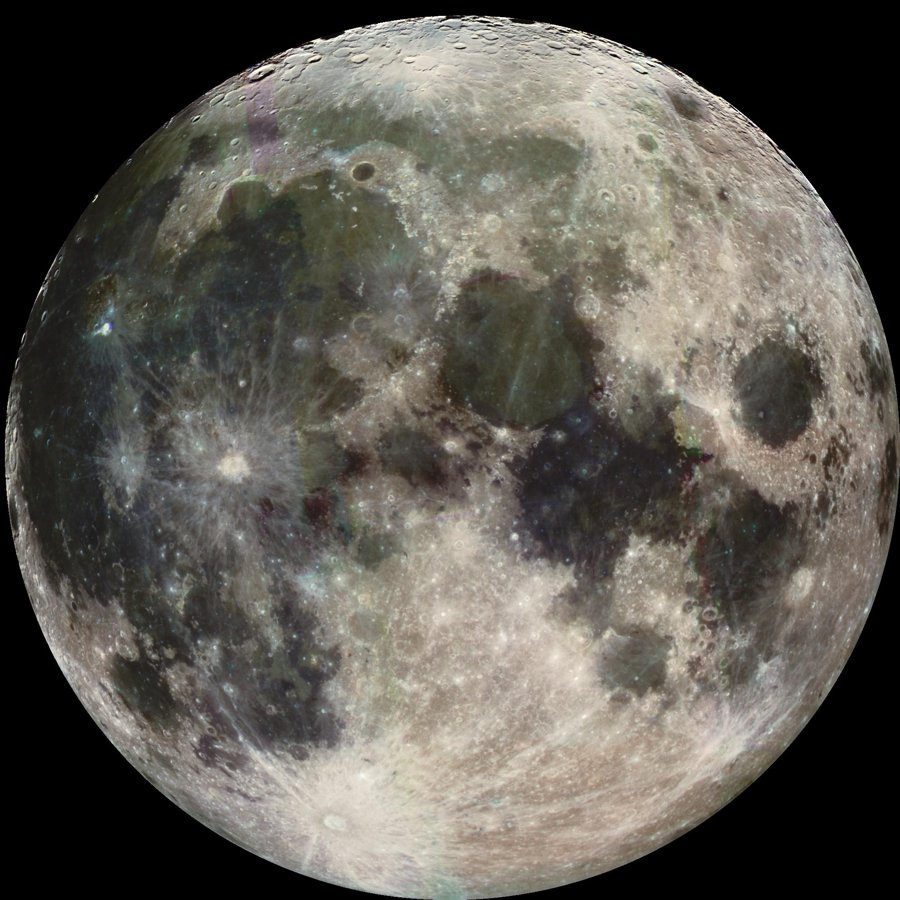
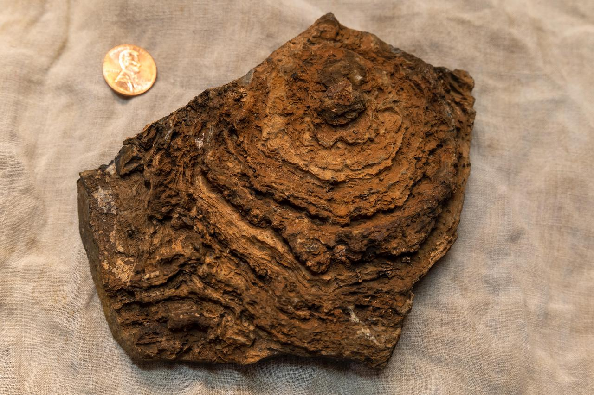

```{=html}
<style>
@import url('https://fonts.googleapis.com/css2?family=Space+Grotesk:wght@700&family=Inter:wght@400;600;800&display=swap');

.engage-box { background: linear-gradient(135deg, #006064 0%, #4A148C 100%); color: white; padding: 25px; margin: 20px 0; border-radius: 15px; box-shadow: 0 10px 30px rgba(0, 96, 100, 0.3); }
.explore-box { background: linear-gradient(135deg, #01579B 0%, #004D40 100%); color: white; padding: 25px; margin: 20px 0; border-radius: 15px; box-shadow: 0 10px 30px rgba(1, 87, 155, 0.3); }
.explain-box { background: linear-gradient(135deg, #4A148C 0%, #311B92 100%); color: white; padding: 25px; margin: 20px 0; border-radius: 15px; box-shadow: 0 10px 30px rgba(74, 20, 140, 0.3); }
.elaborate-box { background: linear-gradient(135deg, #E65100 0%, #BF360C 100%); color: white; padding: 25px; margin: 20px 0; border-radius: 15px; box-shadow: 0 10px 30px rgba(230, 81, 0, 0.3); }
.evaluate-box { background: linear-gradient(135deg, #c62828 0%, #ad1457 100%); color: white; padding: 25px; margin: 20px 0; border-radius: 15px; box-shadow: 0 10px 30px rgba(198, 40, 40, 0.3); }
.engage-box h2, .explore-box h2, .explain-box h2, .elaborate-box h2, .evaluate-box h2 { font-family: 'Space Grotesk', sans-serif; font-size: 2em; margin-top: 0; color: white !important; }
.engage-box a, .explore-box a, .explain-box a, .elaborate-box a, .evaluate-box a { color: #b2ebf2; }
.pe-badge { display: inline-block; background: linear-gradient(135deg, #00cec9 0%, #6c5ce7 100%); color: white; padding: 8px 16px; border-radius: 20px; font-size: 13px; font-weight: 800; margin: 5px; box-shadow: 0 4px 15px rgba(0, 206, 201, 0.4); text-transform: uppercase; letter-spacing: 1px; }
.big-question { font-family: 'Space Grotesk', sans-serif; font-size: 2.5em; font-weight: 800; background: linear-gradient(135deg, #00a8a3 0%, #6c5ce7 100%); -webkit-background-clip: text; -webkit-text-fill-color: transparent; margin: 30px 0 20px 0; text-align: center; animation: slideIn 0.8s ease-out; }
.key-idea { background: linear-gradient(135deg, #ffecd2 0%, #fcb69f 100%); color: #1a1a1a; padding: 20px; margin: 20px 0; border-radius: 12px; border-left: 8px solid #ff6b6b; font-size: 1.1em; }
.student-task { background: #fff3e0; color: #1a1a1a; border-left: 5px solid #ff9800; padding: 20px; margin: 15px 0; border-radius: 0 10px 10px 0; }
.mind-blown { background: linear-gradient(135deg, #00838f 0%, #6c5ce7 100%); color: white; padding: 20px; margin: 20px 0; border-radius: 15px; font-size: 1.2em; font-weight: 700; text-align: center; box-shadow: 0 10px 25px rgba(0, 206, 201, 0.4); }
@keyframes slideIn { from { opacity: 0; transform: translateY(-20px); } to { opacity: 1; transform: translateY(0); } }
h1 { font-family: 'Space Grotesk', sans-serif !important; font-weight: 800 !important; font-size: 2.8em !important; margin-top: 40px !important; }
h2 { font-family: 'Space Grotesk', sans-serif !important; font-weight: 700 !important; color: #00838f !important; }
@media (max-width: 600px) { .big-question { font-size: 1.8em; } h1 { font-size: 2.1em !important; } }
</style>
```

<a class="quiz-jump-btn" href="#end-of-chapter-quiz">🧠 Quiz ↓</a>

<div class="big-question">🌑 Why Is the Moon Covered in Craters but Earth Isn't? 🌍</div>

::: {.callout-note collapse="true"}
## 📒 Using this chapter with your student packet

This chapter follows the same steps as your **Stability of the Solar System 5E** packet. Missed a class or need a refresher? Jump to the matching section:

| Packet section | In this chapter |
|---|---|
| Craters in the Solar System (See–Think–Wonder) | [Engage](#engage-craters-in-the-solar-system) |
| Early Solar System Investigation, Part 1: Decay Rates & Dating Game | [Explore 1, Part 1](#part-1-radioactive-decay-and-absolute-dating) |
| Early Solar System Investigation, Part 2: The Age of Rocks (Tables 1–3) | [Explore 1, Part 2](#part-2-the-age-of-rocks-in-the-solar-system) |
| Explaining the Craters in the Inner Solar System + Late Heavy Bombardment reading | [Explain 1](#explain-1-explaining-the-craters-in-the-inner-solar-system) |
| The Role of Water Investigation, Part 1: Chemical Weathering (chalk lab) | [Explore 2](#explore-2-the-role-of-water-investigation) |
| The Role of Water + Part 2: Water in the Inner Solar System | [Explain 2](#explain-2-the-role-of-water) |
| Part 3: Scientific Explanation, Evaluate Your Explanation, Summary Task | [Part 3](#part-3-constructing-a-scientific-explanation), [Summary Task](#summary-task) |
| The Rock Cycle | [Elaborate 1](#elaborate-1-the-rock-cycle) |
| The Beginning of Life on Earth | [Elaborate 2](#elaborate-2-the-beginning-of-life-on-earth) |
| Stability of the Solar System Performance Task Rubric | [Evaluate](#evaluate-stability-of-the-solar-system-rubric) |
:::

# Engage: Craters in the Solar System

::: {.engage-box}
## ☄️ The Crater Mystery

<div style="font-size: 1.25em; font-weight: 700; text-align: center; margin: 18px 0;">
On Earth, about <span style="color:#80deea;">128</span> impact craters have been discovered. On Mars, more than <span style="color:#ffab91;">300,000</span>. On the Moon, more than <span style="color:#e0e0e0;">one million!</span>
</div>

Earth is the **biggest** of the three and has the **strongest gravity**, so it should attract at least as many impacts. So where did all of Earth's craters go?
:::

<figure style="margin: 18px auto; max-width: 420px; text-align: center;">
  
  <figcaption style="margin-top: 8px; color: #64748b; font-size: .85em; font-style: italic; line-height: 1.4;">
    The Moon, pocked with impact craters. Even the dark plains and bright rays are scars from impacts. Credit: NASA/JPL (Galileo spacecraft).
  </figcaption>
</figure>

```{ojs}
//| echo: false
Plot = require("@observablehq/plot")
d3 = require("d3@7")
```

```{ojs}
//| echo: false
craterData = [
  {body: "Earth", craters: 128, area: 510.1, color: "#2e86de"},
  {body: "Mars", craters: 300000, area: 144.8, color: "#e74c3c"},
  {body: "Moon", craters: 1000000, area: 37.9, color: "#95a5a6"}
].map(d => ({...d, perArea: d.craters / d.area}))
```

```{ojs}
//| echo: false
viewof craterView = Inputs.radio(["Total craters found", "Craters per million km² of surface"], {label: "Show:", value: "Total craters found"})
```

```{ojs}
//| echo: false
{
  const per = craterView !== "Total craters found";
  const key = per ? "perArea" : "craters";
  const fmt = d => d >= 100 ? Math.round(d).toLocaleString() : d.toFixed(2);
  return Plot.plot({
    title: per ? "Craters per million km² of surface (log scale)" : "Impact craters discovered (log scale)",
    subtitle: per ? "Surface area: Earth 510.1, Mars 144.8, Moon 37.9 million km²" : "Each grid line is 10× more than the one before it",
    width: width,
    height: 230,
    marginLeft: 60,
    marginRight: Math.min(90, width * 0.2),
    x: {type: "log", label: per ? "Craters per million km² →" : "Number of craters →", grid: true, tickFormat: "~s"},
    y: {label: null, domain: ["Earth", "Mars", "Moon"]},
    marks: [
      Plot.barX(craterData, {x1: per ? 0.1 : 1, x2: key, y: "body", fill: "color", tip: true,
        title: d => `${d.body}\n${d.craters.toLocaleString()} craters\n${fmt(d.perArea)} per million km²`}),
      Plot.text(craterData, {x: key, y: "body", text: d => fmt(d[key]), dx: 6, textAnchor: "start", fontWeight: "bold", fontSize: 12})
    ]
  });
}
```

::: {.student-task}
### ✏️ In your packet: See – Think – Wonder (Craters in the Solar System)

- **See:** What patterns do you observe in the crater numbers for Earth, Mars, and the Moon?
- **Think:** What do those observations make you think about? (Was Earth hit less, or were its craters erased?)
- **Wonder:** What questions do you have? Write at least two.
:::

```{ojs}
//| echo: false
buildQuiz = function(id, title, questions) {
  const outer = html`<div id="${id}" style="margin:18px 0 24px 0;text-align:center;">
    <button style="
      display:inline-flex;align-items:center;gap:7px;
      background:linear-gradient(135deg,#667eea 0%,#764ba2 100%);
      color:#fff;border:none;padding:9px 22px;border-radius:50px;
      font-size:.95em;font-weight:700;cursor:pointer;
      box-shadow:0 3px 12px rgba(102,126,234,.45);
      transition:transform .15s,box-shadow .15s;"
      onmouseover="this.style.transform='scale(1.04)';this.style.boxShadow='0 5px 18px rgba(102,126,234,.55)'"
      onmouseout="this.style.transform='scale(1)';this.style.boxShadow='0 3px 12px rgba(102,126,234,.45)'"
    >
      <span style="font-size:1.1em;">📝</span> ${title}
      <span class="chevron" style="transition:transform .3s;">▼</span>
    </button>
    <div class="quiz-body" style="
      max-height:0;opacity:0;overflow:hidden;
      transition:max-height .5s cubic-bezier(.4,0,.2,1),opacity .4s ease,margin-top .3s ease;
      margin-top:0;text-align:left;">
      <button class="close-btn" style="
        display:block;margin:0 auto 10px auto;
        background:rgba(102,126,234,.12);color:#667eea;border:none;
        padding:5px 18px;border-radius:50px;font-size:.85em;
        font-weight:600;cursor:pointer;">Hide Quiz</button>
      <p style="text-align:center;color:#718096;font-style:italic;font-size:.9em;margin-bottom:12px;">
        Select an answer for each question.</p>
    </div>
  </div>`;
  const toggle = outer.querySelector("button");
  const chevron = toggle.querySelector(".chevron");
  const body   = outer.querySelector(".quiz-body");
  const closeBtn = body.querySelector(".close-btn");
  function expand(){  body.style.maxHeight="2000px";body.style.opacity="1";body.style.marginTop="14px";chevron.style.transform="rotate(180deg)"; }
  function collapse(){ body.style.maxHeight="0";body.style.opacity="0";body.style.marginTop="0";chevron.style.transform="rotate(0)"; }
  toggle.onclick = () => body.style.maxHeight === "0px" || body.style.maxHeight === "" ? expand() : collapse();
  closeBtn.onclick = collapse;
  questions.forEach((qq, qi) => {
    const card = document.createElement("div");
    card.style.cssText = "background:#fff;color:#1e1b4b;border-radius:12px;padding:16px 20px;margin-bottom:14px;box-shadow:0 2px 8px rgba(0,0,0,.08);";
    card.innerHTML = `<p style="font-weight:700;margin:0 0 10px;">${qi+1}. ${qq.q}</p>`;
    qq.options.forEach((opt, oi) => {
      const btn = document.createElement("button");
      btn.textContent = opt;
      btn.style.cssText = "display:block;width:100%;min-height:44px;text-align:left;padding:10px 14px;margin:6px 0;border:2px solid #e2e8f0;border-radius:8px;background:#fff;color:#1e1b4b;cursor:pointer;font-size:.95em;transition:border-color .2s,background .2s;";
      btn.onmouseover = () => { if(!card.dataset.answered){ btn.style.borderColor="#667eea";btn.style.background="#f0f0ff"; }};
      btn.onmouseout  = () => { if(!card.dataset.answered){ btn.style.borderColor="#e2e8f0";btn.style.background="#fff"; }};
      btn.onclick = () => {
        if(card.dataset.answered) return;
        card.dataset.answered = "true";
        card.querySelectorAll("button").forEach(b => { b.style.cursor="default"; b.onmouseover=null; b.onmouseout=null; });
        if(oi === qq.correct){
          btn.style.borderColor="#48bb78";btn.style.background="#f0fff4";
          fb.innerHTML = "✅ Correct! " + qq.explanation;
          fb.style.color="#276749";fb.style.background="#f0fff4";
        } else {
          btn.style.borderColor="#fc8181";btn.style.background="#fff5f5";
          card.querySelectorAll("button")[qq.correct].style.borderColor="#48bb78";
          card.querySelectorAll("button")[qq.correct].style.background="#f0fff4";
          fb.innerHTML = "❌ " + qq.explanation;
          fb.style.color="#9b2c2c";fb.style.background="#fff5f5";
        }
        fb.style.padding="10px 14px";fb.style.marginTop="8px";
      };
      card.appendChild(btn);
    });
    const fb = document.createElement("div");
    fb.style.cssText = "border-radius:8px;font-size:.9em;transition:all .3s;";
    card.appendChild(fb);
    body.appendChild(card);
  });
  return outer;
}
```

```{ojs}
//| echo: false
buildQuiz("ss-crater-quiz", "☄️ Check Your Understanding — The Crater Mystery", [
  {
    q: "About how many times more craters have been found on the Moon than on Earth?",
    options: ["About 8 times", "About 800 times", "About 8,000 times", "About the same number"],
    correct: 2,
    explanation: "1,000,000 ÷ 128 ≈ 7,800. The Moon has thousands of times more known craters, even though it is a much smaller target."
  },
  {
    q: "Switch to 'Craters per million km²'. Why is this a fairer comparison?",
    options: ["It removes the effect of each body's size", "It counts only the biggest craters", "It shows how old each crater is", "It makes Earth's number bigger"],
    correct: 0,
    explanation: "Bigger bodies have more surface to hit. Dividing by surface area compares crater crowding on the same-sized patch of ground. The Moon's surface is still about 100,000× more crowded than Earth's."
  },
  {
    q: "Earth has stronger gravity than the Moon or Mars. What does that suggest about the crater data?",
    options: ["Earth was hit less often", "Earth was probably hit at least as often, so something must have erased or hidden its craters", "Gravity pushes asteroids away from Earth", "Craters only form on bodies without gravity"],
    correct: 1,
    explanation: "Stronger gravity pulls in more objects, not fewer. If Earth was hit as often but shows far fewer craters, something on Earth must remove them. That is the question this chapter investigates."
  }
])
```

# Explore 1: Early Solar System Investigation

::: {.explore-box}
## 🔬 Reading the Clocks Inside Rocks

To compare when Earth, Mars, and the Moon formed and when they were hit, scientists need to know **how old rocks are**. Some atoms are **radioactive**: they are unstable and change (decay) into other atoms at a steady, predictable rate. That makes them natural clocks. This is called **radiometric** or **absolute dating**.
:::

## Part 1: Radioactive Decay and Absolute Dating

In class you use the PhET [Radioactive Dating Game](https://phet.colorado.edu/en/simulations/radioactive-dating-game) simulation. The model below works the same way. A **parent isotope** (like carbon-14) decays into a **daughter product** (like nitrogen-14). The **half-life** is the time it takes for **half** of the parent atoms to decay.

```{ojs}
//| echo: false
viewof decayIso = Inputs.radio(["Carbon-14", "Uranium-238"], {label: "Isotope:", value: "Carbon-14"})
```

```{ojs}
//| echo: false
viewof decayHalfLives = Inputs.range([0, 5], {label: "Half-lives passed:", step: 0.05, value: 0})
```

```{ojs}
//| echo: false
{
  const iso = decayIso === "Carbon-14"
    ? {parent: "Carbon-14", daughter: "Nitrogen-14", hl: 5730, unit: "years", pc: "#2ecc71", dc: "#7f8c8d"}
    : {parent: "Uranium-238", daughter: "Lead-206", hl: 4.5e9, unit: "years", pc: "#f1c40f", dc: "#7f8c8d"};
  const n = decayHalfLives;
  const frac = Math.pow(0.5, n);
  const years = n * iso.hl;
  const yrText = iso.hl > 1e6 ? `${(years / 1e9).toFixed(2)} billion years` : `${Math.round(years).toLocaleString()} years`;

  // 100 atoms, each with a fixed random "decay order" so decay looks random but repeatable
  let s = 12345;
  const rand = () => { s = (s * 16807) % 2147483647; return s / 2147483647; };
  const order = d3.shuffle(d3.range(100), rand);
  const decayedCount = Math.round((1 - frac) * 100);
  const decayed = new Set(order.slice(0, decayedCount));

  const W = 640, H = 300;
  const svg = d3.create("svg").attr("viewBox", `0 0 ${W} ${H}`)
    .style("width", "100%").style("height", "auto").style("max-width", "640px").style("display", "block").style("margin", "auto");
  svg.append("rect").attr("width", W).attr("height", H).attr("rx", 14).attr("fill", "#0d1b2a");
  svg.append("text").attr("x", 20).attr("y", 30).attr("fill", "white").attr("font-size", 18).attr("font-weight", 700)
    .text(`Time passed: ${yrText}`);

  // Atom grid
  d3.range(100).forEach(i => {
    const cx = 40 + (i % 10) * 24, cy = 64 + Math.floor(i / 10) * 23;
    svg.append("circle").attr("cx", cx).attr("cy", cy).attr("r", 9)
      .attr("fill", decayed.has(i) ? iso.dc : iso.pc).attr("stroke", "#fff").attr("stroke-width", 0.6);
  });

  // Pie chart
  const pie = d3.pie().sort(null)([frac, 1 - frac]);
  const arc = d3.arc().innerRadius(0).outerRadius(85);
  const g = svg.append("g").attr("transform", "translate(450,150)");
  g.selectAll("path").data(pie).join("path").attr("d", arc)
    .attr("fill", (d, i) => i === 0 ? iso.pc : iso.dc).attr("stroke", "#0d1b2a").attr("stroke-width", 2);
  svg.append("text").attr("x", 450).attr("y", 262).attr("text-anchor", "middle").attr("fill", iso.pc).attr("font-size", 16).attr("font-weight", 700)
    .text(`${iso.parent} left: ${(frac * 100).toFixed(1)}%`);
  svg.append("text").attr("x", 450).attr("y", 284).attr("text-anchor", "middle").attr("fill", "#bdc3c7").attr("font-size", 14)
    .text(`${iso.daughter} made: ${((1 - frac) * 100).toFixed(1)}%`);
  svg.append("text").attr("x", 160).attr("y", 296).attr("text-anchor", "middle").attr("fill", "#bdc3c7").attr("font-size", 12)
    .text("● colored = parent atom   ● gray = daughter atom");
  return svg.node();
}
```

```{ojs}
//| echo: false
{
  const hl = decayIso === "Carbon-14" ? 5730 : 4.5;
  const unit = decayIso === "Carbon-14" ? "Years" : "Billions of years";
  const curve = d3.range(0, 5.001, 0.02).map(n => ({t: n * hl, p: 100 * Math.pow(0.5, n)}));
  const marks = [0, 1, 2, 3, 4, 5].map(n => ({t: n * hl, p: 100 * Math.pow(0.5, n), n}));
  return Plot.plot({
    title: `${decayIso} decay curve`,
    subtitle: "The amount drops by half every half-life, so it never quite reaches zero",
    width: width, height: 260, marginLeft: 50, marginBottom: 40,
    x: {label: `${unit} →`, grid: true},
    y: {label: "↑ Parent remaining (%)", domain: [0, 100], grid: true},
    marks: [
      Plot.line(curve, {x: "t", y: "p", stroke: "#00838f", strokeWidth: 2.5}),
      Plot.dot(marks, {x: "t", y: "p", r: 4, fill: "#00838f", tip: true, title: d => `${d.n} half-lives: ${d.p}% left`}),
      Plot.dot([{t: decayHalfLives * hl, p: 100 * Math.pow(0.5, decayHalfLives)}], {x: "t", y: "p", r: 8, fill: "#e74c3c", stroke: "white"})
    ]
  });
}
```

::: {.key-idea}
### 💡 Stable and unstable at the same time

- Each **individual** atom is unstable: you cannot predict when one atom will decay.
- The **rate** is perfectly stable: after one half-life 50% is left, after two 25%, after three 12.5%. Heat, pressure, and chemistry do not change it.
- **Carbon-14** decays fast (half-life **5,730 years**). **Uranium-238** decays extremely slowly (half-life **4.5 billion years**). Both follow the same halving pattern.
:::

::: {.student-task}
### ✏️ In your packet: Part 1a Decay Rates + Part 1b Dating Game

- **Decay Rates tab:** add Carbon-14 nuclei, then answer what the two colors of dots represent, find the half-life of C-14, and sketch the pie graph at 1, 2, and 3 half-lives. Repeat for Uranium-238 and compare.
- **See–Think–Wonder:** Was the speed of change always the same? In what ways is each isotope *stable* and *not stable*?
- **Dating Game tab:** for each object in each layer (Surface → Bottom layer), record which isotope gives a reading above 0%, the percent remaining, and your age estimate. Then fill in the See–Think–Wonder on patterns within a layer and as you go deeper.
:::

### Which isotope should you use?

Each isotope can only date objects within its **useful dating range**, and only in the right **materials**. Pick an object to see which clocks work.

::: {style="overflow-x:auto;"}

| Parent isotope | Daughter product | Half-life (years) | Useful dating range (years) | Datable materials |
|---|---|---|---|---|
| Samarium-147 | Neodymium-143 | 106 billion | 10 million – 4.6 billion | Garnets, micas |
| Rubidium-87 | Strontium-87 | 48.8 billion | 10 million – 4.6 billion | Potassium-bearing minerals; whole igneous or metamorphic rock |
| Uranium-238 | Lead-206 | 4.5 billion | 10 million – 4.6 billion | Uranium-bearing minerals (zircon, apatite, uraninite) |
| Uranium-235 | Lead-207 | 713 million | 10 million – 4.6 billion | Uranium-bearing minerals (zircon, apatite, uraninite) |
| Potassium-40 | Argon-40 | 1.3 billion | 100,000 – 4.6 billion | Potassium-bearing minerals; igneous or volcanic rock |
| Carbon-14 | Nitrogen-14 | 5,730 | 100 – 70,000 | Organic materials, glacial ice with CO₂, groundwater, ocean water |

: Geologically important radioactive elements used for radiometric dating (from your packet)

:::

```{ojs}
//| echo: false
datingRanges = [
  {iso: "Samarium-147", min: 1e7, max: 4.6e9, organic: false},
  {iso: "Rubidium-87", min: 1e7, max: 4.6e9, organic: false},
  {iso: "Uranium-238", min: 1e7, max: 4.6e9, organic: false},
  {iso: "Uranium-235", min: 1e7, max: 4.6e9, organic: false},
  {iso: "Potassium-40", min: 1e5, max: 4.6e9, organic: false},
  {iso: "Carbon-14", min: 100, max: 7e4, organic: true}
]
```

```{ojs}
//| echo: false
datingObjects = [
  {name: "Charcoal from an ancient campfire (about 3,000 years old)", age: 3000, organic: true},
  {name: "Frozen mammoth bone (about 40,000 years old)", age: 40000, organic: true},
  {name: "Volcanic ash layer above a dinosaur fossil (about 66 million years old)", age: 6.6e7, organic: false},
  {name: "Zircon crystal in a Moon rock (about 4.4 billion years old)", age: 4.4e9, organic: false}
]
```

```{ojs}
//| echo: false
viewof datingPick = Inputs.select(datingObjects.map(d => d.name), {label: "Object:"})
```

```{ojs}
//| echo: false
{
  const obj = datingObjects.find(d => d.name === datingPick);
  const rows = datingRanges.map(d => ({...d, ok: obj.age >= d.min && obj.age <= d.max && d.organic === obj.organic}));
  const wrap = d3.create("div");
  wrap.append(() => Plot.plot({
    title: "Useful dating range of each isotope (log scale)",
    subtitle: "Green = can date this object (right age range AND right material)",
    width: width, height: 280,
    marginLeft: Math.min(110, width * 0.3), marginRight: 16, marginBottom: 40,
    x: {type: "log", domain: [50, 1e10], label: "Age of object (years) →", grid: true, tickFormat: "~s"},
    y: {label: null, domain: datingRanges.map(d => d.iso)},
    marks: [
      Plot.barX(rows, {x1: "min", x2: "max", y: "iso", fill: d => d.ok ? "#27ae60" : "#b0bec5", rx: 4, tip: true,
        title: d => `${d.iso}: ${d.min.toLocaleString()} – ${d.max.toLocaleString()} years`}),
      Plot.ruleX([obj.age], {stroke: "#e74c3c", strokeWidth: 2.5, strokeDasharray: "5,3"})
    ]
  }));
  const usable = rows.filter(d => d.ok).map(d => d.iso);
  wrap.append("p").style("font-weight", "600").style("margin-top", "6px")
    .html(`Red line = this object's age. Usable clocks: <span style="color:#27ae60">${usable.length ? usable.join(", ") : "none"}</span>` +
      (obj.organic ? ". It's organic (was once alive), so carbon-14 is the clock to use." : ". It's far too old for carbon-14 (and not organic), so a slow isotope like uranium-238 is needed."));
  return wrap.node();
}
```

::: {.callout-tip collapse="true"}
## ✅ Check your Tables 1 and 2 (Absolute Dating)

| Half-life | Original Uranium-238 remaining (%) | Number of years |
|---|---|---|
| 0 | 100 | 0 |
| 1 | 50 | 4.5 billion |
| 2 | 25 | 9.0 billion |
| 3 | 12.5 | 13.5 billion |

: Table 1. Absolute dating using uranium-238

| Half-life | Original Carbon-14 remaining (%) | Number of years |
|---|---|---|
| 0 | 100 | 0 |
| 1 | 50 | 5,730 |
| 2 | 25 | 11,460 |
| 3 | 12.5 | 17,190 |

: Table 2. Absolute dating using carbon-14

Rule: **years = number of half-lives × half-life**. (Your packet prints 13.4 billion in Table 1; 3 × 4.5 = 13.5 billion.)

- **Use uranium-238 instead of carbon-14** when the object is very old (millions to billions of years) or is a rock/mineral with uranium in it (like zircon). After about 70,000 years, almost no carbon-14 is left to measure.
- **Use carbon-14 instead of uranium-238** when the object is organic (bone, wood, shells) and younger than about 70,000 years. Uranium-238 changes too slowly to measure such short times.
:::

```{ojs}
//| echo: false
buildQuiz("ss-decay-quiz", "☢️ Check Your Understanding — Half-Life", [
  {
    q: "Set the slider to 2 half-lives. What percent of the parent isotope is left?",
    options: ["0%", "25%", "50%", "75%"],
    correct: 1,
    explanation: "Each half-life cuts the amount in half: 100% → 50% → 25%. It does not run out after two half-lives."
  },
  {
    q: "A bone has 25% of its original carbon-14 left. How old is it?",
    options: ["5,730 years", "11,460 years", "17,190 years", "2,865 years"],
    correct: 1,
    explanation: "25% means two half-lives have passed: 2 × 5,730 = 11,460 years."
  },
  {
    q: "Use the range chart. Why can't carbon-14 date a 4.4-billion-year-old Moon rock?",
    options: ["Moon rocks have too much carbon", "Carbon-14 decays faster on the Moon", "Carbon-14 only works up to about 70,000 years, and the rock is not organic", "Carbon-14 can date it, it just takes longer"],
    correct: 2,
    explanation: "After about 12 half-lives (~70,000 years) carbon-14 is essentially gone. Ancient rocks are dated with slow clocks like uranium-238 (half-life 4.5 billion years)."
  }
])
```

## Part 2: The Age of Rocks in the Solar System

Your packet gives the **percent of original uranium-238 remaining** in the oldest minerals from four places, and in **impact melt rocks**: rocks melted by the heat of an asteroid strike on the Moon. Read each age off the uranium-238 dating curve, or type your own value.

```{ojs}
//| echo: false
u238Age = pct => 4.5 * Math.log2(100 / pct)
```

```{ojs}
//| echo: false
ssHtmlTable = rows => {
  const cols = Object.keys(rows[0] || {});
  const tbl = html`<table class="table table-sm" style="font-size:.9em;margin:8px 0;"><thead><tr>${cols.map(c => html`<th>${c}</th>`)}</tr></thead>
    <tbody>${rows.map(r => html`<tr>${cols.map(c => html`<td>${r[c]}</td>`)}</tr>`)}</tbody></table>`;
  const wrap = html`<div style="overflow-x:auto;"></div>`;
  wrap.appendChild(tbl);
  return wrap;
}
```

```{ojs}
//| echo: false
rockSamples = [
  {object: "Oldest Earth mineral", pct: 50.5, set: "Table 2: Oldest minerals"},
  {object: "Oldest Mars mineral", pct: 50.1, set: "Table 2: Oldest minerals"},
  {object: "Oldest Moon mineral", pct: 50.5, set: "Table 2: Oldest minerals"},
  {object: "Oldest meteorite mineral", pct: 49.0, set: "Table 2: Oldest minerals"},
  {object: "Impact melt rock 1", pct: 55.7, set: "Table 3: Impact melt rocks"},
  {object: "Impact melt rock 2", pct: 55.4, set: "Table 3: Impact melt rocks"},
  {object: "Impact melt rock 3", pct: 53.7, set: "Table 3: Impact melt rocks"},
  {object: "Impact melt rock 4", pct: 54.9, set: "Table 3: Impact melt rocks"}
].map(d => ({...d, age: u238Age(d.pct)}))
```

```{ojs}
//| echo: false
numberInput = function(label, value, {placeholder = "", unit = ""} = {}) {
  const form = html`<form style="display:flex;align-items:center;gap:8px;flex-wrap:wrap;margin:8px 0;">
    <label style="font-weight:600;">${label}</label>
    <input type="number" step="any" inputmode="decimal" placeholder="${placeholder}"
      style="width:9em;min-height:40px;padding:4px 8px;border:1px solid #94a3b8;border-radius:6px;font-size:1rem;background:var(--bs-body-bg);color:var(--bs-body-color);">
    <span>${unit}</span>
  </form>`;
  const input = form.querySelector("input");
  if (value != null) input.value = value;
  form.value = value == null ? NaN : +value;
  // The native input event bubbles up to the form, which is what OJS listens to
  input.addEventListener("input", () => { form.value = input.value === "" ? NaN : +input.value; });
  form.addEventListener("submit", e => e.preventDefault());
  return form;
}
```

```{ojs}
//| echo: false
viewof rockSets = Inputs.checkbox(["Table 2: Oldest minerals", "Table 3: Impact melt rocks"], {label: "Show:", value: ["Table 2: Oldest minerals", "Table 3: Impact melt rocks"]})
```

```{ojs}
//| echo: false
viewof zoomCurve = Inputs.toggle({label: "Zoom in (3.5–5 billion years)", value: true})
```

```{ojs}
//| echo: false
viewof myPct = numberInput("Your own sample: U-238 remaining", null, {placeholder: "e.g. 59", unit: "%"})
```

```{ojs}
//| echo: false
{
  const shown = rockSamples.filter(d => rockSets.includes(d.set));
  const curve = d3.range(0, 31.51, 0.05).map(t => ({t, p: 100 * Math.pow(0.5, t / 4.5)}));
  const mine = myPct > 0 && myPct <= 100 ? [{t: u238Age(myPct), p: myPct}] : [];
  const xd = zoomCurve ? [3.5, 5] : [0, 31.5];
  const yd = zoomCurve ? [45, 60] : [0, 100];
  const setColors = {domain: ["Table 2: Oldest minerals", "Table 3: Impact melt rocks", "Your sample"], range: ["#2e86de", "#e67e22", "#8e44ad"]};
  const wrap = d3.create("div");
  wrap.append(() => Plot.plot({
    title: "Uranium-238 dating curve",
    subtitle: zoomCurve ? "Zoomed in. Hover or tap a dot for its age." : "Same curve as in your packet: half is gone every 4.5 billion years",
    width: width, height: 340, marginLeft: 50, marginBottom: 42, marginRight: 14,
    color: setColors,
    x: {label: "Billions of years →", domain: xd, grid: true},
    y: {label: "↑ Uranium-238 remaining (%)", domain: yd, grid: true},
    marks: [
      Plot.line(curve.filter(d => d.t >= xd[0] && d.t <= xd[1]), {x: "t", y: "p", stroke: "#00838f", strokeWidth: 2.5}),
      Plot.ruleY(shown, {y: "pct", x1: xd[0], x2: "age", stroke: "set", strokeOpacity: 0.35, strokeDasharray: "3,3"}),
      Plot.ruleX(shown, {x: "age", y1: yd[0], y2: "pct", stroke: "set", strokeOpacity: 0.35, strokeDasharray: "3,3"}),
      Plot.dot(shown, {x: "age", y: "pct", fill: "set", r: 6, stroke: "white", tip: true,
        title: d => `${d.object}\n${d.pct}% U-238 left\nAge ≈ ${d.age.toFixed(2)} billion years`}),
      Plot.dot(mine.filter(d => d.t >= xd[0] && d.t <= xd[1]), {x: "t", y: "p", r: 8, fill: "#8e44ad", stroke: "white", symbol: "star"})
    ]
  }));
  wrap.append("div")
    .style("display", "flex").style("flex-wrap", "wrap").style("gap", "6px 16px").style("justify-content", "center").style("font-size", "0.85em")
    .html(setColors.domain.map((s, i) => `<span style="display:inline-flex;align-items:center;gap:6px;"><span style="width:12px;height:12px;border-radius:50%;background:${setColors.range[i]};"></span>${s}</span>`).join(""));
  if (mine.length) wrap.append("p").style("font-weight", "700").style("margin", "8px 0 0").style("text-align", "center")
    .text(`Your sample: ${myPct}% left → about ${mine[0].t.toFixed(2)} billion years old` + ((mine[0].t < xd[0] || mine[0].t > xd[1]) ? " (turn off zoom to see it)" : ""));
  return wrap.node();
}
```

```{ojs}
//| echo: false
{
  const shown = rockSamples.filter(d => rockSets.includes(d.set));
  return ssHtmlTable(shown.map(d => ({Object: d.object, "U-238 remaining (%)": d.pct, "Age (billion years)": d.age.toFixed(2)})));
}
```

::: {.student-task}
### ✏️ In your packet: Tables 2 & 3 + Making Sense See–Think–Wonder

- Use the uranium-238 dating curve to find the **age** of each mineral in **Table 2** and each impact melt rock in **Table 3**.
- **See:** What do you notice about the ages of the oldest minerals from different places? What is the **range** of ages of the impact melt rocks?
- **Think:** What does this make you think about how the solar system formed, and when most asteroid impacts on the Moon (and Earth and Mars) happened?
:::

```{ojs}
//| echo: false
buildQuiz("ss-ages-quiz", "🪨 Check Your Understanding — Ages of Solar System Rocks", [
  {
    q: "The oldest minerals from Earth, Mars, the Moon, and a meteorite have 49.0–50.5% of their uranium-238 left. What does that tell you?",
    options: ["They are all about 4.4–4.6 billion years old, so they formed at about the same time", "Earth is billions of years older than the Moon", "Meteorites are the youngest objects", "The minerals formed at random times"],
    correct: 0,
    explanation: "About 50% left means about one half-life (4.5 billion years). All four ages fall between about 4.4 and 4.6 billion years, evidence that the planets and moons formed together around 4.6 billion years ago."
  },
  {
    q: "The impact melt rocks have 53.7–55.7% of their uranium-238 left. About when did most of the asteroids strike the Moon?",
    options: ["About 4.6 billion years ago", "About 3.8–4.0 billion years ago", "About 66 million years ago", "About 1 billion years ago"],
    correct: 1,
    explanation: "More uranium-238 left means younger. 55.7% → 3.80 billion years and 53.7% → 4.04 billion years. Most impacts happened in a burst a few hundred million years after the Moon formed."
  },
  {
    q: "The meteorite mineral has LESS uranium-238 left (49.0%) than the Earth mineral (50.5%). Which is older?",
    options: ["The Earth mineral", "The meteorite mineral", "They are the same age", "You can't tell from uranium-238"],
    correct: 1,
    explanation: "The longer a mineral has existed, the more of its uranium-238 has decayed. Less parent left = older. The meteorite mineral (~4.6 billion years) is a little older than the Earth mineral (~4.4 billion years)."
  }
])
```

# Explain 1: Explaining the Craters in the Inner Solar System

::: {.explain-box}
## 🧠 What the Rocks Tell Us

- **Oldest Earth rocks:** the oldest Earth mineral is about **4.4 billion years** old.
- **Compared with the Moon and Mars:** the oldest Moon mineral (~4.4 billion years), Mars mineral (~4.5 billion years), and meteorite mineral (~4.6 billion years) are **almost the same age**.
- **So the planets are about 4.5–4.6 billion years old.** They all formed at about the same time, from the same cloud of gas and dust around the young Sun.
- **Impact melt rocks** show that most asteroids hit the Moon about **3.8–4.0 billion years ago**, a few hundred million years after it formed.
- **Other objects were hit too.** If the Moon was being pummeled, its next-door neighbor Earth, plus Mars and Mercury, were in the same "shooting gallery." Evidence that would support this: heavily cratered old surfaces on Mars and Mercury with similar ages, and impact melt or shocked minerals of the same age in Earth's oldest rocks and in meteorites.
:::

```{ojs}
//| echo: false
ssTimeline = [
  {event: "Meteorite mineral", full: "Oldest meteorite mineral (solar system forms)", age: 4.63, kind: "Formation"},
  {event: "Mars mineral", full: "Oldest Mars mineral", age: 4.49, kind: "Formation"},
  {event: "Earth & Moon minerals", full: "Oldest Earth & Moon minerals", age: 4.43, kind: "Formation"},
  {event: "Impact melt rocks", full: "Impact melt rocks (Late Heavy Bombardment)", age: 3.92, lo: 3.80, hi: 4.04, kind: "Bombardment"},
  {event: "First life (stromatolite)", full: "Oldest rock with evidence of life (stromatolite)", age: 3.43, kind: "Life"}
]
```

```{ojs}
//| echo: false
Plot.plot({
  title: "A timeline of the early solar system",
  subtitle: "Ages from the uranium-238 data in your packet. Time runs left → right toward today.",
  width: width, height: 260,
  marginLeft: Math.min(160, width * 0.36), marginRight: 16, marginBottom: 40,
  x: {label: "Billions of years ago", domain: [4.8, 3.2], grid: true, ticks: [4.8, 4.6, 4.4, 4.2, 4.0, 3.8, 3.6, 3.4, 3.2].filter((d, i) => width > 520 || i % 2 === 0), tickFormat: d => d.toFixed(1)},
  y: {label: null, domain: ssTimeline.map(d => d.event)},
  color: {domain: ["Formation", "Bombardment", "Life"], range: ["#2e86de", "#e67e22", "#27ae60"]},
  marks: [
    Plot.rectX([{x1: 4.04, x2: 3.80}], {x1: "x1", x2: "x2", fill: "#e67e22", fillOpacity: 0.15}),
    Plot.ruleY(ssTimeline.filter(d => d.lo), {y: "event", x1: "lo", x2: "hi", stroke: "#e67e22", strokeWidth: 6, strokeOpacity: 0.6}),
    Plot.dot(ssTimeline, {x: "age", y: "event", fill: "kind", r: 7, stroke: "white", tip: true,
      title: d => `${d.full}\n≈ ${d.lo ? d.hi.toFixed(1) + "–" + d.lo.toFixed(1) : d.age.toFixed(2)} billion years ago`})
  ]
})
```

## The Late Heavy Bombardment Hypothesis

::: {.key-idea}
### 💡 The Late Heavy Bombardment (LHB), from the PBS reading

- About **4 billion years ago**, roughly 500 million years after the Sun formed, the planets and moons may have been **pummeled by asteroids and comets**.
- **Cause (one popular computer model):** the giant planets used to be closer to the Sun. Their orbits shifted until **Jupiter orbited twice for every one orbit of Saturn**. The repeated gravitational tugs **destabilized** the orbits of Uranus and Neptune, which plowed into the Kuiper Belt and **scattered** small icy and rocky objects. Some were thrown out of the solar system; others **collided** with planets and moons.
- **Evidence:** the many craters on the Moon, Mars, and other bodies, and impact melt rocks that cluster around **3.8–4.0 billion years old**.
- **Effects on life:** asteroids may have **delivered water and key molecules** to Earth, or the impacts may have **disrupted** life that had already started.
:::

Slide through time to see what a **2 : 1 orbital resonance** means: the two planets line up again and again at the same spots, so their gravitational tugs add up.

```{ojs}
//| echo: false
viewof resTime = Inputs.range([0, 3], {label: "Saturn orbits completed:", step: 0.01, value: 0})
```

```{ojs}
//| echo: false
{
  const W = 360, H = 330, cx = 180, cy = 160;
  const aJ = 2 * Math.PI * 2 * resTime - Math.PI / 2, aS = 2 * Math.PI * resTime - Math.PI / 2;
  const jx = cx + 80 * Math.cos(aJ), jy = cy + 80 * Math.sin(aJ);
  const sx = cx + 135 * Math.cos(aS), sy = cy + 135 * Math.sin(aS);
  const lined = Math.abs(((2 * resTime) % 1) - (resTime % 1)) < 0.015 || Math.abs(((2 * resTime) % 1) - (resTime % 1)) > 0.985;
  const svg = d3.create("svg").attr("viewBox", `0 0 ${W} ${H}`)
    .style("width", "100%").style("height", "auto").style("max-width", "460px").style("display", "block").style("margin", "auto");
  svg.append("rect").attr("width", W).attr("height", H).attr("rx", 12).attr("fill", "#0a0a2e");
  svg.append("circle").attr("cx", cx).attr("cy", cy).attr("r", 80).attr("fill", "none").attr("stroke", "#e67e22").attr("stroke-opacity", 0.6);
  svg.append("circle").attr("cx", cx).attr("cy", cy).attr("r", 135).attr("fill", "none").attr("stroke", "#f1c40f").attr("stroke-opacity", 0.6);
  svg.append("circle").attr("cx", cx).attr("cy", cy).attr("r", 9).attr("fill", "#ffcc33");
  if (lined) svg.append("line").attr("x1", cx).attr("y1", cy).attr("x2", sx).attr("y2", sy).attr("stroke", "#ff5252").attr("stroke-width", 2).attr("stroke-dasharray", "4,3");
  svg.append("circle").attr("cx", jx).attr("cy", jy).attr("r", 11).attr("fill", "#e67e22");
  svg.append("circle").attr("cx", sx).attr("cy", sy).attr("r", 9).attr("fill", "#f1c40f");
  svg.append("text").attr("x", 12).attr("y", 22).attr("fill", "#e67e22").attr("font-size", 14).attr("font-weight", 700).text(`Jupiter orbits: ${(2 * resTime).toFixed(2)}`);
  svg.append("text").attr("x", 12).attr("y", 42).attr("fill", "#f1c40f").attr("font-size", 14).attr("font-weight", 700).text(`Saturn orbits: ${resTime.toFixed(2)}`);
  svg.append("text").attr("x", W / 2).attr("y", H - 12).attr("text-anchor", "middle").attr("fill", lined ? "#ff8a80" : "#9aa7bd").attr("font-size", 13).attr("font-weight", 700)
    .text(lined ? "Lined up! Another gravitational tug in the same place." : "Not to scale. Drag to 1.00, 2.00, 3.00…");
  return svg.node();
}
```

::: {.callout-tip}
## 🔎 Strengths and limitations of the evidence

Scientists still debate the LHB. Most dated lunar melt rocks came from the six Apollo landing sites, which are close together, so some of them may come from one or two giant impacts rather than a solar-system-wide storm. Today Jupiter (11.86-year period) and Saturn (29.46-year period) are close to, but not in, a 2 : 1 resonance. This is a good example of evidence that **supports** a hypothesis without **proving** it.
:::

::: {.student-task}
### ✏️ In your packet: Explaining the Craters + Think–Talk–Open Exchange

- Answer questions 1–6: ages of the oldest rocks on Earth, the Moon, and Mars; how old the planets are; when the asteroids hit the Moon; whether other objects were hit too; and what evidence would support that prediction.
- Read **The Late Heavy Bombardment Hypothesis**. **Think:** How does your dating evidence support the LHB hypothesis? What implications might it have had for life on Earth?
- **Talk** with your group, then write down any new ideas.
:::

```{ojs}
//| echo: false
buildQuiz("ss-lhb-quiz", "💥 Check Your Understanding — The Late Heavy Bombardment", [
  {
    q: "Which piece of evidence from your investigation best supports the Late Heavy Bombardment hypothesis?",
    options: ["Earth has 128 known craters", "Carbon-14 has a half-life of 5,730 years", "Impact melt rocks from many lunar craters cluster around 3.8–4.0 billion years old", "Jupiter is the largest planet"],
    correct: 2,
    explanation: "If most impact melt rocks formed within the same few hundred million years, many impacts happened in a burst, which is exactly what the LHB hypothesis predicts."
  },
  {
    q: "In the computer model, what made the solar system unstable about 4 billion years ago?",
    options: ["The Sun exploded", "Jupiter and Saturn's orbits reached a 2 : 1 resonance, and their combined pull scattered Uranus, Neptune, and Kuiper Belt objects", "Earth's Moon was captured", "Comets started forming for the first time"],
    correct: 1,
    explanation: "When Jupiter orbits twice for every Saturn orbit, their tugs repeat at the same spots and add up. That disturbed the outer planets, which scattered small bodies inward toward the planets."
  },
  {
    q: "The LHB hit the Moon about 3.9 billion years ago. Why would Earth have been hit at the same time?",
    options: ["Earth was not formed yet", "Asteroids only hit moons", "Earth's atmosphere was too thick", "Earth and the Moon are neighbors in the same region of space, and Earth's stronger gravity attracts even more impactors"],
    correct: 3,
    explanation: "Earth and the Moon share the same orbit around the Sun. Anything sweeping through the inner solar system would hit both, and Earth is a bigger target with stronger gravity."
  }
])
```

# Explore 2: The Role of Water Investigation

::: {.explore-box}
## 💧 Can Water Wipe Away Rock?

Asteroids likely hit Earth **as often and at the same time** as they hit the Moon and Mars. Yet Earth shows much less evidence. In this investigation you test how water, especially slightly **acidic** water, changes rock through **chemical weathering**.
:::

In class you soak one piece of chalk in **water** and one in **white vinegar** for 5 minutes and compare their mass. Chalk is mostly **calcium carbonate** (CaCO₃), the same mineral as limestone and marble. Enter your class data below (example values are filled in so you can see how it works).

```{ojs}
//| echo: false
viewof chalkWater0 = numberInput("Water, initial mass:", 5.20, {unit: "g"})
```

```{ojs}
//| echo: false
viewof chalkWater1 = numberInput("Water, after 5 min:", 5.23, {unit: "g"})
```

```{ojs}
//| echo: false
viewof chalkVin0 = numberInput("Vinegar, initial mass:", 5.18, {unit: "g"})
```

```{ojs}
//| echo: false
viewof chalkVin1 = numberInput("Vinegar, after 5 min:", 4.87, {unit: "g"})
```

```{ojs}
//| echo: false
{
  const rows = [
    {liquid: "Water", m0: chalkWater0, m1: chalkWater1, obs: "Few or no bubbles; chalk keeps its shape (it may soak up a little water)"},
    {liquid: "Vinegar", m0: chalkVin0, m1: chalkVin1, obs: "Lots of fizzing bubbles (CO₂ gas); chalk gets smaller and crumbly"}
  ].map(d => ({...d, change: d.m1 - d.m0, pct: 100 * (d.m1 - d.m0) / d.m0}));
  const ok = rows.every(d => isFinite(d.change));
  const wrap = d3.create("div");
  if (!ok) { wrap.append("p").text("Enter all four masses to see your results."); return wrap.node(); }
  wrap.append(() => Plot.plot({
    title: "Change in chalk mass after 5 minutes",
    subtitle: "Negative = chalk lost mass (dissolved)",
    width: width, height: 200, marginLeft: 70, marginRight: 70, marginBottom: 40,
    x: {label: "Change in mass (g) →", grid: true, domain: [Math.min(-0.05, 2.2 * d3.min(rows, d => d.change)), Math.max(0.05, 2.2 * d3.max(rows, d => d.change))]},
    y: {label: null},
    marks: [
      Plot.ruleX([0]),
      Plot.barX(rows, {x: "change", y: "liquid", fill: d => d.change < 0 ? "#e67e22" : "#2e86de", tip: true,
        title: d => `${d.liquid}: ${d.m0} g → ${d.m1} g (${d.change >= 0 ? "+" : ""}${d.change.toFixed(2)} g)`}),
      Plot.text(rows.filter(d => d.change < 0), {x: "change", y: "liquid", text: d => `${d.change.toFixed(2)} g (${d.pct.toFixed(1)}%)`,
        dx: -6, textAnchor: "end", fontWeight: "bold"}),
      Plot.text(rows.filter(d => d.change >= 0), {x: "change", y: "liquid", text: d => `+${d.change.toFixed(2)} g (+${d.pct.toFixed(1)}%)`,
        dx: 6, textAnchor: "start", fontWeight: "bold"})
    ]
  }));
  wrap.append(() => ssHtmlTable(rows.map(d => ({Liquid: d.liquid, "Initial mass (g)": d.m0, "Mass after 5 min (g)": d.m1, "Change (g)": d.change.toFixed(2), "Typical observations": d.obs}))));
  return wrap.node();
}
```

::: {.key-idea}
### 💡 What's happening in the cup

Vinegar contains **acetic acid**. Acids react with calcium carbonate and break it apart:

CaCO₃ (chalk) + 2 CH₃COOH (vinegar) → Ca(CH₃COO)₂ (dissolves) + H₂O + **CO₂** (the bubbles)

The chalk literally dissolves away, so it **loses mass**. Plain water barely reacts in 5 minutes. **Chemical weathering** is when a chemical reaction (often involving water) breaks down rock.
:::

::: {.student-task}
### ✏️ In your packet: Part 1. Chemical Weathering

- State the **independent variable** (what you changed) and the **dependent variable** (what you measured), then write a **prediction**.
- Do the experiment and fill in the **Data Table**: initial mass, mass after 5 minutes, change in mass, and qualitative observations for water and vinegar.
- **Analyze:** What was the relationship between your independent and dependent variables? How would **acidified rain** affect rock formations on Earth over time?
:::

```{ojs}
//| echo: false
buildQuiz("ss-chalk-quiz", "🧪 Check Your Understanding — Chemical Weathering", [
  {
    q: "In the chalk experiment, what is the independent variable?",
    options: ["The type of liquid (water or vinegar)", "The change in mass of the chalk", "The 5-minute time", "The balance"],
    correct: 0,
    explanation: "The independent variable is the one you deliberately change: the liquid. The 5-minute time is kept the same for both (a controlled variable)."
  },
  {
    q: "What is the dependent variable?",
    options: ["The type of cup", "The change in mass of the chalk", "The vinegar", "The masking tape label"],
    correct: 1,
    explanation: "The dependent variable is what you measure to see the effect: the chalk's change in mass (plus your observations)."
  },
  {
    q: "The chalk in vinegar lost mass and fizzed. What does this predict about acidic rain falling on limestone for thousands of years?",
    options: ["Nothing will happen", "The limestone will slowly dissolve and wear away", "The limestone will grow larger", "The rain will turn into limestone"],
    correct: 1,
    explanation: "Even weak acids slowly dissolve calcium carbonate rock. Over thousands to millions of years, this chemical weathering carves caves, wears down mountains, and erases surface features like craters."
  }
])
```

# Explain 2: The Role of Water

::: {.explain-box}
## 🧠 Why Is Water So Important for Weathering, Erosion, and Deposition?

Water can **dissolve** a huge range of substances, including gases like **carbon dioxide**. That makes it the main driver of **chemical weathering** (breaking rock down chemically), **erosion** (carrying pieces away), and **deposition** (dropping sediment somewhere new).
:::

```{ojs}
//| echo: false
{
  const W = 640, H = 260;
  const svg = d3.create("svg").attr("viewBox", `0 0 ${W} ${H}`)
    .style("width", "100%").style("height", "auto").style("max-width", "640px").style("display", "block").style("margin", "auto");
  svg.append("rect").attr("width", W).attr("height", H).attr("rx", 14).attr("fill", "#e3f2fd");
  // Water molecule (104.5° angle)
  const ox = 140, oy = 120, L = 70, half = 104.5 / 2 * Math.PI / 180;
  const h1 = [ox - L * Math.sin(half), oy + L * Math.cos(half)], h2 = [ox + L * Math.sin(half), oy + L * Math.cos(half)];
  [h1, h2].forEach(h => svg.append("line").attr("x1", ox).attr("y1", oy).attr("x2", h[0]).attr("y2", h[1]).attr("stroke", "#555").attr("stroke-width", 8));
  svg.append("circle").attr("cx", ox).attr("cy", oy).attr("r", 40).attr("fill", "#e53935");
  svg.append("text").attr("x", ox).attr("y", oy + 7).attr("text-anchor", "middle").attr("fill", "white").attr("font-size", 22).attr("font-weight", 700).text("O");
  svg.append("text").attr("x", ox).attr("y", oy - 50).attr("text-anchor", "middle").attr("fill", "#b71c1c").attr("font-size", 22).attr("font-weight", 700).text("δ−");
  [h1, h2].forEach((h, i) => {
    svg.append("circle").attr("cx", h[0]).attr("cy", h[1]).attr("r", 24).attr("fill", "#fafafa").attr("stroke", "#90a4ae").attr("stroke-width", 2);
    svg.append("text").attr("x", h[0]).attr("y", h[1] + 6).attr("text-anchor", "middle").attr("fill", "#263238").attr("font-size", 18).attr("font-weight", 700).text("H");
    svg.append("text").attr("x", h[0] + (i ? 30 : -30)).attr("y", h[1] + 32).attr("text-anchor", "middle").attr("fill", "#0d47a1").attr("font-size", 20).attr("font-weight", 700).text("δ+");
  });
  svg.append("text").attr("x", ox).attr("y", 248).attr("text-anchor", "middle").attr("fill", "#263238").attr("font-size", 15).attr("font-weight", 700).text("Water is polar");
  // Reaction chain
  const steps = [
    {y: 50, t: "CO₂ (gas) dissolves in water"},
    {y: 105, t: "CO₂ + H₂O ⇌ H₂CO₃ (carbonic acid)"},
    {y: 160, t: "Carbonic acid weathers rock"},
    {y: 215, t: "Dissolved minerals → rivers → ocean"}
  ];
  steps.forEach((s, i) => {
    svg.append("rect").attr("x", 290).attr("y", s.y - 22).attr("width", 330).attr("height", 36).attr("rx", 8).attr("fill", ["#bbdefb", "#c8e6c9", "#ffe0b2", "#d1c4e9"][i]);
    svg.append("text").attr("x", 455).attr("y", s.y + 2).attr("text-anchor", "middle").attr("fill", "#1a1a1a").attr("font-size", 16).attr("font-weight", 600).text(s.t);
    if (i < 3) svg.append("text").attr("x", 455).attr("y", s.y + 30).attr("text-anchor", "middle").attr("fill", "#455a64").attr("font-size", 14).text("▼");
  });
  return svg.node();
}
```

- **Polar molecule:** the oxygen end is slightly **negative (δ−)** and the hydrogen ends slightly **positive (δ+)**. These charged ends pull on other molecules and ions, so water dissolves many substances. It is often called the **universal solvent**.
- **CO₂ + H₂O ⇌ H₂CO₃:** dissolved carbon dioxide forms **carbonic acid**. That is why ordinary rain is naturally slightly acidic (pH about 5.6), a weak version of the vinegar in your experiment.
- **Carbonic acid dissolves rock** such as limestone, and the dissolved minerals are carried to the ocean. This moves carbon between the air, oceans, and rocks (the **carbon cycle**), which helps regulate climate.

## Part 2: The Presence of Water in the Inner Solar System

| Planet / object | Water |
|---|---|
| **Earth** | 71% of the surface is water. 96.5% of Earth's water is salt water in the oceans; 3.5% is fresh water in lakes, glaciers, and polar ice caps. |
| **Mercury** | Very small traces of water vapor in its atmosphere |
| **Mars** | Almost all ice at the poles; a small amount of vapor in the atmosphere; some brief (transient) liquid water on the surface |
| **The Moon** | Some water, but in limited amounts and mostly as ice |

: Water in the inner solar system (from your packet)

### 🎛️ Model: Which craters survive?

This simplified model drops impacts onto a patch of surface over **4.5 billion years**: lots early (including the Late Heavy Bombardment), fewer later. Pick a world and move through time. Craters fade as **weathering, erosion, plate tectonics, and volcanism** erase them.

```{ojs}
//| echo: false
ssCraterSim = {
  let s = 2024;
  const rand = () => { s = (s * 16807) % 2147483647; return s / 2147483647; };
  // Impact rate (relative): early heavy bombardment + LHB burst 4.1–3.8 billion years ago + steady background
  const rate = t => 0.35 + 5 * Math.exp(-t / 0.12) + (t > 0.45 && t < 0.75 ? 3.5 : 0);
  const craters = [];
  while (craters.length < 900) {
    const t = rand() * 4.5;
    if (rand() * 9 < rate(t)) craters.push({t, x: rand(), y: rand(), r: 0.006 + 0.03 * Math.pow(rand(), 3), u: rand()});
  }
  return craters.sort((a, b) => a.t - b.t);
}
```

```{ojs}
//| echo: false
ssWorlds = ({
  // K(t) = total "erasing" done from formation to time t (erasure rate × time)
  "Moon: no liquid water, no plate tectonics": {K: t => 0, color: "#95a5a6", short: "Moon"},
  "Mars: some water and volcanism early, then almost none": {K: t => t < 1.2 ? 0.9 * t : 1.08 + 0.04 * (t - 1.2), color: "#e74c3c", short: "Mars"},
  "Earth: liquid water + plate tectonics + volcanism": {K: t => 4.5 * t, color: "#2e86de", short: "Earth"}
})
```

```{ojs}
//| echo: false
viewof craterWorld = Inputs.radio(Object.keys(ssWorlds), {label: "World:", value: "Moon: no liquid water, no plate tectonics"})
```

```{ojs}
//| echo: false
viewof craterTime = Inputs.range([0, 4.5], {label: "Billion years since formation:", step: 0.05, value: 4.5})
```

```{ojs}
//| echo: false
ssSurvive = (world, c, T) => c.t <= T && c.u < Math.exp(-(world.K(T) - world.K(c.t)))
```

```{ojs}
//| echo: false
{
  const world = ssWorlds[craterWorld];
  const visible = ssCraterSim.filter(c => ssSurvive(world, c, craterTime));
  const W = 400, H = 400;
  const wrap = d3.create("div").style("display", "flex").style("flex-wrap", "wrap").style("gap", "12px").style("align-items", "flex-start");
  const svg = wrap.append("svg").attr("viewBox", `0 0 ${W} ${H}`)
    .style("width", "100%").style("max-width", "380px").style("height", "auto").style("border-radius", "12px");
  svg.append("rect").attr("width", W).attr("height", H).attr("fill", world.short === "Earth" ? "#5d7a3a" : world.short === "Mars" ? "#b5653b" : "#8f8f8f");
  svg.selectAll("circle").data(visible).join("circle")
    .attr("cx", d => d.x * W).attr("cy", d => d.y * H).attr("r", d => d.r * W)
    .attr("fill", "rgba(0,0,0,0.25)").attr("stroke", "rgba(255,255,255,0.55)").attr("stroke-width", 1);
  const gyrAgo = (4.5 - craterTime).toFixed(2);
  wrap.append("div").style("flex", "1 1 200px").style("font-size", "1.05em").html(
    `<div style="font-size:2.2em;font-weight:800;color:${world.color};">${visible.length}</div>` +
    `<div>craters visible on this patch</div>` +
    `<div style="margin-top:8px;color:#64748b;">${ssCraterSim.filter(c => c.t <= craterTime).length} impacts so far · ${gyrAgo} billion years ago</div>` +
    `<div style="margin-top:8px;font-size:.85em;color:#64748b;">Simplified model, not to scale. Real crater counts depend on size, age, and how hard scientists have looked.</div>`);
  return wrap.node();
}
```

```{ojs}
//| echo: false
{
  const times = d3.range(0, 4.501, 0.1);
  const rows = Object.entries(ssWorlds).flatMap(([name, w]) =>
    times.map(T => ({world: w.short, T, n: ssCraterSim.filter(c => ssSurvive(w, c, T)).length})));
  return Plot.plot({
    title: "Visible craters over time in the model",
    width: width, height: 240, marginLeft: 46, marginBottom: 40,
    x: {label: "Billion years since the solar system formed →", domain: [0, 4.5], grid: true},
    y: {label: "↑ Visible craters", grid: true},
    color: {domain: ["Moon", "Mars", "Earth"], range: ["#7f8c8d", "#e74c3c", "#2e86de"], legend: true},
    marks: [
      Plot.rectX([{a: 0.45, b: 0.75}], {x1: "a", x2: "b", fill: "#e67e22", fillOpacity: 0.12}),
      Plot.line(rows, {x: "T", y: "n", stroke: "world", strokeWidth: 2.5}),
      Plot.ruleX([craterTime], {stroke: "#333", strokeDasharray: "4,3"})
    ]
  });
}
```

::: {.key-idea}
### 💡 Linking water, weathering, and craters

- **Earth:** abundant liquid water drives weathering, erosion, and deposition that wear down crater rims and bury craters under sediment. Plate tectonics recycles crust (the ocean floor is less than about 200 million years old). Craters from the LHB are gone.
- **Mars:** water and volcanism were active early, then mostly stopped, so many ancient craters survive.
- **The Moon:** no liquid water, almost no atmosphere, and no plate tectonics, so craters from 4 billion years ago are still there.
:::

```{ojs}
//| echo: false
buildQuiz("ss-water-quiz", "💧 Check Your Understanding — The Role of Water", [
  {
    q: "Why does water dissolve so many substances?",
    options: ["Water is very heavy", "Water is polar: its slightly negative oxygen end and slightly positive hydrogen ends pull on other molecules and ions", "Water is always hot", "Water has no charge at all"],
    correct: 1,
    explanation: "Water's polarity lets it surround and pull apart many substances, which is why it's called the universal solvent."
  },
  {
    q: "What forms when carbon dioxide dissolves in water?",
    options: ["Salt", "Carbonic acid (H₂CO₃)", "Oxygen gas", "Calcium carbonate"],
    correct: 1,
    explanation: "CO₂ + H₂O ⇌ H₂CO₃. This weak acid makes rain slightly acidic and slowly dissolves rock: chemical weathering."
  },
  {
    q: "In the crater model, set the world to Earth and the time to 4.5. Why are so few craters left compared with the Moon?",
    options: ["Earth was hit less often", "Water-driven weathering and erosion, plus plate tectonics and volcanism, erase old craters on Earth", "Earth's craters are too small to see", "The model only counts craters on the Moon"],
    correct: 1,
    explanation: "All three worlds get the same impacts in the model. Only the erasing processes differ, which is the key idea behind the real crater numbers (128 vs. 300,000 vs. 1,000,000)."
  }
])
```

## Part 3: Constructing a Scientific Explanation

::: {.student-task}
### ✏️ In your packet: Scientific Explanation + Evaluate Your Explanation

**Question:** *Why is there a tremendous difference in the number of craters found on the Moon, Mars, and Earth?*

- **Claim:** one sentence that answers the question.
- **Evidence** (use data from this chapter):
  - Oldest minerals on Earth, the Moon, Mars, and meteorites are all about **4.4–4.6 billion years** old → the bodies formed together.
  - Impact melt rocks are **3.8–4.0 billion years** old → most impacts happened in the same period (LHB), so Earth was hit too.
  - Crater counts: Earth ~**128**, Mars **300,000+**, Moon **1,000,000+**.
  - Chalk lost mass in vinegar → acidic water chemically weathers rock. Earth has far more liquid water than Mercury, Mars, or the Moon.
- **Reasoning:** link each piece of evidence to your claim with *because* and *therefore*.
- **Evaluate:** in the table, name each piece of evidence and the scientific reasoning that connects it to your claim.
:::

## Summary Task

::: {.student-task}
### ✏️ In your packet: Summary Task

1. What have you learned about the **strength of scientific explanations**? (Think: multiple independent lines of evidence make a claim stronger; one sample alone has limitations.)
2. What have you learned about the **stability of the solar system**? (Think: a long stable period, a burst of instability around 4 billion years ago, then relative calm.)
:::

# Elaborate 1: The Rock Cycle

::: {.elaborate-box}
## ♻️ Earth's Recycling Machine

The amount of liquid water on Earth is unique, and water drives **erosion, deposition, and chemical weathering**, all parts of the **rock cycle**. Together with **plate tectonics**, the rock cycle keeps renewing Earth's surface. Pick a process to see where it fits and whether it relies on water.
:::

```{ojs}
//| echo: false
rockProcesses = [
  {name: "Weathering & erosion", from: "Igneous", to: "Sediments", water: "Yes", desc: "Rain, carbonic acid, ice, and flowing water break rock into pieces and dissolve minerals, then rivers, wind, and glaciers carry the pieces away. This is the step that wears down crater rims."},
  {name: "Deposition, compaction & cementation", from: "Sediments", to: "Sedimentary", water: "Yes", desc: "Water drops sediment in layers (in lakes and oceans). New layers pile on top and press down; minerals dissolved in water glue the grains together into sedimentary rock. Craters get buried."},
  {name: "Heat & pressure (burial, folding)", from: "Sedimentary", to: "Metamorphic", water: "Not mainly", desc: "Deep burial and plate collisions squeeze and heat rock until its minerals change. Fault lines show plates moving."},
  {name: "Melting", from: "Metamorphic", to: "Magma", water: "Partly", desc: "Rock dragged deep at subduction zones melts from mantle heat. Water carried down by the sinking plate lowers the melting point and helps rock melt."},
  {name: "Cooling & crystallization", from: "Magma", to: "Igneous", water: "No", desc: "Magma cools underground (intrusive rock like granite) or erupts as lava (extrusive rock like basalt). Fresh lava flows cover and erase old surfaces."},
  {name: "Uplift, then weathering again", from: "Metamorphic", to: "Sediments", water: "Yes", desc: "Plate tectonics pushes deep rock up into mountains, where weathering and erosion start the cycle again."}
]
```

```{ojs}
//| echo: false
viewof rockStep = Inputs.select(rockProcesses.map(d => d.name), {label: "Process:"})
```

```{ojs}
//| echo: false
{
  const nodes = {
    Igneous: {x: 330, y: 60, label: "Igneous rock", c: "#e74c3c"},
    Sediments: {x: 560, y: 175, label: "Sediments", c: "#c49a6c"},
    Sedimentary: {x: 470, y: 340, label: "Sedimentary rock", c: "#f39c12"},
    Metamorphic: {x: 190, y: 340, label: "Metamorphic rock", c: "#8e44ad"},
    Magma: {x: 100, y: 175, label: "Magma", c: "#c0392b"}
  };
  const sel = rockProcesses.find(d => d.name === rockStep);
  const W = 660, H = 400;
  const svg = d3.create("svg").attr("viewBox", `0 0 ${W} ${H}`)
    .style("width", "100%").style("height", "auto").style("max-width", "660px").style("display", "block").style("margin", "auto");
  svg.append("rect").attr("width", W).attr("height", H).attr("rx", 14).attr("fill", "#fdf6ec");
  const defs = svg.append("defs");
  ["#b0bec5", "#00838f"].forEach((c, i) => defs.append("marker").attr("id", `ss-arrow-${i}`).attr("viewBox", "0 0 10 10").attr("refX", 9).attr("refY", 5)
    .attr("markerWidth", 7).attr("markerHeight", 7).attr("orient", "auto").append("path").attr("d", "M0,0 L10,5 L0,10 z").attr("fill", c));
  rockProcesses.forEach(p => {
    const a = nodes[p.from], b = nodes[p.to];
    const on = p.name === rockStep;
    const dx = b.x - a.x, dy = b.y - a.y, len = Math.hypot(dx, dy);
    const sx = a.x + dx / len * 92, sy = a.y + dy / len * 37, ex = b.x - dx / len * 92, ey = b.y - dy / len * 37;
    svg.append("line").attr("x1", sx).attr("y1", sy).attr("x2", ex).attr("y2", ey)
      .attr("stroke", on ? "#00838f" : "#b0bec5").attr("stroke-width", on ? 6 : 3)
      .attr("marker-end", `url(#ss-arrow-${on ? 1 : 0})`);
  });
  Object.values(nodes).forEach(n => {
    svg.append("ellipse").attr("cx", n.x).attr("cy", n.y).attr("rx", 92).attr("ry", 36).attr("fill", n.c);
    svg.append("text").attr("x", n.x).attr("y", n.y + 6).attr("text-anchor", "middle").attr("fill", "white").attr("font-size", 20).attr("font-weight", 700).text(n.label);
  });
  svg.append("text").attr("x", 330).attr("y", 205).attr("text-anchor", "middle").attr("fill", "#00838f").attr("font-size", 21).attr("font-weight", 800).text(sel.name);
  svg.append("text").attr("x", 330).attr("y", 232).attr("text-anchor", "middle").attr("fill", sel.water === "Yes" ? "#1565c0" : "#6d4c41").attr("font-size", 19).attr("font-weight", 700)
    .text(`Relies on water? ${sel.water}`);
  const wrap = d3.create("div");
  wrap.append(() => svg.node());
  wrap.append("p").style("margin-top", "8px").style("padding", "10px 14px").style("border-radius", "8px").style("background", "rgba(0,131,143,0.1)").text(sel.desc);
  return wrap.node();
}
```

| Planet / object | Tectonic activity |
|---|---|
| **Earth** | Undergoes extensive tectonic activity, shaping the planet's surface. |
| **Mercury** | No active plate tectonics. Scarps and cliffs show past crustal compression as the planet cooled and shrank. |
| **Mars** | No active plate tectonics now. Ancient rift valleys and volcanoes show activity that seems to have stopped long ago. |
| **The Moon** | Not known to have active plate tectonics. Some activity in its early history, but far less geologic activity than Earth. |

: Tectonic activity in the inner solar system (from your packet)

::: {.key-idea}
### 💡 Layers, cycles, and stability

- **Deeper = older:** sediment is deposited in layers, and each new layer settles **on top**. Unless rocks were flipped or disturbed, lower layers are older. That's why deeper layers in the Dating Game gave older dates.
- **It's a cycle:** the arrows loop around, so any rock type can become any other. No rock formation on Earth is permanent.
- **Plate tectonics** (the double arrows along fault lines) lifts, buries, and melts crust, so Earth's surface is constantly **changing**, not stable like the Moon's.
- **Life:** weathering releases nutrients into the ocean and the cycle recycles carbon to help keep the climate livable. The same processes erased almost all of Earth's craters.
:::

::: {.student-task}
### ✏️ In your packet: The Rock Cycle

- On the **Rock Cycle Infographic**: name processes that rely on water in the atmosphere and explain water's role; outline the **sedimentary** section in blue; draw stripes where **layers** form.
- Explain why **deeper layers** in the Dating Game had older dates, and how the arrows show a **cycle**.
- What does the cycle (and the fault lines from plate tectonics) show about the **stability** of rock formations across Earth's history?
- **Conclusion (#8):** explain how the rock cycle contributed to the evolution of life *and* how it (and tectonic activity) disrupted Earth's crater record compared with other planets.
:::

```{ojs}
//| echo: false
buildQuiz("ss-rockcycle-quiz", "♻️ Check Your Understanding — The Rock Cycle", [
  {
    q: "Which pair of rock cycle processes relies MOST on water?",
    options: ["Weathering & erosion, and deposition", "Cooling & crystallization of magma", "Melting deep in the mantle", "Heat & pressure during burial"],
    correct: 0,
    explanation: "Rain, carbonic acid, rivers, and oceans break rock down, carry the pieces, and lay them down in layers. These are the processes that wear away and bury craters."
  },
  {
    q: "In the Dating Game, objects in deeper layers were older. Which rock cycle idea explains this?",
    options: ["Magma always rises to the top", "Heavy objects sink through rock", "Radioactive decay is faster near the surface", "Sediment is deposited in layers, with newer layers settling on top of older ones"],
    correct: 3,
    explanation: "Deposition builds layers from the bottom up, so (unless disturbed) the deeper the layer, the older it is."
  },
  {
    q: "Which body in the tectonics table would you expect to keep its ancient craters BEST?",
    options: ["Earth", "The Moon", "They would all keep them equally", "Earth's ocean floor"],
    correct: 1,
    explanation: "The Moon has no active plate tectonics, no liquid water, and almost no atmosphere, so nothing erases its craters. Earth's ocean floor is recycled within about 200 million years."
  }
])
```

# Elaborate 2: The Beginning of Life on Earth

::: {.elaborate-box}
## 🦠 The Oldest Rock with Evidence of Life

Your packet shows a striped rock called a **stromatolite**: layers built up by colonies of microscopic organisms (cyanobacteria) living in an ancient ocean. It has **59% of its uranium-238 remaining**. How old is it, and what does that tell us about when life began?
:::

<figure style="margin: 18px auto; max-width: 520px; text-align: center;">
  
  <figcaption style="margin-top: 8px; color: #64748b; font-size: .85em; font-style: italic; line-height: 1.4;">
    A stromatolite about 2.7 billion years old from Western Australia (penny for scale). Layers built up as microbes trapped sediment, much like the stromatolite in your packet. Credit: NASA/JPL-Caltech.
  </figcaption>
</figure>

```{ojs}
//| echo: false
viewof stromReveal = Inputs.toggle({label: "Show the reading on the curve", value: false})
```

```{ojs}
//| echo: false
{
  const curve = d3.range(0, 31.51, 0.05).map(t => ({t, p: 100 * Math.pow(0.5, t / 4.5)}));
  const age = u238Age(59);
  return Plot.plot({
    title: "Uranium-238 dating curve: stromatolite sample (59% remaining)",
    subtitle: stromReveal ? `59% remaining → about ${age.toFixed(1)} billion years old` : "Find 59% on the y-axis, go across to the curve, then down",
    width: width, height: 300, marginLeft: 50, marginBottom: 42,
    x: {label: "Billions of years →", domain: [0, 31.5], grid: true, ticks: [0, 4.5, 9, 13.5, 18, 22.5, 27, 31.5], tickFormat: d => String(d)},
    y: {label: "↑ Uranium-238 remaining (%)", domain: [0, 100], grid: true},
    marks: [
      Plot.line(curve, {x: "t", y: "p", stroke: "#00838f", strokeWidth: 2.5}),
      Plot.ruleY([59], {stroke: "#e67e22", strokeDasharray: "5,3", x1: 0, x2: stromReveal ? age : 31.5}),
      ...(stromReveal ? [
        Plot.ruleX([age], {stroke: "#e67e22", strokeDasharray: "5,3", y1: 0, y2: 59}),
        Plot.dot([{t: age, p: 59}], {x: "t", y: "p", r: 7, fill: "#e67e22", stroke: "white"}),
        Plot.text([{t: age, p: 59}], {x: "t", y: "p", text: () => `≈ ${age.toFixed(1)} billion years`, dx: 10, dy: -10, textAnchor: "start", fontWeight: "bold"})
      ] : [])
    ]
  });
}
```

::: {.key-idea}
### 💡 Strengths and limitations of one sample

- **Strength:** the age comes from a reliable, steady clock (uranium-238), and the layered structure is strong evidence that microbes built it. So life existed by **about 3.4–3.5 billion years ago**, only a few hundred million years after the Late Heavy Bombardment ended.
- **Limitation:** one sample can only show that life existed **by** that time. It **cannot rule out** earlier life. Older rocks that might have held evidence were mostly recycled by the rock cycle and plate tectonics, or were destroyed by impacts.
- **Stability and life:** life shows up in the rock record soon after the solar system **settled down**. A calmer solar system, with fewer giant impacts, gave life a chance to survive and spread.
:::

::: {.student-task}
### ✏️ In your packet: The Beginning of Life on Earth

- Use the **Uranium-238 Dating Curve** to find the age of the stromatolite (59% remaining).
- Using this sample alone, can you **rule out** life evolving before 3.5 billion years ago? Describe the **strengths and limitations** of this sample as evidence that life evolved 3.5 billion years ago.
:::

```{ojs}
//| echo: false
buildQuiz("ss-life-quiz", "🦠 Check Your Understanding — Earliest Life", [
  {
    q: "The stromatolite has 59% of its uranium-238 left. About how old is it?",
    options: ["About 0.6 billion years", "About 3.4 billion years", "About 4.5 billion years", "About 9 billion years"],
    correct: 1,
    explanation: "59% is a bit more than 50%, so a bit less than one half-life (4.5 billion years) has passed: 4.5 × log₂(100/59) ≈ 3.4 billion years."
  },
  {
    q: "Can this one sample rule out life before 3.5 billion years ago?",
    options: ["Yes, it proves life started exactly 3.4 billion years ago", "No, it shows life existed BY then, but older evidence may have been erased by the rock cycle, plate tectonics, or impacts", "Yes, because no older rocks exist anywhere", "No, because the uranium clock is unreliable"],
    correct: 1,
    explanation: "A sample sets a minimum age for life. Absence of older evidence is not evidence of absence, especially on a planet that recycles its crust."
  },
  {
    q: "How does the timing of this sample connect to the stability of the solar system?",
    options: ["Life appeared before Earth formed", "Life appears in the rock record shortly after the Late Heavy Bombardment ended and the solar system became more stable", "Life caused the Late Heavy Bombardment", "There is no connection"],
    correct: 1,
    explanation: "The LHB ended about 3.8 billion years ago; life is clearly present by about 3.4–3.5 billion years ago. Fewer sterilizing impacts gave life a stable environment to persist."
  }
])
```

# Evaluate: Stability of the Solar System Rubric

::: {.evaluate-box}
## ✅ Explanation Checklist

Use this checklist (based on the Stability of the Solar System Performance Task Rubric) before you turn in your explanation. **Proficient** includes *all* of these; **Developing** includes *some*.

**Claim and evidence:** at least **3 sources** of relevant evidence, from an investigation or resource in this learning cycle, including:

- when the **solar system formed** (oldest minerals ≈ 4.4–4.6 billion years old from Earth, Moon, Mars, and meteorites)
- when the **great bombardment** occurred (impact melt rocks ≈ 3.8–4.0 billion years old)
- what accounts for the **difference in crater numbers** on other bodies and Earth (water, weathering, erosion, rock cycle, plate tectonics)

**Scientific reasoning and logic:**

- an accurate explanation of **radiometric dating** (half-life, percent remaining → age) and of **surface processes on Earth**
- a logic statement linking evidence to claim, using words like **because** and **therefore**
- a discussion of the **strengths and limitations** of the data (for example: Apollo samples come from a few sites; one stromatolite only shows life existed *by* 3.5 billion years ago)

**Stability and change:** a clear, accurate, *explicit* discussion of how the **stability of the solar system** was a factor in **life appearing on Earth**.

**Self-score:** circle Proficient or Developing, then write one **Glow** (strength) and one **Grow** (next step).
:::

## 🔗 Connect to the Performance Task

For the Unit 2 performance task, you'll argue whether life, and intelligent life, is likely to exist elsewhere. Evidence from this chapter:

| Evidence from this chapter | How it helps your argument |
|---|---|
| Solar system formed ≈ 4.6 billion years ago | Life had to wait for a planet to form and cool down |
| Late Heavy Bombardment ≈ 3.8–4.0 billion years ago | Unstable planetary orbits can bombard planets and disrupt early life |
| Oldest evidence of life ≈ 3.4–3.5 billion years ago | Life appeared relatively quickly once the solar system became stable |
| Liquid water + active rock cycle + plate tectonics | Recycle nutrients and carbon and keep a planet livable (but erase craters) |
| Few planets have Earth's water and tectonics | A planet needs a stable system *and* active surface processes, which may be rare |

# Chapter Summary

| Key Concept | Details |
|---|---|
| **Crater phenomenon** | Earth ~128 known craters, Mars 300,000+, Moon 1,000,000+ |
| **Radioactive decay** | Unstable parent isotopes decay into daughter products at a steady rate |
| **Half-life** | Time for half the parent to decay: C-14 = 5,730 years; U-238 = 4.5 billion years |
| **Choosing an isotope** | C-14 for organic material up to ~70,000 years; U-238 (and others) for rocks millions–billions of years old |
| **Age of the solar system** | Oldest Earth, Moon, Mars, and meteorite minerals ≈ 4.4–4.6 billion years: everything formed together |
| **Late Heavy Bombardment** | Impact melt rocks ≈ 3.8–4.0 billion years; possibly caused by a Jupiter–Saturn 2 : 1 resonance |
| **Role of water** | Polar molecule, universal solvent; CO₂ + H₂O → carbonic acid → chemical weathering |
| **Rock cycle + tectonics** | Weathering, erosion, deposition, burial, melting, and plate motion recycle Earth's surface and erase craters |
| **Deeper = older** | Sediment layers are deposited on top of older layers |
| **Earliest life** | Stromatolite with 59% U-238 left ≈ 3.4–3.5 billion years old |

---

# Myth or Fact?

```{=html}
<div id="ss-myths" style="background:linear-gradient(135deg,#1a1a2e 0%,#16213e 50%,#0f3460 100%); color:white; padding:30px; border-radius:16px; margin:30px 0; font-family:'Inter',sans-serif; box-shadow:0 20px 60px rgba(0,0,0,0.3);">
  <h2 style="font-family:'Space Grotesk',sans-serif; font-size:1.8em; margin:0 0 8px 0; background:linear-gradient(135deg,#00cec9,#a29bfe); -webkit-background-clip:text; -webkit-text-fill-color:transparent;">
    🌑 Stability of the Solar System: Myths vs. Facts
  </h2>
  <p style="color:#94a3b8; margin:0 0 20px 0; font-size:0.95em;">Decide whether each statement is a MYTH or a FACT!</p>
  <div style="display:flex; justify-content:space-between; align-items:center; flex-wrap:wrap; gap:6px; background:rgba(255,255,255,0.05); padding:12px 20px; border-radius:12px; margin-bottom:20px;">
    <div id="ssmf-progress" style="color:#94a3b8; font-size:0.9em;">Card 1 of 8</div>
    <div style="color:#94a3b8; font-size:0.9em;">Score: <span id="ssmf-score" style="color:#00cec9; font-weight:700;">0</span> / <span id="ssmf-total">0</span></div>
  </div>
  <div id="ssmf-card" style="background:rgba(255,255,255,0.08); border-radius:14px; padding:28px; min-height:100px; display:flex; align-items:center; justify-content:center; text-align:center; font-size:1.1em; font-weight:600; line-height:1.6; border:1.5px solid rgba(255,255,255,0.1);"></div>
  <div style="display:flex; gap:12px; margin-top:16px;">
    <button id="ssmf-myth" onclick="ssmfAnswer('Myth')" style="flex:1; min-height:44px; padding:14px; border:none; border-radius:10px; background:linear-gradient(135deg,#e17055,#d63031); color:white; font-size:1em; font-weight:700; cursor:pointer; box-shadow:0 4px 15px rgba(214,48,49,0.3);">❌ MYTH</button>
    <button id="ssmf-fact" onclick="ssmfAnswer('Fact')" style="flex:1; min-height:44px; padding:14px; border:none; border-radius:10px; background:linear-gradient(135deg,#00b894,#00cec9); color:white; font-size:1em; font-weight:700; cursor:pointer; box-shadow:0 4px 15px rgba(0,184,148,0.3);">✅ FACT</button>
  </div>
  <div id="ssmf-feedback" style="margin-top:16px; padding:16px; border-radius:10px; display:none; font-size:0.95em; line-height:1.6;"></div>
  <button id="ssmf-next" onclick="ssmfNext()" style="display:none; margin-top:12px; width:100%; min-height:44px; padding:12px; border:2px solid rgba(255,255,255,0.2); border-radius:10px; background:transparent; color:white; font-size:0.95em; font-weight:600; cursor:pointer;">Next Card →</button>
  <div id="ssmf-done" style="display:none; text-align:center; padding:20px;">
    <div style="font-size:2.5em; margin-bottom:10px;">🎉</div>
    <div style="font-size:1.3em; font-weight:700;">All cards complete!</div>
    <div style="color:#94a3b8; margin:8px 0;">Final score: <span id="ssmf-final" style="color:#00cec9; font-weight:700;"></span> / <span id="ssmf-outof">8</span></div>
    <button onclick="ssmfRestart()" style="margin-top:12px; min-height:44px; padding:10px 24px; border:2px solid #00cec9; border-radius:20px; background:transparent; color:#00cec9; font-size:0.9em; cursor:pointer; font-weight:600;">Play Again</button>
  </div>
</div>
<script>
(function() {
  var cards = [
    {
      text: "Earth has so few craters because asteroids almost never hit Earth.",
      type: "Myth",
      explanation: "Earth is a bigger target with stronger gravity than the Moon or Mars, and it was hit during the same bombardment. Its craters were erased by weathering, erosion, deposition, plate tectonics, and volcanism."
    },
    {
      text: "The oldest minerals from Earth, the Moon, Mars, and meteorites are all about 4.4 to 4.6 billion years old.",
      type: "Fact",
      explanation: "They all have about 49–50.5% of their uranium-238 left, roughly one half-life (4.5 billion years). The bodies of the solar system formed together about 4.6 billion years ago."
    },
    {
      text: "Carbon-14 is the best isotope for dating a 4-billion-year-old Moon rock.",
      type: "Myth",
      explanation: "Carbon-14's half-life is only 5,730 years, so it's useful only up to about 70,000 years and only for organic material. Ancient rocks are dated with slow clocks like uranium-238."
    },
    {
      text: "After two half-lives, all of a radioactive isotope is gone.",
      type: "Myth",
      explanation: "Each half-life removes half of what's left: 100% → 50% → 25% → 12.5%. After two half-lives, 25% of the parent isotope remains."
    },
    {
      text: "Heating a rock in a fire makes its uranium-238 decay faster.",
      type: "Myth",
      explanation: "Radioactive decay rates are not changed by ordinary heat, pressure, or chemical reactions. That steady, stable rate is what makes radiometric dating reliable."
    },
    {
      text: "Ordinary rain is naturally slightly acidic.",
      type: "Fact",
      explanation: "Carbon dioxide dissolves in rainwater and forms carbonic acid (CO₂ + H₂O ⇌ H₂CO₃), giving rain a pH of about 5.6. Over long times it slowly dissolves rock, like vinegar dissolving chalk."
    },
    {
      text: "The Moon is completely dry, with no water at all.",
      type: "Myth",
      explanation: "The Moon has some water, mostly as ice (for example in permanently shadowed polar craters), but far too little liquid water to drive Earth-like weathering and erosion."
    },
    {
      text: "In undisturbed sedimentary rock, deeper layers are usually older than the layers above them.",
      type: "Fact",
      explanation: "Sediment is deposited in layers, and each new layer settles on top. That's why deeper layers in the Dating Game gave older ages."
    }
  ];
  var idx = 0, score = 0, answered = 0, cardAnswered = false;
  function el(id) { return document.getElementById(id); }
  function updateCard() {
    if (idx >= cards.length) {
      el('ssmf-card').style.display = 'none';
      el('ssmf-myth').style.display = 'none';
      el('ssmf-fact').style.display = 'none';
      el('ssmf-feedback').style.display = 'none';
      el('ssmf-next').style.display = 'none';
      el('ssmf-done').style.display = 'block';
      el('ssmf-final').textContent = score;
      el('ssmf-outof').textContent = cards.length;
      return;
    }
    el('ssmf-card').textContent = cards[idx].text;
    el('ssmf-progress').textContent = 'Card ' + (idx + 1) + ' of ' + cards.length;
    el('ssmf-feedback').style.display = 'none';
    el('ssmf-next').style.display = 'none';
    el('ssmf-myth').disabled = false;
    el('ssmf-fact').disabled = false;
    el('ssmf-myth').style.opacity = '1';
    el('ssmf-fact').style.opacity = '1';
    cardAnswered = false;
  }
  window.ssmfAnswer = function(choice) {
    if (cardAnswered) return;
    cardAnswered = true;
    answered++;
    var card = cards[idx];
    var correct = (choice === card.type);
    if (correct) score++;
    el('ssmf-score').textContent = score;
    el('ssmf-total').textContent = answered;
    var fb = el('ssmf-feedback');
    fb.style.display = 'block';
    fb.style.background = correct ? 'rgba(0,184,148,0.2)' : 'rgba(214,48,49,0.2)';
    fb.style.border = '1px solid ' + (correct ? '#00b894' : '#e17055');
    fb.innerHTML = '<strong>' + (correct ? '✅ Correct! ' : '❌ That\'s a ' + card.type + '! ') + '</strong>' + card.explanation;
    el('ssmf-myth').disabled = true;
    el('ssmf-fact').disabled = true;
    el('ssmf-myth').style.opacity = (choice === 'Myth') ? '1' : '0.5';
    el('ssmf-fact').style.opacity = (choice === 'Fact') ? '1' : '0.5';
    el('ssmf-next').style.display = 'block';
  };
  window.ssmfNext = function() { idx++; updateCard(); };
  window.ssmfRestart = function() {
    idx = 0; score = 0; answered = 0;
    el('ssmf-card').style.display = 'flex';
    el('ssmf-myth').style.display = 'block';
    el('ssmf-fact').style.display = 'block';
    el('ssmf-done').style.display = 'none';
    el('ssmf-score').textContent = '0';
    el('ssmf-total').textContent = '0';
    updateCard();
  };
  updateCard();
})();
</script>
```

---

# End-of-Chapter Quiz

```{ojs}
//| echo: false
function buildSolarQuiz(id, title, questions) {
  const outer = html`<div id="${id}" style="font-family:'Inter',sans-serif; max-width:720px; margin:18px auto;"></div>`;
  const header = html`<div style="background:linear-gradient(135deg,#667eea 0%,#764ba2 100%);color:#fff;border-radius:14px 14px 0 0;padding:18px 24px;">
    <div style="font-size:1.1em;font-weight:700;display:flex;align-items:center;gap:8px;"><span style="font-size:1.2em;">📝</span> ${title}</div>
    <div style="font-size:0.85em;opacity:0.85;margin-top:4px;">Select an answer for each question.</div>
  </div>`;
  const body = html`<div style="border:1.5px solid #c7d2fe;border-top:none;border-radius:0 0 14px 14px;overflow:hidden;background:#f8f9ff;padding:16px;"></div>`;
  questions.forEach((qq, qi) => {
    const card = document.createElement("div");
    card.style.cssText = "background:#fff;color:#1e1b4b;border-radius:12px;padding:16px 20px;margin-bottom:14px;box-shadow:0 2px 8px rgba(0,0,0,.08);";
    card.innerHTML = `<p style="font-weight:700;margin:0 0 10px;color:#1e1b4b;">${qi+1}. ${qq.q}</p>`;
    qq.options.forEach((opt, oi) => {
      const btn = document.createElement("button");
      btn.textContent = opt;
      btn.style.cssText = "display:block;width:100%;min-height:44px;text-align:left;padding:10px 14px;margin:6px 0;border:2px solid #e2e8f0;border-radius:8px;background:#fff;color:#1e1b4b;cursor:pointer;font-size:.95em;transition:border-color .2s,background .2s;";
      btn.onmouseover = () => { if(!card.dataset.answered){ btn.style.borderColor="#667eea";btn.style.background="#f0f0ff"; }};
      btn.onmouseout  = () => { if(!card.dataset.answered){ btn.style.borderColor="#e2e8f0";btn.style.background="#fff"; }};
      btn.onclick = () => {
        if(card.dataset.answered) return;
        card.dataset.answered = "true";
        card.querySelectorAll("button").forEach(b => {
          b.style.cursor="default"; b.onmouseover=null; b.onmouseout=null;
          b.style.borderColor="#e2e8f0"; b.style.background="#f8fafc"; b.style.color="#475569";
        });
        if(oi === qq.correct){
          btn.style.borderColor="#48bb78";btn.style.background="#f0fff4";btn.style.color="#276749";btn.style.fontWeight="700";
          fb.innerHTML = "✅ Correct! " + qq.explanation;
          fb.style.color="#276749";fb.style.background="#f0fff4";
        } else {
          btn.style.borderColor="#fc8181";btn.style.background="#fff5f5";btn.style.color="#9b2c2c";btn.style.fontWeight="700";
          const correctBtn = card.querySelectorAll("button")[qq.correct];
          correctBtn.style.borderColor="#48bb78";correctBtn.style.background="#f0fff4";correctBtn.style.color="#276749";correctBtn.style.fontWeight="700";
          fb.innerHTML = "❌ " + qq.explanation;
          fb.style.color="#9b2c2c";fb.style.background="#fff5f5";
        }
        fb.style.padding="10px 14px";fb.style.marginTop="8px";fb.style.borderRadius="8px";
      };
      card.appendChild(btn);
    });
    const fb = document.createElement("div");
    fb.style.cssText = "border-radius:8px;font-size:.9em;transition:all .3s;";
    card.appendChild(fb);
    body.appendChild(card);
  });
  outer.appendChild(header);
  outer.appendChild(body);
  return outer;
}
```

```{ojs}
//| echo: false
buildSolarQuiz("ss-summative-quiz", "🌑 Summative Quiz — Stability of the Solar System", [
  {
    q: "Earth has about 128 known craters, Mars more than 300,000, and the Moon more than 1,000,000. Which explanation fits ALL the evidence in this chapter?",
    options: ["Earth formed after the bombardment was over", "Earth's atmosphere stopped every asteroid", "All three were hit during the same bombardment, but Earth's water, rock cycle, and plate tectonics erased most of its craters", "The Moon attracts more asteroids because it is smaller"],
    correct: 2,
    explanation: "The rocks show all three bodies are the same age and the bombardment hit the inner solar system around 3.8–4.0 billion years ago. The difference is in what happened afterward: Earth's surface processes erased the record."
  },
  {
    q: "A mineral has 50% of its original uranium-238 left. How old is it?",
    options: ["2.25 billion years", "4.5 billion years", "9 billion years", "5,730 years"],
    correct: 1,
    explanation: "50% left means exactly one half-life has passed. Uranium-238's half-life is 4.5 billion years."
  },
  {
    q: "An archaeologist finds a 20,000-year-old wooden spear. Which isotope should she use to date it?",
    options: ["Uranium-238", "Carbon-14", "Samarium-147", "Rubidium-87"],
    correct: 1,
    explanation: "The spear is organic and within carbon-14's useful range (100–70,000 years). The other isotopes only work from about 10 million years and up, and in minerals, not wood."
  },
  {
    q: "A rock sample has 12.5% of its original carbon-14 left. How old is it?",
    options: ["5,730 years", "11,460 years", "17,190 years", "22,920 years"],
    correct: 2,
    explanation: "100% → 50% → 25% → 12.5% is three half-lives: 3 × 5,730 = 17,190 years."
  },
  {
    q: "Impact melt rocks from the Moon have 53.7–55.7% of their uranium-238 left, while the oldest Moon mineral has 50.5%. What can you conclude?",
    options: ["The impacts happened a few hundred million years after the Moon formed", "The impacts happened before the Moon formed", "The impacts happened only in the last million years", "The Moon and the impacts are the same age"],
    correct: 0,
    explanation: "More uranium-238 left = younger. The melt rocks (~3.8–4.0 billion years) are younger than the oldest Moon mineral (~4.4 billion years), so the heavy bombardment came later."
  },
  {
    q: "During the chalk experiment, the chalk in vinegar fizzed and lost 0.31 g, while the chalk in water barely changed. What does this show?",
    options: ["Vinegar adds mass to rock", "Acidic water chemically weathers calcium carbonate rock much faster than plain water", "Water is the strongest acid", "Mass is not a useful measurement"],
    correct: 1,
    explanation: "The acid reacts with calcium carbonate, releasing CO₂ gas and dissolving the chalk. Rainwater containing carbonic acid does the same thing to rock, slowly, over long periods."
  },
  {
    q: "Why does dissolved carbon dioxide make water better at weathering rock?",
    options: ["CO₂ makes water freeze faster", "CO₂ makes water heavier", "CO₂ removes all minerals from water", "CO₂ + H₂O forms carbonic acid, which dissolves minerals like calcium carbonate"],
    correct: 3,
    explanation: "Water's polarity lets it dissolve CO₂, forming carbonic acid (H₂CO₃), a weak acid that drives chemical weathering."
  },
  {
    q: "Based on the water and tectonics tables, which of these bodies would you expect to have the LEAST weathering and erosion today?",
    options: ["Earth", "Mars", "The Moon", "Earth and Mars equally"],
    correct: 2,
    explanation: "The Moon has only small amounts of ice, almost no atmosphere, and no active tectonics, so its 4-billion-year-old craters remain. Mars had some water and activity early on; Earth has the most."
  },
  {
    q: "In a cliff of undisturbed sedimentary layers, a fossil fish is found below a fossil leaf. What can you infer?",
    options: ["The leaf is probably older than the fish", "The fish is probably older than the leaf", "They must be exactly the same age", "Nothing, because layers are random"],
    correct: 1,
    explanation: "Sediment layers build from the bottom up, so lower layers were deposited first and are older (unless the rocks were later folded or overturned)."
  },
  {
    q: "The oldest stromatolite (59% U-238 left) is about 3.4–3.5 billion years old. Which statement is best supported?",
    options: ["Life began exactly 3.4 billion years ago", "Life began before the solar system formed", "Life existed on Earth by about 3.5 billion years ago, not long after the Late Heavy Bombardment ended, though it might have started earlier", "Life could not exist until the rock cycle stopped"],
    correct: 2,
    explanation: "The sample gives a minimum age for life. Older evidence may have been destroyed by impacts or recycled by the rock cycle and plate tectonics, so earlier life can't be ruled out."
  }
])
```
