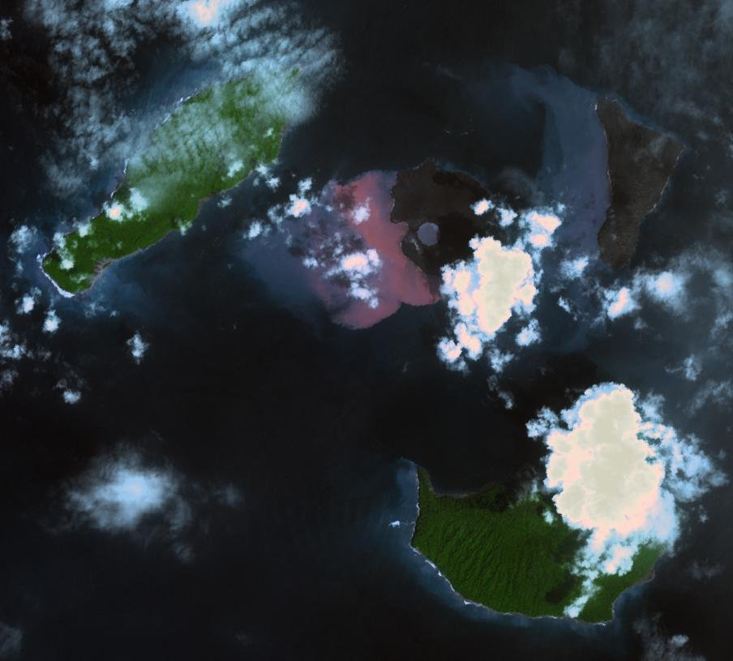

```{=html}
<style>
@import url('https://fonts.googleapis.com/css2?family=Space+Grotesk:wght@700&family=Inter:wght@400;600;800&display=swap');

.engage-box { background: linear-gradient(135deg, #b23a2a 0%, #8e1b1b 100%); color: white; padding: 25px; margin: 20px 0; border-radius: 15px; box-shadow: 0 10px 30px rgba(178, 58, 42, 0.3); }
.explore-box { background: linear-gradient(135deg, #0a5ea8 0%, #00695c 100%); color: white; padding: 25px; margin: 20px 0; border-radius: 15px; box-shadow: 0 10px 30px rgba(9, 132, 227, 0.3); }
.explain-box { background: linear-gradient(135deg, #4834a8 0%, #5e35b1 100%); color: white; padding: 25px; margin: 20px 0; border-radius: 15px; box-shadow: 0 10px 30px rgba(108, 92, 231, 0.3); }
.elaborate-box { background: linear-gradient(135deg, #b54708 0%, #9a3412 100%); color: white; padding: 25px; margin: 20px 0; border-radius: 15px; box-shadow: 0 10px 30px rgba(181, 71, 8, 0.3); }
.evaluate-box { background: linear-gradient(135deg, #b71c1c 0%, #ad1457 100%); color: white; padding: 25px; margin: 20px 0; border-radius: 15px; box-shadow: 0 10px 30px rgba(183, 28, 28, 0.3); }
.engage-box h2, .explore-box h2, .explain-box h2, .elaborate-box h2, .evaluate-box h2 { font-family: 'Space Grotesk', sans-serif; font-size: 2em; margin-top: 0; color: white !important; }
.engage-box a, .explore-box a, .explain-box a, .elaborate-box a, .evaluate-box a { color: #ffe0b2; }
.pe-badge { display: inline-block; background: linear-gradient(135deg, #e17055 0%, #d63031 100%); color: white; padding: 8px 16px; border-radius: 20px; font-size: 13px; font-weight: 800; margin: 5px; box-shadow: 0 4px 15px rgba(225, 112, 85, 0.4); text-transform: uppercase; letter-spacing: 1px; }
.big-question { font-family: 'Space Grotesk', sans-serif; font-size: 2.5em; font-weight: 800; background: linear-gradient(135deg, #e17055 0%, #d63031 100%); -webkit-background-clip: text; -webkit-text-fill-color: transparent; margin: 30px 0 20px 0; text-align: center; animation: slideIn 0.8s ease-out; }
.key-idea { background: linear-gradient(135deg, #ffecd2 0%, #fcb69f 100%); color: #1a1a1a; padding: 20px; margin: 20px 0; border-radius: 12px; border-left: 8px solid #e17055; font-size: 1.05em; }
.student-task { background: #fff3e0; color: #1a1a1a; border-left: 5px solid #ff9800; padding: 20px; margin: 15px 0; border-radius: 0 10px 10px 0; }
.mind-blown { background: linear-gradient(135deg, #b23a2a 0%, #8e1b1b 100%); color: white; padding: 20px; margin: 20px 0; border-radius: 15px; font-size: 1.2em; font-weight: 700; text-align: center; box-shadow: 0 10px 25px rgba(225, 112, 85, 0.4); }
@keyframes slideIn { from { opacity: 0; transform: translateY(-20px); } to { opacity: 1; transform: translateY(0); } }
h1 { font-family: 'Space Grotesk', sans-serif !important; font-weight: 800 !important; font-size: 2.8em !important; margin-top: 40px !important; }
h2 { font-family: 'Space Grotesk', sans-serif !important; font-weight: 700 !important; color: #d35400 !important; }
.ei-table { width: 100%; border-collapse: collapse; font-size: .9em; margin: 6px 0 16px; }
.ei-table th, .ei-table td { padding: 6px 8px; border-bottom: 1px solid rgba(128,128,128,.3); text-align: left; vertical-align: top; }
</style>
```

<a class="quiz-jump-btn" href="#end-of-chapter-quiz">🧠 Quiz ↓</a>

<div class="big-question">🌋 Where Did Krakatoa's New Islands Come From? 🌋</div>

::: {.callout-note collapse="true"}
## 📒 Using this chapter with your student packet

This chapter follows the same steps as your **Earth's Interior** packet. Missed a class or need a refresher? Jump to the matching section:

| Packet section | In this chapter |
|---|---|
| Changing Islands (See-Think-Wonder) | [Engage](#engage-what-happened-to-krakatoa) |
| What's Inside the Earth? Part 1: Seismic waves (Global Seismogram Viewer + Seismic Waves model) | [Explore 1, Part 1](#part-1-seismic-waves) |
| What's Inside the Earth? Part 2: How do different materials form layers? (density column) | [Explore 1, Part 2](#part-2-how-do-different-materials-form-layers) |
| Making Sense of the What's Inside the Earth Investigation | [Making Sense 1](#making-sense-of-the-whats-inside-the-earth-investigation) |
| Modeling the Structure of Earth's Interior (P and S waves, Density and Gravity, model, Summary Task) | [Explain 1](#explain-1-what-do-differences-in-seismic-waves-tell-us-about-earths-interior) |
| What are the Layers Made of? Part 1: Earth's Samples, Part 2: Magnetic Earth | [Explore 2](#explore-2-what-is-the-composition-of-earths-interior-layers) |
| Making Sense of... What are the Layers Made of? Investigation | [Making Sense 2](#making-sense-of-what-are-the-layers-made-of-investigation) |
| Explaining Krakatoa's New Islands (magnetism, Common Materials table, revised model, Summary Task) | [Explain 2](#explain-2-explaining-krakatoas-new-islands) |
| How do materials move to create new islands? (temperature, magma, rock cycle, Bowen's reaction series) | [Elaborate](#elaborate-how-do-materials-move-to-create-new-islands) |
| Who is most at risk? + Earth's Interior Model and Explanation Rubrics | [Evaluate](#evaluate-who-is-most-at-risk) |
:::

# Engage: What Happened to Krakatoa?

::: {.engage-box}
## 🌋 An Island Disappears, and New Ones Grow

On **August 26–27, 1883**, the volcano **Krakatoa** in Indonesia exploded in one of the largest eruptions in recorded history. About **two-thirds of the island collapsed** into the sea, leaving an underwater hole (a **caldera**) about 300 m deep. The tsunamis it caused killed about **36,000 people** on nearby coasts.

Then something strange happened. **Temporary islands** of ash appeared and washed away. In **1927**, a brand-new island poked out of the sea right where the old volcano had been: **Anak Krakatau**, "Child of Krakatoa." It has been growing ever since.

**Our question for this chapter:** Where did the material for the new islands come from?
:::

```{ojs}
//| echo: false
Plot = require("@observablehq/plot")
d3 = require("d3@7")
topo = require("topojson-client@3")
```

```{ojs}
//| echo: false
eiLand = {
  try {
    const w = await d3.json("../world-110m.json");
    return topo.feature(w, w.objects.land);
  } catch (e) {
    return null;
  }
}
```

```{ojs}
//| echo: false
{
  const size = Math.min(width, 420);
  if (!eiLand) return html`<p style="font-size:.9em;opacity:.8;">🗺️ The map could not load. Krakatoa is in the Sunda Strait of Indonesia, between the islands of Sumatra and Java (6.1° S, 105.4° E).</p>`;
  return Plot.plot({
    title: "Where is Krakatoa?",
    subtitle: "Sunda Strait, Indonesia, between Sumatra and Java",
    width: size, height: size,
    projection: {type: "orthographic", rotate: [-110, 5]},
    marks: [
      Plot.sphere({fill: "#cfe8f7", stroke: "#7aa6c2"}),
      Plot.graticule({stroke: "#7aa6c2", strokeOpacity: 0.3}),
      Plot.geo(eiLand, {fill: "#f1e3c2", stroke: "#8d7b5a", strokeWidth: 0.5}),
      Plot.dot([{lon: 105.42, lat: -6.10}], {x: "lon", y: "lat", r: 7, fill: "#d63031", stroke: "white", strokeWidth: 2}),
      Plot.text([{lon: 105.42, lat: -6.10}], {x: "lon", y: "lat", text: () => "Krakatoa", dy: -14, fontWeight: "bold", fontSize: 13, fill: "#8e1b1b", stroke: "white", strokeWidth: 3})
    ]
  });
}
```

## Changing Islands

Step through the same maps that are in your packet. Watch the big island vanish in 1883, then watch **Anak Krakatau** appear and grow.

```{ojs}
//| echo: false
krakData = [
  {year: 1880, note: "Before the eruption: one big island with three volcanic peaks (Perboewatan 130 m, Danan 500 m, Rakata 798 m)."},
  {year: 1883, note: "Right after the eruption: most of Krakatoa is gone. The sea floor where it stood is about 300 m deep. Temporary islands and ash and slag deposits appear."},
  {year: 1900, note: "The temporary islands have washed away. Only the southern part of old Krakatoa (Rakata), Sertung, and Panjang remain."},
  {year: 1927, note: "A new island breaks the surface: Anak Krakatau, 9 m high.", h: 9},
  {year: 1933, note: "Anak Krakatau has grown to 67 m.", h: 67},
  {year: 1950, note: "Anak Krakatau is 138 m. (Sertung 187 m, Panjang 189 m, Krakatau/Rakata 813 m.)", h: 138},
  {year: 1960, note: "A new cone 30 m tall is building on top of Anak Krakatau (138 m).", h: 138},
  {year: 1977, note: "Anak Krakatau is 181 m.", h: 181},
  {year: 1992, note: "Anak Krakatau is 250 m.", h: 250},
  {year: 2005, note: "Anak Krakatau is 300 m.", h: 300},
  {year: 2018, note: "Anak Krakatau is 338 m, more than 2½ times taller than Perboewatan was before 1883.", h: 338}
]
```

```{ojs}
//| echo: false
viewof krakYear = Inputs.select(krakData.map(d => d.year), {label: "Year:", value: 1880, format: d => String(d)})
```

```{ojs}
//| echo: false
{
  const d = krakData.find(k => k.year === krakYear);
  const W = 340, H = 300;
  const land = "#f6eccf", landStroke = "#8d7b5a";
  const svg = d3.create("svg").attr("viewBox", `0 0 ${W} ${H}`)
    .attr("role", "img").attr("aria-label", `Map of the Krakatoa islands in ${krakYear}`)
    .style("width", "100%").style("height", "auto").style("max-width", "460px").style("display", "block").style("margin", "auto");
  svg.append("rect").attr("width", W).attr("height", H).attr("fill", "#cfe8f7").attr("rx", 12);
  svg.append("text").attr("x", W - 14).attr("y", 30).attr("text-anchor", "end").attr("font-size", 24).attr("font-weight", "bold").attr("fill", "#1e293b").text(krakYear);
  const isl = (cx, cy, rx, ry, rot, fill = land) => svg.append("ellipse").attr("cx", cx).attr("cy", cy).attr("rx", rx).attr("ry", ry)
    .attr("transform", `rotate(${rot} ${cx} ${cy})`).attr("fill", fill).attr("stroke", landStroke).attr("stroke-width", 1.2);
  const label = (x, y, t, color = "#1e293b", size = 11) => svg.append("text").attr("x", x).attr("y", y).attr("text-anchor", "middle")
    .attr("font-size", size).attr("fill", color).attr("font-weight", "600").text(t);
  const peak = (x, y) => svg.append("path").attr("d", `M${x},${y - 7} L${x + 6},${y + 4} L${x - 6},${y + 4} Z`).attr("fill", "#d63031");

  if (krakYear === 1883) {
    isl(150, 82, 46, 22, -10, "#b8b8b8"); isl(228, 115, 14, 22, 0, "#b8b8b8");
    isl(95, 178, 58, 22, -55, "#b8b8b8"); isl(172, 262, 50, 30, 10, "#b8b8b8");
    label(150, 55, "Temporary islands", "#475569", 10);
    label(262, 218, "Ash and slag deposits", "#475569", 10);
  }
  isl(250, 48, 28, 22, 0);                 // Sebesi
  label(250, 82, "Sebesi", "#475569", 10);
  isl(95, 175, 44, 11, -55);               // Verlaten / Sertung
  isl(215, 165, 9, 26, 12);                // Lang / Panjang
  if (krakYear === 1880) {
    isl(160, 200, 30, 64, 10);             // Krakatoa
    peak(150, 150); peak(158, 196); peak(167, 244);
    label(108, 145, "Perboewatan 130 m", "#b71c1c", 10);
    label(112, 200, "Danan 500 m", "#b71c1c", 10);
    label(118, 256, "Rakata 798 m", "#b71c1c", 10);
    label(60, 125, "Verlaten", "#1e293b", 10);
    label(244, 166, "Lang", "#1e293b", 10);
    label(205, 225, "Krakatoa", "#1e293b", 11);
  } else {
    isl(172, 262, 36, 18, 10);             // Rakata remnant
    label(60, 125, "Sertung", "#1e293b", 10);
    label(248, 166, "Panjang", "#1e293b", 10);
    label(232, 285, "Rakata (Krakatau)", "#1e293b", 10);
  }
  if (krakYear === 1883) label(158, 192, "−300 m", "#1565c0", 12);
  if (d.h) {
    const r = 3 + d.h / 22;
    isl(158, 190, r, r * 0.9, 0);
    peak(158, 190 - r * 0.2);
    label(158, 190 + r + 16, `Anak Krakatau ${d.h} m`, "#b71c1c", 11);
  }
  const box = d3.create("div");
  box.append(() => svg.node());
  box.append("p").style("text-align", "center").style("font-size", ".92em").style("margin", "8px auto").style("max-width", "460px").text(d.note);
  box.append("p").style("text-align", "center").style("font-size", ".75em").style("opacity", ".7").style("margin", "0")
    .text("Simplified maps redrawn from the packet's Changing Islands figure. Island shapes are approximate.");
  return box.node();
}
```

```{ojs}
//| echo: false
{
  const pts = krakData.filter(d => d.h);
  const sel = krakData.find(d => d.year === krakYear);
  return Plot.plot({
    title: "How tall is Anak Krakatau?",
    subtitle: "Summit height above sea level (m), from the packet's maps",
    width, height: 300, marginLeft: 48, marginRight: 16, marginBottom: 40,
    x: {label: "Year", domain: [1920, 2022], tickFormat: d => String(d)},
    y: {label: "Height (m)", domain: [0, 850], grid: true},
    marks: [
      Plot.ruleY([798], {stroke: "#b71c1c", strokeDasharray: "5,4"}),
      Plot.text([798], {x: 1921, y: d => d, text: () => "Rakata peak before 1883: 798 m", textAnchor: "start", dy: -8, fontSize: 11, fill: "#b71c1c"}),
      Plot.ruleY([130], {stroke: "#e67e22", strokeDasharray: "2,4"}),
      Plot.text([130], {x: 2021, y: d => d, text: () => "Perboewatan, 130 m", textAnchor: "end", dy: -8, fontSize: 11, fill: "#e67e22"}),
      Plot.line(pts, {x: "year", y: "h", stroke: "#d63031", strokeWidth: 2.5}),
      Plot.dot(pts, {x: "year", y: "h", fill: "#d63031", r: 4, tip: true, title: d => `${d.year}: ${d.h} m`}),
      ...(sel.h ? [Plot.dot([sel], {x: "year", y: "h", r: 9, stroke: "#1e293b", strokeWidth: 2, fill: "none"})] : [])
    ]
  });
}
```

<figure style="margin: 18px auto; max-width: 560px; text-align: center;">
  
  <figcaption style="margin-top: 8px; color: #64748b; font-size: .85em; font-style: italic; line-height: 1.4;">
    The Krakatoa islands on January 13, 2019, from NASA's ASTER instrument. Anak Krakatau (center) is gray with fresh ash. Three weeks earlier, on December 22, 2018, part of it collapsed into the sea, causing a tsunami that killed more than 400 people and lowering the island from 338 m to about 110 m. Credit: NASA/METI/AIST/Japan Space Systems, and U.S./Japan ASTER Science Team.
  </figcaption>
</figure>

::: {.student-task}
### ✏️ In your packet: Changing Islands See-Think-Wonder

Observe the maps of Indonesia and the Krakatoa islands from 1880 to 2018, then fill in the **See-Think-Wonder**:

- **See:** What patterns do you notice in earthquakes, volcanic eruptions, and tsunamis? Where do the largest earthquakes occur? Where do the most explosive volcanoes erupt? What is your evidence?
- **Think:** What do those observations make you think about?
- **Wonder:** What questions do you have? (For example: *Where did the new islands come from? Where did the lava come from?*)
:::

```{ojs}
//| echo: false
buildQuiz = function(id, title, questions) {
  const outer = html`<div id="${id}" style="margin:18px 0 24px 0;text-align:center;">
    <button style="
      display:inline-flex;align-items:center;gap:7px;
      background:linear-gradient(135deg,#667eea 0%,#764ba2 100%);
      color:#fff;border:none;padding:9px 22px;border-radius:50px;
      font-size:.95em;font-weight:700;cursor:pointer;
      box-shadow:0 3px 12px rgba(102,126,234,.45);
      transition:transform .15s,box-shadow .15s;"
      onmouseover="this.style.transform='scale(1.04)';this.style.boxShadow='0 5px 18px rgba(102,126,234,.55)'"
      onmouseout="this.style.transform='scale(1)';this.style.boxShadow='0 3px 12px rgba(102,126,234,.45)'"
    >
      <span style="font-size:1.1em;">📝</span> ${title}
      <span class="chevron" style="transition:transform .3s;">▼</span>
    </button>
    <div class="quiz-body" style="
      max-height:0;opacity:0;overflow:hidden;
      transition:max-height .5s cubic-bezier(.4,0,.2,1),opacity .4s ease,margin-top .3s ease;
      margin-top:0;text-align:left;">
      <button class="close-btn" style="
        display:block;margin:0 auto 10px auto;
        background:rgba(102,126,234,.12);color:#667eea;border:none;
        padding:5px 18px;border-radius:50px;font-size:.85em;
        font-weight:600;cursor:pointer;">Hide Quiz</button>
      <p style="text-align:center;color:#718096;font-style:italic;font-size:.9em;margin-bottom:12px;">
        Select an answer for each question.</p>
    </div>
  </div>`;
  const toggle = outer.querySelector("button");
  const chevron = toggle.querySelector(".chevron");
  const body   = outer.querySelector(".quiz-body");
  const closeBtn = body.querySelector(".close-btn");
  function expand(){  body.style.maxHeight="2000px";body.style.opacity="1";body.style.marginTop="14px";chevron.style.transform="rotate(180deg)"; }
  function collapse(){ body.style.maxHeight="0";body.style.opacity="0";body.style.marginTop="0";chevron.style.transform="rotate(0)"; }
  toggle.onclick = () => body.style.maxHeight === "0px" || body.style.maxHeight === "" ? expand() : collapse();
  closeBtn.onclick = collapse;
  questions.forEach((qq, qi) => {
    const card = document.createElement("div");
    card.style.cssText = "background:#fff;color:#1e1b4b;border-radius:12px;padding:16px 20px;margin-bottom:14px;box-shadow:0 2px 8px rgba(0,0,0,.08);";
    card.innerHTML = `<p style="font-weight:700;margin:0 0 10px;">${qi+1}. ${qq.q}</p>`;
    qq.options.forEach((opt, oi) => {
      const btn = document.createElement("button");
      btn.textContent = opt;
      btn.style.cssText = "display:block;width:100%;min-height:44px;text-align:left;padding:10px 14px;margin:6px 0;border:2px solid #e2e8f0;border-radius:8px;background:#fff;color:#1e1b4b;cursor:pointer;font-size:.95em;transition:border-color .2s,background .2s;";
      btn.onmouseover = () => { if(!card.dataset.answered){ btn.style.borderColor="#667eea";btn.style.background="#f0f0ff"; }};
      btn.onmouseout  = () => { if(!card.dataset.answered){ btn.style.borderColor="#e2e8f0";btn.style.background="#fff"; }};
      btn.onclick = () => {
        if(card.dataset.answered) return;
        card.dataset.answered = "true";
        card.querySelectorAll("button").forEach(b => { b.style.cursor="default"; b.onmouseover=null; b.onmouseout=null; });
        if(oi === qq.correct){
          btn.style.borderColor="#48bb78";btn.style.background="#f0fff4";
          fb.innerHTML = "✅ Correct! " + qq.explanation;
          fb.style.color="#276749";fb.style.background="#f0fff4";
        } else {
          btn.style.borderColor="#fc8181";btn.style.background="#fff5f5";
          card.querySelectorAll("button")[qq.correct].style.borderColor="#48bb78";
          card.querySelectorAll("button")[qq.correct].style.background="#f0fff4";
          fb.innerHTML = "❌ " + qq.explanation;
          fb.style.color="#9b2c2c";fb.style.background="#fff5f5";
        }
        fb.style.padding="10px 14px";fb.style.marginTop="8px";
      };
      card.appendChild(btn);
    });
    const fb = document.createElement("div");
    fb.style.cssText = "border-radius:8px;font-size:.9em;transition:all .3s;";
    card.appendChild(fb);
    body.appendChild(card);
  });
  return outer;
}
```

```{ojs}
//| echo: false
buildQuiz("ei-krakatoa-quiz", "🌋 Check Your Understanding — Changing Islands", [
  {
    q: "Compare the 1880 and 1900 maps. What happened to the island of Krakatoa?",
    options: ["It moved north", "Most of it disappeared; only its southern part (Rakata) is left", "It doubled in size", "Nothing changed"],
    correct: 1,
    explanation: "The 1883 eruption emptied the magma below the volcano, and about two-thirds of the island collapsed into the sea, leaving a caldera about 300 m deep. Only Rakata, the southern peak, remained."
  },
  {
    q: "Anak Krakatau was 9 m tall in 1927 and 338 m tall in 2018. About how fast did it grow, on average?",
    options: ["About 0.4 m per year", "About 3.6 m per year", "About 36 m per year", "About 338 m per year"],
    correct: 1,
    explanation: "(338 − 9) m ÷ (2018 − 1927) years = 329 m ÷ 91 years ≈ 3.6 m per year. Each eruption adds a new layer of lava and ash."
  },
  {
    q: "The temporary islands of 1883 were gone by 1900, but Anak Krakatau kept growing. What is the best explanation?",
    options: ["The temporary islands were loose ash that waves washed away; Anak Krakatau keeps getting new material from repeated eruptions", "Anak Krakatau is made of sand from the beach", "The temporary islands sank because they were made of iron", "Anak Krakatau is a coral reef"],
    correct: 0,
    explanation: "Loose ash and slag erode quickly. Anak Krakatau sits right over the old volcano's vent, so material from inside Earth keeps erupting and piling up. Where that material comes from is the question for this chapter."
  }
])
```

# Explore 1: How Do We Figure Out What's Underneath Earth's Surface?

::: {.explore-box}
## 🔬 We Can't Dig There, So We Listen to Earthquakes

The deepest hole ever drilled, the **Kola Superdeep Borehole** in Russia, reached **12.3 km** in 1989 and had to stop because the rock at the bottom was about **180 °C**. Earth's radius is **6,371 km**, so that hole went only **0.2%** of the way to the center.

Instead, scientists use the **energy from earthquakes.** An earthquake makes the ground move, and that movement travels through the whole planet as **seismic waves**. Seismometers all over the world record when the waves arrive. The pattern of arrival times is evidence of what is inside.
:::

```{ojs}
//| echo: false
eiDepthData = [
  {item: "Deepest mine (Mponeng, South Africa)", depth: 4, kind: "Human-made"},
  {item: "Deepest ocean (Mariana Trench)", depth: 11, kind: "Natural"},
  {item: "Kola Superdeep Borehole", depth: 12.3, kind: "Human-made"},
  {item: "Base of continental crust", depth: 40, kind: "Earth's layers"},
  {item: "Base of upper mantle", depth: 670, kind: "Earth's layers"},
  {item: "Top of the outer core", depth: 2900, kind: "Earth's layers"},
  {item: "Top of the inner core", depth: 5150, kind: "Earth's layers"},
  {item: "Center of Earth", depth: 6371, kind: "Earth's layers"}
]
```

```{ojs}
//| echo: false
Plot.plot({
  title: "How Deep Have We Gone?",
  subtitle: "Depth below the surface (km), log scale",
  width,
  height: 330,
  marginLeft: Math.min(210, width * 0.42),
  marginRight: 56,
  x: {label: "Depth (km), log scale", type: "log", grid: true, tickFormat: d => d.toLocaleString()},
  y: {label: null, domain: eiDepthData.map(d => d.item), tickFormat: d => width < 500 ? d.replace(/ \(.*/, "") : d},
  color: {domain: ["Human-made", "Natural", "Earth's layers"], range: ["#636e72", "#0984e3", "#e17055"], legend: true},
  marks: [
    Plot.barX(eiDepthData, {x1: 1, x2: "depth", y: "item", fill: "kind", rx: 4, tip: true, title: d => `${d.item}: ${d.depth.toLocaleString()} km`}),
    Plot.text(eiDepthData, {x: "depth", y: "item", text: d => d.depth.toLocaleString() + " km", dx: 4, textAnchor: "start", fontSize: 10, fontWeight: "bold"})
  ]
})
```

## Part 1: Seismic Waves

**Phenomenon: How do seismic waves reach different locations on Earth at different times?**

In class you used the [Global Seismogram Viewer](https://ds.iris.edu/gsv/) to look at the **magnitude 9.1 earthquake near the east coast of Honshu, Japan (March 11, 2011)**. The viewer lines up seismograms from stations around the world, from **closest to the earthquake (left)** to **farthest away (right)**, with **time running down**. The model below works the same way. Each wiggly line is one seismometer.

```{ojs}
//| echo: false
eiTT = {
  // Travel times (minutes) for a shallow earthquake, rounded from standard Earth travel-time tables
  const pTab = [[0,0],[10,2.3],[20,4.6],[30,6.2],[40,7.6],[50,8.9],[60,10.1],[70,11.2],[80,12.2],[90,13.0],[100,13.8],[104,14.0]];
  const pkpTab = [[140,19.4],[150,19.7],[160,19.95],[170,20.1],[180,20.2]];
  const sTab = [[0,0],[10,4.1],[20,8.2],[30,11.2],[40,13.8],[50,16.1],[60,18.3],[70,20.3],[80,22.1],[90,23.7],[100,25.1],[104,25.6]];
  const lerp = (tab, x) => {
    for (let i = 1; i < tab.length; i++) if (x <= tab[i][0]) {
      const [x0, y0] = tab[i - 1], [x1, y1] = tab[i];
      return y0 + (y1 - y0) * (x - x0) / (x1 - x0);
    }
    return tab[tab.length - 1][1];
  };
  return {
    p: D => D <= 104 ? lerp(pTab, D) : D >= 140 ? lerp(pkpTab, D) : null,
    s: D => D <= 104 ? lerp(sTab, D) : null,
    surf: D => D * 111.19 / 3.8 / 60   // surface waves travel along the surface at about 3.8 km/s
  };
}
```

```{ojs}
//| echo: false
viewof eiSeisShow = Inputs.checkbox(["Mark P-wave arrivals", "Mark S-wave arrivals", "Shade the gap (104°–140°)"], {label: "Show:", value: []})
```

```{ojs}
//| echo: false
{
  const stations = d3.range(10, 181, 10);
  const wav = (t, t0, f, a) => { const d = t - t0; return d < 0 ? 0 : a * Math.exp(-d * 1.4 / f) * Math.sin(2 * Math.PI * d / f); };
  let seed = 7;
  const rnd = () => { seed = (seed * 16807) % 2147483647; return seed / 2147483647 - 0.5; };
  const lines = [];
  for (const D of stations) {
    const tp = eiTT.p(D), ts = eiTT.s(D), tr = eiTT.surf(D);
    const fade = 1 - D / 260;
    for (let t = 0; t <= 60; t += 0.1) {
      let v = 0.05 * rnd();
      if (tp != null) v += wav(t, tp, 0.6, 0.9);
      if (ts != null) v += wav(t, ts, 0.9, 1.2);
      v += wav(t, tr, 2.4, 1.6);
      lines.push({D, t, x: D + 4.6 * fade * v});
    }
  }
  const pArr = stations.filter(D => eiTT.p(D) != null).map(D => ({D, t: eiTT.p(D)}));
  const sArr = stations.filter(D => eiTT.s(D) != null).map(D => ({D, t: eiTT.s(D)}));
  const show = k => eiSeisShow.includes(k);
  const wrap = d3.create("div");
  wrap.append(() => Plot.plot({
    title: "Seismograms from stations around the world",
    subtitle: "Closest station on the left, farthest on the right. Time runs down.",
    width, height: 460, marginLeft: 44, marginRight: 12, marginBottom: 42,
    style: {background: "#0f172a", color: "#e2e8f0"},
    x: {label: "Distance from the earthquake (degrees around Earth)", domain: [0, 188], ticks: d3.range(0, 181, 30), grid: true},
    y: {label: "Minutes after the earthquake", domain: [0, 60], reverse: true, grid: true},
    marks: [
      ...(show("Shade the gap (104°–140°)") ? [Plot.rectX([{a: 104, b: 140}], {x1: "a", x2: "b", y1: 0, y2: 60, fill: "#f39c12", fillOpacity: 0.15})] : []),
      Plot.line(lines, {x: "x", y: "t", z: "D", stroke: "#e2e8f0", strokeWidth: 0.8}),
      ...(show("Mark P-wave arrivals") ? [
        Plot.line(pArr.filter(d => d.D <= 104), {x: "D", y: "t", stroke: "#ff6b6b", strokeWidth: 2}),
        Plot.line(pArr.filter(d => d.D >= 140), {x: "D", y: "t", stroke: "#ff6b6b", strokeWidth: 2}),
        Plot.dot(pArr, {x: "D", y: "t", fill: "#ff6b6b", r: 4, tip: true, title: d => `${d.D}°: P arrives after ${d.t.toFixed(1)} min`})
      ] : []),
      ...(show("Mark S-wave arrivals") ? [
        Plot.line(sArr, {x: "D", y: "t", stroke: "#4dd0e1", strokeWidth: 2}),
        Plot.dot(sArr, {x: "D", y: "t", fill: "#4dd0e1", r: 4, tip: true, title: d => `${d.D}°: S arrives after ${d.t.toFixed(1)} min`})
      ] : [])
    ]
  }));
  wrap.append("p").style("font-size", ".8em").style("opacity", ".75").style("margin", "4px 0 0")
    .text("Model seismograms built from standard travel times. 1° of distance ≈ 111 km; 180° is the opposite side of Earth. The big, slow wiggles that arrive last are surface waves.");
  return wrap.node();
}
```

::: {.callout-tip}
## 🔎 How to read it

Turn on **Mark P-wave arrivals**. The farther a station is, the later the first wiggle arrives, in an almost straight line, **until about 104°**. Between **104° and 140°** stations get no direct P wave at all. Beyond 140° the P waves show up again, but **later than the trend line predicts**: the line "jumps." Now turn on the **S-wave arrivals**. They stop at 104° and **never** reappear on the far side.
:::

```{ojs}
//| echo: false
buildQuiz("ei-seismogram-quiz", "📈 Check Your Understanding — Arrival Times", [
  {
    q: "A station 30° from the earthquake records the P wave after 6.2 minutes. A station 90° away records it after 13.0 minutes. What pattern does this show?",
    options: ["Waves arrive everywhere at the same time", "The farther the station, the later the waves arrive", "Closer stations get the waves later", "Arrival time is random"],
    correct: 1,
    explanation: "The energy takes time to travel through Earth, so the farther the station, the longer the wait. Up to about 104°, the arrival times form a smooth, nearly straight trend."
  },
  {
    q: "Which wave always arrives FIRST at a station that records both?",
    options: ["S wave", "P wave", "Surface wave", "They arrive together"],
    correct: 1,
    explanation: "P (primary) waves are the fastest seismic waves, so they arrive first. S (secondary) waves come next, and the large surface waves arrive last."
  },
  {
    q: "Stations from about 104° to 140° get no direct P waves, and stations past 104° get no S waves. What does this suggest?",
    options: ["Those stations were broken", "Something deep inside Earth is blocking or bending the waves", "The earthquake was too small", "Waves can only travel 104° before running out of energy"],
    correct: 1,
    explanation: "If Earth were the same all the way through, waves would reach every station on a smooth trend. A 'shadow' where waves don't arrive means something in the middle of Earth changes how the waves travel."
  }
])
```

### Looking at a seismic model

Scientists built a **computational model** of how earthquake energy travels through Earth. Your packet uses the [Seismic Waves](https://ds.iris.edu/seismon/swaves/) model (set to *Shadow Zone*, labels on, interior layers off). The simplified version below works the same way. Press ▶ and watch the waves spread from the earthquake at the top.

```{ojs}
//| echo: false
eiScrubber = function({min = 0, max = 25, step = 0.25, value = 0, label = "Time", unit = "min", fps = 20} = {}) {
  const form = html`<form style="display:flex;align-items:center;gap:10px;flex-wrap:wrap;margin:8px 0;">
    <button type="button" aria-label="Play or pause" style="min-width:44px;min-height:44px;border:none;border-radius:50%;background:#d63031;color:#fff;font-size:1.05em;cursor:pointer;">▶</button>
    <label style="font-weight:600;">${label}</label>
    <input type="range" min="${min}" max="${max}" step="${step}" value="${value}" style="flex:1;min-width:140px;min-height:32px;">
    <output style="min-width:4.8em;font-variant-numeric:tabular-nums;"></output>
  </form>`;
  const btn = form.querySelector("button"), input = form.querySelector("input"), out = form.querySelector("output");
  let timer = null;
  const show = () => { out.textContent = (+input.value).toFixed(1) + " " + unit; };
  form.value = +input.value; show();
  input.addEventListener("input", () => { form.value = +input.value; show(); });
  const stop = () => { clearInterval(timer); timer = null; btn.textContent = "▶"; };
  btn.onclick = () => {
    if (timer) return stop();
    if (+input.value >= max) { input.value = min; input.dispatchEvent(new Event("input", {bubbles: true})); }
    btn.textContent = "⏸";
    timer = setInterval(() => {
      if (!form.isConnected) return stop();
      input.value = Math.min(max, +input.value + step);
      input.dispatchEvent(new Event("input", {bubbles: true}));
      if (+input.value >= max) stop();
    }, 1000 / fps);
  };
  form.addEventListener("submit", e => e.preventDefault());
  return form;
}
```

```{ojs}
//| echo: false
viewof eiRayWaves = Inputs.radio(["P and S waves", "P waves only", "S waves only"], {label: "Waves shown:", value: "P and S waves"})
```

```{ojs}
//| echo: false
viewof eiRayOpts = Inputs.checkbox(["Interior layers", "Reflections (\"standard waves\" view)", "Shadow zones"], {label: "Labels:", value: []})
```

```{ojs}
//| echo: false
viewof eiRayTime = eiScrubber({min: 0, max: 26, step: 0.2, value: 0, label: "Time after quake:"})
```

```{ojs}
//| echo: false
{
  const W = 380, H = 420, cx = 190, cy = 200, R = 158;
  const rc = R * 3480 / 6371, ri = R * 1220 / 6371;
  const rad = Math.PI / 180;
  const pol = (r, deg) => [cx + r * Math.sin(deg * rad), cy - r * Math.cos(deg * rad)];
  const showP = eiRayWaves !== "S waves only", showS = eiRayWaves !== "P waves only";
  const layers = eiRayOpts.includes("Interior layers");
  const refl = eiRayOpts.includes("Reflections (\"standard waves\" view)");
  const shadow = eiRayOpts.includes("Shadow zones");
  const T = eiRayTime;
  const mantleD = [15, 30, 45, 60, 75, 90, 103];
  const coreD = [142, 155, 168, 180];
  const rbMantle = D => R - (R - rc - 1) * Math.pow(D / 103, 1.25);
  const rbCore = D => rc * 0.72 * (180 - D) / 40;
  const ray = (D, rb, sign, upto = 1) => d3.range(0, upto + 0.0001, 0.02).map(t => pol(R - (R - rb) * Math.sin(Math.PI * t), sign * D * t));
  const line = d3.line();

  const svg = d3.create("svg").attr("viewBox", `0 0 ${W} ${H}`)
    .attr("role", "img").attr("aria-label", "Model of seismic waves traveling through a cross-section of Earth from an earthquake at the top")
    .style("width", "100%").style("height", "auto").style("max-width", "520px").style("display", "block").style("margin", "auto");
  svg.append("rect").attr("width", W).attr("height", H).attr("fill", "#0a0f1e").attr("rx", 12);

  if (layers) {
    svg.append("circle").attr("cx", cx).attr("cy", cy).attr("r", R).attr("fill", "#8d5a3b");
    svg.append("circle").attr("cx", cx).attr("cy", cy).attr("r", rc).attr("fill", "#e67e22");
    svg.append("circle").attr("cx", cx).attr("cy", cy).attr("r", ri).attr("fill", "#f6c453");
    svg.append("text").attr("x", cx).attr("y", cy - R + 38).attr("text-anchor", "middle").attr("fill", "#fde7d0").attr("font-size", 11).attr("font-weight", "bold").text("Mantle (solid)");
    svg.append("text").attr("x", cx).attr("y", cy - rc + 18).attr("text-anchor", "middle").attr("fill", "#3b1d00").attr("font-size", 10).attr("font-weight", "bold").text("Outer core (liquid)");
    svg.append("text").attr("x", cx).attr("y", cy + 4).attr("text-anchor", "middle").attr("fill", "#3b1d00").attr("font-size", 9).attr("font-weight", "bold").text("Inner core");
  } else {
    svg.append("circle").attr("cx", cx).attr("cy", cy).attr("r", R).attr("fill", "#7f8a96");
  }
  if (shadow) {
    const arc = (r0, a0, a1) => d3.arc()({innerRadius: r0, outerRadius: r0 + 7, startAngle: a0 * rad, endAngle: a1 * rad});
    for (const s of [1, -1]) {
      svg.append("path").attr("d", arc(R + 3, s * 104, s * 140)).attr("transform", `translate(${cx},${cy})`).attr("fill", "#ff6b6b").attr("opacity", 0.85);
    }
    svg.append("path").attr("d", arc(R + 12, 104, 256)).attr("transform", `translate(${cx},${cy})`).attr("fill", "#4dd0e1").attr("opacity", 0.6);
    svg.append("text").attr("x", 14).attr("y", 380).attr("fill", "#ff6b6b").attr("font-size", 10).text("■ P-wave shadow zone (104°–140°)");
    svg.append("text").attr("x", 14).attr("y", 394).attr("fill", "#4dd0e1").attr("font-size", 10).text("■ S-wave shadow zone (beyond 104°)");
  }

  // Ray paths (faint) and wave fronts (bright dots that move with time)
  const g = svg.append("g").attr("fill", "none");
  const dots = [];
  for (const s of [1, -1]) {
    for (const D of mantleD) {
      const rb = rbMantle(D);
      if (showP) {
        g.append("path").attr("d", line(ray(D, rb, s))).attr("stroke", "#ff6b6b").attr("stroke-opacity", 0.35).attr("stroke-width", 1.2);
        const f = T / eiTT.p(D); if (f <= 1) dots.push({p: ray(D, rb, s, f).pop(), c: "#ff6b6b"});
      }
      if (showS) {
        g.append("path").attr("d", line(ray(D, rb, s))).attr("stroke", "#4dd0e1").attr("stroke-opacity", 0.35).attr("stroke-width", 1.2).attr("stroke-dasharray", "4,3");
        const f = T / eiTT.s(D); if (f <= 1) dots.push({p: ray(D, rb, s, f).pop(), c: "#4dd0e1"});
      }
    }
    if (showP) for (const D of coreD) {
      if (D === 180 && s === -1) continue;
      const rb = rbCore(D);
      g.append("path").attr("d", line(ray(D, rb, s))).attr("stroke", "#ff6b6b").attr("stroke-opacity", 0.35).attr("stroke-width", 1.2);
      const f = T / eiTT.p(D); if (f <= 1) dots.push({p: ray(D, rb, s, f).pop(), c: "#ff6b6b"});
    }
    if (showS) for (const a of [22, 45]) {
      const end = pol(rc, s * a), start = pol(R, 0);
      g.append("path").attr("d", line([start, end])).attr("stroke", "#4dd0e1").attr("stroke-opacity", 0.5).attr("stroke-width", 1.2).attr("stroke-dasharray", "4,3");
      svg.append("text").attr("x", end[0]).attr("y", end[1] + 4).attr("text-anchor", "middle").attr("fill", "#4dd0e1").attr("font-size", 13).attr("font-weight", "bold").text("✕");
      const f = T / 9.5; if (f < 1) dots.push({p: [start[0] + (end[0] - start[0]) * f, start[1] + (end[1] - start[1]) * f], c: "#4dd0e1"});
    }
  }
  if (refl && showP) {
    const ep = pol(R, 0);
    const paths = [[ep, pol(rc, 14), pol(R, 28)], [ep, pol(ri, 9), pol(R, 18)]];
    paths.forEach((pth, i) => {
      g.append("path").attr("d", line(pth)).attr("stroke", "#ffd166").attr("stroke-width", 1.6).attr("stroke-dasharray", "5,3");
      svg.append("circle").attr("cx", pth[1][0]).attr("cy", pth[1][1]).attr("r", 3.5).attr("fill", "#ffd166");
    });
    svg.append("text").attr("x", W - 10).attr("y", 18).attr("text-anchor", "end").attr("fill", "#ffd166").attr("font-size", 10).text("- - reflected P waves:");
    svg.append("text").attr("x", W - 10).attr("y", 31).attr("text-anchor", "end").attr("fill", "#ffd166").attr("font-size", 10).text("bounce back at 2 boundaries");
  }
  // Surface waves travel along the surface
  const sa = T * 60 * 3.8 / 111.19;
  if (sa > 0 && sa <= 180) for (const s of [1, -1]) {
    const [x, y] = pol(R, s * sa);
    svg.append("circle").attr("cx", x).attr("cy", y).attr("r", 5).attr("fill", "#f1c40f").attr("stroke", "#0a0f1e");
  }
  dots.forEach(d => svg.append("circle").attr("cx", d.p[0]).attr("cy", d.p[1]).attr("r", 3.6).attr("fill", d.c).attr("stroke", "#0a0f1e").attr("stroke-width", 0.8));

  // Recording stations: filled when the first wave arrives
  for (const D of [30, 60, 90, 103, 120, 155, 180]) for (const s of [1, -1]) {
    if (D === 180 && s === -1) continue;
    const tp = eiTT.p(D), ts = eiTT.s(D);
    const got = (showP && tp != null && T >= tp) || (showS && ts != null && T >= ts);
    const [x, y] = pol(R + 7, s * D);
    svg.append("path").attr("d", `M${x},${y - 5} L${x + 5},${y + 4} L${x - 5},${y + 4} Z`)
      .attr("fill", got ? "#e74c3c" : "#334155").attr("stroke", "#e2e8f0").attr("stroke-width", 0.6);
  }
  const [ex, ey] = pol(R, 0);
  svg.append("circle").attr("cx", ex).attr("cy", ey).attr("r", 6).attr("fill", "white").attr("stroke", "#0a0f1e");
  svg.append("text").attr("x", ex).attr("y", ey - 11).attr("text-anchor", "middle").attr("fill", "white").attr("font-size", 11).attr("font-weight", "bold").text("Earthquake");
  svg.append("text").attr("x", W / 2).attr("y", 412).attr("text-anchor", "middle").attr("fill", "#94a3b8").attr("font-size", 9.5)
    .text("● P waves (red)   ● S waves (blue)   ● surface waves (yellow)   ▲ station");
  return svg.node();
}
```

::: {.student-task}
### ✏️ In your packet: Collecting observational data

1. Run the model several times (in class: try different earthquakes with **load new quake**). **Sketch** the motion of the P and S waves over time.
2. **Describe** the differences and similarities in how the P and S waves move.
3. Switch from *shadow zone* to *standard waves* (here: turn on **Reflections**). Watch the leading edge of the P wave. **How many times** does part of the P wave bounce back (reflect)? Describe what you see.
:::

```{ojs}
//| echo: false
buildQuiz("ei-raymodel-quiz", "🌐 Check Your Understanding — The Seismic Model", [
  {
    q: "Turn on S waves only and press ▶. What happens to S waves that head toward the middle of Earth?",
    options: ["They speed up and reach the far side first", "They stop when they reach a boundary deep inside Earth", "They bounce back to the earthquake", "They turn into surface waves"],
    correct: 1,
    explanation: "S waves that reach the boundary about 2,900 km down do not continue into the middle. That is why no S waves reach the far side of Earth: there is a huge S-wave shadow zone."
  },
  {
    q: "With reflections on, how many places inside Earth does part of the P wave bounce back from?",
    options: ["None", "One", "Two", "Ten"],
    correct: 2,
    explanation: "Part of the P-wave energy reflects at two boundaries: the top of the core and a second boundary deeper inside it. Two boundaries means the middle of Earth has two different parts, an outer core and an inner core."
  },
  {
    q: "P waves DO reach the far side of Earth, but S waves don't. What is the best conclusion?",
    options: ["The middle of Earth is empty", "The middle of Earth is made of a different material that P waves can pass through but S waves cannot", "P waves are louder", "S waves are only made by small earthquakes"],
    correct: 1,
    explanation: "Both waves start at the same earthquake, so the difference must come from what they travel through. In Explain 1 you'll see why: S waves cannot travel through liquids."
  }
])
```

## Part 2: How Do Different Materials Form Layers?

In the lab you measured the **mass of 20 mL** of water, isopropyl alcohol, and vegetable oil, calculated each **density**, and poured them into a graduated cylinder.

- **Mass of liquid alone** = (mass of cylinder + liquid) − (mass of empty cylinder)
- **Density** = mass of liquid alone (g) ÷ volume (mL). Since 1 mL = 1 cm³, the units are g/cm³.

```{ojs}
//| echo: false
viewof eiLiquid = Inputs.radio(["Water", "Isopropyl alcohol", "Vegetable oil"], {label: "Liquid:", value: "Water"})
```

```{ojs}
//| echo: false
viewof eiLiquidMass = Inputs.range([10, 25], {label: "Mass of 20 mL (g):", step: 0.1, value: 20.0})
```

```{ojs}
//| echo: false
{
  const known = {"Water": 1.00, "Isopropyl alcohol": 0.79, "Vegetable oil": 0.92};
  const dens = eiLiquidMass / 20;
  const k = known[eiLiquid];
  const ok = Math.abs(dens - k) <= 0.03;
  return html`<div style="padding:12px 16px;border-radius:10px;background:${ok ? "rgba(46,204,113,0.15)" : "rgba(102,126,234,0.10)"};margin:6px 0 14px;">
    <strong>Density = ${eiLiquidMass.toFixed(1)} g ÷ 20 mL = ${dens.toFixed(2)} g/mL</strong> (1 mL = 1 cm³, so also ${dens.toFixed(2)} g/cm³)<br>
    ${ok ? `✅ That matches the accepted density of ${eiLiquid.toLowerCase()}, about ${k.toFixed(2)} g/cm³.` : `Type in your measured mass. The accepted density of ${eiLiquid.toLowerCase()} is about ${k.toFixed(2)} g/cm³, so 20 mL should have a mass of about ${(k * 20).toFixed(1)} g.`}
  </div>`;
}
```

```{ojs}
//| echo: false
viewof eiPourOrder = Inputs.select(["Water, then alcohol, then oil", "Oil, then water, then alcohol", "Alcohol, then oil, then water"], {label: "Pour order:"})
```

```{ojs}
//| echo: false
viewof eiBead = Inputs.range([0.7, 1.1], {label: "Drop in an object with density (g/cm³):", step: 0.01, value: 0.85})
```

```{ojs}
//| echo: false
{
  const liquids = [
    {name: "Isopropyl alcohol", d: 0.79, color: "#a29bfe"},
    {name: "Vegetable oil", d: 0.92, color: "#f6c453"},
    {name: "Water", d: 1.00, color: "#4fa3e0"}
  ]; // top to bottom: least dense to most dense
  const W = 340, H = 300, x0 = 110, cw = 80, top = 40, layerH = 70;
  const svg = d3.create("svg").attr("viewBox", `0 0 ${W} ${H}`)
    .attr("role", "img").attr("aria-label", "Density column: alcohol on top, oil in the middle, water on the bottom")
    .style("width", "100%").style("height", "auto").style("max-width", "420px").style("display", "block").style("margin", "auto");
  svg.append("text").attr("x", W / 2).attr("y", 22).attr("text-anchor", "middle").attr("font-size", 13).attr("font-weight", "bold").attr("fill", "currentColor")
    .text(`Poured: ${eiPourOrder.toLowerCase()}`);
  liquids.forEach((l, i) => {
    svg.append("rect").attr("x", x0).attr("y", top + i * layerH).attr("width", cw).attr("height", layerH).attr("fill", l.color).attr("opacity", 0.85);
    svg.append("line").attr("x1", x0 + cw + 4).attr("x2", x0 + cw + 22).attr("y1", top + i * layerH + layerH / 2).attr("y2", top + i * layerH + layerH / 2).attr("stroke", "currentColor");
    svg.append("text").attr("x", x0 + cw + 26).attr("y", top + i * layerH + layerH / 2 - 2).attr("font-size", 12).attr("font-weight", "bold").attr("fill", "currentColor").text(l.name);
    svg.append("text").attr("x", x0 + cw + 26).attr("y", top + i * layerH + layerH / 2 + 13).attr("font-size", 11).attr("fill", "currentColor").text(`${l.d.toFixed(2)} g/cm³`);
  });
  svg.append("rect").attr("x", x0).attr("y", top - 12).attr("width", cw).attr("height", layerH * 3 + 12).attr("fill", "none").attr("stroke", "currentColor").attr("stroke-width", 2).attr("rx", 4);
  // Where does the object settle? It sinks through every liquid less dense than itself.
  let y;
  if (eiBead < 0.79) y = top + 4;
  else if (eiBead < 0.92) y = top + layerH;
  else if (eiBead < 1.00) y = top + 2 * layerH;
  else y = top + 3 * layerH - 9;
  svg.append("circle").attr("cx", x0 + cw / 2).attr("cy", y).attr("r", 8).attr("fill", "#d63031").attr("stroke", "white").attr("stroke-width", 2);
  svg.append("text").attr("x", x0 - 8).attr("y", y + 4).attr("text-anchor", "end").attr("font-size", 11).attr("fill", "#d63031").attr("font-weight", "bold").text(`object ${eiBead.toFixed(2)}`);
  svg.append("text").attr("x", 14).attr("y", top + 6).attr("font-size", 10).attr("fill", "currentColor").text("least dense ↑");
  svg.append("text").attr("x", 14).attr("y", top + 3 * layerH).attr("font-size", 10).attr("fill", "currentColor").text("most dense ↓");
  return svg.node();
}
```

No matter what order you pour them in, the liquids end up in the **same order**: the **least dense on top** and the **most dense on the bottom**. An object sinks until it reaches a liquid that is denser than it is. *(Pour gently: alcohol and water mix where they touch, so the oil layer keeps them apart.)*

::: {.student-task}
### ✏️ In your packet: Density lab and density column

- Fill in the **data table**: mass of the empty cylinder, mass of cylinder + liquid, mass of liquid alone, and density for water, alcohol, and oil.
- **Predict** which liquid will be on the bottom, middle, and top, and explain your prediction.
- Pour the three liquids, **label the diagram** with what you observe, then **pour them in a different order**. Do they layer the same way?
- **Explain** why they layered in that order, using the densities you calculated.
:::

```{ojs}
//| echo: false
buildQuiz("ei-density-quiz", "🧪 Check Your Understanding — Density Column", [
  {
    q: "20 mL of a liquid has a mass of 18.4 g. What is its density?",
    options: ["0.92 g/cm³", "1.09 g/cm³", "18.4 g/cm³", "368 g/cm³"],
    correct: 0,
    explanation: "density = mass ÷ volume = 18.4 g ÷ 20 mL = 0.92 g/mL = 0.92 g/cm³. That's vegetable oil."
  },
  {
    q: "Which liquid ends up at the BOTTOM of the column?",
    options: ["Isopropyl alcohol (0.79 g/cm³)", "Vegetable oil (0.92 g/cm³)", "Water (1.00 g/cm³)", "It depends on which one you pour first"],
    correct: 2,
    explanation: "Water is the densest of the three, so it sinks to the bottom no matter when you pour it in. The order is set by density, not by pouring order."
  },
  {
    q: "How does the density column help us think about Earth's interior?",
    options: ["It shows that Earth is made of water and oil", "It suggests Earth's materials could be arranged in layers by density, with the densest material deepest", "It proves that Earth's center is hollow", "It has nothing to do with Earth"],
    correct: 1,
    explanation: "The seismic evidence showed Earth has layers. The density column shows one way layers form: denser materials sink and less dense materials rise. Explain 1 connects this to gravity inside Earth."
  }
])
```

## Making Sense of the What's Inside the Earth Investigation

::: {.student-task}
### ✏️ In your packet: See-Think-Wonder

| See | Think | Wonder |
|---|---|---|
| What patterns do you observe about **P waves**? What is your evidence? | What does each observation make you think? | What questions do you have? |
| What patterns do you observe about **S waves**? | | |
| What did you notice about the **disturbances** (reflections) in the P wave in the "standard waves" view? | What do you think that means was happening to the P waves? | |
| What patterns did you observe in the **sinking and rising** of household substances? What is your evidence? | How do you think these patterns relate to what we saw in the P and S waves? | |
:::

::: {.callout-note collapse="true"}
## 🔑 Check your thinking (try it first!)

Observations scientists make from this data:

- **P waves** travel all the way through Earth and arrive first. Arrival time increases steadily with distance, but the P waves **bend and slow** in the middle of Earth, leaving a **shadow zone from 104° to 140°**.
- **S waves** are slower and **stop** when they reach the middle of Earth. No S waves reach the far side.
- Part of the P wave **reflects twice**, so there are **two boundaries** in the middle: Earth's core has **two layers**.
- Liquids settle into **layers by density**. Earth might be layered the same way, with different materials in each layer.
- **Wonder:** *Why would waves travel differently through different materials? What are the layers made of?*
:::

# Explain 1: What Do Differences in Seismic Waves Tell Us About Earth's Interior?

::: {.explain-box}
## 🧠 Energy Moves Matter

A seismic wave is **energy from an earthquake moving matter**: the molecules of rock push or pull on their neighbors, passing the energy along. **How** the molecules move decides **what materials** the wave can travel through. That one difference between P and S waves is the key to Earth's interior.
:::

## What's Different About P and S Waves?

In class you watched (or acted out) a "human earthquake" model: people standing in a line with arms linked, passing a push or a side-to-side shove down the line. Each person is a molecule. Try it here with **bonded** (solid) and **unbonded** (liquid) molecules. (Your packet links a video, *Demonstrating P and S waves*, if you missed it.)

```{ojs}
//| echo: false
viewof eiPSMaterial = Inputs.radio(["Solid (molecules bonded together)", "Liquid (molecules not bonded)"], {label: "Material:", value: "Solid (molecules bonded together)"})
```

```{ojs}
//| echo: false
{
  const liquid = eiPSMaterial.startsWith("Liquid");
  const W = 360, H = 240, n = 15, x0 = 24, dx = (W - 48) / (n - 1);
  const pRow = 82, sRow = 186, A = 7, lam = 7 * dx;
  const svg = d3.create("svg").attr("viewBox", `0 0 ${W} ${H}`)
    .attr("role", "img").attr("aria-label", "Animation of molecules moving as P and S waves pass through a solid or a liquid")
    .style("width", "100%").style("height", "auto").style("max-width", "520px").style("display", "block").style("margin", "auto");
  svg.append("rect").attr("width", W).attr("height", H).attr("fill", "#0f172a").attr("rx", 12);
  svg.append("text").attr("x", 14).attr("y", 26).attr("fill", "#ff6b6b").attr("font-size", 13).attr("font-weight", "bold").text("P wave: push–pull (compression)");
  svg.append("text").attr("x", 14).attr("y", 130).attr("fill", "#4dd0e1").attr("font-size", 13).attr("font-weight", "bold").text("S wave: side-to-side (shear)");
  svg.append("text").attr("x", W - 14).attr("y", 26).attr("text-anchor", "end").attr("fill", "#94a3b8").attr("font-size", 10).text("wave travels →");
  const pB = svg.append("g"), sB = svg.append("g");
  const pD = svg.append("g").selectAll("circle").data(d3.range(n)).join("circle").attr("r", 6).attr("fill", "#ff6b6b");
  const sD = svg.append("g").selectAll("circle").data(d3.range(n)).join("circle").attr("r", 6).attr("fill", "#4dd0e1");
  const msg = svg.append("text").attr("x", W / 2).attr("y", H - 12).attr("text-anchor", "middle").attr("fill", "#e2e8f0").attr("font-size", 11)
    .text(liquid ? "Liquid: P waves still pass, but S waves die out." : "Solid: bonds pull neighbors along, so both waves pass.");
  const jit = d3.range(n).map(i => [Math.sin(i * 12.9) * 3, Math.cos(i * 7.3) * 3]);
  let raf;
  const t0 = performance.now();
  function frame(now) {
    const t = ((now - t0) / 1000) % 7;
    const vP = liquid ? 85 : 110, vS = 65;
    const pPos = d3.range(n).map(i => {
      const x = i * dx, on = x < t * vP;
      const disp = on ? A * Math.sin(2 * Math.PI * (t * vP - x) / lam) : 0;
      return [x0 + x + disp + (liquid ? jit[i][0] : 0), pRow + (liquid ? jit[i][1] : 0)];
    });
    const sPos = d3.range(n).map(i => {
      const x = i * dx, on = x < t * vS;
      const damp = liquid ? Math.exp(-i * 1.6) : 1;
      const disp = on ? 2.2 * A * damp * Math.sin(2 * Math.PI * (t * vS - x) / lam) : 0;
      return [x0 + x + (liquid ? jit[i][0] : 0), sRow + disp + (liquid ? jit[i][1] : 0)];
    });
    pD.attr("cx", (d, i) => pPos[i][0]).attr("cy", (d, i) => pPos[i][1]);
    sD.attr("cx", (d, i) => sPos[i][0]).attr("cy", (d, i) => sPos[i][1]);
    if (!liquid) {
      pB.selectAll("line").data(d3.range(n - 1)).join("line").attr("stroke", "#ff6b6b").attr("stroke-opacity", 0.5)
        .attr("x1", i => pPos[i][0]).attr("y1", i => pPos[i][1]).attr("x2", i => pPos[i + 1][0]).attr("y2", i => pPos[i + 1][1]);
      sB.selectAll("line").data(d3.range(n - 1)).join("line").attr("stroke", "#4dd0e1").attr("stroke-opacity", 0.5)
        .attr("x1", i => sPos[i][0]).attr("y1", i => sPos[i][1]).attr("x2", i => sPos[i + 1][0]).attr("y2", i => sPos[i + 1][1]);
    }
    raf = requestAnimationFrame(frame);
  }
  raf = requestAnimationFrame(frame);
  invalidation.then(() => cancelAnimationFrame(raf));
  return svg.node();
}
```

| | **P waves (primary)** | **S waves (secondary)** |
|---|---|---|
| How molecules move | Push and pull **in the same direction** the wave travels | Shake **side to side**, across the direction the wave travels |
| Speed in rock | Faster (about 6–14 km/s) | Slower (about 3.5–7.3 km/s) |
| Solids? | ✅ Yes | ✅ Yes: bonds drag each neighbor sideways too |
| Liquids? | ✅ Yes: each molecule still bumps the next one | ❌ No: unbonded molecules just slide past each other |

::: {.key-idea}
### 💡 Why the outer core must be liquid

S waves can only travel through **solids**. S waves stop at about **2,900 km** deep, so the layer below that, the **outer core**, must be **liquid**. P waves can cross it, but they **bend and slow down** when they enter the liquid, which makes the P-wave **shadow zone** (104°–140°). The second P-wave reflection, deeper down, reveals a separate **inner core**.
:::

### Wave speed changes with depth

```{ojs}
//| echo: false
eiWaveSpeed = [
  {depth: 0, p: 6.0, s: 3.5}, {depth: 35, p: 8.1, s: 4.5}, {depth: 200, p: 8.3, s: 4.5},
  {depth: 400, p: 9.0, s: 4.9}, {depth: 670, p: 10.7, s: 5.9}, {depth: 1000, p: 11.4, s: 6.4},
  {depth: 2000, p: 12.8, s: 6.9}, {depth: 2900, p: 13.7, s: 7.3},
  {depth: 2900.1, p: 8.1, s: null}, {depth: 3500, p: 9.0, s: null}, {depth: 4500, p: 9.9, s: null}, {depth: 5150, p: 10.4, s: null},
  {depth: 5150.1, p: 11.0, s: 3.5}, {depth: 6371, p: 11.3, s: 3.7}
]
```

```{ojs}
//| echo: false
Plot.plot({
  title: "Seismic wave speed vs. depth",
  subtitle: "S waves vanish in the liquid outer core; P waves suddenly slow down there",
  width, height: 380, marginLeft: 44, marginRight: 12, marginBottom: 42,
  x: {label: "Depth below the surface (km)", domain: [0, 6371], grid: true},
  y: {label: "Wave speed (km/s)", domain: [0, 15], grid: true},
  marks: [
    Plot.rectX([{a: 0, b: 2900, f: "#e17055"}, {a: 2900, b: 5150, f: "#f39c12"}, {a: 5150, b: 6371, f: "#f6c453"}], {x1: "a", x2: "b", y1: 0, y2: 15, fill: "f", fillOpacity: 0.15}),
    Plot.text([{x: 1450, t: "Mantle (solid)"}, {x: 4025, t: "Outer core (liquid)"}, {x: 5760, t: "Inner core"}], {x: "x", y: 14.4, text: "t", fontSize: 11, fontWeight: "bold"}),
    Plot.line(eiWaveSpeed, {x: "depth", y: "p", stroke: "#e74c3c", strokeWidth: 3}),
    Plot.line(eiWaveSpeed.filter(d => d.s != null && d.depth <= 2900), {x: "depth", y: "s", stroke: "#0984e3", strokeWidth: 3}),
    Plot.line(eiWaveSpeed.filter(d => d.s != null && d.depth > 5150), {x: "depth", y: "s", stroke: "#0984e3", strokeWidth: 3}),
    Plot.text([{x: 1600, y: 12.2, t: "P waves"}], {x: "x", y: "y", text: "t", fill: "#e74c3c", fontWeight: "bold", fontSize: 13, dy: -16}),
    Plot.text([{x: 1600, y: 6.6, t: "S waves"}], {x: "x", y: "y", text: "t", fill: "#0984e3", fontWeight: "bold", fontSize: 13, dy: 16}),
    Plot.text([{x: 4025, y: 1.2, t: "no S waves"}], {x: "x", y: "y", text: "t", fill: "#0984e3", fontStyle: "italic", fontSize: 11}),
    Plot.dot(eiWaveSpeed, {x: "depth", y: "p", r: 2.5, fill: "#e74c3c", tip: true, title: d => `${Math.round(d.depth)} km: P ${d.p} km/s${d.s != null ? `, S ${d.s} km/s` : ", no S waves"}`})
  ]
})
```

```{ojs}
//| echo: false
buildQuiz("ei-psdiff-quiz", "🌊 Check Your Understanding — P and S Waves", [
  {
    q: "Switch the material to Liquid. Why does the S wave die out?",
    options: ["Liquids are too hot", "Unbonded molecules slide past each other, so a side-to-side shove isn't passed to the next molecule", "S waves are too fast for liquids", "Liquids absorb all sound"],
    correct: 1,
    explanation: "A side-to-side (shear) motion needs bonds to drag the next molecule along. In a liquid there is nothing holding neighbors together sideways, so the S wave can't travel."
  },
  {
    q: "In the speed graph, what happens to S waves between 2,900 km and 5,150 km deep?",
    options: ["They speed up", "They disappear", "They stay the same speed", "They turn into P waves only at the surface"],
    correct: 1,
    explanation: "S waves have no speed there because they cannot travel through that layer at all. That's the liquid outer core."
  },
  {
    q: "P waves slow down suddenly at 2,900 km. What does that tell us?",
    options: ["The material changes there, from the solid mantle to the liquid outer core", "Earth's center is empty", "The waves run out of energy", "Nothing; it's a measurement error"],
    correct: 0,
    explanation: "Wave speed depends on the material. A sudden drop in P-wave speed exactly where S waves stop is strong evidence for a boundary between solid rock and liquid metal."
  }
])
```

## Density and Gravity

Denser materials sink when they are mixed with less dense materials because they have **more mass in the same amount of space**, so **gravity has a greater effect on them**. As the denser materials sink, they push the less dense materials out of the way and force them to rise.

On a round planet, "down" means **toward the center**. Picture your density column standing on every side of Earth, all pointing at the center: the densest material collects in the middle, and the least dense ends up on the outside.

**Structure determines density.** Water molecules pack together more tightly than oil molecules do, so the same volume of water holds more mass: water is denser and sinks below oil.

Slide to see what happens when gravity sorts a mixed-up, molten young Earth:

```{ojs}
//| echo: false
viewof eiSort = Inputs.range([0, 100], {label: "Sorting by gravity (%):", step: 1, value: 0})
```

```{ojs}
//| echo: false
eiParticles = {
  let s = 42;
  const rnd = () => { s = (s * 16807) % 2147483647; return s / 2147483647; };
  const bands = [
    {name: "Iron and nickel (≈ 10–13 g/cm³)", color: "#f39c12", r0: 0, r1: 0.55, n: 92},
    {name: "Dense rock (≈ 3.4–5.6 g/cm³)", color: "#c0392b", r0: 0.56, r1: 0.91, n: 162},
    {name: "Light rock (≈ 2.2–3.0 g/cm³)", color: "#dfe6e9", r0: 0.92, r1: 1.0, n: 46}
  ];
  const out = [];
  bands.forEach((b, bi) => {
    for (let i = 0; i < b.n; i++) {
      const ang = rnd() * 2 * Math.PI;
      const start = Math.sqrt(rnd()) * 0.97;
      const end = Math.sqrt(b.r0 ** 2 + (b.r1 ** 2 - b.r0 ** 2) * rnd());
      out.push({ang, start, end, color: b.color, band: bi});
    }
  });
  return {bands, pts: out};
}
```

```{ojs}
//| echo: false
{
  const W = 340, H = 360, cx = 170, cy = 170, R = 150;
  const t = eiSort / 100, e = t * t * (3 - 2 * t);
  const svg = d3.create("svg").attr("viewBox", `0 0 ${W} ${H}`)
    .attr("role", "img").attr("aria-label", "Particles of different density sorting into layers inside a young Earth")
    .style("width", "100%").style("height", "auto").style("max-width", "420px").style("display", "block").style("margin", "auto");
  svg.append("circle").attr("cx", cx).attr("cy", cy).attr("r", R + 4).attr("fill", "#3b2a2a");
  for (const p of eiParticles.pts) {
    const r = (p.start + (p.end - p.start) * e) * R;
    svg.append("circle").attr("cx", cx + r * Math.cos(p.ang)).attr("cy", cy + r * Math.sin(p.ang)).attr("r", 3.4).attr("fill", p.color);
  }
  if (t > 0.05) {
    for (const a of d3.range(0, 360, 45)) {
      const ar = a * Math.PI / 180, r1 = R + 2, r2 = R - 26;
      svg.append("line").attr("x1", cx + r1 * Math.cos(ar)).attr("y1", cy + r1 * Math.sin(ar)).attr("x2", cx + r2 * Math.cos(ar)).attr("y2", cy + r2 * Math.sin(ar))
        .attr("stroke", "#a5d8ff").attr("stroke-width", 2).attr("opacity", 0.8).attr("marker-end", "url(#ei-arrow)");
    }
    svg.append("defs").append("marker").attr("id", "ei-arrow").attr("viewBox", "0 0 10 10").attr("refX", 5).attr("refY", 5).attr("markerWidth", 5).attr("markerHeight", 5).attr("orient", "auto")
      .append("path").attr("d", "M0,0 L10,5 L0,10 Z").attr("fill", "#a5d8ff");
  }
  const lg = svg.append("g").attr("transform", `translate(10, ${H - 34})`);
  eiParticles.bands.forEach((b, i) => {
    const g = lg.append("g").attr("transform", `translate(0, ${i * 12})`);
    g.append("circle").attr("cx", 5).attr("cy", 0).attr("r", 4).attr("fill", b.color).attr("stroke", "#555").attr("stroke-width", 0.5);
    g.append("text").attr("x", 14).attr("y", 4).attr("font-size", 10).attr("fill", "currentColor").text(b.name);
  });
  svg.append("text").attr("x", W - 10).attr("y", H - 10).attr("text-anchor", "end").attr("font-size", 10).attr("fill", "currentColor")
    .text(t < 0.05 ? "Mixed up" : t < 0.95 ? "Gravity pulls dense material inward…" : "Layered!");
  return svg.node();
}
```

```{ojs}
//| echo: false
buildQuiz("ei-gravity-quiz", "🧲 Check Your Understanding — Density and Gravity", [
  {
    q: "On a round planet, which way does gravity pull the densest material?",
    options: ["Toward the North Pole", "Toward the center of the planet", "Toward the surface", "Toward the Sun"],
    correct: 1,
    explanation: "Gravity pulls everything toward the center of the planet. That's 'down' on every side of Earth, so dense material collects in the middle from all directions."
  },
  {
    q: "Why does gravity have a greater effect on denser materials?",
    options: ["They have more mass packed into the same amount of space", "They are always hotter", "They are always liquid", "They are magnetic"],
    correct: 0,
    explanation: "Same volume, more mass. Gravity's pull depends on mass, so a denser chunk is pulled down harder than the same-size chunk of less dense material, and it sinks past it."
  },
  {
    q: "After sorting, where does the least dense rock end up?",
    options: ["At the center", "In the middle layer", "In a thin outer layer at the surface", "Spread evenly everywhere"],
    correct: 2,
    explanation: "Light rock gets pushed up and out as dense material sinks, forming a thin outer layer, just like the alcohol on top of the density column. That outer layer is Earth's crust."
  }
])
```

## Developing a Model of Earth's Interior

Put the evidence together into a first model, like the one you drew in your packet:

| Evidence | What it tells us |
|---|---|
| P and S waves both travel through the outer part of Earth | The outer part (crust and mantle) is **solid** |
| S waves stop at about 2,900 km; P waves slow and bend | Below 2,900 km is a **liquid** layer (outer core) |
| P waves reflect at a second, deeper boundary | There is another layer in the center (inner core) |
| Liquids layer by density; gravity pulls toward the center | Layers are probably **stacked by density**: densest in the middle |

::: {.student-task}
### ✏️ In your packet: Model + Summary Task

- Use the **Earth's Interior** and **Earth's Surface** templates to draw a model of all your ideas so far. Include how **energy from earthquakes drives the motion of molecules** through Earth's interior (P waves vs. S waves).
- **Summary Task**
    - What was the evidence for patterns in seismic wave motion that you used to develop a model of Earth's interior structure?
    - Why is energy from an earthquake detected by seismic stations all around the world? Describe the different ways it gets to these seismic stations.
:::

::: {.callout-note collapse="true"}
## 🔑 Check your Summary Task (try it first!)

- **Evidence:** P-wave arrival times rise steadily with distance up to about 104°, then a **shadow zone (104°–140°)** and a late "jump" beyond 140° show the waves bent and slowed in the middle. **S waves never arrive beyond 104°**. Part of the P wave **reflects at two boundaries**. So Earth has at least three layers: solid outer layers, a **liquid outer core**, and an **inner core**, stacked by density.
- **Why everywhere:** The energy moves matter in every direction. **P waves** travel through the whole planet, including the liquid core. **S waves** travel through the solid mantle (but not the core). **Surface waves** travel around Earth along its surface. Some energy **reflects** off boundaries inside Earth and comes back up.
:::

# Explore 2: What Is the Composition of Earth's Interior Layers?

::: {.explore-box}
## 🪨 What Are the Layers Made Of?

Seismic waves tell us **where** the layers are and whether they are **solid or liquid**, but not what they're **made of**. Scientists use other evidence:

- **Rock samples** from the surface, from deep boreholes, and from under the ocean floor
- **Meteorites**, which formed at the same time as Earth from the same ingredients
- **Magnetism:** how compasses behave all over Earth
:::

## Part 1: Earth's Samples

In class you sorted **rock samples and information cards** into igneous, metamorphic, and sedimentary rocks, and listed the minerals and elements in each. Here are the cards. Filter them and look for patterns: **which elements show up again and again?**

```{ojs}
//| echo: false
eiRockCards = [
  {name: "Granite", type: "Igneous", elements: ["Silica", "Aluminum", "Sodium", "Calcium"], minerals: "Quartz, feldspar, plagioclase", location: "Within the top layer of Earth, often buried beneath other rock types", common: "Commonly found at Earth's surface"},
  {name: "Rhyolite", type: "Igneous", elements: ["Silica"], minerals: "High amounts of quartz and alkali feldspar", location: "Usually within mountainous continental areas", common: "Common at Earth's surface"},
  {name: "Dacite", type: "Igneous", elements: ["Silica", "Potassium", "Sodium"], minerals: "Plagioclase feldspar and quartz", location: "Earth's top layer, often near volcanoes", common: "Relatively common at Earth's surface"},
  {name: "Andesite", type: "Igneous", elements: ["Silica"], minerals: "Plagioclase and pyroxene or hornblende", location: "Earth's top layer, often at ocean-adjacent mountain ridges", common: "Relatively common at Earth's surface"},
  {name: "Basalt", type: "Igneous", elements: ["Iron", "Magnesium", "Calcium", "Silica"], minerals: "Pyroxene, plagioclase, low amounts of hornblende and olivine", location: "Mostly on the ocean floor", common: "Very common on the ocean floor"},
  {name: "Gabbro", type: "Igneous", elements: ["Iron", "Magnesium", "Calcium", "Silica"], minerals: "Pyroxene, plagioclase, low amounts of hornblende and olivine", location: "Within the top layer of Earth, usually beneath other materials", common: "Somewhat rare at Earth's surface"},
  {name: "Peridotite", type: "Igneous", elements: ["Magnesium", "Iron", "Calcium", "Silica"], minerals: "High amounts of olivine and pyroxene, lower amounts of hornblende", location: "Below the highest layer of Earth, in deep boreholes, and where the layers are mixing and breaking through the crust", common: "Not common at Earth's surface"},
  {name: "Olivine", type: "Mineral", elements: ["Magnesium", "Iron", "Silica"], minerals: "Olivine is a mineral", location: "Below Earth's top layer, or in areas where the layers mixed", common: "Not common at Earth's surface"},
  {name: "Garnet", type: "Mineral", elements: ["Silica", "Magnesium", "Iron", "Calcium"], minerals: "Garnet is a mineral", location: "Below Earth's top layer, or in areas where the layers mixed", common: "Not common at Earth's surface"},
  {name: "Schist", type: "Metamorphic", elements: ["Silica", "Aluminum", "Magnesium"], minerals: "Mica, talc, often quartz and feldspar", location: "Areas that have experienced high temperatures and compression, often in mountains", common: "Commonly found in mountains"},
  {name: "Gneiss", type: "Metamorphic", elements: ["Silica", "Magnesium", "Iron", "Aluminum"], minerals: "Many different mixes, but low in mica; may have garnet, biotite, feldspar, or quartz", location: "Mountain ranges on Earth's surface", common: "Found at Earth's surface in the oldest mountains"},
  {name: "Phyllite", type: "Metamorphic", elements: ["Silica", "Magnesium", "Iron", "Aluminum"], minerals: "Mica, quartz, and chlorite", location: "A variety of settings on Earth's surface", common: "Relatively common within mountains and other surface features"},
  {name: "Limestone", type: "Sedimentary", elements: ["Calcium", "Magnesium"], minerals: "Calcite and aragonite", location: "Earth's surface in lakes, caves, and shallow ocean waters", common: "Common at Earth's surface"},
  {name: "Sandstone", type: "Sedimentary", elements: ["Silica", "Sodium", "Calcium"], minerals: "Quartz and feldspar", location: "Basins where eroded material collects: ocean trenches, riverbeds, dunes, beaches, lake beds, some deserts", common: "Commonly found at Earth's surface"}
]
```

```{ojs}
//| echo: false
viewof eiRockType = Inputs.radio(["All", "Igneous", "Metamorphic", "Sedimentary", "Mineral"], {label: "Show:", value: "All"})
```

```{ojs}
//| echo: false
{
  const cards = eiRockCards.filter(d => eiRockType === "All" || d.type === eiRockType);
  const colors = {Igneous: "#d35400", Metamorphic: "#6c5ce7", Sedimentary: "#00897b", Mineral: "#c2185b"};
  const counts = d3.rollups(cards.flatMap(c => c.elements), v => v.length, d => d).map(([el, n]) => ({el, n})).sort((a, b) => b.n - a.n);
  const wrap = d3.create("div");
  wrap.append(() => Plot.plot({
    title: `Elements on the ${cards.length} card${cards.length === 1 ? "" : "s"} shown`,
    subtitle: "Number of cards that list each element (silica = silicon + oxygen)",
    width, height: Math.max(160, counts.length * 28 + 50), marginLeft: 80, marginRight: 30,
    x: {label: "Number of cards", grid: true, domain: [0, Math.max(...counts.map(d => d.n), 1)]},
    y: {label: null, domain: counts.map(d => d.el)},
    marks: [
      Plot.barX(counts, {x: "n", y: "el", fill: d => d.el === "Silica" ? "#d35400" : "#e9a56a"}),
      Plot.text(counts, {x: "n", y: "el", text: "n", dx: 8, fontWeight: "bold"})
    ]
  }));
  const grid = wrap.append("div").style("display", "grid").style("grid-template-columns", "repeat(auto-fill, minmax(230px, 1fr))").style("gap", "10px").style("margin-top", "10px");
  cards.forEach(c => {
    grid.append("div").style("border-left", `6px solid ${colors[c.type]}`).style("background", "rgba(128,128,128,0.08)").style("border-radius", "10px").style("padding", "10px 12px").style("font-size", ".86em")
      .html(`<div style="font-weight:800;font-size:1.1em;">${c.name} <span style="font-weight:600;font-size:.8em;color:${colors[c.type]};">${c.type === "Mineral" ? "Mineral" : c.type + " rock"}</span></div>
        <div><strong>Elements:</strong> ${c.elements.join(", ")}</div>
        <div><strong>Minerals:</strong> ${c.minerals}</div>
        <div><strong>Location:</strong> ${c.location}</div>
        <div style="font-style:italic;opacity:.85;">${c.common}</div>`);
  });
  return wrap.node();
}
```

```{ojs}
//| echo: false
buildQuiz("ei-rockcards-quiz", "🪨 Check Your Understanding — Earth's Samples", [
  {
    q: "With 'All' selected, which material appears on almost every card?",
    options: ["Iron", "Silica (silicon + oxygen)", "Potassium", "Gold"],
    correct: 1,
    explanation: "Silica is in 13 of the 14 cards. Rocks at and near Earth's surface are mostly silicate minerals: silicon and oxygen combined with other elements like aluminum, magnesium, iron, and calcium."
  },
  {
    q: "Which samples are 'not common at Earth's surface' and are found below the top layer or where layers mixed?",
    options: ["Limestone and sandstone", "Peridotite, olivine, and garnet", "Granite and rhyolite", "Schist and phyllite"],
    correct: 1,
    explanation: "Peridotite, olivine, and garnet come from below the crust. They are rich in magnesium and iron, which gives us a clue about the next layer down: the mantle."
  },
  {
    q: "Which rock is described as very common on the ocean floor?",
    options: ["Granite", "Basalt", "Limestone", "Gneiss"],
    correct: 1,
    explanation: "Basalt, a dark igneous rock high in iron, magnesium, and calcium, makes up most of the ocean floor. Granite is more typical of the continents."
  }
])
```

## Part 2: Magnetic Earth

People in China noticed that a special rock, **lodestone** (the mineral magnetite, an iron oxide), always turned to point **north–south** when hung on a string. By **1100 CE**, explorers in China and Europe were navigating with **compasses**: needles magnetized by rubbing them on lodestone, floating in a dish of water.

In class you tested how a compass reacts to different materials and moved it around a bar magnet. A compass needle reacts most strongly to **magnets and objects containing iron**. Iron filings line up along curved paths from one end of the magnet to the other.

**Try it:** drag the red compass around. Then switch to **Earth** and compare.

```{ojs}
//| echo: false
viewof eiMagMode = Inputs.radio(["Bar magnet", "Earth"], {label: "Magnet:", value: "Bar magnet"})
```

```{ojs}
//| echo: false
viewof eiMagShow = Inputs.checkbox(["Iron filings", "Compasses everywhere"], {label: "Show:", value: ["Iron filings"]})
```

```{ojs}
//| echo: false
{
  const W = 360, H = 300, cx = 180, cy = 150;
  const earth = eiMagMode === "Earth";
  // Dipole moment direction (SVG coordinates, y down). Bar magnet: N at right -> moment points right.
  // Earth: field lines leave the Southern Hemisphere and enter the Northern Hemisphere -> moment points "down" (south).
  const m = earth ? [0, 1] : [1, 0];
  const field = (x, y) => {
    const rx = x - cx, ry = y - cy, r2 = rx * rx + ry * ry, r = Math.sqrt(r2) || 1;
    const ux = rx / r, uy = ry / r, md = m[0] * ux + m[1] * uy;
    return [(3 * md * ux - m[0]) / (r2 * r), (3 * md * uy - m[1]) / (r2 * r)];
  };
  const inside = (x, y) => earth ? Math.hypot(x - cx, y - cy) < 46 : Math.abs(x - cx) < 62 && Math.abs(y - cy) < 16;
  const svg = d3.create("svg").attr("viewBox", `0 0 ${W} ${H}`)
    .attr("role", "img").attr("aria-label", earth ? "Earth's magnetic field with compass needles" : "Bar magnet magnetic field with compass needles")
    .style("width", "100%").style("height", "auto").style("max-width", "520px").style("display", "block").style("margin", "auto").style("touch-action", "none");
  svg.append("rect").attr("width", W).attr("height", H).attr("fill", "#f8fafc").attr("rx", 12).attr("stroke", "#cbd5e1");
  if (eiMagShow.includes("Iron filings")) {
    let s = 3; const rnd = () => { s = (s * 16807) % 2147483647; return s / 2147483647; };
    for (let i = 0; i < 1100; i++) {
      const x = rnd() * W, y = rnd() * H;
      if (inside(x, y)) continue;
      const [bx, by] = field(x, y), b = Math.hypot(bx, by) || 1;
      const L = 3.2;
      svg.append("line").attr("x1", x - bx / b * L).attr("y1", y - by / b * L).attr("x2", x + bx / b * L).attr("y2", y + by / b * L)
        .attr("stroke", "#475569").attr("stroke-width", 1).attr("stroke-opacity", 0.65);
    }
  }
  if (earth) {
    svg.append("circle").attr("cx", cx).attr("cy", cy).attr("r", 46).attr("fill", "#4fa3e0").attr("stroke", "#1e3a5f");
    svg.append("path").attr("d", `M${cx - 18},${cy - 30} q14,-8 24,2 q6,14 -6,22 q-10,10 -2,26 q-14,4 -18,-14 q-8,-16 2,-36 z`).attr("fill", "#5cb85c");
    svg.append("line").attr("x1", cx).attr("y1", cy - 62).attr("x2", cx).attr("y2", cy + 62).attr("stroke", "#1e293b").attr("stroke-dasharray", "3,3");
    svg.append("text").attr("x", cx).attr("y", cy - 66).attr("text-anchor", "middle").attr("font-size", 11).attr("font-weight", "bold").attr("fill", "#1e293b").text("Geographic North");
    svg.append("text").attr("x", cx).attr("y", cy + 76).attr("text-anchor", "middle").attr("font-size", 11).attr("font-weight", "bold").attr("fill", "#1e293b").text("Geographic South");
  } else {
    svg.append("rect").attr("x", cx - 62).attr("y", cy - 16).attr("width", 62).attr("height", 32).attr("fill", "#3b82f6");
    svg.append("rect").attr("x", cx).attr("y", cy - 16).attr("width", 62).attr("height", 32).attr("fill", "#ef4444");
    svg.append("text").attr("x", cx - 31).attr("y", cy + 6).attr("text-anchor", "middle").attr("fill", "white").attr("font-weight", "bold").text("S");
    svg.append("text").attr("x", cx + 31).attr("y", cy + 6).attr("text-anchor", "middle").attr("fill", "white").attr("font-weight", "bold").text("N");
  }
  const needle = (g, x, y, size) => {
    const [bx, by] = field(x, y), ang = Math.atan2(by, bx) * 180 / Math.PI;
    g.attr("transform", `translate(${x},${y}) rotate(${ang})`);
    return g;
  };
  const makeCompass = (size, ring) => {
    const g = svg.append("g");
    g.append("circle").attr("r", size).attr("fill", "white").attr("stroke", ring).attr("stroke-width", 1.5);
    g.append("path").attr("d", `M${size - 2},0 L0,${-size * 0.28} L0,${size * 0.28} Z`).attr("fill", "#d63031");
    g.append("path").attr("d", `M${-size + 2},0 L0,${-size * 0.28} L0,${size * 0.28} Z`).attr("fill", "#1e3a8a");
    return g;
  };
  if (eiMagShow.includes("Compasses everywhere")) {
    for (let a = 0; a < 360; a += 30) for (const rr of [80, 125]) {
      const x = cx + rr * Math.cos(a * Math.PI / 180) * 1.25, y = cy + rr * Math.sin(a * Math.PI / 180) * 0.95;
      if (x < 12 || x > W - 12 || y < 12 || y > H - 12) continue;
      needle(makeCompass(9, "#64748b"), x, y);
    }
  }
  const big = makeCompass(17, "#d63031");
  let pos = earth ? [cx + 95, cy - 40] : [cx + 95, cy - 70];
  needle(big, ...pos);
  const toSvg = e => { const p = svg.node().createSVGPoint(); p.x = e.clientX; p.y = e.clientY; const q = p.matrixTransform(svg.node().getScreenCTM().inverse()); return [q.x, q.y]; };
  let drag = false;
  svg.on("pointerdown", e => { drag = true; try { svg.node().setPointerCapture(e.pointerId); } catch {} const q = toSvg(e); if (!inside(...q)) needle(big, ...q); });
  svg.on("pointermove", e => { if (!drag) return; const q = toSvg(e); if (!inside(...q)) needle(big, ...q); });
  svg.on("pointerup pointercancel", () => drag = false);
  svg.append("text").attr("x", 10).attr("y", H - 10).attr("font-size", 10).attr("fill", "#475569").text("Red tip = north-seeking end. Drag to move the compass.");
  return svg.node();
}
```

### Compasses haven't always pointed the same way

The spot compasses point to, the **north magnetic pole**, moves. Your packet's map shows where it has been observed since 1831 and where computer models place it up to 2020.

```{ojs}
//| echo: false
eiPole = [
  {year: 1831, lat: 70.1, lon: -96.9, kind: "Observed"},
  {year: 1904, lat: 70.5, lon: -96.2, kind: "Observed"},
  {year: 1948, lat: 73.0, lon: -100.0, kind: "Observed"},
  {year: 1962, lat: 75.1, lon: -100.8, kind: "Observed"},
  {year: 1973, lat: 76.0, lon: -100.6, kind: "Observed"},
  {year: 1984, lat: 77.4, lon: -102.2, kind: "Observed"},
  {year: 1994, lat: 78.3, lon: -104.0, kind: "Observed"},
  {year: 2001, lat: 81.3, lon: -110.8, kind: "Observed"},
  {year: 2007, lat: 83.9, lon: -120.7, kind: "Observed"},
  {year: 2010, lat: 85.0, lon: -132.6, kind: "Modelled"},
  {year: 2015, lat: 86.3, lon: -160.0, kind: "Modelled"},
  {year: 2020, lat: 86.5, lon: 162.9, kind: "Modelled"}
]
```

```{ojs}
//| echo: false
{
  const hav = (a, b) => {
    const r = Math.PI / 180, dLat = (b.lat - a.lat) * r, dLon = (b.lon - a.lon) * r;
    const h = Math.sin(dLat / 2) ** 2 + Math.cos(a.lat * r) * Math.cos(b.lat * r) * Math.sin(dLon / 2) ** 2;
    return 2 * 6371 * Math.asin(Math.sqrt(h));
  };
  const speeds = eiPole.slice(1).map((d, i) => {
    const prev = eiPole[i], km = hav(prev, d);
    return {label: `${prev.year}–${d.year}`, mid: (prev.year + d.year) / 2, kmyr: km / (d.year - prev.year), km};
  });
  const wrap = d3.create("div");
  wrap.append(() => Plot.plot({
    title: "The north magnetic pole is moving",
    subtitle: "Latitude of the north magnetic pole (approximate positions)",
    width, height: 260, marginLeft: 46, marginBottom: 40,
    x: {label: "Year", tickFormat: d => String(d)},
    y: {label: "Latitude (°N)", domain: [68, 90], grid: true},
    color: {domain: ["Observed", "Modelled"], range: ["#e74c3c", "#1e40af"], legend: true},
    marks: [
      Plot.ruleY([90], {stroke: "#94a3b8", strokeDasharray: "3,3"}),
      Plot.text([90], {x: 1835, y: d => d, text: () => "Geographic North Pole (90°)", textAnchor: "start", dy: 10, fontSize: 10, fill: "#64748b"}),
      Plot.line(eiPole, {x: "year", y: "lat", stroke: "#94a3b8"}),
      Plot.dot(eiPole, {x: "year", y: "lat", fill: "kind", r: 5, tip: true, title: d => `${d.year} (${d.kind.toLowerCase()}): ${d.lat}°N, ${Math.abs(d.lon)}°${d.lon < 0 ? "W" : "E"}`})
    ]
  }));
  wrap.append(() => Plot.plot({
    title: "How fast is it moving?",
    subtitle: "Average speed between positions (km per year)",
    width, height: 230, marginLeft: 46, marginBottom: 54,
    x: {label: null, domain: speeds.map(d => d.label), tickRotate: -35},
    y: {label: "km per year", grid: true},
    marks: [
      Plot.barY(speeds, {x: "label", y: "kmyr", fill: d => d.kmyr > 30 ? "#e74c3c" : "#f39c12", tip: true, title: d => `${d.label}: about ${Math.round(d.km)} km, ${d.kmyr.toFixed(0)} km/yr`}),
      Plot.ruleY([0])
    ]
  }));
  wrap.append("p").style("font-size", ".8em").style("opacity", ".75").style("margin", "4px 0 0")
    .text("Positions are approximate, from published surveys and models of the magnetic pole (Geological Survey of Canada, IGRF model).");
  return wrap.node();
}
```

```{ojs}
//| echo: false
buildQuiz("ei-magnet-quiz", "🧭 Check Your Understanding — Magnetic Earth", [
  {
    q: "Switch to Earth and turn on 'Compasses everywhere.' What pattern do the compasses show?",
    options: ["They point in random directions", "They line up along curved lines from one end of Earth to the other, just like around a bar magnet", "They all point at the Sun", "They spin constantly"],
    correct: 1,
    explanation: "Earth's field has the same shape as a bar magnet's. That's strong evidence that Earth acts like a giant magnet, and magnets are made of materials like iron."
  },
  {
    q: "A compass needle reacts most strongly to which object?",
    options: ["A plastic ruler", "A wooden pencil", "An iron nail or a magnet", "A glass of water"],
    correct: 2,
    explanation: "Compass needles respond to magnets and to iron-containing (ferromagnetic) materials. If Earth makes a compass turn, Earth probably contains a lot of iron."
  },
  {
    q: "Look at the speed graph. How has the north magnetic pole's speed changed?",
    options: ["It has stayed exactly the same", "It moved slowly (around 10 km/yr or less) for over a century, then sped up to roughly 50 km/yr around 2000", "It has stopped moving", "It moves thousands of km per year"],
    correct: 1,
    explanation: "From 1831 to the 1970s, it drifted slowly. Since the 1990s it has raced toward Siberia. A solid, unchanging magnet couldn't do that; the magnet inside Earth must be changing, which points to moving material."
  }
])
```

## Making Sense of What are the Layers Made of? Investigation

::: {.student-task}
### ✏️ In your packet: See-Think-Wonder + Analysis

| See | Think | Wonder |
|---|---|---|
| Describe the patterns you observed in materials that are **accessible from the surface** of Earth. | | |
| What did you notice about the interactions of the **compass** with other items? | Based on that, and the fact that the compass interacts with Earth, what do you think Earth is partially made of? | |
| What did you notice about the **stability or change** of the directions the compass points over time? | Based on that, what do you think is happening with the materials inside Earth? | |

**Analysis:**

1. Based on the sampling and magnetic data, what materials do you think Earth is made of?
2. Building on your last model, sketch the **layers of Earth** and which **materials** you think each layer is made of.
:::

::: {.callout-note collapse="true"}
## 🔑 Check your thinking (try it first!)

- Surface samples are rocks like **granite and basalt**, made mostly of **silica** plus aluminum, magnesium, iron, calcium, and more. Magnesium- and iron-rich rocks like **peridotite** come from **below** the top layer.
- Earth makes compasses line up like a **bar magnet**, so Earth likely has a lot of **metal (iron)** inside.
- The magnetic pole **moves**, so the metal that makes Earth's magnetism is probably **moving**, which suggests it is **liquid**. That matches the liquid layer found by S waves!
:::

# Explain 2: Explaining Krakatoa's New Islands

::: {.explain-box}
## 🧩 Putting the Evidence Together

You now have three lines of evidence: **seismic waves** (where the layers are, solid or liquid), **density** (how the layers stack), and **samples + magnetism** (what the layers are made of). Time to combine them, revise your model, and answer the question: **which layer did Krakatoa's new islands come from?**
:::

## Part 1: Magnetism and Earth

Some rocks contain **iron**. When those rocks cool and harden, their iron grains line up with Earth's magnetic field and get **locked in place**, like a fossil compass. On the ocean floor off the coast of the Pacific Northwest (the Juan de Fuca Ridge), scientists found **stripes**: in some stripes the iron points the way we'd expect today (**normal**), and in others it points the **opposite way (reversed)**. Earth's magnetic field has **flipped** many times.

New sea floor forms at the ridge and spreads out to both sides, so the stripes are a **mirror image** on either side. Slide back in time to build the stripes.

```{ojs}
//| echo: false
eiChrons = [[0, 0.78], [0.99, 1.07], [1.78, 1.95], [2.58, 3.04], [3.11, 3.22], [3.33, 3.58], [4.18, 4.29], [4.49, 4.61], [4.80, 4.89]]
```

```{ojs}
//| echo: false
viewof eiStripeAge = Inputs.range([0.2, 5], {label: "Show sea floor formed in the last (million years):", step: 0.1, value: 2.6})
```

```{ojs}
//| echo: false
{
  const half = 30; // km of new sea floor per million years on each side (simplified spreading rate)
  const normal = a => eiChrons.some(([a0, a1]) => a >= a0 && a < a1);
  const W = 360, H = 210, cx = W / 2, maxKm = 5 * half, sx = (W / 2 - 14) / maxKm;
  const svg = d3.create("svg").attr("viewBox", `0 0 ${W} ${H}`)
    .attr("role", "img").attr("aria-label", "Magnetic stripes of normal and reversed polarity on both sides of a mid-ocean ridge")
    .style("width", "100%").style("height", "auto").style("max-width", "560px").style("display", "block").style("margin", "auto");
  svg.append("rect").attr("width", W).attr("height", H).attr("fill", "#0b2545").attr("rx", 12);
  const top = 46, h = 96;
  const step = 0.02;
  for (let a = 0; a < eiStripeAge; a += step) {
    const w = step * half * sx + 0.4;
    const fill = normal(a + step / 2) ? "#9aa5b1" : "#f8fafc";
    for (const s of [1, -1]) {
      const x = s > 0 ? cx + a * half * sx : cx - (a + step) * half * sx;
      svg.append("rect").attr("x", x).attr("y", top).attr("width", w).attr("height", h).attr("fill", fill);
    }
  }
  svg.append("line").attr("x1", cx).attr("x2", cx).attr("y1", top - 8).attr("y2", top + h + 8).attr("stroke", "#e74c3c").attr("stroke-width", 3);
  svg.append("text").attr("x", cx).attr("y", top - 14).attr("text-anchor", "middle").attr("fill", "#ffb4a2").attr("font-size", 11).attr("font-weight", "bold").text("Ridge: new sea floor forms here");
  svg.append("text").attr("x", 16).attr("y", 24).attr("fill", "#e2e8f0").attr("font-size", 11).text("← spreads west");
  svg.append("text").attr("x", W - 16).attr("y", 24).attr("text-anchor", "end").attr("fill", "#e2e8f0").attr("font-size", 11).text("spreads east →");
  svg.append("rect").attr("x", 16).attr("y", 160).attr("width", 14).attr("height", 12).attr("fill", "#9aa5b1");
  svg.append("text").attr("x", 36).attr("y", 170).attr("fill", "#e2e8f0").attr("font-size", 11).text("Normal (iron points like today)");
  svg.append("rect").attr("x", 16).attr("y", 180).attr("width", 14).attr("height", 12).attr("fill", "#f8fafc");
  svg.append("text").attr("x", 36).attr("y", 190).attr("fill", "#e2e8f0").attr("font-size", 11).text("Reversed (iron points the other way)");
  const flips = eiChrons.flat().filter(a => a > 0 && a <= eiStripeAge).length;
  svg.append("text").attr("x", W - 16).attr("y", 180).attr("text-anchor", "end").attr("fill", "#ffd166").attr("font-size", 12).attr("font-weight", "bold").text(`${flips} flip${flips === 1 ? "" : "s"} recorded`);
  svg.append("text").attr("x", W - 16).attr("y", 196).attr("text-anchor", "end").attr("fill", "#ffd166").attr("font-size", 11).text(`in ${eiStripeAge.toFixed(1)} million years`);
  return svg.node();
}
```

Magnets made of solid metal don't flip on their own. The flips (and the moving pole) tell us Earth's magnetism is made by **moving, liquid metal**. The seismic evidence already showed a **liquid layer**: the **outer core**. Earth's magnetic field is generated by liquid **iron and nickel** flowing in the outer core.

```{ojs}
//| echo: false
buildQuiz("ei-stripes-quiz", "🦓 Check Your Understanding — Magnetic Stripes", [
  {
    q: "Why are the stripes a mirror image on both sides of the ridge?",
    options: ["Scientists painted them that way", "New sea floor forms at the ridge and moves away in both directions, recording the field as it cools", "The ocean water makes them symmetric", "The stripes are caused by waves"],
    correct: 1,
    explanation: "Each strip of new rock splits and moves out to both sides. Rock that formed at the same time, under the same magnetic field, ends up the same distance from the ridge on each side."
  },
  {
    q: "What does the reversal of polarity make you think is happening inside Earth?",
    options: ["Earth's magnet is a solid, unchanging bar of iron", "The material making Earth's magnetism is moving and changing", "Earth has no magnetic field", "The crust is liquid"],
    correct: 1,
    explanation: "A field that wanders and sometimes flips must come from material that moves. That fits a layer of moving liquid metal."
  },
  {
    q: "Which layer has the properties needed to produce Earth's magnetic field?",
    options: ["The crust: solid silica-rich rock", "The mantle: solid magnesium and silicon oxides", "The outer core: liquid iron–nickel alloy", "The atmosphere"],
    correct: 2,
    explanation: "You need metal that conducts electricity (iron and nickel) AND can flow (liquid). Only the outer core has both."
  }
])
```

## Part 2: How Does This Apply to Earth's Interior?

Scientists combined **sampling data** and Earth's **magnetism** to figure out what the layers are made of, and used **seismic data** and the **wobbling magnetic pole** to figure out which layers are liquid. The way the materials **stack** into layers is based on **density**.

```{ojs}
//| echo: false
eiMaterials = [
  {material: "Iron and nickel alloy (solid form)", density: "12.8–13.1", lo: 12.8, hi: 13.1, magnetism: "Not magnetic", sampling: "Not found on Earth's surface in this form"},
  {material: "Iron and nickel alloy (liquid form)", density: "9.9–12.12", lo: 9.9, hi: 12.12, magnetism: "Magnetic", sampling: "Not found on Earth's surface in this form"},
  {material: "Silicic rocks (like granite and rhyolite), andesite, and basalt", density: "2.2–2.9", lo: 2.2, hi: 2.9, magnetism: "Not magnetic", sampling: "Abundantly found on Earth's surface, in a layer called the \"crust\""},
  {material: "Magnesium oxide (magnesium and oxygen) and silicon dioxide (silica and oxygen)", density: "4.4–5.6", lo: 4.4, hi: 5.6, magnetism: "Not magnetic", sampling: "Not found on Earth's surface in this form"},
  {material: "Peridotite, olivine, garnet", density: "3.4–4.4", lo: 3.4, hi: 4.4, magnetism: "Not magnetic", sampling: "Found in select locations on Earth's surface, and frequently found in samples underneath the ocean floor, in a layer where the \"mantle\" meets the crust"}
]
```

```{ojs}
//| echo: false
{
  const wrap = d3.create("div").style("overflow-x", "auto");
  wrap.append("p").style("font-weight", "700").style("margin", "0 0 4px").text("Common Materials in Earth's Interior");
  wrap.append(() => Inputs.table(eiMaterials, {
    columns: ["material", "density", "magnetism", "sampling"],
    header: {material: "Dominant material(s)", density: "Density (g/cm³)", magnetism: "Magnetism", sampling: "Sampling data"},
    width: {material: 220, density: 90, magnetism: 90, sampling: 260},
    layout: "auto",
    rows: 6
  }));
  return wrap.node();
}
```

Sort the materials by density and the layers fall into place. Tap a layer to see the evidence for it.

```{ojs}
//| echo: false
eiLayers = [
  {name: "Crust", top: 0, bottom: 40, state: "Solid", dens: "2.2–2.9 (oceanic ≈ 3.0)", temp: "≈ 15 °C at the surface", mat: "Silicic rocks (granite, rhyolite), andesite, basalt", thick: "Oceanic 5–15 km; continental 30–50 km", evidence: "Sampled directly at the surface. P and S waves both travel through it, so it's solid.", color: "#d9c7a7"},
  {name: "Upper mantle", top: 40, bottom: 670, state: "Solid (can flow very slowly)", dens: "3.4–4.4", temp: "≈ 1,400–2,000 °C", mat: "Peridotite, olivine, garnet", thick: "From the base of the crust to 670 km", evidence: "Samples from under the ocean floor and where layers mix at the surface. S waves pass through, so it's solid.", color: "#c0392b"},
  {name: "Lower mantle", top: 670, bottom: 2900, state: "Solid", dens: "4.4–5.6", temp: "≈ 2,000–3,800 °C", mat: "Magnesium oxide and silicon dioxide", thick: "670–2,900 km", evidence: "S waves pass through it and speed up with depth. Its density fits between the upper mantle and the core.", color: "#8e2a1e"},
  {name: "Outer core", top: 2900, bottom: 5150, state: "LIQUID", dens: "9.9–12.2", temp: "≈ 3,800–6,000 °C", mat: "Liquid iron and nickel alloy (magnetic)", thick: "2,900–5,150 km", evidence: "S waves stop here; P waves slow and bend (shadow zone). Earth's moving, flipping magnetic field needs moving liquid metal.", color: "#e67e22"},
  {name: "Inner core", top: 5150, bottom: 6378, state: "Solid", dens: "12.8–13.1", temp: "≈ 6,000–7,000 °C", mat: "Solid iron and nickel alloy", thick: "5,150 km to the center (6,378 km)", evidence: "A second P-wave reflection marks its edge. Densest material sank to the center. Huge pressure keeps it solid even though it's the hottest layer.", color: "#f6c453"}
]
```

```{ojs}
//| echo: false
viewof eiLayerPick = Inputs.radio(eiLayers.map(d => d.name), {label: "Layer:", value: "Outer core"})
```

```{ojs}
//| echo: false
{
  const L = eiLayers.find(d => d.name === eiLayerPick);
  const W = 360, H = 250, ox = 20, oy = 230, R = 210;
  const rOf = depth => R * (6378 - depth) / 6378;
  const svg = d3.create("svg").attr("viewBox", `0 0 ${W} ${H}`)
    .attr("role", "img").attr("aria-label", "Quarter cross-section of Earth's layers with the selected layer highlighted")
    .style("width", "100%").style("height", "auto").style("max-width", "520px").style("display", "block").style("margin", "auto");
  const arcG = d3.arc();
  eiLayers.forEach(l => {
    // The crust is drawn 8 px thick so it can be seen and tapped (true scale would be under 1.5 px)
    const outerR = l.name === "Crust" ? R : l.name === "Upper mantle" ? R - 8 : rOf(l.top);
    const innerR = l.name === "Crust" ? R - 8 : rOf(l.bottom);
    svg.append("path")
      .attr("d", arcG({innerRadius: innerR, outerRadius: outerR, startAngle: 0, endAngle: Math.PI / 2}))
      .attr("transform", `translate(${ox},${oy})`)
      .attr("fill", l.color).attr("opacity", l.name === eiLayerPick ? 1 : 0.35)
      .attr("stroke", l.name === eiLayerPick ? "#111" : "white").attr("stroke-width", l.name === eiLayerPick ? 2 : 1)
      .style("cursor", "pointer")
      .on("click", () => { const f = viewof eiLayerPick; f.value = l.name; f.dispatchEvent(new Event("input", {bubbles: true})); });
  });
  [["670 km", 670], ["2,900 km", 2900], ["5,150 km", 5150]].forEach(([t, dep]) => {
    svg.append("text").attr("x", ox + rOf(dep) - 3).attr("y", oy + 14).attr("text-anchor", "end").attr("font-size", 9).attr("fill", "currentColor").text(t);
  });
  svg.append("text").attr("x", W - 6).attr("y", 18).attr("text-anchor", "end").attr("font-size", 10).attr("fill", "currentColor").attr("opacity", 0.7).text("Crust drawn thicker than scale");
  const wrap = d3.create("div");
  wrap.append(() => svg.node());
  wrap.append("div").style("border-left", `6px solid ${L.color}`).style("background", "rgba(128,128,128,0.08)").style("border-radius", "10px").style("padding", "10px 14px").style("margin-top", "8px")
    .html(`<div style="font-weight:800;font-size:1.15em;">${L.name}</div>
      <div><strong>Depth:</strong> ${L.thick}</div>
      <div><strong>State:</strong> ${L.state} · <strong>Density:</strong> ${L.dens} g/cm³ · <strong>Temperature:</strong> ${L.temp}</div>
      <div><strong>Made of:</strong> ${L.mat}</div>
      <div style="margin-top:4px;"><strong>Evidence:</strong> ${L.evidence}</div>`);
  return wrap.node();
}
```

<div class="mind-blown">
🧠 The inner core is the hottest layer (about 6,000–7,000 °C, as hot as the surface of the Sun), yet it's solid. The pressure at the center is about 3.6 million times the air pressure at the surface, so the iron atoms are squeezed too tightly to flow.
</div>

## Where Did the New Islands in Krakatoa Come From?

Sampling data from the islands that have grown since the 1883 eruption show they are made mostly of **andesite, dacite, and basalt**: materials high in **oxygen, iron, magnesium, and silica**. Compare those rocks with the layers:

```{ojs}
//| echo: false
{
  const layersD = [
    {layer: "Crust", lo: 2.2, hi: 2.9},
    {layer: "Upper mantle", lo: 3.4, hi: 4.4},
    {layer: "Lower mantle", lo: 4.4, hi: 5.6},
    {layer: "Outer core", lo: 9.9, hi: 12.12},
    {layer: "Inner core", lo: 12.8, hi: 13.1}
  ];
  const rocks = [
    {rock: "Dacite", d: 2.5},
    {rock: "Andesite", d: 2.65},
    {rock: "Basalt", d: 2.9}
  ];
  return Plot.plot({
    title: "Krakatoa's island rocks vs. the layers",
    subtitle: "Bars = density range of each layer's material (Common Materials table). Dots = typical density of the island rocks.",
    width, height: 280, marginLeft: 94, marginRight: 20, marginBottom: 40,
    x: {label: "Density (g/cm³)", domain: [0, 14], grid: true},
    y: {label: null, domain: layersD.map(d => d.layer)},
    marks: [
      Plot.barX(layersD, {x1: "lo", x2: "hi", y: "layer", fill: d => d.layer.includes("core") ? "#e67e22" : d.layer === "Crust" ? "#b08d57" : "#c0392b", insetTop: 6, insetBottom: 6}),
      Plot.dot(rocks, {x: "d", y: () => "Crust", r: 6, fill: "#1e293b", stroke: "white", tip: true, title: d => `${d.rock}: about ${d.d} g/cm³`}),
      Plot.text(rocks.filter(d => d.rock === "Basalt"), {x: "d", y: () => "Crust", text: () => "island rocks", dx: 10, dy: -14, textAnchor: "start", fontSize: 10, fontWeight: "bold"})
    ]
  });
}
```

::: {.key-idea}
### 💡 The new islands came from the upper layers, not the core

Andesite, dacite, and basalt are **silica-rich rocks** with oxygen, iron, and magnesium, just like the materials of the **crust and upper mantle**. They are **not** liquid iron and nickel. So the material for Krakatoa's new islands came from **melted rock in the crust and upper mantle** that rose up and erupted.

⚠️ **Common misconception:** lava does **not** come from Earth's liquid outer core. The outer core is liquid **metal** about 2,900 km down, and it stays there because it's far denser than the rock above it. Magma is melted **rock** from much closer to the surface.
:::

::: {.student-task}
### ✏️ In your packet: Revise your model + Summary Task

- **Part 1 questions:** What does the reversal of polarity make you think is happening inside Earth? What properties would the layer that produces these effects have?
- **Revise your model of Earth's interior.** Include evidence from the composition investigation, ideas from the *Density and Gravity* text (how structure determines density), and the **Common Materials** table. Provide **evidence and reasoning** for each change.
- **Where did the new islands in Krakatoa come from?** Use the sampling data (andesite, dacite, basalt) to decide which layer(s) the material came from.
- **Summary Task:** How did the additional empirical evidence and patterns you observed help strengthen your model of Earth's interior, including the relationships between components of the system?
:::

::: {.callout-note collapse="true"}
## 🔑 Check your revised model (try it first!)

A strong revised model shows, from the outside in:

1. **Crust** (solid): silicic rocks like granite and rhyolite, andesite, basalt, 2.2–2.9 g/cm³
2. **Mantle** (solid): peridotite, olivine, garnet near the top (3.4–4.4 g/cm³); magnesium oxide and silicon dioxide deeper (4.4–5.6 g/cm³)
3. **Outer core** (liquid): iron–nickel alloy, 9.9–12.2 g/cm³, its flowing metal makes Earth's magnetic field
4. **Inner core** (solid): iron–nickel alloy, 12.8–13.1 g/cm³

Density **increases toward the center** because gravity pulled the densest materials inward. **Krakatoa's islands** came from melted crust and upper-mantle rock, because they are made of andesite, dacite, and basalt.
:::

```{ojs}
//| echo: false
buildQuiz("ei-krakatoa-source-quiz", "🏝️ Check Your Understanding — Krakatoa's Source", [
  {
    q: "Using the Common Materials table, which material makes up the layer just below the crust, where the 'mantle meets the crust'?",
    options: ["Iron and nickel alloy", "Peridotite, olivine, and garnet", "Granite and rhyolite", "Liquid water"],
    correct: 1,
    explanation: "Peridotite, olivine, and garnet (3.4–4.4 g/cm³) are found in samples underneath the ocean floor where the mantle meets the crust."
  },
  {
    q: "Krakatoa's new islands are made of andesite, dacite, and basalt. Which layer(s) did the material come from?",
    options: ["The inner core", "The outer core", "The crust and upper mantle", "Outer space"],
    correct: 2,
    explanation: "These are silica-rich rocks that match the crust and upper mantle, not iron–nickel metal. The magma formed from melted rock close to the surface."
  },
  {
    q: "Why is the liquid outer core magnetic but the solid inner core isn't, according to the table?",
    options: ["The inner core is made of rock", "Earth's magnetism comes from liquid metal that moves; the solid inner core can't flow", "The outer core is colder", "The inner core is empty"],
    correct: 1,
    explanation: "Both cores are iron and nickel, but only the liquid one can flow. Moving liquid metal creates Earth's magnetic field, which is why it can wander and flip."
  }
])
```

# Elaborate: How Do Materials Move to Create New Islands?

::: {.elaborate-box}
## 🔥 From Solid Rock to New Island

The crust and mantle are mostly **solid rock**. So how did that rock get out of the ground and build Anak Krakatau? To find out, look at three things: how **temperature** changes inside Earth, how **heat changes density**, and how melted rock turns back into solid rock.
:::

## Temperature and Earth's Layers

```{ojs}
//| echo: false
eiTemp = [
  {depth: 0, t: 15}, {depth: 100, t: 1400}, {depth: 400, t: 1600}, {depth: 670, t: 2000},
  {depth: 2900, t: 3800}, {depth: 5150, t: 6000}, {depth: 6378, t: 7000}
]
```

```{ojs}
//| echo: false
viewof eiDepthVar = Inputs.radio(["Temperature", "Density"], {label: "Graph:", value: "Temperature"})
```

```{ojs}
//| echo: false
{
  const dens = [
    {depth: 0, d: 2.7}, {depth: 40, d: 2.9}, {depth: 40.1, d: 3.4}, {depth: 670, d: 4.4}, {depth: 2900, d: 5.6},
    {depth: 2900.1, d: 9.9}, {depth: 5150, d: 12.2}, {depth: 5150.1, d: 12.8}, {depth: 6378, d: 13.1}
  ];
  const temp = eiDepthVar === "Temperature";
  return Plot.plot({
    title: temp ? "Temperature increases with depth" : "Density increases with depth",
    subtitle: "Values from the packet's Model of Earth's Interior Structure",
    width, height: 330, marginLeft: 52, marginRight: 14, marginBottom: 42,
    x: {label: "Depth below the surface (km)", domain: [0, 6378], grid: true},
    y: temp ? {label: "Temperature (°C)", domain: [0, 7500], grid: true} : {label: "Density (g/cm³)", domain: [0, 14], grid: true},
    marks: [
      Plot.rectX([{a: 0, b: 2900, f: "#c0392b"}, {a: 2900, b: 5150, f: "#e67e22"}, {a: 5150, b: 6378, f: "#f6c453"}], {x1: "a", x2: "b", y1: 0, y2: temp ? 7500 : 14, fill: "f", fillOpacity: 0.12}),
      Plot.text([{x: 1450, t: "Mantle"}, {x: 4025, t: "Outer core"}, {x: 5760, t: "Inner core"}], {x: "x", y: temp ? 7200 : 13.5, text: "t", fontSize: 11, fontWeight: "bold"}),
      temp
        ? Plot.line(eiTemp, {x: "depth", y: "t", stroke: "#d63031", strokeWidth: 3, curve: "monotone-x"})
        : Plot.line(dens, {x: "depth", y: "d", stroke: "#6c5ce7", strokeWidth: 3}),
      temp
        ? Plot.dot(eiTemp, {x: "depth", y: "t", fill: "#d63031", r: 4, tip: true, title: d => `${d.depth.toLocaleString()} km: about ${d.t.toLocaleString()} °C`})
        : Plot.dot(dens, {x: "depth", y: "d", fill: "#6c5ce7", r: 3, tip: true, title: d => `${Math.round(d.depth).toLocaleString()} km: ${d.d} g/cm³`})
    ]
  });
}
```

**Pattern:** the deeper the layer, the **hotter** and the **denser** it is.

## Hot Magma Rises

When materials like iron, nickel, silica, and magnesium **heat up**, they **expand**: the same mass spreads over more space, so their **density decreases**. Silica, iron, and magnesium are molten in parts of the upper mantle, in a liquid called **magma**. The **hottest magma is less dense** than the cooler rock around it, so it **rises** and pushes against the crust above. Where the crust is thick and solid, it stays **trapped**.

But **weak spots** change things:

- In some weak spots, **water** travels down from the crust into the mantle. Water **lowers the melting point** of rock, so it melts at a lower temperature.
- Where magma pushes against **weak or thin crust**, it can break through and move toward the surface.

Try the conditions:

```{ojs}
//| echo: false
viewof eiMagmaHeat = Inputs.range([1000, 1400], {label: "Mantle rock temperature (°C):", step: 10, value: 1150})
```

```{ojs}
//| echo: false
viewof eiMagmaWater = Inputs.toggle({label: "Water seeps down into the mantle", value: false})
```

```{ojs}
//| echo: false
viewof eiMagmaCrust = Inputs.radio(["Thick, solid crust", "Weak spot in the crust"], {label: "Crust:", value: "Thick, solid crust"})
```

```{ojs}
//| echo: false
{
  const meltAt = eiMagmaWater ? 1000 : 1300;  // simplified melting temperatures
  const melts = eiMagmaHeat >= meltAt;
  const weak = eiMagmaCrust.startsWith("Weak");
  const erupts = melts && weak;
  const W = 360, H = 260;
  const svg = d3.create("svg").attr("viewBox", `0 0 ${W} ${H}`)
    .attr("role", "img").attr("aria-label", "Cross-section of crust and mantle showing whether magma forms, rises, and erupts")
    .style("width", "100%").style("height", "auto").style("max-width", "540px").style("display", "block").style("margin", "auto");
  svg.append("rect").attr("width", W).attr("height", 60).attr("fill", "#4fa3e0").attr("rx", 0);
  svg.append("rect").attr("y", 60).attr("width", W).attr("height", 50).attr("fill", "#a1887f");
  svg.append("rect").attr("y", 110).attr("width", W).attr("height", 150).attr("fill", "#8e2a1e");
  svg.append("text").attr("x", 10).attr("y", 20).attr("fill", "white").attr("font-size", 11).attr("font-weight", "bold").text("Ocean");
  svg.append("text").attr("x", 10).attr("y", 90).attr("fill", "white").attr("font-size", 11).attr("font-weight", "bold").text("Crust (solid rock)");
  svg.append("text").attr("x", 10).attr("y", 250).attr("fill", "#ffd8c2").attr("font-size", 11).attr("font-weight", "bold").text(`Upper mantle: ${eiMagmaHeat} °C`);
  if (weak) {
    svg.append("path").attr("d", "M168,60 L176,110 L184,110 L192,60 Z").attr("fill", "#5d4037");
    svg.append("text").attr("x", 200).attr("y", 76).attr("fill", "white").attr("font-size", 10).text("weak spot");
  }
  if (eiMagmaWater) {
    for (const x of [120, 230]) svg.append("path").attr("d", `M${x},64 l0,70`).attr("stroke", "#81d4fa").attr("stroke-width", 2.5).attr("stroke-dasharray", "4,3").attr("marker-end", "url(#ei-warrow)");
    svg.append("defs").append("marker").attr("id", "ei-warrow").attr("viewBox", "0 0 10 10").attr("refX", 5).attr("refY", 5).attr("markerWidth", 5).attr("markerHeight", 5).attr("orient", "auto")
      .append("path").attr("d", "M0,0 L10,5 L0,10 Z").attr("fill", "#81d4fa");
    svg.append("text").attr("x", W - 10).attr("y", 236).attr("text-anchor", "end").attr("fill", "#b3e5fc").attr("font-size", 10).attr("font-weight", "bold").text("💧 water lowers the melting point");
  }
  if (melts) {
    const y = erupts ? 128 : 124;
    svg.append("ellipse").attr("cx", 180).attr("cy", y + 40).attr("rx", 90).attr("ry", 28).attr("fill", "#ff7043").attr("opacity", 0.95);
    svg.append("text").attr("x", 180).attr("y", y + 44).attr("text-anchor", "middle").attr("fill", "#3b0d00").attr("font-size", 11).attr("font-weight", "bold").text("Magma: hot, less dense, rises ↑");
    if (erupts) {
      svg.append("path").attr("d", "M176,124 L184,124 L184,58 L176,58 Z").attr("fill", "#ff7043");
      svg.append("path").attr("d", "M140,60 L180,18 L220,60 Z").attr("fill", "#5d4037").attr("stroke", "#3e2723");
      svg.append("path").attr("d", "M172,26 L180,14 L188,26 Z").attr("fill", "#ff7043");
      svg.append("text").attr("x", 230).attr("y", 30).attr("fill", "white").attr("font-size", 11).attr("font-weight", "bold").text("New island grows!");
    } else {
      svg.append("text").attr("x", 180).attr("y", 104).attr("text-anchor", "middle").attr("fill", "white").attr("font-size", 10).text("trapped beneath thick crust");
    }
  } else {
    svg.append("text").attr("x", 180).attr("y", 180).attr("text-anchor", "middle").attr("fill", "#ffd8c2").attr("font-size", 12).text("Rock stays solid: not hot enough to melt");
  }
  const msg = !melts ? `Rock at ${eiMagmaHeat} °C doesn't melt. In this simplified model it melts at about ${meltAt.toLocaleString()} °C${eiMagmaWater ? " (water lowered it from 1,300 °C)" : ". Try adding water or more heat"}.`
    : !weak ? "Magma forms and rises, but thick, solid crust traps it underground."
    : "Magma forms, rises because it is less dense, and breaks through the weak spot. Each eruption adds rock to the island.";
  const wrap = d3.create("div");
  wrap.append(() => svg.node());
  wrap.append("p").style("text-align", "center").style("font-size", ".92em").style("margin", "8px auto").style("max-width", "540px").text(msg);
  return wrap.node();
}
```

```{ojs}
//| echo: false
buildQuiz("ei-magma-quiz", "🔥 Check Your Understanding — Moving Magma", [
  {
    q: "State the relationship between temperature and Earth's layers.",
    options: ["Temperature decreases with depth", "Temperature increases with depth: about 15 °C at the surface to about 7,000 °C at the center", "Every layer is the same temperature", "Only the crust is hot"],
    correct: 1,
    explanation: "The deeper you go, the hotter it gets: ≈1,400 °C below the crust, ≈3,800 °C at the top of the outer core, and ≈7,000 °C at the center."
  },
  {
    q: "Why does hot magma rise toward the crust?",
    options: ["Hot material is less dense than the cooler rock around it, so it rises (and denser rock sinks)", "Magma is pulled up by the Moon", "Hot material is heavier", "Magma is pushed by ocean water"],
    correct: 0,
    explanation: "Heating makes material expand, lowering its density. Just like the alcohol floating on top of water, the less dense magma is pushed upward as denser material sinks around it."
  },
  {
    q: "In the model, set the temperature to 1,150 °C with a weak spot. What does adding water do?",
    options: ["Nothing", "It cools the magma so it stops", "It lowers the rock's melting point, so magma forms and erupts through the weak spot", "It makes the crust thicker"],
    correct: 2,
    explanation: "Water lowers the melting point of rock (to about 1,000 °C in this model), so rock that was solid at 1,150 °C melts. With a weak spot above, the magma can reach the surface."
  }
])
```

## The Rock Cycle

Your packet uses the **Rock Cycle** infographic from the Earth Science Reference Tables. The part that builds new islands is **magma → igneous rock**: magma moves up through a weak part of the crust, bringing material from the mantle upward, then **cools and solidifies (crystallizes)**. Tap a process to follow it.

```{ojs}
//| echo: false
viewof eiCycleStep = Inputs.radio([
  "Melting", "Cooling and solidification (crystallization)", "Weathering and erosion",
  "Deposition, burial, compaction, and cementation", "Heat and/or pressure (metamorphism)"
], {label: "Process:", value: "Cooling and solidification (crystallization)"})
```

```{ojs}
//| echo: false
{
  const nodes = {
    magma: {x: 180, y: 232, t: "Magma", c: "#ff7043"},
    igneous: {x: 66, y: 150, t: "Igneous rock", c: "#d35400"},
    sediments: {x: 120, y: 40, t: "Sediments", c: "#c8a165"},
    sedimentary: {x: 280, y: 60, t: "Sedimentary rock", c: "#00897b"},
    metamorphic: {x: 296, y: 160, t: "Metamorphic rock", c: "#6c5ce7"}
  };
  const links = [
    {a: "igneous", b: "magma", p: "Melting"}, {a: "sedimentary", b: "magma", p: "Melting"}, {a: "metamorphic", b: "magma", p: "Melting"},
    {a: "magma", b: "igneous", p: "Cooling and solidification (crystallization)"},
    {a: "igneous", b: "sediments", p: "Weathering and erosion"}, {a: "metamorphic", b: "sediments", p: "Weathering and erosion"}, {a: "sedimentary", b: "sediments", p: "Weathering and erosion"},
    {a: "sediments", b: "sedimentary", p: "Deposition, burial, compaction, and cementation"},
    {a: "igneous", b: "metamorphic", p: "Heat and/or pressure (metamorphism)"}, {a: "sedimentary", b: "metamorphic", p: "Heat and/or pressure (metamorphism)"}
  ];
  const W = 360, H = 270;
  const svg = d3.create("svg").attr("viewBox", `0 0 ${W} ${H}`)
    .attr("role", "img").attr("aria-label", `Rock cycle diagram highlighting ${eiCycleStep}`)
    .style("width", "100%").style("height", "auto").style("max-width", "520px").style("display", "block").style("margin", "auto");
  const defs = svg.append("defs");
  for (const [id, col] of [["ei-rc-on", "#d63031"], ["ei-rc-off", "#94a3b8"]]) {
    defs.append("marker").attr("id", id).attr("viewBox", "0 0 10 10").attr("refX", 9).attr("refY", 5).attr("markerWidth", 6).attr("markerHeight", 6).attr("orient", "auto")
      .append("path").attr("d", "M0,0 L10,5 L0,10 Z").attr("fill", col);
  }
  links.forEach((l, i) => {
    const A = nodes[l.a], B = nodes[l.b], on = l.p === eiCycleStep;
    const mx = (A.x + B.x) / 2, my = (A.y + B.y) / 2, dx = B.x - A.x, dy = B.y - A.y, len = Math.hypot(dx, dy);
    const bend = (i % 2 ? 1 : -1) * 18, qx = mx - dy / len * bend, qy = my + dx / len * bend;
    const shrink = 34, sx = A.x + dx / len * shrink, sy = A.y + dy / len * shrink, ex = B.x - dx / len * shrink, ey = B.y - dy / len * shrink;
    svg.append("path").attr("d", `M${sx},${sy} Q${qx},${qy} ${ex},${ey}`).attr("fill", "none")
      .attr("stroke", on ? "#d63031" : "#94a3b8").attr("stroke-width", on ? 3.5 : 1.4).attr("stroke-opacity", on ? 1 : 0.6)
      .attr("marker-end", `url(#${on ? "ei-rc-on" : "ei-rc-off"})`);
  });
  Object.values(nodes).forEach(n => {
    svg.append("rect").attr("x", n.x - 52).attr("y", n.y - 15).attr("width", 104).attr("height", 30).attr("rx", 15).attr("fill", n.c);
    svg.append("text").attr("x", n.x).attr("y", n.y + 4).attr("text-anchor", "middle").attr("fill", "white").attr("font-size", 11).attr("font-weight", "bold").text(n.t);
  });
  return svg.node();
}
```

Rocks that form when magma **cools and solidifies (crystallizes)** are **igneous** rocks. Magma that cools **slowly underground** makes **intrusive** igneous rocks with big crystals (granite, diorite, gabbro, peridotite). Lava that cools **quickly at the surface** makes **extrusive** igneous rocks with tiny crystals (rhyolite, andesite, basalt), like the rocks of Anak Krakatau.

## Mineral Composition of Igneous Rocks

Different igneous rocks are made of different **minerals**. The ESRT chart sorts them from **felsic** (high in silica, potassium, and sodium) to **ultramafic** (high in iron, magnesium, and calcium).

```{ojs}
//| echo: false
eiIgneous = [
  {group: "Felsic", rocks: "Granite / Rhyolite", silica: "about 70% or more", melt: "≈ 700 °C (melts first, lowest temperature)", minerals: {Quartz: 25, "Potassium feldspar": 40, "Plagioclase feldspar": 20, Biotite: 7, Muscovite: 5, Amphibole: 3}},
  {group: "Intermediate", rocks: "Diorite / Andesite", silica: "about 60%", melt: "≈ 900 °C", minerals: {Quartz: 5, "Plagioclase feldspar": 58, Biotite: 10, Amphibole: 22, Pyroxene: 5}},
  {group: "Mafic", rocks: "Gabbro / Basalt", silica: "about 50%", melt: "≈ 1,100 °C", minerals: {"Plagioclase feldspar": 50, Amphibole: 5, Pyroxene: 37, Olivine: 8}},
  {group: "Ultramafic", rocks: "Peridotite / Komatiite", silica: "about 40–45%", melt: "≈ 1,200 °C (highest temperature)", minerals: {Pyroxene: 35, Olivine: 65}}
]
```

```{ojs}
//| echo: false
{
  const order = ["Quartz", "Potassium feldspar", "Muscovite", "Biotite", "Plagioclase feldspar", "Amphibole", "Pyroxene", "Olivine"];
  const colors = ["#e8eaf6", "#f8bbd0", "#d7ccc8", "#5d4037", "#b0bec5", "#2e7d32", "#1b5e20", "#9ccc65"];
  const rows = eiIgneous.flatMap(g => order.filter(m => g.minerals[m]).map(m => ({group: g.group, mineral: m, pct: g.minerals[m], rocks: g.rocks})));
  return Plot.plot({
    title: "Mineral composition of igneous rocks",
    subtitle: "Approximate percent by volume (simplified from the ESRT chart)",
    width, height: 280, marginLeft: Math.min(150, width * 0.34), marginRight: 10, marginBottom: 40,
    x: {label: "Percent by volume", domain: [0, 100], grid: true},
    y: {label: null, domain: eiIgneous.map(g => g.group), tickFormat: g => width < 500 ? g : `${g}: ${eiIgneous.find(d => d.group === g).rocks}`},
    color: {domain: order, range: colors, legend: true},
    marks: [
      Plot.barX(rows, Plot.stackX({x: "pct", y: "group", fill: "mineral", order: order, stroke: "white", tip: true, title: d => `${d.group} (${d.rocks})\n${d.mineral}: about ${d.pct}%`}))
    ]
  });
}
```

<table class="ei-table">
<tr><th>Group</th><th>Rock types (intrusive / extrusive)</th><th>Silica (SiO₂)</th><th>Melting begins</th></tr>
<tr><td>Felsic</td><td>Granite / Rhyolite</td><td>about 70% or more</td><td>≈ 700 °C</td></tr>
<tr><td>Intermediate</td><td>Diorite / Andesite</td><td>about 60%</td><td>≈ 900 °C</td></tr>
<tr><td>Mafic</td><td>Gabbro / Basalt</td><td>about 50%</td><td>≈ 1,100 °C</td></tr>
<tr><td>Ultramafic</td><td>Peridotite / Komatiite</td><td>about 40–45%</td><td>≈ 1,200 °C</td></tr>
</table>

## Bowen's Reaction Series

As magma **cools**, minerals **crystallize in order**. Minerals rich in iron and magnesium (like **olivine**) form first, at the **highest temperatures** (about 1,400 °C). Silica-rich minerals (like **quartz**) form last, at the **lowest** (about 650 °C). Slide the temperature down to cool the magma.

```{ojs}
//| echo: false
eiBowen = [
  {mineral: "Olivine", hi: 1400, lo: 1200, series: "Discontinuous"},
  {mineral: "Pyroxene", hi: 1200, lo: 1050, series: "Discontinuous"},
  {mineral: "Amphibole", hi: 1050, lo: 900, series: "Discontinuous"},
  {mineral: "Biotite mica", hi: 900, lo: 800, series: "Discontinuous"},
  {mineral: "Plagioclase (calcium-rich → sodium-rich)", hi: 1350, lo: 800, series: "Continuous"},
  {mineral: "Potassium feldspar", hi: 800, lo: 720, series: "Last to form"},
  {mineral: "Muscovite mica", hi: 720, lo: 680, series: "Last to form"},
  {mineral: "Quartz", hi: 680, lo: 650, series: "Last to form"}
]
```

```{ojs}
//| echo: false
viewof eiBowenT = Inputs.range([650, 1400], {label: "Magma temperature (°C):", step: 10, value: 1400})
```

```{ojs}
//| echo: false
{
  const T = eiBowenT;
  const band = T >= 1200 ? {g: "Ultramafic", r: "peridotite (slow cooling) or komatiite (fast cooling)"}
    : T >= 1000 ? {g: "Mafic", r: "gabbro (slow cooling) or basalt (fast cooling)"}
    : T >= 800 ? {g: "Intermediate", r: "diorite (slow cooling) or andesite (fast cooling)"}
    : {g: "Felsic", r: "granite (slow cooling) or rhyolite (fast cooling)"};
  const formed = eiBowen.filter(d => T <= d.hi).map(d => d.mineral.replace(/ \(.*/, ""));
  const wrap = d3.create("div");
  wrap.append(() => Plot.plot({
    title: "When does each mineral crystallize?",
    subtitle: "Bars show the approximate crystallization range (simplified Bowen's reaction series)",
    width, height: 320, marginLeft: Math.min(220, width * 0.42), marginRight: 14, marginBottom: 40,
    x: {label: "Temperature (°C): cooling →", domain: [1450, 600], grid: true},
    y: {label: null, domain: eiBowen.map(d => d.mineral), tickFormat: d => width < 500 ? d.replace(/ \(.*/, "") : d},
    color: {domain: ["Discontinuous", "Continuous", "Last to form"], range: ["#2e7d32", "#607d8b", "#ad1457"], legend: true},
    marks: [
      Plot.barX(eiBowen, {x1: "hi", x2: "lo", y: "mineral", fill: "series", fillOpacity: d => T <= d.hi ? 1 : 0.25, insetTop: 4, insetBottom: 4, tip: true, title: d => `${d.mineral}: about ${d.hi}–${d.lo} °C`}),
      Plot.ruleX([T], {stroke: "#d63031", strokeWidth: 2.5}),
      Plot.text([T], {x: d => d, y: () => eiBowen[0].mineral, text: d => `${d} °C`, dy: -14, fill: "#d63031", fontWeight: "bold"})
    ]
  }));
  wrap.append("div").style("padding", "10px 14px").style("border-radius", "10px").style("background", "rgba(214,48,49,0.08)").style("margin-top", "6px")
    .html(`<strong>At ${T} °C:</strong> ${formed.length ? `crystals of ${formed.join(", ")} have started to form.` : "nothing has crystallized yet."}<br>
      Rocks crystallizing in this range are <strong>${band.g}</strong>: ${band.r}.`);
  return wrap.node();
}
```

::: {.callout-tip}
## 🌍 How Bowen's reaction series explains layering

Minerals that crystallize at **high temperatures** (olivine, pyroxene) are rich in **iron and magnesium** and are **denser**, so they form and sink first, **deeper** down. Minerals that crystallize at **low temperatures** (feldspar, quartz) are rich in **silica** and **less dense**, so they end up **higher**, near the surface. That's why the **mantle** is made of iron- and magnesium-rich rock like **peridotite**, and the **crust** is made of silica-rich rock like **granite and basalt**, both **between** and **within** layers.
:::

::: {.student-task}
### ✏️ In your packet: How do materials move to create new islands?

1. State the relationship between **temperature and Earth's layers**.
2. **Predict** how materials move as they increase in temperature.
3. Review the **Rock Cycle infographic**: what parts have you learned about before?
4. Outline the **magma** section (mantle heat, magma, cooling) in red.
5. What rock type forms by "cooling and solidification" and "crystallization"?
6. List the rocks formed in these processes.
7. & 8. Circle the rocks that also appear on the *Mineral Composition of Igneous Rocks* and *Bowen's Reaction Series* diagrams.
9. Fill in the table for each igneous rock: **temperature of crystallization, igneous rock type** (felsic, mafic…), and **composition**.
10. Explain how **Bowen's reaction series** explains the layering of materials in Earth, both **between and within** layers.
:::

::: {.callout-note collapse="true"}
## 🔑 Check your table for question 9 (try it first!)

| Rock | Temperature of crystallization | Igneous rock type | Composition |
|---|---|---|---|
| Peridotite / Komatiite | Highest, about 1,200–1,400 °C | Ultramafic | Mostly olivine and pyroxene; very rich in iron and magnesium; lowest silica |
| Gabbro / Basalt | About 1,000–1,200 °C | Mafic | Pyroxene and calcium-rich plagioclase, some olivine; rich in iron, magnesium, calcium |
| Diorite / Andesite | About 800–1,000 °C | Intermediate | Plagioclase, amphibole, biotite; medium silica |
| Granite / Rhyolite | Lowest, about 650–800 °C | Felsic | Quartz, potassium feldspar, sodium-rich plagioclase, micas; highest silica, potassium, and sodium |

**Question 5:** igneous rock. **Question 10:** see the tip box above. High-temperature, iron- and magnesium-rich minerals form first and stay deep; low-temperature, silica-rich minerals form last and rise, so density sorts minerals both **between** layers (mantle vs. crust) and **within** a layer (basalt ocean crust vs. granite continental crust).
:::

```{ojs}
//| echo: false
buildQuiz("ei-bowen-quiz", "💎 Check Your Understanding — Igneous Rocks", [
  {
    q: "Which mineral is the FIRST to crystallize as magma cools?",
    options: ["Quartz", "Olivine", "Muscovite mica", "Potassium feldspar"],
    correct: 1,
    explanation: "Olivine crystallizes at the highest temperature (about 1,400 °C). Quartz is the last, at about 650 °C."
  },
  {
    q: "Anak Krakatau's andesite is an intermediate rock. Which pair has the same composition?",
    options: ["Granite and rhyolite", "Diorite and andesite", "Gabbro and basalt", "Peridotite and komatiite"],
    correct: 1,
    explanation: "Diorite and andesite have the same minerals (plagioclase, amphibole, biotite). Diorite cools slowly underground (big crystals); andesite cools fast at the surface (small crystals)."
  },
  {
    q: "Moving from felsic to ultramafic rocks, what happens to silica and iron/magnesium?",
    options: ["Silica increases; iron and magnesium decrease", "Silica decreases; iron and magnesium increase", "Both increase", "Neither changes"],
    correct: 1,
    explanation: "Felsic rocks like granite have the most silica (about 70%+). Ultramafic rocks like peridotite have the least (about 40%) but the most iron and magnesium, which makes them denser."
  }
])
```

# Evaluate: Who Is Most at Risk?

::: {.evaluate-box}
## 🌍 Volcanoes and People

Earth's layers are the same everywhere, so does the structure of Earth's interior tell us **which places are most at risk**? Look at the eruption data for the **Key 5 Regions** of the unit: how **often** volcanoes erupt there, how **big** the eruptions are (the **Volcanic Explosivity Index, VEI**: 0 = gentle, each step up is about 10 times more material erupted), and how many people have **died**.
:::

```{ojs}
//| echo: false
eiRegions = [
  {region: "Mediterranean Basin", lon: 15, lat: 38, vei: [65, 26, 78, 12, 1, 0], d1900: 254, d1990: 2},
  {region: "Great Rift Valley", lon: 36, lat: -2, vei: [20, 27, 30, 14, 0, 0], d1900: 378, d1990: 308},
  {region: "Mainland Southeast Asia", lon: 101, lat: 16, vei: [0, 0, 1, 0, 0, 0], d1900: 0, d1990: 0},
  {region: "Japanese Archipelago", lon: 138, lat: 36, vei: [22, 225, 203, 28, 5, 0], d1900: 501, d1990: 110},
  {region: "Andes Region", lon: -70, lat: -20, vei: [15, 78, 247, 54, 8, 0], d1900: 84, d1990: 1}
].map(d => ({...d, total: d3.sum(d.vei), perYear: d3.sum(d.vei) / 125}))
```

```{ojs}
//| echo: false
{
  const W = Math.min(width, 760);
  if (!eiLand) return html`<p style="font-size:.9em;opacity:.8;">🗺️ The map could not load. The five regions are the Mediterranean Basin, the Great Rift Valley (East Africa), Mainland Southeast Asia, the Japanese Archipelago, and the Andes (South America).</p>`;
  return Plot.plot({
    title: "The Key 5 Regions",
    subtitle: "Circle size = number of eruptions since 1900 (approximate). Star = Krakatoa.",
    width: W, height: W * 0.52,
    projection: "equal-earth",
    r: {range: [3, 26]},
    marks: [
      Plot.sphere({fill: "#e8f4fb", stroke: "#9cc"}),
      Plot.geo(eiLand, {fill: "#f1e3c2", stroke: "#8d7b5a", strokeWidth: 0.4}),
      Plot.dot(eiRegions, {x: "lon", y: "lat", r: d => Math.max(1, d.total), fill: "#d63031", fillOpacity: 0.55, stroke: "#8e1b1b", tip: true,
        title: d => `${d.region}\n${d.total} eruptions since 1900\n${d.d1900} deaths since 1900`}),
      Plot.text(eiRegions, {x: "lon", y: "lat", text: d => d.region.replace("Mainland ", "").replace(" Archipelago", ""), dy: -18, fontSize: 10, fontWeight: "bold", stroke: "white", strokeWidth: 3, fill: "#1e293b"}),
      Plot.text([{lon: 105.42, lat: -6.1}], {x: "lon", y: "lat", text: () => "★", fontSize: 16, fill: "#8e1b1b"})
    ]
  });
}
```

```{ojs}
//| echo: false
viewof eiRegionPick = Inputs.select(eiRegions.map(d => d.region), {label: "Region:", value: "Japanese Archipelago"})
```

```{ojs}
//| echo: false
{
  const r = eiRegions.find(d => d.region === eiRegionPick);
  const bars = r.vei.map((n, i) => ({vei: String(i), n}));
  return Plot.plot({
    title: `Magnitudes of volcanic eruptions: ${r.region} since 1900`,
    subtitle: `${r.total} eruptions (about ${r.perYear.toFixed(1)} per year). Counts read from the packet's graphs, approximate.`,
    width, height: 260, marginLeft: 50, marginBottom: 40,
    x: {label: "Volcanic Explosivity Index (VEI)", domain: ["0", "1", "2", "3", "4", "5"]},
    y: {label: "Number of eruptions", domain: [0, 260], grid: true},
    marks: [
      Plot.barY(bars, {x: "vei", y: "n", fill: "#2f6fde"}),
      Plot.text(bars.filter(d => d.n > 0), {x: "vei", y: "n", text: "n", dy: -8, fontWeight: "bold"}),
      Plot.ruleY([0])
    ]
  });
}
```

```{ojs}
//| echo: false
{
  const rows = eiRegions.flatMap(d => [
    {region: d.region, period: "Since 1900", deaths: d.d1900},
    {region: d.region, period: "Since 1990", deaths: d.d1990}
  ]);
  const wrap = d3.create("div");
  wrap.append(() => Plot.plot({
    title: "Deaths from volcanic eruptions in the Key 5 Regions",
    subtitle: "From the packet's data table",
    width, height: 360, marginLeft: Math.min(170, width * 0.38), marginRight: 34, marginBottom: 40,
    x: {label: "Deaths", grid: true},
    y: {axis: null, domain: ["Since 1900", "Since 1990"]},
    fy: {label: null, domain: eiRegions.map(d => d.region), padding: 0.25},
    color: {domain: ["Since 1900", "Since 1990"], range: ["#d63031", "#f39c12"], legend: true},
    marks: [
      Plot.barX(rows, {x: "deaths", y: "period", fy: "region", fill: "period", tip: true, title: d => `${d.region}, ${d.period.toLowerCase()}: ${d.deaths} deaths`}),
      Plot.text(rows, {x: "deaths", y: "period", fy: "region", text: d => String(d.deaths), dx: 5, textAnchor: "start", fontSize: 10}),
      Plot.ruleX([0])
    ]
  }));
  wrap.append("div").style("overflow-x", "auto").html(`<table class="ei-table">
    <tr><th></th>${eiRegions.map(d => `<th>${d.region}</th>`).join("")}</tr>
    <tr><td>Deaths since 1900</td>${eiRegions.map(d => `<td>${d.d1900}</td>`).join("")}</tr>
    <tr><td>Deaths since 1990</td>${eiRegions.map(d => `<td>${d.d1990}</td>`).join("")}</tr>
  </table>`);
  return wrap.node();
}
```

::: {.student-task}
### ✏️ In your packet: Who is most at risk?

1. Does the structure of the interior of the Earth give you any information about which locations would be most at risk from seismic hazards?
2. Observe the **eruption magnitude and frequency** data for the Key 5 Regions and the **deaths** table.
3. **Brainstorm** ways volcanic activity has affected populations around the world, using evidence from (a) the unit launch, (b) the Engage phase of this lesson (Krakatoa), and (c) the data above.

Then complete **Revisit the Performance Task: Earth's Interior 5E**: build a **model** showing how the structure of Earth puts people at risk from volcanic activity, and write an **explanation**.
:::

```{ojs}
//| echo: false
buildQuiz("ei-risk-quiz", "⚠️ Check Your Understanding — Who Is Most at Risk?", [
  {
    q: "Which region had the MOST volcanic eruptions since 1900?",
    options: ["Mediterranean Basin", "Great Rift Valley", "Mainland Southeast Asia", "Japanese Archipelago"],
    correct: 3,
    explanation: "The Japanese Archipelago had about 480 eruptions since 1900 (nearly 4 per year), mostly VEI 1–2. The Andes are close behind at about 400."
  },
  {
    q: "The Great Rift Valley had far fewer eruptions than Japan, but 308 deaths since 1990 compared to Japan's 110. What does this suggest?",
    options: ["Frequency alone doesn't decide risk; where people live and how close they are to the volcano also matter", "Rift Valley eruptions are always bigger", "The data must be wrong", "Japan has no volcanoes near people"],
    correct: 0,
    explanation: "Risk to people depends on the hazard AND on how many people live nearby and how prepared they are. A few eruptions near a crowded city can be deadlier than many eruptions in well-monitored areas."
  },
  {
    q: "Mainland Southeast Asia had only about one eruption and zero deaths since 1900. How does Earth's interior help explain why some places have many volcanoes and others almost none?",
    options: ["The layers are missing under Southeast Asia", "The layers are the same everywhere, so the difference must be in the crust: some places have weak spots where magma can rise and others don't", "The core is closer to the surface in Japan", "Volcanoes only form near the equator"],
    correct: 1,
    explanation: "Earth has the same layers under every region. What changes is the crust above: weak or thin spots let magma break through. Why some places have weak spots is the question for the next chapter on plate boundaries."
  }
])
```

::: {.evaluate-box}
## ✅ Model and Explanation Checklist

Use this checklist (based on the **Earth's Interior Model Rubric** and **Explanation Rubric**) before you turn in your work.

**Your model shows:**

- A **solid inner core**, a **liquid outer core**, and a **solid mantle and crust**
- An indication of how **density increases** toward the center
- The **material components** of each layer (iron–nickel alloy; magnesium oxide and silicon dioxide; peridotite, olivine, garnet; granite, rhyolite, andesite, basalt)
- The **conditions that allow materials to move** within and between layers (heat, lower density of hot magma, water lowering the melting point, weak spots in the crust)
- Components that "speak for themselves," **or** legends, keys, and captions
- **Evidence and reasoning** for each change you made to your model
- **Patterns:** annotations explaining how tracking the **movement of matter caused by earthquake energy** (P and S waves) revealed Earth's structure

**Your explanation:**

- Connects the **structure of Earth** to **volcanic eruptions** and their **impact on people**
- Uses evidence: eruption **frequency**, eruption **magnitude** (VEI), the **conditions that create moving magma**, and the **conditions that let magma erupt**
- Includes **reasoning** that links the evidence to your claim, and cites the **patterns** in the data
:::

## 🔗 Connect to the Performance Task

The unit asks: **What locations on Earth are most at risk of loss of life and property caused by an earthquake, volcanic eruption, or tsunami in the near future? Why do populations live in these risky areas?** This lesson gives you this evidence:

| Evidence from this lesson | Where it comes from |
|---|---|
| Earth has layers (solid crust and mantle, liquid outer core, solid inner core) stacked by density | Seismic waves (Explore 1, Explain 1) + Common Materials table (Explain 2) |
| Magma comes from melted crust and upper-mantle rock, not the core | Krakatoa's andesite, dacite, and basalt (Explain 2) |
| Magma forms and rises where it's hot, where water lowers the melting point, and where hot rock is less dense | Elaborate: temperature, density, and the magma model |
| Magma erupts where the crust has weak or thin spots | Elaborate: magma model |
| Eruption frequency, VEI, and deaths for the Key 5 Regions | Evaluate data |
| Eruptions cause tsunamis and destroy towns (Krakatoa 1883: about 36,000 deaths; 2018: 400+) | Engage |

**Still to figure out:** the layers are the same everywhere, so **why do some places have weak spots and so many more eruptions and earthquakes?** That's the next chapter: *Surface Features and Plate Boundaries*.

# Chapter Summary

| Key Concept | Details |
|---|---|
| **Krakatoa** | 1883 eruption destroyed most of the island; Anak Krakatau appeared in 1927 and grew to 338 m by 2018 |
| **Seismic waves** | Earthquake energy moving matter. P waves (push–pull) are fastest and pass through solids and liquids; S waves (side-to-side) pass through solids only |
| **Shadow zones** | No direct P waves 104°–140° from the quake; no S waves beyond 104°, so the outer core is liquid |
| **Reflections** | P waves reflect at two deep boundaries, revealing an outer and an inner core |
| **Density and gravity** | Denser materials have more mass in the same space; gravity pulls them toward Earth's center, so layers stack by density |
| **Layers** | Crust (2.2–2.9 g/cm³, silicic rocks, andesite, basalt) → mantle (3.4–5.6, peridotite, olivine, garnet, MgO and SiO₂) → liquid outer core (9.9–12.2, iron–nickel) → solid inner core (12.8–13.1, iron–nickel) |
| **Magnetism** | Earth acts like a bar magnet; its pole moves and has flipped, so the field comes from moving liquid metal in the outer core |
| **Temperature** | Increases with depth: about 15 °C at the surface to about 7,000 °C at the center |
| **Magma** | Hot, less dense melted rock from the crust and upper mantle rises; water lowers the melting point; it erupts through weak spots |
| **Igneous rocks** | Form when magma cools and crystallizes; felsic (granite/rhyolite) to ultramafic (peridotite); Bowen's series: olivine first (≈1,400 °C), quartz last (≈650 °C) |
| **Risk** | Japan and the Andes erupt most often; deaths also depend on where people live |

---

# Myth or Fact?

```{=html}
<div id="ei-myths" style="background:linear-gradient(135deg,#1a1a2e 0%,#3b1f1f 50%,#5c1a1a 100%); color:white; padding:30px; border-radius:16px; margin:30px 0; font-family:'Inter',sans-serif; box-shadow:0 20px 60px rgba(0,0,0,0.3);">
  <h2 style="font-family:'Space Grotesk',sans-serif; font-size:1.8em; margin:0 0 8px 0; background:linear-gradient(135deg,#ff9f43,#ff6b6b); -webkit-background-clip:text; -webkit-text-fill-color:transparent;">
    🌋 Earth's Interior: Myths vs. Facts
  </h2>
  <p style="color:#cbd5e1; margin:0 0 20px 0; font-size:0.95em;">Decide whether each statement is a MYTH or a FACT!</p>
  <div style="display:flex; justify-content:space-between; align-items:center; background:rgba(255,255,255,0.05); padding:12px 20px; border-radius:12px; margin-bottom:20px;">
    <div id="eimf-progress" style="color:#cbd5e1; font-size:0.9em;">Card 1 of 8</div>
    <div style="color:#cbd5e1; font-size:0.9em;">Score: <span id="eimf-score" style="color:#ff9f43; font-weight:700;">0</span> / <span id="eimf-total">0</span></div>
  </div>
  <div id="eimf-card" style="background:rgba(255,255,255,0.08); border-radius:14px; padding:28px; min-height:100px; display:flex; align-items:center; justify-content:center; text-align:center; font-size:1.1em; font-weight:600; line-height:1.6; border:1.5px solid rgba(255,255,255,0.1);"></div>
  <div style="display:flex; gap:12px; margin-top:16px;">
    <button id="eimf-myth" onclick="eimfAnswer('Myth')" style="flex:1; min-height:44px; padding:14px; border:none; border-radius:10px; background:linear-gradient(135deg,#e17055,#d63031); color:white; font-size:1em; font-weight:700; cursor:pointer; box-shadow:0 4px 15px rgba(214,48,49,0.3);">❌ MYTH</button>
    <button id="eimf-fact" onclick="eimfAnswer('Fact')" style="flex:1; min-height:44px; padding:14px; border:none; border-radius:10px; background:linear-gradient(135deg,#00b894,#00a383); color:white; font-size:1em; font-weight:700; cursor:pointer; box-shadow:0 4px 15px rgba(0,184,148,0.3);">✅ FACT</button>
  </div>
  <div id="eimf-feedback" style="margin-top:16px; padding:16px; border-radius:10px; display:none; font-size:0.95em; line-height:1.6;"></div>
  <button id="eimf-next" onclick="eimfNext()" style="display:none; margin-top:12px; width:100%; min-height:44px; padding:12px; border:2px solid rgba(255,255,255,0.2); border-radius:10px; background:transparent; color:white; font-size:0.95em; font-weight:600; cursor:pointer;">Next Card →</button>
  <div id="eimf-done" style="display:none; text-align:center; padding:20px;">
    <div style="font-size:2.5em; margin-bottom:10px;">🎉</div>
    <div style="font-size:1.3em; font-weight:700;">All cards complete!</div>
    <div style="color:#cbd5e1; margin:8px 0;">Final score: <span id="eimf-final" style="color:#ff9f43; font-weight:700;"></span> / <span id="eimf-count"></span></div>
    <button onclick="eimfRestart()" style="margin-top:12px; min-height:44px; padding:10px 24px; border:2px solid #ff9f43; border-radius:20px; background:transparent; color:#ff9f43; font-size:0.9em; cursor:pointer; font-weight:600;">Play Again</button>
  </div>
</div>
<script>
(function() {
  var cards = [
    {
      text: "The lava that erupts from volcanoes comes from Earth's liquid outer core.",
      type: "Myth",
      explanation: "The outer core is liquid iron and nickel about 2,900 km down, and it is far too dense to rise. Magma is melted ROCK from the crust and upper mantle. Krakatoa's new islands are andesite, dacite, and basalt: silica-rich rocks, not metal."
    },
    {
      text: "Earth's mantle is a giant ocean of liquid magma.",
      type: "Myth",
      explanation: "S waves travel through the mantle, so it is solid. It can flow very slowly over millions of years, and magma forms only in certain places where rock gets hot enough to melt, often helped by water lowering the melting point."
    },
    {
      text: "We know Earth's outer core is liquid because S waves can't travel through it.",
      type: "Fact",
      explanation: "S waves move molecules side to side, which only works when the molecules are bonded together, as in a solid. S waves stop at about 2,900 km and never reach the far side of Earth, so that layer must be liquid."
    },
    {
      text: "The inner core is solid even though it is the hottest part of Earth.",
      type: "Fact",
      explanation: "The inner core is about 6,000–7,000 °C, but the pressure is millions of times greater than at the surface. The iron and nickel atoms are squeezed so tightly that they can't flow, so the inner core stays solid."
    },
    {
      text: "Scientists have drilled through the crust and taken samples from Earth's mantle.",
      type: "Myth",
      explanation: "The deepest hole ever drilled, the Kola Superdeep Borehole, reached only 12.3 km, still inside the crust. Mantle rocks like peridotite reach us when layers mix and break through the crust, and in samples from under the ocean floor."
    },
    {
      text: "A compass points to exactly the same spot today as it did 200 years ago.",
      type: "Myth",
      explanation: "The north magnetic pole has moved more than 1,000 km since 1831, from northern Canada toward Siberia. Since the 1990s it has moved roughly 50 km per year. A moving pole is evidence of moving liquid metal in the outer core."
    },
    {
      text: "Denser materials sank toward Earth's center because gravity has a greater effect on materials with more mass in the same space.",
      type: "Fact",
      explanation: "Same volume, more mass, stronger pull. When young Earth was hot and partly molten, dense iron and nickel sank toward the center and pushed less dense silicate rock upward. That's why density increases with depth."
    },
    {
      text: "Earth's magnetic field has always pointed the same way.",
      type: "Myth",
      explanation: "Iron in sea-floor rocks records stripes of normal and reversed polarity on both sides of mid-ocean ridges. Earth's field has flipped many times. The most recent reversal was about 780,000 years ago."
    }
  ];
  var idx = 0, score = 0, answered = 0, cardAnswered = false;
  function el(id) { return document.getElementById(id); }
  function updateCard() {
    if (idx >= cards.length) {
      el('eimf-card').style.display = 'none';
      el('eimf-myth').style.display = 'none';
      el('eimf-fact').style.display = 'none';
      el('eimf-feedback').style.display = 'none';
      el('eimf-next').style.display = 'none';
      el('eimf-done').style.display = 'block';
      el('eimf-final').textContent = score;
      el('eimf-count').textContent = cards.length;
      return;
    }
    el('eimf-card').textContent = cards[idx].text;
    el('eimf-progress').textContent = 'Card ' + (idx + 1) + ' of ' + cards.length;
    el('eimf-feedback').style.display = 'none';
    el('eimf-next').style.display = 'none';
    el('eimf-myth').disabled = false;
    el('eimf-fact').disabled = false;
    el('eimf-myth').style.opacity = '1';
    el('eimf-fact').style.opacity = '1';
    cardAnswered = false;
  }
  window.eimfAnswer = function(choice) {
    if (cardAnswered) return;
    cardAnswered = true;
    answered++;
    var card = cards[idx];
    var correct = (choice === card.type);
    if (correct) score++;
    el('eimf-score').textContent = score;
    el('eimf-total').textContent = answered;
    var fb = el('eimf-feedback');
    fb.style.display = 'block';
    fb.style.background = correct ? 'rgba(0,184,148,0.2)' : 'rgba(214,48,49,0.2)';
    fb.style.border = '1px solid ' + (correct ? '#00b894' : '#e17055');
    fb.innerHTML = '<strong>' + (correct ? '✅ Correct! ' : '❌ That\'s a ' + card.type + '! ') + '</strong>' + card.explanation;
    el('eimf-myth').disabled = true;
    el('eimf-fact').disabled = true;
    el('eimf-myth').style.opacity = (choice === 'Myth') ? '1' : '0.5';
    el('eimf-fact').style.opacity = (choice === 'Fact') ? '1' : '0.5';
    el('eimf-next').style.display = 'block';
  };
  window.eimfNext = function() { idx++; updateCard(); };
  window.eimfRestart = function() {
    idx = 0; score = 0; answered = 0;
    el('eimf-card').style.display = 'flex';
    el('eimf-myth').style.display = 'block';
    el('eimf-fact').style.display = 'block';
    el('eimf-done').style.display = 'none';
    el('eimf-score').textContent = '0';
    el('eimf-total').textContent = '0';
    updateCard();
  };
  updateCard();
})();
</script>
```

---

# End-of-Chapter Quiz

```{ojs}
//| echo: false
function buildEiQuiz(id, title, questions) {
  const outer = html`<div id="${id}" style="font-family:'Inter',sans-serif; max-width:720px; margin:18px auto;"></div>`;
  const header = html`<div style="background:linear-gradient(135deg,#b23a2a 0%,#8e1b1b 100%);color:#fff;border-radius:14px 14px 0 0;padding:18px 24px;">
    <div style="font-size:1.1em;font-weight:700;display:flex;align-items:center;gap:8px;"><span style="font-size:1.2em;">📝</span> ${title}</div>
    <div style="font-size:0.85em;opacity:0.85;margin-top:4px;">Select an answer for each question.</div>
  </div>`;
  const body = html`<div style="border:1.5px solid #f5c6b8;border-top:none;border-radius:0 0 14px 14px;overflow:hidden;background:#fff8f5;padding:16px;"></div>`;
  questions.forEach((qq, qi) => {
    const card = document.createElement("div");
    card.style.cssText = "background:#fff;color:#1e1b4b;border-radius:12px;padding:16px 20px;margin-bottom:14px;box-shadow:0 2px 8px rgba(0,0,0,.08);";
    card.innerHTML = `<p style="font-weight:700;margin:0 0 10px;color:#1e1b4b;">${qi+1}. ${qq.q}</p>`;
    qq.options.forEach((opt, oi) => {
      const btn = document.createElement("button");
      btn.textContent = opt;
      btn.style.cssText = "display:block;width:100%;min-height:44px;text-align:left;padding:10px 14px;margin:6px 0;border:2px solid #e2e8f0;border-radius:8px;background:#fff;color:#1e1b4b;cursor:pointer;font-size:.95em;transition:border-color .2s,background .2s;";
      btn.onmouseover = () => { if(!card.dataset.answered){ btn.style.borderColor="#e17055";btn.style.background="#fff3ee"; }};
      btn.onmouseout  = () => { if(!card.dataset.answered){ btn.style.borderColor="#e2e8f0";btn.style.background="#fff"; }};
      btn.onclick = () => {
        if(card.dataset.answered) return;
        card.dataset.answered = "true";
        card.querySelectorAll("button").forEach(b => {
          b.style.cursor="default"; b.onmouseover=null; b.onmouseout=null;
          b.style.borderColor="#e2e8f0"; b.style.background="#f8fafc"; b.style.color="#475569";
        });
        if(oi === qq.correct){
          btn.style.borderColor="#48bb78";btn.style.background="#f0fff4";btn.style.color="#276749";btn.style.fontWeight="700";
          fb.innerHTML = "✅ Correct! " + qq.explanation;
          fb.style.color="#276749";fb.style.background="#f0fff4";
        } else {
          btn.style.borderColor="#fc8181";btn.style.background="#fff5f5";btn.style.color="#9b2c2c";btn.style.fontWeight="700";
          const correctBtn = card.querySelectorAll("button")[qq.correct];
          correctBtn.style.borderColor="#48bb78";correctBtn.style.background="#f0fff4";correctBtn.style.color="#276749";correctBtn.style.fontWeight="700";
          fb.innerHTML = "❌ " + qq.explanation;
          fb.style.color="#9b2c2c";fb.style.background="#fff5f5";
        }
        fb.style.padding="10px 14px";fb.style.marginTop="8px";fb.style.borderRadius="8px";
      };
      card.appendChild(btn);
    });
    const fb = document.createElement("div");
    fb.style.cssText = "border-radius:8px;font-size:.9em;transition:all .3s;";
    card.appendChild(fb);
    body.appendChild(card);
  });
  outer.appendChild(header);
  outer.appendChild(body);
  return outer;
}
```

```{ojs}
//| echo: false
buildEiQuiz("ei-summative-quiz", "🌋 Summative Quiz — Earth's Interior", [
  {
    q: "A seismometer 120° from an earthquake records surface waves but no direct P or S waves. Why?",
    options: ["The earthquake was too small", "It is in the P-wave shadow zone (104°–140°) created when P waves bend in the liquid outer core, and in the S-wave shadow zone beyond 104°", "Seismometers can't detect waves that far away", "The waves went around Earth the other way"],
    correct: 1,
    explanation: "P waves refract (bend) when they enter and leave the liquid outer core, leaving a gap from 104° to 140°. S waves can't cross the liquid core at all, so nothing beyond 104° gets them. Surface waves travel along the surface and still arrive."
  },
  {
    q: "A station 60° away records the P wave 10.1 minutes after a quake and the S wave 18.3 minutes after. What explains the 8-minute gap?",
    options: ["S waves travel more slowly than P waves", "S waves take a longer path through the core", "P waves start later", "The station's clock was wrong"],
    correct: 0,
    explanation: "Both waves start at the same moment, but P waves travel faster. The farther the station, the bigger the gap between P and S arrivals."
  },
  {
    q: "In the 'human earthquake' model, people link arms tightly to model a solid. What happens to an S wave if they let go of each other's arms?",
    options: ["The S wave travels faster", "The S wave can't pass along the line, like in a liquid", "The S wave turns into a P wave", "Nothing changes"],
    correct: 1,
    explanation: "A side-to-side shove only travels if each person drags the next one with them. Without bonds (like molecules in a liquid), the motion isn't passed on. A push (P wave) still works because each person bumps into the next."
  },
  {
    q: "Water (1.00 g/cm³), vegetable oil (0.92 g/cm³), and alcohol (0.79 g/cm³) are poured into a cylinder in the order oil, water, alcohol. What is the order from bottom to top?",
    options: ["Oil, water, alcohol", "Water, oil, alcohol", "Alcohol, oil, water", "They mix evenly"],
    correct: 1,
    explanation: "Liquids layer by density, not pouring order: the densest (water) on the bottom, then oil, then the least dense (alcohol) on top. Earth's layers stack by density the same way."
  },
  {
    q: "Using the Common Materials table, which material fits a layer that is liquid AND magnetic?",
    options: ["Iron and nickel alloy, liquid form (9.9–12.12 g/cm³)", "Iron and nickel alloy, solid form (12.8–13.1 g/cm³)", "Peridotite, olivine, garnet (3.4–4.4 g/cm³)", "Granite and basalt (2.2–2.9 g/cm³)"],
    correct: 0,
    explanation: "Liquid iron–nickel alloy is the only material in the table that is magnetic. It matches the liquid layer found by seismic waves: the outer core, which makes Earth's magnetic field."
  },
  {
    q: "Sea-floor rocks show stripes where iron points in opposite directions, and the magnetic north pole has moved about 50 km/yr recently. What does this evidence tell us about Earth's interior?",
    options: ["Earth's magnetism comes from moving, changing material: liquid metal in the outer core", "Earth's magnetism comes from the crust", "Earth's interior never changes", "The inner core is liquid"],
    correct: 0,
    explanation: "A field that flips and wanders can't come from a fixed, solid magnet. It's made by liquid iron and nickel flowing in the outer core."
  },
  {
    q: "The samples from Krakatoa's new islands are andesite, dacite, and basalt: high in oxygen, iron, magnesium, and silica. Where did this material come from?",
    options: ["The liquid outer core", "The solid inner core", "Melted rock from the crust and upper mantle", "Meteorites"],
    correct: 2,
    explanation: "These silica-rich rocks match the crust and upper mantle (2.2–4.4 g/cm³), not iron–nickel metal from the core. Melted rock from these upper layers rose and erupted."
  },
  {
    q: "Mantle rock is at 1,150 °C. In the simplified model, dry rock melts at 1,300 °C and wet rock at 1,000 °C. Under a weak spot in the crust, what happens when water seeps down?",
    options: ["Nothing; the rock stays solid", "The rock melts, the hot, less dense magma rises, and it erupts through the weak spot", "The water freezes the magma", "The crust becomes thicker"],
    correct: 1,
    explanation: "Water lowers the melting point below 1,150 °C, so magma forms. Hot magma is less dense than the rock around it, so it rises, and the weak spot lets it reach the surface."
  },
  {
    q: "According to Bowen's reaction series, which minerals crystallize first from cooling magma, and what kind of rock do they make?",
    options: ["Quartz and muscovite; felsic rock like granite", "Olivine and pyroxene; ultramafic and mafic rocks like peridotite and basalt", "Feldspar only; sedimentary rock", "All minerals crystallize at the same time"],
    correct: 1,
    explanation: "Olivine (about 1,400 °C) and pyroxene crystallize first. They're rich in iron and magnesium, forming dense ultramafic and mafic rocks like those in the mantle and ocean crust."
  },
  {
    q: "Earth's layers are the same under every region, yet Japan has had about 480 eruptions since 1900 and Mainland Southeast Asia about 1. What is the best next question to investigate?",
    options: ["Why is Japan's core hotter?", "Why do some parts of the crust have weak spots where magma can reach the surface?", "Why does Southeast Asia have no mantle?", "Why don't volcanoes form in the ocean?"],
    correct: 1,
    explanation: "The interior explains WHERE magma comes from, but not WHY it reaches the surface in some places and not others. Weak spots in the crust, at plate boundaries, are the focus of the next chapter."
  }
])
```
