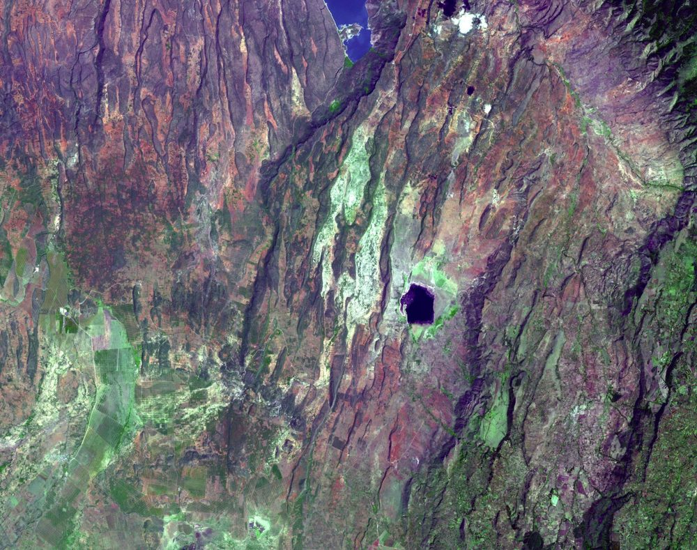
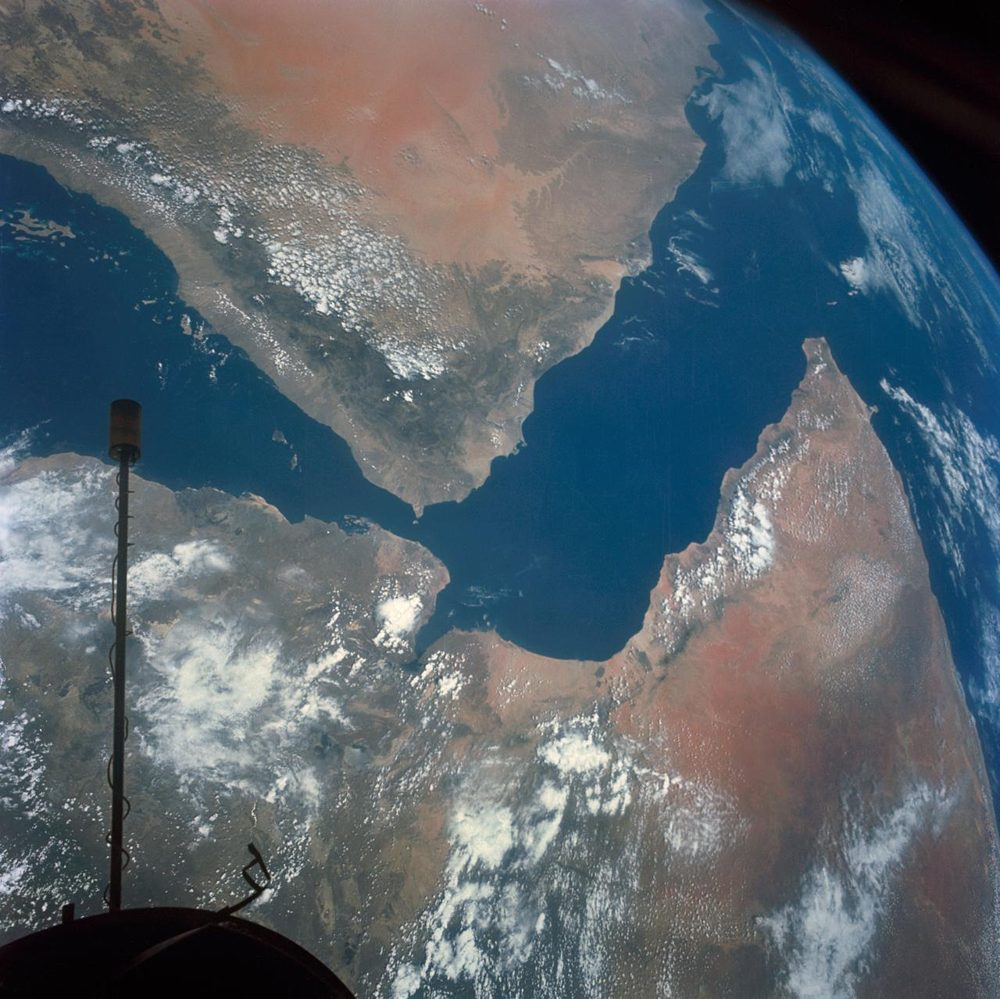
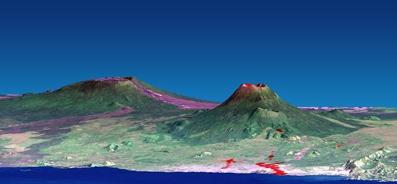

```{=html}
<style>
@import url('https://fonts.googleapis.com/css2?family=Space+Grotesk:wght@700&family=Inter:wght@400;600;800&display=swap');

.engage-box { background: linear-gradient(135deg, #c0392b 0%, #a52a1a 100%); color: white; padding: 25px; margin: 20px 0; border-radius: 15px; box-shadow: 0 10px 30px rgba(225, 112, 85, 0.3); }
.explore-box { background: linear-gradient(135deg, #0767b5 0%, #00806a 100%); color: white; padding: 25px; margin: 20px 0; border-radius: 15px; box-shadow: 0 10px 30px rgba(9, 132, 227, 0.3); }
.explain-box { background: linear-gradient(135deg, #4b3bb5 0%, #6a5acd 100%); color: white; padding: 25px; margin: 20px 0; border-radius: 15px; box-shadow: 0 10px 30px rgba(108, 92, 231, 0.3); }
.elaborate-box { background: linear-gradient(135deg, #c25100 0%, #b33939 100%); color: white; padding: 25px; margin: 20px 0; border-radius: 15px; box-shadow: 0 10px 30px rgba(230, 126, 34, 0.3); }
.evaluate-box { background: linear-gradient(135deg, #b71c1c 0%, #9c2b5a 100%); color: white; padding: 25px; margin: 20px 0; border-radius: 15px; box-shadow: 0 10px 30px rgba(255, 107, 107, 0.3); }
.engage-box h2, .explore-box h2, .explain-box h2, .elaborate-box h2, .evaluate-box h2 { font-family: 'Space Grotesk', sans-serif; font-size: 2em; margin-top: 0; color: white !important; }
.engage-box a, .explore-box a, .explain-box a, .elaborate-box a, .evaluate-box a { color: #ffe0b2; }
.pe-badge { display: inline-block; background: linear-gradient(135deg, #e17055 0%, #d63031 100%); color: white; padding: 8px 16px; border-radius: 20px; font-size: 13px; font-weight: 800; margin: 5px; box-shadow: 0 4px 15px rgba(225, 112, 85, 0.4); text-transform: uppercase; letter-spacing: 1px; }
.big-question { font-family: 'Space Grotesk', sans-serif; font-size: 2.5em; font-weight: 800; background: linear-gradient(135deg, #e17055 0%, #d63031 100%); -webkit-background-clip: text; -webkit-text-fill-color: transparent; margin: 30px 0 20px 0; text-align: center; animation: slideIn 0.8s ease-out; }
.key-idea { background: linear-gradient(135deg, #ffecd2 0%, #fcb69f 100%); color: #1a1a1a; padding: 20px; margin: 20px 0; border-radius: 12px; border-left: 8px solid #e17055; font-size: 1.05em; }
.student-task { background: #fff3e0; color: #1a1a1a; border-left: 5px solid #ff9800; padding: 20px; margin: 15px 0; border-radius: 0 10px 10px 0; }
.mind-blown { background: linear-gradient(135deg, #c0392b 0%, #8e2a1d 100%); color: white; padding: 20px; margin: 20px 0; border-radius: 15px; font-size: 1.2em; font-weight: 700; text-align: center; box-shadow: 0 10px 25px rgba(225, 112, 85, 0.4); }
@keyframes slideIn { from { opacity: 0; transform: translateY(-20px); } to { opacity: 1; transform: translateY(0); } }
h1 { font-family: 'Space Grotesk', sans-serif !important; font-weight: 800 !important; font-size: 2.8em !important; margin-top: 40px !important; }
h2 { font-family: 'Space Grotesk', sans-serif !important; font-weight: 700 !important; color: #e17055 !important; }
.em-table { width: 100%; border-collapse: collapse; font-size: .9em; margin: 6px 0 16px; }
.em-table th, .em-table td { padding: 6px 8px; border-bottom: 1px solid rgba(128,128,128,.3); text-align: left; vertical-align: top; }
</style>
```

<a class="quiz-jump-btn" href="#end-of-chapter-quiz">🧠 Quiz ↓</a>

<div class="big-question">🔥 What Energy Is Tearing Africa Apart? 🌍</div>

::: {.callout-note collapse="true"}
## 📒 Using this chapter with your student packet

This chapter follows the same steps as your **Energy and Matter 5E** packet. Missed a class or need a refresher? Jump to the matching section:

| Packet section | In this chapter |
|---|---|
| Energy Inside the Earth (Great Rift Valley maps) | [Engage](#engage-energy-inside-the-earth) |
| Modeling Earth's Interior Processes: Models 1–3 (Tables 1–3) | [Explore: the three models](#the-three-models) |
| Modeling Earth's Interior Processes: See-Think-Wonder | [See-Think-Wonder](#see-think-wonder) |
| Explaining the Great Rift Valley, Part 1 + The Role of Density | [Explain Part 1](#part-1-how-energy-from-earths-interior-causes-plate-motion), [Density](#the-role-of-density) |
| Where does the heat come from? (Possible Energy-Releasing Processes) | [Where does the heat come from?](#where-does-the-heat-come-from) |
| Part 2: Modeling the Movement of Energy and the Motion of the Great Rift Valley | [Explain Part 2](#part-2-modeling-the-movement-of-energy-and-the-great-rift-valley) |
| Summary Task | [Summary Task](#summary-task) |
| How do energy and minerals impact human populations? + reading | [Elaborate](#elaborate-how-do-energy-and-minerals-impact-human-populations) |
| Tectonically Active Region Resources | [Region resources](#tectonically-active-region-resources) |
| Energy Transfer Model Rubric + Energy and Matter Explanation Rubric | [Evaluate checklist](#energy-and-matter-checklist) |
:::

::: {.callout-tip collapse="true"}
## 🔁 What you already figured out in this unit

- **Earth's Interior:** Earth has layers set by **density**: a rocky **crust**, a solid but slowly flowing **mantle**, a **liquid outer core**, and a **solid inner core**. It gets **hotter with depth**.
- **Plate Boundaries:** Earthquakes and volcanoes cluster at plate boundaries. Plates move **apart** (divergent), **together** (convergent), or **past each other** (transform). The **Tonga** eruption happened where one plate sinks under another.

**Still unanswered:** *What moves the plates? Why is Earth's inside so hot? And why do people keep living in these dangerous places?*
:::

# Engage: Energy Inside the Earth

::: {.engage-box}
## 🌍 A Continent Splitting Apart

Africa's **Great Rift Valley** is a set of rifts at **diverging plate boundaries** that stretches from the Middle East down to Malawi. It is geologically active and **frequently has earthquakes** from tectonic forces.

It is also the **cradle of humanity**: people have lived here for well over 100,000 years, right on top of plates that are moving apart.

**Where do you think the energy to split this continent apart is coming from?**
:::

<figure style="margin: 18px auto; max-width: 640px; text-align: center;">
  
  <figcaption style="margin-top: 8px; color: #64748b; font-size: .85em; font-style: italic; line-height: 1.4;">
    Part of the East African Rift seen by NASA's Terra satellite (ASTER), December 18, 2002. The long parallel ridges are blocks of crust that cracked and dropped down as the plates pulled apart. Credit: NASA/GSFC/METI/ERSDAC/JAROS and U.S./Japan ASTER Science Team (PIA11082).
  </figcaption>
</figure>

## The Great Rift Valley

Your packet shows four maps of East Africa: earthquakes, the rift valleys, volcanoes, and the rift's outline. The map below combines them using **real earthquake data from the USGS** (magnitude 4.5 and up, since 2000). Each circle is one earthquake. Triangles are some of the rift's well-known volcanoes.

```{ojs}
//| echo: false
Plot = require("@observablehq/plot")
d3 = require("d3@7")
topojson = require("topojson-client@3")
```

```{ojs}
//| echo: false
emLand = {
  const tryLoad = async (url) => { const w = await d3.json(url); return topojson.feature(w, w.objects.land); };
  try { return await tryLoad("../world-110m.json"); }
  catch (e) {
    try { return await tryLoad("https://cdn.jsdelivr.net/npm/world-atlas@2.0.2/land-110m.json"); }
    catch (e2) { return null; }
  }
}
```

```{ojs}
//| echo: false
emQuakes = {
  const url = "https://earthquake.usgs.gov/fdsnws/event/1/query?format=geojson&starttime=2000-01-01&minmagnitude=4.5&minlatitude=-18&maxlatitude=22&minlongitude=24&maxlongitude=54&orderby=time&limit=4000";
  try {
    const fc = await d3.json(url);
    return fc.features.map(f => ({
      lon: f.geometry.coordinates[0], lat: f.geometry.coordinates[1], depth: f.geometry.coordinates[2],
      mag: f.properties.mag, place: f.properties.place, year: new Date(f.properties.time).getFullYear()
    }));
  } catch (e) { return null; }
}
```

```{ojs}
//| echo: false
emVolcanoes = [
  {name: "Erta Ale", lon: 40.67, lat: 13.60},
  {name: "Longonot", lon: 36.45, lat: -0.91},
  {name: "Ol Doinyo Lengai", lon: 35.90, lat: -2.76},
  {name: "Kilimanjaro", lon: 37.35, lat: -3.07},
  {name: "Nyiragongo", lon: 29.25, lat: -1.52}
]
```

```{ojs}
//| echo: false
viewof emMinMag = Inputs.range([4.5, 6.5], {label: "Show earthquakes of magnitude ≥", step: 0.1, value: 4.5})
```

```{ojs}
//| echo: false
{
  const quakes = (emQuakes || []).filter(d => d.mag >= emMinMag);
  const labels = [
    {lon: 38.6, lat: 19.5, text: "Red Sea"},
    {lon: 48.5, lat: 13.6, text: "Gulf of Aden"},
    {lon: 37.6, lat: 3.2, text: "Eastern Rift"},
    {lon: 27.6, lat: -6.5, text: "Western Rift"}
  ];
  const wrap = d3.create("div");
  wrap.append(() => Plot.plot({
    title: "Earthquakes along the East African Rift",
    subtitle: emQuakes ? `${quakes.length.toLocaleString()} earthquakes since 2000 (USGS). Tap a circle for details.` : "Live USGS data could not load right now — volcanoes and labels are still shown.",
    width: width,
    height: Math.min(560, width * 1.15),
    projection: {type: "mercator", domain: {type: "MultiPoint", coordinates: [[25, -17], [53, 21]]}},
    r: {type: "linear", domain: [4.5, 7], range: [1.5, 7]},
    marks: [
      Plot.frame({fill: "#cfe8fb"}),
      emLand ? Plot.geo(emLand, {fill: "#f2e6cf", stroke: "#a8a29e", strokeWidth: 0.6}) : null,
      Plot.graticule({strokeOpacity: 0.12}),
      Plot.dot(quakes, {x: "lon", y: "lat", r: "mag", fill: "#7e57c2", fillOpacity: 0.55, stroke: "#4527a0", strokeWidth: 0.5, tip: true,
        title: d => `M${d.mag.toFixed(1)} · ${d.year}\n${d.place}\nDepth: ${Math.round(d.depth)} km`}),
      Plot.dot(emVolcanoes, {x: "lon", y: "lat", symbol: "triangle", r: 7, fill: "#d63031", stroke: "white", strokeWidth: 1.2,
        title: d => `${d.name} (volcano)`, tip: true}),
      Plot.text(emVolcanoes.filter(d => d.name === "Ol Doinyo Lengai"), {x: "lon", y: "lat", text: "name", dx: -9, textAnchor: "end", fontSize: 10, fontWeight: 600, fill: "#7f1d1d", stroke: "white", strokeWidth: 3}),
      Plot.text(emVolcanoes.filter(d => d.name !== "Kilimanjaro" && d.name !== "Ol Doinyo Lengai"), {x: "lon", y: "lat", text: "name", dx: 9, textAnchor: "start", fontSize: 10, fontWeight: 600, fill: "#7f1d1d", stroke: "white", strokeWidth: 3}),
      Plot.text(emVolcanoes.filter(d => d.name === "Kilimanjaro"), {x: "lon", y: "lat", text: "name", dx: 9, dy: 8, textAnchor: "start", fontSize: 10, fontWeight: 600, fill: "#7f1d1d", stroke: "white", strokeWidth: 3}),
      Plot.text(labels, {x: "lon", y: "lat", text: "text", fontSize: 12, fontStyle: "italic", fontWeight: 700, fill: "#1e3a5f", stroke: "white", strokeWidth: 3})
    ]
  }));
  wrap.append("p").style("font-size", "0.85em").style("margin-top", "6px")
    .html("🟣 circle = earthquake (bigger = stronger) &nbsp; 🔺 = volcano. Data: <a href='https://earthquake.usgs.gov/earthquakes/search/' target='_blank' rel='noopener'>USGS Earthquake Catalog</a>.");
  return wrap.node();
}
```

<figure style="margin: 18px auto; max-width: 560px; text-align: center;">
  
  <figcaption style="margin-top: 8px; color: #64748b; font-size: .85em; font-style: italic; line-height: 1.4;">
    The Gulf of Aden (center) and the southern Red Sea (left), photographed by Gemini 11 astronauts in 1966. Both are rifts that already opened wide enough to fill with ocean water. The Arabian Peninsula is at the top and the Horn of Africa at lower right. Credit: NASA (S66-54536).
  </figcaption>
</figure>

::: {.key-idea}
### 💡 What the maps show

- Earthquakes and volcanoes line up along **narrow belts**: the Red Sea, the Gulf of Aden, and the **Eastern** and **Western** branches of the rift.
- The northern rifts (Red Sea, Gulf of Aden) have already opened into **seas**. The rifts on land are at an earlier stage. Over millions of years, East Africa could split off and a **new ocean** could form.
- The plates move apart only a few **millimeters per year**, but sometimes a lot happens at once: in 2005, a crack about **60 km long** opened in Ethiopia's Afar region in just a few weeks.
:::

::: {.student-task}
### ✏️ In your packet: Energy Inside the Earth

- **Look closely** at the four maps of the Great Rift Valley. What patterns do you notice in where the earthquakes and volcanoes are?
- **Make an initial claim:** Where do you think the energy to split this continent apart is coming from? Write or sketch your idea.
- **Share ideas** with classmates (the *Rumors* routine). Note one idea that is similar to yours and one that is different.
:::

```{ojs}
//| echo: false
buildQuiz = function(id, title, questions) {
  const outer = html`<div id="${id}" style="margin:18px 0 24px 0;text-align:center;">
    <button style="
      display:inline-flex;align-items:center;gap:7px;
      background:linear-gradient(135deg,#667eea 0%,#764ba2 100%);
      color:#fff;border:none;padding:9px 22px;border-radius:50px;
      font-size:.95em;font-weight:700;cursor:pointer;
      box-shadow:0 3px 12px rgba(102,126,234,.45);
      transition:transform .15s,box-shadow .15s;"
      onmouseover="this.style.transform='scale(1.04)';this.style.boxShadow='0 5px 18px rgba(102,126,234,.55)'"
      onmouseout="this.style.transform='scale(1)';this.style.boxShadow='0 3px 12px rgba(102,126,234,.45)'"
    >
      <span style="font-size:1.1em;">📝</span> ${title}
      <span class="chevron" style="transition:transform .3s;">▼</span>
    </button>
    <div class="quiz-body" style="
      max-height:0;opacity:0;overflow:hidden;
      transition:max-height .5s cubic-bezier(.4,0,.2,1),opacity .4s ease,margin-top .3s ease;
      margin-top:0;text-align:left;">
      <button class="close-btn" style="
        display:block;margin:0 auto 10px auto;
        background:rgba(102,126,234,.12);color:#667eea;border:none;
        padding:5px 18px;border-radius:50px;font-size:.85em;
        font-weight:600;cursor:pointer;">Hide Quiz</button>
      <p style="text-align:center;color:#718096;font-style:italic;font-size:.9em;margin-bottom:12px;">
        Select an answer for each question.</p>
    </div>
  </div>`;
  const toggle = outer.querySelector("button");
  const chevron = toggle.querySelector(".chevron");
  const body   = outer.querySelector(".quiz-body");
  const closeBtn = body.querySelector(".close-btn");
  function expand(){  body.style.maxHeight="2000px";body.style.opacity="1";body.style.marginTop="14px";chevron.style.transform="rotate(180deg)"; }
  function collapse(){ body.style.maxHeight="0";body.style.opacity="0";body.style.marginTop="0";chevron.style.transform="rotate(0)"; }
  toggle.onclick = () => body.style.maxHeight === "0px" || body.style.maxHeight === "" ? expand() : collapse();
  closeBtn.onclick = collapse;
  questions.forEach((qq, qi) => {
    const card = document.createElement("div");
    card.style.cssText = "background:#fff;color:#1e1b4b;border-radius:12px;padding:16px 20px;margin-bottom:14px;box-shadow:0 2px 8px rgba(0,0,0,.08);";
    card.innerHTML = `<p style="font-weight:700;margin:0 0 10px;">${qi+1}. ${qq.q}</p>`;
    qq.options.forEach((opt, oi) => {
      const btn = document.createElement("button");
      btn.textContent = opt;
      btn.style.cssText = "display:block;width:100%;min-height:44px;text-align:left;padding:10px 14px;margin:6px 0;border:2px solid #e2e8f0;border-radius:8px;background:#fff;color:#1e1b4b;cursor:pointer;font-size:.95em;transition:border-color .2s,background .2s;";
      btn.onmouseover = () => { if(!card.dataset.answered){ btn.style.borderColor="#667eea";btn.style.background="#f0f0ff"; }};
      btn.onmouseout  = () => { if(!card.dataset.answered){ btn.style.borderColor="#e2e8f0";btn.style.background="#fff"; }};
      btn.onclick = () => {
        if(card.dataset.answered) return;
        card.dataset.answered = "true";
        card.querySelectorAll("button").forEach(b => { b.style.cursor="default"; b.onmouseover=null; b.onmouseout=null; });
        if(oi === qq.correct){
          btn.style.borderColor="#48bb78";btn.style.background="#f0fff4";
          fb.innerHTML = "✅ Correct! " + qq.explanation;
          fb.style.color="#276749";fb.style.background="#f0fff4";
        } else {
          btn.style.borderColor="#fc8181";btn.style.background="#fff5f5";
          card.querySelectorAll("button")[qq.correct].style.borderColor="#48bb78";
          card.querySelectorAll("button")[qq.correct].style.background="#f0fff4";
          fb.innerHTML = "❌ " + qq.explanation;
          fb.style.color="#9b2c2c";fb.style.background="#fff5f5";
        }
        fb.style.padding="10px 14px";fb.style.marginTop="8px";
      };
      card.appendChild(btn);
    });
    const fb = document.createElement("div");
    fb.style.cssText = "border-radius:8px;font-size:.9em;transition:all .3s;";
    card.appendChild(fb);
    body.appendChild(card);
  });
  return outer;
}
```

```{ojs}
//| echo: false
buildQuiz("em-rift-quiz", "🌍 Check Your Understanding — The Great Rift Valley", [
  {
    q: "Look at the earthquake map. Where are most of the earthquakes?",
    options: ["Spread evenly across all of Africa", "In narrow belts along the rifts, the Red Sea, and the Gulf of Aden", "Only along the coast of the Indian Ocean", "Only near the equator"],
    correct: 1,
    explanation: "The earthquakes trace narrow lines: the Red Sea, the Gulf of Aden, and the Eastern and Western branches of the rift. Those lines are where the plates are pulling apart."
  },
  {
    q: "What kind of plate boundary runs through the Great Rift Valley?",
    options: ["Convergent: plates pushing together", "Transform: plates sliding past each other", "Divergent: plates moving apart", "There is no plate boundary there"],
    correct: 2,
    explanation: "The Great Rift Valley is a set of rifts at diverging plate boundaries. The crust is stretched, cracks, and drops down into long valleys."
  },
  {
    q: "The Red Sea and the Gulf of Aden are already filled with ocean water. What does that suggest about the land rifts farther south?",
    options: ["They could keep widening and one day fill with ocean water too", "They will close up again next year", "They are not related to the Red Sea", "They are getting colder and will stop"],
    correct: 0,
    explanation: "The Red Sea and Gulf of Aden show a later stage of the same process. If the East African rifts keep spreading for millions of years, a new ocean could form."
  }
])
```

# Explore: Modeling Earth's Interior Processes

::: {.explore-box}
## 🔬 How Does Heating and Cooling Move Matter?

In class you set up **three physical models** and looked for patterns in the **movement of matter** when it is heated and cooled. These patterns can help you explain where the energy came from that moved matter in the **Tonga** eruption and in the **Great Rift Valley**.
:::

## The Three Models

| Model | Set-up | What to watch |
|---|---|---|
| **Model 1** | Beaker of cooking oil with oregano on a **hot plate** | How the oregano and oil move as the bottom heats up |
| **Model 2** | Tub of room-temperature water; a bottle of **hot red** water laid on one side, **blue ice cubes** on the other | Where the hot red and cold blue colors go |
| **Model 3** | Shallow glass dish of oil and oregano with **4 plastic pieces** floating in the middle, over a row of **tea candles** | How the oil, oregano, *and* the plastic pieces move |

Run each model below. Make a **prediction** first, then press **Start**. (The simulation is sped up; in class, observe for about 30–45 seconds.)

```{ojs}
//| echo: false
viewof emModel = Inputs.radio(["Model 1 · Hot plate", "Model 2 · Hot & cold water", "Model 3 · Candles + plates"], {label: "Choose a model:", value: "Model 3 · Candles + plates"})
```

```{ojs}
//| echo: false
viewof emHeat = Inputs.toggle({label: "▶ Start (heat on / add hot & cold water)", value: false})
```

```{ojs}
//| echo: false
viewof emShow = Inputs.checkbox(["Color matter by temperature", "Show flow arrows"], {label: "Options:", value: []})
```

```{ojs}
//| echo: false
viewof emReset = Inputs.button("↺ Reset the model")
```

```{ojs}
//| echo: false
{
  emReset;
  const heatEl = viewof emHeat, showEl = viewof emShow;
  const heatOn = () => heatEl.value;
  const m = emModel.startsWith("Model 1") ? 1 : emModel.startsWith("Model 2") ? 2 : 3;
  let colorT = false, arrows = false;
  const W = Math.max(300, Math.min(width, 640));
  let fx, fw, fh, fy = 34;
  if (m === 1) { fw = W * 0.46; fx = (W - fw) / 2; fh = W * 0.48; }
  else if (m === 2) { fw = W * 0.86; fx = (W - fw) / 2; fh = W * 0.30; }
  else { fw = W * 0.86; fx = (W - fw) / 2; fh = W * 0.20; }
  const Hc = fy + fh + (m === 2 ? 26 : 74);

  const wrap = document.createElement("div");
  wrap.style.cssText = "max-width:640px;margin:auto;";
  const canvas = document.createElement("canvas");
  const dpr = Math.min(window.devicePixelRatio || 1, 2);
  canvas.width = W * dpr; canvas.height = Hc * dpr;
  canvas.style.cssText = `width:${W}px;height:${Hc}px;display:block;margin:auto;border-radius:12px;background:#f8fafc;`;
  canvas.setAttribute("role", "img");
  canvas.setAttribute("aria-label", "Animated model of convection: particles move as the fluid is heated from below or cooled from above");
  wrap.appendChild(canvas);
  const readout = document.createElement("div");
  readout.style.cssText = "margin:8px auto 0;max-width:640px;padding:10px 14px;border-radius:8px;background:rgba(9,132,227,.1);font-size:.92em;line-height:1.45;min-height:3.2em;";
  wrap.appendChild(readout);
  const ctx = canvas.getContext("2d");
  ctx.scale(dpr, dpr);

  const A = 0.03;
  function vel(x, y) {
    if (m === 2) {
      const a = -A * 1.1;
      return [a * Math.PI * Math.sin(Math.PI * x) * Math.cos(Math.PI * y), -a * Math.PI * Math.cos(Math.PI * x) * Math.sin(Math.PI * y)];
    }
    return [A * Math.PI * Math.sin(2 * Math.PI * x) * Math.cos(Math.PI * y), -2 * Math.PI * A * Math.cos(2 * Math.PI * x) * Math.sin(Math.PI * y)];
  }
  const px = x => fx + x * fw, py = y => fy + (1 - y) * fh;

  let seed = 7;
  const rand = () => { seed = (seed * 16807) % 2147483647; return seed / 2147483647; };
  let parts = [];
  if (m !== 2) parts = d3.range(170).map(() => ({x: 0.03 + rand() * 0.94, y: 0.03 + rand() * 0.94, T: 0.3}));
  const pw = 0.11;
  const plates = [0.28, 0.39, 0.50, 0.61].map(x0 => ({x0}));
  let dyeAdded = false;
  let s = 0, t = 0, tOn = 0, last = performance.now(), raf = 0, lastText = 0;

  function addDye() {
    dyeAdded = true;
    for (let i = 0; i < 90; i++) parts.push({x: 0.02 + rand() * 0.12, y: 0.86 + rand() * 0.12, T: 1, kind: "hot"});
    for (let i = 0; i < 90; i++) parts.push({x: 0.86 + rand() * 0.12, y: 0.84 + rand() * 0.14, T: 0, kind: "cold"});
  }

  function drawContainer() {
    ctx.clearRect(0, 0, W, Hc);
    ctx.fillStyle = "#334155"; ctx.font = "600 13px sans-serif"; ctx.textAlign = "center";
    ctx.fillText(m === 1 ? "Model 1: oil + oregano on a hot plate" : m === 2 ? "Model 2: hot (red) and cold (blue) water" : "Model 3: oil + oregano + 4 plastic pieces over candles", W / 2, 20);
    // fluid
    const fluid = m === 2 ? "#d6ecfb" : "#f8e9a8";
    ctx.fillStyle = fluid; ctx.fillRect(fx, fy, fw, fh);
    // heat glow
    if (m !== 2 && s > 0.01) {
      const gx = px(0.5), gy = py(0);
      const g = ctx.createRadialGradient(gx, gy, 2, gx, gy, m === 1 ? fw * 0.75 : fw * 0.3);
      g.addColorStop(0, `rgba(231,76,60,${0.45 * s})`); g.addColorStop(1, "rgba(231,76,60,0)");
      ctx.fillStyle = g; ctx.fillRect(fx, fy, fw, fh);
    }
    if (m === 2 && dyeAdded) {
      const decay = Math.exp(-tOn / 45);
      const g1 = ctx.createRadialGradient(px(0.05), py(1), 2, px(0.05), py(1), fw * 0.35);
      g1.addColorStop(0, `rgba(231,76,60,${0.25 * decay})`); g1.addColorStop(1, "rgba(231,76,60,0)");
      ctx.fillStyle = g1; ctx.fillRect(fx, fy, fw, fh);
      const g2 = ctx.createRadialGradient(px(0.94), py(1), 2, px(0.94), py(1), fw * 0.35);
      g2.addColorStop(0, `rgba(41,128,185,${0.3 * decay})`); g2.addColorStop(1, "rgba(41,128,185,0)");
      ctx.fillStyle = g2; ctx.fillRect(fx, fy, fw, fh);
    }
    // walls
    ctx.strokeStyle = "#64748b"; ctx.lineWidth = 3;
    ctx.beginPath(); ctx.moveTo(fx, fy - (m === 1 ? 12 : 6)); ctx.lineTo(fx, fy + fh); ctx.lineTo(fx + fw, fy + fh); ctx.lineTo(fx + fw, fy - (m === 1 ? 12 : 6)); ctx.stroke();
    // heat source
    if (m === 1) {
      const hx = fx - W * 0.07, hw = fw + W * 0.14;
      ctx.fillStyle = s > 0.05 ? `rgb(${Math.round(150 + 90 * s)},${Math.round(150 - 60 * s)},${Math.round(150 - 90 * s)})` : "#cbd5e1";
      ctx.fillRect(hx, fy + fh + 2, hw, 10);
      ctx.fillStyle = "#94a3b8"; ctx.beginPath();
      ctx.moveTo(hx - 10, fy + fh + 50); ctx.lineTo(hx + 4, fy + fh + 12); ctx.lineTo(hx + hw - 4, fy + fh + 12); ctx.lineTo(hx + hw + 10, fy + fh + 50); ctx.closePath(); ctx.fill();
      ctx.fillStyle = "#334155"; ctx.beginPath(); ctx.arc(hx + 22, fy + fh + 31, 9, 0, 2 * Math.PI); ctx.fill();
      ctx.fillStyle = "#334155"; ctx.font = "12px sans-serif"; ctx.fillText(heatOn() ? "hot plate ON" : "hot plate off", W / 2, fy + fh + 66);
    } else if (m === 3) {
      ctx.fillStyle = "#94a3b8";
      ctx.fillRect(fx - 4, fy + fh, 26, 34); ctx.fillRect(fx + fw - 22, fy + fh, 26, 34);
      for (let i = -1; i <= 1; i++) {
        const cxp = px(0.5) + i * 20;
        ctx.fillStyle = "#e2e8f0"; ctx.fillRect(cxp - 7, fy + fh + 26, 14, 12);
        if (heatOn()) {
          const fl = 9 + Math.sin(t * 13 + i * 2) * 2;
          ctx.fillStyle = "#f39c12"; ctx.beginPath(); ctx.ellipse(cxp, fy + fh + 26 - fl / 2, 4, fl / 2, 0, 0, 2 * Math.PI); ctx.fill();
        }
      }
      ctx.fillStyle = "#334155"; ctx.font = "12px sans-serif"; ctx.fillText(heatOn() ? "tea candles lit" : "tea candles not lit", W / 2, fy + fh + 58);
    } else {
      // bottle and ice
      ctx.fillStyle = "#e74c3c"; ctx.fillRect(px(0.0) + 4, fy - 6, fw * 0.12, 10);
      ctx.fillStyle = "#c0392b"; ctx.fillRect(px(0.0) + 4 + fw * 0.12, fy - 4, 8, 6);
      ctx.fillStyle = "#1e40af";
      for (let i = 0; i < 3; i++) ctx.fillRect(px(0.86) + i * 12, fy - 4, 10, 10);
      ctx.fillRect(px(0.86) + 12, fy + 6, 10, 10);
      ctx.fillStyle = "#334155"; ctx.font = "12px sans-serif"; ctx.textAlign = "left";
      ctx.fillText("hot red water", px(0) + 4, fy + fh + 18);
      ctx.textAlign = "right"; ctx.fillText("blue ice", px(1) - 4, fy + fh + 18); ctx.textAlign = "center";
    }
  }

  function drawArrows() {
    if (!arrows) return;
    ctx.strokeStyle = "rgba(30,41,59,.55)"; ctx.fillStyle = "rgba(30,41,59,.55)"; ctx.lineWidth = 1.5;
    const nx = m === 1 ? 6 : 9, ny = m === 1 ? 6 : m === 2 ? 4 : 3;
    for (let i = 0; i < nx; i++) for (let j = 0; j < ny; j++) {
      const x = (i + 0.5) / nx, y = (j + 0.5) / ny;
      const [u, v] = vel(x, y);
      const sc = Math.max(s, 0.25) * 140;
      const dx = u * sc * fw / 100, dy = -v * sc * fh / 100 * (m === 1 ? 1 : 1.6);
      const x0 = px(x), y0 = py(y), x1 = x0 + dx, y1 = y0 + dy;
      ctx.beginPath(); ctx.moveTo(x0, y0); ctx.lineTo(x1, y1); ctx.stroke();
      const ang = Math.atan2(y1 - y0, x1 - x0);
      ctx.beginPath(); ctx.moveTo(x1, y1);
      ctx.lineTo(x1 - 6 * Math.cos(ang - 0.45), y1 - 6 * Math.sin(ang - 0.45));
      ctx.lineTo(x1 - 6 * Math.cos(ang + 0.45), y1 - 6 * Math.sin(ang + 0.45)); ctx.closePath(); ctx.fill();
    }
  }

  function step(ts) {
    const dt = Math.min((ts - last) / 1000, 0.05); last = ts; t += dt;
    const heatNow = heatOn();
    colorT = showEl.value.includes("Color matter by temperature");
    arrows = showEl.value.includes("Show flow arrows");
    if (heatNow) tOn += dt;
    if (m === 2 && heatNow && !dyeAdded) addDye();
    const target = heatNow ? (m === 2 ? Math.max(0.15, Math.exp(-tOn / 45)) : 1) : 0;
    s += (target - s) * Math.min(1, dt / 2.5);
    const decay = Math.exp(-tOn / 45);
    for (const p of parts) {
      const [u, v] = vel(p.x, p.y);
      let vy = v * s;
      if (m === 2) vy += (p.kind === "hot" ? 0.035 : -0.045) * decay * (heatNow ? 1 : 0);
      p.x += (u * s + (rand() - 0.5) * 0.006 * Math.max(s, 0.1)) * dt * 3;
      p.y += (vy + (rand() - 0.5) * 0.006 * Math.max(s, 0.1)) * dt * 3;
      p.x = Math.min(0.985, Math.max(0.015, p.x)); p.y = Math.min(0.985, Math.max(0.015, p.y));
      if (m !== 2) {
        const nearSource = m === 1 ? p.y < 0.1 : (p.y < 0.16 && Math.abs(p.x - 0.5) < 0.11);
        if (heatNow && nearSource) p.T += (1 - p.T) * dt * 2.5;
        else if (p.y > 0.88) p.T -= (p.T - 0.05) * dt * 0.9;
        else p.T -= (p.T - 0.3) * dt * 0.06;
      } else {
        p.T += (0.5 - p.T) * dt * 0.02;
      }
    }
    if (m === 3) {
      for (const pl of plates) { const c = pl.x0 + pw / 2; pl.x0 += vel(c, 1)[0] * s * dt * 2.4; }
      plates[0].x0 = Math.max(0.005, plates[0].x0);
      for (let i = 1; i < 4; i++) plates[i].x0 = Math.max(plates[i].x0, plates[i - 1].x0 + pw);
      plates[3].x0 = Math.min(0.995 - pw, plates[3].x0);
      for (let i = 2; i >= 0; i--) plates[i].x0 = Math.min(plates[i].x0, plates[i + 1].x0 - pw);
    }

    drawContainer();
    for (const p of parts) {
      let col;
      if (m === 2) col = p.kind === "hot" ? "#e74c3c" : "#2563eb";
      else col = colorT ? d3.interpolateRdYlBu(1 - p.T) : "#3f6212";
      ctx.fillStyle = col;
      if (m === 2) { ctx.globalAlpha = 0.75; ctx.beginPath(); ctx.arc(px(p.x), py(p.y), 3.2, 0, 2 * Math.PI); ctx.fill(); ctx.globalAlpha = 1; }
      else ctx.fillRect(px(p.x) - 2, py(p.y) - 1.5, 4, 3);
    }
    if (m === 3) {
      ctx.fillStyle = "#7c4a1e";
      for (const pl of plates) ctx.fillRect(px(pl.x0) + 1, fy - 5, pw * fw - 2, 7);
    }
    drawArrows();

    if (t - lastText > 0.3) {
      lastText = t;
      let msg;
      if (!heatNow && s < 0.02) msg = m === 2 && !dyeAdded ? "The water is still. Predict: where will the hot red water and the cold blue water go? Then press <b>Start</b>." : "No heat, no motion: the matter just sits there. Make a prediction, then press <b>Start</b>.";
      else if (m === 1) msg = "🔥 Oil touching the hot plate warms up, <b>rises</b> through the middle, spreads out at the top, cools, and <b>sinks</b> down the cooler sides. The oregano shows the loop: a <b>convection current</b>.";
      else if (m === 2) msg = "🔴 The <b>hot</b> red water stays near the top and spreads across the surface. 🔵 The <b>cold</b> blue water sinks to the bottom and spreads along the floor. Over time the temperatures even out and the motion slows down.";
      else {
        const gap = (plates[2].x0 - plates[1].x0 - pw) * 30;
        const touching = plates[0].x0 < 0.01 || plates[3].x0 > 0.98 - pw;
        msg = `🕯️ Hot oil <b>rises</b> above the candles and spreads outward under the plastic. Gap between the two middle plates: <b>${gap.toFixed(1)} cm</b> (of a 30 cm dish)` +
          (gap > 0.5 ? " — like plates moving apart at a <b>divergent boundary</b> such as the Great Rift Valley." : ".") +
          (touching ? " The outer plates are being pushed into the dish edges and each other — like a <b>convergent boundary</b>." : "");
      }
      readout.innerHTML = msg;
    }
    raf = requestAnimationFrame(step);
  }
  raf = requestAnimationFrame(step);
  invalidation.then(() => cancelAnimationFrame(raf));
  return wrap;
}
```

::: {.student-task}
### ✏️ In your packet: Tables 1, 2, and 3

For **each** model:

- **Prediction:** draw what you think will happen and use **arrows** to show any movement. Describe it in words.
- **Observations:** draw and describe what you actually see. Label the parts: the beaker or container, oil or water, oregano or food coloring, heat source, ice, and plastic pieces.
- **Model 3:** also show what happens to the **4 plastic pieces**. (In class: blow out the candles before moving on!)
:::

```{ojs}
//| echo: false
buildQuiz("em-models-quiz", "🔬 Check Your Understanding — The Three Models", [
  {
    q: "In Model 1, where was the greatest amount of energy when you started the model?",
    options: ["At the top of the oil", "At the bottom, where the hot plate touches the beaker", "In the oregano", "Spread evenly through the oil"],
    correct: 1,
    explanation: "The hot plate is the energy source, so the oil at the bottom of the beaker heats up first. That hot oil is the matter that starts rising."
  },
  {
    q: "In Model 2, the cold blue water sank and the hot red water stayed on top. What explains this pattern?",
    options: ["Blue food coloring is heavier than red food coloring", "Cold water is more dense than warm water, so it sinks below it", "The ice cubes pushed the water down", "Hot water is attracted to the surface"],
    correct: 1,
    explanation: "Cooling makes water contract, so the same amount of water takes up less space: it becomes more dense and sinks. Warm water is less dense, so it floats on top."
  },
  {
    q: "In Model 3, what happened to the plastic pieces when the candles were lit?",
    options: ["They sank to the bottom", "They stayed perfectly still", "The middle pieces moved apart and the outer pieces were pushed toward the edges", "They melted"],
    correct: 2,
    explanation: "Oil heated by the candles rises in the middle and spreads outward, dragging the plastic pieces apart. A gap opens in the middle (like a divergent boundary) and the pieces pile up at the edges (like a convergent boundary)."
  }
])
```

## See-Think-Wonder

::: {.student-task}
### ✏️ In your packet: See – Think – Wonder

- **See:** What patterns did you observe related to matter (stuff) **rising**? Related to matter **sinking**? What else did you observe?
- **Think:** What do you think is **causing** the matter to move? How might what you observed explain the **plate motion** that formed the **Tonga volcano** and caused it to erupt?
- **Wonder:** What questions do you still have?
:::

::: {.callout-tip collapse="true"}
## ✅ Check your thinking: patterns many students notice (try first!)

- Matter that **rose** was hot or right next to the energy source (the hot plate, the hot red water, the candles).
- Matter that **sank** had moved away from the energy source and cooled, or started cold (the blue ice water).
- Heated matter seems to become **less dense** and rise; cooled matter becomes **more dense** and sinks. Denser stuff sinking pushes less dense stuff up.
- Energy moved from the bottom toward the top in Models 1 and 3, along with the moving matter.
- In Model 3 the plates moved **apart** over the rising oil and **crashed** into other plates at the edges, like divergent and convergent plate boundaries, where volcanoes like Tonga form.
:::

# Explain: Explaining the Great Rift Valley

::: {.explain-box}
## 🧠 From Classroom Models to Earth's Interior

The models showed a pattern: **heat makes matter rise, cooling makes it sink**, and the loop that forms (a **convection current**) can drag floating plates apart. Now let's connect each part of the models to the real Earth and figure out **where Earth's heat comes from**.
:::

## Part 1: How Energy from Earth's Interior Causes Plate Motion

Your packet puts **Model 3** next to a diagram of Earth's interior (a **ridge** in the middle, **trenches** at both edges, **lithosphere** on top, the **mantle** at 2,800–5,000 °C, and the **core** at 5,000–6,600 °C). Which parts match? Try it:

```{ojs}
//| echo: false
{
  const items = [
    {part: "🕯️ Tea candles (the heat source)", answer: "Heat from Earth's hot interior (the core and radioactive decay)"},
    {part: "🛢️ Cooking oil", answer: "The mantle: solid rock that flows very slowly"},
    {part: "🟫 Floating plastic pieces", answer: "The lithosphere: Earth's tectonic plates"},
    {part: "🌿 Oregano flakes", answer: "Bits of mantle matter: they show the path the matter takes"},
    {part: "↔️ Gap opening between the middle pieces", answer: "A ridge or rift: a divergent boundary"},
    {part: "💥 Pieces crashing at the dish edges", answer: "A trench: a convergent boundary"}
  ];
  const opts = ["(choose)", ...d3.shuffle(items.map(d => d.answer).concat(["The ocean water above the plates", "Sunlight warming Earth's surface"]), d3.randomLcg(42))];
  const wrap = html`<div style="max-width:680px;margin:10px auto;"></div>`;
  const rows = items.map(it => {
    const row = html`<div style="display:flex;flex-wrap:wrap;align-items:center;gap:8px;padding:8px 0;border-bottom:1px solid rgba(128,128,128,.25);">
      <div style="flex:1 1 220px;font-weight:600;">${it.part}</div>
      <select style="flex:1 1 260px;min-height:44px;padding:6px;border-radius:8px;border:1px solid #94a3b8;font-size:.92em;max-width:100%;background:var(--bs-body-bg);color:var(--bs-body-color);">
        ${opts.map(o => html`<option>${o}</option>`)}
      </select>
      <span class="mark" style="width:1.6em;text-align:center;font-size:1.2em;"></span>
    </div>`;
    wrap.appendChild(row);
    return {row, it, sel: row.querySelector("select"), mark: row.querySelector(".mark")};
  });
  const btn = html`<button style="margin-top:12px;min-height:44px;padding:8px 22px;border:none;border-radius:50px;background:linear-gradient(135deg,#4b3bb5,#6a5acd);color:#fff;font-weight:700;cursor:pointer;">Check my matches</button>`;
  const fb = html`<div style="margin-top:10px;padding:10px 14px;border-radius:8px;display:none;"></div>`;
  btn.onclick = () => {
    let n = 0;
    rows.forEach(r => { const ok = r.sel.value === r.it.answer; if (ok) n++; r.mark.textContent = r.sel.value === "(choose)" ? "" : ok ? "✅" : "❌"; });
    fb.style.display = "block";
    fb.style.background = n === items.length ? "rgba(46,204,113,.15)" : "rgba(108,92,231,.12)";
    fb.innerHTML = n === items.length
      ? "🎉 All 6 correct! The candles' heat makes the oil rise and spread, just like heat inside Earth makes mantle rock rise under a ridge and drag the plates apart."
      : `${n} of ${items.length} correct. Fix the ❌ rows. Hint: which part of Earth is <em>heated</em>, which part <em>flows</em>, and which part <em>floats on top</em>?`;
  };
  wrap.appendChild(btn); wrap.appendChild(fb);
  return wrap;
}
```

::: {.key-idea}
### 💡 In the real Earth, plates are also *pulled*

The packet's diagram labels **"slab pull."** At a trench, the old, cold edge of a plate is **denser** than the hot mantle beneath it, so gravity pulls it down into the mantle, and it drags the rest of the plate along behind it. Slab pull is part of the **same convection loop**: cold, dense matter sinking at trenches; hot, less dense matter rising at ridges.
:::

## The Role of Density

From the density column in the *Earth's Interior* lesson, you know that **layers form because less dense substances float on top of more dense ones**. Now: **how does a change in temperature affect a material's density?**

Drag the slider to heat a chunk of mantle rock. Watch the particles (spacing exaggerated so you can see it).

```{ojs}
//| echo: false
viewof emRockT = Inputs.range([2800, 5000], {label: "Rock temperature (°C):", step: 50, value: 4500})
```

```{ojs}
//| echo: false
{
  const rho = T => 3.30 / (1 + 3e-5 * (T - 2800));
  const Tsur = 3900, rhoSur = rho(Tsur);
  const r = rho(emRockT);
  const f = 1 + (emRockT - 2800) / 2200 * 0.55;
  const S = 220, n = 5, base = 30;
  const svg = d3.create("svg").attr("viewBox", `0 0 ${S * 2 + 40} ${S + 40}`)
    .style("width", "100%").style("max-width", "520px").style("height", "auto").style("display", "block").style("margin", "auto")
    .attr("role", "img").attr("aria-label", "Two boxes of particles: on the left, rock before heating with tightly packed particles; on the right, the same particles spread farther apart after heating");
  const drawBox = (x0, spacing, label, fill) => {
    const g = svg.append("g").attr("transform", `translate(${x0},20)`);
    g.append("rect").attr("width", S).attr("height", S).attr("fill", "none").attr("stroke", "#64748b").attr("stroke-width", 2).attr("rx", 8);
    const span = spacing * (n - 1);
    for (let i = 0; i < n; i++) for (let j = 0; j < n; j++) {
      g.append("circle").attr("cx", S / 2 - span / 2 + i * spacing).attr("cy", S / 2 - span / 2 + j * spacing).attr("r", 13)
        .attr("fill", fill).attr("stroke", "#334155");
    }
    g.append("text").attr("x", S / 2).attr("y", S + 16).attr("text-anchor", "middle").attr("font-size", 15).attr("font-weight", 700).attr("fill", "currentColor").text(label);
  };
  drawBox(10, base, "Before heating (2,800 °C)", "#bfdbfe");
  drawBox(S + 30, base * f, `After heating (${emRockT.toLocaleString()} °C)`, d3.interpolateYlOrRd(0.2 + 0.7 * (emRockT - 2800) / 2200));
  const verdict = Math.abs(emRockT - Tsur) < 60 ? "about the same density as the surrounding mantle: it neither rises nor sinks" :
    emRockT > Tsur ? "<b>less dense</b> than the surrounding mantle, so it is pushed up and <b>rises</b> ⬆️" : "<b>more dense</b> than the surrounding mantle, so gravity pulls it down and it <b>sinks</b> ⬇️";
  const wrap = d3.create("div");
  wrap.append(() => svg.node());
  wrap.append("div").style("max-width", "560px").style("margin", "8px auto").style("padding", "10px 14px").style("border-radius", "8px")
    .style("background", emRockT > Tsur ? "rgba(231,76,60,.12)" : "rgba(52,152,219,.12)")
    .html(`Same particles, same <b>mass</b>, but more <b>volume</b>: density = mass ÷ volume goes from 3.30 to <b>${r.toFixed(3)} g/cm³</b>.<br>
      Surrounding mantle at this depth: ${Tsur.toLocaleString()} °C, ${rhoSur.toFixed(3)} g/cm³. This rock is ${verdict}`);
  wrap.append("p").style("font-size", ".8em").style("opacity", ".75").style("text-align", "center")
    .text("Uses a typical thermal expansion for mantle rock (3 × 10⁻⁵ per °C) and compares rock at the same depth (same pressure).");
  return wrap.node();
}
```

::: {.key-idea}
### 💡 Hotter → less dense → rises. Cooler → more dense → sinks.

When matter is **heated**, its particles move faster and spread apart. The same mass takes up more volume, so its **density decreases**. Less dense matter is **pushed up** by the denser matter around it; denser matter is **pulled down** by gravity. Even a density difference of only a few percent is enough to make solid mantle rock creep upward or downward a few centimeters per year, over millions of years.
:::

```{ojs}
//| echo: false
buildQuiz("em-density-quiz", "⚖️ Check Your Understanding — Temperature and Density", [
  {
    q: "A chunk of mantle rock is heated. Its mass stays the same but its volume increases. What happens to its density?",
    options: ["It increases", "It decreases", "It stays the same", "It becomes zero"],
    correct: 1,
    explanation: "Density = mass ÷ volume. Same mass divided by a bigger volume gives a smaller density, so the heated rock is less dense than before."
  },
  {
    q: "Set the slider to 4,500 °C. Compared with the surrounding mantle (3,900 °C), what will this rock do?",
    options: ["Sink, because it is denser", "Rise, because it is less dense", "Stay still", "Turn into a gas"],
    correct: 1,
    explanation: "Rock hotter than its surroundings has expanded more, so it is less dense. The denser rock around it sinks and pushes it upward, like the hot oil over the candles."
  },
  {
    q: "Mantle rock near the top of the mantle cools as it gives off heat toward Earth's surface. What happens next?",
    options: ["It becomes more dense and sinks back down", "It becomes less dense and rises faster", "It stops moving forever", "It turns into core material"],
    correct: 0,
    explanation: "Cooling makes rock contract and become more dense, so gravity pulls it back down. Rising, cooling, sinking, and reheating make a full convection loop."
  }
])
```

#### 🌍 Annotate the convection model

Your packet asks you to annotate the Earth diagram to show **how energy and matter move** in Earth's interior to drive plate motion. Turn on each layer to build the model step by step:

```{ojs}
//| echo: false
viewof emLayers = Inputs.checkbox(["Temperatures", "Rising & sinking (density)", "Convection currents", "Plate motion & slab pull", "Heat sources", "Outer core convection"], {label: "Show:", value: ["Temperatures", "Convection currents"]})
```

```{ojs}
//| echo: false
{
  const show = new Set(emLayers);
  const W = 700, H = 620, cx = 350, cy = 600, R = 440, rL = 420, rOC = 215, rIC = 105;
  const rad = d => d * Math.PI / 180;
  const P = (r, deg) => [cx + r * Math.cos(rad(deg)), cy - r * Math.sin(rad(deg))];
  const svg = d3.create("svg").attr("viewBox", `0 0 ${W} ${H}`)
    .style("width", "100%").style("height", "auto").style("max-width", "700px").style("display", "block").style("margin", "auto")
    .attr("role", "img").attr("aria-label", "Cross-section of Earth's interior showing the lithosphere, a ridge at the top with trenches on both sides, the mantle, the liquid outer core, and the solid inner core, with optional labels for temperatures, convection currents, density, plate motion, and heat sources");
  const defs = svg.append("defs");
  const colors = {red: "#d63031", blue: "#0984e3", orange: "#e67e22", purple: "#6c5ce7", dark: "#1e293b", gold: "#b45309"};
  Object.entries(colors).forEach(([k, c]) => defs.append("marker").attr("id", `em-arr-${k}`).attr("viewBox", "0 0 10 10")
    .attr("refX", 6).attr("refY", 5).attr("markerWidth", 5).attr("markerHeight", 5).attr("orient", "auto-start-reverse")
    .append("path").attr("d", "M0,0 L10,5 L0,10 z").attr("fill", c));
  const mg = defs.append("radialGradient").attr("id", "em-mantle-grad").attr("cx", cx).attr("cy", cy).attr("r", rL).attr("gradientUnits", "userSpaceOnUse");
  mg.append("stop").attr("offset", "45%").attr("stop-color", "#f5a65b");
  mg.append("stop").attr("offset", "100%").attr("stop-color", "#fde2b8");

  svg.append("rect").attr("width", W).attr("height", H).attr("fill", "#bfe3f7").attr("rx", 12);
  svg.append("circle").attr("cx", cx).attr("cy", cy).attr("r", R).attr("fill", "#8a8a8a");
  svg.append("circle").attr("cx", cx).attr("cy", cy).attr("r", rL).attr("fill", "url(#em-mantle-grad)");
  svg.append("circle").attr("cx", cx).attr("cy", cy).attr("r", rOC).attr("fill", "#f39c12");
  svg.append("circle").attr("cx", cx).attr("cy", cy).attr("r", rIC).attr("fill", "#fde047").attr("stroke", "#b45309").attr("stroke-width", 1.5);

  const line = d3.line();
  const arcPts = (r, a0, a1, n = 24) => d3.range(n + 1).map(i => P(r, a0 + (a1 - a0) * i / n));
  const radPts = (a, r0, r1, n = 10) => d3.range(n + 1).map(i => P(r0 + (r1 - r0) * i / n, a));
  const txt = (x, y, lines, o = {}) => {
    const t = svg.append("text").attr("x", x).attr("y", y).attr("text-anchor", o.anchor || "middle")
      .attr("font-size", o.size || 19).attr("font-weight", o.weight || 700).attr("fill", o.fill || colors.dark)
      .attr("paint-order", "stroke").attr("stroke", o.halo || "none").attr("stroke-width", o.halo ? 4 : 0);
    [].concat(lines).forEach((l, i) => t.append("tspan").attr("x", x).attr("dy", i === 0 ? 0 : (o.size || 19) * 1.15).text(l));
  };

  // slabs (subducting plates) and ridge
  [[130, 1], [50, -1]].forEach(([a, sgn]) => {
    svg.append("path").attr("d", line([P(R - 8, a), P(R - 70, a + sgn * 3), P(R - 140, a + sgn * 7)]))
      .attr("fill", "none").attr("stroke", "#6b6b6b").attr("stroke-width", 20).attr("stroke-linecap", "round");
  });
  const [rx0, ry0] = P(R, 90);
  svg.append("path").attr("d", `M${rx0 - 14},${ry0 + 4} L${rx0},${ry0 - 14} L${rx0 + 14},${ry0 + 4} Z`).attr("fill", "#d63031");
  txt(rx0, ry0 - 30, "Ridge / rift", {size: 20});
  const [tlx, tly] = P(R, 130), [trx, try_] = P(R, 50);
  txt(tlx - 6, tly - 34, "Trench", {size: 20});
  txt(trx + 6, try_ - 34, "Trench", {size: 20});

  if (show.has("Temperatures")) {
    txt(...P(300, 112), ["Mantle", "2,800–5,000 °C"], {fill: "#9a3412", halo: "#fde2b8"});
    txt(cx, cy - 190, ["Outer core (liquid)", "5,000–6,300 °C"], {size: 17, fill: "#7c2d12", halo: "#f39c12"});
    txt(cx, cy - 72, ["Inner core (solid)"], {size: 16, fill: "#7c2d12"});
    txt(cx, cy - 50, ["6,300–6,600 °C"], {size: 16, fill: "#7c2d12"});
  }

  if (show.has("Convection currents")) {
    const rin = rOC + 18, rout = rL - 22;
    [[100, 124, 1], [80, 56, -1]].forEach(([aRise, aSink]) => {
      svg.append("path").attr("d", line(radPts(aRise, rin, rout))).attr("fill", "none").attr("stroke", colors.red).attr("stroke-width", 5).attr("marker-end", "url(#em-arr-red)");
      svg.append("path").attr("d", line(arcPts(rout, aRise, aSink - (aSink > aRise ? 2 : -2)))).attr("fill", "none").attr("stroke", colors.orange).attr("stroke-width", 5).attr("marker-end", "url(#em-arr-orange)");
      svg.append("path").attr("d", line(radPts(aSink, rout, rin + 4))).attr("fill", "none").attr("stroke", colors.blue).attr("stroke-width", 5).attr("marker-end", "url(#em-arr-blue)");
      svg.append("path").attr("d", line(arcPts(rin, aSink, aRise + (aSink > aRise ? 2 : -2)))).attr("fill", "none").attr("stroke", colors.purple).attr("stroke-width", 5).attr("marker-end", "url(#em-arr-purple)");
    });
  }

  if (show.has("Rising & sinking (density)")) {
    txt(cx, cy - 345, ["HOT", "less dense", "RISES ⬆"], {size: 17, fill: colors.red, halo: "#fde2b8"});
    txt(...P(345, 148), ["COOL", "more dense", "SINKS ⬇"], {size: 17, fill: colors.blue, halo: "#fde2b8"});
    txt(...P(345, 32), ["COOL", "more dense", "SINKS ⬇"], {size: 17, fill: colors.blue, halo: "#fde2b8"});
  }

  if (show.has("Plate motion & slab pull")) {
    svg.append("path").attr("d", line(arcPts(R + 16, 95, 124))).attr("fill", "none").attr("stroke", colors.dark).attr("stroke-width", 4).attr("marker-end", "url(#em-arr-dark)");
    svg.append("path").attr("d", line(arcPts(R + 16, 85, 56))).attr("fill", "none").attr("stroke", colors.dark).attr("stroke-width", 4).attr("marker-end", "url(#em-arr-dark)");
    txt(...P(R + 48, 113), "plates move apart", {size: 17});
    txt(...P(R - 100, 140), "SLAB", {size: 15, fill: "#f8fafc", halo: "#4b5563"});
    txt(...P(R - 120, 141), "PULL", {size: 15, fill: "#f8fafc", halo: "#4b5563"});
    txt(...P(R - 100, 40), "SLAB", {size: 15, fill: "#f8fafc", halo: "#4b5563"});
    txt(...P(R - 120, 39), "PULL", {size: 15, fill: "#f8fafc", halo: "#4b5563"});
    txt(620, 70, ["Lithosphere", "(plates)"], {size: 17, fill: "#374151"});
  }

  if (show.has("Heat sources")) {
    [18, 42, 138, 162].forEach(a => svg.append("path").attr("d", line(radPts(a, rOC + 2, rOC + 40, 2)))
      .attr("stroke", colors.gold).attr("stroke-width", 4).attr("fill", "none").attr("marker-end", "url(#em-arr-gold)"));
    const decay = [[365, 107], [245, 117], [300, 64], [350, 71], [265, 73], [330, 58], [390, 30], [262, 160], [255, 20]];
    decay.forEach(([r, a]) => txt(...P(r, a), "☢", {size: 20, fill: "#166534", weight: 400}));
    txt(14, 608, "☢ radioactive decay in mantle rock (uneven)   ➚ residual heat from the core", {size: 14, anchor: "start", fill: "#14532d", halo: "#fde68a"});
  }

  if (show.has("Outer core convection")) {
    [150, 90, 30].forEach(a => {
      const [lx, ly] = P(160, a);
      const r = 30;
      const pts = d3.range(0, 301, 15).map(d => [lx + r * Math.cos(rad(d)), ly - r * Math.sin(rad(d))]);
      svg.append("path").attr("d", line(pts)).attr("fill", "none").attr("stroke", "#7c2d12").attr("stroke-width", 3.5).attr("marker-end", "url(#em-arr-dark)");
    });
    txt(14, 586, "↻ liquid metal swirls in the outer core → magnetic field", {size: 14, anchor: "start", fill: "#7c2d12", halo: "#fde68a"});
  }
  return svg.node();
}
```

::: {.key-idea}
### 💡 The convection loop in Earth's mantle

1. The **core** is the hottest part of Earth, so it **transfers heat** to the cooler mantle above it.
2. Mantle rock that is heated **expands** and becomes **less dense**.
3. Cooler, **denser** rock is pulled down by **gravity** and forces the hotter, less dense rock **up**.
4. Near the surface, the hot rock can come out as **new crust** at **divergent boundaries** (ridges and rifts), pushing those plates toward **convergent boundaries**.
5. As the rock nears the surface it **transfers heat** to its cooler surroundings, becomes **more dense**, and **sinks** again, often as a cold slab at a trench.

This cycle of rising and sinking rock is what moves Earth's massive plates and causes natural hazards and surface features.
:::

```{ojs}
//| echo: false
buildQuiz("em-convection-quiz", "🔄 Check Your Understanding — The Convection Model", [
  {
    q: "In the Earth model, what part plays the role of the cooking oil in Model 3?",
    options: ["The ocean", "The mantle", "The inner core", "The atmosphere"],
    correct: 1,
    explanation: "The oil was heated from below and flowed in loops. In Earth, the mantle is heated from below by the core (and from within by radioactive decay) and flows very slowly in convection currents."
  },
  {
    q: "Turn on 'Rising & sinking.' Why does rock sink at the trenches?",
    options: ["It is hotter and less dense than the mantle around it", "It is cooler and more dense, so gravity pulls it down", "Water pushes it down", "The core pulls only on rock at trenches"],
    correct: 1,
    explanation: "The edge of a plate at a trench has been cooling at the surface for millions of years. It is denser than the hot mantle below, so it sinks, pulling the plate behind it (slab pull)."
  },
  {
    q: "Which feature in the model matches the Great Rift Valley?",
    options: ["A trench, where plates come together", "A ridge or rift, above rising hot mantle, where plates move apart", "The inner core", "The middle of a plate, far from any boundary"],
    correct: 1,
    explanation: "The Great Rift Valley sits where plates are moving apart above rising, hot mantle: the ridge/rift in the model, like the gap that opened between the middle plastic pieces."
  }
])
```

## Where Does the Heat Come From?

The motion of the mantle is what drives plate tectonics. That motion needs **heat**, like the heat from the candles. **But where does Earth's heat come from?**

::: {.explain-box}
## 🔥 44 Trillion Joules Every Second

Based on temperatures measured at the bottom of deep **boreholes**, scientists estimate that Earth's interior releases about **44 trillion joules of energy every second** (44,000,000,000,000 J/s, or 44 terawatts). That is many times faster than the whole United States uses energy.

- **Residual heat from Earth's formation: about 20–50%.** As Earth formed, violent collisions of smaller bodies turned **kinetic energy into heat**. As Earth grew, gravity pulled denser materials like **iron** to the center while less dense materials rose. The **friction** from that movement made even more heat. This heat is slowly lost from the core, into the mantle, out through the crust, and into space.
- **The rest: ?** Some other energy-releasing process inside Earth must supply the other 50–80%.
:::

Use the slider to see how the 44 TW splits for different estimates of residual heat:

```{ojs}
//| echo: false
viewof emResidual = Inputs.range([20, 50], {label: "Residual heat from formation (%):", step: 1, value: 35})
```

```{ojs}
//| echo: false
{
  const total = 44;
  const res = total * emResidual / 100, rest = total - res;
  const data = [
    {source: "Residual heat from Earth's formation", tw: res},
    {source: "The rest (another process?)", tw: rest}
  ];
  return Plot.plot({
    title: "Where Earth's 44 TW of internal heat comes from",
    subtitle: `Residual heat ${res.toFixed(1)} TW (${emResidual}%) + the rest ${rest.toFixed(1)} TW (${100 - emResidual}%)`,
    width: width,
    height: 150,
    marginLeft: 10, marginRight: 10, marginBottom: 36,
    x: {label: "Heat flow (terawatts, TW)", domain: [0, 44], grid: true},
    color: {domain: data.map(d => d.source), range: ["#f39c12", "#94a3b8"], legend: true},
    marks: [
      Plot.barX(data, {x: "tw", fill: "source", insetTop: 4, insetBottom: 4, tip: true, title: d => `${d.source}: ${d.tw.toFixed(1)} TW`}),
      Plot.ruleX([0])
    ]
  });
}
```

### Possible Energy-Releasing Processes in Earth's Interior

Your packet lists three processes that release energy. Pick one to test it against what we know about Earth's interior:

```{ojs}
//| echo: false
viewof emProcess = Inputs.radio(["Chemical reaction", "Nuclear fusion", "Radioactive decay"], {label: "Process:", value: "Chemical reaction"})
```

```{ojs}
//| echo: false
{
  const tests = {
    "Chemical reaction": {
      eq: "2H₂ + O₂ → 2H₂O + energy (like burning)",
      checks: [
        {need: "Requires free oxygen gas (O₂ not bonded to another element, as in air)", have: "Inside Earth, oxygen is locked into minerals, bonded to silicon, magnesium, and iron. There is no free oxygen gas down there.", ok: false}
      ]
    },
    "Nuclear fusion": {
      eq: "²H + ³H → ⁴He + neutron + energy (what powers the Sun)",
      checks: [
        {need: "Does not happen in solid form; needs light elements as a gas or liquid", have: "The mantle and inner core are solid. Earth's interior is made mostly of heavy elements like iron and silicate rock, not hydrogen.", ok: false},
        {need: "Temperatures of at least 4 million °C", have: "The hottest part of Earth, the inner core, is about 6,600 °C, roughly 600 times too cool.", ok: false},
        {need: "A suitable ion density (about 5 × 10⁻¹³ g/mL)", have: "Earth's interior is dense rock and metal (3 to 13 g/mL), nothing like a thin hot plasma of ions.", ok: false}
      ]
    },
    "Radioactive decay": {
      eq: "Uranium-238 → alpha particle + beta particles + gamma rays + energy",
      checks: [
        {need: "Spontaneously occurs in rocks", have: "Rocks in the crust and mantle contain unstable isotopes like uranium-238, thorium-232, and potassium-40, which decay on their own and release heat.", ok: true}
      ]
    }
  }[emProcess];
  const allOk = tests.checks.every(c => c.ok);
  const div = document.createElement("div");
  div.style.cssText = "max-width:680px;margin:8px auto;";
  div.innerHTML = `<div style="font-family:monospace;background:rgba(128,128,128,.12);padding:8px 12px;border-radius:8px;margin-bottom:8px;overflow-x:auto;">${tests.eq}</div>
    <table class="em-table"><thead><tr><th>Condition required</th><th>Evidence about Earth's interior</th><th></th></tr></thead>
    <tbody>${tests.checks.map(c => `<tr><td>${c.need}</td><td>${c.have}</td><td style="font-size:1.3em;">${c.ok ? "✅" : "❌"}</td></tr>`).join("")}</tbody></table>
    <div style="padding:10px 14px;border-radius:8px;background:${allOk ? "rgba(46,204,113,.15)" : "rgba(231,76,60,.12)"};">
      ${allOk ? `<b>✅ Possible!</b> The conditions for ${emProcess.toLowerCase()} are met inside Earth.` : `<b>❌ Ruled out.</b> The conditions for ${emProcess.toLowerCase()} are not met inside Earth.`}
    </div>`;
  return div;
}
```

::: {.student-task}
### ✏️ In your packet: The Role of Density + Where does the heat come from?

1. **How do layers of different substances form?** (Recall the density column from the Earth's Interior lesson.)
2. **How does a change in temperature affect a material's density?** Draw the particles of the material **after it is heated**.
3. **Annotate the Earth model** to show how energy and matter move in Earth's interior to drive tectonic plate motion.
4. **Based on the evidence, which process is most likely responsible for the heat in the mantle?** Support your answer with evidence from the table.
:::

```{ojs}
//| echo: false
buildQuiz("em-heat-quiz", "☢️ Check Your Understanding — Where the Heat Comes From", [
  {
    q: "Why can a chemical reaction like 2H₂ + O₂ → 2H₂O NOT be the main source of heat inside Earth?",
    options: ["It releases too much energy", "There is no free oxygen gas inside Earth", "Water cannot exist on Earth", "It only works in the Sun"],
    correct: 1,
    explanation: "That reaction needs free oxygen gas (not bonded to other elements). Inside Earth, oxygen is locked into minerals, so this kind of 'burning' can't happen."
  },
  {
    q: "Nuclear fusion needs at least 4 million °C. The inner core is about 6,600 °C. What can you conclude?",
    options: ["Fusion happens only in the inner core", "Earth is far too cool for fusion, so fusion is ruled out", "Fusion happens in the mantle instead", "The packet's numbers must be wrong"],
    correct: 1,
    explanation: "Even Earth's hottest layer is hundreds of times too cool, and fusion can't happen in solids anyway. Fusion powers stars like the Sun, not planets like Earth."
  },
  {
    q: "If residual heat supplies 20–50% of Earth's 44 TW, about how much comes from radioactive decay?",
    options: ["0–9 TW", "About 22–35 TW (50–80%)", "Exactly 44 TW", "More than 100 TW"],
    correct: 1,
    explanation: "If residual heat is 20–50%, the rest is 50–80%. 50% of 44 = 22 TW and 80% of 44 ≈ 35 TW. Radioactive decay of uranium, thorium, and potassium in rocks supplies that energy."
  }
])
```

::: {.callout-tip collapse="true"}
## ✅ Check your answer to question 4 (try first!)

**Radioactive decay** is most likely responsible for most of the heat in the mantle.

- **Chemical reactions** like burning need free oxygen gas, and there's no free oxygen inside Earth.
- **Nuclear fusion** needs temperatures of at least 4 million °C and light elements as gas or liquid. Earth's interior is at most about 6,600 °C and is mostly solid.
- **Radioactive decay** happens **spontaneously in rocks**, and the mantle is made of rock. Together with **residual heat** from Earth's formation (20–50%), it explains the heat that drives mantle convection.
:::

## Part 2: Modeling the Movement of Energy and the Great Rift Valley

Now put it all together. Earth's convection happens in **two** layers:

| Layer | State | Temperature (packet) | What moves it | What it causes |
|---|---|---|---|---|
| **Lithosphere** (crust + top of mantle) | Solid, rigid plates | Coolest | Dragged and pulled by the convecting mantle (slab pull at trenches) | Earthquakes, volcanoes, rifts, mountains |
| **Mantle** | Solid rock that flows very slowly | 2,800–5,000 °C | **Convection** from residual heat out of the core **and** radioactive decay scattered through the mantle | Plate motion |
| **Outer core** | **Liquid** metal (iron and nickel) | 5,000–6,300 °C | **Convection** driven by heat given off by the solid inner core | **Earth's magnetic field** |
| **Inner core** | Solid metal | 6,300–6,600 °C | Doesn't flow | Releases heat into the outer core |

In the cross-section above, turn on **Heat sources** and **Outer core convection** to see the full model.

::: {.key-idea}
### 💡 Why the Great Rift Valley exists

Hot, **less dense** mantle rock **rises** beneath East Africa, carrying energy from the core and from **radioactive decay** toward the surface. As it spreads out under the African plate, it **stretches** the lithosphere until it **cracks** into long valleys (the rift) and **magma** reaches the surface in **volcanoes** like Erta Ale, Ol Doinyo Lengai, and Nyiragongo. Each sudden slip along the cracks is an **earthquake**.
:::

<div class="mind-blown">
🧠 Without its internal heat, Earth would be geologically quiet, like Mars today: no moving plates, far fewer earthquakes and volcanoes, and no new mountains or rift valleys. The energy released by atoms decaying inside rocks helps keep our planet alive and changing.
</div>

::: {.student-task}
### ✏️ In your packet: Part 2 annotated model

Construct an **annotated model** showing how energy moves through Earth's layers and how movement in the mantle results in the **Great Rift Valley**. Be sure to include:

- **Temperature / heating**
- **Density**
- **Rising and sinking**
- **Convection in the outer core**
- **Convection in the mantle** from **residual heat _and_ radioactive decay**
:::

```{ojs}
//| echo: false
buildQuiz("em-layers-quiz", "🌐 Check Your Understanding — Two Layers of Convection", [
  {
    q: "Convection in which layer generates Earth's magnetic field?",
    options: ["The crust", "The mantle", "The liquid outer core", "The solid inner core"],
    correct: 2,
    explanation: "Heat released by the solid inner core drives convection in the liquid metal outer core. Moving liquid metal generates Earth's magnetic field."
  },
  {
    q: "What two energy sources drive convection in the mantle?",
    options: ["Sunlight and wind", "Residual heat from the core and radioactive decay in mantle rock", "Ocean tides and earthquakes", "Burning oxygen and nuclear fusion"],
    correct: 1,
    explanation: "Convection in the mantle is driven both by heat flowing out of the core (left over from Earth's formation) and by radioactive decay scattered throughout the mantle."
  }
])
```

## Summary Task

::: {.student-task}
### ✏️ In your packet: Summary Task

**Reflect on the class consensus discussion:** one thing that went well, one thing to improve, one person who helped you learn (and what you learned from them), and one idea you contributed.

**Then explain what you know:**

1. What did you figure out about what causes the **motion of matter** within Earth's interior?
2. Describe how **energy** within Earth's interior drives the **cycling of matter**.
3. Review **Model 1** from part 1 of the Explain phase of the *Plate Boundaries and Surface Features* lesson. Describe how energy was transferred from Earth's interior to its surface, causing the **eruption and aftermath of the Tonga volcano**.
4. Summarize how **energy drives the movement of matter** within and between systems.
5. Describe how you used **multiple lines of evidence** to determine the cause of the Great Rift Valley's unique features.
:::

::: {.callout-tip collapse="true"}
## ✅ Check your thinking for questions 1–2 (try first!)

- **Differences in temperature** inside Earth cause **differences in density**. Heated mantle rock expands, becomes less dense, and is forced upward by cooler, denser rock that gravity pulls down.
- The energy comes from **residual heat** in the core and **radioactive decay** in the mantle. Energy is not created or destroyed: it **moves** from the hot interior, carried by rising rock, toward the cooler surface and out into space.
- As the rising rock gives off its heat, it cools, becomes denser, and sinks. This **cycle of matter** (rise → spread → cool → sink → reheat) moves the plates, creating rifts like the Great Rift Valley and convergent boundaries like the one under Tonga.
:::

# Elaborate: How Do Energy and Minerals Impact Human Populations?

::: {.elaborate-box}
## 🏘️ Why Do People Live in Hazardous Areas?

People have lived in the Great Rift Valley for hundreds of thousands of years, through earthquakes and eruptions. **How has resource availability guided the development of human populations and societies?** The same energy that moves the plates also **moves matter** to the surface, creating resources that people depend on.
:::

## Minerals, Energy, and Human Populations

Key ideas from your packet's reading:

- **The birthplace of humanity.** Every living person can be traced back to a small population of humans who lived in this region about **200,000 years ago**.
- **Energy from hot springs.** Hot springs bubble through **hydrothermal vents** in the rift. Some scientists think human ancestors may have **cooked food in these springs about 1.8 million years ago**, long before using fire, getting more calories to grow bigger brains.
- **Varied landscapes.** Tectonics builds valleys, mountains, lakes, and highlands. Different topography → different **weather** and **ecosystems** → high **biodiversity** that supports growing populations.
- **Fertile soil.** Volcanic activity **cycles minerals to the surface**. A volcanic-ash soil called **andisol** provided pasture for domesticating large animals about **10,000 years ago**, and farming a few thousand years later. Today the same land grows **coffee, tea, and corn**.
- **Minerals.** Circulating **hot fluids concentrate** scattered trace elements into rich deposits of **gold, diamonds, nickel, copper, iron, tin, cobalt, coal, oil, natural gas, gemstones, and rare earth elements**.
- **A painful history.** In the 1800s, this wealth drove **colonialism**: Germans mined gold in Tanzania; Belgium brutally exploited the Democratic Republic of the Congo (DRC) for rubber and diamonds, then copper. Today the region's **cobalt and rare earth elements**, critical for batteries and electronics, are again in high demand.
- **Not just Africa.** Early Greek, Roman, and Etruscan civilizations grew on fertile volcanic soils around the Mediterranean and Aegean seas. Volcanic **Indonesia** has excellent rice-growing conditions. Valuable mineral veins form near **subduction zones**. Heat and pressure in the crust turn buried organic matter into **oil, coal, and natural gas**. Plate boundaries also make places where **land meets sea**, good for fishing, trade, and transportation.

```{ojs}
//| echo: false
emTimeline = [
  {ya: 1.8e6, when: "~1.8 million years ago", label: "Cooking in hot springs?", detail: "Human ancestors may have boiled food in the rift's hot springs, gaining calories before they controlled fire."},
  {ya: 2e5, when: "~200,000 years ago", label: "Our ancestors live here", detail: "Every living person traces back to a small population of humans in this region."},
  {ya: 1e4, when: "~10,000 years ago", label: "Pastures on volcanic soil", detail: "Fertile andisol (volcanic ash soil) supports domesticating large animals."},
  {ya: 5e3, when: "a few thousand years later", label: "Farming spreads", detail: "Agriculture is adopted in the Great Rift Valley, supporting growing populations (date approximate)."},
  {ya: 150, when: "1800s", label: "Colonial mining", detail: "European powers seize the region's gold, diamonds, rubber, and copper."},
  {ya: 1, when: "today", label: "Cobalt & rare earths", detail: "Minerals for batteries and electronics; coffee, tea, and corn on fertile land."}
]
```

```{ojs}
//| echo: false
Plot.plot({
  title: "Living in the Great Rift Valley: a timeline",
  subtitle: "Log scale: each gridline is 10× farther back in time. Tap a dot for details.",
  width: width,
  height: 300,
  marginLeft: Math.min(170, width * 0.38),
  marginRight: 20,
  marginBottom: 42,
  x: {type: "log", domain: [4e6, 0.6], label: "Years ago →  (left = long ago, right = today)", tickFormat: d => d >= 1e6 ? `${d / 1e6}M` : d >= 1e3 ? `${d / 1e3}k` : d === 1 ? "now" : String(d), grid: true},
  y: {domain: emTimeline.map(d => d.label), label: null},
  marks: [
    Plot.ruleY(emTimeline, {y: "label", x1: 4e6, x2: "ya", stroke: "#e17055", strokeOpacity: 0.3, strokeWidth: 2}),
    Plot.dot(emTimeline, {x: "ya", y: "label", r: 8, fill: "#e17055", stroke: "white", tip: true, title: d => `${d.when}\n${d.detail}`})
  ]
})
```

#### ⚙️ How energy cycles matter into resources

Pick a process to see how Earth's internal energy moves matter and creates something people use:

```{ojs}
//| echo: false
emCycles = [
  {name: "Hot fluids circulating through cracks", energy: "Heat from rising magma warms underground water, which circulates through cracks in the rock.", matter: "The hot water dissolves scattered trace elements and concentrates them in veins.", benefit: "Ores of gold, copper, nickel, tin, and cobalt; hot springs; geothermal power.", example: "Great Rift Valley hot springs. Kenya now makes nearly half of its electricity from geothermal power plants in the rift."},
  {name: "Volcanic eruptions and ash", energy: "Mantle heat melts rock; eruptions carry magma and ash to the surface.", matter: "Minerals from deep inside Earth are spread over the land and weather into soil.", benefit: "Very fertile soil (like andisol) for pasture and crops.", example: "Coffee, tea, and corn in East Africa; rice in Indonesia; early Mediterranean civilizations."},
  {name: "Plates rifting and uplifting land", energy: "Mantle convection moves the plates apart or together.", matter: "Crust is lifted into mountains and highlands or dropped into valleys and lake basins.", benefit: "Varied landscapes, weather, and ecosystems, so more kinds of food and resources.", example: "The rift valleys, lakes, and highlands of East Africa; the Andes."},
  {name: "Heat and pressure on buried organic matter", energy: "Tectonic processes bury material deep in the crust where it is hot and squeezed.", matter: "Decaying organic matter is transformed into fossil fuels.", benefit: "Oil, coal, and natural gas: key energy resources since the Industrial Revolution.", example: "Oil and gas in the Mediterranean; coal, oil, and gas in the Great Rift Valley."},
  {name: "Plate boundaries forming coastlines", energy: "Plate motion shapes where land meets sea.", matter: "Coasts, harbors, and islands form along boundaries.", benefit: "Fishing, trade, and transportation.", example: "Japan, Southeast Asia, the Mediterranean, and the Andes coast."}
]
```

```{ojs}
//| echo: false
viewof emCycle = Inputs.select(emCycles.map(d => d.name), {label: "Process:"})
```

```{ojs}
//| echo: false
{
  const c = emCycles.find(d => d.name === emCycle);
  const box = (icon, head, body, col) => `<div style="flex:1 1 180px;background:${col};border-radius:10px;padding:12px 14px;color:#1a1a1a;">
    <div style="font-weight:800;margin-bottom:4px;">${icon} ${head}</div><div style="font-size:.92em;line-height:1.45;">${body}</div></div>`;
  const div = document.createElement("div");
  div.style.cssText = "display:flex;flex-wrap:wrap;gap:10px;align-items:stretch;max-width:760px;margin:8px auto;";
  div.innerHTML = box("🔥", "Energy", c.energy, "#ffe0d1") + box("🪨", "Matter moves", c.matter, "#fdf2c4") +
    box("🧺", "Resource for people", c.benefit, "#d9f2e3") + box("📍", "Where", c.example, "#dbeafe");
  return div;
}
```

<figure style="margin: 18px auto; max-width: 640px; text-align: center;">
  
  <figcaption style="margin-top: 8px; color: #64748b; font-size: .85em; font-style: italic; line-height: 1.4;">
    Nyiragongo volcano in the Western Rift (DR Congo). In January 2002, lava flows (red) poured into the city of Goma on the shore of Lake Kivu (blue, front), destroying thousands of homes. Hundreds of thousands of people still live here for the fertile soil, the lake, and the region's minerals. Perspective view from satellite data, vertical scale exaggerated. Credit: NASA/JPL/NIMA (PIA03338).
  </figcaption>
</figure>

::: {.student-task}
### ✏️ In your packet: Read – Generate – Sort – Solve

1. **Read** *Minerals, Energy, and Human Populations* silently.
2. **Generate** ideas connected to the reading on your group's chart paper (each person has a box).
3. **Sort:** each person stars the one idea they think is most relevant to the question.
4. **Solve:** as a group, discuss the starred ideas and record your answer to: **How has resource availability guided the development of human populations and societies?**
:::

```{ojs}
//| echo: false
buildQuiz("em-resources-quiz", "🏘️ Check Your Understanding — Resources and People", [
  {
    q: "How does volcanic activity help create fertile soil?",
    options: ["Lava kills all the weeds", "Eruptions cycle minerals from deep inside Earth to the surface, where ash weathers into nutrient-rich soil", "Volcanoes make it rain more", "Volcanic soil has no minerals at all"],
    correct: 1,
    explanation: "Energy from Earth's interior carries matter (minerals) up to the surface. Volcanic ash breaks down into soils like andisol, rich in nutrients for pasture and crops."
  },
  {
    q: "Why are valuable metals like gold and copper often found in volcanic regions?",
    options: ["Meteorites hit volcanoes more often", "Hot fluids circulating through the rock concentrate scattered trace elements into rich deposits", "Volcanoes create metal atoms out of nothing", "People brought the metals there"],
    correct: 1,
    explanation: "Heat drives hot water through cracks. The water dissolves tiny amounts of metals spread through the rock and deposits them together in veins: energy driving the cycling of matter."
  },
  {
    q: "Which statement best answers 'Why do people live in these hazardous areas?'",
    options: ["They don't know the areas are dangerous", "The same tectonic energy that causes hazards also creates fertile soil, minerals, energy resources, varied ecosystems, and coastlines", "These areas never actually have eruptions", "Governments force everyone to live there"],
    correct: 1,
    explanation: "Tectonically active areas have real benefits. For thousands of years, resource availability has drawn people to these regions, even with the risks."
  }
])
```

# Evaluate: Revisit the Performance Task

::: {.evaluate-box}
## 🗺️ How Does Tectonic Plate Motion Impact Humans?

Use what you learned about **energy and matter flow in Earth's interior** to model the **energy and matter resources** of tectonic plate boundaries, and explain how tectonic activity impacts populations in **both positive and negative ways**.
:::

## Tectonically Active Region Resources

Your packet's table lists resources in five tectonically active regions. Explore them on the map and in the grid:

```{ojs}
//| echo: false
emRegions = [
  {region: "Japanese Archipelago", short: "Japan", lon: 138, lat: 36, items: ["volcanic islands contain rich, fertile soil", "diverse landscapes and ecosystem resources from varied topography due to tectonic activity", "position surrounded by water but near the continent provided abundant seafood and trade resources", "limestone and coal resources", "precious metals like gold"],
    cats: ["Fertile soil", "Landscapes", "Coast & sea", "Metals", "Rocks & minerals", "Energy"]},
  {region: "Mainland Southeast Asia", short: "SE Asia", lon: 101, lat: 16, items: ["mountainous region with high rainfall and rivers allowed for wet rice cultivation", "diverse landscapes and ecosystem resources from varied topography due to tectonic activity", "coastal position gave access to ocean trade", "copper, tin, iron, precious metals like gold and silver", "precious minerals like rubies and sapphires"],
    cats: ["Rain & rivers", "Landscapes", "Coast & sea", "Metals", "Gems"]},
  {region: "Mediterranean Basin", short: "Mediterranean", lon: 18, lat: 38, items: ["volcanic lands with rich, fertile soil", "diverse landscapes and ecosystem resources from varied topography due to tectonic activity", "central sea gave access to trade and food resources", "mineral resources like salt", "energy resources like oil and gas"],
    cats: ["Fertile soil", "Landscapes", "Coast & sea", "Rocks & minerals", "Energy"]},
  {region: "Great Rift Valley", short: "Great Rift Valley", lon: 36, lat: 0, items: ["volcanic lands with rich, fertile soil", "diverse landscapes and ecosystem resources due to tectonic activity", "precious metals like gold, nickel, copper, iron, tin, cobalt", "precious minerals like diamonds and gemstones", "energy resources like coal, oil, and natural gas"],
    cats: ["Fertile soil", "Landscapes", "Metals", "Gems", "Energy"]},
  {region: "Andes Region", short: "Andes", lon: -70, lat: -15, items: ["volcanic lands with rich, fertile soil", "mountainous region with high rainfall and rivers", "diverse landscapes and ecosystem resources from varied topography due to tectonic activity", "coastal position provides abundant seafood resources", "precious metals like copper, silver, gold, zinc, and tin"],
    cats: ["Fertile soil", "Rain & rivers", "Landscapes", "Coast & sea", "Metals"]}
]
```

```{ojs}
//| echo: false
emCats = ["Fertile soil", "Rain & rivers", "Landscapes", "Coast & sea", "Metals", "Gems", "Rocks & minerals", "Energy"]
```

```{ojs}
//| echo: false
viewof emCat = Inputs.select(["All resources", ...emCats], {label: "Highlight regions with:", value: "All resources"})
```

```{ojs}
//| echo: false
{
  const has = d => emCat === "All resources" || d.cats.includes(emCat);
  const on = emRegions.filter(has), off = emRegions.filter(d => !has(d));
  return Plot.plot({
    title: emCat === "All resources" ? "Five tectonically active regions" : `Regions with: ${emCat}`,
    subtitle: emCat === "All resources" ? "Pick a resource above to highlight the regions that list it" : `${on.length} of 5 regions list this resource in the packet table`,
    width: width,
    height: Math.round(width * 0.52),
    projection: "equal-earth",
    marks: [
      Plot.sphere({fill: "#dbeafe", stroke: "#94a3b8"}),
      emLand ? Plot.geo(emLand, {fill: "#f1e7d0", stroke: "#a8a29e", strokeWidth: 0.4}) : null,
      Plot.dot(off, {x: "lon", y: "lat", r: 7, fill: "#cbd5e1", stroke: "#64748b"}),
      Plot.dot(on, {x: "lon", y: "lat", r: 9, fill: "#e17055", stroke: "white", strokeWidth: 1.5, tip: true, title: d => `${d.region}\n• ${d.items.join("\n• ")}`}),
      Plot.text(on.filter(d => d.short !== "SE Asia"), {x: "lon", y: "lat", text: "short", dy: -14, fontSize: 11, fontWeight: 700, fill: "#7c2d12", stroke: "white", strokeWidth: 3}),
      Plot.text(on.filter(d => d.short === "SE Asia"), {x: "lon", y: "lat", text: "short", dy: 16, fontSize: 11, fontWeight: 700, fill: "#7c2d12", stroke: "white", strokeWidth: 3})
    ]
  });
}
```

```{ojs}
//| echo: false
{
  const cells = emRegions.flatMap(r => emCats.map(c => ({region: r.short, cat: c, has: r.cats.includes(c)})));
  return Plot.plot({
    title: "Which resources does each region list?",
    width: width,
    height: 300,
    marginLeft: Math.min(130, width * 0.33),
    marginBottom: 90,
    padding: 0.06,
    x: {domain: emCats, label: null, tickRotate: -40},
    y: {label: null},
    color: {domain: [true, false], range: ["#e17055", "#eef2f7"]},
    marks: [
      Plot.cell(cells, {x: "cat", y: "region", fill: "has", stroke: d => d.cat === emCat ? "#1e293b" : "white", strokeWidth: d => d.cat === emCat ? 2 : 1, tip: true, title: d => `${d.region}: ${d.has ? "✓ " : "✗ not listed: "}${d.cat}`}),
      Plot.text(cells.filter(d => d.has), {x: "cat", y: "region", text: () => "✓", fill: "white", fontWeight: 800, fontSize: 14})
    ]
  });
}
```

::: {.callout-note collapse="true"}
## 📋 The full packet table (all five regions)

| Region | Resources |
|---|---|
| **Japanese Archipelago** | volcanic islands with rich, fertile soil · diverse landscapes and ecosystems · surrounded by water near the continent: seafood and trade · limestone and coal · precious metals like gold |
| **Mainland Southeast Asia** | mountains with high rainfall and rivers for wet rice cultivation · diverse landscapes and ecosystems · coastal access to ocean trade · copper, tin, iron, gold, and silver · rubies and sapphires |
| **Mediterranean Basin** | volcanic lands with fertile soil · diverse landscapes and ecosystems · central sea for trade and food · salt · oil and gas |
| **Great Rift Valley** | volcanic lands with fertile soil · diverse landscapes and ecosystems · gold, nickel, copper, iron, tin, cobalt · diamonds and gemstones · coal, oil, and natural gas |
| **Andes Region** | volcanic lands with fertile soil · mountains with high rainfall and rivers · diverse landscapes and ecosystems · coastal seafood · copper, silver, gold, zinc, and tin |
:::

```{ojs}
//| echo: false
buildQuiz("em-regions-quiz", "🗺️ Check Your Understanding — Region Resources", [
  {
    q: "Which resource category appears in ALL five regions in the packet table?",
    options: ["Energy resources like oil and coal", "Diverse landscapes and ecosystems from varied topography", "Gems like rubies and diamonds", "High rainfall and rivers"],
    correct: 1,
    explanation: "Every region lists 'diverse landscapes and ecosystem resources from varied topography due to tectonic activity.' Tectonics builds mountains, valleys, and lakes everywhere it is active."
  },
  {
    q: "Which two regions list mountains with high rainfall and rivers?",
    options: ["Japan and the Mediterranean", "Mainland Southeast Asia and the Andes", "The Great Rift Valley and Japan", "The Mediterranean and the Great Rift Valley"],
    correct: 1,
    explanation: "Highlight 'Rain & rivers': Mainland Southeast Asia (wet rice cultivation) and the Andes both list mountains with high rainfall and rivers."
  },
  {
    q: "Fertile volcanic soil appears in four of the five regions. What Earth process connects them?",
    options: ["Volcanic activity at plate boundaries cycles minerals from Earth's interior to the surface", "Glaciers grinding rock", "Ocean tides", "Meteorite impacts"],
    correct: 0,
    explanation: "Energy from Earth's interior melts rock and carries it to the surface as lava and ash. The minerals weather into fertile soil, so plate boundaries with volcanoes tend to have rich farmland."
  }
])
```

::: {.evaluate-box}
## ✅ Energy and Matter Checklist

Based on your packet's **Energy Transfer Model Rubric** and **Energy and Matter Explanation Rubric**.

**Your model shows:**

- **Radioactive decay in the mantle** as a major source of energy within Earth's interior
- **Convection currents** and how they transfer energy from Earth's interior to the surface to cause **earthquakes, volcanic eruptions, and tsunamis** at the performance task locations
- How energy drives the motion of matter as a result of differences in **temperature / density** caused by energy produced in the mantle
- How **volcanic activity contributes to mineral availability** in Earth's crust, and the connections between Earth's interior, surface features, and plate boundaries
- The **vulnerability** of the populations at each performance task location
- Components that "speak for themselves," or a **legend, key, or captions**; and **evidence + reasoning** for each change you made to your model

**Your argument:**

- Makes a **claim** about which location is most at risk of an earthquake, volcanic eruption, and/or tsunami
- Uses evidence from the data sets: **frequency** and **magnitude** of earthquakes, **explosivity** of eruptions, tsunami **wave height**, and **vulnerability** of populations
- Gives **reasoning** connecting the type of plate interaction to its hazards, and risk to frequency, magnitude, explosivity, wave height, and vulnerability
- Includes the **rates** at which volcanic eruptions and tsunamis occur at the different locations (stability and change)

**Reflection:** How did tracking the flow of energy and matter in the Explore models help you see how energy produced in the mantle leads to movement of matter on Earth's surface?
:::

::: {.student-task}
### ✏️ In your packet: Revisit the Performance Task + Relevance to your life

- Talk with your group about the resources in each region, then **construct your model and explanation** in the performance task organizer.
- **Self-score** with both rubrics (Proficient / Developing) and write a **Glow** and a **Grow**.
- **Relevance to your life:** What is one idea or skill from this unit that is important to teach someone in your family or community? Whom will you teach, and why is it important for them?
:::

## 🔗 Connect to the Performance Task

**Unit question:** *What locations on Earth are most at risk of loss of life and property caused by an earthquake, volcanic eruption, or tsunami in the near future? Why do populations live in these risky areas?*

| Evidence from this lesson | How it helps your argument |
|---|---|
| Mantle convection, powered by radioactive decay and residual heat | Explains **why plates move**, so hazards keep happening at plate boundaries |
| Rising hot rock at divergent boundaries, sinking cold slabs at convergent boundaries | Connects the **type of plate boundary** to the hazards at each location (rift volcanoes and earthquakes vs. explosive subduction volcanoes and tsunamis) |
| Volcanic soil, hydrothermal minerals, fossil fuels, coastlines | Explains **why populations live** in risky areas |
| Tectonically Active Region Resources table | Specific **benefits** to weigh against each location's risks |

Combine this with the **earthquake, volcano, and tsunami data** (frequency, magnitude, explosivity, wave height) and **vulnerability** from earlier lessons.

# Chapter Summary

| Key Concept | Details |
|---|---|
| **Convection** | Heated matter expands, becomes less dense, and rises; cooled matter becomes denser and sinks, making a loop |
| **Classroom models** | Model 1 (hot plate), Model 2 (hot and cold water), Model 3 (candles + floating plates) all show heat-driven rising and sinking |
| **Model 3 ↔ Earth** | Candles = Earth's internal heat · oil = mantle · plastic pieces = plates · gap = ridge/rift · crashing edges = trench |
| **Temperature and density** | Same mass, more volume → lower density. Hot rock rises; cool, dense rock (like slabs at trenches) sinks |
| **Earth's heat flow** | About 44 trillion J/s (44 TW) leaves Earth's interior |
| **Heat sources** | Residual heat from Earth's formation (20–50%) + **radioactive decay** of uranium, thorium, and potassium in rock (the rest) |
| **Ruled-out sources** | Chemical reactions (no free oxygen) and nuclear fusion (needs ≥ 4 million °C; Earth's core is about 6,600 °C) |
| **Two convection layers** | Mantle convection moves plates; liquid outer core convection generates Earth's magnetic field |
| **Great Rift Valley** | Rising hot mantle stretches and cracks Africa's plate: rift valleys, volcanoes, earthquakes, maybe a future ocean |
| **Why people live there** | Tectonic energy cycles matter into fertile soil, minerals, metals, energy resources, varied ecosystems, and coastlines |

---

# Myth or Fact?

```{=html}
<div id="em-myths" style="background:linear-gradient(135deg,#1a1a2e 0%,#3b1d1d 50%,#7a2e12 100%); color:white; padding:30px; border-radius:16px; margin:30px 0; font-family:'Inter',sans-serif; box-shadow:0 20px 60px rgba(0,0,0,0.3);">
  <h2 style="font-family:'Space Grotesk',sans-serif; font-size:1.8em; margin:0 0 8px 0; background:linear-gradient(135deg,#f39c12,#e17055); -webkit-background-clip:text; -webkit-text-fill-color:transparent;">
    🔥 Energy & Matter: Myths vs. Facts
  </h2>
  <p style="color:#cbd5e1; margin:0 0 20px 0; font-size:0.95em;">Decide whether each statement is a MYTH or a FACT!</p>
  <div style="display:flex; justify-content:space-between; align-items:center; background:rgba(255,255,255,0.05); padding:12px 20px; border-radius:12px; margin-bottom:20px;">
    <div id="emmf-progress" style="color:#cbd5e1; font-size:0.9em;">Card 1 of 8</div>
    <div style="color:#cbd5e1; font-size:0.9em;">Score: <span id="emmf-score" style="color:#f39c12; font-weight:700;">0</span> / <span id="emmf-total">0</span></div>
  </div>
  <div id="emmf-card" style="background:rgba(255,255,255,0.08); border-radius:14px; padding:28px; min-height:100px; display:flex; align-items:center; justify-content:center; text-align:center; font-size:1.1em; font-weight:600; line-height:1.6; border:1.5px solid rgba(255,255,255,0.1);"></div>
  <div style="display:flex; gap:12px; margin-top:16px;">
    <button id="emmf-myth" onclick="emmfAnswer('Myth')" style="flex:1; min-height:44px; padding:14px; border:none; border-radius:10px; background:linear-gradient(135deg,#e17055,#d63031); color:white; font-size:1em; font-weight:700; cursor:pointer; box-shadow:0 4px 15px rgba(214,48,49,0.3);">❌ MYTH</button>
    <button id="emmf-fact" onclick="emmfAnswer('Fact')" style="flex:1; min-height:44px; padding:14px; border:none; border-radius:10px; background:linear-gradient(135deg,#00b894,#00a8a8); color:white; font-size:1em; font-weight:700; cursor:pointer; box-shadow:0 4px 15px rgba(0,184,148,0.3);">✅ FACT</button>
  </div>
  <div id="emmf-feedback" style="margin-top:16px; padding:16px; border-radius:10px; display:none; font-size:0.95em; line-height:1.6;"></div>
  <button id="emmf-next" onclick="emmfNext()" style="display:none; margin-top:12px; width:100%; min-height:44px; padding:12px; border:2px solid rgba(255,255,255,0.2); border-radius:10px; background:transparent; color:white; font-size:0.95em; font-weight:600; cursor:pointer;">Next Card →</button>
  <div id="emmf-done" style="display:none; text-align:center; padding:20px;">
    <div style="font-size:2.5em; margin-bottom:10px;">🎉</div>
    <div style="font-size:1.3em; font-weight:700;">All cards complete!</div>
    <div style="color:#cbd5e1; margin:8px 0;">Final score: <span id="emmf-final" style="color:#f39c12; font-weight:700;"></span> / <span id="emmf-count"></span></div>
    <button onclick="emmfRestart()" style="margin-top:12px; min-height:44px; padding:10px 24px; border:2px solid #f39c12; border-radius:20px; background:transparent; color:#f39c12; font-size:0.9em; cursor:pointer; font-weight:600;">Play Again</button>
  </div>
</div>
<script>
(function() {
  var cards = [
    {
      text: "Earth's mantle is a giant ocean of liquid magma.",
      type: "Myth",
      explanation: "The mantle is almost entirely solid rock. It is so hot that over millions of years it flows very slowly, like extremely thick putty, which is how convection happens. Magma forms only in small zones, such as under rifts and above sinking slabs."
    },
    {
      text: "Heating a material usually makes it less dense, which is why hot matter rises.",
      type: "Fact",
      explanation: "Heated particles move faster and spread apart, so the same mass takes up more volume. Lower density means the material is pushed up by the denser material around it, like the hot oil over the candles in Model 3."
    },
    {
      text: "Most of the heat inside Earth comes from nuclear fusion, the same process that powers the Sun.",
      type: "Myth",
      explanation: "Fusion needs at least 4 million °C and light elements as gas or liquid. Earth's hottest layer is only about 6,600 °C and its interior is mostly solid. Earth's heat comes from residual heat and radioactive decay."
    },
    {
      text: "Radioactive decay of elements like uranium, thorium, and potassium in rocks is a major source of Earth's internal heat.",
      type: "Fact",
      explanation: "Residual heat from Earth's formation supplies about 20–50% of the 44 TW flowing out of Earth's interior. Radioactive decay, which happens spontaneously in rocks, supplies most of the rest."
    },
    {
      text: "Deep underground, rock is burning like a giant fire, and that is what makes Earth hot.",
      type: "Myth",
      explanation: "Burning is a chemical reaction that needs free oxygen gas. Inside Earth, oxygen is bonded into minerals, so there is no fire. The heat comes from residual heat and radioactive decay."
    },
    {
      text: "Earth's magnetic field is generated by convection of liquid metal in the outer core.",
      type: "Fact",
      explanation: "Heat given off by the solid inner core drives convection currents in the liquid iron-nickel outer core. That moving liquid metal generates Earth's magnetic field."
    },
    {
      text: "People live near plate boundaries only because they don't know about the danger.",
      type: "Myth",
      explanation: "Plate boundaries offer real benefits: fertile volcanic soil, metals and gems concentrated by hot fluids, geothermal energy, fossil fuels, varied ecosystems, and coastlines for fishing and trade. People have weighed these benefits against the risks for thousands of years."
    },
    {
      text: "The Great Rift Valley could one day split East Africa away and form a new ocean, like the Red Sea.",
      type: "Fact",
      explanation: "The Red Sea and Gulf of Aden are rifts that have already filled with seawater. If spreading continues for millions of years, the East African rifts could widen and flood the same way."
    }
  ];
  var idx = 0, score = 0, answered = 0, cardAnswered = false;
  function el(id) { return document.getElementById(id); }
  function updateCard() {
    if (idx >= cards.length) {
      el('emmf-card').style.display = 'none';
      el('emmf-myth').style.display = 'none';
      el('emmf-fact').style.display = 'none';
      el('emmf-feedback').style.display = 'none';
      el('emmf-next').style.display = 'none';
      el('emmf-done').style.display = 'block';
      el('emmf-final').textContent = score;
      el('emmf-count').textContent = cards.length;
      return;
    }
    el('emmf-card').textContent = cards[idx].text;
    el('emmf-progress').textContent = 'Card ' + (idx + 1) + ' of ' + cards.length;
    el('emmf-feedback').style.display = 'none';
    el('emmf-next').style.display = 'none';
    el('emmf-myth').disabled = false;
    el('emmf-fact').disabled = false;
    el('emmf-myth').style.opacity = '1';
    el('emmf-fact').style.opacity = '1';
    cardAnswered = false;
  }
  window.emmfAnswer = function(choice) {
    if (cardAnswered) return;
    cardAnswered = true;
    answered++;
    var card = cards[idx];
    var correct = (choice === card.type);
    if (correct) score++;
    el('emmf-score').textContent = score;
    el('emmf-total').textContent = answered;
    var fb = el('emmf-feedback');
    fb.style.display = 'block';
    fb.style.background = correct ? 'rgba(0,184,148,0.2)' : 'rgba(214,48,49,0.2)';
    fb.style.border = '1px solid ' + (correct ? '#00b894' : '#e17055');
    fb.innerHTML = '<strong>' + (correct ? '✅ Correct! ' : '❌ That\'s a ' + card.type + '! ') + '</strong>' + card.explanation;
    el('emmf-myth').disabled = true;
    el('emmf-fact').disabled = true;
    el('emmf-myth').style.opacity = (choice === 'Myth') ? '1' : '0.5';
    el('emmf-fact').style.opacity = (choice === 'Fact') ? '1' : '0.5';
    el('emmf-next').style.display = 'block';
  };
  window.emmfNext = function() { idx++; updateCard(); };
  window.emmfRestart = function() {
    idx = 0; score = 0; answered = 0;
    el('emmf-card').style.display = 'flex';
    el('emmf-myth').style.display = 'block';
    el('emmf-fact').style.display = 'block';
    el('emmf-done').style.display = 'none';
    el('emmf-score').textContent = '0';
    el('emmf-total').textContent = '0';
    updateCard();
  };
  el('emmf-progress').textContent = 'Card 1 of ' + cards.length;
  updateCard();
})();
</script>
```

---

# End-of-Chapter Quiz

```{ojs}
//| echo: false
function buildEMQuiz(id, title, questions) {
  const outer = html`<div id="${id}" style="font-family:'Inter',sans-serif; max-width:720px; margin:18px auto;"></div>`;
  const header = html`<div style="background:linear-gradient(135deg,#667eea 0%,#764ba2 100%);color:#fff;border-radius:14px 14px 0 0;padding:18px 24px;">
    <div style="font-size:1.1em;font-weight:700;display:flex;align-items:center;gap:8px;"><span style="font-size:1.2em;">📝</span> ${title}</div>
    <div style="font-size:0.85em;opacity:0.85;margin-top:4px;">Select an answer for each question.</div>
  </div>`;
  const body = html`<div style="border:1.5px solid #c7d2fe;border-top:none;border-radius:0 0 14px 14px;overflow:hidden;background:#f8f9ff;padding:16px;"></div>`;
  questions.forEach((qq, qi) => {
    const card = document.createElement("div");
    card.style.cssText = "background:#fff;color:#1e1b4b;border-radius:12px;padding:16px 20px;margin-bottom:14px;box-shadow:0 2px 8px rgba(0,0,0,.08);";
    card.innerHTML = `<p style="font-weight:700;margin:0 0 10px;color:#1e1b4b;">${qi+1}. ${qq.q}</p>`;
    qq.options.forEach((opt, oi) => {
      const btn = document.createElement("button");
      btn.textContent = opt;
      btn.style.cssText = "display:block;width:100%;min-height:44px;text-align:left;padding:10px 14px;margin:6px 0;border:2px solid #e2e8f0;border-radius:8px;background:#fff;color:#1e1b4b;cursor:pointer;font-size:.95em;transition:border-color .2s,background .2s;";
      btn.onmouseover = () => { if(!card.dataset.answered){ btn.style.borderColor="#667eea";btn.style.background="#f0f0ff"; }};
      btn.onmouseout  = () => { if(!card.dataset.answered){ btn.style.borderColor="#e2e8f0";btn.style.background="#fff"; }};
      btn.onclick = () => {
        if(card.dataset.answered) return;
        card.dataset.answered = "true";
        card.querySelectorAll("button").forEach(b => {
          b.style.cursor="default"; b.onmouseover=null; b.onmouseout=null;
          b.style.borderColor="#e2e8f0"; b.style.background="#f8fafc"; b.style.color="#475569";
        });
        if(oi === qq.correct){
          btn.style.borderColor="#48bb78";btn.style.background="#f0fff4";btn.style.color="#276749";btn.style.fontWeight="700";
          fb.innerHTML = "✅ Correct! " + qq.explanation;
          fb.style.color="#276749";fb.style.background="#f0fff4";
        } else {
          btn.style.borderColor="#fc8181";btn.style.background="#fff5f5";btn.style.color="#9b2c2c";btn.style.fontWeight="700";
          const correctBtn = card.querySelectorAll("button")[qq.correct];
          correctBtn.style.borderColor="#48bb78";correctBtn.style.background="#f0fff4";correctBtn.style.color="#276749";correctBtn.style.fontWeight="700";
          fb.innerHTML = "❌ " + qq.explanation;
          fb.style.color="#9b2c2c";fb.style.background="#fff5f5";
        }
        fb.style.padding="10px 14px";fb.style.marginTop="8px";fb.style.borderRadius="8px";
      };
      card.appendChild(btn);
    });
    const fb = document.createElement("div");
    fb.style.cssText = "border-radius:8px;font-size:.9em;transition:all .3s;";
    card.appendChild(fb);
    body.appendChild(card);
  });
  outer.appendChild(header);
  outer.appendChild(body);
  return outer;
}
```

```{ojs}
//| echo: false
buildEMQuiz("em-summative-quiz", "🔥 Summative Quiz — Energy and Matter", [
  {
    q: "In Model 3, the two middle plastic pieces moved apart over the candles. Which Earth feature does this best represent?",
    options: ["A trench where one plate sinks under another", "A divergent boundary or rift, like the Great Rift Valley", "A transform fault", "The inner core"],
    correct: 1,
    explanation: "Hot oil rising above the candles spread outward and dragged the pieces apart, just as rising hot mantle spreads under East Africa and pulls the plates apart at the rift."
  },
  {
    q: "In Model 2, blue ice water sank to the bottom of the tub. Which statement explains why?",
    options: ["Cold water is more dense than the warmer water around it", "Blue dye is magnetic", "Ice cubes push water down as they melt", "Cold water has more mass per drop because it is blue"],
    correct: 0,
    explanation: "Cooling makes water contract, so it takes up less volume and becomes denser. Denser fluid sinks beneath less dense fluid: the same reason cold slabs sink into the mantle."
  },
  {
    q: "A student says, 'The mantle moves because it is heated from below and cooled from above.' Which piece of evidence from the models BEST supports this?",
    options: ["The oregano did not move until the heat source was turned on, then rose over the heat and sank where it cooled", "The plastic pieces were brown", "The water in Model 2 was room temperature at the start", "The beaker was made of glass"],
    correct: 0,
    explanation: "No heat → no motion; heat on → matter rises over the source and sinks where it cools. That cause-and-effect pattern is the evidence that temperature differences drive the movement of matter."
  },
  {
    q: "Earth's interior releases about 44 TW of heat. If residual heat from formation supplies 30%, how much comes from other sources like radioactive decay?",
    options: ["About 13 TW", "About 31 TW", "About 44 TW", "About 74 TW"],
    correct: 1,
    explanation: "100% − 30% = 70%, and 70% of 44 TW ≈ 30.8 TW, about 31 TW. Most of Earth's heat comes from radioactive decay in rocks."
  },
  {
    q: "Which evidence rules out nuclear fusion as the source of Earth's internal heat?",
    options: ["Earth has a magnetic field", "Fusion needs at least 4 million °C, but Earth's hottest layer is only about 6,600 °C, and fusion can't happen in solids", "Fusion needs free oxygen gas", "Earth is too far from the Sun"],
    correct: 1,
    explanation: "Fusion needs extreme temperatures (≥ 4 million °C) and light elements as gas or liquid. Earth is hundreds of times too cool and mostly solid. (Free oxygen is what a chemical reaction would need.)"
  },
  {
    q: "Why is radioactive decay the best explanation for most of the mantle's heat?",
    options: ["It needs free oxygen, which the mantle has", "It happens spontaneously in rocks, and the mantle is made of rock", "It only happens at 4 million °C", "It only happens at Earth's surface"],
    correct: 1,
    explanation: "The only condition for radioactive decay is unstable isotopes in rock (uranium, thorium, potassium). The mantle is a huge volume of rock, so decay throughout it releases heat everywhere, unevenly."
  },
  {
    q: "In the Earth cross-section, which description matches the matter at a trench?",
    options: ["Hot, less dense rock rising to make new crust", "Cool, dense plate sinking into the mantle and pulling the plate behind it", "Liquid metal swirling to make a magnetic field", "Rock that never moves"],
    correct: 1,
    explanation: "At trenches, old, cold plates are denser than the mantle and sink (slab pull). This is the 'sinking' half of the convection loop, and it is where the Tonga volcano formed."
  },
  {
    q: "Which layer's convection produces Earth's magnetic field, and what drives it?",
    options: ["The mantle, driven by sunlight", "The liquid outer core, driven by heat given off by the solid inner core", "The crust, driven by earthquakes", "The inner core, driven by ocean tides"],
    correct: 1,
    explanation: "Heat from the inner core drives convection currents in the liquid metal outer core, and that motion generates Earth's magnetic field."
  },
  {
    q: "Use the region resources grid. Which region lists BOTH gems (diamonds, gemstones) AND energy resources (coal, oil, natural gas)?",
    options: ["Japanese Archipelago", "Mediterranean Basin", "Great Rift Valley", "Andes Region"],
    correct: 2,
    explanation: "The Great Rift Valley lists diamonds and gemstones plus coal, oil, and natural gas, along with fertile soil, diverse landscapes, and metals like gold and cobalt."
  },
  {
    q: "Which explanation best connects Earth's internal energy to why people live in the Great Rift Valley?",
    options: ["Earth's internal energy keeps the region cool and comfortable", "Energy from Earth's interior drives the cycling of matter: magma and hot fluids bring minerals up, forming fertile soil, metal deposits, hot springs, and varied landscapes", "Earthquakes scare away predators", "The rift has no hazards, so it is safe"],
    correct: 1,
    explanation: "The same convection that splits the continent moves matter to the surface. Fertile andisol, concentrated metals, geothermal energy, and varied ecosystems have drawn people here for hundreds of thousands of years, despite the risks."
  }
])
```
