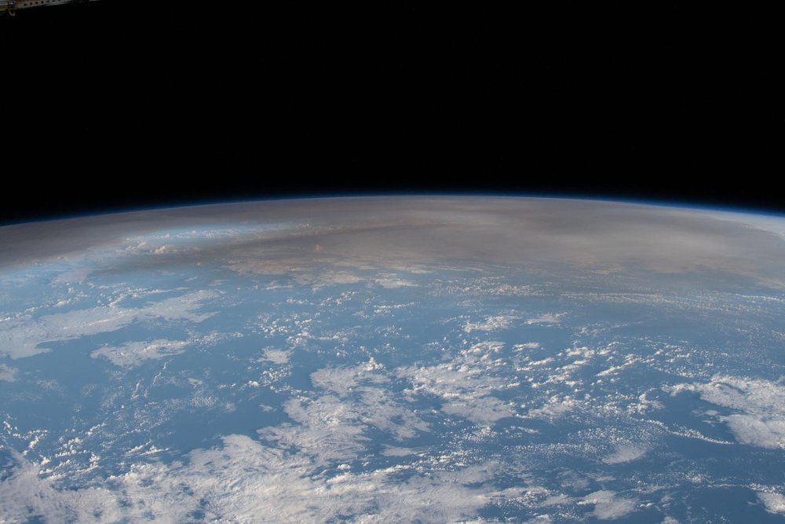

```{=html}
<style>
@import url('https://fonts.googleapis.com/css2?family=Space+Grotesk:wght@700&family=Inter:wght@400;600;800&display=swap');

.engage-box { background: linear-gradient(135deg, #c0392b 0%, #e17055 100%); color: white; padding: 25px; margin: 20px 0; border-radius: 15px; box-shadow: 0 10px 30px rgba(225, 112, 85, 0.3); }
.engage-box h2 { font-family: 'Space Grotesk', sans-serif; font-size: 2em; margin-top: 0; }
.explore-box { background: linear-gradient(135deg, #0984e3 0%, #00897b 100%); color: white; padding: 25px; margin: 20px 0; border-radius: 15px; box-shadow: 0 10px 30px rgba(9, 132, 227, 0.3); }
.explain-box { background: linear-gradient(135deg, #5f3dc4 0%, #8e44ad 100%); color: white; padding: 25px; margin: 20px 0; border-radius: 15px; box-shadow: 0 10px 30px rgba(108, 92, 231, 0.3); }
.big-question { font-family: 'Space Grotesk', sans-serif; font-size: 2.5em; font-weight: 800; background: linear-gradient(135deg, #e17055 0%, #d63031 100%); -webkit-background-clip: text; -webkit-text-fill-color: transparent; margin: 30px 0 20px 0; text-align: center; animation: slideIn 0.8s ease-out; }
.key-idea { background: linear-gradient(135deg, #ffecd2 0%, #fcb69f 100%); color: #1a1a1a; padding: 20px; margin: 20px 0; border-radius: 12px; border-left: 8px solid #e17055; font-size: 1.1em; }
.student-task { background: #fff3e0; color: #1a1a1a; border-left: 5px solid #ff9800; padding: 20px; margin: 15px 0; border-radius: 0 10px 10px 0; }
.mind-blown { background: linear-gradient(135deg, #c0392b 0%, #e17055 100%); color: white; padding: 20px; margin: 20px 0; border-radius: 15px; font-size: 1.3em; font-weight: 700; text-align: center; box-shadow: 0 10px 25px rgba(225, 112, 85, 0.4); }
.engage-box *, .explore-box *, .explain-box * { color: white; }
.engage-box a, .explore-box a, .explain-box a { color: white !important; text-decoration: underline; }
@keyframes slideIn { from { opacity: 0; transform: translateY(-20px); } to { opacity: 1; transform: translateY(0); } }
h1 { font-family: 'Space Grotesk', sans-serif !important; font-weight: 800 !important; font-size: 2.8em !important; margin-top: 40px !important; }
h2 { font-family: 'Space Grotesk', sans-serif !important; font-weight: 700 !important; color: #e17055 !important; }
.engage-box h2, .explore-box h2, .explain-box h2 { color: white !important; }
@media (max-width: 600px) { .big-question { font-size: 1.7em; } h1 { font-size: 2em !important; } }
</style>
```

<div class="big-question">🌋 Who's at Risk? 🌊</div>

::: {.callout-note collapse="true"}
## 📒 Using this page with your Performance Task Organizer

This page follows the opening pages of your **Unit 3 Performance Task Organizer (PTO): Earthquakes, Tsunamis, and Volcanoes: Who's at Risk?** Missed a class or need a refresher? Jump to the matching section:

| PTO section (page) | On this site |
|---|---|
| Do Now / Exit Slip boxes, Classes 1–6 (pp. 1–2) | [Do Now and Exit Slips](#do-now-and-exit-slips) |
| Class opener: the Tonga and Japan videos | [Anchor Phenomenon](#anchor-phenomenon-whos-at-risk) |
| Tell the Story, Text #1: Earthquakes and Volcanic Eruptions in Continuously Populated Regions (pp. 3–4) | [Text 1](#text-1-earthquakes-and-volcanic-eruptions-in-continuously-populated-regions) |
| Text #2: The Deadliest Earthquakes in Human History (pp. 4–5) | [Text 2](#text-2-the-deadliest-earthquakes-in-human-history) |
| Text #3: Volcano Fatalities since 1500 (pp. 5–6) | [Text 3](#text-3-volcano-fatalities-since-1500), [All three on one map](#putting-the-three-texts-together) |
| Important details our group surfaced + Overall Story (pp. 6–7) | [Overall Story](#overall-story) |
| Performance Task Introduction: Evaluating Disaster Risk (p. 8) | [Performance Task Introduction](#performance-task-introduction-evaluating-disaster-risk) |
| Initial Model (pp. 9–10) | [Initial Model](#initial-model) |
| Driving Question Board (class chart paper) | [Driving Question Board](#driving-question-board) |
| Revisit the Performance Task after each lesson (pp. 11–16) | [Unit Closing: Evidence Review](unit3-closing.qmd#evidence-review-revisiting-the-performance-task) |
| Final Performance Task (pp. 17–18) | [Unit Closing: Final Performance Task](unit3-closing.qmd#final-performance-task) |
:::

# Do Now and Exit Slips

The first two pages of your PTO have a **Do Now** box and an **Exit Slip** box for **Classes 1–6**. Your teacher posts the prompt at the start and end of each class.

- **Do Now:** a quick warm-up, usually about the last class or today's text.
- **Exit Slip:** one or two sentences showing what you figured out today.
- **Absent?** Ask your teacher for the prompt, then use the matching section below to answer it. The 📝 checks on this page are good practice for Exit Slips.

```{ojs}
//| echo: false
Plot = require("@observablehq/plot")
d3 = require("d3@7")
```

```{ojs}
//| echo: false
buildQuiz = function(id, title, questions) {
  const outer = html`<div id="${id}" style="margin:18px 0 24px 0;text-align:center;">
    <button style="
      display:inline-flex;align-items:center;gap:7px;
      background:linear-gradient(135deg,#667eea 0%,#764ba2 100%);
      color:#fff;border:none;padding:9px 22px;border-radius:50px;
      font-size:.95em;font-weight:700;cursor:pointer;
      box-shadow:0 3px 12px rgba(102,126,234,.45);
      transition:transform .15s,box-shadow .15s;"
      onmouseover="this.style.transform='scale(1.04)';this.style.boxShadow='0 5px 18px rgba(102,126,234,.55)'"
      onmouseout="this.style.transform='scale(1)';this.style.boxShadow='0 3px 12px rgba(102,126,234,.45)'"
    >
      <span style="font-size:1.1em;">📝</span> ${title}
      <span class="chevron" style="transition:transform .3s;">▼</span>
    </button>
    <div class="quiz-body" style="
      max-height:0;opacity:0;overflow:hidden;
      transition:max-height .5s cubic-bezier(.4,0,.2,1),opacity .4s ease,margin-top .3s ease;
      margin-top:0;text-align:left;">
      <button class="close-btn" style="
        display:block;margin:0 auto 10px auto;
        background:rgba(102,126,234,.12);color:#667eea;border:none;
        padding:5px 18px;border-radius:50px;font-size:.85em;
        font-weight:600;cursor:pointer;">Hide Quiz</button>
      <p style="text-align:center;color:#718096;font-style:italic;font-size:.9em;margin-bottom:12px;">
        Select an answer for each question.</p>
    </div>
  </div>`;
  const toggle = outer.querySelector("button");
  const chevron = toggle.querySelector(".chevron");
  const body   = outer.querySelector(".quiz-body");
  const closeBtn = body.querySelector(".close-btn");
  function expand(){  body.style.maxHeight="2000px";body.style.opacity="1";body.style.marginTop="14px";chevron.style.transform="rotate(180deg)"; }
  function collapse(){ body.style.maxHeight="0";body.style.opacity="0";body.style.marginTop="0";chevron.style.transform="rotate(0)"; }
  toggle.onclick = () => body.style.maxHeight === "0px" || body.style.maxHeight === "" ? expand() : collapse();
  closeBtn.onclick = collapse;
  questions.forEach((qq, qi) => {
    const card = document.createElement("div");
    card.style.cssText = "background:#fff;color:#1e1b4b;border-radius:12px;padding:16px 20px;margin-bottom:14px;box-shadow:0 2px 8px rgba(0,0,0,.08);";
    card.innerHTML = `<p style="font-weight:700;margin:0 0 10px;">${qi+1}. ${qq.q}</p>`;
    qq.options.forEach((opt, oi) => {
      const btn = document.createElement("button");
      btn.textContent = opt;
      btn.style.cssText = "display:block;width:100%;min-height:44px;text-align:left;padding:10px 14px;margin:6px 0;border:2px solid #e2e8f0;border-radius:8px;background:#fff;color:#1e1b4b;cursor:pointer;font-size:.95em;transition:border-color .2s,background .2s;";
      btn.onmouseover = () => { if(!card.dataset.answered){ btn.style.borderColor="#667eea";btn.style.background="#f0f0ff"; }};
      btn.onmouseout  = () => { if(!card.dataset.answered){ btn.style.borderColor="#e2e8f0";btn.style.background="#fff"; }};
      btn.onclick = () => {
        if(card.dataset.answered) return;
        card.dataset.answered = "true";
        card.querySelectorAll("button").forEach(b => { b.style.cursor="default"; b.onmouseover=null; b.onmouseout=null; });
        if(oi === qq.correct){
          btn.style.borderColor="#48bb78";btn.style.background="#f0fff4";
          fb.innerHTML = "✅ Correct! " + qq.explanation;
          fb.style.color="#276749";fb.style.background="#f0fff4";
        } else {
          btn.style.borderColor="#fc8181";btn.style.background="#fff5f5";
          card.querySelectorAll("button")[qq.correct].style.borderColor="#48bb78";
          card.querySelectorAll("button")[qq.correct].style.background="#f0fff4";
          fb.innerHTML = "❌ " + qq.explanation;
          fb.style.color="#9b2c2c";fb.style.background="#fff5f5";
        }
        fb.style.padding="10px 14px";fb.style.marginTop="8px";
      };
      card.appendChild(btn);
    });
    const fb = document.createElement("div");
    fb.style.cssText = "border-radius:8px;font-size:.9em;transition:all .3s;";
    card.appendChild(fb);
    body.appendChild(card);
  });
  return outer;
}
```

# Anchor Phenomenon: Who's at Risk?

::: {.engage-box}
## 🌊 Japan, 2011 · Tonga, 2022

<div style="font-size: 1.2em; font-weight: 700; text-align: center; margin: 18px 0;">
Major earthquakes, volcanic eruptions, and tsunamis happen all over the world, causing loss of life and property. Yet humans have been living continuously in these hazardous areas for thousands of years.
</div>

- **March 11, 2011, Japan:** a magnitude 9–9.1 earthquake struck off the coast. People felt the shaking first; then a **tsunami** reached the coast, killing **19,759 people** and causing a nuclear disaster that Japan is still recovering from.
- **January 15, 2022, Tonga:** the underwater volcano **Hunga Tonga–Hunga Ha'apai** exploded. It was heard thousands of miles away, and the tsunami that followed damaged villages across the Pacific.

**Videos from class:** [How the Tonga volcanic eruption rippled through the earth, ocean and atmosphere](https://www.youtube.com/watch?v=tNoA1n-rLhA) · [Japan Tsunami](https://www.youtube.com/watch?v=oWzdgBNfhQU) (first 1:24 only)
:::

{fig-alt="Photo from orbit showing Earth's curved horizon with a wide grayish-brown ash plume spread across the atmosphere above white clouds and blue ocean." width="100%"}

**Think about it** (your teacher asks these out loud):

- Have you ever felt an earthquake, or heard about an earthquake, tsunami, or volcano affecting people?
- What happened to people (and other living things) after those events?
- **Could events like these affect people where you live? Why do you think so?**

<div class="mind-blown">
🔊 The Tonga blast sent a pressure wave around the whole planet. Barometers around the world recorded it passing several times.
</div>

# Tell the Story

::: {.explore-box}
## 📰 Three texts, one story

**Directions from your PTO:**

1. Silently read the texts below.
2. For each text, circle or jot **2–3 details** that are important to telling the story of the **global occurrence of earthquakes, volcanic eruptions, and tsunamis**.
3. Take turns sharing your details. Write down the ideas that are most important to the story of global geologic hazard occurrence.
:::

## Text 1: Earthquakes and Volcanic Eruptions in Continuously Populated Regions

Your PTO's Text #1 is a map of **early civilizations (c. 8000–900 BCE)** with call-out boxes for five regions where people have lived for thousands of years. Pick a region to read its call-out box.

```{ojs}
//| echo: false
u3oRegions = [
  {region: "Mediterranean Basin", lat: 38, lon: 22, color: "#e17055", events: [
    {year: -1500, label: "1500 BCE", type: "Volcano", text: "An eruption on the island of Santorini impacted the settlement on Crete and contributed to the Atlantis myth."},
    {year: 70, label: "70 CE", type: "Volcano", text: "Eruption of Mt. Vesuvius destroyed the cities of Pompeii and Herculaneum, which were never repopulated. Other towns were impacted by ash, but remained in existence."},
    {year: 2023, label: "2023", type: "Earthquake", text: "Magnitudes 7.7 and 7.8 earthquakes days apart caused thousands of fatalities in Turkey and Syria."}
  ]},
  {region: "Great Rift Valley", lat: 0, lon: 36, color: "#fdcb6e", events: [
    {year: -1700, label: "1700 BCE", type: "Earthquake", text: "Ancient earthquakes at the northern border of this rift system have been linked to the destruction and abandonment of areas of Canaan."},
    {year: 1928, label: "1928", type: "Earthquake", text: "A magnitude 6.9 earthquake in Kenya created a 38 km long break in Earth's surface."},
    {year: 2002, label: "2002", type: "Volcano", text: "Volcanic eruptions forced the evacuations of hundreds of thousands of people. 245 people died and 120,000 people were left homeless."}
  ]},
  {region: "Japanese Archipelago", lat: 36, lon: 138, color: "#d63031", events: [
    {year: -5300, label: "5,300 BCE", type: "Volcano", text: "A massive volcanic eruption forced populations to coastal regions. Ecosystems took hundreds of years to recover."},
    {year: 1703, label: "1703", type: "Earthquake + tsunami", text: "A magnitude 8.0 earthquake triggered a tsunami and killed over 100,000 people."},
    {year: 2011, label: "2011", type: "Earthquake + tsunami", text: "A magnitude 9–9.1 earthquake triggered a tsunami and killed 19,759 people."}
  ]},
  {region: "Mainland Southeast Asia", lat: 18, lon: 100, color: "#6c5ce7", events: [
    {year: 460, label: "460 CE", type: "Earthquake", text: "A massive earthquake in Thailand submerged parts of the capital city."},
    {year: 1939, label: "1939", type: "Earthquake", text: "An earthquake in Myanmar destroyed the former capital city, which was never repopulated."},
    {year: 2025, label: "2025", type: "Earthquake", text: "A magnitude 7.7 earthquake in Myanmar killed over 5,000 people."}
  ]},
  {region: "Andes Region", lat: -18, lon: -71, color: "#00b894", events: [
    {year: -1800, label: "1,800 BCE", type: "Earthquake", text: "A greater-than-magnitude-9 earthquake severely disrupted societies living in southern Peru / northern Chile."},
    {year: 1450, label: "1450", type: "Earthquake", text: "A magnitude 6.5 earthquake in Chile disrupted massive monuments."},
    {year: 1970, label: "1970", type: "Earthquake", text: "A magnitude 7.9 earthquake and landslide in Peru killed 50,000 people."}
  ]}
]
u3oTypeIcon = ({"Volcano": "🌋", "Earthquake": "〰️", "Earthquake + tsunami": "🌊"})
```

```{ojs}
//| echo: false
viewof u3oRegionPick = Inputs.radio(u3oRegions.map(d => d.region), {label: "Region:", value: "Japanese Archipelago"})
```

```{ojs}
//| echo: false
{
  const r = u3oRegions.find(d => d.region === u3oRegionPick);
  return html`<div style="background:#fff;color:#1a1a1a;border-left:8px solid ${r.color};border-radius:12px;padding:16px 20px;margin:10px 0;box-shadow:0 2px 10px rgba(0,0,0,.1);">
    <div style="font-size:1.25em;font-weight:800;margin-bottom:8px;">📍 ${r.region}</div>
    ${r.events.map(e => html`<div style="display:flex;gap:12px;align-items:flex-start;padding:8px 0;border-top:1px solid #eee;">
      <div style="flex:0 0 92px;font-weight:800;color:${r.color === "#fdcb6e" ? "#b7791f" : r.color};">${u3oTypeIcon[e.type]} ${e.label}</div>
      <div style="flex:1 1 auto;">${e.text}</div>
    </div>`)}
  </div>`;
}
```

::: {.callout-tip collapse="true"}
## 🔎 About the dates in Text 1

The PTO lists the Vesuvius eruption as 70 CE. Most historians date it to **79 CE**. The 5,300 BCE eruption in Japan is usually linked to the **Kikai caldera**, south of Kyushu. Death tolls for very old events are estimates.
:::

```{ojs}
//| echo: false
buildQuiz("u3o-text1-quiz", "🗺️ Check Your Understanding — Text 1", [
  {
    q: "Which pattern shows up in ALL five regions in Text 1?",
    options: ["They had hazards only in ancient times", "People have kept living there for thousands of years even though hazards keep happening", "They only have volcanoes", "No one has died there since 1900"],
    correct: 1,
    explanation: "Every region has events from thousands of years ago AND from the last 100 years (2002, 2011, 2023, 2025, 1970). People stayed, which is the puzzle in the anchor phenomenon."
  },
  {
    q: "Text 1 says some places (Pompeii, Herculaneum, Myanmar's former capital) were 'never repopulated.' What does that detail add to the story?",
    options: ["Hazards never affect where people live", "A disaster can change where people live, even if the region as a whole stays populated", "All cities near volcanoes are abandoned", "Earthquakes only damage farmland"],
    correct: 1,
    explanation: "Hazards have shaped human history and driven people to move (like the 5,300 BCE eruption that pushed people to Japan's coasts), but the regions themselves stayed home to many people."
  },
  {
    q: "In which region does Text 1 describe hazards caused mostly by volcanic eruptions AND earthquakes, both within the last 25 years?",
    options: ["Andes Region", "Mainland Southeast Asia", "Great Rift Valley", "None of them"],
    correct: 2,
    explanation: "The Great Rift Valley had volcanic eruptions in 2002 (245 deaths, 120,000 homeless) and a long history of earthquakes, including the 1928 M6.9 quake in Kenya. You'll study why in the Energy and Matter lesson."
  }
])
```

## Text 2: The Deadliest Earthquakes in Human History

Text #2 is a map from **Our World in Data** of the **top 10 known earthquakes by death toll**. Two events tie for 8th place, so **11** are shown. Hover over or tap a bar for details.

```{ojs}
//| echo: false
u3oDeadliest = [
  {rank: 1, place: "Shaanxi, China", year: 1556, deaths: 830000, mag: "8", lat: 34.5, lon: 109.7},
  {rank: 2, place: "Port-au-Prince, Haiti", year: 2010, deaths: 316000, mag: "7", lat: 18.5, lon: -72.3},
  {rank: 3, place: "Antakya, Turkey", year: 115, deaths: 260000, mag: "7.5", lat: 36.2, lon: 36.2},
  {rank: 4, place: "Antakya, Turkey", year: 525, deaths: 250000, mag: "7", lat: 36.2, lon: 36.2},
  {rank: 5, place: "Tangshan, China", year: 1976, deaths: 242769, mag: "7.5", lat: 39.6, lon: 118.2},
  {rank: 6, place: "Gyzndzha, Azerbaijan", year: 1139, deaths: 230000, mag: "Unknown", lat: 40.7, lon: 46.4},
  {rank: 7, place: "Sumatra, Indonesia", year: 2004, deaths: 227899, mag: "9.1", lat: 3.3, lon: 95.9},
  {rank: 8, place: "Damghan, Iran", year: 856, deaths: 200000, mag: "7.9", lat: 36.2, lon: 54.3},
  {rank: 8, place: "Gansu, China", year: 1920, deaths: 200000, mag: "8.3", lat: 36.6, lon: 105.3},
  {rank: 9, place: "Dvin, Armenia", year: 893, deaths: 150000, mag: "Unknown", lat: 40.0, lon: 44.6},
  {rank: 10, place: "Tokyo, Japan", year: 1923, deaths: 142807, mag: "7.9", lat: 35.3, lon: 139.5}
].map(d => ({...d, label: `${d.place}, ${d.year}`}))
```

```{ojs}
//| echo: false
Plot.plot({
  title: "The Deadliest Earthquakes in Human History",
  subtitle: "Deaths per earthquake. Data: NOAA NGDC/WDS Significant Earthquake Database, via the PTO's Our World in Data map.",
  width: width,
  height: 60 + u3oDeadliest.length * 30,
  marginLeft: Math.min(190, width * 0.42),
  marginRight: 50,
  x: {label: "Deaths →", grid: true, tickFormat: d => d >= 1000 ? `${d / 1000}k` : d},
  y: {label: null, domain: u3oDeadliest.map(d => d.label)},
  marks: [
    Plot.barX(u3oDeadliest, {y: "label", x: "deaths", fill: d => d.year >= 1900 ? "#d63031" : "#fab1a0", tip: true,
      title: d => `#${d.rank}: ${d.place}, ${d.year}\n${d.deaths.toLocaleString()} deaths\nMagnitude: ${d.mag}`}),
    Plot.text(u3oDeadliest, {y: "label", x: "deaths", text: d => `M${d.mag === "Unknown" ? "?" : d.mag}`, dx: 4, textAnchor: "start", fontSize: 10, fill: "currentColor"}),
    Plot.ruleX([0])
  ]
})
```

<p style="text-align:center;font-size:.85em;"><span style="display:inline-block;width:12px;height:12px;background:#d63031;border-radius:2px;"></span> since 1900 &nbsp; <span style="display:inline-block;width:12px;height:12px;background:#fab1a0;border-radius:2px;"></span> before 1900</p>

::: {.callout-tip collapse="true"}
## 🔎 About the Haiti number

The 2010 Haiti death toll is still disputed. The map uses NOAA's figure (316,000), which the Haitian government reported. Some sources give a lower figure, about 220,000. In that case Haiti would drop to 7th place.
:::

```{ojs}
//| echo: false
buildQuiz("u3o-text2-quiz", "💀 Check Your Understanding — Text 2", [
  {
    q: "Where are almost all of the deadliest earthquakes located?",
    options: ["Spread evenly over every continent", "In a band from Turkey and Iran across to China, Japan, and Indonesia (plus Haiti)", "Only in the middle of oceans", "Only in North and South America"],
    correct: 1,
    explanation: "10 of the 11 are in a belt across southern Asia from Turkey to Japan and Indonesia. Only Haiti is outside it. That pattern is a clue you'll explain in Surface Features & Plate Boundaries."
  },
  {
    q: "The Haiti (2010, M7) earthquake killed more people than the Sumatra (2004, M9.1) earthquake. What does this suggest?",
    options: ["Magnitude is the only thing that matters", "Deaths depend on more than magnitude, like how close people live and how buildings are built", "The magnitudes must be wrong", "Smaller earthquakes are always deadlier"],
    correct: 1,
    explanation: "A magnitude 9.1 quake releases about 1,000 times more energy than an M7. Haiti's quake struck right next to a crowded capital with weak buildings. Exposure and vulnerability matter, an idea you'll use in the final task."
  },
  {
    q: "How many of the 11 deadliest earthquakes happened since 1900?",
    options: ["1", "3", "5", "All 11"],
    correct: 2,
    explanation: "Haiti 2010, Tangshan 1976, Sumatra 2004, Gansu 1920, and Tokyo 1923: five. Huge disasters are not just ancient history."
  }
])
```

## Text 3: Volcano Fatalities since 1500

Text #3 is a **Washington Post** map built from the **Volcanic Fatalities Database (Brown et al.)**. Circles are sized by the number of fatalities caused by each volcano since 1500. The chart below shows the deadliest eruption of several of the volcanoes on that map.

```{ojs}
//| echo: false
u3oFatalityBins = ["1–9", "10–99", "100–999", "1,000–9,999", "10,000–61,000"]
u3oVolcanoes = [
  {name: "Tambora", country: "Indonesia", year: "1815", deaths: 60000, note: "~60,000 (some estimates over 71,000 with famine)", lat: -8.25, lon: 118.0},
  {name: "Krakatau", country: "Indonesia", year: "1883", deaths: 36000, note: "~36,000, mostly from tsunamis", lat: -6.1, lon: 105.4},
  {name: "Pelée", country: "Martinique", year: "1902", deaths: 28000, note: "~28,000; the town of St. Pierre was destroyed by a pyroclastic flow", lat: 14.8, lon: -61.2},
  {name: "Nevado del Ruiz", country: "Colombia", year: "1985", deaths: 23000, note: "~23,000, buried by mudflows (lahars)", lat: 4.9, lon: -75.3},
  {name: "Unzen", country: "Japan", year: "1792", deaths: 15000, note: "~15,000; a collapse triggered a tsunami", lat: 32.8, lon: 130.3},
  {name: "Kelut", country: "Indonesia", year: "1586", deaths: 10000, note: "~10,000 (and ~5,000 more in 1919)", lat: -7.9, lon: 112.3},
  {name: "Grímsvötn (Laki)", country: "Iceland", year: "1783", deaths: 9000, note: "~9,000, mostly from famine after the eruption", lat: 64.4, lon: -17.3},
  {name: "Santa María", country: "Guatemala", year: "1902", deaths: 5000, note: "~5,000 or more", lat: 14.76, lon: -91.55},
  {name: "Vesuvius", country: "Italy", year: "1631", deaths: 4000, note: "~3,000–6,000", lat: 40.82, lon: 14.43},
  {name: "El Chichón", country: "Mexico", year: "1982", deaths: 2000, note: "~2,000", lat: 17.36, lon: -93.23},
  {name: "Oku Volcanic Field (Lake Nyos)", country: "Cameroon", year: "1986", deaths: 1700, note: "~1,700, suffocated by a cloud of volcanic CO₂", lat: 6.44, lon: 10.3},
  {name: "Huaynaputina", country: "Peru", year: "1600", deaths: 1500, note: "~1,500", lat: -16.6, lon: -70.85},
  {name: "Pinatubo", country: "Philippines", year: "1991", deaths: 850, note: "~850; tens of thousands were evacuated in time", lat: 15.14, lon: 120.35},
  {name: "Nyiragongo", country: "DR Congo (Great Rift Valley)", year: "2002", deaths: 245, note: "245 (Text 1)", lat: -1.52, lon: 29.25},
  {name: "Kīlauea", country: "USA (Hawaiʻi)", year: "1790", deaths: 100, note: "at least 80, possibly a few hundred", lat: 19.4, lon: -155.3},
  {name: "Mt. St. Helens", country: "USA", year: "1980", deaths: 57, note: "57", lat: 46.2, lon: -122.2}
].map(d => ({...d, bin: d.deaths >= 10000 ? 4 : d.deaths >= 1000 ? 3 : d.deaths >= 100 ? 2 : d.deaths >= 10 ? 1 : 0, label: `${d.name} (${d.year})`}))
u3oBinColors = ["#ffeaa7", "#fdcb6e", "#f39c12", "#e17055", "#c0392b"]
```

```{ojs}
//| echo: false
Plot.plot({
  title: "Deadliest Eruption of Selected Volcanoes (since 1500)",
  subtitle: "Log scale: each gridline is 10× more deaths. Colors match the PTO map's circle sizes.",
  width: width,
  height: 60 + u3oVolcanoes.length * 26,
  marginLeft: Math.min(200, width * 0.44),
  marginRight: 20,
  x: {type: "log", domain: [10, 100000], label: "Approximate deaths →", grid: true, tickFormat: d => d.toLocaleString()},
  y: {label: null, domain: u3oVolcanoes.map(d => d.label)},
  color: {domain: u3oFatalityBins, range: u3oBinColors, legend: true},
  marks: [
    Plot.barX(u3oVolcanoes, {y: "label", x1: 10, x2: "deaths", fill: d => u3oFatalityBins[d.bin], tip: true,
      title: d => `${d.name}, ${d.country}\nEruption: ${d.year}\nDeaths: ${d.note}`})
  ]
})
```

::: {.callout-tip collapse="true"}
## 🔎 About these numbers

The PTO map adds up **all** eruptions of each volcano since 1500, so some circles are bigger than one eruption alone. Fatality counts for older eruptions are estimates and differ between sources.
:::

```{ojs}
//| echo: false
buildQuiz("u3o-text3-quiz", "🌋 Check Your Understanding — Text 3", [
  {
    q: "Which country has the most volcanoes with large death tolls on the Text 3 map and chart?",
    options: ["Iceland", "Indonesia", "Mexico", "USA"],
    correct: 1,
    explanation: "Tambora, Krakatau, and Kelut are all in Indonesia, and the PTO map shows a cluster of big circles there. Indonesia has many volcanoes and many people living close to them."
  },
  {
    q: "Nevado del Ruiz killed ~23,000 people, mostly with mudflows, and Krakatau killed most of its victims with tsunamis. What does this tell you?",
    options: ["Volcanoes only kill people with lava", "Volcanoes cause loss of life in several ways, including mudflows, tsunamis, ash, gas, and famine", "Only tsunamis are dangerous", "Mudflows only happen in deserts"],
    correct: 1,
    explanation: "Lava is rarely the main killer. Pyroclastic flows (Pelée), lahars (Ruiz), tsunamis (Krakatau, Unzen), gas (Lake Nyos), and famine (Laki, Tambora) cause most deaths. Your initial model should show how each hazard causes loss."
  },
  {
    q: "Compare Text 2 and Text 3. What do the two maps have in common?",
    options: ["Both show disasters spread evenly around the world", "Both show disasters clustered in certain bands, especially around the western Pacific and southern Asia", "Neither shows Asia", "Both only show events after 2000"],
    correct: 1,
    explanation: "Deadly earthquakes and deadly volcanoes both cluster in bands, especially the edges of the Pacific and across southern Asia. Explaining why is a big goal of this unit."
  }
])
```

## Putting the Three Texts Together

Here are all three texts on one map. Turn layers on and off, and add the **live USGS feed** of every magnitude 4.5+ earthquake in the past 30 days. Hover over or tap a symbol for details.

```{ojs}
//| echo: false
u3oLand = {
  const topojson = await require("topojson-client@3");
  let topo;
  try { topo = await d3.json("../world-110m.json"); } catch (e) { topo = null; }
  if (!topo || !topo.objects) topo = await d3.json("https://cdn.jsdelivr.net/npm/world-atlas@2.0.2/land-110m.json");
  const key = topo.objects.land ? "land" : Object.keys(topo.objects)[0];
  return topojson.feature(topo, topo.objects[key]);
}
```

```{ojs}
//| echo: false
u3oLive = {
  try {
    const r = await fetch("https://earthquake.usgs.gov/earthquakes/feed/v1.0/summary/4.5_month.geojson");
    if (!r.ok) throw new Error(r.status);
    const j = await r.json();
    return {ok: true, quakes: j.features.map(f => ({lon: f.geometry.coordinates[0], lat: f.geometry.coordinates[1], depth: f.geometry.coordinates[2], mag: f.properties.mag, place: f.properties.place, time: new Date(f.properties.time)}))};
  } catch (e) {
    return {ok: false, quakes: []};
  }
}
```

```{ojs}
//| echo: false
viewof u3oLayers = Inputs.checkbox(["Text 1: Five regions", "Text 2: Deadliest earthquakes", "Text 3: Volcano fatalities", "Live: M4.5+ earthquakes, last 30 days"], {label: "Show:", value: ["Text 1: Five regions", "Text 2: Deadliest earthquakes", "Text 3: Volcano fatalities"]})
```

```{ojs}
//| echo: false
{
  const on = k => u3oLayers.some(l => l.startsWith(k));
  const k = Math.max(0.55, Math.min(1, width / 700));
  const wrap = d3.create("div");
  wrap.append(() => Plot.plot({
    width: width,
    height: Math.round(width * 0.52),
    projection: "equal-earth",
    r: {type: "identity"},
    marks: [
      Plot.sphere({fill: "#dbeafe", stroke: "#94a3b8"}),
      Plot.geo(u3oLand, {fill: "#f1ede4", stroke: "#a0a0a0", strokeWidth: 0.5}),
      on("Live") ? Plot.dot(u3oLive.quakes, {x: "lon", y: "lat", r: d => Math.max(1.5, (d.mag - 4) * 2.2), fill: "#636e72", fillOpacity: 0.55, stroke: "white", strokeWidth: 0.3, tip: true,
        title: d => `M${d.mag.toFixed(1)}: ${d.place}\n${d.time.toLocaleDateString()} · depth ${Math.round(d.depth)} km`}) : null,
      on("Text 3") ? Plot.dot(u3oVolcanoes, {x: "lon", y: "lat", r: d => (2.5 + d.bin * 1.9) * k, fill: "#f39c12", fillOpacity: 0.75, stroke: "#7f4f00", strokeWidth: 0.8, tip: true,
        title: d => `🌋 ${d.name}, ${d.country}\n${d.year}: ${d.note}`}) : null,
      on("Text 2") ? Plot.dot(u3oDeadliest, {x: "lon", y: "lat", r: 6 * k, symbol: "diamond", fill: "#d63031", stroke: "white", strokeWidth: 1, tip: true,
        title: d => `#${d.rank} ${d.place}, ${d.year}\n${d.deaths.toLocaleString()} deaths · M${d.mag}`}) : null,
      on("Text 1") ? Plot.dot(u3oRegions, {x: "lon", y: "lat", r: 22 * k, fill: d => d.color, fillOpacity: 0.18, stroke: d => d.color, strokeWidth: 2.5, tip: true,
        title: d => `${d.region}\n` + d.events.map(e => `${e.label}: ${e.type}`).join("\n")}) : null
    ]
  }));
  wrap.append("div")
    .style("display", "flex").style("flex-wrap", "wrap").style("gap", "6px 16px").style("justify-content", "center").style("font-size", "0.85em").style("margin-top", "6px")
    .html(`<span>⭕ Text 1 region</span><span><span style="color:#d63031;">◆</span> Text 2 deadly earthquake</span><span><span style="color:#f39c12;">●</span> Text 3 deadly volcano</span><span><span style="color:#636e72;">●</span> Live M4.5+ quake</span>`);
  if (on("Live")) wrap.append("div").style("text-align", "center").style("font-size", "0.85em").style("margin-top", "4px")
    .text(u3oLive.ok ? `Live data: ${u3oLive.quakes.length} earthquakes of magnitude 4.5 or more in the past 30 days (USGS).` : "⚠️ The live USGS feed could not be loaded right now. Try again later; the three PTO texts still work.");
  return wrap.node();
}
```

```{ojs}
//| echo: false
buildQuiz("u3o-map-quiz", "🌍 Check Your Understanding — Putting It Together", [
  {
    q: "Turn on the live USGS layer. How do this month's earthquakes compare with the deadly historic events?",
    options: ["They are in completely different places", "They fall in many of the same narrow bands, like the edges of the Pacific and across southern Asia", "They are spread evenly over the whole Earth", "They are all in the middle of continents"],
    correct: 1,
    explanation: "Earthquakes happen every day along the same belts where history's deadly quakes and eruptions happened. The hazard is still active, which is why the performance task asks about risk in the near future."
  },
  {
    q: "Which of the five PTO regions sits right where many live earthquakes, deadly earthquakes, AND deadly volcanoes overlap?",
    options: ["Japanese Archipelago", "None of them", "Only the Great Rift Valley", "Only the Mediterranean Basin"],
    correct: 0,
    explanation: "Japan has frequent earthquakes, the 1923 Tokyo quake (Text 2), Unzen (Text 3), and tsunamis (Text 1). Indonesia, just south of Mainland Southeast Asia, is another hot spot."
  }
])
```

## Overall Story

::: {.student-task}
### ✏️ In your packet: Tell the Story (pp. 3–7)

- For **each text** (Text #1, #2, #3), write **2–3 important details** on the lines.
- Take turns sharing with your group. Write down **at least 5 important details your group surfaced**.
- Write the **Overall Story** based on your group's discussion.
:::

::: {.key-idea}
### 💡 One way to tell the story

Earthquakes, volcanic eruptions, and tsunamis are **not spread evenly**: they cluster in certain bands, like the edges of the Pacific and a belt from the Mediterranean across Asia. They have killed **hundreds of thousands** of people at a time, destroyed cities, and forced people to move. **Yet people have lived in these same regions continuously for thousands of years, and still do today.**
:::

# Performance Task Introduction: Evaluating Disaster Risk

::: {.explore-box}
## 🌐 Evaluating Disaster Risk

The **United Nations**, non-profit organizations, and governments around the world are interested in supporting populations at risk from disasters like earthquakes, volcanic eruptions, and tsunamis. Unfortunately, **money available to fund this effort is limited**, so decisions need to be made about how much should be invested to reduce risk in these areas.

**Five areas have been identified as at risk to these disasters and of particular interest:**

1. The Mediterranean Basin
2. The Great Rift Valley
3. The Japanese Archipelago
4. Southeast Asian Mainland
5. Andes Region
:::

::: {.key-idea}
### 🎯 Your task in this unit

Investigate seismic disasters in order to **model how they occur** and **explain how they have affected populations in the past**, in order to better understand **how they put people and property at risk today**.
:::

### 🕰️ The five regions through time

Every Text 1 event on one timeline. Notice how long people have been living with these hazards. Hover over or tap a symbol to read it.

```{ojs}
//| echo: false
u3oAllEvents = u3oRegions.flatMap(r => r.events.map(e => ({...e, region: r.region, color: r.color})))
```

```{ojs}
//| echo: false
Plot.plot({
  title: "Hazard Events in the Five PTO Regions",
  subtitle: "From the PTO's Text #1.",
  width: width,
  height: 300,
  marginLeft: Math.min(170, width * 0.38),
  marginRight: 20,
  marginBottom: 42,
  x: {label: "Year →", domain: [-6000, 2100], grid: true, tickFormat: d => d < 0 ? `${-d} BCE` : d === 0 ? "0" : `${d}`},
  y: {label: null, domain: u3oRegions.map(d => d.region)},
  symbol: {domain: ["Volcano", "Earthquake", "Earthquake + tsunami"], range: ["triangle", "circle", "diamond"], legend: true},
  marks: [
    Plot.ruleY(u3oRegions, {y: "region", x1: -6000, x2: 2100, stroke: "#dfe6e9"}),
    Plot.dot(u3oAllEvents, {x: "year", y: "region", symbol: "type", r: 7, fill: "color", stroke: "#2d3436", strokeWidth: 0.8, tip: true,
      title: d => `${d.region}, ${d.label}\n${d.type}\n${d.text}`})
  ]
})
```

```{ojs}
//| echo: false
buildQuiz("u3o-pt-quiz", "🎯 Check Your Understanding — The Performance Task", [
  {
    q: "Why does the performance task say decisions must be made about how much to invest in each region?",
    options: ["Because the hazards are not real", "Because money to reduce risk is limited, so it should go where it can reduce loss of life and property the most", "Because only one region has hazards", "Because the UN wants to move everyone out of these regions"],
    correct: 1,
    explanation: "With limited funds, decision makers need evidence about where risk is highest and what actually reduces it. Your models and explanations provide that evidence."
  },
  {
    q: "Based on the timeline, which statement is best supported?",
    options: ["Hazards in these regions stopped after 1000 CE", "Every region has had major hazards both thousands of years ago and in the last ~100 years", "Only the Andes has ancient events", "Volcanoes are the only hazard in all five regions"],
    correct: 1,
    explanation: "Each row has symbols far to the left (ancient) and at the far right (1900s–2020s). The hazards are ongoing, so the risk is in the 'near future' too."
  }
])
```

# Initial Model

::: {.explain-box}
## 🧩 What causes earthquakes, tsunamis, and volcanoes to occur across the world? How do they cause loss of life and property?

**Individual:** Using what you already know, **develop an initial model** that illustrates:

- what causes an **earthquake**
- what causes a **volcanic eruption**
- how each of these hazards causes **loss of life and property**
:::

### 🗂️ Hazard Sorter: warm up your model

Each card describes a cause or an effect. Decide which hazard it belongs to, then compare with how scientists see it. There is no score; use it to collect ideas for your model.

```{ojs}
//| echo: false
u3oHazardCards = [
  {f: "Rock along a fault suddenly slips, releasing energy that travels as waves through the ground", key: "Earthquake", why: "An earthquake is the shaking caused when stressed rock suddenly breaks or slips along a fault. The energy travels outward as seismic waves."},
  {f: "Molten rock (magma) rises toward the surface and gas pressure builds until it bursts out", key: "Volcano", why: "Volcanoes erupt when magma from inside Earth reaches the surface. Trapped gas can make eruptions explosive, like Tonga in 2022."},
  {f: "The sea floor suddenly moves up or down, pushing a huge volume of water", key: "Tsunami", why: "Tsunamis are usually caused by undersea earthquakes (Japan 2011, Sumatra 2004), but volcanic explosions and landslides can cause them too (Krakatau, Tonga)."},
  {f: "Buildings collapse because the ground shakes back and forth", key: "Earthquake", why: "Shaking itself rarely kills people. Collapsing buildings do. That is why building codes matter so much (Haiti 2010)."},
  {f: "Clouds of hot ash and gas race downhill and bury towns", key: "Volcano", why: "These pyroclastic flows destroyed Pompeii (Vesuvius) and St. Pierre (Pelée, 1902). They move too fast to outrun."},
  {f: "Coastal towns flood, sometimes thousands of kilometers from where it started", key: "Tsunami", why: "Tsunami waves cross whole oceans. The 2004 Sumatra tsunami killed people as far away as Africa."},
  {f: "Shaking loosens a mountainside and a landslide buries a town", key: "Earthquake", why: "The 1970 Peru earthquake (Text 1) triggered a landslide. Together they killed about 50,000 people."},
  {f: "Ash and gas block sunlight and ruin crops, so people starve months later", key: "Volcano", why: "After Laki (1783) and Tambora (1815), famine killed more people than the eruptions themselves."}
]
```

```{ojs}
//| echo: false
{
  const wrap = html`<div style="margin:10px 0;"></div>`;
  const tally = html`<div style="text-align:center;font-weight:700;margin:8px 0 14px;">Sorted: <span>0</span> / ${u3oHazardCards.length} · Matched scientists: <span>0</span></div>`;
  wrap.appendChild(tally);
  let sorted = 0, matched = 0;
  const colors = {Earthquake: "#6c5ce7", Volcano: "#d63031", Tsunami: "#0984e3"};
  const icons = {Earthquake: "〰️", Volcano: "🌋", Tsunami: "🌊"};
  u3oHazardCards.forEach(item => {
    const card = html`<div style="background:#fff;color:#1e1b4b;border-radius:12px;padding:14px 16px;margin-bottom:12px;box-shadow:0 2px 8px rgba(0,0,0,.1);">
      <div style="font-weight:700;margin-bottom:8px;">${item.f}</div>
      <div class="btns" style="display:flex;flex-wrap:wrap;gap:8px;"></div>
      <div class="fb" style="font-size:.92em;"></div>
    </div>`;
    const btns = card.querySelector(".btns"), fb = card.querySelector(".fb");
    ["Earthquake", "Volcano", "Tsunami"].forEach(choice => {
      const b = html`<button style="flex:1 1 90px;min-height:44px;border:2px solid ${colors[choice]};border-radius:8px;background:#fff;color:${colors[choice]};font-weight:700;cursor:pointer;">${icons[choice]} ${choice}</button>`;
      b.onclick = () => {
        if (card.dataset.done) return;
        card.dataset.done = "1";
        sorted++;
        const ok = choice === item.key;
        if (ok) matched++;
        b.style.background = colors[choice]; b.style.color = "#fff";
        btns.querySelectorAll("button").forEach(x => x.style.cursor = "default");
        fb.style.cssText = `margin-top:8px;padding:10px 12px;border-radius:8px;background:${ok ? "#f0fff4" : "#f5f3ff"};color:#1e1b4b;`;
        fb.innerHTML = `<b>${ok ? "✅ Scientists agree:" : "🤔 Scientists would say:"} ${item.key}.</b> ${item.why}`;
        tally.querySelectorAll("span")[0].textContent = sorted;
        tally.querySelectorAll("span")[1].textContent = matched;
      };
      btns.appendChild(b);
    });
    wrap.appendChild(card);
  });
  return wrap;
}
```

::: {.student-task}
### ✏️ In your packet: Initial Model (pp. 9–10)

- **Individual:** draw a model showing what causes an earthquake, what causes a volcanic eruption, and how each hazard causes loss of life and property.
- **Questions to consider:** How are you representing each hazard? How are you showing how each hazard is caused? Can you use your model to share your ideas with your group? Use **labels and arrows**.
- **Small group:** after sharing, develop a **group model** of the ideas you agree on.
- **Whole class:** look at other groups' models. List **two things** you saw that you think would be important for **everyone's** model to include (p. 10).
:::

```{ojs}
//| echo: false
buildQuiz("u3o-model-quiz", "🧩 Check Your Understanding — Initial Model", [
  {
    q: "Which pair of details from Tell the Story would best help a model show that a tsunami can have more than one cause?",
    options: ["Japan 2011 (earthquake → tsunami) and Tonga 2022 / Krakatau 1883 (eruption → tsunami)", "Shaanxi 1556 and Gansu 1920", "Mt. St. Helens and Kīlauea", "Pompeii and Herculaneum"],
    correct: 0,
    explanation: "Japan's tsunami came from an undersea earthquake. Tonga's and Krakatau's came from volcanic explosions. A strong model shows both paths."
  },
  {
    q: "A student's initial model shows a volcano and an earthquake but no people or buildings. What part of the PTO prompt is missing?",
    options: ["What causes an earthquake", "What causes a volcanic eruption", "How each hazard causes loss of life and property", "Nothing is missing"],
    correct: 2,
    explanation: "The prompt asks for causes AND how each hazard harms people and property (collapsing buildings, pyroclastic flows, flooding, famine)."
  }
])
```

# Driving Question Board

::: {.student-task}
### ✏️ With your class: Driving Question Board

- **Individually**, write questions you would need to answer to figure out **what parts of the world are most at risk** from earthquakes, volcanic eruptions, and tsunamis. Put **one question per sticky note**.
- As a class, **share and sort** the questions into categories on chart paper. For each category, try to write one **umbrella question**.
- You will investigate these questions throughout the unit, and return to the board in the [Unit Closing](unit3-closing.qmd#revisit-the-driving-question-board).
:::

**Questions students often ask** (use them if you're stuck):

- What caused the events in Japan and Tonga? Is there a relationship between volcanoes, earthquakes, and tsunamis?
- Why do earthquakes, volcanoes, and tsunamis happen in some places and not others? How do tectonic plates move?
- Can these hazards happen where we live?
- Why have people lived in these places for thousands of years? How big are the populations there today?
- What technology and resources do these populations have? Are they rich or poor?

### ❓ Questions to carry forward

One category is usually about **what causes earthquakes, volcanoes, and tsunamis**. The three lessons in this unit start there:

| Upcoming lesson | Question it helps answer |
|---|---|
| [Earth's Interior](unit3-earth-interior.qmd) | Where did the material for new islands come from after Krakatoa erupted? |
| [Surface Features & Plate Boundaries](unit3-plate-boundaries.qmd) | Why does seismic activity happen in some areas more than others? |
| [Energy and Matter](unit3-energy-matter.qmd) | Where is all the energy coming from to move plates apart? What processes inside Earth can cause it to reach the surface? And why do people continue to live in these hazardous areas? |

---

# Myth or Fact?

```{=html}
<div id="u3omf-widget" style="background:linear-gradient(135deg,#1a1a2e 0%,#16213e 50%,#0f3460 100%); color:white; padding:24px; border-radius:16px; margin:30px 0; font-family:'Inter',sans-serif; box-shadow:0 20px 60px rgba(0,0,0,0.3);">
  <h2 style="font-family:'Space Grotesk',sans-serif; font-size:1.6em; margin:0 0 8px 0; background:linear-gradient(135deg,#00cec9,#a29bfe); -webkit-background-clip:text; -webkit-text-fill-color:transparent;">
    🌋 Earthquakes, Volcanoes & Tsunamis: Myths vs. Facts
  </h2>
  <p style="color:#94a3b8; margin:0 0 20px 0; font-size:0.95em;">Decide whether each statement is a MYTH or a FACT!</p>
  <div style="display:flex; justify-content:space-between; align-items:center; flex-wrap:wrap; gap:6px; background:rgba(255,255,255,0.05); padding:12px 20px; border-radius:12px; margin-bottom:20px;">
    <div id="u3omf-progress" style="color:#94a3b8; font-size:0.9em;">Card 1 of 8</div>
    <div style="color:#94a3b8; font-size:0.9em;">Score: <span id="u3omf-score" style="color:#00cec9; font-weight:700;">0</span> / <span id="u3omf-total">0</span></div>
  </div>
  <div id="u3omf-card" style="background:rgba(255,255,255,0.08); border-radius:14px; padding:24px; min-height:100px; display:flex; align-items:center; justify-content:center; text-align:center; font-size:1.1em; font-weight:600; line-height:1.6; border:1.5px solid rgba(255,255,255,0.1);"></div>
  <div style="display:flex; gap:12px; margin-top:16px;">
    <button id="u3omf-myth" onclick="u3omfAnswer('Myth')" style="flex:1; min-height:44px; padding:14px; border:none; border-radius:10px; background:linear-gradient(135deg,#e17055,#d63031); color:white; font-size:1em; font-weight:700; cursor:pointer;">❌ MYTH</button>
    <button id="u3omf-fact" onclick="u3omfAnswer('Fact')" style="flex:1; min-height:44px; padding:14px; border:none; border-radius:10px; background:linear-gradient(135deg,#00b894,#00cec9); color:white; font-size:1em; font-weight:700; cursor:pointer;">✅ FACT</button>
  </div>
  <div id="u3omf-feedback" style="margin-top:16px; padding:16px; border-radius:10px; display:none; font-size:0.95em; line-height:1.6;"></div>
  <button id="u3omf-next" onclick="u3omfNext()" style="display:none; margin-top:12px; width:100%; min-height:44px; padding:12px; border:2px solid rgba(255,255,255,0.2); border-radius:10px; background:transparent; color:white; font-size:0.95em; font-weight:600; cursor:pointer;">Next Card →</button>
  <div id="u3omf-done" style="display:none; text-align:center; padding:20px;">
    <div style="font-size:2.5em; margin-bottom:10px;">🎉</div>
    <div style="font-size:1.3em; font-weight:700;">All cards complete!</div>
    <div style="color:#94a3b8; margin:8px 0;">Final score: <span id="u3omf-final" style="color:#00cec9; font-weight:700;"></span> / <span id="u3omf-count"></span></div>
    <button onclick="u3omfRestart()" style="margin-top:12px; min-height:44px; padding:10px 24px; border:2px solid #00cec9; border-radius:20px; background:transparent; color:#00cec9; font-size:0.9em; cursor:pointer; font-weight:600;">Play Again</button>
  </div>
</div>
<script>
(function() {
  var cards = [
    {text: "Earthquakes and volcanic eruptions happen randomly, anywhere on Earth.", type: "Myth",
     explanation: "All three Tell the Story texts show clusters: around the edges of the Pacific and in a belt from the Mediterranean across southern Asia. The live USGS map shows the same bands every month."},
    {text: "Most people killed by volcanoes are killed by flowing lava.", type: "Myth",
     explanation: "Lava usually moves slowly enough to walk away from. Pyroclastic flows (Pelée, Vesuvius), mudflows (Nevado del Ruiz), tsunamis (Krakatau), gas (Lake Nyos), and famine (Laki, Tambora) cause most volcano deaths."},
    {text: "A tsunami can be caused by a volcanic eruption, not only by an earthquake.", type: "Fact",
     explanation: "Most tsunamis come from undersea earthquakes (Japan 2011, Sumatra 2004), but the Krakatau (1883) and Hunga Tonga (2022) eruptions also caused deadly tsunamis."},
    {text: "The bigger an earthquake's magnitude, the more people it will kill.", type: "Myth",
     explanation: "The M7 Haiti earthquake (2010) killed more people than the M9.1 Sumatra earthquake (2004). Where people live and how buildings are built matter as much as magnitude."},
    {text: "People have lived in regions with frequent earthquakes and eruptions for thousands of years.", type: "Fact",
     explanation: "Text 1 shows early civilizations in all five PTO regions, with disasters recorded from 5,300 BCE to 2025. Figuring out why people stay is part of this unit's question."},
    {text: "Deadly earthquakes are mostly ancient history.", type: "Myth",
     explanation: "Five of the 11 deadliest earthquakes in Text 2 happened since 1900, including Haiti (2010) and Sumatra (2004). The 2023 Turkey–Syria and 2025 Myanmar earthquakes killed thousands."},
    {text: "A tsunami is a single giant wave that only hits the coast nearest the earthquake.", type: "Myth",
     explanation: "A tsunami is a series of waves that can cross an entire ocean. The 2004 Sumatra tsunami killed people in more than a dozen countries, as far away as East Africa."},
    {text: "Earthquakes happen somewhere on Earth every day.", type: "Fact",
     explanation: "The USGS locates about 20,000 earthquakes a year, roughly 55 per day. Most are too small to feel. Turn on the live layer on the map to see a month of the larger ones."}
  ];
  var idx = 0, score = 0, answered = 0, cardAnswered = false;
  function el(id) { return document.getElementById(id); }
  function updateCard() {
    if (idx >= cards.length) {
      el('u3omf-card').style.display = 'none';
      el('u3omf-myth').style.display = 'none';
      el('u3omf-fact').style.display = 'none';
      el('u3omf-feedback').style.display = 'none';
      el('u3omf-next').style.display = 'none';
      el('u3omf-done').style.display = 'block';
      el('u3omf-final').textContent = score;
      el('u3omf-count').textContent = cards.length;
      return;
    }
    el('u3omf-card').textContent = cards[idx].text;
    el('u3omf-progress').textContent = 'Card ' + (idx + 1) + ' of ' + cards.length;
    el('u3omf-feedback').style.display = 'none';
    el('u3omf-next').style.display = 'none';
    el('u3omf-myth').disabled = false;
    el('u3omf-fact').disabled = false;
    el('u3omf-myth').style.opacity = '1';
    el('u3omf-fact').style.opacity = '1';
    cardAnswered = false;
  }
  window.u3omfAnswer = function(choice) {
    if (cardAnswered) return;
    cardAnswered = true;
    answered++;
    var card = cards[idx];
    var correct = (choice === card.type);
    if (correct) score++;
    el('u3omf-score').textContent = score;
    el('u3omf-total').textContent = answered;
    var fb = el('u3omf-feedback');
    fb.style.display = 'block';
    fb.style.background = correct ? 'rgba(0,184,148,0.2)' : 'rgba(214,48,49,0.2)';
    fb.style.border = '1px solid ' + (correct ? '#00b894' : '#e17055');
    fb.innerHTML = '<strong>' + (correct ? '✅ Correct! ' : '❌ That\'s a ' + card.type + '! ') + '</strong>' + card.explanation;
    el('u3omf-myth').disabled = true;
    el('u3omf-fact').disabled = true;
    el('u3omf-myth').style.opacity = (choice === 'Myth') ? '1' : '0.5';
    el('u3omf-fact').style.opacity = (choice === 'Fact') ? '1' : '0.5';
    el('u3omf-next').style.display = 'block';
  };
  window.u3omfNext = function() { idx++; updateCard(); };
  window.u3omfRestart = function() {
    idx = 0; score = 0; answered = 0;
    el('u3omf-card').style.display = 'flex';
    el('u3omf-myth').style.display = 'block';
    el('u3omf-fact').style.display = 'block';
    el('u3omf-done').style.display = 'none';
    el('u3omf-score').textContent = '0';
    el('u3omf-total').textContent = '0';
    updateCard();
  };
  updateCard();
})();
</script>
```
