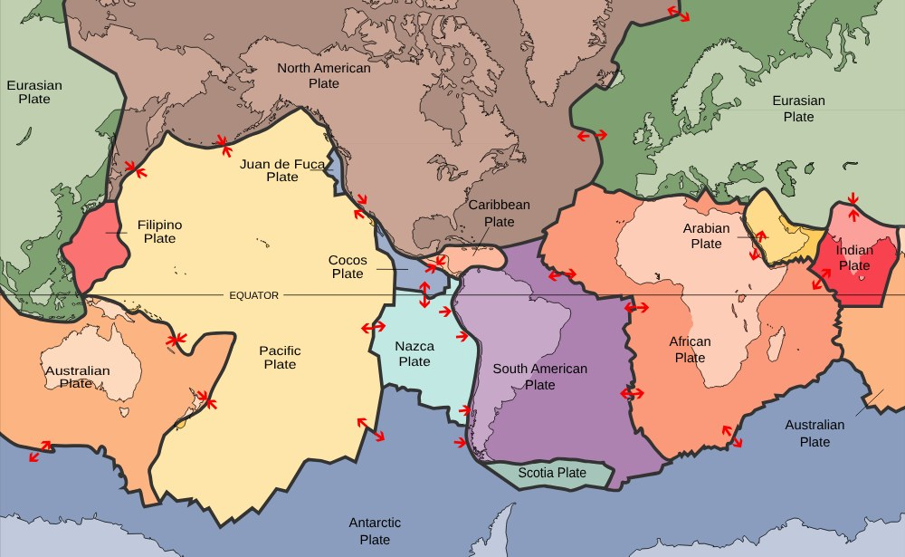

```{=html}
<style>
@import url('https://fonts.googleapis.com/css2?family=Space+Grotesk:wght@700&family=Inter:wght@400;600;800&display=swap');

.engage-box { background: linear-gradient(135deg, #e17055 0%, #d63031 100%); color: white; padding: 25px; margin: 20px 0; border-radius: 15px; box-shadow: 0 10px 30px rgba(225, 112, 85, 0.3); }
.explore-box { background: linear-gradient(135deg, #0870c0 0%, #00876a 100%); color: white; padding: 25px; margin: 20px 0; border-radius: 15px; box-shadow: 0 10px 30px rgba(9, 132, 227, 0.3); }
.explain-box { background: linear-gradient(135deg, #5848c7 0%, #6c5ce7 100%); color: white; padding: 25px; margin: 20px 0; border-radius: 15px; box-shadow: 0 10px 30px rgba(108, 92, 231, 0.3); }
.elaborate-box { background: linear-gradient(135deg, #c0701a 0%, #c0392b 100%); color: white; padding: 25px; margin: 20px 0; border-radius: 15px; box-shadow: 0 10px 30px rgba(225, 112, 85, 0.3); }
.evaluate-box { background: linear-gradient(135deg, #c0392b 0%, #b33771 100%); color: white; padding: 25px; margin: 20px 0; border-radius: 15px; box-shadow: 0 10px 30px rgba(192, 57, 43, 0.3); }
.engage-box h2, .explore-box h2, .explain-box h2, .elaborate-box h2, .evaluate-box h2 { font-family: 'Space Grotesk', sans-serif; font-size: 2em; margin-top: 0; color: white !important; }
.engage-box a, .explore-box a, .explain-box a, .elaborate-box a, .evaluate-box a { color: #ffeaa7; }
.big-question { font-family: 'Space Grotesk', sans-serif; font-size: 2.5em; font-weight: 800; background: linear-gradient(135deg, #e17055 0%, #d63031 100%); -webkit-background-clip: text; -webkit-text-fill-color: transparent; margin: 30px 0 20px 0; text-align: center; animation: slideIn 0.8s ease-out; }
.key-idea { background: linear-gradient(135deg, #ffecd2 0%, #fcd5c4 100%); color: #1a1a1a; padding: 20px; margin: 20px 0; border-radius: 12px; border-left: 8px solid #e17055; font-size: 1.05em; }
.student-task { background: #fff3e0; color: #1a1a1a; border-left: 5px solid #ff9800; padding: 20px; margin: 15px 0; border-radius: 0 10px 10px 0; }
.mind-blown { background: linear-gradient(135deg, #e17055 0%, #d63031 100%); color: white; padding: 20px; margin: 20px 0; border-radius: 15px; font-size: 1.2em; font-weight: 700; text-align: center; box-shadow: 0 10px 25px rgba(225, 112, 85, 0.4); }
@keyframes slideIn { from { opacity: 0; transform: translateY(-20px); } to { opacity: 1; transform: translateY(0); } }
h1 { font-family: 'Space Grotesk', sans-serif !important; font-weight: 800 !important; font-size: 2.8em !important; margin-top: 40px !important; }
h2 { font-family: 'Space Grotesk', sans-serif !important; font-weight: 700 !important; color: #e17055 !important; }
.pb-table { width: 100%; border-collapse: collapse; font-size: .9em; margin: 6px 0 16px; }
.pb-table th, .pb-table td { padding: 6px 8px; border-bottom: 1px solid rgba(128,128,128,.3); text-align: left; vertical-align: top; }
.pb-stat { display: inline-block; min-width: 130px; padding: 8px 12px; margin: 4px; border-radius: 10px; background: rgba(225,112,85,.12); border-left: 4px solid #e17055; font-size: .92em; }
.pb-note { font-size: .9em; opacity: .85; font-style: italic; }
</style>
```

<a class="quiz-jump-btn" href="#end-of-chapter-quiz">🧠 Quiz ↓</a>

<div class="big-question">🗺️ Why Does Seismic Activity Happen in Some Areas More Than Others?</div>

::: {.callout-note collapse="true"}
## 📒 Using this chapter with your student packet

This chapter follows the same steps as your **Surface Features & Plate Boundaries 5E** packet. Missed a class or need a refresher? Jump to the matching section:

| Packet section | In this chapter |
|---|---|
| Engage: Global Patterns of Seismic Activity (maps + See-Think-Wonder) | [Engage](#engage-global-patterns-of-seismic-activity) |
| Explore 1: Seismic Activity in the Ocean, Part 1: Topography of the Ocean Floor | [Part 1](#part-1-the-topography-of-the-ocean-floor) |
| Part 2: The Age of Bedrock on the Ocean Floor | [Part 2](#part-2-the-age-of-bedrock-on-the-ocean-floor) |
| Part 3: Calculating Seafloor Change | [Part 3](#part-3-calculating-seafloor-change) |
| Part 4: Iceland Earthquakes from Below | [Part 4](#part-4-iceland-earthquakes-from-below) |
| Making Sense of the Seismic Activity in the Ocean Investigation | [Making Sense](#making-sense-of-the-ocean-investigation) |
| Explain 1: What explains the patterns in the age of the ocean floor? + Summary Task | [Explain 1](#explain-1-what-explains-the-patterns-in-the-age-of-the-ocean-floor) |
| Explore 2: Coastal and Continental Seismic Activity (Parts 1–4) | [Explore 2](#explore-2-coastal-and-continental-seismic-activity) |
| Making Sense of the Coastal and Continental Seismic Activity Investigation | [Making Sense](#making-sense-of-the-coastal-and-continental-investigation) |
| Explain 2: Modeling Natural Hazards and Surface Features + Summary Task | [Explain 2](#explain-2-modeling-natural-hazards-and-surface-features) |
| Elaborate: Constructing New York State (Steps 1–4, Adirondack cards) | [Elaborate](#elaborate-constructing-new-york-state) |
| Evaluate: Who is Most at Risk? + Model and Argument Rubrics | [Evaluate](#evaluate-who-is-most-at-risk) |
:::

::: {.callout-tip collapse="true"}
## 🔁 Where we are in the unit

In **Earth's Interior** you used seismic waves, meteorites, and volcanic rock to model Earth's layers: a thin, rigid **crust**, a hot **mantle** that can slowly flow, and a metal **core**. You learned *how* Earth's structure can create hazards, but not **where** they happen most, or **who** is at risk.

This chapter answers: **Why does seismic activity happen in some areas more than others?** You will use maps, ocean-floor ages, and real earthquake data to build evidence for **plate tectonics**, then use it to judge which of the unit's five regions are most at risk.
:::

# Engage: Global Patterns of Seismic Activity

::: {.engage-box}
## 🌋 Where is seismic activity happening most?

On your Driving Question Board you asked: *Where do earthquakes, tsunamis, and volcanic eruptions occur? How do they occur? Is every place equally at risk?* Your packet's **Text 1** animation shows 120 years of earthquakes and their tsunamis (1901–2020). **Text 2** maps earthquakes from 1900–2017, and **Text 3** maps significant volcanic eruptions from 4360 B.C. to A.D. 2022.
:::

The map below plots **real earthquakes** from the U.S. Geological Survey (USGS) catalog, using the same colors as the packet's legend. Toggle the layers to compare earthquakes with volcanoes.

```{ojs}
//| echo: false
Plot = require("@observablehq/plot")
d3 = require("d3@7")
topojson = require("topojson-client@3")
```

```{ojs}
//| echo: false
pbLand = {
  try {
    const w = await d3.json("https://cdn.jsdelivr.net/npm/world-atlas@2.0.2/land-110m.json");
    return topojson.feature(w, w.objects.land);
  } catch (e) {
    try {
      const w = await d3.json("../world-110m.json");
      return topojson.feature(w, w.objects.land);
    } catch (e2) { return null; }
  }
}
```

```{ojs}
//| echo: false
pbBoundaries = d3.json("https://cdn.jsdelivr.net/gh/fraxen/tectonicplates@339b0c56563c118307b1f4542703047f5f698fae/GeoJSON/PB2002_boundaries.json").catch(() => null)
```

```{ojs}
//| echo: false
pbVolcanoes = [
  {name: "Tambora (Indonesia)", year: 1815, vei: 7, lat: -8.25, lon: 118.0, setting: "Convergent (subduction)"},
  {name: "Samalas (Indonesia)", year: 1257, vei: 7, lat: -8.41, lon: 116.46, setting: "Convergent (subduction)"},
  {name: "Krakatau (Indonesia)", year: 1883, vei: 6, lat: -6.10, lon: 105.42, setting: "Convergent (subduction)"},
  {name: "Pinatubo (Philippines)", year: 1991, vei: 6, lat: 15.13, lon: 120.35, setting: "Convergent (subduction)"},
  {name: "Novarupta (Alaska)", year: 1912, vei: 6, lat: 58.27, lon: -155.16, setting: "Convergent (subduction)"},
  {name: "Huaynaputina (Peru)", year: 1600, vei: 6, lat: -16.61, lon: -70.85, setting: "Convergent (subduction)"},
  {name: "Santa María (Guatemala)", year: 1902, vei: 6, lat: 14.76, lon: -91.55, setting: "Convergent (subduction)"},
  {name: "Vesuvius (Italy)", year: 79, vei: 5, lat: 40.82, lon: 14.43, setting: "Convergent (subduction)"},
  {name: "Mount St. Helens (USA)", year: 1980, vei: 5, lat: 46.20, lon: -122.18, setting: "Convergent (subduction)"},
  {name: "El Chichón (Mexico)", year: 1982, vei: 5, lat: 17.36, lon: -93.23, setting: "Convergent (subduction)"},
  {name: "Mount Fuji (Japan)", year: 1707, vei: 5, lat: 35.36, lon: 138.73, setting: "Convergent (subduction)"},
  {name: "Hunga Tonga–Hunga Ha'apai (Tonga)", year: 2022, vei: 5, lat: -20.55, lon: -175.39, setting: "Convergent (subduction)"},
  {name: "Merapi (Indonesia)", year: 2010, vei: 4, lat: -7.54, lon: 110.45, setting: "Convergent (subduction)"},
  {name: "Chaitén (Chile)", year: 2008, vei: 4, lat: -42.83, lon: -72.65, setting: "Convergent (subduction)"},
  {name: "Mount Pelée (Martinique)", year: 1902, vei: 4, lat: 14.81, lon: -61.17, setting: "Convergent (subduction)"},
  {name: "Nevado del Ruiz (Colombia)", year: 1985, vei: 3, lat: 4.89, lon: -75.32, setting: "Convergent (subduction)"},
  {name: "Eyjafjallajökull (Iceland)", year: 2010, vei: 4, lat: 63.63, lon: -19.62, setting: "Divergent (ridge or rift)"},
  {name: "Laki (Iceland)", year: 1783, vei: 4, lat: 64.07, lon: -18.23, setting: "Divergent (ridge or rift)"},
  {name: "Fagradalsfjall (Iceland)", year: 2021, vei: 0, lat: 63.90, lon: -22.27, setting: "Divergent (ridge or rift)"},
  {name: "Ol Doinyo Lengai (Tanzania)", year: 2007, vei: 3, lat: -2.76, lon: 35.91, setting: "Divergent (ridge or rift)"},
  {name: "Nyiragongo (DR Congo)", year: 2002, vei: 1, lat: -1.52, lon: 29.25, setting: "Divergent (ridge or rift)"},
  {name: "Mauna Loa (Hawaii)", year: 2022, vei: 0, lat: 19.48, lon: -155.61, setting: "Hot spot (middle of a plate)"}
]
```

```{ojs}
//| echo: false
pbMagClass = m => m >= 9 ? "9.0+" : m >= 8 ? "8.0–8.9" : m >= 7 ? "7.0–7.9" : "6.0–6.9"
```

```{ojs}
//| echo: false
pbWorldMap = function({quakes, layers = [], title, subtitle}) {
  const showQ = layers.includes("Earthquakes"), showV = layers.includes("Volcanoes"), showB = layers.includes("Plate boundaries");
  const marks = [Plot.sphere({fill: "#cfe8f7", stroke: "#8aa"})];
  if (pbLand) marks.push(Plot.geo(pbLand, {fill: "#f4f1e8", stroke: "#b9b29c", strokeWidth: 0.5}));
  if (showB && pbBoundaries) {
    marks.push(Plot.geo(pbBoundaries.features.filter(f => f.properties.Type !== "subduction"), {stroke: "#0984e3", strokeWidth: 1.2}));
    marks.push(Plot.geo(pbBoundaries.features.filter(f => f.properties.Type === "subduction"), {stroke: "#8e44ad", strokeWidth: 2.2}));
  }
  if (showQ && quakes) {
    const sorted = quakes.slice().sort((a, b) => a.mag - b.mag);
    marks.push(Plot.dot(sorted, {x: "lon", y: "lat", r: "mag", fill: d => pbMagClass(d.mag), stroke: "#333", strokeWidth: 0.3,
      tip: true, title: d => `M${d.mag.toFixed(1)} · ${d.time.getUTCFullYear()}\n${d.place}\nDepth: ${Math.round(d.depth)} km`}));
  }
  if (showV) marks.push(Plot.dot(pbVolcanoes, {x: "lon", y: "lat", symbol: "triangle", r: 6, fill: "#c0392b", stroke: "white", strokeWidth: 1,
    tip: true, title: d => `▲ ${d.name}, ${d.year}\nVEI ${d.vei} · ${d.setting}`}));
  return Plot.plot({
    title, subtitle,
    projection: "equal-earth",
    width: width, height: Math.round(width * 0.52),
    r: {type: "linear", domain: [6, 9.5], range: [1.4, 9]},
    color: {domain: ["6.0–6.9", "7.0–7.9", "8.0–8.9", "9.0+"], range: ["#f1c40f", "#e67e22", "#e74c3c", "#111111"], legend: showQ, label: "Magnitude"},
    marks
  });
}
```

```{ojs}
//| echo: false
viewof pbQuakeSet = Inputs.radio(["M7+ since 1900", "M6+ since 2000"], {label: "Earthquakes:", value: "M7+ since 1900"})
```

```{ojs}
//| echo: false
pbQuakes = {
  const base = "https://earthquake.usgs.gov/fdsnws/event/1/query?format=csv&orderby=time-asc";
  const url = pbQuakeSet === "M7+ since 1900" ? `${base}&minmagnitude=7&starttime=1900-01-01` : `${base}&minmagnitude=6&starttime=2000-01-01`;
  try {
    const rows = await d3.csv(url, d => ({lat: +d.latitude, lon: +d.longitude, depth: +d.depth, mag: +d.mag, time: new Date(d.time), place: d.place}));
    return rows.filter(d => isFinite(d.mag) && isFinite(d.lat));
  } catch (e) { return null; }
}
```

```{ojs}
//| echo: false
viewof pbEngageLayers = Inputs.checkbox(["Earthquakes", "Volcanoes", "Plate boundaries"], {label: "Show:", value: ["Earthquakes"]})
```

```{ojs}
//| echo: false
{
  const wrap = d3.create("div");
  if (!pbQuakes) wrap.append("p").attr("class", "pb-note").text("⚠️ Live earthquake data from USGS couldn't load right now. Reload the page, or use the maps in your packet (Text 2).");
  wrap.append(() => pbWorldMap({quakes: pbQuakes, layers: pbEngageLayers,
    title: `Earthquakes (${pbQuakeSet})${pbQuakes ? ": " + pbQuakes.length.toLocaleString() + " events" : ""}`,
    subtitle: "Data: USGS earthquake catalog (live). Bigger dots = bigger magnitude. Tap a dot for details."}));
  const notes = [];
  if (pbEngageLayers.includes("Volcanoes")) notes.push("▲ red triangles = major historic eruptions (see the table below)");
  if (pbEngageLayers.includes("Plate boundaries")) notes.push("purple lines = subduction zones · blue lines = other plate boundaries (ridges, rifts, transforms, collisions). Boundaries: Bird (2003) PB2002 model");
  if (notes.length) wrap.append("p").attr("class", "pb-note").text(notes.join(" · "));
  return wrap.node();
}
```

```{ojs}
//| echo: false
{
  if (!pbQuakes) return html``;
  const top = pbQuakes.slice().sort((a, b) => b.mag - a.mag).slice(0, 8);
  return html`<div style="overflow-x:auto;"><table class="pb-table">
    <caption style="caption-side:top;text-align:left;font-weight:700;padding-bottom:4px;">Largest earthquakes in this data set</caption>
    <thead><tr><th>Year</th><th>Magnitude</th><th>Location</th><th>Depth</th></tr></thead>
    <tbody>${top.map(d => html`<tr><td>${d.time.getUTCFullYear()}</td><td><strong>${d.mag.toFixed(1)}</strong></td><td>${d.place}</td><td>${Math.round(d.depth)} km</td></tr>`)}</tbody>
  </table></div>`;
}
```

::: {.mind-blown}
🌊 The five largest earthquakes since 1900 (Chile 1960, M9.5; Alaska 1964; Sumatra 2004; Japan 2011; Kamchatka 1952) **all** struck where the ocean floor meets a coastline, and **all** of them caused tsunamis.
:::

### How explosive were the eruptions?

Volcanologists rate eruptions with the **Volcanic Explosivity Index (VEI)**, from 0 (gentle lava flows) to 8. Each step up means roughly **10 times more** erupted material. Bigger bubbles = more eruptions at that VEI.

```{ojs}
//| echo: false
Plot.plot({
  title: "Explosiveness of major eruptions by plate setting",
  subtitle: "22 well-known eruptions. Tap a bubble to see which volcanoes.",
  width: width, height: 230,
  marginLeft: Math.min(170, width * 0.38), marginRight: 20,
  x: {label: "Volcanic Explosivity Index (VEI)", domain: [-0.5, 7.5], ticks: 8, grid: true},
  y: {label: null, domain: ["Convergent (subduction)", "Divergent (ridge or rift)", "Hot spot (middle of a plate)"],
      tickFormat: d => width < 520 ? d.replace(/ \(.*\)/, "") : d},
  r: {range: [5, 18]},
  color: {domain: ["Convergent (subduction)", "Divergent (ridge or rift)", "Hot spot (middle of a plate)"], range: ["#8e44ad", "#0984e3", "#e67e22"]},
  marks: [
    Plot.dot(pbVolcanoes, Plot.group({r: "count", title: names => names.join("\n")},
      {x: "vei", y: "setting", fill: "setting", fillOpacity: 0.75, stroke: "white", title: d => `${d.name} (${d.year}): VEI ${d.vei}`, tip: true}))
  ]
})
```

```{ojs}
//| echo: false
buildQuiz = function(id, title, questions) {
  const outer = html`<div id="${id}" style="margin:18px 0 24px 0;text-align:center;">
    <button style="
      display:inline-flex;align-items:center;gap:7px;
      background:linear-gradient(135deg,#667eea 0%,#764ba2 100%);
      color:#fff;border:none;padding:9px 22px;border-radius:50px;
      font-size:.95em;font-weight:700;cursor:pointer;
      box-shadow:0 3px 12px rgba(102,126,234,.45);
      transition:transform .15s,box-shadow .15s;"
      onmouseover="this.style.transform='scale(1.04)';this.style.boxShadow='0 5px 18px rgba(102,126,234,.55)'"
      onmouseout="this.style.transform='scale(1)';this.style.boxShadow='0 3px 12px rgba(102,126,234,.45)'"
    >
      <span style="font-size:1.1em;">📝</span> ${title}
      <span class="chevron" style="transition:transform .3s;">▼</span>
    </button>
    <div class="quiz-body" style="
      max-height:0;opacity:0;overflow:hidden;
      transition:max-height .5s cubic-bezier(.4,0,.2,1),opacity .4s ease,margin-top .3s ease;
      margin-top:0;text-align:left;">
      <button class="close-btn" style="
        display:block;margin:0 auto 10px auto;
        background:rgba(102,126,234,.12);color:#667eea;border:none;
        padding:5px 18px;border-radius:50px;font-size:.85em;
        font-weight:600;cursor:pointer;">Hide Quiz</button>
      <p style="text-align:center;color:#718096;font-style:italic;font-size:.9em;margin-bottom:12px;">
        Select an answer for each question.</p>
    </div>
  </div>`;
  const toggle = outer.querySelector("button");
  const chevron = toggle.querySelector(".chevron");
  const body   = outer.querySelector(".quiz-body");
  const closeBtn = body.querySelector(".close-btn");
  function expand(){  body.style.maxHeight="2000px";body.style.opacity="1";body.style.marginTop="14px";chevron.style.transform="rotate(180deg)"; }
  function collapse(){ body.style.maxHeight="0";body.style.opacity="0";body.style.marginTop="0";chevron.style.transform="rotate(0)"; }
  toggle.onclick = () => body.style.maxHeight === "0px" || body.style.maxHeight === "" ? expand() : collapse();
  closeBtn.onclick = collapse;
  questions.forEach((qq, qi) => {
    const card = document.createElement("div");
    card.style.cssText = "background:#fff;color:#1e1b4b;border-radius:12px;padding:16px 20px;margin-bottom:14px;box-shadow:0 2px 8px rgba(0,0,0,.08);";
    card.innerHTML = `<p style="font-weight:700;margin:0 0 10px;">${qi+1}. ${qq.q}</p>`;
    qq.options.forEach((opt, oi) => {
      const btn = document.createElement("button");
      btn.textContent = opt;
      btn.style.cssText = "display:block;width:100%;min-height:44px;text-align:left;padding:10px 14px;margin:6px 0;border:2px solid #e2e8f0;border-radius:8px;background:#fff;color:#1e1b4b;cursor:pointer;font-size:.95em;transition:border-color .2s,background .2s;";
      btn.onmouseover = () => { if(!card.dataset.answered){ btn.style.borderColor="#667eea";btn.style.background="#f0f0ff"; }};
      btn.onmouseout  = () => { if(!card.dataset.answered){ btn.style.borderColor="#e2e8f0";btn.style.background="#fff"; }};
      btn.onclick = () => {
        if(card.dataset.answered) return;
        card.dataset.answered = "true";
        card.querySelectorAll("button").forEach(b => { b.style.cursor="default"; b.onmouseover=null; b.onmouseout=null; });
        if(oi === qq.correct){
          btn.style.borderColor="#48bb78";btn.style.background="#f0fff4";
          fb.innerHTML = "✅ Correct! " + qq.explanation;
          fb.style.color="#276749";fb.style.background="#f0fff4";
        } else {
          btn.style.borderColor="#fc8181";btn.style.background="#fff5f5";
          card.querySelectorAll("button")[qq.correct].style.borderColor="#48bb78";
          card.querySelectorAll("button")[qq.correct].style.background="#f0fff4";
          fb.innerHTML = "❌ " + qq.explanation;
          fb.style.color="#9b2c2c";fb.style.background="#fff5f5";
        }
        fb.style.padding="10px 14px";fb.style.marginTop="8px";
      };
      card.appendChild(btn);
    });
    const fb = document.createElement("div");
    fb.style.cssText = "border-radius:8px;font-size:.9em;transition:all .3s;";
    card.appendChild(fb);
    body.appendChild(card);
  });
  return outer;
}
```

```{ojs}
//| echo: false
buildQuiz("pb-engage-quiz", "🌋 Check Your Understanding: Global Patterns", [
  {
    q: "Look at the earthquake map. Which statement best describes the pattern?",
    options: ["Earthquakes are spread evenly across the planet", "Earthquakes form long, narrow bands, many of them around the edges of the Pacific Ocean", "Earthquakes happen only in the middle of continents", "Earthquakes happen only near the equator"],
    correct: 1,
    explanation: "Earthquakes line up in narrow belts: a ring around the Pacific, a belt from the Mediterranean through the Himalayas to Indonesia, and thin lines down the middle of the oceans. Large areas (like most of Africa, Australia, and Canada) have very few."
  },
  {
    q: "Where do the LARGEST earthquakes (black and red dots) occur?",
    options: ["Along the thin lines in the middle of the oceans", "Mostly along coastlines and island chains around the Pacific and Indian Oceans (Chile, Alaska, Japan, Sumatra)", "In the center of Africa", "Evenly everywhere"],
    correct: 1,
    explanation: "Every M9 earthquake since 1900 happened along a coastline or island chain where ocean floor meets land: Chile, Alaska, Kamchatka, Japan, and Sumatra. The mid-ocean lines have many earthquakes, but they are smaller."
  },
  {
    q: "Turn on Volcanoes. Use the VEI chart: where do the MOST EXPLOSIVE eruptions happen?",
    options: ["At divergent settings like Iceland", "At hot spots like Hawaii", "At convergent (subduction) settings, like Indonesia, the Philippines, and the Andes", "Explosive eruptions happen equally everywhere"],
    correct: 2,
    explanation: "All of the VEI 5–7 eruptions in the chart (Tambora, Krakatau, Pinatubo, Mount St. Helens…) are in the same belts as the big earthquakes. Iceland, East Africa, and Hawaii mostly have gentler lava eruptions (VEI 0–4)."
  },
  {
    q: "Turn on Plate boundaries. What do the earthquake bands and volcanoes have in common?",
    options: ["They follow the plate boundaries", "They follow lines of latitude", "They follow the coastlines of every continent", "They only occur where many people live"],
    correct: 0,
    explanation: "Almost all of the earthquakes and volcanoes sit along plate boundaries. The rest of this chapter collects evidence about WHY. Notice too that some coastlines (like the U.S. East Coast) have almost no activity, so it isn't just about being near the ocean."
  }
])
```

::: {.student-task}
### ✏️ In your packet: See-Think-Wonder

Use the animation (Text 1) and maps (Texts 2 and 3) to fill in the organizer:

- **See:** What patterns do you notice in earthquakes, volcanic eruptions, and tsunamis? Where do the **largest earthquakes** occur? Where do the **most explosive volcanoes** erupt? Give evidence for each.
- **Think:** What do those observations make you think about?
- **Wonder:** What questions do you have?
- Your group shares **one important idea and one question** with the class.
:::

# Explore 1: Seismic Activity in the Ocean

::: {.explore-box}
## 🌊 Why did earthquakes and volcanic eruptions occur in Iceland?

Iceland has lots of earthquakes **and** volcanic eruptions, and it sits right on one of those thin lines of earthquakes in the middle of the Atlantic Ocean. In this investigation you'll look at the shape of the ocean floor, the age of its rock, how fast it changes, and what the earthquakes look like underneath Iceland.
:::

## Part 1: The Topography of the Ocean Floor

{fig-alt="World map of elevation and ocean depth. Land is green to brown. The oceans are shades of blue, with lighter blue ridges running down the middle of the Atlantic Ocean and across the Indian and Pacific Oceans, and narrow dark-blue trenches along the western edge of South America and east of Japan." width="100%"}

::: {.key-idea}
### 💡 Three kinds of ocean floor

- **Continental shelves:** shallow ocean floor at the edges of continents (red in your packet's map).
- **Mid-ocean ridges:** long underwater mountain chains that wind through every ocean, like the seam on a baseball (yellow-green in your packet's map). The **Mid-Atlantic Ridge** runs right through Iceland.
- **Abyssal plains:** deep, flat ocean floor (blue to purple in your packet's map).
- **Trenches:** narrow, very deep valleys next to some coastlines and island chains (Peru–Chile Trench, Japan Trench, Mariana Trench).
:::

```{ojs}
//| echo: false
buildQuiz("pb-topo-quiz", "🗺️ Check Your Understanding: The Ocean Floor", [
  {
    q: "Compare the topography map with the earthquake map in Engage. Which ocean-floor feature lines up with the thin bands of earthquakes in the MIDDLE of the oceans?",
    options: ["Abyssal plains", "Mid-ocean ridges", "Continental shelves", "None of them"],
    correct: 1,
    explanation: "The thin earthquake lines in the middle of the Atlantic, Indian, and Pacific Oceans trace the mid-ocean ridges exactly. Iceland sits on top of the Mid-Atlantic Ridge."
  },
  {
    q: "Which ocean-floor feature lines up with the bands of the LARGEST earthquakes along coastlines (Chile, Japan, Alaska)?",
    options: ["Deep ocean trenches", "Abyssal plains", "Mid-ocean ridges", "Continental shelves of the Atlantic coast"],
    correct: 0,
    explanation: "The biggest earthquakes happen beside deep trenches: the Peru–Chile Trench, the Japan Trench, and the Aleutian Trench. You'll find out why in Explore 2."
  }
])
```

::: {.student-task}
### ✏️ In your packet: Part 1 questions

1. Compare the ocean-floor map to the Engage maps. **Mark** the areas of high earthquake and volcanic activity on the ocean-floor map.
2. What patterns do you notice? Are any **types of ocean floor** connected to the seismic hazards?
:::

## Part 2: The Age of Bedrock on the Ocean Floor

Scientists drilled into the ocean floor and used **radiometric dating** (measuring radioactive decay in the rock) to find out how old the rock is. This is the same map as your packet, drawn on a different projection.

{fig-alt="World map of the ocean floor colored by age. Thin red stripes run down the middle of the Atlantic Ocean and through the Indian and Pacific Oceans. On both sides of each red stripe the colors change in matching bands through orange, yellow, green, and blue, with the oldest blue and purple rock near the continents and in the western Pacific." width="100%"}

```{ojs}
//| echo: false
buildQuiz("pb-age-quiz", "🎨 Check Your Understanding: Ocean Floor Age", [
  {
    q: "Where is the YOUNGEST ocean-floor rock (red)?",
    options: ["Next to the continents", "Along the mid-ocean ridges", "In the deepest abyssal plains", "Under Antarctica"],
    correct: 1,
    explanation: "The red stripes trace the mid-ocean ridges. That's where the brand-new rock is."
  },
  {
    q: "Follow the colors from the Mid-Atlantic Ridge toward Africa, then toward South America. What do you notice?",
    options: ["The rock gets older in both directions, in a matching (mirror-image) pattern", "The rock gets younger toward the continents", "The colors are random", "Only the African side gets older"],
    correct: 0,
    explanation: "The color bands are symmetric: red → orange → yellow → green → blue on BOTH sides of the ridge. Something is making new rock at the ridge and moving it outward in both directions."
  },
  {
    q: "About how old is the OLDEST rock on almost all of the ocean floor?",
    options: ["About 18 thousand years", "About 180 million years", "About 4 billion years", "Exactly as old as Earth"],
    correct: 1,
    explanation: "Nearly all ocean floor is younger than about 200 million years. That's young for Earth (4.6 billion years old). Where does the older ocean floor go? Keep that question in mind for Explore 2."
  }
])
```

::: {.student-task}
### ✏️ In your packet: Part 2 questions

1. What patterns do you notice in the **age** of the ocean-floor rock as it gets closer to or farther from the continents?
2. What do you think might be **causing** that pattern?
:::

## Part 3: Calculating Seafloor Change

Your packet asks you to measure the color map **in the North Atlantic** and calculate how fast the seafloor is spreading. Measure the distance from the **center of the new crust (red)** to the border between **dark yellow and light green** (the **65 million year** line). Enter your measurement below; the calculator follows the same steps as your packet.

```{ojs}
//| echo: false
viewof pbMapCm = Inputs.range([0.2, 1.2], {label: "Your map measurement (cm):", step: 0.01, value: 0.56})
```

```{ojs}
//| echo: false
{
  const km = pbMapCm * 2100;
  const cm = km * 100000;
  const years = 65e6;
  const rate = cm / years;
  const fmt = d3.format(",.0f");
  return html`<div style="padding:14px 16px;border-radius:12px;background:rgba(9,132,227,.08);border-left:5px solid #0984e3;line-height:1.7;">
    <div><strong>Step 1 · Real distance:</strong> ${pbMapCm.toFixed(2)} cm on the map × 2,100 km per cm = <strong>${fmt(km)} km</strong></div>
    <div><strong>Step 2 · Convert to cm:</strong> ${fmt(km)} km × 100,000 cm per km = <strong>${d3.format(".3~e")(cm).replace("e+", " × 10^")} cm</strong></div>
    <div><strong>Step 3 · Time:</strong> 65 Ma = <strong>65,000,000 years</strong></div>
    <div><strong>Step 4 · Rate:</strong> R = d ÷ t = ${d3.format(".3~e")(cm).replace("e+", " × 10^")} cm ÷ 65,000,000 yr = <strong style="font-size:1.15em;">${rate.toFixed(2)} cm/yr</strong></div>
    <div style="margin-top:6px;font-size:.92em;">That's ${rate < 3.5 ? "a little slower than" : "about as fast as"} your fingernails grow (about 3–4 cm per year).</div>
  </div>`;
}
```

```{ojs}
//| echo: false
viewof pbShowRateKey = Inputs.toggle({label: "Show the answer key (after you try!)", value: false})
```

```{ojs}
//| echo: false
pbShowRateKey ? html`<div style="padding:12px 16px;border-radius:10px;background:#f0fff4;color:#1a1a1a;border-left:5px solid #48bb78;">
  <strong>Answer key:</strong> Most students measure about <strong>0.5–0.6 cm</strong> on a full-size printed map, so the plate has moved about <strong>1,100–1,300 km</strong> in <strong>65 million years</strong>. That gives a spreading rate of about <strong>1.8 cm/yr</strong> (anywhere from <strong>1.5 to 2 cm/yr</strong> is reasonable, depending on exactly where you measure). The key idea: at a few centimeters per year, building an ocean basin takes <strong>tens of millions of years</strong>.
</div>` : html`<p class="pb-note">Try the calculation in your packet first, then check here.</p>`
```

The spreading rate is different at different ridges. These are the **total spreading rates** (both plates combined) printed on the *Global Tectonic Activity* map in your packet (from the NYS Earth Science Reference Tables):

```{ojs}
//| echo: false
pbSpreadRates = [
  {ridge: "Southwest Indian Ridge", ocean: "Indian", lo: 1.6, hi: 1.6},
  {ridge: "Red Sea", ocean: "Indian", lo: 1.6, hi: 1.6},
  {ridge: "Reykjanes Ridge (Iceland)", ocean: "Atlantic", lo: 1.8, hi: 1.8},
  {ridge: "Gulf of Aden", ocean: "Indian", lo: 2.0, hi: 2.0},
  {ridge: "Mid-Atlantic Ridge (North)", ocean: "Atlantic", lo: 2.5, hi: 2.8},
  {ridge: "Central Indian Ridge", ocean: "Indian", lo: 2.7, hi: 4.9},
  {ridge: "Mid-Atlantic Ridge (South)", ocean: "Atlantic", lo: 3.8, hi: 4.0},
  {ridge: "Cocos–Nazca boundary", ocean: "Pacific", lo: 7.0, hi: 7.0},
  {ridge: "Southeast Indian Ocean Ridge", ocean: "Indian", lo: 7.4, hi: 7.4},
  {ridge: "Pacific–Antarctic Ridge", ocean: "Pacific", lo: 8.8, hi: 9.5},
  {ridge: "East Pacific Rise", ocean: "Pacific", lo: 15.3, hi: 16.1}
]
```

```{ojs}
//| echo: false
Plot.plot({
  title: "How fast are the ridges spreading?",
  subtitle: "Total spreading rate (cm per year). Two dots = two readings along the same ridge.",
  width: width, height: 330,
  marginLeft: Math.min(190, width * 0.42), marginRight: 20,
  x: {label: "Total spreading rate (cm/yr)", grid: true, domain: [0, 17]},
  y: {label: null, domain: pbSpreadRates.map(d => d.ridge)},
  color: {domain: ["Atlantic", "Indian", "Pacific"], range: ["#0984e3", "#00b894", "#e17055"], legend: true},
  marks: [
    Plot.link(pbSpreadRates, {x1: "lo", x2: "hi", y1: "ridge", y2: "ridge", stroke: "ocean", strokeWidth: 3}),
    Plot.dot(pbSpreadRates, {x: "lo", y: "ridge", fill: "ocean", r: 5, tip: true, title: d => `${d.ridge}\n${d.lo === d.hi ? d.lo : d.lo + "–" + d.hi} cm/yr`}),
    Plot.dot(pbSpreadRates.filter(d => d.hi !== d.lo), {x: "hi", y: "ridge", fill: "ocean", r: 5}),
    Plot.ruleX([0])
  ]
})
```

```{ojs}
//| echo: false
buildQuiz("pb-rate-quiz", "📏 Check Your Understanding: Spreading Rates", [
  {
    q: "A student measures 0.6 cm on the map (1 cm = 2,100 km). How far has the plate moved?",
    options: ["210 km", "1,260 km", "2,100 km", "12,600 km"],
    correct: 1,
    explanation: "0.6 cm × 2,100 km/cm = 1,260 km. Then 1,260 km × 100,000 = 126,000,000 cm, and 126,000,000 cm ÷ 65,000,000 yr ≈ 1.9 cm/yr."
  },
  {
    q: "Why do we convert kilometers to centimeters before dividing by the time?",
    options: ["Because spreading rates are usually given in cm per year, and the numbers are easier to picture", "Because kilometers are wrong", "To make the plate move faster", "It makes no difference to the units"],
    correct: 0,
    explanation: "1,260 km ÷ 65,000,000 yr = 0.0000194 km/yr, a hard number to picture. In cm/yr it's about 1.9, close to how fast your fingernails grow."
  },
  {
    q: "According to the chart, which ridge is spreading FASTEST?",
    options: ["The Reykjanes Ridge near Iceland", "The Mid-Atlantic Ridge", "The East Pacific Rise", "The Southwest Indian Ridge"],
    correct: 2,
    explanation: "The East Pacific Rise spreads at about 15–16 cm per year, around 8 times faster than the ridge near Iceland (1.8 cm/yr)."
  }
])
```

::: {.student-task}
### ✏️ In your packet: Part 3 calculations

Using the full-size *Map of Sea Floor Spread*, a ruler, and a calculator:

1. **Measure** (cm) from the center of the red crust to the dark-yellow/light-green border (65 Ma) in the North Atlantic.
2. **Calculate** the real distance using the scale **1 cm = 2,100 km**.
3. **Determine** how long the plate has been moving (65 million years).
4. **Calculate** the spreading rate: **R = d ÷ t**, in **cm/yr** (1 km = 100,000 cm).
:::

## Part 4: Iceland Earthquakes from Below

In your packet you use the **IRIS Interactive Earthquake Viewer** to zoom in on Iceland and rotate to a 3D view. The viewer below does the same thing with live USGS data: the **map** shows where the earthquakes are, and the **cross-section** shows how deep they are (as if you sliced the Earth and looked from the side).

```{ojs}
//| echo: false
pbDepthClass = d => d < 33 ? "0–33 km" : d < 70 ? "33–70 km" : d < 150 ? "70–150 km" : d < 300 ? "150–300 km" : d < 500 ? "300–500 km" : "500–800 km"
```

```{ojs}
//| echo: false
pbDepthColor = ({domain: ["0–33 km", "33–70 km", "70–150 km", "150–300 km", "300–500 km", "500–800 km"],
  range: ["#7d3c98", "#2e86de", "#27ae60", "#f1c40f", "#e67e22", "#c0392b"]})
```

```{ojs}
//| echo: false
pbRegions = ({
  "Iceland (Mid-Atlantic Ridge)": {box: [63, 67.5, -25, -13], minmag: 2.5, start: "2000-01-01"},
  "Japanese Archipelago": {box: [30, 46, 128, 148], minmag: 4.5, start: "2000-01-01"},
  "Indonesia (Sumatra–Java)": {box: [-11, 6, 94, 116], minmag: 4.5, start: "2000-01-01"},
  "Andes Region (Chile–Argentina)": {box: [-40, -15, -80, -60], minmag: 4.5, start: "2000-01-01"},
  "Mainland Southeast Asia (Myanmar)": {box: [15, 28, 90, 102], minmag: 4, start: "2000-01-01"},
  "Great Rift Valley (East Africa)": {box: [-12, 15, 28, 42], minmag: 4, start: "2000-01-01"},
  "Mediterranean Basin": {box: [30, 46, -6, 36], minmag: 4.5, start: "2000-01-01"}
})
```

```{ojs}
//| echo: false
pbFetchRegion = async function(key) {
  const r = pbRegions[key], [s, n, w, e] = r.box;
  const url = `https://earthquake.usgs.gov/fdsnws/event/1/query?format=csv&starttime=${r.start}&minlatitude=${s}&maxlatitude=${n}&minlongitude=${w}&maxlongitude=${e}&minmagnitude=${r.minmag}&orderby=magnitude&limit=1500`;
  try {
    const rows = await d3.csv(url, d => ({lat: +d.latitude, lon: +d.longitude, depth: Math.max(0, +d.depth), mag: +d.mag, time: new Date(d.time), place: d.place}));
    return rows.filter(d => isFinite(d.mag) && isFinite(d.depth));
  } catch (err) { return null; }
}
```

```{ojs}
//| echo: false
pbRegionView = function(rows, key) {
  const r = pbRegions[key], [s, n, w, e] = r.box;
  const wrap = d3.create("div");
  if (!rows || rows.length === 0) {
    wrap.append("p").attr("class", "pb-note").text("⚠️ Live earthquake data from USGS couldn't load right now. Reload the page, or use the IRIS Earthquake Viewer linked in your packet.");
    return wrap.node();
  }
  const dExt = d3.extent(rows, d => d.depth), mExt = d3.extent(rows, d => d.mag);
  const stats = wrap.append("div").style("margin", "6px 0 10px");
  [["Earthquakes shown", rows.length.toLocaleString()],
   ["Depth range", `${Math.round(dExt[0])}–${Math.round(dExt[1])} km`],
   ["Magnitude range", `${mExt[0].toFixed(1)}–${mExt[1].toFixed(1)}`],
   ["Deeper than 70 km", `${Math.round(100 * rows.filter(d => d.depth > 70).length / rows.length)}%`]]
    .forEach(([k, v]) => stats.append("div").attr("class", "pb-stat").html(`${k}<br><strong>${v}</strong>`));
  const sorted = rows.slice().sort((a, b) => a.depth - b.depth);
  const domain = {type: "MultiPoint", coordinates: [[w, s], [e, n], [w, n], [e, s]]};
  const tip = d => `M${d.mag.toFixed(1)} · ${d.time.getUTCFullYear()}\n${d.place}\nDepth: ${Math.round(d.depth)} km`;
  const rScale = {type: "linear", domain: mExt, range: [1.5, 7]};
  wrap.append(() => Plot.plot({
    title: `Map view: ${key}`,
    width: width, height: Math.round(Math.min(460, width * 0.75)),
    projection: {type: "mercator", domain, inset: 6},
    r: rScale,
    color: {...pbDepthColor, legend: true, label: "Depth"},
    style: {background: "#cfe8f7"},
    marks: [
      pbLand ? Plot.geo(pbLand, {fill: "#f4f1e8", stroke: "#999", strokeWidth: 0.6, clip: true}) : null,
      Plot.dot(sorted, {x: "lon", y: "lat", r: "mag", fill: d => pbDepthClass(d.depth), stroke: "#222", strokeWidth: 0.3, clip: true, tip: true, title: tip}),
      Plot.frame()
    ]
  }));
  wrap.append(() => Plot.plot({
    title: "Cross-section (side view): depth vs. longitude",
    subtitle: "West is on the left, east on the right. The surface is at the top.",
    width: width, height: 260, marginLeft: 52, marginBottom: 40,
    x: {label: "Longitude (° east; negative = west)", domain: [w, e], grid: true},
    y: {label: "Depth (km)", reverse: true, grid: true, domain: [0, Math.max(40, Math.ceil(dExt[1] / 50) * 50)]},
    r: rScale,
    color: pbDepthColor,
    marks: [
      Plot.ruleY([0], {stroke: "#333"}),
      Plot.dot(sorted, {x: "lon", y: "depth", r: "mag", fill: d => pbDepthClass(d.depth), stroke: "#222", strokeWidth: 0.3, fillOpacity: 0.8, tip: true, title: tip})
    ]
  }));
  wrap.append("p").attr("class", "pb-note").text(`Data: USGS earthquake catalog (live), M${r.minmag}+ since ${r.start.slice(0, 4)}, up to the 1,500 largest. Dot size = magnitude; color = depth (similar to the IRIS viewer). Many small earthquakes far from seismometers are listed at a standard depth of 10 km, so you may see a flat line of dots there.`);
  return wrap.node();
}
```

```{ojs}
//| echo: false
pbIcelandRows = pbFetchRegion("Iceland (Mid-Atlantic Ridge)")
```

```{ojs}
//| echo: false
pbRegionView(pbIcelandRows, "Iceland (Mid-Atlantic Ridge)")
```

```{ojs}
//| echo: false
buildQuiz("pb-iceland-quiz", "🇮🇸 Check Your Understanding: Under Iceland", [
  {
    q: "What does the COLOR of each dot tell you? What does its SIZE tell you?",
    options: ["Color = depth; size = magnitude", "Color = magnitude; size = depth", "Color = year; size = number of deaths", "Color = temperature; size = depth"],
    correct: 0,
    explanation: "Like the IRIS viewer, color shows how deep the earthquake started and dot size shows its magnitude."
  },
  {
    q: "Look at the cross-section. How deep are almost all of the earthquakes under Iceland?",
    options: ["Very shallow: almost all in the top ~20 km (purple)", "Very deep: 300–700 km", "Evenly spread from 0 to 700 km", "Exactly at the core"],
    correct: 0,
    explanation: "Under Iceland the earthquakes form a thin, shallow layer, like a shallow trough between two plates that are pulling apart. You won't find deep (green, yellow, or red) earthquakes here."
  },
  {
    q: "Iceland's earthquakes are mostly small to moderate (rarely above M6). How does that compare with Chile or Japan?",
    options: ["Iceland's are much larger", "Iceland's are smaller and shallower; the biggest earthquakes happen elsewhere", "They're identical", "Iceland has no earthquakes"],
    correct: 1,
    explanation: "Mid-ocean ridge earthquakes are frequent but usually smaller. The M8–9 earthquakes happen at the coastal trenches you'll explore next."
  }
])
```

::: {.student-task}
### ✏️ In your packet: Part 4 (IRIS Earthquake Viewer)

1. Set *maximum number of earthquakes* to **1000** and click *Apply*. What does dot **color** mean? Dot **size**?
2. Center the map on **Iceland**, zoom in, and **draw** what you see.
3. Record the **minimum and maximum depths** and **magnitudes** in that area.
4. Click **3D view**, rotate to see underneath, and **draw** the shape of the earthquakes below the surface.
:::

## Making Sense of the Ocean Investigation

::: {.key-idea}
### 💡 What the ocean evidence shows

| Evidence | Pattern |
|---|---|
| Ocean-floor topography | Long **mid-ocean ridges** wind through every ocean |
| Ocean-floor age (radiometric dating) | **Youngest rock at the ridges**, getting older in **matching bands on both sides** |
| Seafloor spreading rate | The ocean floor moves away from the ridge **slowly**: about **1.5–2 cm per year** in the North Atlantic |
| Earthquakes under Iceland | **Shallow**, small-to-moderate earthquakes spread along the ridge |
| Volcanoes in Iceland | **Frequent eruptions**, often long fissures of lava |
:::

::: {.student-task}
### ✏️ In your packet: Making Sense of the Seismic Activity in the Ocean Investigation

- **See-Think-Wonder:** What patterns did you see in the **age of the ocean floor**? What do you think is happening to the sea floor? What patterns did you see in the **seismic activity under Iceland**? How does that relate to what's happening to the sea floor?
- **Analysis:** Construct an **initial model** showing what you think is creating these patterns. Add **annotations** that name the evidence for each part.
- Self- and peer-assess with the **Seismic Activity in the Ocean Investigation Rubric**.
:::

# Explain 1: What Explains the Patterns in the Age of the Ocean Floor?

::: {.explain-box}
## 🧩 How does the evidence support our explanation of why Earth's crust is youngest at ocean ridges?

Scientists used the same kinds of evidence you just collected to build the theory of **plate tectonics**. Your job: compare your ideas with this theory, and build a model that connects the evidence to it.
:::

::: {.key-idea}
### 💡 The accepted explanation (from your packet)

The continents sit on top of moving pieces of Earth's outer shell, called **tectonic plates**, whose positions slowly shift over time. At **ocean ridges**, the plates are **moving away from each other**, and **new oceanic crust forms in between from rising magma**. As the magma cools, it forms rock types like **basalt** and **gabbro**, the most common rocks in oceanic crust. During that movement, **earthquakes and volcanic eruptions** can occur.

This process is called **seafloor spreading**, and a boundary where plates move apart is a **divergent plate boundary**.
:::

### The seafloor-spreading model

Your teacher may show this with a textbook and folded paper (or clay): the paper rising out of the book's spine is like magma rising at the ridge, and the colored stripes move apart symmetrically. Drag the sliders to run the same model. Each colored band is a **10-million-year** slice of rock, colored like the age map.

```{ojs}
//| echo: false
viewof pbSpreadTime = Inputs.range([0, 65], {label: "Time (millions of years):", step: 1, value: 30})
```

```{ojs}
//| echo: false
viewof pbHalfRate = Inputs.range([1, 5], {label: "Speed of each plate (cm/yr):", step: 0.1, value: 1.8})
```

```{ojs}
//| echo: false
pbAgeColor = d3.scaleLinear().domain([0, 20, 40, 60, 80, 100, 120, 140, 160, 180])
  .range(["#e60000", "#ff7f00", "#ffd000", "#b5e000", "#3ccf3c", "#20c9b0", "#1ea0ff", "#2050ff", "#6a00e0", "#c000ff"]).clamp(true)
```

```{ojs}
//| echo: false
{
  const W = 360, H = 210, cx = W / 2, top = 70, plateH = 26;
  const kmPerMyr = pbHalfRate * 10;               // 1 cm/yr = 10 km per million years
  const maxKm = 5 * 10 * 65;                      // widest possible half-ocean
  const pxPerKm = (W / 2 - 30) / maxKm;
  const halfKm = kmPerMyr * pbSpreadTime, halfPx = halfKm * pxPerKm;
  const svg = d3.create("svg").attr("viewBox", `0 0 ${W} ${H}`)
    .attr("role", "img").attr("aria-label", "Cross-section of a mid-ocean ridge with colored bands of ocean crust moving away from the ridge in both directions and continents being pushed apart")
    .style("width", "100%").style("height", "auto").style("max-width", "640px").style("display", "block").style("margin", "auto");
  svg.append("rect").attr("width", W).attr("height", H).attr("fill", "#fdf6ec").attr("rx", 12);
  svg.append("rect").attr("x", 0).attr("y", 30).attr("width", W).attr("height", top - 30).attr("fill", "#a9d4f5");
  svg.append("rect").attr("x", 0).attr("y", top + plateH).attr("width", W).attr("height", H - top - plateH).attr("fill", "#f3c48f");
  svg.append("text").attr("x", 8).attr("y", H - 10).attr("font-size", 9).attr("fill", "#7a4a1a").text("Hot mantle (can flow slowly)");
  // magma rising
  svg.append("path").attr("d", `M${cx - 4},${top} L${cx + 4},${top} L${cx + 22},${H} L${cx - 22},${H} Z`).attr("fill", "#e74c3c").attr("opacity", 0.75);
  // age bands on both sides
  const nBands = Math.ceil(pbSpreadTime / 10);
  for (let i = 0; i < nBands; i++) {
    const a0 = i * 10, a1 = Math.min(pbSpreadTime, (i + 1) * 10);
    const x0 = a0 * kmPerMyr * pxPerKm, x1 = a1 * kmPerMyr * pxPerKm;
    for (const sgn of [-1, 1]) {
      const xa = cx + sgn * x0, xb = cx + sgn * x1;
      svg.append("rect").attr("x", Math.min(xa, xb)).attr("y", top).attr("width", Math.abs(xb - xa)).attr("height", plateH)
        .attr("fill", pbAgeColor(a0 + 5)).attr("stroke", "#fff").attr("stroke-width", 0.4);
    }
  }
  // continents riding on the plates
  for (const sgn of [-1, 1]) {
    const x = cx + sgn * halfPx;
    svg.append("path").attr("d", sgn < 0
      ? `M${x},${top - 6} L${x - 90},${top - 6} L${x - 90},${top + plateH + 8} L${x},${top + plateH}`
      : `M${x},${top - 6} L${x + 90},${top - 6} L${x + 90},${top + plateH + 8} L${x},${top + plateH}`)
      .attr("fill", "#b08d57").attr("stroke", "#7a5c2e");
    svg.append("text").attr("x", x + sgn * 45).attr("y", top - 12).attr("text-anchor", "middle").attr("font-size", 10).attr("font-weight", "bold").attr("fill", "#5a3d16")
      .text(sgn < 0 ? "Continent A" : "Continent B");
    if (pbSpreadTime > 0) svg.append("text").attr("x", cx + sgn * Math.max(26, halfPx / 2)).attr("y", top + plateH + 16).attr("text-anchor", "middle").attr("font-size", 14).attr("fill", "#333").text(sgn < 0 ? "⬅" : "➡");
  }
  svg.append("text").attr("x", cx).attr("y", 22).attr("text-anchor", "middle").attr("font-size", 10).attr("font-weight", "bold").attr("fill", "#c0392b").text("Ridge: magma rises, cools, becomes new crust");
  svg.append("line").attr("x1", cx).attr("y1", 26).attr("x2", cx).attr("y2", top).attr("stroke", "#c0392b").attr("stroke-dasharray", "3,2");
  const box = d3.create("div");
  box.append(() => svg.node());
  box.append("div").style("margin-top", "8px").html(
    `<span class="pb-stat">Each side has moved<br><strong>${d3.format(",")(Math.round(halfKm))} km</strong></span>` +
    `<span class="pb-stat">Width of new ocean<br><strong>${d3.format(",")(Math.round(2 * halfKm))} km</strong></span>` +
    `<span class="pb-stat">Oldest ocean rock<br><strong>${pbSpreadTime} million years</strong></span>`);
  return box.node();
}
```

```{ojs}
//| echo: false
buildQuiz("pb-spread-quiz", "🧩 Check Your Understanding: Seafloor Spreading", [
  {
    q: "In the model, where is the oldest ocean rock, and why?",
    options: ["At the ridge, because magma is old", "Next to the continents, because it formed first and has been carried farthest from the ridge", "Randomly scattered", "Under the ridge, deep in the mantle"],
    correct: 1,
    explanation: "Each new strip of crust forms at the ridge and pushes the older strips outward. The first crust that formed is now farthest away, next to the continents, just like the real age map."
  },
  {
    q: "Set the speed to 1.8 cm/yr and the time to 65 million years. About how far has each side moved?",
    options: ["About 117 km", "About 1,170 km", "About 11,700 km", "About 65 km"],
    correct: 1,
    explanation: "1.8 cm/yr = 18 km per million years. 18 × 65 ≈ 1,170 km, the same answer as the map calculation in Explore 1."
  },
  {
    q: "Which piece of evidence most strongly shows that new crust forms at ridges and moves outward?",
    options: ["The symmetric pattern of ocean-floor ages: youngest at the ridge, older in matching bands on both sides", "The color of Iceland's lava", "That oceans are salty", "That ridges are underwater"],
    correct: 0,
    explanation: "The mirror-image age bands, measured by radiometric dating, are exactly what the spreading model predicts. The shallow earthquakes and frequent eruptions at the ridge support it too."
  }
])
```

::: {.key-idea}
### 💡 Evidence for seafloor spreading (class consensus)

- **Radiometric dating** shows ocean crust is **youngest along mid-ocean ridges** and gets **older farther away**.
- **Measuring the rate of change** shows new crust forms **very slowly** (a few cm per year), so plates are moving apart and new crust forms in between over millions of years.
- **Earthquakes happen along mid-ocean ridges.** Under Iceland they are **shallow** and spread evenly along the ridge, which fits a **shallow gap** between two plates.
- Iceland has **lots of volcanic activity**, which fits **magma rising** into that gap and forming new crust.
:::

::: {.callout-note collapse="true"}
## ➕ Optional Extension: Magnetic stripes and continental drift

- **Magnetic stripes:** When lava cools at a ridge, iron-rich minerals line up with Earth's magnetic field. The field **flips** every few hundred thousand years, so the ocean floor records **matching stripes of normal and reversed magnetism on both sides of each ridge**. This mirror pattern, discovered in the 1960s, was one of the strongest early pieces of evidence for seafloor spreading.
- **Continental drift:** In 1912 Alfred Wegener argued that the continents were once joined in a supercontinent, **Pangaea**. He pointed to coastlines that fit (South America and Africa), matching fossils and rock layers on different continents, and ancient glacier scratches in places that are now tropical. Many scientists rejected the idea because he couldn't explain **what moves the continents**. Seafloor spreading, and later GPS measurements of plates moving a few cm per year, supplied that missing piece.
:::

::: {.student-task}
### ✏️ In your packet: What explains the patterns in the age of the ocean floor?

- After your group discussion, construct a **revised model** of plates spreading at ocean ridges, with **annotations of the evidence** for each part.
- **Q1:** Which pieces of evidence most strongly support the explanation? Why?
- **Q2:** Explain how that plate motion could result in **earthquakes and volcanic eruptions**.
- **Q3:** Annotate the plate map to show the **directions you think the plates are moving**. (Check yourself with the map below *after* you try.)
:::

::: {.callout-tip collapse="true"}
## 🧭 Check your plate-direction arrows (open after you try Q3)

{fig-alt="Map of the world's tectonic plates in different colors, including the North American, South American, Eurasian, African, Indian, Australian, Pacific, Nazca, and Antarctic plates, with small red arrows along the boundaries showing whether neighboring plates move apart or toward each other." width="100%"}

Notice the arrows pointing **apart** along the Mid-Atlantic Ridge (the Americas move west, Europe and Africa move east) and arrows pointing **together** where the Nazca Plate meets South America.
:::

::: {.student-task}
### ✏️ In your packet: Summary Task (after the class consensus discussion)

- One thing that **went well** in the discussion, one thing to **improve**, one person who **helped you learn** (and what you learned), and one idea **you contributed**.
- **Q1:** How did combining **multiple lines of evidence** help you identify patterns and support explanations?
- **Q2:** How did constructing **models** help you understand how the ocean crust changes over time?
:::

# Explore 2: Coastal and Continental Seismic Activity

::: {.explore-box}
## 🏔️ Why does seismic activity happen in areas far from mid-ocean ridges?

Spreading at ridges explains **some** of the earthquakes, but not the biggest ones. In this investigation you'll look at the surface of the crust, underneath the earthquakes, and the age of the continents.
:::

## Part 1: How Does Plate Movement Create Hazards?

Not all seismic activity is at ocean ridges where plates are spreading. Use the map to **find the areas of high seismic activity that are not on mid-ocean ridges**. (Compare with the topography map in Explore 1: the ridges are the long underwater mountain chains.)

```{ojs}
//| echo: false
viewof pbE2Layers = Inputs.checkbox(["Earthquakes", "Volcanoes", "Plate boundaries"], {label: "Show:", value: ["Earthquakes"]})
```

```{ojs}
//| echo: false
pbWorldMap({quakes: pbQuakes, layers: pbE2Layers,
  title: "Where is seismic activity NOT on a mid-ocean ridge?",
  subtitle: `Earthquakes: ${pbQuakeSet} (change this in Engage). Turn on Volcanoes for Part 2.`})
```

```{ojs}
//| echo: false
buildQuiz("pb-offridge-quiz", "📍 Check Your Understanding: Away from the Ridges", [
  {
    q: "Which of these areas has lots of earthquakes but is NOT on a mid-ocean ridge?",
    options: ["The west coast of South America", "The middle of the Atlantic Ocean", "Iceland", "The East Pacific Rise"],
    correct: 0,
    explanation: "The west coast of South America (along the Andes) has a dense band of large earthquakes, but there's no ridge there. There's a deep trench instead."
  },
  {
    q: "Which list contains only COASTAL or ISLAND areas of high activity away from ridges?",
    options: ["Japan, Indonesia, Alaska, Chile", "Iceland, the Mid-Atlantic Ridge, the East Pacific Rise", "Australia, Canada, Brazil", "Greenland, Antarctica, Siberia"],
    correct: 0,
    explanation: "Japan, Indonesia, Alaska's Aleutian Islands, and Chile all line the edges of the Pacific and Indian Oceans, where trenches are. Inland areas like the Himalayas, Iran, and Turkey are a second group."
  }
])
```

## Part 2: The Surface of the Crust

Turn on **Volcanoes** above, and compare the earthquake bands with the world's **mountains**: the **Andes**, the **Rockies and Cascades**, the **Alps**, the **Himalayas**, and the mountainous islands of **Japan** and **Indonesia**. In your packet's map, the high-seismic-activity areas line up with **high mountains** and **major volcanoes**.

```{ojs}
//| echo: false
pbMountains = [
  {range: "Himalayas (Asia)", peak: "Mount Everest", m: 8849, quakes: "Many, strong, mostly shallow", volcanoes: "No"},
  {range: "Andes (South America)", peak: "Aconcagua", m: 6961, quakes: "Many, strong, shallow to very deep", volcanoes: "Yes, many"},
  {range: "Alaska Range / Aleutians", peak: "Denali", m: 6190, quakes: "Many, strong", volcanoes: "Yes, many"},
  {range: "Alps (Europe)", peak: "Mont Blanc", m: 4806, quakes: "Moderate, shallow", volcanoes: "No (Italy's volcanoes are farther south)"},
  {range: "Cascades (USA)", peak: "Mount Rainier", m: 4392, quakes: "Moderate (big ones offshore)", volcanoes: "Yes (Mount St. Helens)"},
  {range: "Japanese Alps", peak: "Mount Fuji (a volcano)", m: 3776, quakes: "Very many, strong, shallow to deep", volcanoes: "Yes, many"},
  {range: "Adirondacks (New York)", peak: "Mount Marcy", m: 1629, quakes: "Few and small", volcanoes: "No"}
]
```

```{ojs}
//| echo: false
Plot.plot({
  title: "Highest peaks of some mountain ranges",
  subtitle: "Purple = range sits in an earthquake belt · Gray = far from any plate boundary",
  width: width, height: 260,
  marginLeft: Math.min(170, width * 0.4), marginRight: 30,
  x: {label: "Height above sea level (m)", grid: true},
  y: {label: null, domain: pbMountains.map(d => d.range), tickFormat: d => width < 520 ? d.replace(/ \(.*\)/, "") : d},
  marks: [
    Plot.barX(pbMountains, {x: "m", y: "range", fill: d => d.range.startsWith("Adirondacks") ? "#95a5a6" : "#8e44ad", tip: true,
      title: d => `${d.range}\nHighest peak: ${d.peak}, ${d.m.toLocaleString()} m\nEarthquakes: ${d.quakes}\nVolcanoes: ${d.volcanoes}`}),
    Plot.ruleX([0])
  ]
})
```

```{ojs}
//| echo: false
buildQuiz("pb-surface-quiz", "⛰️ Check Your Understanding: Surface Features", [
  {
    q: "What relationship do you notice between surface features and areas of high seismic activity away from the ridges?",
    options: ["They line up with tall mountain ranges, volcanoes, and deep trenches", "They line up with deserts", "They line up with flat plains", "There's no relationship"],
    correct: 0,
    explanation: "The Andes, the Himalayas, Japan, and Indonesia are all mountainous AND seismically active. Many also have volcanoes, and the coastal ones have trenches offshore."
  },
  {
    q: "What might that pattern suggest is happening in those places?",
    options: ["Plates may be pushing into (colliding with) each other, crumpling crust into mountains", "Plates are pulling apart, like at ridges", "Nothing is moving there", "Erosion is making mountains taller"],
    correct: 0,
    explanation: "If new crust forms at ridges and Earth isn't getting bigger, plates must be colliding somewhere else. Collisions could push crust up into mountains and shake the ground."
  }
])
```

::: {.student-task}
### ✏️ In your packet: Parts 1 and 2

- **Part 1:** **Circle** the areas of high seismic activity that are not on mid-ocean ridges. **Predict:** What do you think is causing this additional seismic activity?
- **Part 2:** Compare those locations with the mountains-and-volcanoes map. What **relationship** do you notice? What might be **happening** in those locations?
:::

## Part 3: Underneath the Earthquakes

Now look **underneath** these areas, the same way you looked under Iceland. Pick a region. Japan and Indonesia are good **coastal/island** choices; Myanmar and the Great Rift Valley are good **inland** choices. Compare each cross-section with Iceland's.

```{ojs}
//| echo: false
viewof pbRegionPick = Inputs.select(Object.keys(pbRegions), {label: "Region:", value: "Japanese Archipelago"})
```

```{ojs}
//| echo: false
pbRegionRows = pbFetchRegion(pbRegionPick)
```

```{ojs}
//| echo: false
pbRegionView(pbRegionRows, pbRegionPick)
```

::: {.callout-tip collapse="true"}
## 🔎 What shapes should I see?

- **Japan, Indonesia, Andes:** a **slanted wedge** of earthquakes. They start shallow near the trench and get **deeper and deeper** in one direction, down to hundreds of kilometers (Japan and the Andes down to about **600–700 km**). That's one plate **sinking beneath** another.
- **Myanmar (Mainland Southeast Asia):** also a wedge, but most earthquakes are **shallower**; plates are colliding beneath a **continent**.
- **Great Rift Valley:** **shallow and spread out**, like Iceland. The plates here are **pulling apart** (a continent splitting).
- **Mediterranean:** a mix! Small plates collide in some places (deep earthquakes under southern Italy and Greece) and pull apart in others.
:::

```{ojs}
//| echo: false
buildQuiz("pb-under-quiz", "🔍 Check Your Understanding: Underneath the Earthquakes", [
  {
    q: "Pick Japanese Archipelago. How does the cross-section differ from Iceland's?",
    options: ["Japan's earthquakes form a slanted band that reaches hundreds of km deep; Iceland's are all shallow", "They look exactly the same", "Japan has only shallow earthquakes", "Iceland's are deeper"],
    correct: 0,
    explanation: "Under Japan the colors change from purple (shallow, near the trench in the east) to green, yellow, and red (deep, toward the west). That slanted 'wedge' traces a plate sinking into the mantle."
  },
  {
    q: "Pick Andes Region. In which direction do the earthquakes get deeper?",
    options: ["Toward the east, under South America", "Toward the west, out into the Pacific", "They don't get deeper", "Straight down at the coast only"],
    correct: 0,
    explanation: "Shallow quakes sit near the Peru–Chile Trench offshore, and deeper ones lie farther east under the continent. The ocean plate (Nazca Plate) is diving eastward beneath South America."
  },
  {
    q: "Pick Great Rift Valley. Which other region does its pattern look most like?",
    options: ["Iceland: shallow, spread-out earthquakes where plates pull apart", "Japan: a deep slanted wedge", "The Andes: earthquakes 600 km deep", "None; it has no earthquakes"],
    correct: 0,
    explanation: "The East African Rift is a divergent boundary on land. Like Iceland's ridge, its earthquakes are shallow and it has volcanoes (such as Nyiragongo and Ol Doinyo Lengai)."
  }
])
```

::: {.student-task}
### ✏️ In your packet: Part 3 (IRIS Earthquake Viewer)

1. Zoom out to the whole planet; set *maximum number of earthquakes* to **25,000**. What **colors** are the dots along the ocean ridges? What are their **min/max depths**?
2. How do the **colors and arrangement** of dots differ in high-activity areas **away** from the ridges? What do the differences mean?
3. Choose a **coastal/island** area: record **min/max depths and magnitudes**; use **3D view** to **draw** the earthquakes below the surface.
4. Choose an **inland** area: record **min/max depths and magnitudes**; **draw** the 3D configuration.
:::

## Part 4: The Continental Crust

How old is the rock on the **continents**? Your packet's map shows that continents have rock of many ages, with the **oldest rock (1,600–4,000 million years)** in the **centers** of continents (for example, the Canadian Shield in North America) and **younger rock toward their edges**, especially near active mountain belts.

```{ojs}
//| echo: false
pbOldest = [
  {thing: "Oldest ocean floor (western Pacific)", age: 180, kind: "Ocean crust"},
  {thing: "Oldest Atlantic ocean floor", age: 180, kind: "Ocean crust"},
  {thing: "Appalachian rocks (eastern USA)", age: 450, kind: "Continental crust"},
  {thing: "Adirondack rocks (New York)", age: 1150, kind: "Continental crust"},
  {thing: "Canadian Shield core (Acasta Gneiss)", age: 4000, kind: "Continental crust"}
]
```

```{ojs}
//| echo: false
Plot.plot({
  title: "Ocean crust is young; continents can be ancient",
  subtitle: "Approximate age in millions of years (Ma)",
  width: width, height: 250,
  marginLeft: Math.min(230, width * 0.46), marginRight: 30,
  x: {label: "Age (millions of years)", grid: true},
  y: {label: null, domain: pbOldest.map(d => d.thing), tickFormat: d => width < 560 ? d.replace(/ \(.*\)/, "") : d},
  color: {domain: ["Ocean crust", "Continental crust"], range: ["#0984e3", "#b07d3b"], legend: true},
  marks: [
    Plot.barX(pbOldest, {x: "age", y: "thing", fill: "kind", tip: true, title: d => `${d.thing}\nabout ${d.age.toLocaleString()} million years old`}),
    Plot.ruleX([0])
  ]
})
```

::: {.key-idea}
### 💡 Fitting the two patterns together

- **Ocean crust** is constantly made at ridges and destroyed where it **sinks back into the mantle**, so none of it gets very old (almost all under 200 million years).
- **Continental crust** is thicker and **less dense**, so it doesn't sink. It stays at the surface and can survive for **billions of years**.
- The continents grew as **pieces were added to their edges** during ancient collisions, so the oldest rock is in the middle and younger rock is at the edges.
:::

```{ojs}
//| echo: false
buildQuiz("pb-cont-quiz", "🪨 Check Your Understanding: Continental Crust", [
  {
    q: "Using the chart, about how many times older is the oldest continental rock than the oldest ocean floor?",
    options: ["About 2 times", "About 22 times", "About the same age", "About 200 times"],
    correct: 1,
    explanation: "About 4,000 million ÷ 180 million ≈ 22. Continents keep their rock for billions of years; ocean floor gets recycled."
  },
  {
    q: "Why might continental rock be so much older than ocean-floor rock?",
    options: ["Continental crust is less dense, so it stays on top instead of sinking back into the mantle", "Continents are made at mid-ocean ridges", "Ocean rock erodes away underwater in a few years", "Radiometric dating doesn't work on ocean rocks"],
    correct: 0,
    explanation: "Dense ocean crust can sink back into the mantle where plates collide. Light continental crust floats like a cork, so it isn't recycled the same way."
  }
])
```

::: {.student-task}
### ✏️ In your packet: Part 4 questions

1. Describe any **patterns** in the age of the **continental rocks**.
2. Compare that pattern with the ages of the **ocean floor**. How might those patterns **fit together**?
:::

## Making Sense of the Coastal and Continental Investigation

::: {.key-idea}
### 💡 What the coastal and continental evidence shows

- High seismic activity away from ridges lines up with **mountains, volcanoes, and trenches**.
- Under coastal and island areas (Japan, Indonesia, Andes) the earthquakes form a **slanted wedge** reaching **hundreds of km deep**; **one plate appears to go underneath another**.
- Under inland collision zones (Myanmar, Himalayas) earthquakes are **mostly shallower**, and the surface has **tall mountains**.
- The **continental crust is the oldest**, probably because it **doesn't sink** and has survived many collisions.
:::

```{ojs}
//| echo: false
buildQuiz("pb-impact-quiz", "⚖️ Check Your Understanding: Where Are Earthquakes Most Impactful?", [
  {
    q: "Comparing mid-ocean ridges, coastal plate boundaries, and continental plate boundaries, where do earthquakes seem MOST impactful?",
    options: ["Coastal plate boundaries (trenches), where earthquakes are frequent, can be M8–9, and can trigger tsunamis near populated coasts", "Mid-ocean ridges, because they have the most earthquakes", "Places far from any boundary", "All three are equally impactful"],
    correct: 0,
    explanation: "Ridge earthquakes are mostly small and far out at sea. Coastal subduction zones produce the largest earthquakes AND tsunamis right next to cities. Continental collisions also cause damaging shallow earthquakes in mountain regions."
  }
])
```

::: {.student-task}
### ✏️ In your packet: Making Sense of the Coastal and Continental Seismic Activity Investigation

- **See-Think-Wonder:** What patterns connect **surface features and seismic activity**? What patterns did you observe **underneath** high-activity areas? What evidence did you use, and how did it help you figure out what's happening there?
- **Analysis 1:** Using evidence from the ocean ridges, the edges of the plates, and the ages of continental crust, sketch an **initial model** that could explain all of these patterns.
- **Analysis 2:** Comparing depths and magnitudes at mid-ocean ridges, coastal boundaries, and continental boundaries, where do earthquakes seem **most impactful**?
- Self- and peer-assess with the **Coastal and Continental Seismic Activity Investigation Rubric**.
:::

# Explain 2: Modeling Natural Hazards and Surface Features

::: {.explain-box}
## 🏗️ How do plate movements cause natural hazards and surface features?

You've collected evidence from ridges, trenches, mountains, and the ages of rock. Now you'll evaluate how well that evidence supports **plate tectonic theory**, then explain the global pattern of seismic activity.
:::

## Part 1: Evaluating Evidence for Plate Tectonic Theory

::: {.key-idea}
### 💡 Two competing ideas from the 1960s

Geologists agreed that **new crust forms at mid-ocean ridges**. But then where does it all go?

- **Idea 1: Earth is getting bigger.** If crust is only ever added, the planet must be expanding.
- **Idea 2: Plate tectonics.** Earth is **not** getting bigger. Crust is **created** at ridges (where plates spread apart) and **destroyed**, sinking back into Earth's interior, where plates **collide**.
  - **Ocean plate meets continental plate:** the **denser ocean plate sinks** below the lighter continental plate and returns to the mantle. This is **subduction**. Subduction creates **heat and friction** that can melt rock back into **magma**, causing **volcanism**. The continental plate on top is crushed and lifted, forming **mountains**.
  - **Two continental plates collide:** neither sinks, so the crust **stacks up and accumulates**, forming **mountains**.

The evidence (ocean floor never older than ~200 million years, deep slanted earthquake zones, volcanoes and mountains beside trenches) supports **plate tectonics**.
:::

Explore each type of plate boundary in this cross-section model (like the *Cross Section Model of Earth's Surface and Interior* in your packet). ⭐ = typical earthquake locations.

```{ojs}
//| echo: false
pbBoundaryInfo = ({
  "Divergent: mid-ocean ridge": {
    motion: "Two ocean plates move APART.", color: "#0984e3",
    features: "Mid-ocean ridge, new ocean crust, volcanic islands (Iceland)",
    hazards: "Frequent small, shallow earthquakes; gentle (effusive) lava eruptions",
    depth: "Shallow (mostly less than ~20 km)",
    examples: "Mid-Atlantic Ridge and Iceland; East Pacific Rise"
  },
  "Divergent: continental rift": {
    motion: "A continent is pulling APART.", color: "#00b894",
    features: "Rift valley, long lakes, volcanoes",
    hazards: "Frequent shallow earthquakes; volcanic eruptions and lava flows",
    depth: "Shallow",
    examples: "Great Rift Valley (East Africa): Nyiragongo, Ol Doinyo Lengai"
  },
  "Convergent: ocean–continent": {
    motion: "An ocean plate and a continental plate move TOGETHER. The denser ocean plate sinks (subducts).", color: "#8e44ad",
    features: "Deep trench offshore, volcanic mountain range on the continent",
    hazards: "The world's largest earthquakes (M9+), tsunamis, explosive volcanoes",
    depth: "Shallow near the trench → very deep (to ~700 km) under the continent: a slanted wedge",
    examples: "Andes Region (Nazca Plate under South America); Indonesia and Krakatoa; Cascadia (Pacific Northwest)"
  },
  "Convergent: ocean–ocean": {
    motion: "Two ocean plates move TOGETHER. The older, denser one sinks.", color: "#6c3483",
    features: "Deep trench, curved chain of volcanic islands (island arc)",
    hazards: "Huge earthquakes and tsunamis; explosive volcanoes",
    depth: "Shallow → deep slanted wedge",
    examples: "Japanese Archipelago (Pacific Plate sinking beneath Japan); Mariana Islands; Tonga"
  },
  "Convergent: continent–continent": {
    motion: "Two continental plates move TOGETHER. Neither sinks, so the crust stacks up.", color: "#b07d3b",
    features: "The tallest mountain ranges",
    hazards: "Strong, mostly shallow earthquakes; landslides; usually no volcanoes",
    depth: "Mostly shallow to intermediate",
    examples: "Himalayas (India pushing into Asia); Mainland Southeast Asia (Myanmar); Alps"
  },
  "Transform": {
    motion: "Two plates slide PAST each other sideways.", color: "#e17055",
    features: "Long straight fault valleys, offset streams and roads",
    hazards: "Sudden, strong, shallow earthquakes; no volcanoes (no crust is made or destroyed)",
    depth: "Shallow",
    examples: "San Andreas Fault (California); North Anatolian Fault (Turkey, in the Mediterranean region)"
  }
})
```

```{ojs}
//| echo: false
viewof pbBoundary = Inputs.select(Object.keys(pbBoundaryInfo), {label: "Boundary type:", value: "Convergent: ocean–continent"})
```

```{ojs}
//| echo: false
{
  const W = 360, H = 230, t = pbBoundary;
  const svg = d3.create("svg").attr("viewBox", `0 0 ${W} ${H}`)
    .attr("role", "img").attr("aria-label", `Cross-section diagram of a ${t} plate boundary`)
    .style("width", "100%").style("height", "auto").style("max-width", "640px").style("display", "block").style("margin", "auto");
  const defs = svg.append("defs");
  defs.append("marker").attr("id", "pb-arrow").attr("viewBox", "0 0 10 10").attr("refX", 8).attr("refY", 5)
    .attr("markerWidth", 5).attr("markerHeight", 5).attr("orient", "auto")
    .append("path").attr("d", "M0,0 L10,5 L0,10 z").attr("fill", "#fff");
  const arrow = (x1, y1, x2, y2) => svg.append("line").attr("x1", x1).attr("y1", y1).attr("x2", x2).attr("y2", y2)
    .attr("stroke", "#fff").attr("stroke-width", 3).attr("marker-end", "url(#pb-arrow)");
  const star = (x, y) => svg.append("text").attr("x", x).attr("y", y).attr("text-anchor", "middle").attr("dominant-baseline", "middle").attr("font-size", 11).text("⭐");
  const label = (x, y, s, anchor = "middle", color = "#222") => svg.append("text").attr("x", x).attr("y", y).attr("text-anchor", anchor)
    .attr("font-size", 10).attr("font-weight", "bold").attr("fill", color).text(s);
  const volcano = (x, base, h) => {
    svg.append("path").attr("d", `M${x - 22},${base} L${x - 4},${base - h} L${x + 4},${base - h} L${x + 22},${base} Z`).attr("fill", "#7f6a55");
    svg.append("path").attr("d", `M${x - 4},${base - h} Q${x},${base - h - 18} ${x + 14},${base - h - 26}`).attr("stroke", "#999").attr("stroke-width", 6).attr("fill", "none").attr("opacity", 0.6);
  };
  const OCEAN = "#4b5d73", CONT = "#c8a26b", MANTLE = "#f3c48f", WATER = "#a9d4f5", SKY = "#eef6fb", MAGMA = "#e74c3c";
  svg.append("rect").attr("width", W).attr("height", H).attr("fill", SKY).attr("rx", 12);
  if (t === "Transform") {
    svg.append("rect").attr("x", 10).attr("y", 20).attr("width", 170).attr("height", 200).attr("fill", "#c9b48a");
    svg.append("rect").attr("x", 180).attr("y", 20).attr("width", 170).attr("height", 200).attr("fill", "#d8c49c");
    svg.append("line").attr("x1", 180).attr("y1", 20).attr("x2", 180).attr("y2", 220).attr("stroke", "#6d4c1f").attr("stroke-width", 3).attr("stroke-dasharray", "8,4");
    svg.append("path").attr("d", "M20,95 C80,90 140,100 180,100").attr("stroke", "#1e88e5").attr("stroke-width", 4).attr("fill", "none");
    svg.append("path").attr("d", "M180,150 C220,150 280,145 345,150").attr("stroke", "#1e88e5").attr("stroke-width", 4).attr("fill", "none");
    label(100, 88, "stream", "middle", "#0d47a1");
    label(265, 168, "same stream, offset", "middle", "#0d47a1");
    svg.append("line").attr("x1", 120).attr("y1", 200).attr("x2", 120).attr("y2", 40).attr("stroke", "#fff").attr("stroke-width", 3).attr("marker-end", "url(#pb-arrow)");
    svg.append("line").attr("x1", 240).attr("y1", 40).attr("x2", 240).attr("y2", 200).attr("stroke", "#fff").attr("stroke-width", 3).attr("marker-end", "url(#pb-arrow)");
    [50, 80, 125, 170, 200].forEach(y => star(180, y));
    label(180, 14, "MAP VIEW (looking down from above): the fault", "middle");
    return svg.node();
  }
  // mantle
  svg.append("rect").attr("x", 0).attr("y", 100).attr("width", W).attr("height", H - 100).attr("fill", MANTLE);
  label(8, H - 8, "Mantle", "start", "#7a4a1a");
  if (t === "Divergent: mid-ocean ridge") {
    svg.append("rect").attr("x", 0).attr("y", 25).attr("width", W).attr("height", 50).attr("fill", WATER);
    svg.append("path").attr("d", `M${W / 2 - 14},100 L${W / 2 + 14},100 L${W / 2 + 40},${H} L${W / 2 - 40},${H} Z`).attr("fill", MAGMA).attr("opacity", 0.75);
    svg.append("path").attr("d", `M0,75 L150,70 L172,56 L172,100 L0,100 Z`).attr("fill", OCEAN);
    svg.append("path").attr("d", `M${W},75 L210,70 L188,56 L188,100 L${W},100 Z`).attr("fill", OCEAN);
    svg.append("path").attr("d", `M172,100 L172,58 L180,52 L188,58 L188,100 Z`).attr("fill", MAGMA);
    arrow(130, 88, 50, 88); arrow(230, 88, 310, 88);
    star(176, 66); star(184, 74); star(180, 84);
    label(180, 18, "Mid-ocean ridge: new crust forms", "middle", "#c0392b");
    label(60, 45, "Ocean", "middle", "#1565c0");
  } else if (t === "Divergent: continental rift") {
    svg.append("path").attr("d", `M${W / 2 - 14},110 L${W / 2 + 14},110 L${W / 2 + 40},${H} L${W / 2 - 40},${H} Z`).attr("fill", MAGMA).attr("opacity", 0.75);
    svg.append("path").attr("d", "M0,55 L150,55 L160,60 L160,110 L0,110 Z").attr("fill", CONT);
    svg.append("path").attr("d", `M${W},55 L210,55 L200,60 L200,110 L${W},110 Z`).attr("fill", CONT);
    svg.append("path").attr("d", "M160,78 L200,78 L200,110 L160,110 Z").attr("fill", "#b08d57");
    svg.append("rect").attr("x", 165).attr("y", 72).attr("width", 30).attr("height", 6).attr("fill", WATER);
    volcano(228, 55, 22);
    arrow(120, 90, 40, 90); arrow(240, 90, 320, 90);
    star(162, 70); star(198, 70); star(180, 92);
    label(180, 18, "Rift valley: the continent splits", "middle", "#00876a");
  } else if (t === "Convergent: ocean–continent" || t === "Convergent: ocean–ocean") {
    const oo = t === "Convergent: ocean–ocean";
    svg.append("rect").attr("x", 0).attr("y", 35).attr("width", oo ? W : 205).attr("height", 40).attr("fill", WATER);
    svg.append("path").attr("d", "M0,75 L190,75 Q232,80 300,205 L276,215 Q222,104 190,98 L0,98 Z").attr("fill", OCEAN);
    if (oo) svg.append("path").attr("d", `M200,72 L${W},70 L${W},100 L260,100 Q228,84 200,72 Z`).attr("fill", "#5e7189");
    else svg.append("path").attr("d", `M200,72 L214,48 L${W},45 L${W},112 L262,112 Q230,86 200,72 Z`).attr("fill", CONT);
    svg.append("path").attr("d", "M268,150 C272,120 280,95 285,70").attr("stroke", MAGMA).attr("stroke-width", 6).attr("fill", "none").attr("opacity", 0.85);
    volcano(286, oo ? 72 : 48, oo ? 30 : 26);
    if (!oo) { svg.append("path").attr("d", "M318,45 L330,30 L342,45 Z").attr("fill", "#8d7a62"); }
    arrow(40, 86, 140, 86); arrow(345, oo ? 88 : 80, 305, oo ? 88 : 80);
    [[204, 78], [218, 90], [236, 108], [252, 132], [266, 160], [280, 188]].forEach(([x, y]) => star(x, y));
    label(196, 30, "Trench", "middle", "#1565c0");
    label(oo ? 300 : 300, oo ? 26 : 16, oo ? "Volcanic island arc" : "Volcanic mountains", "middle", "#c0392b");
    label(120, 140, "Ocean plate sinks (subducts)", "middle", "#2c3e50");
    label(120, 152, "⭐ get deeper along the slab", "middle", "#2c3e50");
  } else if (t === "Convergent: continent–continent") {
    svg.append("path").attr("d", "M0,70 L150,70 L165,40 L180,18 L195,38 L210,70 L360,70 L360,110 L230,110 Q180,170 130,110 L0,110 Z").attr("fill", CONT);
    svg.append("path").attr("d", "M150,70 L165,40 L180,18 L195,38 L210,70 Z").attr("fill", "#a6875a");
    arrow(40, 90, 120, 90); arrow(320, 90, 240, 90);
    [[170, 80], [190, 85], [180, 105], [160, 98], [200, 100]].forEach(([x, y]) => star(x, y));
    label(180, 12, "Crust stacks up: tallest mountains", "middle", "#6d4c1f");
    label(300, 60, "No volcanoes", "middle", "#555");
  }
  return svg.node();
}
```

```{ojs}
//| echo: false
{
  const b = pbBoundaryInfo[pbBoundary];
  return html`<div style="border-left:6px solid ${b.color};background:rgba(128,128,128,.07);padding:12px 16px;border-radius:0 12px 12px 0;margin-top:8px;">
    <p style="font-weight:800;margin:0 0 6px;">${b.motion}</p>
    <div style="display:flex;flex-wrap:wrap;gap:10px;">
      <div style="flex:1;min-width:200px;"><strong>🏔️ Surface features:</strong> ${b.features}</div>
      <div style="flex:1;min-width:200px;"><strong>⚠️ Hazards:</strong> ${b.hazards}</div>
      <div style="flex:1;min-width:200px;"><strong>📏 Earthquake depths:</strong> ${b.depth}</div>
      <div style="flex:1;min-width:200px;"><strong>📍 Examples:</strong> ${b.examples}</div>
    </div></div>`;
}
```

```{ojs}
//| echo: false
buildQuiz("pb-boundary-quiz", "🏗️ Check Your Understanding: Plate Boundaries", [
  {
    q: "When an ocean plate collides with a continental plate, which one sinks, and why?",
    options: ["The ocean plate, because it is denser", "The continental plate, because it is heavier overall", "Neither; they both rise", "Whichever one is moving faster"],
    correct: 0,
    explanation: "Ocean crust (basalt, gabbro) is denser than continental crust, so gravity pulls it down beneath the lighter continent. This is subduction."
  },
  {
    q: "Why do volcanoes form above subduction zones?",
    options: ["Heat and friction from the sinking plate melt rock into magma, which is less dense and rises to the surface", "Water from the ocean boils and erupts", "The trench fills up with lava", "Mountains are hollow"],
    correct: 0,
    explanation: "As the plate sinks, heat and friction help melt rock. The magma is less dense than the solid rock around it, so it rises and erupts, often explosively (Krakatoa, Pinatubo, Mount St. Helens)."
  },
  {
    q: "Which boundary type explains the deep, slanted wedge of earthquakes under Japan and the Andes?",
    options: ["Divergent", "Convergent with subduction", "Transform", "Continent–continent collision"],
    correct: 1,
    explanation: "Earthquakes happen along the sinking plate as it grinds past and bends beneath the other plate, so they get deeper with distance from the trench."
  },
  {
    q: "Why are there usually NO volcanoes along the Himalayas or along transform faults like the San Andreas?",
    options: ["No plate is sinking deep into the mantle there, so little magma forms", "They are too cold", "Volcanoes were all eroded away", "Earthquakes stop volcanoes"],
    correct: 0,
    explanation: "In continent–continent collisions neither plate subducts deeply, and at transform boundaries crust is neither made nor destroyed. Without subduction or spreading, little magma rises."
  }
])
```

**Evaluating the evidence.** For each idea in the model, ask: *Is there evidence for it? Is there more than one piece? Is there a mechanism (a process) that connects the evidence to the idea?*

::: {.callout-note collapse="true"}
## 🧾 Check your thinking: example claims, evidence, and mechanisms (open after you fill in your table)

| Claim in the model | Evidence | Mechanism connecting them |
|---|---|---|
| New crust forms where plates spread apart | Youngest rock at ridges, symmetric age bands; spreading ~1.5–2 cm/yr; shallow quakes and eruptions in Iceland | Magma rises into the gap between separating plates, cools, and becomes new basalt/gabbro crust |
| Ocean crust sinks back into the mantle at trenches | Ocean floor is never older than ~200 Ma; slanted earthquake wedges reaching ~700 km deep beside trenches | Dense ocean plate is pulled down by gravity beneath a less dense plate (subduction) |
| Subduction causes volcanoes | Explosive volcanoes line up 100–300 km inland from trenches (Andes, Japan, Indonesia) | Heat and friction melt rock; buoyant magma rises and erupts |
| Collisions build mountains | Tall mountains in earthquake belts (Himalayas, Andes) | Crust is crushed, stacked, and lifted |
| Earthquakes happen at all plate boundaries | Earthquake bands trace ridges, trenches, collisions, and transform faults | Plates lock, stress builds, then rock suddenly slips |
:::

## Part 2: Explaining the Pattern of Seismic Activity

Turn on all three layers to see the whole system at once, like the *Global Tectonic Activity of the Last One Million Years* map in your packet.

```{ojs}
//| echo: false
viewof pbE3Layers = Inputs.checkbox(["Earthquakes", "Volcanoes", "Plate boundaries"], {label: "Show:", value: ["Earthquakes", "Volcanoes", "Plate boundaries"]})
```

```{ojs}
//| echo: false
pbWorldMap({quakes: pbQuakes, layers: pbE3Layers,
  title: "Earthquakes, volcanoes, and plate boundaries",
  subtitle: "Purple lines = subduction zones · blue lines = ridges, rifts, transforms, and collisions"})
```

::: {.key-idea}
### 💡 Key points from the class consensus discussion

- **Earthquakes occur at all types of plate boundaries.**
- **Mid-ocean ridges** (like the Mid-Atlantic Ridge, where Iceland is) form at **divergent ocean–ocean** boundaries. Plates move apart, and hot, pressurized magma can rise to the surface.
- **Volcanoes form and erupt at ocean–continent convergent boundaries.** Friction and heat melt rock into **less dense** magma that rises. This explains eruptions like **Krakatoa**.
- **Mountains form at convergent boundaries.** When ocean meets continent, the **denser ocean plate goes underneath** because gravity pulls on it more.
- **Tsunamis** are caused by **plates slipping** under the sea, **underwater eruptions**, or **volcano collapses**. This explains the Japan (2011) and Krakatoa (1883) tsunamis from the unit launch.
- **Timescales:** Some changes happen **very suddenly** (an earthquake, an eruption) and some **very slowly** (ridges, mountains). The time it takes for a feature to form depends on the **process that causes it**. Surface features can disappear or change, but the hazards' effects on people **can't be reversed**.
- **Still unanswered:** Where does the **heat** inside Earth come from, and how does that energy **move these massive plates**? (That's the next chapter: **Energy and Matter**.)
:::

```{ojs}
//| echo: false
buildQuiz("pb-pattern-quiz", "🌐 Check Your Understanding: The Whole Pattern", [
  {
    q: "Turn on all layers. Which boundary type has the most large earthquakes AND explosive volcanoes?",
    options: ["Subduction zones (purple lines)", "Mid-ocean ridges", "The middle of plates", "Transform faults"],
    correct: 0,
    explanation: "The purple subduction lines around the Pacific ('Ring of Fire') and through Indonesia have the biggest earthquakes, explosive volcanoes, and tsunamis."
  },
  {
    q: "A large earthquake suddenly lifts the sea floor near a coast. What other hazard should people nearby prepare for?",
    options: ["A tsunami", "A drought", "A blizzard", "Nothing else"],
    correct: 0,
    explanation: "When a plate slips under the sea, it pushes up a huge volume of water, sending tsunami waves out in all directions, like the 2004 Sumatra and 2011 Japan tsunamis."
  }
])
```

::: {.student-task}
### ✏️ In your packet: Modeling Natural Hazards and Surface Features

- **Part 1:** **Annotate** the cross-section model with the direction of plate motion. Complete the table: *What claims/ideas are in the model? Is each supported by evidence (what evidence)? What mechanism connects the evidence to the claim?*
- **Part 2:** Using the *Global Tectonic Activity* map, **explain the pattern of seismic activity**. Include evidence from **all of the investigations**, evidence from the **maps and diagrams**, and how that evidence **connects to seismic activity**.
- **Summary Task:** reflect on the class consensus discussion, then describe how **empirical evidence** helped you identify patterns, and how those patterns supported your analysis of the evidence for **plate tectonics**.
:::

# Elaborate: Constructing New York State

::: {.elaborate-box}
## 🗽 How did the Adirondack Mountains form?

It took about 4 billion years for Earth to look the way it does now. But **not every landform** formed at a plate boundary. New York sits in the **middle of the North American Plate**, yet it has mountains (the **Adirondacks**), rivers, and dramatic cliffs (the **Palisades** along the Hudson River). What built them, and how long did it take?
:::

### Three factors that change Earth's surface

```{ojs}
//| echo: false
pbFactors = [
  {factor: "Volcanic eruption", event: "An eruption builds or destroys land", lo: 0.003, hi: 10, mech: "Magma breaks through to the surface; lava and ash pile up or an explosion blasts land away", change: "New islands and mountains; craters; destroyed islands (Krakatoa, 1883)"},
  {factor: "Volcanic eruption", event: "A new volcanic island grows (Anak Krakatau)", lo: 1, hi: 50, mech: "Repeated eruptions pile rock above sea level", change: "Anak Krakatau rose above the sea in 1927, 44 years after Krakatoa exploded"},
  {factor: "Tectonic plate motion", event: "An earthquake (plates suddenly slip)", lo: 1e-7, hi: 1e-5, mech: "Stress builds as plates lock, then rock slips in seconds to minutes", change: "Shaking, faults, uplift of land or sea floor, tsunamis"},
  {factor: "Tectonic plate motion", event: "Plates build an ocean or a mountain range", lo: 1e6, hi: 2e8, mech: "Plates move a few cm per year: spreading at ridges, subduction, collision", change: "Oceans, continents, ridges, trenches, mountain ranges"},
  {factor: "Erosion", event: "Erosion carves valleys and wears down mountains", lo: 1e2, hi: 1e8, mech: "Water, ice, and wind break rock apart and carry it away", change: "Valleys, canyons, lower and rounder mountains; sediment for new rock"}
]
```

```{ojs}
//| echo: false
Plot.plot({
  title: "How long does each change take?",
  subtitle: "Time scale in years (log scale: each grid line is 100× longer). Tap a bar for details.",
  width: width, height: 290,
  marginLeft: Math.min(200, width * 0.44), marginRight: 16, marginBottom: 44,
  x: {type: "log", label: "Time (years)", domain: [1e-8, 1e9], grid: true, ticks: [1e-7, 1e-5, 1e-3, 1e-1, 10, 1e3, 1e5, 1e7, 1e9],
      tickFormat: d => ({1e-7: "3 s", 1e-5: "5 min", 1e-3: "9 hr", 0.1: "5 wk", 10: "10", 1000: "1,000", 100000: "100K", 10000000: "10M", 1000000000: "1B"})[d] ?? ""},
  y: {label: null, domain: pbFactors.map(d => d.event), tickFormat: d => width < 560 ? d.split(" (")[0].replace("An eruption builds or destroys land", "Eruption") : d},
  color: {domain: ["Volcanic eruption", "Tectonic plate motion", "Erosion"], range: ["#e74c3c", "#8e44ad", "#2e86de"], legend: true},
  marks: [
    Plot.barX(pbFactors, {x1: "lo", x2: "hi", y: "event", fill: "factor", tip: true,
      title: d => `${d.factor}: ${d.event}\nHow: ${d.mech}\nChanges: ${d.change}`})
  ]
})
```

```{ojs}
//| echo: false
buildQuiz("pb-factor-quiz", "⏳ Check Your Understanding: Timescales", [
  {
    q: "Which factor changes Earth's surface on the SHORTEST timescale?",
    options: ["Volcanic eruptions (and the sudden slip of an earthquake)", "Erosion of a mountain range", "Plates building an ocean", "They all take the same time"],
    correct: 0,
    explanation: "An eruption can create or destroy land in days to a few years, and an earthquake happens in seconds. Building an ocean or wearing down mountains takes millions of years."
  },
  {
    q: "The Atlantic Ocean is about 6,000 km wide and is still widening by a few cm per year. About how long has it taken to open?",
    options: ["About 180 thousand years", "About 180 million years", "About 18 years", "About 18 billion years"],
    correct: 1,
    explanation: "At a few cm per year, thousands of kilometers takes on the order of 100+ million years. The oldest Atlantic sea floor is about 180 million years old."
  }
])
```

::: {.student-task}
### ✏️ In your packet: Factor table

For **volcanic eruption**, **tectonic plate motion**, and **erosion**, describe the **mechanism** (how it causes change), the **types of changes** it causes, and the **timescale** on which it causes change.
:::

## Step 1: Examine the Ages of New York Bedrock

In your packet you color the *Generalized Surface Bedrock Geology of New York State* map. This chart shows the same information by region. Each bar spans the ages of the bedrock in that region.

```{ojs}
//| echo: false
pbNY = [
  {region: "Adirondack Mountains", ageMin: 1000, ageMax: 1300, type: "Metamorphic", rocks: "gneiss, quartzite, marble, anorthosite (Middle Proterozoic)", elev: 1629, peak: "Mount Marcy"},
  {region: "Hudson Highlands & Manhattan Prong", ageMin: 450, ageMax: 1300, type: "Metamorphic", rocks: "gneiss, schist, marble (Middle Proterozoic to Ordovician)", elev: 500, peak: "Hudson Highlands"},
  {region: "Taconic Mountains", ageMin: 444, ageMax: 541, type: "Metamorphic", rocks: "slate, phyllite, schist (Cambrian–Ordovician, moderately metamorphosed)", elev: 720, peak: "Brace Mountain"},
  {region: "St. Lawrence & Champlain Lowlands", ageMin: 444, ageMax: 541, type: "Sedimentary", rocks: "sandstone, dolostone, limestone (Cambrian–Ordovician)", elev: 150, peak: "lowland"},
  {region: "Tug Hill Plateau", ageMin: 444, ageMax: 485, type: "Sedimentary", rocks: "sandstone, shale, limestone (Ordovician)", elev: 600, peak: "plateau"},
  {region: "Erie–Ontario Lowlands", ageMin: 419, ageMax: 444, type: "Sedimentary", rocks: "shale, dolostone, salt (Silurian)", elev: 150, peak: "lowland"},
  {region: "Appalachian (Allegheny) Plateau", ageMin: 359, ageMax: 419, type: "Sedimentary", rocks: "shale, sandstone, limestone (Devonian)", elev: 700, peak: "plateau"},
  {region: "The Catskills", ageMin: 359, ageMax: 393, type: "Sedimentary", rocks: "sandstone, shale, conglomerate (Devonian)", elev: 1274, peak: "Slide Mountain"},
  {region: "Newark Lowlands (Palisades)", ageMin: 190, ageMax: 230, type: "Sedimentary + igneous", rocks: "red sandstone and shale, with diabase in the Palisades sill (Late Triassic–Early Jurassic)", elev: 160, peak: "Palisades cliffs"},
  {region: "Atlantic Coastal Plain (Long Island)", ageMin: 0.01, ageMax: 100, type: "Unconsolidated sediment", rocks: "gravel, sand, clay (Cretaceous and Pleistocene)", elev: 122, peak: "Jayne's Hill"}
]
```

```{ojs}
//| echo: false
viewof pbNYView = Inputs.radio(["Rock ages", "Elevation"], {label: "Show:", value: "Rock ages"})
```

```{ojs}
//| echo: false
{
  const colors = {domain: ["Metamorphic", "Sedimentary", "Sedimentary + igneous", "Unconsolidated sediment"], range: ["#8e44ad", "#e67e22", "#c0392b", "#f1c40f"], legend: true};
  const common = {width: width, height: 340, marginLeft: Math.min(200, width * 0.44), marginRight: 20, marginBottom: 44, color: colors,
    y: {label: null, domain: pbNY.map(d => d.region), tickFormat: d => width < 560 ? d.replace(/ \(.*\)/, "").replace(" & Manhattan Prong", "").replace(" & Champlain", "") : d}};
  const tip = d => `${d.region}\n${d.type}: ${d.rocks}\nAge: ${d.ageMin < 1 ? "<1" : d.ageMin}–${d.ageMax} million years\nHighest point: about ${d.elev.toLocaleString()} m (${d.peak})`;
  if (pbNYView === "Rock ages") return Plot.plot({...common,
    title: "Ages of New York's surface bedrock", subtitle: "Millions of years ago (Ma). Longer bars = a range of ages.",
    x: {label: "Age of the rock (millions of years)", grid: true, domain: [0, 1350]},
    marks: [Plot.barX(pbNY, {x1: "ageMin", x2: d => Math.max(d.ageMax, d.ageMin + 12), y: "region", fill: "type", tip: true, title: tip}), Plot.ruleX([0])]});
  return Plot.plot({...common,
    title: "Highest elevation in each region", subtitle: "Approximate, in meters above sea level",
    x: {label: "Elevation (m)", grid: true},
    marks: [Plot.barX(pbNY, {x: "elev", y: "region", fill: "type", tip: true, title: tip}), Plot.ruleX([0])]});
}
```

## Step 2: Analyzing Rock Types

Use the *Rock Cycle Infographic* to trace how each New York rock forms. Pick a rock from the bedrock key:

```{ojs}
//| echo: false
pbRocks = [
  {rock: "Limestone", type: "Sedimentary", where: "At the surface: shallow seas", how: "Shells and dissolved minerals settle in the ocean → deposition → burial → compaction and cementation (lithification)"},
  {rock: "Dolostone", type: "Sedimentary", where: "At the surface: shallow, salty seas", how: "Like limestone, but rich in magnesium: mineral precipitation → deposition → lithification"},
  {rock: "Shale", type: "Sedimentary", where: "At the surface: quiet water", how: "Weathering and erosion make mud → deposition → burial → compaction"},
  {rock: "Sandstone", type: "Sedimentary", where: "At the surface: beaches, rivers, deserts", how: "Weathering and erosion make sand → sorting → deposition → compaction and cementation"},
  {rock: "Conglomerate", type: "Sedimentary", where: "At the surface: fast rivers", how: "Erosion carries pebbles and cobbles → deposition → cementation"},
  {rock: "Rock salt / gypsum", type: "Sedimentary", where: "At the surface: evaporating seas", how: "Salty water evaporates → mineral precipitation (evaporites)"},
  {rock: "Slate / phyllite", type: "Metamorphic", where: "Deep underground", how: "Shale is buried → heat and pressure → folding and recrystallization"},
  {rock: "Schist", type: "Metamorphic", where: "Deep underground", how: "Shale/slate under more heat and pressure → recrystallization into shiny, layered rock"},
  {rock: "Gneiss", type: "Metamorphic", where: "Deep underground (highest heat and pressure)", how: "Rock buried very deep → intense heat and pressure → recrystallization into banded rock"},
  {rock: "Marble", type: "Metamorphic", where: "Deep underground", how: "Limestone or dolostone → heat and pressure → recrystallization"},
  {rock: "Quartzite", type: "Metamorphic", where: "Deep underground", how: "Sandstone → heat and pressure → recrystallization"},
  {rock: "Anorthosite", type: "Igneous (intrusive)", where: "Deep underground", how: "Magma cools slowly deep underground → crystallization (in the Adirondacks it was later metamorphosed too)"},
  {rock: "Diabase (Palisades)", type: "Igneous (intrusive)", where: "Just underground", how: "Magma intruded between sedimentary layers → cooling and solidification (about 200 million years ago)"}
]
```

```{ojs}
//| echo: false
viewof pbRockPick = Inputs.select(pbRocks.map(d => d.rock), {label: "Rock:", value: "Marble"})
```

```{ojs}
//| echo: false
{
  const r = pbRocks.find(d => d.rock === pbRockPick);
  const c = r.type.startsWith("Sed") ? "#e67e22" : r.type.startsWith("Meta") ? "#8e44ad" : "#c0392b";
  return html`<div style="border-left:6px solid ${c};background:rgba(128,128,128,.07);padding:12px 16px;border-radius:0 12px 12px 0;">
    <div style="font-size:1.15em;font-weight:800;">${r.rock}: <span style="color:${c};">${r.type}</span></div>
    <div><strong>Where it forms:</strong> ${r.where}</div>
    <div><strong>Processes:</strong> ${r.how}</div></div>`;
}
```

::: {.key-idea}
### 💡 What the bedrock tells us

- **Trend:** New York's **metamorphic rocks are the oldest** (over 1 billion years in the Adirondacks and Hudson Highlands). Its **sedimentary rocks are younger** (about 200–540 million years old).
- **Sedimentary rocks** form **at the surface** (in seas, rivers, and beaches), so you expect them near the surface and at **low elevations**. **Metamorphic and intrusive igneous rocks** form **deep underground** under high heat and pressure.
- So finding ancient metamorphic rock at the **top** of the Adirondacks means that deep rock was **pushed up (uplift)**, and the rock above it was **worn away (erosion)**.
- **Volcanism** has not shaped New York's surface in a very long time. The Palisades diabase formed from magma that cooled **underground** about 200 million years ago, as Pangaea began to split apart; it is exposed today only because erosion removed the rock above it.
:::

```{ojs}
//| echo: false
buildQuiz("pb-ny-quiz", "🗽 Check Your Understanding: New York Bedrock", [
  {
    q: "Use the 'Rock ages' chart. What trend connects rock TYPE and AGE in New York?",
    options: ["Metamorphic rocks are the oldest; sedimentary rocks are younger", "Sedimentary rocks are the oldest", "All of New York's rock is the same age", "Igneous rocks cover most of the state"],
    correct: 0,
    explanation: "The purple (metamorphic) bars reach back over 1,000 million years. The orange (sedimentary) bars are all younger than about 541 million years."
  },
  {
    q: "Switch to 'Elevation'. Which region is BOTH the highest AND made of the oldest, deep-formed rock?",
    options: ["The Adirondack Mountains", "The Erie–Ontario Lowlands", "Long Island", "The Newark Lowlands"],
    correct: 0,
    explanation: "Mount Marcy (1,629 m) is New York's highest peak, and the Adirondacks are made of rock that formed deep underground over a billion years ago. Uplift and erosion must have exposed it."
  },
  {
    q: "The Catskills are high (1,274 m) but made of sedimentary rock. Does that break the pattern?",
    options: ["Not really: they are a raised plateau of sedimentary layers that rivers have carved into mountains, so erosion shaped them", "Yes, so the rock cycle is wrong", "The Catskills are volcanoes", "The Catskills are made of gneiss"],
    correct: 0,
    explanation: "The Catskills are a high plateau of Devonian sedimentary rock. Streams cut deep valleys into it, leaving mountain-like peaks. Elevation alone doesn't tell you the rock type; you need both maps."
  },
  {
    q: "Which rock-cycle process turns limestone into marble?",
    options: ["Recrystallization under heat and pressure", "Erosion", "Evaporation", "Cooling of lava at the surface"],
    correct: 0,
    explanation: "Deep burial heats and squeezes limestone until its crystals regrow (recrystallize), making marble, a metamorphic rock found in the Adirondacks and in New York City's Inwood Marble."
  }
])
```

::: {.student-task}
### ✏️ In your packet: Steps 1–3

- **Step 1:** Color the **Generalized Surface Bedrock Geology** map, assigning colors in rainbow order by age.
- **Step 2:** (1) What trend do you notice between **rock type** (sedimentary or metamorphic) and **age**? (2) **Highlight** every rock from the map key on the **Rock Cycle Infographic**. (3) **Box** the processes (words ending in *-ing, -tion, -sion*) that connect them. Which processes formed New York's rocks? Which ones we've learned about are **not** involved over the past billion years? (4) Explain how New York's bedrock formed. (5) Which rocks would you expect **near the surface or at higher elevations**, and which **deeper**? Use evidence from the infographic.
- **Step 3:** Compare your colored map with the **Geographic Province and Landscape Regions** map. Annotate each region with **ages and rock types**. Do the rock types, ages, and landforms match your predictions?
:::

## Step 4: Understanding New York's Landforms

As plates moved over millions of years, they separated the continents and created oceans; where plates converge, some crust returns to the mantle and some is **pushed up into mountains (tectonic uplift)**. Volcanic eruptions can build and destroy islands quickly, as at Krakatoa. But New York today is **far from any plate boundary**, so its present-day landforms were shaped by other processes. Watch *How Earth Recycled a Mountain Range* in your packet, then put the **Adirondack Mountain Cards** in order.

**Tap the cards in order, from oldest to most recent.**

```{ojs}
//| echo: false
pbAdkCards = [
  {text: "Magma deep underground formed anorthositic rocks", when: "Over 1 billion years ago"},
  {text: "Tectonic activity lifted anorthositic rock up into a massive mountain range", when: "About 1 billion years ago (the Grenville mountains)"},
  {text: "Erosion acted on the Grenville mountains and they decreased in size", when: "Between 1 billion and 500 million years ago"},
  {text: "A shallow ocean formed on top", when: "About 500 million years ago"},
  {text: "Sedimentary rock formed in the ocean above the mountain", when: "About 500 million years ago"},
  {text: "Uplift forced the mountains, covered in sedimentary rock, back up", when: "Starting about 5 million years ago"},
  {text: "Erosion wore away the sedimentary rocks covering the anorthositic rocks", when: "The last few million years (rivers and glaciers)"},
  {text: "Now we have ancient rocks at the top of the Adirondack mountains, surrounded by younger rocks", when: "Today"}
]
```

```{ojs}
//| echo: false
{
  const order = [4, 1, 6, 0, 7, 2, 5, 3];          // fixed shuffle so the page is the same for everyone
  const picked = [];
  const wrap = d3.create("div");
  const deck = wrap.append("div").style("display", "grid").style("grid-template-columns", "repeat(auto-fill, minmax(150px, 1fr))").style("gap", "8px");
  const seq = wrap.append("ol").style("margin", "12px 0").style("padding-left", "22px");
  const fb = wrap.append("div").style("margin-top", "8px");
  const btns = wrap.append("div").style("display", "flex").style("gap", "8px").style("flex-wrap", "wrap");
  const btnStyle = b => b.style("min-height", "44px").style("padding", "8px 16px").style("border-radius", "22px").style("border", "2px solid #e17055")
    .style("background", "#fff").style("color", "#c0392b").style("font-weight", "700").style("cursor", "pointer");
  const cardEls = order.map(i => {
    const c = deck.append("button").text(pbAdkCards[i].text)
      .style("min-height", "64px").style("padding", "10px").style("border-radius", "10px").style("border", "2px solid #c8a26b")
      .style("background", "#fffaf0").style("color", "#3b2a14").style("font-size", ".9em").style("cursor", "pointer").style("text-align", "left");
    c.on("click", () => { if (picked.includes(i)) return; picked.push(i); render(); });
    return [i, c];
  });
  function render() {
    cardEls.forEach(([i, c]) => c.style("opacity", picked.includes(i) ? 0.35 : 1).style("cursor", picked.includes(i) ? "default" : "pointer"));
    seq.selectAll("li").remove();
    picked.forEach(i => seq.append("li").style("margin", "3px 0").text(pbAdkCards[i].text));
    fb.html(picked.length < pbAdkCards.length ? `<span class="pb-note">${picked.length} of ${pbAdkCards.length} cards placed.</span>` : "");
  }
  btnStyle(btns.append("button").text("↩ Undo")).on("click", () => { picked.pop(); render(); });
  btnStyle(btns.append("button").text("Reset")).on("click", () => { picked.length = 0; render(); });
  btnStyle(btns.append("button").text("✅ Check my order")).on("click", () => {
    if (picked.length < pbAdkCards.length) { fb.html(`<span style="color:#9b2c2c;">Place all ${pbAdkCards.length} cards first.</span>`); return; }
    const right = picked.filter((v, k) => v === k).length;
    const rows = pbAdkCards.map((c, k) => `<tr><td style="white-space:nowrap;">${c.when}</td><td>${picked[k] === k ? "✅" : "❌"} ${c.text}</td></tr>`).join("");
    fb.html(`<div style="padding:10px 14px;border-radius:10px;background:${right === 8 ? "#f0fff4" : "#fff5f5"};color:#1a1a1a;">
      <strong>${right} of 8 in the right place.</strong> ${right === 8 ? "Great sequencing!" : "Here is the correct timeline:"}
      <div style="overflow-x:auto;"><table class="pb-table" style="margin-top:6px;"><thead><tr><th>When</th><th>Card (✅ = you placed it correctly)</th></tr></thead><tbody>${rows}</tbody></table></div></div>`);
  });
  render();
  return wrap.node();
}
```

```{ojs}
//| echo: false
buildQuiz("pb-adk-quiz", "🏔️ Check Your Understanding: The Adirondacks and Krakatoa", [
  {
    q: "How does the Adirondack model explain finding billion-year-old metamorphic rock at the TOP of the mountains, surrounded by younger sedimentary rock?",
    options: ["Uplift pushed the old, deep rock up, and erosion stripped off the younger sedimentary rock on top, but only in the center", "A volcano erupted the old rock onto the surface last year", "The sedimentary rock is actually older", "The mountains were built at a plate boundary in New York today"],
    correct: 0,
    explanation: "The ancient rock formed deep down, was covered by ~500-million-year-old ocean sediments, and then was domed back up. Erosion removed the sedimentary cover from the top of the dome, leaving younger rock around the edges."
  },
  {
    q: "Which processes are CONSTRUCTIVE (build land up) and which are DESTRUCTIVE (wear it down) in these stories?",
    options: ["Constructive: magma forming rock, tectonic uplift, deposition of sediment, volcanic eruptions. Destructive: erosion and explosive eruptions", "All of them are destructive", "Only erosion is constructive", "Uplift is destructive"],
    correct: 0,
    explanation: "Uplift, deposition, and volcanism build land. Erosion wears it down. Krakatoa's 1883 eruption was destructive (it blew most of the island apart) and later constructive (Anak Krakatau grew from 1927)."
  },
  {
    q: "Compare the timescales: Krakatoa vs. the Adirondacks.",
    options: ["Krakatoa changed in hours to decades; the Adirondacks took over a billion years of slow uplift and erosion", "Both took about one year", "The Adirondacks formed in one eruption", "Krakatoa took a billion years"],
    correct: 0,
    explanation: "Volcanic processes can destroy and build islands within a human lifetime. Mountain building and erosion of a range like the Adirondacks play out over hundreds of millions of years."
  }
])
```

::: {.callout-note collapse="true"}
## 🔎 Going deeper: New York's older plate-boundary history

New York is far from a plate boundary **today**, but its rocks record **past** plate collisions. About 1.1 billion years ago the **Grenville** mountain-building event formed the Adirondack and Hudson Highlands rocks. Around 450 million years ago a volcanic island arc collided with ancient North America (the **Taconic** event), building the Taconic Mountains. Later collisions helped assemble **Pangaea**, and when Pangaea began to rift apart about 200 million years ago, magma intruded underground to form the **Palisades**. The Adirondack **dome** we see today, though, was pushed up much more recently, in the middle of the plate, and is still being shaped by erosion.
:::

::: {.student-task}
### ✏️ In your packet: Step 4

- Watch *How Earth Recycled a Mountain Range*. Arrange the **Adirondack Mountain Cards** on the **Adirondack Mountain Timeline** (over 1 billion years ago → 1 billion → 500 million → 5 million → today) and **sketch** your completed model.
- **Q1:** How does this model explain the **rock ages and types** found in New York State?
- **Q2:** Name the **constructive** and **destructive** processes that formed the **Adirondacks** and **Krakatoa**. **Compare and contrast** their timescales.
:::

# Evaluate: Who is Most at Risk?

::: {.evaluate-box}
## ⚠️ Who's at risk?

Use what you've learned about where and how earthquakes, volcanic eruptions, and tsunamis happen at plate boundaries to model **how plate motion creates surface features and hazards**, and to explain **which of the five key regions** are most at risk.
:::

### Deaths from earthquakes in the key 5 regions

These are the numbers from your packet's table.

```{ojs}
//| echo: false
pbDeaths = [
  {region: "Mediterranean Basin", since1900: 186234, since1990: 87403, boundary: "Mixed: small plates colliding and pulling apart", quakes: "Frequent earthquakes of varying depths; volcanic activity"},
  {region: "Great Rift Valley", since1900: 302, since1990: 75, boundary: "Divergent (continental rift)", quakes: "Frequent shallow earthquakes; volcanic activity"},
  {region: "Mainland Southeast Asia", since1900: 12251, since1990: 6091, boundary: "Convergent (continent–continent)", quakes: "Mostly shallower earthquakes in tall, mountainous regions"},
  {region: "Japanese Archipelago", since1900: 185929, since1990: 27460, boundary: "Convergent (subduction)", quakes: "Frequent deep earthquakes and volcanic eruptions; tsunamis"},
  {region: "Andes Region", since1900: 130151, since1990: 6336, boundary: "Convergent (ocean–continent subduction)", quakes: "Frequent deep earthquakes; the strongest earthquake ever recorded (Chile, 1960)"}
]
```

```{ojs}
//| echo: false
viewof pbDeathPeriod = Inputs.radio(["Deaths since 1900", "Deaths since 1990"], {label: "Show:", value: "Deaths since 1900"})
```

```{ojs}
//| echo: false
{
  const key = pbDeathPeriod === "Deaths since 1900" ? "since1900" : "since1990";
  return Plot.plot({
    title: `Earthquake ${pbDeathPeriod.toLowerCase()}`,
    subtitle: "Key 5 performance task regions (packet data)",
    width: width, height: 230,
    marginLeft: Math.min(170, width * 0.4), marginRight: 60,
    x: {label: "Deaths", grid: true, tickFormat: "~s"},
    y: {label: null, domain: pbDeaths.map(d => d.region)},
    marks: [
      Plot.barX(pbDeaths, {x: key, y: "region", fill: "#c0392b", tip: true,
        title: d => `${d.region}\nSince 1900: ${d.since1900.toLocaleString()}\nSince 1990: ${d.since1990.toLocaleString()}\n${d.boundary}`}),
      Plot.text(pbDeaths, {x: key, y: "region", text: d => d[key].toLocaleString(), textAnchor: "start", dx: 4, fontSize: 10}),
      Plot.ruleX([0])
    ]
  });
}
```

```{ojs}
//| echo: false
html`<div style="overflow-x:auto;"><table class="pb-table">
  <thead><tr><th>Region</th><th>Plate setting</th><th>Earthquake pattern (from your packet)</th><th>Deaths since 1900</th><th>Since 1990</th></tr></thead>
  <tbody>${pbDeaths.map(d => html`<tr><td><strong>${d.region}</strong></td><td>${d.boundary}</td><td>${d.quakes}</td><td>${d.since1900.toLocaleString()}</td><td>${d.since1990.toLocaleString()}</td></tr>`)}</tbody>
</table></div>`
```

### How often, and how big? (live USGS data)

Your packet's region pages show magnitude and earthquakes-per-year charts. This table counts **real earthquakes of magnitude 5 or more since 1990** in a box around each region, and finds the **largest** one.

```{ojs}
//| echo: false
pbRiskBoxes = [
  {region: "Mediterranean Basin", box: [30, 46, -6, 36]},
  {region: "Great Rift Valley", box: [-12, 15, 28, 42]},
  {region: "Mainland Southeast Asia", box: [5, 28, 92, 110]},
  {region: "Japanese Archipelago", box: [30, 46, 128, 148]},
  {region: "Andes Region", box: [-45, 5, -82, -62]}
]
```

```{ojs}
//| echo: false
pbRiskLive = {
  const base = "https://earthquake.usgs.gov/fdsnws/event/1/";
  const q = b => `starttime=1990-01-01&minmagnitude=5&minlatitude=${b[0]}&maxlatitude=${b[1]}&minlongitude=${b[2]}&maxlongitude=${b[3]}`;
  try {
    return await Promise.all(pbRiskBoxes.map(async r => {
      const n = +(await d3.text(`${base}count?${q(r.box)}`));
      const top = await d3.csv(`${base}query?format=csv&orderby=magnitude&limit=1&${q(r.box)}`);
      const t = top[0];
      return {region: r.region, n, maxMag: t ? +t.mag : NaN, maxPlace: t ? t.place : "", maxYear: t ? new Date(t.time).getUTCFullYear() : ""};
    }));
  } catch (e) { return null; }
}
```

```{ojs}
//| echo: false
pbRiskLive ? html`<div style="overflow-x:auto;"><table class="pb-table">
  <thead><tr><th>Region</th><th>M5+ earthquakes since 1990</th><th>Largest since 1990</th></tr></thead>
  <tbody>${pbRiskLive.map(d => html`<tr><td><strong>${d.region}</strong></td><td>${d.n.toLocaleString()}</td><td>M${isFinite(d.maxMag) ? d.maxMag.toFixed(1) : "?"} (${d.maxYear}) ${d.maxPlace}</td></tr>`)}</tbody>
</table></div><p class="pb-note">Data: USGS earthquake catalog (live). Boxes are rectangles around each region, so they include some nearby ocean floor.</p>`
: html`<p class="pb-note">⚠️ Live USGS data couldn't load right now. Use the region charts in your packet.</p>`
```

```{ojs}
//| echo: false
buildQuiz("pb-risk-quiz", "⚠️ Check Your Understanding: Who's at Risk?", [
  {
    q: "Which region had the FEWEST earthquake deaths since 1900, and what plate setting explains part of that?",
    options: ["Great Rift Valley (302): a divergent rift with mostly shallow, moderate earthquakes", "Japan: a subduction zone", "The Andes: a subduction zone", "The Mediterranean: colliding plates"],
    correct: 0,
    explanation: "Plates pulling apart produce frequent but mostly moderate, shallow earthquakes, not the giant M8–9 events of subduction zones. (Population and building types matter too.)"
  },
  {
    q: "Japan and the Mediterranean both had about 186,000 deaths since 1900. Since 1990, Japan's deaths (27,460) are much lower than the Mediterranean's (87,403). What could explain that?",
    options: ["Differences in building codes, warning systems, and preparedness, not just plate activity", "Japan stopped having earthquakes in 1990", "The Mediterranean is a divergent boundary", "Deaths aren't related to earthquakes"],
    correct: 0,
    explanation: "Japan still has many large earthquakes (and most of its post-1990 deaths came from the 2011 tsunami), but strict building codes and warnings reduce losses. Risk depends on the hazard AND on how people live with it."
  },
  {
    q: "The Andes region is mountainous with frequent DEEP earthquakes. Which hazard there can also affect coastlines thousands of kilometers away?",
    options: ["Tsunamis from large subduction earthquakes", "Hurricanes", "Lava flows from the rift", "Sinkholes"],
    correct: 0,
    explanation: "The 1960 Chile earthquake (M9.5) sent a tsunami across the Pacific that caused deaths in Hawaii and Japan."
  }
])
```

::: {.student-task}
### ✏️ In your packet: Who is Most at Risk?

1. Brainstorm what characteristics **distinguish areas with high tectonic activity** from areas with low activity.
2. Brainstorm what characteristics affect **how earthquake activity affects people** in different high-activity areas.
- Use the **Deaths from Earthquakes** table and each region's **distribution map, depth view, magnitude chart, and earthquakes-per-year chart** (Mediterranean Basin, Rift Valley, Japanese Archipelago, Mainland Southeast Asia, Andes Region).
- **Revisit the Performance Task:** construct a **model** showing how plate tectonic theory explains the seismic risk at different types of plate boundaries (moving toward each other and moving apart). Include the **types of risks**, the **role of Earth's internal structure**, **at least two specific locations** and their surface features, and **specific evidence** that supports the model.
:::

## ✅ Model Checklist

Use this checklist (based on the **Plate Boundaries & Surface Features Model Rubric**) before you turn in your model.

**Proficient** models include **all** of these:

- The **type / structure of plate boundary** at each performance task location (e.g., *Andes = ocean–continent subduction; Great Rift Valley = continental rift*)
- The **direction of plate movement** at each location (arrows toward each other or apart)
- The **surface features and hazards** at each location (trenches, mountains, volcanoes, rift valleys; earthquakes, eruptions, tsunamis)
- Components that **"speak for themselves,"** or **legends, keys, or captions** that make them clear
- **Relevant evidence** for each change you made to your model, with **scientific reasoning** linking the evidence to the change

**Stability & Change:** your reflection explains how **mathematical calculations** (like your **seafloor spreading rate**, R = d ÷ t ≈ 1.8 cm/yr) or the **frequency of eruptions and tsunamis** helped you determine **rates of change**.

## ✅ Argument Checklist

Based on the **Plate Boundaries & Surface Features Argument Rubric**:

- A **claim** naming the location you think is **most at risk** of an earthquake, volcanic eruption, and/or tsunami
- **Evidence** from the data sets for each location: the **frequency** of earthquakes, eruptions, and tsunamis, and their **magnitude** (earthquake magnitude, volcanic explosivity, tsunami wave height)
- **Reasoning** that connects:
  - the **type of plate interaction** to the hazards it can cause
  - the **level of risk** to the **frequency and magnitude** of earthquakes
  - the level of risk to the frequency and **explosivity** of eruptions
  - the level of risk to the frequency and **wave height** of tsunamis
- **Stability & Change:** the **rates** at which eruptions and tsunamis occur at the different locations

**Self-score:** Proficient or Developing? Write one **Glow** (strength) and one **Grow** (next step).

::: {.student-task}
### ✏️ In your packet: Relevance to your life

1. What is one idea or skill you learned that is important to **teach someone in your family or community**?
2. **Whom** will you teach, and **why** is it important for that person to learn it?
:::

## 🔗 Connect to the Performance Task

For the unit question (**What locations on Earth are most at risk of loss of life and property from an earthquake, volcanic eruption, or tsunami in the near future? Why do populations live in these risky areas?**), this chapter adds:

| Evidence from this chapter | How it connects to risk |
|---|---|
| Earthquakes and volcanoes cluster along **plate boundaries** | Places on or near boundaries face hazards; places in the middle of plates (like New York) face far fewer |
| **Subduction zones** have the largest (M8–9+), deepest earthquakes, explosive volcanoes, and tsunamis | Japan, the Andes, and Indonesia face the most severe combined hazards |
| **Divergent** boundaries (Iceland, Great Rift Valley) have frequent shallow, moderate quakes and gentler eruptions | Lower risk of giant earthquakes, but eruptions and shaking still matter |
| **Continental collisions** (Mainland Southeast Asia, Himalayas) have shallow, damaging quakes and landslides in mountains | Risk depends a lot on building quality in mountain towns |
| Death tolls differ even where plate activity is similar (Japan vs. Mediterranean since 1990) | Risk = **hazard** + **how many people live there** + **how prepared they are** |
| Plates move only a few cm per year, but earthquakes and eruptions happen in seconds to days | Hazards are hard to predict on human timescales; preparation matters |

The question of **why people live in these risky areas** comes next, in **Energy and Matter**.

# Chapter Summary

| Key Concept | Details |
|---|---|
| **Global pattern** | Earthquakes and volcanoes form narrow bands along plate boundaries, not at random |
| **Mid-ocean ridges** | Underwater mountain chains where plates spread apart (divergent); shallow, moderate earthquakes; gentle eruptions (Iceland) |
| **Ocean-floor age** | Youngest at ridges, older in matching bands on both sides; almost all younger than ~200 million years |
| **Spreading rate** | R = d ÷ t; North Atlantic ≈ 1.8 cm/yr (1.5–2); East Pacific Rise ≈ 15–16 cm/yr total |
| **Seafloor spreading** | Magma rises between separating plates and cools into new basalt/gabbro crust |
| **Subduction** | At convergent boundaries the denser ocean plate sinks; deep slanted earthquake zones (to ~700 km), trenches, explosive volcanoes, tsunamis |
| **Continental collision** | Crust stacks up into the tallest mountains (Himalayas); shallow quakes, few volcanoes |
| **Transform boundaries** | Plates slide past each other; shallow earthquakes, no volcanoes (San Andreas) |
| **Continental crust** | Less dense, doesn't sink; can be up to ~4 billion years old |
| **New York** | Middle of the North American Plate; Adirondacks = billion-year-old metamorphic rock, uplifted and eroded; sedimentary rocks are younger |
| **Timescales** | Earthquakes: seconds; eruptions: days–years; erosion and plate motion: thousands to hundreds of millions of years |
| **Risk** | Depends on plate setting (hazard) **and** population and preparedness |

---

# Myth or Fact?

```{=html}
<div id="pbmf-myths" style="background:linear-gradient(135deg,#1a1a2e 0%,#2d1b1b 50%,#4a1d0f 100%); color:white; padding:30px; border-radius:16px; margin:30px 0; font-family:'Inter',sans-serif; box-shadow:0 20px 60px rgba(0,0,0,0.3);">
  <h2 style="font-family:'Space Grotesk',sans-serif; font-size:1.8em; margin:0 0 8px 0; background:linear-gradient(135deg,#fdcb6e,#e17055); -webkit-background-clip:text; -webkit-text-fill-color:transparent;">
    🗺️ Plate Boundaries: Myths vs. Facts
  </h2>
  <p style="color:#cbd5e1; margin:0 0 20px 0; font-size:0.95em;">Decide whether each statement is a MYTH or a FACT!</p>
  <div style="display:flex; justify-content:space-between; align-items:center; background:rgba(255,255,255,0.05); padding:12px 20px; border-radius:12px; margin-bottom:20px;">
    <div id="pbmf-progress" style="color:#cbd5e1; font-size:0.9em;">Card 1 of 8</div>
    <div style="color:#cbd5e1; font-size:0.9em;">Score: <span id="pbmf-score" style="color:#fdcb6e; font-weight:700;">0</span> / <span id="pbmf-total">0</span></div>
  </div>
  <div id="pbmf-card" style="background:rgba(255,255,255,0.08); border-radius:14px; padding:28px; min-height:100px; display:flex; align-items:center; justify-content:center; text-align:center; font-size:1.1em; font-weight:600; line-height:1.6; border:1.5px solid rgba(255,255,255,0.1);"></div>
  <div style="display:flex; gap:12px; margin-top:16px;">
    <button id="pbmf-myth" onclick="pbmfAnswer('Myth')" style="flex:1; min-height:44px; padding:14px; border:none; border-radius:10px; background:linear-gradient(135deg,#e17055,#d63031); color:white; font-size:1em; font-weight:700; cursor:pointer; box-shadow:0 4px 15px rgba(214,48,49,0.3);">❌ MYTH</button>
    <button id="pbmf-fact" onclick="pbmfAnswer('Fact')" style="flex:1; min-height:44px; padding:14px; border:none; border-radius:10px; background:linear-gradient(135deg,#00b894,#00a383); color:white; font-size:1em; font-weight:700; cursor:pointer; box-shadow:0 4px 15px rgba(0,184,148,0.3);">✅ FACT</button>
  </div>
  <div id="pbmf-feedback" style="margin-top:16px; padding:16px; border-radius:10px; display:none; font-size:0.95em; line-height:1.6;"></div>
  <button id="pbmf-next" onclick="pbmfNext()" style="display:none; margin-top:12px; width:100%; min-height:44px; padding:12px; border:2px solid rgba(255,255,255,0.2); border-radius:10px; background:transparent; color:white; font-size:0.95em; font-weight:600; cursor:pointer;">Next Card →</button>
  <div id="pbmf-done" style="display:none; text-align:center; padding:20px;">
    <div style="font-size:2.5em; margin-bottom:10px;">🎉</div>
    <div style="font-size:1.3em; font-weight:700;">All cards complete!</div>
    <div style="color:#cbd5e1; margin:8px 0;">Final score: <span id="pbmf-final" style="color:#fdcb6e; font-weight:700;"></span> / <span id="pbmf-count"></span></div>
    <button onclick="pbmfRestart()" style="margin-top:12px; min-height:44px; padding:10px 24px; border:2px solid #fdcb6e; border-radius:20px; background:transparent; color:#fdcb6e; font-size:0.9em; cursor:pointer; font-weight:600;">Play Again</button>
  </div>
</div>
<script>
(function() {
  var cards = [
    {
      text: "Earthquakes happen randomly, anywhere on Earth.",
      type: "Myth",
      explanation: "Earthquakes cluster in narrow bands along plate boundaries: around the Pacific, from the Mediterranean to Indonesia, and down the mid-ocean ridges. Large regions in the middle of plates have very few."
    },
    {
      text: "The rock of the ocean floor is younger than most continental rock.",
      type: "Fact",
      explanation: "Almost all ocean floor is younger than about 200 million years because it is constantly made at ridges and recycled at subduction zones. Some continental rock is about 4 billion years old."
    },
    {
      text: "New ocean crust forms at mid-ocean ridges.",
      type: "Fact",
      explanation: "Magma rises between plates that are spreading apart and cools into new basalt and gabbro. That's why the youngest ocean rock (red on the age map) lines the ridges."
    },
    {
      text: "Because new crust keeps forming at ridges, Earth must be getting bigger.",
      type: "Myth",
      explanation: "Some 1960s geologists thought so, but plate tectonics explains the evidence better: crust is destroyed where plates collide, as dense ocean plates sink back into the mantle at subduction zones."
    },
    {
      text: "Tectonic plates move about as fast as a person walks.",
      type: "Myth",
      explanation: "Plates move only a few centimeters per year, about as fast as fingernails grow. The North Atlantic spreads at about 1.8 cm/yr; even the fast East Pacific Rise is only about 15–16 cm/yr."
    },
    {
      text: "The deepest earthquakes happen where one plate sinks beneath another.",
      type: "Fact",
      explanation: "Under Japan, the Andes, and Indonesia, earthquakes follow the sinking plate in a slanted wedge down to about 700 km. Earthquakes at mid-ocean ridges are shallow."
    },
    {
      text: "The most explosive volcanoes are found at mid-ocean ridges like Iceland.",
      type: "Myth",
      explanation: "Iceland's eruptions are frequent but usually gentler lava eruptions. The most explosive eruptions (Tambora, Krakatau, Pinatubo, Mount St. Helens) happen above subduction zones."
    },
    {
      text: "Mountains can only form at active plate boundaries.",
      type: "Myth",
      explanation: "The Adirondacks are in the middle of the North American Plate. Their billion-year-old rock was uplifted in the last few million years, and erosion carved it into mountains."
    }
  ];
  var idx = 0, score = 0, answered = 0, cardAnswered = false;
  function el(id) { return document.getElementById(id); }
  function updateCard() {
    if (idx >= cards.length) {
      el('pbmf-card').style.display = 'none';
      el('pbmf-myth').style.display = 'none';
      el('pbmf-fact').style.display = 'none';
      el('pbmf-feedback').style.display = 'none';
      el('pbmf-next').style.display = 'none';
      el('pbmf-done').style.display = 'block';
      el('pbmf-final').textContent = score;
      el('pbmf-count').textContent = cards.length;
      return;
    }
    el('pbmf-card').textContent = cards[idx].text;
    el('pbmf-progress').textContent = 'Card ' + (idx + 1) + ' of ' + cards.length;
    el('pbmf-feedback').style.display = 'none';
    el('pbmf-next').style.display = 'none';
    el('pbmf-myth').disabled = false;
    el('pbmf-fact').disabled = false;
    el('pbmf-myth').style.opacity = '1';
    el('pbmf-fact').style.opacity = '1';
    cardAnswered = false;
  }
  window.pbmfAnswer = function(choice) {
    if (cardAnswered) return;
    cardAnswered = true;
    answered++;
    var card = cards[idx];
    var correct = (choice === card.type);
    if (correct) score++;
    el('pbmf-score').textContent = score;
    el('pbmf-total').textContent = answered;
    var fb = el('pbmf-feedback');
    fb.style.display = 'block';
    fb.style.background = correct ? 'rgba(0,184,148,0.2)' : 'rgba(214,48,49,0.2)';
    fb.style.border = '1px solid ' + (correct ? '#00b894' : '#e17055');
    fb.innerHTML = '<strong>' + (correct ? '✅ Correct! ' : '❌ That\'s a ' + card.type + '! ') + '</strong>' + card.explanation;
    el('pbmf-myth').disabled = true;
    el('pbmf-fact').disabled = true;
    el('pbmf-myth').style.opacity = (choice === 'Myth') ? '1' : '0.5';
    el('pbmf-fact').style.opacity = (choice === 'Fact') ? '1' : '0.5';
    el('pbmf-next').style.display = 'block';
  };
  window.pbmfNext = function() { idx++; updateCard(); };
  window.pbmfRestart = function() {
    idx = 0; score = 0; answered = 0;
    el('pbmf-card').style.display = 'flex';
    el('pbmf-myth').style.display = 'block';
    el('pbmf-fact').style.display = 'block';
    el('pbmf-done').style.display = 'none';
    el('pbmf-score').textContent = '0';
    el('pbmf-total').textContent = '0';
    updateCard();
  };
  updateCard();
})();
</script>
```

---

# End-of-Chapter Quiz

```{ojs}
//| echo: false
function buildPlateQuiz(id, title, questions) {
  const outer = html`<div id="${id}" style="font-family:'Inter',sans-serif; max-width:720px; margin:18px auto;"></div>`;
  const header = html`<div style="background:linear-gradient(135deg,#667eea 0%,#764ba2 100%);color:#fff;border-radius:14px 14px 0 0;padding:18px 24px;">
    <div style="font-size:1.1em;font-weight:700;display:flex;align-items:center;gap:8px;"><span style="font-size:1.2em;">📝</span> ${title}</div>
    <div style="font-size:0.85em;opacity:0.85;margin-top:4px;">Select an answer for each question.</div>
  </div>`;
  const body = html`<div style="border:1.5px solid #c7d2fe;border-top:none;border-radius:0 0 14px 14px;overflow:hidden;background:#f8f9ff;padding:16px;"></div>`;
  questions.forEach((qq, qi) => {
    const card = document.createElement("div");
    card.style.cssText = "background:#fff;color:#1e1b4b;border-radius:12px;padding:16px 20px;margin-bottom:14px;box-shadow:0 2px 8px rgba(0,0,0,.08);";
    card.innerHTML = `<p style="font-weight:700;margin:0 0 10px;color:#1e1b4b;">${qi+1}. ${qq.q}</p>`;
    qq.options.forEach((opt, oi) => {
      const btn = document.createElement("button");
      btn.textContent = opt;
      btn.style.cssText = "display:block;width:100%;min-height:44px;text-align:left;padding:10px 14px;margin:6px 0;border:2px solid #e2e8f0;border-radius:8px;background:#fff;color:#1e1b4b;cursor:pointer;font-size:.95em;transition:border-color .2s,background .2s;";
      btn.onmouseover = () => { if(!card.dataset.answered){ btn.style.borderColor="#667eea";btn.style.background="#f0f0ff"; }};
      btn.onmouseout  = () => { if(!card.dataset.answered){ btn.style.borderColor="#e2e8f0";btn.style.background="#fff"; }};
      btn.onclick = () => {
        if(card.dataset.answered) return;
        card.dataset.answered = "true";
        card.querySelectorAll("button").forEach(b => {
          b.style.cursor="default"; b.onmouseover=null; b.onmouseout=null;
          b.style.borderColor="#e2e8f0"; b.style.background="#f8fafc"; b.style.color="#475569";
        });
        if(oi === qq.correct){
          btn.style.borderColor="#48bb78";btn.style.background="#f0fff4";btn.style.color="#276749";btn.style.fontWeight="700";
          fb.innerHTML = "✅ Correct! " + qq.explanation;
          fb.style.color="#276749";fb.style.background="#f0fff4";
        } else {
          btn.style.borderColor="#fc8181";btn.style.background="#fff5f5";btn.style.color="#9b2c2c";btn.style.fontWeight="700";
          const correctBtn = card.querySelectorAll("button")[qq.correct];
          correctBtn.style.borderColor="#48bb78";correctBtn.style.background="#f0fff4";correctBtn.style.color="#276749";correctBtn.style.fontWeight="700";
          fb.innerHTML = "❌ " + qq.explanation;
          fb.style.color="#9b2c2c";fb.style.background="#fff5f5";
        }
        fb.style.padding="10px 14px";fb.style.marginTop="8px";fb.style.borderRadius="8px";
      };
      card.appendChild(btn);
    });
    const fb = document.createElement("div");
    fb.style.cssText = "border-radius:8px;font-size:.9em;transition:all .3s;";
    card.appendChild(fb);
    body.appendChild(card);
  });
  outer.appendChild(header);
  outer.appendChild(body);
  return outer;
}
```

```{ojs}
//| echo: false
buildPlateQuiz("pb-summative-quiz", "🗺️ Summative Quiz: Surface Features & Plate Boundaries", [
  {
    q: "On the ocean-floor age map, rock is red (0–10 Ma) at the Mid-Atlantic Ridge and blue (about 120–150 Ma) near Africa and South America, in matching bands on both sides. What is the best explanation?",
    options: ["New crust forms at the ridge and spreads outward in both directions", "The continents are melting the ocean floor", "Old crust is rising at the ridge", "Ocean floor near continents formed most recently"],
    correct: 0,
    explanation: "Symmetric bands that get older away from the ridge are exactly what seafloor spreading predicts: each new strip forms at the ridge and pushes older strips outward."
  },
  {
    q: "On a map where 1 cm = 2,100 km, a student measures 0.5 cm from the ridge to the 65 Ma line. What spreading rate does she get?",
    options: ["About 0.16 cm/yr", "About 1.6 cm/yr", "About 16 cm/yr", "About 160 cm/yr"],
    correct: 1,
    explanation: "0.5 × 2,100 = 1,050 km = 105,000,000 cm. 105,000,000 cm ÷ 65,000,000 yr ≈ 1.6 cm/yr, within the expected 1.5–2 cm/yr."
  },
  {
    q: "A cross-section shows earthquakes that start shallow near an ocean trench and get steadily deeper inland, reaching 600 km. What is happening?",
    options: ["An ocean plate is subducting beneath another plate", "Two plates are pulling apart", "Two plates are sliding past each other", "A hot spot is rising"],
    correct: 0,
    explanation: "A slanted wedge of earthquakes traces a plate sinking into the mantle. This is what you see under Japan, the Andes, and Indonesia."
  },
  {
    q: "Earthquakes under Iceland are almost all shallower than about 20 km and mostly below M6. Which boundary type does this support?",
    options: ["Divergent (plates moving apart at a mid-ocean ridge)", "Ocean–continent subduction", "Continent–continent collision", "No boundary"],
    correct: 0,
    explanation: "Shallow, moderate earthquakes plus frequent lava eruptions match a ridge where plates pull apart and magma rises into a shallow gap."
  },
  {
    q: "Why does the ocean plate, not the continental plate, sink when the two collide?",
    options: ["Ocean crust is denser, so gravity pulls it down more", "Continental crust is always moving faster", "Ocean crust is hotter and lighter", "The continent pushes it down with mountains"],
    correct: 0,
    explanation: "Denser ocean crust (basalt and gabbro) sinks beneath the less dense continental crust. This is subduction."
  },
  {
    q: "Which evidence BEST rules out the idea that Earth is getting bigger?",
    options: ["Ocean floor is never older than about 200 million years, and deep earthquakes trace plates sinking into the mantle", "Mountains are tall", "Iceland has volcanoes", "Earthquakes are dangerous"],
    correct: 0,
    explanation: "If crust were only added, we'd expect very old ocean floor. Instead, old ocean crust disappears down subduction zones, so crust is destroyed as fast as it's made."
  },
  {
    q: "A region has tall mountains, many strong but mostly shallow earthquakes, and almost no volcanoes. What kind of boundary is it most likely on?",
    options: ["Continent–continent collision (like the Himalayas or Mainland Southeast Asia)", "Mid-ocean ridge", "Ocean–ocean subduction", "Hot spot"],
    correct: 0,
    explanation: "When two continents collide, neither sinks, so crust stacks up into high mountains. Without deep subduction, little magma forms, so there are few volcanoes."
  },
  {
    q: "The Adirondacks have billion-year-old metamorphic rock at their peaks, surrounded by ~500-million-year-old sedimentary rock. Which sequence explains this?",
    options: ["Deep rock forms → mountains → erosion → shallow sea deposits sediment → uplift → erosion removes sediment from the top", "Volcano erupts → lava hardens → done", "Sediment forms first, then turns into older rock", "A recent plate collision in New York"],
    correct: 0,
    explanation: "This matches the Adirondack Mountain Cards: anorthosite forms deep, Grenville mountains rise and erode, a sea covers them with sediment, uplift (~5 Ma) domes them up, and erosion strips the cover off the top."
  },
  {
    q: "Since 1900, earthquakes killed 302 people in the Great Rift Valley and 130,151 in the Andes. Which statement is best supported by plate tectonics?",
    options: ["The Andes sit on a subduction zone with large, frequent earthquakes; the Rift Valley is a divergent boundary with mostly moderate, shallow earthquakes", "The Rift Valley has no earthquakes", "The Andes are in the middle of a plate", "Plate setting has nothing to do with risk"],
    correct: 0,
    explanation: "Subduction zones produce the largest earthquakes (and tsunamis). Rifts produce frequent but usually smaller ones. Population and buildings also affect the death toll."
  },
  {
    q: "Which process changes Earth's surface the FASTEST, and which the SLOWEST?",
    options: ["Fastest: earthquakes and volcanic eruptions (seconds to years). Slowest: plate motion building oceans and mountains (millions of years)", "Fastest: plate motion. Slowest: eruptions", "Erosion is always the fastest", "They all take the same amount of time"],
    correct: 0,
    explanation: "Sudden events like an earthquake or Krakatoa's eruption change land in seconds to years; spreading at 1.8 cm/yr takes tens of millions of years to build an ocean."
  }
])
```
