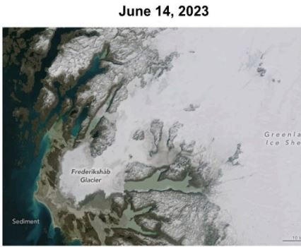
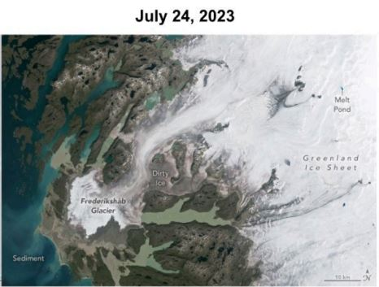

```{=html}
<style>
@import url('https://fonts.googleapis.com/css2?family=Space+Grotesk:wght@700&family=Inter:wght@400;600;800&display=swap');

.engage-box { background: linear-gradient(135deg, #0b5c8a 0%, #0a3d62 100%); color: white; padding: 25px; margin: 20px 0; border-radius: 15px; box-shadow: 0 10px 30px rgba(10, 61, 98, 0.3); }
.explore-box { background: linear-gradient(135deg, #00695c 0%, #0a5ea8 100%); color: white; padding: 25px; margin: 20px 0; border-radius: 15px; box-shadow: 0 10px 30px rgba(0, 105, 92, 0.3); }
.explain-box { background: linear-gradient(135deg, #4834a8 0%, #5e35b1 100%); color: white; padding: 25px; margin: 20px 0; border-radius: 15px; box-shadow: 0 10px 30px rgba(108, 92, 231, 0.3); }
.elaborate-box { background: linear-gradient(135deg, #b54708 0%, #9a3412 100%); color: white; padding: 25px; margin: 20px 0; border-radius: 15px; box-shadow: 0 10px 30px rgba(181, 71, 8, 0.3); }
.evaluate-box { background: linear-gradient(135deg, #b71c1c 0%, #ad1457 100%); color: white; padding: 25px; margin: 20px 0; border-radius: 15px; box-shadow: 0 10px 30px rgba(183, 28, 28, 0.3); }
.engage-box h2, .explore-box h2, .explain-box h2, .elaborate-box h2, .evaluate-box h2 { font-family: 'Space Grotesk', sans-serif; font-size: 1.8em; margin-top: 0; color: white !important; }
.engage-box h3, .explore-box h3, .explain-box h3, .elaborate-box h3, .evaluate-box h3 { color: white !important; }
.engage-box a, .explore-box a, .explain-box a, .elaborate-box a, .evaluate-box a { color: #ffe0b2; }
.pe-badge { display: inline-block; background: linear-gradient(135deg, #0284c7 0%, #0f766e 100%); color: white; padding: 6px 14px; border-radius: 20px; font-size: 12px; font-weight: 800; margin: 4px; letter-spacing: .5px; }
.big-question { font-family: 'Space Grotesk', sans-serif; font-size: 2.1em; font-weight: 800; background: linear-gradient(135deg, #0284c7 0%, #e11d48 100%); -webkit-background-clip: text; background-clip: text; -webkit-text-fill-color: transparent; margin: 26px 0 18px 0; text-align: center; line-height: 1.2; }
.key-idea { background: linear-gradient(135deg, #e0f2fe 0%, #bae6fd 100%); color: #0c1a2a; padding: 18px 20px; margin: 20px 0; border-radius: 12px; border-left: 8px solid #0284c7; font-size: 1.03em; }
.student-task { background: #fff3e0; color: #1a1a1a; border-left: 5px solid #ff9800; padding: 18px 20px; margin: 15px 0; border-radius: 0 10px 10px 0; }
h1 { font-family: 'Space Grotesk', sans-serif !important; font-weight: 800 !important; font-size: 2.3em !important; margin-top: 40px !important; }
h2 { font-family: 'Space Grotesk', sans-serif !important; font-weight: 700 !important; color: #0369a1 !important; }
.quarto-dark h2, [data-bs-theme="dark"] h2 { color: #7dd3fc !important; }
.cf-table { width: 100%; border-collapse: collapse; font-size: .92em; margin: 6px 0 16px; }
.cf-table th, .cf-table td { padding: 6px 8px; border-bottom: 1px solid rgba(128,128,128,.3); text-align: left; vertical-align: top; }
.cf-note { font-size: .8em; opacity: .75; margin: 4px 0 14px; }
.cf-scroll { overflow-x: auto; max-width: 100%; }
.student-task, .callout-body-container { overflow-x: auto; }
.student-task table, .callout-body-container table { font-size: .9em; }
.cf-figs { display: flex; flex-wrap: wrap; gap: 12px; justify-content: center; margin: 14px 0; }
.cf-figs figure { flex: 1 1 260px; max-width: 420px; margin: 0; text-align: center; }
.cf-figs img { width: 100%; height: auto; border-radius: 10px; box-shadow: 0 4px 14px rgba(0,0,0,.2); }
.cf-figs figcaption { font-size: .85em; margin-top: 6px; }
.cell-output-display figure h2 { font-family: 'Inter', sans-serif !important; font-size: 1.02rem !important; font-weight: 700 !important; color: inherit !important; margin: 0 0 2px !important; padding: 0 !important; border: none !important; line-height: 1.3; }
.cell-output-display figure h3 { font-family: 'Inter', sans-serif !important; font-size: .85rem !important; font-weight: 400 !important; opacity: .8; margin: 0 0 6px !important; padding: 0 !important; border: none !important; line-height: 1.3; }
svg [aria-label="tip"] text { fill: #1a1a1a !important; }
svg [aria-label="tip"] rect { fill: rgba(255, 255, 255, 0.97) !important; stroke: #d4d4d4 !important; }
</style>
```

<a class="quiz-jump-btn" href="#cf-quiz">🧠 Quiz ↓</a>

<div class="big-question">🌡️ Why Is the Arctic Warming Almost 4× Faster? 🧊</div>

<span class="pe-badge">HS-ESS2-2</span> <span class="pe-badge">HS-ESS2-4</span> <span class="pe-badge">HS-ESS2-6</span>

::: {.callout-note collapse="true"}
## 📒 Using this chapter with your student packet

This chapter follows the same steps as your **Climate Feedbacks 5E** packet. Missed a class or need a refresher? Jump to the matching section:

| Packet section | In this chapter |
|---|---|
| We are Warming (graph + Brainstorm) | [Engage](#cf-engage) |
| Carbon Dioxide and Air Temperature Investigation, Part 1: Analyzing Changing Carbon Levels over Time | [Explore 1, Part 1](#cf-part1-co2) |
| Part 2: Modeling Pre- and Post-Industrial Revolution Carbon Cycles | [Explore 1, Part 2](#cf-part2-carbon) |
| Part 3: Modeling the Effect of the Carbon Cycle on Temperature (Greenhouse Effect sim) | [Explore 1, Part 3](#cf-part3-greenhouse) |
| Making sense of the Carbon Dioxide and Air Temperature Investigation | [Making Sense 1](#cf-making-sense-1) |
| The Enhanced Greenhouse Effect, Part 1 (natural vs human CO₂) | [Explain 1](#cf-explain-1) |
| The Greenhouse Effect Text + Burning Fossil Fuels Text | [The two texts](#cf-texts) |
| The Enhanced Greenhouse Effect, Part 2 (Claim-Evidence-Reasoning) | [CER](#cf-cer) |
| Summary Task (after Explain 1) | [Summary Task 1](#cf-summary-1) |
| Ice and Radiation, Part 1: Exploring sunny surfaces | [Explore 2, Part 1](#cf-sunny-surfaces) |
| Ice and Radiation, Part 2: Experimenting with Surface Color | [Explore 2, Part 2](#cf-surface-color) |
| Ice and Radiation, Part 3: Sea Ice Extent Since 1980 | [Explore 2, Part 3](#cf-sea-ice) |
| Making Sense of the Ice and Radiation Investigation | [Making Sense 2](#cf-making-sense-2) |
| Ice Caps and Global Temperatures (cause-and-effect model, Revisiting the Investigative Phenomenon) | [Explain 2](#cf-explain-2) |
| Summary Task (after Explain 2) | [Summary Task 2](#cf-summary-2) |
| Greenhouse Gas Feedback Mechanisms, Part 1 and Part 2 | [Elaborate](#cf-elaborate) |
| Disprove the Skeptics + Climate Feedbacks Rubric | [Evaluate](#cf-evaluate) |
:::

```{ojs}
//| echo: false
Plot = require("@observablehq/plot@0.6.16")
d3 = require("d3@7.9.0")
```

```{ojs}
//| echo: false
cfSlope = (pts, xk, yk) => {
  const mx = d3.mean(pts, d => d[xk]), my = d3.mean(pts, d => d[yk]);
  let num = 0, den = 0;
  for (const p of pts) { num += (p[xk] - mx) * (p[yk] - my); den += (p[xk] - mx) ** 2; }
  const m = num / den;
  return {m, b: my - m * mx};
}
```

```{ojs}
//| echo: false
cfOrder = (q, n) => {
  let h = 0;
  for (const ch of q) h = (h * 31 + ch.charCodeAt(0)) >>> 0;
  return d3.shuffler(d3.randomLcg((h % 10000) / 10000))(d3.range(n));
}
```

```{ojs}
//| echo: false
cfQuiz = function(id, title, questions) {
  const outer = html`<div id="${id}" style="margin:18px 0 24px 0;text-align:center;">
    <button style="display:inline-flex;align-items:center;gap:7px;background:linear-gradient(135deg,#0284c7 0%,#4834a8 100%);color:#fff;border:none;padding:9px 22px;border-radius:50px;font-size:.95em;font-weight:700;cursor:pointer;min-height:44px;box-shadow:0 3px 12px rgba(2,132,199,.4);">
      <span style="font-size:1.1em;">📝</span> ${title}
      <span class="chevron" style="transition:transform .3s;">▼</span>
    </button>
    <div class="quiz-body" style="max-height:0;opacity:0;overflow:hidden;transition:max-height .5s cubic-bezier(.4,0,.2,1),opacity .4s ease,margin-top .3s ease;margin-top:0;text-align:left;">
      <button class="close-btn" style="display:block;margin:0 auto 10px auto;background:rgba(2,132,199,.12);color:#0369a1;border:none;padding:5px 18px;border-radius:50px;font-size:.85em;font-weight:600;cursor:pointer;min-height:36px;">Hide Quiz</button>
      <p style="text-align:center;color:#64748b;font-style:italic;font-size:.9em;margin-bottom:12px;">Select an answer for each question.</p>
    </div>
  </div>`;
  const toggle = outer.querySelector("button");
  const chevron = toggle.querySelector(".chevron");
  const body = outer.querySelector(".quiz-body");
  const closeBtn = body.querySelector(".close-btn");
  function expand(){ body.style.maxHeight="4000px"; body.style.opacity="1"; body.style.marginTop="14px"; chevron.style.transform="rotate(180deg)"; }
  function collapse(){ body.style.maxHeight="0"; body.style.opacity="0"; body.style.marginTop="0"; chevron.style.transform="rotate(0)"; }
  toggle.onclick = () => body.style.maxHeight === "0px" || body.style.maxHeight === "" ? expand() : collapse();
  closeBtn.onclick = collapse;
  questions.forEach((qq, qi) => {
    const card = document.createElement("div");
    card.style.cssText = "background:#fff;color:#1e1b4b;border-radius:12px;padding:16px 18px;margin-bottom:14px;box-shadow:0 2px 8px rgba(0,0,0,.1);border:1px solid #e2e8f0;";
    card.innerHTML = `<p style="font-weight:700;margin:0 0 10px;color:#1e1b4b;">${qi+1}. ${qq.q}</p>`;
    const fb = document.createElement("div");
    fb.style.cssText = "border-radius:8px;font-size:.9em;";
    const order = cfOrder(qq.q, qq.options.length);
    const shownCorrect = order.indexOf(qq.correct);
    order.map(i => qq.options[i]).forEach((opt, oi) => {
      const btn = document.createElement("button");
      btn.textContent = opt;
      btn.style.cssText = "display:block;width:100%;min-height:44px;text-align:left;padding:10px 14px;margin:6px 0;border:2px solid #e2e8f0;border-radius:8px;background:#fff;color:#1e1b4b;cursor:pointer;font-size:.95em;";
      btn.onclick = () => {
        if (card.dataset.answered) return;
        card.dataset.answered = "true";
        card.querySelectorAll("button").forEach(b => { b.style.cursor = "default"; });
        const right = card.querySelectorAll("button")[shownCorrect];
        right.style.borderColor = "#48bb78"; right.style.background = "#f0fff4"; right.style.color = "#22543d"; right.style.fontWeight = "700";
        if (oi === shownCorrect) {
          fb.innerHTML = "✅ Correct! " + qq.explanation; fb.style.color = "#276749"; fb.style.background = "#f0fff4";
        } else {
          btn.style.borderColor = "#fc8181"; btn.style.background = "#fff5f5"; btn.style.color = "#9b2c2c";
          fb.innerHTML = "❌ Not quite. " + qq.explanation; fb.style.color = "#9b2c2c"; fb.style.background = "#fff5f5";
        }
        fb.style.padding = "10px 14px"; fb.style.marginTop = "8px";
      };
      card.appendChild(btn);
    });
    card.appendChild(fb);
    body.appendChild(card);
  });
  return outer;
}
```

```{ojs}
//| echo: false
// Real data embedded inline (sources are listed under each graph).
cfData = ({
gis: [
  {year:1950,glob:-0.17,arctic:0.18},{year:1951,glob:-0.07,arctic:0.07},{year:1952,glob:0.01,arctic:0.27},{year:1953,glob:0.08,arctic:1.03},
  {year:1954,glob:-0.13,arctic:0.8},{year:1955,glob:-0.14,arctic:-0.23},{year:1956,glob:-0.19,arctic:0.01},{year:1957,glob:0.05,arctic:0.09},
  {year:1958,glob:0.06,arctic:-0.18},{year:1959,glob:0.03,arctic:0.49},{year:1960,glob:-0.02,arctic:0.34},{year:1961,glob:0.06,arctic:-0.16},
  {year:1962,glob:0.03,arctic:0.44},{year:1963,glob:0.05,arctic:-0.16},{year:1964,glob:-0.2,arctic:-0.66},{year:1965,glob:-0.11,arctic:-0.28},
  {year:1966,glob:-0.06,arctic:-0.76},{year:1967,glob:-0.02,arctic:0.36},{year:1968,glob:-0.08,arctic:-0.33},{year:1969,glob:0.05,arctic:-0.03},
  {year:1970,glob:0.03,arctic:-0.2},{year:1971,glob:-0.08,arctic:-0.08},{year:1972,glob:0.01,arctic:-0.37},{year:1973,glob:0.16,arctic:0.06},
  {year:1974,glob:-0.07,arctic:-0.19},{year:1975,glob:-0.01,arctic:0.1},{year:1976,glob:-0.1,arctic:-0.07},{year:1977,glob:0.18,arctic:0.16},
  {year:1978,glob:0.07,arctic:-0.16},{year:1979,glob:0.16,arctic:-0.61},{year:1980,glob:0.26,arctic:0.26},{year:1981,glob:0.32,arctic:1.09},
  {year:1982,glob:0.14,arctic:-0.4},{year:1983,glob:0.31,arctic:0.19},{year:1984,glob:0.16,arctic:0.36},{year:1985,glob:0.12,arctic:0.39},
  {year:1986,glob:0.18,arctic:0.01},{year:1987,glob:0.32,arctic:-0.36},{year:1988,glob:0.39,arctic:0.59},{year:1989,glob:0.27,arctic:0.32},
  {year:1990,glob:0.45,arctic:0.58},{year:1991,glob:0.41,arctic:0.75},{year:1992,glob:0.22,arctic:-0.17},{year:1993,glob:0.23,arctic:0.54},
  {year:1994,glob:0.31,arctic:0.34},{year:1995,glob:0.45,arctic:1.31},{year:1996,glob:0.33,arctic:0.77},{year:1997,glob:0.47,arctic:0.77},
  {year:1998,glob:0.61,arctic:0.88},{year:1999,glob:0.38,arctic:0.42},{year:2000,glob:0.39,arctic:0.98},{year:2001,glob:0.53,arctic:1.08},
  {year:2002,glob:0.63,arctic:1.27},{year:2003,glob:0.62,arctic:1.51},{year:2004,glob:0.53,arctic:0.48},{year:2005,glob:0.68,arctic:2.0},
  {year:2006,glob:0.64,arctic:1.77},{year:2007,glob:0.66,arctic:2.1},{year:2008,glob:0.54,arctic:1.55},{year:2009,glob:0.66,arctic:1.44},
  {year:2010,glob:0.72,arctic:2.25},{year:2011,glob:0.61,arctic:2.34},{year:2012,glob:0.65,arctic:2.13},{year:2013,glob:0.67,arctic:1.52},
  {year:2014,glob:0.75,arctic:2.05},{year:2015,glob:0.89,arctic:1.99},{year:2016,glob:1.01,arctic:3.24},{year:2017,glob:0.91,arctic:2.47},
  {year:2018,glob:0.85,arctic:2.14},{year:2019,glob:0.98,arctic:2.76},{year:2020,glob:1.01,arctic:2.85},{year:2021,glob:0.85,arctic:2.05},
  {year:2022,glob:0.89,arctic:2.34},{year:2023,glob:1.17,arctic:2.55},{year:2024,glob:1.28,arctic:2.88},{year:2025,glob:1.18,arctic:2.93}
],

mlo: [
  {year:1959,co2:315.98},{year:1960,co2:316.91},{year:1961,co2:317.64},{year:1962,co2:318.45},{year:1963,co2:318.99},{year:1964,co2:319.62},
  {year:1965,co2:320.04},{year:1966,co2:321.37},{year:1967,co2:322.18},{year:1968,co2:323.05},{year:1969,co2:324.62},{year:1970,co2:325.68},
  {year:1971,co2:326.32},{year:1972,co2:327.46},{year:1973,co2:329.68},{year:1974,co2:330.19},{year:1975,co2:331.13},{year:1976,co2:332.03},
  {year:1977,co2:333.84},{year:1978,co2:335.41},{year:1979,co2:336.84},{year:1980,co2:338.76},{year:1981,co2:340.12},{year:1982,co2:341.48},
  {year:1983,co2:343.15},{year:1984,co2:344.87},{year:1985,co2:346.35},{year:1986,co2:347.61},{year:1987,co2:349.31},{year:1988,co2:351.69},
  {year:1989,co2:353.2},{year:1990,co2:354.45},{year:1991,co2:355.7},{year:1992,co2:356.54},{year:1993,co2:357.21},{year:1994,co2:358.96},
  {year:1995,co2:360.97},{year:1996,co2:362.74},{year:1997,co2:363.88},{year:1998,co2:366.84},{year:1999,co2:368.54},{year:2000,co2:369.71},
  {year:2001,co2:371.32},{year:2002,co2:373.45},{year:2003,co2:375.98},{year:2004,co2:377.7},{year:2005,co2:379.98},{year:2006,co2:382.09},
  {year:2007,co2:384.02},{year:2008,co2:385.83},{year:2009,co2:387.64},{year:2010,co2:390.1},{year:2011,co2:391.85},{year:2012,co2:394.06},
  {year:2013,co2:396.74},{year:2014,co2:398.81},{year:2015,co2:401.01},{year:2016,co2:404.41},{year:2017,co2:406.76},{year:2018,co2:408.72},
  {year:2019,co2:411.65},{year:2020,co2:414.21},{year:2021,co2:416.41},{year:2022,co2:418.53},{year:2023,co2:421.08},{year:2024,co2:424.61},
  {year:2025,co2:427.35}
],

sept: [
  {year:1979,extent:7.05},{year:1980,extent:7.67},{year:1981,extent:7.14},{year:1982,extent:7.3},{year:1983,extent:7.39},{year:1984,extent:6.81},
  {year:1985,extent:6.7},{year:1986,extent:7.41},{year:1987,extent:7.28},{year:1988,extent:7.37},{year:1989,extent:7.01},{year:1990,extent:6.14},
  {year:1991,extent:6.47},{year:1992,extent:7.47},{year:1993,extent:6.4},{year:1994,extent:7.14},{year:1995,extent:6.08},{year:1996,extent:7.58},
  {year:1997,extent:6.69},{year:1998,extent:6.54},{year:1999,extent:6.12},{year:2000,extent:6.25},{year:2001,extent:6.73},{year:2002,extent:5.83},
  {year:2003,extent:6.12},{year:2004,extent:5.98},{year:2005,extent:5.5},{year:2006,extent:5.86},{year:2007,extent:4.27},{year:2008,extent:4.69},
  {year:2009,extent:5.26},{year:2010,extent:4.87},{year:2011,extent:4.56},{year:2012,extent:3.57},{year:2013,extent:5.21},{year:2014,extent:5.22},
  {year:2015,extent:4.62},{year:2016,extent:4.53},{year:2017,extent:4.82},{year:2018,extent:4.79},{year:2019,extent:4.36},{year:2020,extent:4.0},
  {year:2021,extent:4.95},{year:2022,extent:4.9},{year:2023,extent:4.38},{year:2024,extent:4.35},{year:2025,extent:4.75},{year:2026,extent:4.81}
],

co2800k: [
  {ka:1.0,co2:289.9},{ka:3.0,co2:275.3},{ka:5.0,co2:268.6},{ka:7.0,co2:261.0},{ka:9.0,co2:261.6},{ka:11.0,co2:261.8},{ka:13.0,co2:243.8},
  {ka:15.0,co2:232.3},{ka:17.0,co2:204.0},{ka:19.0,co2:189.5},{ka:21.0,co2:189.9},{ka:23.0,co2:188.6},{ka:25.0,co2:183.6},{ka:27.0,co2:188.8},
  {ka:29.0,co2:191.4},{ka:31.0,co2:188.5},{ka:33.0,co2:195.8},{ka:35.0,co2:200.3},{ka:37.0,co2:207.0},{ka:39.0,co2:204.6},{ka:41.0,co2:199.5},
  {ka:43.0,co2:203.4},{ka:45.0,co2:210.7},{ka:47.0,co2:212.0},{ka:49.0,co2:202.8},{ka:51.0,co2:208.8},{ka:53.0,co2:220.4},{ka:55.0,co2:214.6},
  {ka:57.0,co2:215.4},{ka:59.0,co2:225.7},{ka:61.0,co2:212.0},{ka:63.0,co2:200.0},{ka:65.0,co2:201.7},{ka:67.0,co2:204.1},{ka:69.0,co2:205.1},
  {ka:71.0,co2:226.7},{ka:73.0,co2:233.6},{ka:75.0,co2:243.1},{ka:77.0,co2:233.5},{ka:79.0,co2:228.4},{ka:81.0,co2:232.2},{ka:83.0,co2:244.8},
  {ka:85.0,co2:236.3},{ka:87.0,co2:222.7},{ka:89.0,co2:224.5},{ka:91.0,co2:231.5},{ka:93.0,co2:235.3},{ka:95.0,co2:243.8},{ka:97.0,co2:242.7},
  {ka:99.0,co2:243.1},{ka:101.0,co2:244.6},{ka:103.0,co2:238.9},{ka:105.0,co2:247.1},{ka:107.0,co2:242.2},{ka:109.0,co2:241.7},{ka:111.0,co2:252.3},
  {ka:113.0,co2:261.3},{ka:115.0,co2:273.3},{ka:117.0,co2:274.2},{ka:119.0,co2:273.4},{ka:121.0,co2:275.4},{ka:123.0,co2:277.4},{ka:125.0,co2:278.0},
  {ka:127.0,co2:275.2},{ka:129.0,co2:273.8},{ka:131.0,co2:244.0},{ka:133.0,co2:225.1},{ka:135.0,co2:212.4},{ka:137.0,co2:201.5},{ka:139.0,co2:195.7},
  {ka:143.0,co2:195.6},{ka:145.0,co2:196.0},{ka:147.0,co2:193.6},{ka:149.0,co2:198.8},{ka:151.0,co2:202.4},{ka:153.0,co2:198.8},{ka:155.0,co2:196.3},
  {ka:157.0,co2:189.4},{ka:159.0,co2:187.2},{ka:161.0,co2:187.5},{ka:163.0,co2:204.3},{ka:165.0,co2:196.5},{ka:167.0,co2:189.5},{ka:169.0,co2:190.2},
  {ka:171.0,co2:197.8},{ka:175.0,co2:196.8},{ka:177.0,co2:189.9},{ka:179.0,co2:207.7},{ka:181.0,co2:213.2},{ka:183.0,co2:207.9},{ka:185.0,co2:199.7},
  {ka:187.0,co2:203.4},{ka:189.0,co2:221.0},{ka:191.0,co2:225.9},{ka:193.0,co2:218.0},{ka:195.0,co2:223.2},{ka:197.0,co2:226.4},{ka:199.0,co2:241.9},
  {ka:201.0,co2:250.9},{ka:203.0,co2:243.3},{ka:205.0,co2:236.2},{ka:207.0,co2:228.9},{ka:209.0,co2:238.8},{ka:211.0,co2:247.5},{ka:213.0,co2:246.8},
  {ka:215.0,co2:244.3},{ka:217.0,co2:248.2},{ka:219.0,co2:242.9},{ka:221.0,co2:215.1},{ka:223.0,co2:207.9},{ka:225.0,co2:205.6},{ka:227.0,co2:218.2},
  {ka:229.0,co2:230.7},{ka:231.0,co2:232.4},{ka:233.0,co2:237.8},{ka:235.0,co2:245.2},{ka:237.0,co2:246.0},{ka:239.0,co2:244.5},{ka:241.0,co2:258.6},
  {ka:243.0,co2:279.6},{ka:245.0,co2:250.7},{ka:247.0,co2:224.9},{ka:249.0,co2:214.7},{ka:251.0,co2:200.2},{ka:253.0,co2:202.0},{ka:255.0,co2:195.4},
  {ka:257.0,co2:201.6},{ka:259.0,co2:203.9},{ka:261.0,co2:207.6},{ka:263.0,co2:211.8},{ka:265.0,co2:228.1},{ka:267.0,co2:205.8},{ka:269.0,co2:190.0},
  {ka:271.0,co2:198.8},{ka:273.0,co2:187.6},{ka:275.0,co2:194.0},{ka:277.0,co2:195.8},{ka:279.0,co2:203.3},{ka:281.0,co2:213.2},{ka:283.0,co2:223.7},
  {ka:285.0,co2:229.7},{ka:287.0,co2:229.4},{ka:289.0,co2:231.0},{ka:291.0,co2:224.1},{ka:293.0,co2:206.8},{ka:295.0,co2:209.7},{ka:297.0,co2:213.1},
  {ka:299.0,co2:220.8},{ka:301.0,co2:233.6},{ka:303.0,co2:237.5},{ka:305.0,co2:243.7},{ka:307.0,co2:246.7},{ka:309.0,co2:226.8},{ka:311.0,co2:232.4},
  {ka:313.0,co2:240.4},{ka:315.0,co2:255.1},{ka:317.0,co2:257.0},{ka:319.0,co2:239.3},{ka:321.0,co2:252.5},{ka:323.0,co2:257.2},{ka:325.0,co2:260.4},
  {ka:327.0,co2:265.1},{ka:329.0,co2:269.4},{ka:331.0,co2:270.1},{ka:333.0,co2:274.9},{ka:335.0,co2:288.6},{ka:337.0,co2:278.3},{ka:339.0,co2:245.7},
  {ka:341.0,co2:234.2},{ka:343.0,co2:225.4},{ka:345.0,co2:205.2},{ka:347.0,co2:208.4},{ka:349.0,co2:220.3},{ka:351.0,co2:221.1},{ka:353.0,co2:216.2},
  {ka:355.0,co2:209.3},{ka:359.0,co2:193.0},{ka:361.0,co2:186.1},{ka:363.0,co2:185.8},{ka:365.0,co2:201.2},{ka:369.0,co2:206.3},{ka:371.0,co2:201.9},
  {ka:373.0,co2:199.9},{ka:375.0,co2:214.7},{ka:377.0,co2:224.6},{ka:379.0,co2:229.6},{ka:383.0,co2:227.0},{ka:385.0,co2:240.0},{ka:387.0,co2:242.9},
  {ka:389.0,co2:245.8},{ka:393.0,co2:258.8},{ka:395.0,co2:267.1},{ka:399.0,co2:276.7},{ka:401.0,co2:283.2},{ka:403.0,co2:279.4},{ka:405.0,co2:278.5},
  {ka:407.0,co2:282.6},{ka:409.0,co2:279.6},{ka:411.0,co2:283.1},{ka:413.0,co2:274.9},{ka:415.0,co2:271.0},{ka:417.0,co2:272.3},{ka:419.0,co2:274.1},
  {ka:421.0,co2:271.2},{ka:423.0,co2:268.5},{ka:425.0,co2:268.9},{ka:427.0,co2:260.7},{ka:429.0,co2:245.3},{ka:431.0,co2:219.7},{ka:433.0,co2:219.3},
  {ka:435.0,co2:208.7},{ka:437.0,co2:207.5},{ka:439.0,co2:200.3},{ka:441.0,co2:201.7},{ka:443.0,co2:201.7},{ka:445.0,co2:199.1},{ka:447.0,co2:201.1},
  {ka:449.0,co2:205.8},{ka:451.0,co2:201.4},{ka:453.0,co2:203.4},{ka:455.0,co2:198.4},{ka:457.0,co2:195.0},{ka:459.0,co2:205.3},{ka:461.0,co2:198.9},
  {ka:463.0,co2:192.6},{ka:465.0,co2:205.0},{ka:467.0,co2:206.2},{ka:469.0,co2:203.4},{ka:471.0,co2:211.6},{ka:473.0,co2:237.4},{ka:475.0,co2:240.0},
  {ka:477.0,co2:234.7},{ka:479.0,co2:235.6},{ka:481.0,co2:221.1},{ka:483.0,co2:225.4},{ka:485.0,co2:231.3},{ka:487.0,co2:232.4},{ka:489.0,co2:240.0},
  {ka:491.0,co2:247.0},{ka:493.0,co2:243.4},{ka:495.0,co2:238.6},{ka:497.0,co2:236.8},{ka:499.0,co2:231.7},{ka:501.0,co2:229.9},{ka:503.0,co2:231.6},
  {ka:505.0,co2:233.4},{ka:507.0,co2:235.8},{ka:509.0,co2:238.5},{ka:511.0,co2:234.9},{ka:513.0,co2:238.6},{ka:515.0,co2:239.6},{ka:517.0,co2:245.5},
  {ka:519.0,co2:245.4},{ka:521.0,co2:245.6},{ka:523.0,co2:241.9},{ka:525.0,co2:236.3},{ka:527.0,co2:230.6},{ka:529.0,co2:223.7},{ka:531.0,co2:220.8},
  {ka:533.0,co2:210.2},{ka:535.0,co2:193.1},{ka:537.0,co2:199.6},{ka:539.0,co2:205.7},{ka:541.0,co2:212.1},{ka:543.0,co2:204.3},{ka:545.0,co2:209.2},
  {ka:547.0,co2:209.6},{ka:549.0,co2:203.6},{ka:551.0,co2:212.5},{ka:553.0,co2:222.1},{ka:555.0,co2:224.9},{ka:557.0,co2:243.6},{ka:559.0,co2:236.4},
  {ka:561.0,co2:230.5},{ka:563.0,co2:239.4},{ka:565.0,co2:250.0},{ka:567.0,co2:253.5},{ka:569.0,co2:252.2},{ka:571.0,co2:251.0},{ka:573.0,co2:248.4},
  {ka:575.0,co2:251.1},{ka:577.0,co2:252.0},{ka:579.0,co2:251.1},{ka:581.0,co2:233.2},{ka:583.0,co2:210.7},{ka:587.0,co2:228.1},{ka:589.0,co2:245.1},
  {ka:591.0,co2:243.0},{ka:593.0,co2:229.4},{ka:595.0,co2:236.3},{ka:597.0,co2:218.0},{ka:599.0,co2:224.8},{ka:601.0,co2:232.4},{ka:603.0,co2:238.5},
  {ka:605.0,co2:244.5},{ka:607.0,co2:251.5},{ka:609.0,co2:259.2},{ka:611.0,co2:258.4},{ka:613.0,co2:257.2},{ka:615.0,co2:252.8},{ka:617.0,co2:252.8},
  {ka:619.0,co2:248.3},{ka:621.0,co2:244.7},{ka:623.0,co2:241.5},{ka:625.0,co2:236.5},{ka:627.0,co2:216.7},{ka:629.0,co2:201.9},{ka:631.0,co2:200.5},
  {ka:633.0,co2:196.5},{ka:635.0,co2:194.6},{ka:637.0,co2:194.7},{ka:639.0,co2:188.8},{ka:641.0,co2:190.2},{ka:643.0,co2:191.5},{ka:645.0,co2:195.6},
  {ka:647.0,co2:190.9},{ka:649.0,co2:194.8},{ka:651.0,co2:191.3},{ka:653.0,co2:189.0},{ka:655.0,co2:197.4},{ka:657.0,co2:193.3},{ka:659.0,co2:185.7},
  {ka:661.0,co2:191.3},{ka:663.0,co2:191.4},{ka:665.0,co2:185.3},{ka:667.0,co2:174.2},{ka:669.0,co2:182.0},{ka:671.0,co2:194.4},{ka:673.0,co2:197.7},
  {ka:675.0,co2:210.8},{ka:677.0,co2:219.7},{ka:679.0,co2:225.0},{ka:681.0,co2:230.1},{ka:683.0,co2:220.8},{ka:685.0,co2:223.1},{ka:687.0,co2:222.2},
  {ka:689.0,co2:229.5},{ka:691.0,co2:237.9},{ka:693.0,co2:240.6},{ka:695.0,co2:239.1},{ka:697.0,co2:238.8},{ka:699.0,co2:240.2},{ka:701.0,co2:234.9},
  {ka:703.0,co2:232.1},{ka:705.0,co2:234.5},{ka:707.0,co2:236.4},{ka:709.0,co2:232.7},{ka:711.0,co2:225.8},{ka:713.0,co2:224.0},{ka:715.0,co2:226.4},
  {ka:717.0,co2:203.1},{ka:719.0,co2:197.1},{ka:721.0,co2:216.8},{ka:723.0,co2:213.6},{ka:725.0,co2:212.0},{ka:727.0,co2:210.9},{ka:729.0,co2:210.4},
  {ka:731.0,co2:211.2},{ka:733.0,co2:209.9},{ka:735.0,co2:214.8},{ka:737.0,co2:210.4},{ka:739.0,co2:188.7},{ka:741.0,co2:185.7},{ka:743.0,co2:188.1},
  {ka:745.0,co2:188.1},{ka:747.0,co2:188.7},{ka:749.0,co2:188.8},{ka:751.0,co2:192.3},{ka:753.0,co2:198.9},{ka:755.0,co2:201.2},{ka:757.0,co2:210.4},
  {ka:759.0,co2:222.8},{ka:761.0,co2:222.6},{ka:763.0,co2:216.2},{ka:765.0,co2:227.5},{ka:767.0,co2:229.2},{ka:769.0,co2:223.8},{ka:771.0,co2:232.7},
  {ka:773.0,co2:243.0},{ka:775.0,co2:239.8},{ka:777.0,co2:247.2},{ka:779.0,co2:254.0},{ka:781.0,co2:253.9},{ka:783.0,co2:256.2},{ka:785.0,co2:258.8},
  {ka:787.0,co2:265.5},{ka:789.0,co2:247.1},{ka:791.0,co2:229.0},{ka:793.0,co2:217.7},{ka:795.0,co2:206.7},{ka:797.0,co2:198.3},{ka:799.0,co2:200.5},
  {ka:801.0,co2:198.7},{ka:803.0,co2:201.4},{ka:805.0,co2:205.5}
],

temp800k: [
  {ka:1.0,t:-0.1},{ka:3.0,t:-0.1},{ka:5.0,t:-0.1},{ka:7.0,t:-0.8},{ka:9.0,t:-0.8},{ka:11.0,t:-0.6},{ka:13.0,t:-4.1},{ka:15.0,t:-4.5},{ka:17.0,t:-8.1},
  {ka:19.0,t:-9.4},{ka:21.0,t:-9.3},{ka:23.0,t:-9.3},{ka:25.0,t:-9.7},{ka:27.0,t:-9.3},{ka:29.0,t:-8.8},{ka:31.0,t:-9.0},{ka:33.0,t:-8.5},
  {ka:35.0,t:-8.2},{ka:37.0,t:-7.5},{ka:39.0,t:-7.4},{ka:41.0,t:-8.2},{ka:43.0,t:-7.7},{ka:45.0,t:-7.2},{ka:47.0,t:-6.3},{ka:49.0,t:-7.5},
  {ka:51.0,t:-6.8},{ka:53.0,t:-6.0},{ka:55.0,t:-6.9},{ka:57.0,t:-6.5},{ka:59.0,t:-5.8},{ka:61.0,t:-7.2},{ka:63.0,t:-8.4},{ka:65.0,t:-8.9},
  {ka:67.0,t:-8.9},{ka:69.0,t:-8.4},{ka:71.0,t:-6.5},{ka:73.0,t:-7.0},{ka:75.0,t:-5.8},{ka:77.0,t:-6.5},{ka:79.0,t:-5.6},{ka:81.0,t:-4.7},
  {ka:83.0,t:-3.4},{ka:85.0,t:-4.4},{ka:87.0,t:-6.0},{ka:89.0,t:-5.7},{ka:91.0,t:-5.6},{ka:93.0,t:-5.0},{ka:95.0,t:-4.6},{ka:97.0,t:-4.6},
  {ka:99.0,t:-4.7},{ka:101.0,t:-4.4},{ka:103.0,t:-5.7},{ka:105.0,t:-5.1},{ka:107.0,t:-4.8},{ka:109.0,t:-6.3},{ka:111.0,t:-5.2},{ka:113.0,t:-4.2},
  {ka:115.0,t:-2.3},{ka:117.0,t:-0.8},{ka:119.0,t:0.5},{ka:121.0,t:1.5},{ka:123.0,t:2.0},{ka:125.0,t:1.7},{ka:127.0,t:2.3},{ka:129.0,t:3.6},
  {ka:131.0,t:0.7},{ka:133.0,t:-3.4},{ka:135.0,t:-6.6},{ka:137.0,t:-8.2},{ka:139.0,t:-8.7},{ka:141.0,t:-8.7},{ka:143.0,t:-8.5},{ka:145.0,t:-8.4},
  {ka:147.0,t:-8.1},{ka:149.0,t:-7.8},{ka:151.0,t:-7.5},{ka:153.0,t:-7.9},{ka:155.0,t:-8.7},{ka:157.0,t:-9.0},{ka:159.0,t:-7.6},{ka:161.0,t:-7.7},
  {ka:163.0,t:-7.3},{ka:165.0,t:-8.6},{ka:167.0,t:-7.8},{ka:169.0,t:-7.0},{ka:171.0,t:-7.6},{ka:173.0,t:-7.5},{ka:175.0,t:-8.1},{ka:177.0,t:-7.1},
  {ka:179.0,t:-7.4},{ka:181.0,t:-8.5},{ka:183.0,t:-8.8},{ka:185.0,t:-8.4},{ka:187.0,t:-6.2},{ka:189.0,t:-6.1},{ka:191.0,t:-6.9},{ka:193.0,t:-6.1},
  {ka:195.0,t:-5.6},{ka:197.0,t:-3.8},{ka:199.0,t:-2.3},{ka:201.0,t:-2.4},{ka:203.0,t:-4.3},{ka:205.0,t:-3.7},{ka:207.0,t:-2.9},{ka:209.0,t:-2.1},
  {ka:211.0,t:-1.7},{ka:213.0,t:-2.2},{ka:215.0,t:-1.9},{ka:217.0,t:-3.7},{ka:219.0,t:-5.4},{ka:221.0,t:-7.0},{ka:223.0,t:-8.3},{ka:225.0,t:-7.5},
  {ka:227.0,t:-6.4},{ka:229.0,t:-7.3},{ka:231.0,t:-7.0},{ka:233.0,t:-5.6},{ka:235.0,t:-4.0},{ka:237.0,t:-2.6},{ka:239.0,t:-2.0},{ka:241.0,t:0.3},
  {ka:243.0,t:1.4},{ka:245.0,t:-3.1},{ka:247.0,t:-6.3},{ka:249.0,t:-6.4},{ka:251.0,t:-7.7},{ka:253.0,t:-8.1},{ka:255.0,t:-7.9},{ka:257.0,t:-7.4},
  {ka:259.0,t:-7.1},{ka:261.0,t:-7.7},{ka:263.0,t:-7.0},{ka:265.0,t:-7.3},{ka:267.0,t:-8.2},{ka:269.0,t:-8.7},{ka:271.0,t:-9.1},{ka:273.0,t:-9.2},
  {ka:275.0,t:-8.7},{ka:277.0,t:-8.5},{ka:279.0,t:-8.2},{ka:281.0,t:-6.9},{ka:283.0,t:-6.2},{ka:285.0,t:-5.7},{ka:287.0,t:-5.1},{ka:289.0,t:-4.8},
  {ka:291.0,t:-5.0},{ka:293.0,t:-6.8},{ka:295.0,t:-7.2},{ka:297.0,t:-6.7},{ka:299.0,t:-6.8},{ka:301.0,t:-6.4},{ka:303.0,t:-5.9},{ka:305.0,t:-4.9},
  {ka:307.0,t:-6.3},{ka:309.0,t:-5.8},{ka:311.0,t:-5.4},{ka:313.0,t:-4.1},{ka:315.0,t:-3.0},{ka:317.0,t:-2.9},{ka:319.0,t:-4.5},{ka:321.0,t:-3.0},
  {ka:323.0,t:-1.3},{ka:325.0,t:0.1},{ka:327.0,t:0.6},{ka:329.0,t:0.7},{ka:331.0,t:0.5},{ka:333.0,t:2.9},{ka:335.0,t:1.3},{ka:337.0,t:-2.7},
  {ka:339.0,t:-5.6},{ka:341.0,t:-8.5},{ka:343.0,t:-9.1},{ka:345.0,t:-8.6},{ka:347.0,t:-8.2},{ka:349.0,t:-7.7},{ka:351.0,t:-7.8},{ka:353.0,t:-7.7},
  {ka:355.0,t:-8.7},{ka:357.0,t:-8.8},{ka:359.0,t:-8.5},{ka:361.0,t:-8.0},{ka:363.0,t:-7.3},{ka:365.0,t:-7.7},{ka:367.0,t:-7.4},{ka:369.0,t:-7.5},
  {ka:371.0,t:-6.6},{ka:373.0,t:-5.8},{ka:375.0,t:-7.5},{ka:377.0,t:-6.6},{ka:379.0,t:-6.0},{ka:381.0,t:-4.7},{ka:383.0,t:-5.4},{ka:385.0,t:-5.0},
  {ka:387.0,t:-4.1},{ka:389.0,t:-6.0},{ka:391.0,t:-5.0},{ka:393.0,t:-3.4},{ka:395.0,t:-1.8},{ka:397.0,t:-0.5},{ka:399.0,t:0.1},{ka:401.0,t:1.3},
  {ka:403.0,t:2.0},{ka:405.0,t:2.2},{ka:407.0,t:2.5},{ka:409.0,t:1.9},{ka:411.0,t:1.4},{ka:413.0,t:0.5},{ka:415.0,t:0.3},{ka:417.0,t:0.5},
  {ka:419.0,t:-0.2},{ka:421.0,t:-0.9},{ka:423.0,t:-2.0},{ka:425.0,t:-0.9},{ka:427.0,t:-3.1},{ka:429.0,t:-6.0},{ka:431.0,t:-8.0},{ka:433.0,t:-8.3},
  {ka:435.0,t:-8.2},{ka:437.0,t:-9.3},{ka:439.0,t:-9.0},{ka:441.0,t:-8.8},{ka:443.0,t:-7.8},{ka:445.0,t:-7.6},{ka:447.0,t:-6.7},{ka:449.0,t:-7.2},
  {ka:451.0,t:-7.4},{ka:453.0,t:-7.1},{ka:455.0,t:-7.1},{ka:457.0,t:-8.6},{ka:459.0,t:-8.7},{ka:461.0,t:-8.0},{ka:463.0,t:-7.5},{ka:465.0,t:-8.3},
  {ka:467.0,t:-8.3},{ka:469.0,t:-7.1},{ka:471.0,t:-5.1},{ka:473.0,t:-5.8},{ka:475.0,t:-5.9},{ka:477.0,t:-4.3},{ka:479.0,t:-5.5},{ka:481.0,t:-4.8},
  {ka:483.0,t:-4.0},{ka:485.0,t:-3.4},{ka:487.0,t:-2.7},{ka:489.0,t:-2.2},{ka:491.0,t:-3.0},{ka:493.0,t:-3.5},{ka:495.0,t:-3.7},{ka:497.0,t:-3.8},
  {ka:499.0,t:-3.9},{ka:501.0,t:-4.4},{ka:503.0,t:-4.3},{ka:505.0,t:-4.8},{ka:507.0,t:-4.7},{ka:509.0,t:-5.7},{ka:511.0,t:-5.7},{ka:513.0,t:-5.4},
  {ka:515.0,t:-4.7},{ka:517.0,t:-4.0},{ka:519.0,t:-3.4},{ka:521.0,t:-3.5},{ka:523.0,t:-4.4},{ka:525.0,t:-4.6},{ka:527.0,t:-4.7},{ka:529.0,t:-4.7},
  {ka:531.0,t:-6.8},{ka:533.0,t:-7.5},{ka:535.0,t:-6.9},{ka:537.0,t:-6.7},{ka:539.0,t:-7.6},{ka:541.0,t:-7.4},{ka:543.0,t:-7.2},{ka:545.0,t:-8.0},
  {ka:547.0,t:-7.3},{ka:549.0,t:-6.8},{ka:551.0,t:-5.9},{ka:553.0,t:-6.0},{ka:555.0,t:-3.8},{ka:557.0,t:-4.9},{ka:559.0,t:-6.3},{ka:561.0,t:-4.9},
  {ka:563.0,t:-3.3},{ka:565.0,t:-2.2},{ka:567.0,t:-1.7},{ka:569.0,t:-1.5},{ka:571.0,t:-1.5},{ka:573.0,t:-1.6},{ka:575.0,t:-1.3},{ka:577.0,t:-1.9},
  {ka:579.0,t:-1.2},{ka:581.0,t:-3.1},{ka:583.0,t:-6.2},{ka:585.0,t:-5.8},{ka:587.0,t:-6.5},{ka:589.0,t:-4.3},{ka:591.0,t:-5.0},{ka:593.0,t:-5.0},
  {ka:595.0,t:-4.5},{ka:597.0,t:-6.5},{ka:599.0,t:-5.4},{ka:601.0,t:-4.8},{ka:603.0,t:-4.2},{ka:605.0,t:-3.6},{ka:607.0,t:-2.8},{ka:609.0,t:-1.6},
  {ka:611.0,t:-1.4},{ka:613.0,t:-1.2},{ka:615.0,t:-1.2},{ka:617.0,t:-1.9},{ka:619.0,t:-2.2},{ka:621.0,t:-2.2},{ka:623.0,t:-2.7},{ka:625.0,t:-2.4},
  {ka:627.0,t:-4.4},{ka:629.0,t:-7.8},{ka:631.0,t:-8.8},{ka:633.0,t:-8.2},{ka:635.0,t:-8.9},{ka:637.0,t:-8.4},{ka:639.0,t:-8.8},{ka:641.0,t:-8.9},
  {ka:643.0,t:-8.0},{ka:645.0,t:-7.7},{ka:647.0,t:-7.8},{ka:649.0,t:-7.3},{ka:651.0,t:-7.4},{ka:653.0,t:-7.8},{ka:655.0,t:-7.2},{ka:657.0,t:-7.0},
  {ka:659.0,t:-8.0},{ka:661.0,t:-8.5},{ka:663.0,t:-7.9},{ka:665.0,t:-8.8},{ka:667.0,t:-9.0},{ka:669.0,t:-8.1},{ka:671.0,t:-7.7},{ka:673.0,t:-8.0},
  {ka:675.0,t:-6.8},{ka:677.0,t:-6.7},{ka:679.0,t:-5.4},{ka:681.0,t:-6.8},{ka:683.0,t:-5.4},{ka:685.0,t:-4.8},{ka:687.0,t:-3.9},{ka:689.0,t:-3.4},
  {ka:691.0,t:-2.8},{ka:693.0,t:-2.0},{ka:695.0,t:-1.9},{ka:697.0,t:-1.9},{ka:699.0,t:-2.2},{ka:701.0,t:-2.2},{ka:703.0,t:-2.5},{ka:705.0,t:-3.2},
  {ka:707.0,t:-3.7},{ka:709.0,t:-3.8},{ka:711.0,t:-4.0},{ka:713.0,t:-4.1},{ka:715.0,t:-4.5},{ka:717.0,t:-5.7},{ka:719.0,t:-6.7},{ka:721.0,t:-7.9},
  {ka:723.0,t:-7.7},{ka:725.0,t:-5.3},{ka:727.0,t:-6.0},{ka:729.0,t:-5.8},{ka:731.0,t:-5.2},{ka:733.0,t:-4.0},{ka:735.0,t:-4.0},{ka:737.0,t:-4.4},
  {ka:739.0,t:-6.1},{ka:741.0,t:-8.2},{ka:743.0,t:-8.7},{ka:745.0,t:-8.5},{ka:747.0,t:-8.6},{ka:749.0,t:-8.5},{ka:751.0,t:-8.5},{ka:753.0,t:-8.2},
  {ka:755.0,t:-7.5},{ka:757.0,t:-5.5},{ka:759.0,t:-6.3},{ka:761.0,t:-7.1},{ka:763.0,t:-5.2},{ka:765.0,t:-5.1},{ka:767.0,t:-6.2},{ka:769.0,t:-4.6},
  {ka:771.0,t:-4.0},{ka:773.0,t:-4.2},{ka:775.0,t:-3.2},{ka:777.0,t:-2.7},{ka:779.0,t:-2.2},{ka:781.0,t:-2.3},{ka:783.0,t:-1.9},{ka:785.0,t:-1.3},
  {ka:787.0,t:-1.0},{ka:789.0,t:-2.7},{ka:791.0,t:-4.3},{ka:793.0,t:-6.0},{ka:795.0,t:-7.8},{ka:797.0,t:-8.6},{ka:799.0,t:-8.7},{ka:801.0,t:-8.9}
],

co2Deglac: [
  {ka:6.12,co2:265.5},{ka:6.38,co2:262.4},{ka:6.62,co2:260.2},{ka:6.88,co2:261.0},{ka:7.12,co2:260.0},{ka:7.38,co2:260.7},{ka:7.62,co2:260.2},
  {ka:7.88,co2:259.9},{ka:8.12,co2:259.5},{ka:8.38,co2:259.8},{ka:8.62,co2:261.2},{ka:8.88,co2:260.1},{ka:9.12,co2:260.6},{ka:9.38,co2:264.2},
  {ka:9.62,co2:262.1},{ka:9.88,co2:264.3},{ka:10.12,co2:263.7},{ka:10.38,co2:265.3},{ka:10.62,co2:267.2},{ka:10.88,co2:266.2},{ka:11.12,co2:265.0},
  {ka:11.38,co2:266.6},{ka:11.62,co2:260.5},{ka:11.88,co2:255.4},{ka:12.12,co2:251.0},{ka:12.38,co2:246.9},{ka:12.62,co2:245.7},{ka:12.88,co2:240.1},
  {ka:13.12,co2:237.9},{ka:13.38,co2:238.8},{ka:13.62,co2:240.0},{ka:13.88,co2:239.7},{ka:14.12,co2:237.5},{ka:14.38,co2:240.2},{ka:14.62,co2:236.3},
  {ka:14.88,co2:228.5},{ka:15.12,co2:229.1},{ka:15.38,co2:226.0},{ka:15.62,co2:222.8},{ka:15.88,co2:223.8},{ka:16.12,co2:223.7},{ka:16.38,co2:213.7},
  {ka:16.62,co2:209.7},{ka:16.88,co2:204.5},{ka:17.12,co2:199.7},{ka:17.38,co2:192.6},{ka:17.62,co2:192.8},{ka:17.88,co2:189.8},{ka:18.12,co2:187.6},
  {ka:18.38,co2:188.1},{ka:18.62,co2:190.4},{ka:18.88,co2:190.7},{ka:19.12,co2:191.1},{ka:19.38,co2:191.6},{ka:19.62,co2:190.2},{ka:19.88,co2:194.8},
  {ka:20.12,co2:192.1},{ka:20.38,co2:190.0},{ka:20.62,co2:190.8},{ka:20.88,co2:191.8},{ka:21.12,co2:189.2},{ka:21.38,co2:187.2},{ka:21.62,co2:185.2},
  {ka:21.88,co2:189.4}
],

tempDeglac: [
  {ka:6.12,t:-0.3},{ka:6.38,t:-0.7},{ka:6.62,t:-0.7},{ka:6.88,t:-0.6},{ka:7.12,t:-1.4},{ka:7.38,t:-1.1},{ka:7.62,t:-0.6},{ka:7.88,t:-0.8},
  {ka:8.12,t:-1.7},{ka:8.38,t:-1.3},{ka:8.62,t:-1.0},{ka:8.88,t:-0.9},{ka:9.12,t:-0.8},{ka:9.38,t:-0.5},{ka:9.62,t:-0.1},{ka:9.88,t:-0.3},
  {ka:10.12,t:-0.1},{ka:10.38,t:-0.2},{ka:10.62,t:-0.4},{ka:10.88,t:-0.6},{ka:11.12,t:-0.6},{ka:11.38,t:-0.2},{ka:11.62,t:-0.8},{ka:11.88,t:-1.9},
  {ka:12.12,t:-3.0},{ka:12.38,t:-3.7},{ka:12.62,t:-4.6},{ka:12.88,t:-4.7},{ka:13.12,t:-4.2},{ka:13.38,t:-4.3},{ka:13.62,t:-4.6},{ka:13.88,t:-3.7},
  {ka:14.12,t:-3.3},{ka:14.38,t:-3.2},{ka:14.62,t:-4.4},{ka:14.88,t:-4.2},{ka:15.12,t:-4.8},{ka:15.38,t:-5.5},{ka:15.62,t:-5.4},{ka:15.88,t:-6.2},
  {ka:16.12,t:-6.4},{ka:16.38,t:-6.9},{ka:16.62,t:-7.7},{ka:16.88,t:-8.1},{ka:17.12,t:-8.6},{ka:17.38,t:-9.3},{ka:17.62,t:-8.9},{ka:17.88,t:-9.4},
  {ka:18.12,t:-9.4},{ka:18.38,t:-9.4},{ka:18.62,t:-9.4},{ka:18.88,t:-9.4},{ka:19.12,t:-9.1},{ka:19.38,t:-9.5},{ka:19.62,t:-9.6},{ka:19.88,t:-9.5},
  {ka:20.12,t:-9.2},{ka:20.38,t:-9.5},{ka:20.62,t:-9.4},{ka:20.88,t:-9.6},{ka:21.12,t:-9.3},{ka:21.38,t:-9.3},{ka:21.62,t:-9.4},{ka:21.88,t:-9.1}
],

co2Ice20k: [
  {ybp:1195,co2:279.2},{ybp:1455,co2:277.6},{ybp:1695,co2:279.5},{ybp:1955,co2:277.7},{ybp:2195,co2:276.8},{ybp:2455,co2:277.1},{ybp:2695,co2:276.9},
  {ybp:2955,co2:275.4},{ybp:3195,co2:274.6},{ybp:3455,co2:274.5},{ybp:3695,co2:273.8},{ybp:3955,co2:273.9},{ybp:4195,co2:271.6},{ybp:4455,co2:271.8},
  {ybp:4695,co2:269.5},{ybp:4955,co2:270.5},{ybp:5195,co2:269.2},{ybp:5455,co2:266.5},{ybp:5695,co2:266.4},{ybp:5955,co2:264.7},{ybp:6195,co2:265.5},
  {ybp:6455,co2:262.4},{ybp:6695,co2:260.2},{ybp:6955,co2:261.0},{ybp:7195,co2:260.0},{ybp:7455,co2:260.7},{ybp:7695,co2:260.2},{ybp:7955,co2:259.9},
  {ybp:8195,co2:259.5},{ybp:8455,co2:259.8},{ybp:8695,co2:261.2},{ybp:8955,co2:260.1},{ybp:9195,co2:260.6},{ybp:9455,co2:264.2},{ybp:9695,co2:262.1},
  {ybp:9955,co2:264.3},{ybp:10195,co2:263.7},{ybp:10455,co2:265.3},{ybp:10695,co2:267.2},{ybp:10955,co2:266.2},{ybp:11195,co2:265.0},
  {ybp:11455,co2:266.6},{ybp:11695,co2:260.5},{ybp:11955,co2:255.4},{ybp:12195,co2:251.0},{ybp:12455,co2:246.9},{ybp:12695,co2:245.7},
  {ybp:12955,co2:240.1},{ybp:13195,co2:237.9},{ybp:13455,co2:238.8},{ybp:13695,co2:240.0},{ybp:13955,co2:239.7},{ybp:14195,co2:237.5},
  {ybp:14455,co2:240.2},{ybp:14695,co2:236.3},{ybp:14955,co2:228.5},{ybp:15195,co2:229.1},{ybp:15455,co2:226.0},{ybp:15695,co2:222.8},
  {ybp:15955,co2:223.8},{ybp:16195,co2:223.7},{ybp:16455,co2:213.7},{ybp:16695,co2:209.7},{ybp:16955,co2:204.5},{ybp:17195,co2:199.7},
  {ybp:17455,co2:192.6},{ybp:17695,co2:192.8},{ybp:17955,co2:189.8},{ybp:18195,co2:187.6},{ybp:18455,co2:188.1},{ybp:18695,co2:190.4},
  {ybp:18955,co2:190.7},{ybp:19195,co2:191.1},{ybp:19455,co2:191.6},{ybp:19695,co2:190.2},{ybp:19955,co2:194.8},{ybp:20195,co2:192.1},
  {ybp:20455,co2:190.0},{ybp:20695,co2:190.8},{ybp:20955,co2:191.8},{ybp:21195,co2:189.2},{ybp:21455,co2:187.2},{ybp:21695,co2:185.2},
  {ybp:21955,co2:189.4}
],

law: [
  {year:1750,co2:276.8},{year:1755,co2:276.7},{year:1760,co2:276.5},{year:1765,co2:276.6},{year:1770,co2:277.3},{year:1775,co2:278.0},
  {year:1780,co2:278.2},{year:1785,co2:278.6},{year:1790,co2:280.0},{year:1795,co2:281.4},{year:1800,co2:282.6},{year:1805,co2:283.6},
  {year:1810,co2:284.2},{year:1815,co2:284.1},{year:1820,co2:283.3},{year:1825,co2:283.1},{year:1830,co2:283.9},{year:1835,co2:283.9},
  {year:1840,co2:284.0},{year:1845,co2:285.9},{year:1850,co2:286.8},{year:1855,co2:286.4},{year:1860,co2:286.1},{year:1865,co2:286.3},
  {year:1870,co2:287.9},{year:1875,co2:289.5},{year:1880,co2:289.8},{year:1885,co2:290.9},{year:1890,co2:293.0},{year:1895,co2:295.5},
  {year:1900,co2:296.1},{year:1905,co2:297.4},{year:1910,co2:299.3},{year:1915,co2:301.1},{year:1920,co2:303.4},{year:1925,co2:304.7},
  {year:1930,co2:306.6},{year:1935,co2:308.4},{year:1940,co2:310.5},{year:1945,co2:310.9},{year:1950,co2:311.2},{year:1955,co2:313.5}
],

emis: [
  {year:1750,gt:0.01},{year:1751,gt:0.01},{year:1752,gt:0.01},{year:1753,gt:0.01},{year:1754,gt:0.01},{year:1755,gt:0.01},{year:1756,gt:0.01},
  {year:1757,gt:0.01},{year:1758,gt:0.01},{year:1759,gt:0.01},{year:1760,gt:0.01},{year:1761,gt:0.01},{year:1762,gt:0.01},{year:1763,gt:0.01},
  {year:1764,gt:0.01},{year:1765,gt:0.01},{year:1766,gt:0.01},{year:1767,gt:0.01},{year:1768,gt:0.01},{year:1769,gt:0.01},{year:1770,gt:0.01},
  {year:1771,gt:0.01},{year:1772,gt:0.01},{year:1773,gt:0.01},{year:1774,gt:0.01},{year:1775,gt:0.01},{year:1776,gt:0.01},{year:1777,gt:0.01},
  {year:1778,gt:0.02},{year:1779,gt:0.02},{year:1780,gt:0.02},{year:1781,gt:0.02},{year:1782,gt:0.02},{year:1783,gt:0.02},{year:1784,gt:0.02},
  {year:1785,gt:0.02},{year:1786,gt:0.02},{year:1787,gt:0.02},{year:1788,gt:0.02},{year:1789,gt:0.02},{year:1790,gt:0.02},{year:1791,gt:0.02},
  {year:1792,gt:0.02},{year:1793,gt:0.02},{year:1794,gt:0.02},{year:1795,gt:0.02},{year:1796,gt:0.02},{year:1797,gt:0.02},{year:1798,gt:0.02},
  {year:1799,gt:0.03},{year:1800,gt:0.03},{year:1801,gt:0.03},{year:1802,gt:0.04},{year:1803,gt:0.03},{year:1804,gt:0.03},{year:1805,gt:0.03},
  {year:1806,gt:0.03},{year:1807,gt:0.04},{year:1808,gt:0.04},{year:1809,gt:0.04},{year:1810,gt:0.04},{year:1811,gt:0.04},{year:1812,gt:0.04},
  {year:1813,gt:0.04},{year:1814,gt:0.04},{year:1815,gt:0.04},{year:1816,gt:0.05},{year:1817,gt:0.05},{year:1818,gt:0.05},{year:1819,gt:0.05},
  {year:1820,gt:0.05},{year:1821,gt:0.05},{year:1822,gt:0.05},{year:1823,gt:0.06},{year:1824,gt:0.06},{year:1825,gt:0.06},{year:1826,gt:0.06},
  {year:1827,gt:0.07},{year:1828,gt:0.07},{year:1829,gt:0.07},{year:1830,gt:0.09},{year:1831,gt:0.08},{year:1832,gt:0.08},{year:1833,gt:0.08},
  {year:1834,gt:0.09},{year:1835,gt:0.1},{year:1836,gt:0.11},{year:1837,gt:0.11},{year:1838,gt:0.11},{year:1839,gt:0.11},{year:1840,gt:0.12},
  {year:1841,gt:0.12},{year:1842,gt:0.13},{year:1843,gt:0.13},{year:1844,gt:0.14},{year:1845,gt:0.16},{year:1846,gt:0.16},{year:1847,gt:0.17},
  {year:1848,gt:0.17},{year:1849,gt:0.19},{year:1850,gt:0.2},{year:1851,gt:0.2},{year:1852,gt:0.21},{year:1853,gt:0.22},{year:1854,gt:0.26},
  {year:1855,gt:0.26},{year:1856,gt:0.28},{year:1857,gt:0.28},{year:1858,gt:0.29},{year:1859,gt:0.3},{year:1860,gt:0.33},{year:1861,gt:0.35},
  {year:1862,gt:0.36},{year:1863,gt:0.38},{year:1864,gt:0.41},{year:1865,gt:0.43},{year:1866,gt:0.45},{year:1867,gt:0.48},{year:1868,gt:0.49},
  {year:1869,gt:0.52},{year:1870,gt:0.54},{year:1871,gt:0.57},{year:1872,gt:0.63},{year:1873,gt:0.67},{year:1874,gt:0.63},{year:1875,gt:0.68},
  {year:1876,gt:0.69},{year:1877,gt:0.7},{year:1878,gt:0.71},{year:1879,gt:0.76},{year:1880,gt:0.86},{year:1881,gt:0.89},{year:1882,gt:0.94},
  {year:1883,gt:1.0},{year:1884,gt:1.01},{year:1885,gt:1.02},{year:1886,gt:1.03},{year:1887,gt:1.08},{year:1888,gt:1.2},{year:1889,gt:1.2},
  {year:1890,gt:1.31},{year:1891,gt:1.37},{year:1892,gt:1.38},{year:1893,gt:1.36},{year:1894,gt:1.41},{year:1895,gt:1.5},{year:1896,gt:1.55},
  {year:1897,gt:1.62},{year:1898,gt:1.71},{year:1899,gt:1.86},{year:1900,gt:1.96},{year:1901,gt:2.03},{year:1902,gt:2.08},{year:1903,gt:2.26},
  {year:1904,gt:2.29},{year:1905,gt:2.44},{year:1906,gt:2.55},{year:1907,gt:2.9},{year:1908,gt:2.79},{year:1909,gt:2.91},{year:1910,gt:3.05},
  {year:1911,gt:3.1},{year:1912,gt:3.25},{year:1913,gt:3.52},{year:1914,gt:3.2},{year:1915,gt:3.15},{year:1916,gt:3.4},{year:1917,gt:3.56},
  {year:1918,gt:3.51},{year:1919,gt:3.04},{year:1920,gt:3.55},{year:1921,gt:3.11},{year:1922,gt:3.26},{year:1923,gt:3.7},{year:1924,gt:3.72},
  {year:1925,gt:3.74},{year:1926,gt:3.68},{year:1927,gt:4.01},{year:1928,gt:4.0},{year:1929,gt:4.29},{year:1930,gt:3.96},{year:1931,gt:3.54},
  {year:1932,gt:3.19},{year:1933,gt:3.36},{year:1934,gt:3.66},{year:1935,gt:3.84},{year:1936,gt:4.21},{year:1937,gt:4.5},{year:1938,gt:4.23},
  {year:1939,gt:4.47},{year:1940,gt:4.88},{year:1941,gt:5.0},{year:1942,gt:4.98},{year:1943,gt:5.08},{year:1944,gt:5.16},{year:1945,gt:4.29},
  {year:1946,gt:4.61},{year:1947,gt:5.17},{year:1948,gt:5.45},{year:1949,gt:5.2},{year:1950,gt:5.93},{year:1951,gt:6.38},{year:1952,gt:6.47},
  {year:1953,gt:6.65},{year:1954,gt:6.79},{year:1955,gt:7.44},{year:1956,gt:7.93},{year:1957,gt:8.19},{year:1958,gt:8.42},{year:1959,gt:8.86},
  {year:1960,gt:9.39},{year:1961,gt:9.41},{year:1962,gt:9.75},{year:1963,gt:10.27},{year:1964,gt:10.82},{year:1965,gt:11.31},{year:1966,gt:11.86},
  {year:1967,gt:12.24},{year:1968,gt:12.91},{year:1969,gt:13.76},{year:1970,gt:14.9},{year:1971,gt:15.5},{year:1972,gt:16.22},{year:1973,gt:17.08},
  {year:1974,gt:17.0},{year:1975,gt:16.99},{year:1976,gt:17.86},{year:1977,gt:18.36},{year:1978,gt:19.02},{year:1979,gt:19.51},{year:1980,gt:19.41},
  {year:1981,gt:18.88},{year:1982,gt:18.73},{year:1983,gt:18.9},{year:1984,gt:19.46},{year:1985,gt:20.14},{year:1986,gt:20.44},{year:1987,gt:21.11},
  {year:1988,gt:21.92},{year:1989,gt:22.2},{year:1990,gt:22.73},{year:1991,gt:23.21},{year:1992,gt:22.52},{year:1993,gt:22.75},{year:1994,gt:22.97},
  {year:1995,gt:23.52},{year:1996,gt:24.23},{year:1997,gt:24.38},{year:1998,gt:24.3},{year:1999,gt:24.84},{year:2000,gt:25.51},{year:2001,gt:25.69},
  {year:2002,gt:26.27},{year:2003,gt:27.65},{year:2004,gt:28.61},{year:2005,gt:29.6},{year:2006,gt:30.59},{year:2007,gt:31.5},{year:2008,gt:32.05},
  {year:2009,gt:31.51},{year:2010,gt:33.32},{year:2011,gt:34.48},{year:2012,gt:34.95},{year:2013,gt:35.28},{year:2014,gt:35.47},{year:2015,gt:35.4},
  {year:2016,gt:35.39},{year:2017,gt:35.97},{year:2018,gt:36.73},{year:2019,gt:37.09},{year:2020,gt:35.16},{year:2021,gt:36.87},{year:2022,gt:37.53},
  {year:2023,gt:38.09},{year:2024,gt:38.6}
],

noaaT: [
  {year:1850,t:-0.15},{year:1851,t:-0.06},{year:1852,t:-0.03},{year:1853,t:-0.07},{year:1854,t:-0.05},{year:1855,t:-0.08},{year:1856,t:-0.13},
  {year:1857,t:-0.2},{year:1858,t:-0.15},{year:1859,t:-0.07},{year:1860,t:-0.2},{year:1861,t:-0.25},{year:1862,t:-0.32},{year:1863,t:-0.25},
  {year:1864,t:-0.23},{year:1865,t:-0.04},{year:1866,t:-0.11},{year:1867,t:-0.2},{year:1868,t:-0.12},{year:1869,t:-0.08},{year:1870,t:-0.18},
  {year:1871,t:-0.17},{year:1872,t:-0.16},{year:1873,t:-0.17},{year:1874,t:-0.23},{year:1875,t:-0.21},{year:1876,t:-0.23},{year:1877,t:0.08},
  {year:1878,t:0.11},{year:1879,t:-0.17},{year:1880,t:-0.19},{year:1881,t:-0.09},{year:1882,t:-0.17},{year:1883,t:-0.17},{year:1884,t:-0.28},
  {year:1885,t:-0.23},{year:1886,t:-0.27},{year:1887,t:-0.35},{year:1888,t:-0.12},{year:1889,t:-0.06},{year:1890,t:-0.31},{year:1891,t:-0.23},
  {year:1892,t:-0.32},{year:1893,t:-0.32},{year:1894,t:-0.33},{year:1895,t:-0.23},{year:1896,t:-0.13},{year:1897,t:-0.12},{year:1898,t:-0.26},
  {year:1899,t:-0.16},{year:1900,t:-0.08},{year:1901,t:-0.12},{year:1902,t:-0.21},{year:1903,t:-0.33},{year:1904,t:-0.39},{year:1905,t:-0.26},
  {year:1906,t:-0.17},{year:1907,t:-0.35},{year:1908,t:-0.39},{year:1909,t:-0.38},{year:1910,t:-0.34},{year:1911,t:-0.37},{year:1912,t:-0.3},
  {year:1913,t:-0.28},{year:1914,t:-0.12},{year:1915,t:-0.07},{year:1916,t:-0.28},{year:1917,t:-0.42},{year:1918,t:-0.32},{year:1919,t:-0.2},
  {year:1920,t:-0.18},{year:1921,t:-0.15},{year:1922,t:-0.23},{year:1923,t:-0.22},{year:1924,t:-0.21},{year:1925,t:-0.19},{year:1926,t:-0.07},
  {year:1927,t:-0.17},{year:1928,t:-0.15},{year:1929,t:-0.3},{year:1930,t:-0.1},{year:1931,t:-0.05},{year:1932,t:-0.11},{year:1933,t:-0.24},
  {year:1934,t:-0.1},{year:1935,t:-0.13},{year:1936,t:-0.09},{year:1937,t:-0.0},{year:1938,t:0.01},{year:1939,t:0.02},{year:1940,t:0.16},
  {year:1941,t:0.21},{year:1942,t:0.08},{year:1943,t:0.09},{year:1944,t:0.21},{year:1945,t:0.13},{year:1946,t:-0.01},{year:1947,t:-0.0},
  {year:1948,t:-0.04},{year:1949,t:-0.04},{year:1950,t:-0.13},{year:1951,t:-0.02},{year:1952,t:0.04},{year:1953,t:0.1},{year:1954,t:-0.08},
  {year:1955,t:-0.13},{year:1956,t:-0.17},{year:1957,t:0.06},{year:1958,t:0.09},{year:1959,t:0.08},{year:1960,t:-0.01},{year:1961,t:0.07},
  {year:1962,t:0.04},{year:1963,t:0.06},{year:1964,t:-0.18},{year:1965,t:-0.08},{year:1966,t:-0.04},{year:1967,t:-0.01},{year:1968,t:-0.05},
  {year:1969,t:0.09},{year:1970,t:0.04},{year:1971,t:-0.08},{year:1972,t:0.05},{year:1973,t:0.17},{year:1974,t:-0.05},{year:1975,t:-0.01},
  {year:1976,t:-0.06},{year:1977,t:0.2},{year:1978,t:0.11},{year:1979,t:0.19},{year:1980,t:0.29},{year:1981,t:0.33},{year:1982,t:0.15},
  {year:1983,t:0.32},{year:1984,t:0.17},{year:1985,t:0.14},{year:1986,t:0.22},{year:1987,t:0.33},{year:1988,t:0.38},{year:1989,t:0.26},
  {year:1990,t:0.42},{year:1991,t:0.4},{year:1992,t:0.23},{year:1993,t:0.26},{year:1994,t:0.32},{year:1995,t:0.46},{year:1996,t:0.34},{year:1997,t:0.47},
  {year:1998,t:0.61},{year:1999,t:0.4},{year:2000,t:0.4},{year:2001,t:0.52},{year:2002,t:0.59},{year:2003,t:0.6},{year:2004,t:0.53},{year:2005,t:0.66},
  {year:2006,t:0.63},{year:2007,t:0.62},{year:2008,t:0.52},{year:2009,t:0.64},{year:2010,t:0.71},{year:2011,t:0.6},{year:2012,t:0.63},{year:2013,t:0.66},
  {year:2014,t:0.73},{year:2015,t:0.87},{year:2016,t:0.99},{year:2017,t:0.92},{year:2018,t:0.86},{year:2019,t:0.99},{year:2020,t:1.01},
  {year:2021,t:0.86},{year:2022,t:0.89},{year:2023,t:1.17},{year:2024,t:1.25}
],

ohc: [
  {year:1955,ohc:-3.2},{year:1956,ohc:-2.61},{year:1957,ohc:-4.61},{year:1958,ohc:-1.53},{year:1959,ohc:-2.19},{year:1960,ohc:-1.44},
  {year:1961,ohc:-2.12},{year:1962,ohc:-1.07},{year:1963,ohc:-2.27},{year:1964,ohc:-3.12},{year:1965,ohc:-3.06},{year:1966,ohc:-3.94},
  {year:1967,ohc:-4.36},{year:1968,ohc:-5.73},{year:1969,ohc:-4.48},{year:1970,ohc:-5.3},{year:1971,ohc:-3.77},{year:1972,ohc:-5.24},
  {year:1973,ohc:-3.52},{year:1974,ohc:-2.77},{year:1975,ohc:-1.55},{year:1976,ohc:-2.6},{year:1977,ohc:0.03},{year:1978,ohc:0.05},{year:1979,ohc:-0.96},
  {year:1980,ohc:1.09},{year:1981,ohc:0.12},{year:1982,ohc:-2.31},{year:1983,ohc:-2.76},{year:1984,ohc:-0.46},{year:1985,ohc:0.11},{year:1986,ohc:-1.04},
  {year:1987,ohc:-0.89},{year:1988,ohc:1.09},{year:1989,ohc:0.9},{year:1990,ohc:0.18},{year:1991,ohc:2.65},{year:1992,ohc:0.57},{year:1993,ohc:0.68},
  {year:1994,ohc:1.51},{year:1995,ohc:2.26},{year:1996,ohc:4.54},{year:1997,ohc:3.25},{year:1998,ohc:4.3},{year:1999,ohc:5.94},{year:2000,ohc:5.67},
  {year:2001,ohc:4.12},{year:2002,ohc:6.79},{year:2003,ohc:9.95},{year:2004,ohc:10.24},{year:2005,ohc:8.41},{year:2006,ohc:10.43},{year:2007,ohc:9.48},
  {year:2008,ohc:10.05},{year:2009,ohc:10.13},{year:2010,ohc:10.37},{year:2011,ohc:10.87},{year:2012,ohc:10.94},{year:2013,ohc:12.6},
  {year:2014,ohc:13.26},{year:2015,ohc:15.12},{year:2016,ohc:13.97},{year:2017,ohc:15.88},{year:2018,ohc:16.72},{year:2019,ohc:17.73},
  {year:2020,ohc:17.52},{year:2021,ohc:18.73},{year:2022,ohc:19.69},{year:2023,ohc:20.73},{year:2024,ohc:21.47},{year:2025,ohc:22.84}
],

green: [
  {year:2003,gt:-222},{year:2004,gt:-440},{year:2005,gt:-649},{year:2006,gt:-906},{year:2007,gt:-1179},{year:2008,gt:-1445},{year:2009,gt:-1672},
  {year:2010,gt:-2045},{year:2011,gt:-2510},{year:2012,gt:-2902},{year:2013,gt:-3251},{year:2014,gt:-3408},{year:2015,gt:-3586},{year:2016,gt:-3821},
  {year:2017,gt:-3960},{year:2018,gt:-4125},{year:2019,gt:-4431},{year:2020,gt:-4835},{year:2021,gt:-4999},{year:2022,gt:-5155},{year:2023,gt:-5344},
  {year:2024,gt:-5504},{year:2025,gt:-5619}
]
})
```

# Engage: We are Warming {#cf-engage}

::: {.engage-box}
## 🌍 The Globe Is Warming, and the Arctic Is Warming Fastest

In the last chapter ([Earth-Sun Dynamics](unit4-earth-sun-dynamics.qmd)) you found that **orbital factors** (Milankovitch cycles) and **solar cycles** can't explain today's warming. If anything, the orbital cycles say Earth should be slowly **cooling** right now.

So let's zoom in on the last several decades. **Investigative phenomenon:** the globe is warming, and the average temperature of the **Arctic** is increasing at **almost 4 times the rate** as the rest of the globe.
:::

The graph in your packet compares the **Arctic** (67–90° N) with the **whole globe**. It shows the **change** in temperature (the *anomaly*) compared to the 1951–1980 average, **not** the actual temperature. Below is the same kind of graph made from NASA's GISTEMP v4 data, the dataset the packet's graph uses. Move the slider to choose where the trend lines start.

```{ojs}
//| echo: false
viewof cfStart = Inputs.range([1950, 2005], {step: 1, value: 1979, label: "Trend lines start in:"})
```

```{ojs}
//| echo: false
cfTrend = {
  const pts = cfData.gis.filter(d => d.year >= cfStart);
  const g = cfSlope(pts, "year", "glob"), a = cfSlope(pts, "year", "arctic");
  const y0 = cfStart, y1 = d3.max(pts, d => d.year);
  return {g, a, y0, y1, ratio: a.m / g.m,
    lines: [
      {series: "Arctic trend", year: y0, v: a.m * y0 + a.b}, {series: "Arctic trend", year: y1, v: a.m * y1 + a.b},
      {series: "Global trend", year: y0, v: g.m * y0 + g.b}, {series: "Global trend", year: y1, v: g.m * y1 + g.b}
    ]};
}
```

```{ojs}
//| echo: false
Plot.plot({
  title: "Annual surface temperature change: Arctic vs. Global",
  subtitle: "Difference from the 1951–1980 average (°C). Arctic = 64–90° N.",
  width, height: 340, marginLeft: 44, marginRight: 12,
  x: {label: "Year", tickFormat: d => String(d)},
  y: {label: "Temperature change (°C)", grid: true, domain: [-1, 3.5]},
  color: {domain: ["Arctic", "Global"], range: ["#0ea5e9", "#f97316"], legend: true},
  marks: [
    Plot.ruleY([0], {stroke: "currentColor", strokeOpacity: 0.4}),
    Plot.line(cfData.gis, {x: "year", y: "arctic", stroke: () => "Arctic", strokeWidth: 2}),
    Plot.line(cfData.gis, {x: "year", y: "glob", stroke: () => "Global", strokeWidth: 2.5}),
    Plot.line(cfTrend.lines, {x: "year", y: "v", z: "series", stroke: d => d.series.startsWith("Arctic") ? "Arctic" : "Global", strokeDasharray: "6,4", strokeWidth: 2}),
    Plot.tip(cfData.gis, Plot.pointerX({x: "year", y: "arctic", title: d => `${d.year}\nArctic: ${d.arctic > 0 ? "+" : ""}${d.arctic} °C\nGlobal: ${d.glob > 0 ? "+" : ""}${d.glob} °C`}))
  ]
})
```

```{ojs}
//| echo: false
html`<div style="display:flex;flex-wrap:wrap;gap:10px;justify-content:center;margin:6px 0 4px;">
  <div style="flex:1 1 140px;max-width:220px;background:#e0f2fe;color:#0c4a6e;border-radius:10px;padding:10px;text-align:center;"><div style="font-size:.8em;">Arctic trend (${cfTrend.y0}–${cfTrend.y1})</div><div style="font-size:1.4em;font-weight:800;">+${(cfTrend.a.m * 10).toFixed(2)} °C</div><div style="font-size:.8em;">per decade</div></div>
  <div style="flex:1 1 140px;max-width:220px;background:#ffedd5;color:#7c2d12;border-radius:10px;padding:10px;text-align:center;"><div style="font-size:.8em;">Global trend (${cfTrend.y0}–${cfTrend.y1})</div><div style="font-size:1.4em;font-weight:800;">+${(cfTrend.g.m * 10).toFixed(2)} °C</div><div style="font-size:.8em;">per decade</div></div>
  <div style="flex:1 1 140px;max-width:220px;background:#fee2e2;color:#7f1d1d;border-radius:10px;padding:10px;text-align:center;"><div style="font-size:.8em;">Arctic ÷ Global</div><div style="font-size:1.4em;font-weight:800;">${cfTrend.ratio.toFixed(1)}×</div><div style="font-size:.8em;">faster</div></div>
</div>`
```

<p class="cf-note">Data: NASA GISS Surface Temperature Analysis (GISTEMP v4), annual zonal means, 1950–2025. The packet's graph (made by Zachary Labe from the same GISTEMP data) uses 67–90° N; GISTEMP's closest standard band is 64–90° N. Scientists who use the Arctic Circle (66.5° N) and 1979 onward get almost 4×; this band gives about 3–4×.</p>

```{ojs}
//| echo: false
cfQuiz("cf-q-engage", "Check: We are Warming", [
  {q: "The graph shows temperature 'anomalies.' What does a value of +2.9 °C for the Arctic in 2025 mean?",
   options: ["The Arctic's average temperature was 2.9 °C", "The Arctic was 2.9 °C warmer than its 1951–1980 average", "The Arctic warmed 2.9 °C in one year", "The Arctic was 2.9 °C warmer than the global average"],
   correct: 1,
   explanation: "An anomaly is a change compared to a baseline (here 1951–1980). The Arctic is still very cold; it's just 2.9 °C warmer than it used to be."},
  {q: "Starting the trend lines in 1979, the Arctic warms about 0.67 °C per decade and the globe about 0.21 °C per decade. What is the best summary?",
   options: ["The Arctic and the globe are warming at about the same rate", "The Arctic is warming about 3 times faster than the globe", "The globe is warming faster than the Arctic", "Only the Arctic is warming"],
   correct: 1,
   explanation: "0.67 ÷ 0.21 ≈ 3.2. Both are warming, but the Arctic much faster. Using the Arctic Circle (66.5° N), scientists get almost 4×. Something about the Arctic must be speeding up its warming."},
  {q: "Look at the Arctic line before about 1990. Why does it jump up and down so much more than the global line?",
   options: ["The Arctic thermometers were broken", "A small region has more year-to-year weather 'noise' than the average of the whole planet", "The Arctic was cooling", "The global line is not real data"],
   correct: 1,
   explanation: "Averaging over the whole globe smooths out regional ups and downs. That's why scientists look at trends over many years instead of single years."}
])
```

::: {.student-task}
### ✏️ In your packet: We are Warming (Brainstorm)

Look at the graph, then brainstorm: **Since we know this isn't due to orbital factors, what do you think is causing warming, and why is the rate of warming not consistent across the planet?** Use what you already know. There are no wrong ideas yet.

Your class also watched the video *As Arctic warms, Indigenous communities there face dramatic changes to their way of life*, about people whose lives depend on sea ice and frozen ground.
:::

::: {.callout-note collapse="true"}
## 🔑 Check your thinking (try it first!)

Ideas students often come up with, which this chapter will test:

- **Greenhouse gases** (like carbon dioxide) are related to warming.
- **Human activities** (burning fuels, factories, cars) are related to warming.
- **Ice melting** makes the Arctic warm faster. Maybe ice and dark ground or water handle sunlight differently.

Notice these are *ideas*, not yet explanations. We need evidence for a **cause**, not just a correlation.
:::

# Explore 1: Carbon Dioxide and Air Temperature Investigation {#cf-explore-1}

::: {.explore-box}
## 🔬 How Do CO₂ Levels Both Affect and Respond to Earth's Systems?

Many people think greenhouse gases like **carbon dioxide (CO₂)** cause warming. In this investigation you'll:

1. **Part 1:** look at CO₂ and temperature over the past 800,000 years and calculate how fast CO₂ is changing.
2. **Part 2:** build a number model of the **carbon cycle** before and after the **Industrial Revolution**.
3. **Part 3:** use the **Greenhouse Effect** simulation to see *how* CO₂ could change air temperature.
:::

## Part 1. Analyzing Changing Carbon Levels over Time {#cf-part1-co2}

Air bubbles trapped in Antarctic ice are tiny samples of ancient atmosphere. Scientists measure the **CO₂** in the bubbles, and the chemistry of the ice itself tells them the **temperature** when the snow fell. Hover or tap to read values.

```{ojs}
//| echo: false
viewof cfShowNow = Inputs.toggle({label: "Show today's CO₂ (Mauna Loa, 2025)", value: false})
```

```{ojs}
//| echo: false
{
  const now = cfData.mlo[cfData.mlo.length - 1];
  const co2 = Plot.plot({
    title: "Atmospheric CO₂ from Antarctic ice cores",
    width, height: 230, marginLeft: 48, marginRight: 14, marginBottom: 30,
    x: {domain: [800, 0], label: null, tickFormat: d => `${d}k`},
    y: {domain: [150, 450], label: "CO₂ (ppm)", grid: true},
    marks: [
      Plot.line(cfData.co2800k, {x: "ka", y: "co2", stroke: "#1d72b8", strokeWidth: 1.6}),
      cfShowNow ? Plot.dot([{ka: 0, co2: now.co2}], {x: "ka", y: "co2", r: 6, fill: "#e11d48"}) : null,
      cfShowNow ? Plot.text([{ka: 0, co2: now.co2}], {x: "ka", y: "co2", text: () => `Today: ${now.co2} ppm`, dx: -8, textAnchor: "end", fill: "#e11d48", fontWeight: "bold"}) : null,
      cfShowNow ? Plot.ruleX([0], {y1: 280, y2: now.co2, stroke: "#e11d48", strokeDasharray: "2,3"}) : null,
      Plot.tip(cfData.co2800k, Plot.pointerX({x: "ka", y: "co2", title: d => `${d.ka.toFixed(0)},000 years ago\nCO₂ ≈ ${d.co2} ppm`}))
    ]
  });
  const temp = Plot.plot({
    title: "Antarctic temperature change",
    width, height: 210, marginLeft: 48, marginRight: 14, marginBottom: 40,
    x: {domain: [800, 0], label: "Years ago (in thousands)", tickFormat: d => `${d}k`},
    y: {domain: [-12, 6], label: "Temp. change (°C)", grid: true},
    marks: [
      Plot.ruleY([0], {stroke: "currentColor", strokeOpacity: 0.3}),
      Plot.line(cfData.temp800k, {x: "ka", y: "t", stroke: "#e8590c", strokeWidth: 1.6}),
      Plot.tip(cfData.temp800k, Plot.pointerX({x: "ka", y: "t", title: d => `${d.ka.toFixed(0)},000 years ago\n${d.t > 0 ? "+" : ""}${d.t} °C vs. the last 1,000 years`}))
    ]
  });
  return html`<div>${co2}${temp}</div>`;
}
```

<p class="cf-note">Data: Antarctic ice core CO₂ composite (Bereiter et al. 2015) and EPICA Dome C temperature estimates (Jouzel et al. 2007), NOAA NCEI Paleoclimatology, averaged into 2,000-year steps. Today's value: NOAA Mauna Loa annual mean.</p>

```{ojs}
//| echo: false
cfQuiz("cf-q-icecore", "Check: 800,000 years of CO₂", [
  {q: "What do you notice about the relationship between Antarctic temperature and atmospheric CO₂?",
   options: ["When one goes up, the other goes down", "They rise and fall together", "They are not related", "CO₂ stays flat while temperature changes"],
   correct: 1,
   explanation: "The peaks and valleys line up: warm periods (interglacials) have high CO₂ and ice ages have low CO₂. That's a strong correlation. It doesn't yet prove which one causes the other."},
  {q: "Before the Industrial Revolution, what was the range of CO₂ in the ice core record?",
   options: ["About 100–200 ppm", "About 170–300 ppm", "About 280–420 ppm", "About 400–450 ppm"],
   correct: 1,
   explanation: "CO₂ swung between about 170–190 ppm in ice ages and about 280–300 ppm in warm periods. The highest value in 800,000 years was about 300 ppm. Today it's over 420 ppm, far outside that range."},
  {q: "How is the rate of change in CO₂ different now than in the past?",
   options: ["It's slower now", "It's about the same", "It's much faster now: the line shoots almost straight up at the right edge", "CO₂ isn't changing now"],
   correct: 2,
   explanation: "Natural rises took thousands of years. Today's rise from about 280 to over 420 ppm happened in less than 200 years, so on this 800,000-year graph it looks like a vertical line."}
])
```

### Zooming in: the last 20,000 years

Your packet's second graph zooms in on the last 20,000 years. CO₂ rose from about **190 ppm** at the end of the last ice age to about **280 ppm** before the Industrial Revolution, then to **421 ppm** (2023). Use the buttons to zoom.

```{ojs}
//| echo: false
viewof cfZoom20 = Inputs.radio(["Last 20,000 years", "Zoom in: since 1750"], {value: "Last 20,000 years", label: "View:"})
```

```{ojs}
//| echo: false
{
  const series = [
    ...cfData.co2Ice20k.filter(d => d.ybp <= 20500).map(d => ({ybp: d.ybp, year: 2025 - d.ybp, co2: d.co2, src: "Ice cores"})),
    ...cfData.law.map(d => ({ybp: 2025 - d.year, year: d.year, co2: d.co2, src: "Law Dome ice core"})),
    ...cfData.mlo.map(d => ({ybp: 2025 - d.year, year: d.year, co2: d.co2, src: "Mauna Loa (air)"}))
  ].sort((a, b) => b.ybp - a.ybp);
  if (cfZoom20 === "Last 20,000 years") {
    return Plot.plot({
      title: "Atmospheric CO₂, last 20,000 years",
      width, height: 300, marginLeft: 48, marginRight: 14,
      x: {domain: [20500, 0], label: "Years before present", tickFormat: d => d3.format(",")(d)},
      y: {domain: [150, 450], label: "CO₂ (ppm)", grid: true},
      marks: [
        Plot.line(series, {x: "ybp", y: "co2", stroke: "#1d72b8", strokeWidth: 2}),
        Plot.dot([{ybp: 18000, co2: 190}, {ybp: 225, co2: 280}, {ybp: 2, co2: 421}], {x: "ybp", y: "co2", r: 4, fill: "#e11d48"}),
        Plot.text([{ybp: 18000, co2: 190, t: "≈190"}, {ybp: 225, co2: 280, t: "≈280"}, {ybp: 2, co2: 421, t: "421"}], {x: "ybp", y: "co2", text: "t", dy: -12, fill: "#e11d48", fontWeight: "bold"}),
        Plot.tip(series, Plot.pointerX({x: "ybp", y: "co2", title: d => `${d3.format(",")(Math.round(d.ybp))} years ago\nCO₂ ≈ ${d.co2} ppm (${d.src})`}))
      ]
    });
  }
  const recent = series.filter(d => d.year >= 1750);
  return Plot.plot({
    title: "Atmospheric CO₂ since 1750",
    width, height: 300, marginLeft: 48, marginRight: 14,
    x: {label: "Year", tickFormat: d => String(d)},
    y: {domain: [260, 440], label: "CO₂ (ppm)", grid: true},
    color: {legend: true},
    marks: [
      Plot.line(recent, {x: "year", y: "co2", stroke: "src", strokeWidth: 2.2}),
      Plot.tip(recent, Plot.pointerX({x: "year", y: "co2", title: d => `${d.year}: ${d.co2} ppm (${d.src})`}))
    ]
  });
}
```

<p class="cf-note">Data: ice core CO₂ composite (Bereiter et al. 2015), Law Dome ice core spline (MacFarling Meure et al. 2006, every 5 years 1750–1955), and NOAA Mauna Loa annual means 1959–2025. "Present" = 2025.</p>

**Rate-of-change calculator.** Your packet uses this equation:

<div style="display:flex;align-items:center;justify-content:center;gap:10px;flex-wrap:wrap;margin:10px 0;font-size:1.02em;">
<span><b>Rate of change =</b></span>
<span style="display:inline-flex;flex-direction:column;text-align:center;"><span style="border-bottom:2px solid currentColor;padding:0 6px 3px;">final CO₂ level − initial CO₂ level</span><span style="padding-top:3px;">number of years</span></span>
</div>

Read the graph, then type your own estimates:

```{ojs}
//| echo: false
viewof cfRate = Inputs.form({
  initial: Inputs.number({label: "Initial CO₂ (ppm)", value: 190, step: 1}),
  final: Inputs.number({label: "Final CO₂ (ppm)", value: 280, step: 1}),
  years: Inputs.number({label: "Number of years", value: 10000, step: 1, min: 1})
})
```

```{ojs}
//| echo: false
{
  const r = (cfRate.final - cfRate.initial) / cfRate.years;
  const ok = isFinite(r) && cfRate.years > 0;
  return html`<div style="background:#ecfeff;color:#164e63;border:2px solid #67e8f9;border-radius:12px;padding:12px 16px;max-width:560px;margin:8px auto;">
    <div>(${cfRate.final} − ${cfRate.initial}) ÷ ${d3.format(",")(cfRate.years)} years =</div>
    <div style="font-size:1.5em;font-weight:800;">${ok ? (Math.abs(r) < 0.1 ? r.toFixed(4) : r.toFixed(2)) : "?"} ppm per year</div>
    <div style="font-size:.85em;margin-top:4px;">${ok ? `At this rate, CO₂ would change by ${(r * 100).toFixed(2)} ppm in a century.` : "Enter a number of years greater than 0."}</div>
  </div>`;
}
```

::: {.student-task}
### ✏️ In your packet: Part 1 questions

On the 800,000-year graph: (1) the relationship between temperature and CO₂, (2) the range of CO₂ before the Industrial Revolution, (3) how today's rate of change differs.

On the 20,000-year graph: (1) estimate how long CO₂ took to go from **190 to 280 ppm**, (2) calculate that rate, (3) estimate how long it took to go from **280 to about 421 ppm**, (4) calculate that rate.
:::

::: {.callout-note collapse="true"}
## 🔑 Check your thinking (try it first!)

- **190 → 280 ppm:** CO₂ started rising about **18,000 years ago** and reached about 280 ppm before the Industrial Revolution, so roughly **10,000–18,000 years** depending on how you read the graph. Rate ≈ 90 ppm ÷ 18,000 years ≈ **0.005 ppm per year** (with 10,000 years: ≈ 0.009 ppm per year).
- **280 → 421 ppm:** from about **1800–1850 to 2023**, roughly **170–220 years**. Rate ≈ 141 ppm ÷ 170 years ≈ **0.8 ppm per year** (with 220 years: ≈ 0.64 ppm per year).
- **Compare:** today's rise is about **100 to 150 times faster** than the end of the ice age. In 2024 alone, Mauna Loa CO₂ rose 3.5 ppm.
- **Range before 1800:** about **170–300 ppm** for 800,000 years. Today (over 420 ppm) is far outside it.
:::

## Part 2. Modeling Pre- and Post-Industrial Revolution Carbon Cycles {#cf-part2-carbon}

Carbon is stored in **reservoirs** (Earth's systems) and **flows** between them. Here are the packet's numbers (gigatons of carbon, Gt; 1 Gt = 1 billion metric tons).

<div class="cf-scroll">

| Reservoir | Pre-Industrial (Gt C) | Post-Industrial (Gt C) |
|---|---|---|
| Atmosphere | 560 | 840 |
| Ocean (Hydrosphere) | 38,000 | 41,000 |
| Land Biomass (Biosphere) | 2,160 | 2,500 |
| Fossil Fuels (Geosphere) | 10,000 | 9,000 |

| Direction of carbon flow | Pre-Industrial (Gt C/yr) | Post-Industrial (Gt C/yr) |
|---|---|---|
| Ocean → Atmosphere | 62 | 77.5 |
| Atmosphere → Ocean | 60 | 80 |
| Land Biomass → Atmosphere | 107 | 120 |
| Atmosphere → Land Biomass | 109 | 122.5 |
| Fossil Fuels → Atmosphere | 0 | 10 |

</div>

Switch between the two models. Each arrow is a flow per year; arrow thickness shows its size.

```{ojs}
//| echo: false
viewof cfEra = Inputs.radio(["Pre-Industrial Revolution", "Post-Industrial Revolution"], {value: "Pre-Industrial Revolution", label: "Model:"})
```

```{ojs}
//| echo: false
viewof cfShowNet = Inputs.toggle({label: "Show the net change for each reservoir (try the math first!)", value: false})
```

```{ojs}
//| echo: false
cfCarbon = cfEra.startsWith("Pre")
  ? {stock: {atm: 560, ocean: 38000, land: 2160, fossil: 10000}, f: {oa: 62, ao: 60, la: 107, al: 109, fa: 0}}
  : {stock: {atm: 840, ocean: 41000, land: 2500, fossil: 9000}, f: {oa: 77.5, ao: 80, la: 120, al: 122.5, fa: 10}}
```

```{ojs}
//| echo: false
{
  const {stock, f} = cfCarbon;
  const net = {atm: f.oa + f.la + f.fa - f.ao - f.al, land: f.al - f.la, ocean: f.ao - f.oa, fossil: -f.fa};
  const fmt = d3.format(",");
  const sw = v => 1.2 + v / 30;
  const sgn = v => v > 0 ? `+${v}` : `${v}`;
  const box = (x, y, w, h, fill, stroke, title, val, n, light = true) => `
    <rect x="${x}" y="${y}" width="${w}" height="${h}" rx="12" fill="${fill}" stroke="${stroke}" stroke-width="2"/>
    <text x="${x + w/2}" y="${y + 24}" text-anchor="middle" font-weight="700" font-size="15" fill="${light ? '#0f172a' : '#fff'}">${title}</text>
    <text x="${x + w/2}" y="${y + 46}" text-anchor="middle" font-size="15" fill="${light ? '#0f172a' : '#fff'}">${fmt(val)} Gt C</text>
    ${cfShowNet ? `<text x="${x + w/2}" y="${y + 66}" text-anchor="middle" font-size="13" font-weight="700" fill="${n > 0 ? '#b91c1c' : n < 0 ? (light ? '#1d4ed8' : '#93c5fd') : (light ? '#166534' : '#86efac')}">net ${sgn(n)} Gt/yr</text>` : ""}`;
  const svg = `<svg viewBox="0 0 600 430" style="width:100%;max-width:620px;height:auto;display:block;margin:auto;font-family:Inter,sans-serif" role="img" aria-label="Carbon cycle model: ${cfEra}">
    <defs>
      <marker id="cfArr" markerUnits="userSpaceOnUse" markerWidth="12" markerHeight="12" refX="9" refY="6" orient="auto"><path d="M0,0 L12,6 L0,12 Z" fill="#475569"/></marker>
      <marker id="cfArrR" markerUnits="userSpaceOnUse" markerWidth="14" markerHeight="14" refX="10" refY="7" orient="auto"><path d="M0,0 L14,7 L0,14 Z" fill="#dc2626"/></marker>
    </defs>
    <rect width="600" height="430" rx="14" fill="#f8fafc"/>
    <text x="300" y="26" text-anchor="middle" font-size="16" font-weight="800" fill="#0f172a">${cfEra}</text>
    ${box(200, 40, 200, 76, "#e0f2fe", "#0284c7", "ATMOSPHERE", stock.atm, net.atm)}
    ${box(20, 230, 170, 76, "#dcfce7", "#16a34a", "LAND BIOMASS", stock.land, net.land)}
    ${box(410, 230, 170, 76, "#cffafe", "#0891b2", "OCEAN", stock.ocean, net.ocean)}
    ${box(200, 340, 200, 76, "#334155", "#0f172a", "FOSSIL FUELS", stock.fossil, net.fossil, false)}
    <line x1="150" y1="228" x2="232" y2="122" stroke="#475569" stroke-width="${sw(f.la)}" marker-end="url(#cfArr)"/>
    <text x="150" y="168" font-size="13" fill="#0f172a" font-weight="700">${f.la}</text>
    <line x1="262" y1="122" x2="182" y2="228" stroke="#475569" stroke-width="${sw(f.al)}" marker-end="url(#cfArr)"/>
    <text x="232" y="196" font-size="13" fill="#0f172a" font-weight="700">${f.al}</text>
    <line x1="450" y1="228" x2="368" y2="122" stroke="#475569" stroke-width="${sw(f.oa)}" marker-end="url(#cfArr)"/>
    <text x="428" y="168" font-size="13" fill="#0f172a" font-weight="700">${f.oa}</text>
    <line x1="338" y1="122" x2="418" y2="228" stroke="#475569" stroke-width="${sw(f.ao)}" marker-end="url(#cfArr)"/>
    <text x="340" y="196" font-size="13" fill="#0f172a" font-weight="700">${f.ao}</text>
    ${f.fa > 0 ? `<line x1="300" y1="338" x2="300" y2="124" stroke="#dc2626" stroke-width="${sw(f.fa) + 1}" stroke-dasharray="7,5" marker-end="url(#cfArrR)"/>
    <text x="308" y="300" font-size="13" fill="#b91c1c" font-weight="800">${f.fa} (burning)</text>` : `<text x="300" y="300" text-anchor="middle" font-size="13" fill="#475569">Fossil fuels → atmosphere: 0</text>`}
    <text x="14" y="424" font-size="11" fill="#475569">numbers on arrows = Gt C per year</text>
  </svg>`;
  return html`${svg}`;
}
```

```{ojs}
//| echo: false
viewof cfYears = Inputs.range([0, 100], {step: 1, value: 0, label: "Run the model for this many years:"})
```

```{ojs}
//| echo: false
{
  const {stock, f} = cfCarbon;
  const netAtm = f.oa + f.la + f.fa - f.ao - f.al;
  const after = stock.atm + netAtm * cfYears;
  return html`<p style="text-align:center;margin:4px 0 10px;">After <b>${cfYears}</b> years at these flows, the atmosphere holds <b style="color:${netAtm > 0 ? '#dc2626' : '#16a34a'}">${d3.format(",")(after)} Gt C</b> ${netAtm === 0 ? "(no change: balanced)" : `(+${netAtm * cfYears} Gt C)`}.</p>`;
}
```

```{ojs}
//| echo: false
cfQuiz("cf-q-carbon", "Check: the carbon cycle models", [
  {q: "In the pre-industrial model, the atmosphere gets 62 + 107 + 0 = 169 Gt C per year and loses 60 + 109 = 169. What does this mean?",
   options: ["The atmosphere's carbon was stable (net change 0)", "The atmosphere was gaining carbon", "The atmosphere was losing carbon", "Carbon was being destroyed"],
   correct: 0,
   explanation: "In = out, so the net change is 0. Carbon kept moving, but the amount in the air stayed the same. The cycle was balanced."},
  {q: "In the post-industrial model, what is the atmosphere's net change per year?",
   options: ["0 Gt C", "+2.5 Gt C", "+5 Gt C", "+10 Gt C"],
   correct: 2,
   explanation: "In: 77.5 + 120 + 10 = 207.5. Out: 80 + 122.5 = 202.5. Net: +5 Gt C per year. The ocean and land each absorb an extra 2.5, but that's only half of the 10 Gt from burning fossil fuels."},
  {q: "Add up the net changes for all four reservoirs in the post-industrial model (+5, +2.5, +2.5, −10). What do you get, and why?",
   options: ["+10, because burning creates carbon", "0, because carbon is only moved between reservoirs, not created or destroyed", "−10, because burning destroys carbon", "+5, because the atmosphere grows"],
   correct: 1,
   explanation: "+5 + 2.5 + 2.5 − 10 = 0. Matter is conserved: the carbon that leaves the fossil fuel reservoir shows up in the atmosphere, ocean, and land."}
])
```

::: {.student-task}
### ✏️ In your packet: Part 2

Draw a diagram of the four reservoirs for **each** era and label the amount stored and the flows. Then fill in the **In / Out / Net Change** table for the Atmosphere, Land Biomass, Ocean, and Fossil Fuels, before and after the Industrial Revolution.
:::

::: {.callout-note collapse="true"}
## 🔑 Check your In / Out / Net tables (try it first!)

| Reservoir | Pre: In | Pre: Out | Pre: Net | Post: In | Post: Out | Post: Net |
|---|---|---|---|---|---|---|
| Atmosphere | 169 | 169 | **0** | 207.5 | 202.5 | **+5** |
| Land Biomass | 109 | 107 | **+2** | 122.5 | 120 | **+2.5** |
| Ocean | 60 | 62 | **−2** | 80 | 77.5 | **+2.5** |
| Fossil Fuels | 0 | 0 | **0** | 0 | 10 | **−10** |

Before: the atmosphere and fossil fuels were stable, and the small land and ocean changes cancel out. After: fossil carbon is moving into **every** other reservoir, and the atmosphere gains the most.
:::

## Part 3. Modeling the Effect of the Carbon Cycle on Temperature {#cf-part3-greenhouse}

**What impact does atmospheric carbon dioxide, a greenhouse gas, have on air temperature?** Your packet uses the PhET **Greenhouse Effect** simulation. Steps: open it and click **Waves**, slide **Greenhouse Gas Concentration** down to **None**, press **Start Sunlight**, then slowly raise the greenhouse gases.

<p style="text-align:center;"><a href="https://phet.colorado.edu/sims/html/greenhouse-effect/latest/greenhouse-effect_all.html" target="_blank" rel="noopener" style="display:inline-block;background:#0284c7;color:#fff;padding:10px 18px;border-radius:999px;font-weight:700;text-decoration:none;min-height:44px;">▶ Open the PhET Greenhouse Effect sim</a></p>

::: {.callout-tip collapse="true"}
## 🖥️ Or run the PhET sim right here (best on a laptop)

<iframe src="https://phet.colorado.edu/sims/html/greenhouse-effect/latest/greenhouse-effect_all.html" loading="lazy" title="PhET Greenhouse Effect simulation" style="width:100%;aspect-ratio:16/10;border:0;border-radius:10px;" allowfullscreen></iframe>

Simulation by PhET Interactive Simulations, University of Colorado Boulder (CC-BY 4.0).
:::

**Can't open PhET?** This simpler model works the same way. **Yellow** = sunlight (light energy from the Sun). **Red** = infrared (heat energy radiated by Earth's surface). Pick a greenhouse gas level and watch.

```{ojs}
//| echo: false
viewof cfGh = Inputs.radio(["None", "Ice age (≈190 ppm CO₂)", "1750 (≈280 ppm)", "Today (≈420 ppm)", "Lots"], {value: "None", label: "Greenhouse gas concentration:"})
```

```{ojs}
//| echo: false
cfGhEps = ({"None": 0, "Ice age (≈190 ppm CO₂)": 0.647, "1750 (≈280 ppm)": 0.755, "Today (≈420 ppm)": 0.775, "Lots": 0.886})[cfGh]
```

```{ojs}
//| echo: false
cfGhTemp = 255 * Math.pow(1 / (1 - cfGhEps / 2), 0.25) - 273.15
```

```{ojs}
//| echo: false
{
  const W = Math.min(width, 640), H = 330;
  const ctx = DOM.context2d(W, H);
  ctx.canvas.style.borderRadius = "12px";
  ctx.canvas.style.display = "block";
  ctx.canvas.style.margin = "auto";
  ctx.canvas.setAttribute("aria-label", "Animation of sunlight and infrared energy in the atmosphere");
  const groundY = H - 52, layerY = 150, cloud = {x: W * 0.45, y: 80, w: 70};
  const eps = cfGhEps, target = cfGhTemp;
  let shown = (window.cfGhShown === undefined) ? -18 : window.cfGhShown;
  const P = [];
  let t = 0, frame;
  const molecules = Array.from({length: Math.round(eps * 60)}, () => ({x: Math.random() * W, y: 110 + Math.random() * 90}));
  function seg(p, color) {
    ctx.strokeStyle = color; ctx.lineWidth = 2.4; ctx.beginPath();
    const dir = Math.sign(p.vy);
    for (let i = 0; i <= 14; i++) {
      const yy = p.y - dir * i;
      const xx = p.x + Math.sin((yy + p.ph) / 2.2) * 3;
      i === 0 ? ctx.moveTo(xx, yy) : ctx.lineTo(xx, yy);
    }
    ctx.stroke();
  }
  function step() {
    t++;
    if (t % 7 === 0) P.push({x: 20 + Math.random() * (W - 40), y: -10, vy: 3, type: "sun", ph: Math.random() * 10, hitCloud: false});
    for (const p of P) {
      p.y += p.vy;
      if (p.type === "sun" && p.vy > 0 && !p.hitCloud && Math.abs(p.x - cloud.x) < cloud.w && p.y > cloud.y - 4) {
        p.hitCloud = true;
        if (Math.random() < 0.5) p.vy = -3;
      }
      if (p.type === "sun" && p.vy > 0 && p.y >= groundY) { p.type = "ir"; p.vy = -2.2; p.passed = false; p.x += (Math.random() - 0.5) * 30; }
      if (p.type === "ir" && p.vy < 0 && !p.passed && p.y <= layerY) { p.passed = true; if (Math.random() < eps) p.vy = 2.2; }
      if (p.type === "ir" && p.vy > 0 && p.y >= groundY) { p.vy = -2.2; p.passed = false; }
    }
    for (let i = P.length - 1; i >= 0; i--) if (P[i].y < -20 || P.length > 900) P.splice(i, 1);
    shown += (target - shown) * 0.012;
    window.cfGhShown = shown;
    // draw
    const g = ctx.createLinearGradient(0, 0, 0, groundY);
    g.addColorStop(0, "#0b1d3a"); g.addColorStop(1, "#2563eb");
    ctx.fillStyle = g; ctx.fillRect(0, 0, W, H);
    ctx.fillStyle = "rgba(255,255,255,.08)"; ctx.fillRect(0, 105, W, 100);
    ctx.fillStyle = "#cbd5e1"; ctx.font = "11px Inter, sans-serif"; ctx.fillText("atmosphere", 8, 120);
    for (const m of molecules) { ctx.fillStyle = "#a78bfa"; ctx.beginPath(); ctx.arc(m.x, m.y, 2.6, 0, 7); ctx.fill(); }
    ctx.fillStyle = "#f1f5f9";
    for (const dx of [-40, -10, 22, 48]) { ctx.beginPath(); ctx.ellipse(cloud.x + dx, cloud.y + (dx % 20 === 0 ? -6 : 0), 30, 15, 0, 0, 7); ctx.fill(); }
    ctx.fillStyle = "#facc15"; ctx.beginPath(); ctx.arc(30, 26, 18, 0, 7); ctx.fill();
    ctx.fillStyle = "#3f6212"; ctx.fillRect(0, groundY, W, H - groundY);
    ctx.fillStyle = "#1e3a8a"; ctx.fillRect(W * 0.55, groundY, W * 0.45, H - groundY);
    for (const p of P) seg(p, p.type === "sun" ? "#fde047" : "#f87171");
    // thermometer
    const tx = W - 34, ty0 = 18, th = 150;
    ctx.fillStyle = "rgba(255,255,255,.9)"; ctx.fillRect(tx - 8, ty0, 16, th);
    const frac = Math.max(0, Math.min(1, (shown + 25) / 55));
    ctx.fillStyle = "#ef4444"; ctx.fillRect(tx - 5, ty0 + th * (1 - frac), 10, th * frac);
    ctx.fillStyle = "#fff"; ctx.font = "bold 15px Inter, sans-serif"; ctx.textAlign = "right";
    ctx.fillText(`${shown.toFixed(1)} °C`, tx - 14, ty0 + 16);
    ctx.font = "11px Inter, sans-serif"; ctx.fillText("avg. surface temp.", tx - 14, ty0 + 32);
    ctx.textAlign = "left";
    ctx.fillStyle = "#fde047"; ctx.fillText("— sunlight", 8, H - 12);
    ctx.fillStyle = "#fca5a5"; ctx.fillText("— infrared (heat)", 86, H - 12);
    ctx.fillStyle = "#ddd6fe"; ctx.fillText("● greenhouse gas", 200, H - 12);
    frame = requestAnimationFrame(step);
  }
  step();
  invalidation.then(() => cancelAnimationFrame(frame));
  return ctx.canvas;
}
```

```{ojs}
//| echo: false
html`<p style="text-align:center;margin:6px 0 2px;">Steady temperature for <b>${cfGh}</b>: <b style="font-size:1.2em;color:#dc2626">${cfGhTemp.toFixed(1)} °C</b>. Sunlight coming in never changes.</p>`
```

<p class="cf-note">How this model works: sunlight is the same in every setting. A share of the infrared crossing the atmosphere is absorbed by greenhouse gases and sent back toward the ground; that share grows with the greenhouse gas level. Temperatures come from a one-layer energy-balance model tuned so "None" gives −18 °C and "Today" about 15 °C, close to Earth's real values. It's a simplified stand-in for the PhET sim, not real measurements.</p>

```{ojs}
//| echo: false
cfQuiz("cf-q-greenhouse", "Check: the greenhouse model", [
  {q: "According to the key, what do the yellow lines represent, and what happens when they hit a cloud?",
   options: ["Infrared heat; they speed up", "Sunlight; some of it is reflected back to space", "Greenhouse gases; they disappear", "Wind; it changes direction"],
   correct: 1,
   explanation: "Yellow is sunlight (solar energy). Clouds are bright, so they reflect some sunlight back to space before it reaches the ground. Remember this for later: bright surfaces reflect."},
  {q: "Where do the red lines (infrared) come from?",
   options: ["Straight from the Sun", "From the ground, after it absorbs sunlight and warms up", "From the clouds only", "From the greenhouse gas molecules only"],
   correct: 1,
   explanation: "The ground absorbs sunlight, warms up, and radiates the energy back up as infrared (heat). Energy isn't created or destroyed. It changes form from light to heat."},
  {q: "As you raise the greenhouse gas level, what changes?",
   options: ["More sunlight comes in", "More infrared is sent back toward the ground, so the surface temperature rises", "Less sunlight reaches the ground, so it cools", "Nothing changes"],
   correct: 1,
   explanation: "The incoming sunlight is the same every time. Greenhouse gases absorb more of the outgoing infrared and send some back down, so more energy stays in the system and the temperature rises until it finds a new balance."}
])
```

::: {.student-task}
### ✏️ In your packet: Part 3

Answer: (3) what the **yellow** lines represent, (4) how the yellow line changes at a **cloud** and why, (5) what the **red** lines represent. Then (6) start with **no** greenhouse gases and slowly increase them; fill in the table: *Amount of greenhouse gases / motion of the yellow lines / motion of the red lines / temperature*.
:::

::: {.callout-note collapse="true"}
## 🔑 Check your table (try it first!)

| Greenhouse gases | Yellow lines (sunlight) | Red lines (infrared) | Temperature |
|---|---|---|---|
| None | Come straight in; some bounce off clouds | Leave Earth and go straight out to space | About −18 °C (very cold) |
| A little (ice age, 1750) | No change | Some are turned back toward Earth | Rises (about 8 °C to 14 °C) |
| Today | No change | More are turned back | About 15 °C |
| Lots | No change | Many bounce back and forth before escaping | Much warmer (about 22 °C in this model) |

**Pattern:** sunlight doesn't change; more greenhouse gas means more infrared is sent back down, so the temperature goes **up**.
:::

## Making sense of the Carbon Dioxide and Air Temperature Investigation {#cf-making-sense-1}

::: {.student-task}
### ✏️ In your packet: See-Think-Wonder + Analysis Questions

| See | Think | Wonder |
|---|---|---|
| How did the rate of change in carbon levels compare after the Industrial Revolution to before? | What do you think can explain that difference? | What questions do you have? |
| Where does CO₂ from the atmosphere come from and go to? | Is carbon from the atmosphere created or destroyed? | |
| How has the movement of CO₂ changed after the Industrial Revolution? | | |
| How do greenhouse gas levels impact temperatures? | | |
| How does energy move and change between components of Earth's systems? | Is energy in the atmosphere created or destroyed? | |

**Analysis:** (1) Which reservoirs hold more carbon now than 300 years ago? (2) How did human activity change the relationships between the geosphere, atmosphere, biosphere, and hydrosphere? (3) Complete: *As temperature ___, atmospheric carbon dioxide levels ___ because...*
:::

::: {.callout-note collapse="true"}
## 🔑 Check your thinking (try it first!)

- **Rate:** CO₂ is rising more than 100 times faster than at the end of the last ice age. The difference lines up with the **Industrial Revolution** and **burning fossil fuels**.
- **Where carbon goes:** CO₂ moves between the atmosphere, ocean, and living things (photosynthesis, respiration, decay). It is **moved, not created or destroyed**.
- **What changed:** fossil fuels now send about 10 Gt C per year into the air. Every reservoir except the geosphere is gaining carbon. **The system is no longer in balance.**
- **Energy:** sunlight is absorbed by the surface, changes into infrared (heat), and greenhouse gases send some of it back to Earth. Energy **changes form** but isn't created or destroyed. More greenhouse gas means **more energy stays** in the Earth system.
- **Analysis 1:** the **atmosphere** (560 → 840), **ocean** (38,000 → 41,000), and **land biomass** (2,160 → 2,500). Fossil fuels went **down** (10,000 → 9,000).
- **Analysis 2:** humans moved carbon from the **geosphere** (fossil fuels) into the **atmosphere**, and from there into the **hydrosphere** and **biosphere**.
- **Analysis 3:** *As temperature **rises**, atmospheric CO₂ levels **rise** because...* the two rise and fall together in the ice cores, and the greenhouse model shows more CO₂ traps more heat. (In the Elaborate you'll see it works the other way too: warming can release CO₂.)
:::

# Explain 1: The Enhanced Greenhouse Effect {#cf-explain-1}

::: {.explain-box}
## 🏭 How Are CO₂ Levels and Temperature Related?

Now connect three things: the **Industrial Revolution**, rising **greenhouse gases**, and **climate change**. Is the link between human activity and warming just a correlation, or is it a cause?
:::

### Part 1: Human emissions and atmospheric CO₂

Your packet's graph compares **human CO₂ emissions** each year (gray, right axis) with the **CO₂ in the atmosphere** (blue, left axis) from 1751 to 2022.

```{ojs}
//| echo: false
{
  const co2 = [...cfData.law.filter(d => d.year <= 1955), ...cfData.mlo.filter(d => d.year <= 2022)];
  const em = cfData.emis.filter(d => d.year <= 2022);
  const toY = gt => 260 + gt * 4;
  return Plot.plot({
    title: "Global atmospheric CO₂ compared to annual emissions (1751–2022)",
    width, height: 320, marginLeft: 46, marginRight: 46,
    x: {label: "Year", tickFormat: d => String(d)},
    y: {domain: [260, 425], label: "Atmospheric CO₂ (ppm)", grid: true},
    marks: [
      Plot.axisY({anchor: "left", label: "Atmospheric CO₂ (ppm)", color: "#0284c7"}),
      Plot.axisY(d3.range(0, 41, 10).map(toY), {anchor: "right", label: "Emissions (billion tons CO₂)", tickFormat: v => String((v - 260) / 4)}),
      Plot.line(em, {x: "year", y: d => toY(d.gt), stroke: "#6b7280", strokeWidth: 2}),
      Plot.line(co2, {x: "year", y: "co2", stroke: "#0284c7", strokeWidth: 2.6}),
      Plot.tip(em, Plot.pointerX({x: "year", y: d => toY(d.gt), title: d => {
        const c = co2.find(c => c.year >= d.year) || co2[co2.length - 1];
        return `${d.year}\nEmissions: ${d.gt} billion t CO₂\nAtmosphere: ≈${c.co2} ppm`; }}))
    ]
  });
}
```

<p class="cf-note">Data: CO₂ emissions from fossil fuels and industry, Global Carbon Project via Our World in Data; atmospheric CO₂ from Law Dome ice core (to 1955) and NOAA Mauna Loa (1959 on).</p>

**Natural and human-emitted CO₂ in the atmosphere today** (packet table):

```{ojs}
//| echo: false
Plot.plot({
  title: "Where today's 421.6 ppm of CO₂ comes from",
  width, height: 170, marginLeft: 10, marginRight: 20, marginBottom: 40,
  x: {domain: [0, 440], label: "CO₂ (ppm)", grid: true},
  y: {axis: null, domain: [0, 1.15]},
  marks: [
    Plot.rectX([{x1: 172, x2: 300}], {x1: "x1", x2: "x2", y1: 0.82, y2: 0.98, fill: "#16a34a", fillOpacity: 0.35}),
    Plot.text([{x: 236}], {x: "x", y: 1.0, text: () => "800,000-year natural range (≈172–300)", dy: -8, fill: "#15803d", fontSize: 11}),
    Plot.barX([{src: "Natural factors", a: 0, b: 286.68}, {src: "Human activity", a: 286.68, b: 421.59}], {x1: "a", x2: "b", y1: 0.25, y2: 0.75, fill: "src", inset: 0}),
    Plot.text([{x: 143, t: "Natural: 286.68"}, {x: 354, t: "Human: 134.91"}], {x: "x", y: 0.5, text: "t", fill: "white", fontWeight: "bold", fontSize: 12})
  ],
  color: {domain: ["Natural factors", "Human activity"], range: ["#0f766e", "#dc2626"]}
})
```

```{ojs}
//| echo: false
cfQuiz("cf-q-enhanced", "Check: natural vs. human CO₂", [
  {q: "What would atmospheric CO₂ be today if humans had not emitted any?",
   options: ["About 134.91 ppm", "About 286.68 ppm", "About 421.6 ppm", "0 ppm"],
   correct: 1,
   explanation: "421.6 − 134.91 = 286.68 ppm: the part due to natural factors."},
  {q: "Does 286.68 ppm fall within the 800,000-year range before the Industrial Revolution?",
   options: ["Yes, it's inside the natural range (about 170–300 ppm)", "No, it's far above it", "No, it's far below it", "There's no way to tell"],
   correct: 0,
   explanation: "Without humans, CO₂ would be a normal warm-period value. The extra 135 ppm from humans is what pushes us far outside the natural range."},
  {q: "How do human-driven changes to CO₂ change the balance of energy in the Earth system?",
   options: ["They let in more sunlight", "They trap more outgoing infrared, so more energy stays in the system than leaves", "They block sunlight, cooling Earth", "They have no effect on energy"],
   correct: 1,
   explanation: "Incoming sunlight hasn't changed. Extra CO₂ absorbs more outgoing heat and sends some back toward Earth, so energy in > energy out until Earth warms enough to balance again."}
])
```

::: {.callout-tip}
## 🔎 How do scientists know the extra CO₂ is from humans?

Your class watched *Evidence Links Human Activity to Global Warming (Decoding the Weather Machine)*. The short version:

- Fossil fuels are made from plants that died millions of years ago, so their carbon has **no carbon-14** left and is **low in carbon-13**. As CO₂ in the air has risen, the air's carbon has become lower in both. It's a chemical "fingerprint" of fossil fuels.
- Burning uses up **oxygen**, and oxygen in the air is dropping by just the right amount.
- The amount of CO₂ added to the air matches the fuel humans have burned (about half of it stays in the air; the ocean and land take up the rest, like the +2.5 / +2.5 in your carbon model).
:::

### The Greenhouse Effect Text and the Burning Fossil Fuels Text {#cf-texts}

Your packet has two short readings. Here are their key ideas (annotate the packet copies: ✔ = confirms your idea, ◯ = answers a question, **?** = still unclear).

::: {.callout-note collapse="true" appearance="simple"}
## 📖 The Greenhouse Effect (key ideas)

- Sunlight reaches Earth. Some is **reflected** by bright surfaces and clouds back to space. The rest is **absorbed** by the surface and changed into **infrared radiation (heat)**, which is released back toward space.
- If all that heat escaped, Earth's average surface temperature would be about **−18 °C (0 °F)**.
- **Greenhouse gases** (carbon dioxide, water vapor, methane) absorb heat and re-release some back toward Earth, like a puffy coat, or a greenhouse or hot car with the windows closed.
- When greenhouse gases **increase**, they trap more heat. **The Sun's energy hasn't changed**, but more of it is kept, so temperatures rise. Some greenhouse effect is good for life; too much causes damage.
- *Science note:* scientists call sunlight **short-wave** radiation and infrared **long-wave** radiation. (Your packet's text has these two labels switched.)
:::

::: {.callout-note collapse="true" appearance="simple"}
## 📖 Burning Fossil Fuels (key ideas)

- The **Industrial Revolution** (about 1760–1840, starting in Great Britain) mechanized manufacturing. Steam engines ran on **burned fossil fuels** (coal, oil, gas).
- Emissions rose from nearly zero to about **200 million metric tons of CO₂ per year by 1850** (the packet says "204 metric tons"; the real number is in the millions).
- This **interrupted the carbon cycle**: carbon now enters the atmosphere faster than it can be sunk back into the geosphere.
- In **2023** the world emitted about **37.4 billion metric tons** of CO₂ from fossil fuels: more than **82 trillion pounds**.
- The U.S. burns about **369 million gallons of gasoline per day**. Each gallon makes about **19 lb of CO₂**, enough to fill about **1,100 balloons**.
:::

Try the gasoline math from the text:

```{ojs}
//| echo: false
viewof cfGas = Inputs.radio(new Map([
  ["1 gallon", 1], ["A 15-gallon fill-up", 15], ["One car for a year (≈470 gallons)", 470], ["The whole U.S. for one day (369 million gallons)", 369e6]
]), {value: 1, label: "Gasoline burned:"})
```

```{ojs}
//| echo: false
{
  const lb = cfGas * 19, balloons = cfGas * 1100;
  const big = v => v >= 1e9 ? `${(v / 1e9).toFixed(1)} billion` : v >= 1e6 ? `${(v / 1e6).toFixed(1)} million` : d3.format(",")(Math.round(v));
  return html`<div style="display:flex;flex-wrap:wrap;gap:10px;justify-content:center;">
    <div style="flex:1 1 160px;max-width:260px;background:#f1f5f9;color:#0f172a;border-radius:10px;padding:10px;text-align:center;"><div style="font-size:.8em">CO₂ produced</div><div style="font-size:1.35em;font-weight:800">${big(lb)} lb</div></div>
    <div style="flex:1 1 160px;max-width:260px;background:#fef9c3;color:#713f12;border-radius:10px;padding:10px;text-align:center;"><div style="font-size:.8em">Balloons it would fill</div><div style="font-size:1.35em;font-weight:800">🎈 ${big(balloons)}</div></div>
  </div>
  ${cfGas === 369e6 ? html`<p class="cf-note" style="text-align:center">369 million × 19 lb ≈ 7 billion lb of CO₂ per day, from U.S. gasoline alone. (369 million × 1,100 ≈ 400 billion balloons; the packet's "400,000" is a typo.)</p>` : ""}`;
}
```

### Part 2: Supporting a scientific claim {#cf-cer}

::: {.student-task}
### ✏️ In your packet: Claim, Evidence, Reasoning

**Question:** *What is the relationship between human activities and temperature increase since the Industrial Revolution?*

1. Brainstorm evidence. 2. Record ideas from your discussion. 3. Outline your claim, evidence, and reasoning. 4. Write your argument: *My claim is ___, because ___.*

Evidence can come from: the **quantities** of human CO₂, the **two texts**, your **carbon cycle model**, and the **scale of CO₂ and of time** (rates). Your reasoning should answer: **how do we know this is causation and not just correlation?**
:::

Use this checklist to see if your evidence covers every source the packet lists:

```{ojs}
//| echo: false
viewof cfCer = Inputs.checkbox([
  "Human activity accounts for about 135 of today's ≈422 ppm of CO₂",
  "Today's CO₂ is far above the 800,000-year range (≈170–300 ppm)",
  "CO₂ is rising 100+ times faster than at the end of the last ice age",
  "The rise began with the Industrial Revolution and burning fossil fuels",
  "My carbon model: fossil fuels −10 Gt C/yr, atmosphere +5 Gt C/yr",
  "Mechanism: greenhouse gases send infrared back toward Earth (sim + text)",
  "Temperatures have risen along with CO₂"
], {label: "My evidence includes:"})
```

```{ojs}
//| echo: false
html`<p style="margin:4px 0 12px;"><b>${cfCer.length} of 7</b> lines of evidence. ${cfCer.length >= 6 ? "🌟 Strong! Now make sure your reasoning explains the <b>mechanism</b>." : cfCer.length >= 4 ? "Good start. Which source are you missing?" : "Add more: a strong argument uses several different kinds of evidence."}</p>`
```

::: {.callout-note collapse="true"}
## 🔑 Sample CER (try yours first!)

**Claim:** Human activities, mainly burning fossil fuels since the Industrial Revolution, have caused the global temperature increase.

**Evidence:** CO₂ was 170–300 ppm for 800,000 years but is now over 420 ppm; about 135 ppm of today's CO₂ is from human activity. It rose about 0.7 ppm per year since about 1850 compared to about 0.005 ppm per year at the end of the ice age. Emissions and atmospheric CO₂ climb together since 1750. In our carbon model, fossil fuels lose 10 Gt C per year and the atmosphere gains 5 Gt C per year. Global temperatures have risen about 1.2 °C.

**Reasoning:** The greenhouse effect is a **mechanism**: CO₂ absorbs infrared from Earth's surface and sends some back, so more energy stays in the system. The sim showed that adding greenhouse gases, with sunlight unchanged, raises temperature. A known mechanism, the timing (the rise starts with industrialization), the fingerprint showing the carbon is from fossil fuels, and a speed no natural process matches together show **causation, not just correlation**.

**Class consensus key points:** the Industrial Revolution (around 1850) included burning fossil fuels; atmospheric CO₂ has increased since then; scientists have confirmed the rise is **anthropogenic** (human-caused); the greenhouse effect explains how CO₂ increases the energy kept in Earth's atmosphere; so there is a clear cause-and-effect relationship between these human activities and climate change.
:::

### Summary Task {#cf-summary-1}

::: {.student-task}
### ✏️ In your packet: Summary Task (after Explain 1)

Earth is a system made of **subsystems** (biosphere, hydrosphere, atmosphere, cryosphere...).

1. Matter can increase or decrease in subsystems. Why is matter **conserved** in the overall Earth system?
2. Energy can increase or decrease in subsystems. Why is energy **conserved** in the overall Earth-Sun system?
3. How did **empirical evidence** help you establish a **causal link**, not just a correlation, between greenhouse gas levels and the energy Earth retains (its temperature)?
4. How did evidence about **rates of change** help establish a causal link between human activity and the rise in CO₂ since the Industrial Revolution?
5. Compared to before the Industrial Revolution, how have human activities and feedback mechanisms **stabilized or destabilized** Earth's systems?
:::

::: {.callout-note collapse="true"}
## 🔑 Check your Summary Task (try it first!)

1. Carbon only **moves** between reservoirs. The net changes add to zero (+5 + 2.5 + 2.5 − 10 = 0): what the geosphere loses, the others gain.
2. Energy only **changes form** (sunlight → heat) and moves between parts of the system or out to space. Greenhouse gases change *how much stays*, not how much exists.
3. The simulation changed **only** the greenhouse gas level, with sunlight held constant, and the temperature changed. That's a tested mechanism, not just two lines that move together.
4. CO₂ is rising more than 100 times faster than any natural change in the ice cores, and the rise starts right when fossil fuel burning starts. Natural processes can't explain that speed or timing.
5. Before: the carbon cycle was **balanced** (stable). Now: humans add carbon faster than oceans and plants can absorb it, so the system is **destabilized**, and CO₂ and temperature keep climbing.
:::

# Explore 2: Ice and Radiation {#cf-explore-2}

::: {.explore-box}
## 🧊 How Is the Icy Surface of the Poles Changing?

In the greenhouse model, sunlight **bounced off bright clouds**. Do bright and dark surfaces on Earth also handle sunlight differently? Think about people who get **sunburned on a ski trip**, or how hot a black parking lot gets in summer.
:::

Your packet opens with two satellite images of **Frederikshåb Glacier** on the edge of the **Greenland Ice Sheet**, taken 40 days apart in summer 2023. What do you notice about the **color** of the surface?

::: {.cf-figs}
<figure>

<figcaption><b>June 14, 2023:</b> bright white snow covers the glacier and ice sheet.</figcaption>
</figure>
<figure>

<figcaption><b>July 24, 2023:</b> the snow has melted, exposing gray "dirty ice," dark melt ponds, and more bare land.</figcaption>
</figure>
:::

<p class="cf-note">Images: NASA Earth Observatory (Landsat 8/9), as shown in the student packet.</p>

```{ojs}
//| echo: false
cfQuiz("cf-q-glacier", "Check: the two images", [
  {q: "What is the biggest change between June 14 and July 24?",
   options: ["The glacier got bigger and whiter", "Much of the bright white snow melted, leaving darker ice, melt ponds, and land", "Clouds covered the ice", "Nothing changed"],
   correct: 1,
   explanation: "The surface got darker. Your teacher highlights both the loss of ice and the darkening of these regions. Keep the color change in mind for the next investigation."}
])
```

## Part 1. Exploring sunny surfaces {#cf-sunny-surfaces}

In class you walked outside on a sunny day and felt different surfaces getting the **same sunlight**. Take a virtual walk instead. **Albedo** is the fraction of sunlight a surface reflects (0 = reflects nothing, 1 = reflects everything).

```{ojs}
//| echo: false
cfSurfaces = [
  {name: "Black asphalt", color: "#1f2937", albedo: [0.05, 0.10], temp: "≈ 55–65 °C (130–150 °F)", feel: "Too hot to touch for long", rank: 1},
  {name: "Light concrete sidewalk", color: "#cbd5e1", albedo: [0.25, 0.40], temp: "≈ 45–50 °C (115–120 °F)", feel: "Hot, but cooler than asphalt", rank: 2},
  {name: "White paint line on asphalt", color: "#f8fafc", albedo: [0.50, 0.60], temp: "≈ 40–45 °C (105–115 °F)", feel: "Warm; noticeably cooler than the black around it", rank: 3},
  {name: "Grass lawn", color: "#4d7c0f", albedo: [0.20, 0.25], temp: "≈ 30–35 °C (85–95 °F)", feel: "Close to air temperature; plants cool by evaporating water", rank: 4},
  {name: "Fresh snow (real-world link)", color: "#ffffff", albedo: [0.80, 0.90], temp: "stays at or below 0 °C", feel: "Cold, and blinding in sunlight", rank: 5},
  {name: "Open ocean (real-world link)", color: "#1e3a8a", albedo: [0.06, 0.06], temp: "warms slowly but stores lots of heat", feel: "Dark: absorbs about 94% of sunlight", rank: 6}
]
```

```{ojs}
//| echo: false
viewof cfSurf = Inputs.select(cfSurfaces.map(d => d.name), {label: "Stand on:", value: "Black asphalt"})
```

```{ojs}
//| echo: false
{
  const s = cfSurfaces.find(d => d.name === cfSurf);
  const mid = (s.albedo[0] + s.albedo[1]) / 2;
  const card = html`<div style="display:flex;gap:14px;align-items:center;flex-wrap:wrap;background:#f8fafc;color:#0f172a;border:1px solid #cbd5e1;border-radius:12px;padding:12px 14px;margin:8px 0;">
    <div style="width:64px;height:64px;border-radius:10px;background:${s.color};border:2px solid #94a3b8;flex:none;"></div>
    <div style="flex:1 1 200px;">
      <div style="font-weight:800;">${s.name}</div>
      <div>Albedo: <b>${s.albedo[0] === s.albedo[1] ? s.albedo[0] : s.albedo[0] + "–" + s.albedo[1]}</b> → reflects about <b>${Math.round(mid * 100)}%</b>, absorbs about <b>${Math.round((1 - mid) * 100)}%</b></div>
      <div>Surface temperature on a sunny 32 °C (90 °F) afternoon: <b>${s.temp}</b></div>
      <div>Feels: ${s.feel}</div>
    </div></div>`;
  const chart = Plot.plot({
    title: "Share of sunlight reflected (albedo)",
    width, height: 230, marginLeft: 190, marginRight: 20,
    x: {domain: [0, 1], label: "Albedo (0 = absorbs all, 1 = reflects all)", grid: true},
    y: {label: null, domain: cfSurfaces.map(d => d.name)},
    marks: [
      Plot.barX(cfSurfaces, {x1: d => d.albedo[0], x2: d => d.albedo[1] + (d.albedo[0] === d.albedo[1] ? 0.01 : 0), y: "name", fill: d => d.name === cfSurf ? "#f97316" : "#94a3b8"}),
      Plot.ruleX([0])
    ]
  });
  return html`<div>${card}${chart}</div>`;
}
```

<p class="cf-note">Typical approximate values from heat-island and albedo studies. Real temperatures depend on sun angle, wind, moisture, and time of day. If you can't go outside, your teacher may show the video <i>How Hot is Asphalt or Cement in Summertime?</i></p>

::: {.student-task}
### ✏️ In your packet: Part 1 table

For each surface, record its **surface type**, **appearance/color**, **temperature**, and **how it feels to touch**.
:::

## Part 2. Experimenting with Surface Color {#cf-surface-color}

**Experimental question:** What impact does ice have on solar radiation retained by Earth?
**Question with our model:** What impact does **surface color** have on the air inside a jar?

In class: cover four jars in **white, blue, green, and black** paper (top included), poke a thermometer through each lid, put them under a **heat lamp** so they get equal light, and record temperatures every 5 minutes. Here is a virtual version.

```{ojs}
//| echo: false
cfJars = [
  {color: "White", fill: "#f8fafc", text: "#0f172a", dT: 5},
  {color: "Blue", fill: "#1d4ed8", text: "#fff", dT: 10},
  {color: "Green", fill: "#15803d", text: "#fff", dT: 9},
  {color: "Black", fill: "#111827", text: "#fff", dT: 15}
]
```

```{ojs}
//| echo: false
viewof cfJarT = Inputs.range([0, 30], {step: 5, value: 0, label: "Minutes under the lamp:"})
```

```{ojs}
//| echo: false
cfJarTemp = (j, t) => Math.round((21 + j.dT * (1 - Math.exp(-t / 12))) * 10) / 10
```

```{ojs}
//| echo: false
{
  const W = 600, H = 250;
  const jars = cfJars.map((j, i) => {
    const x = 40 + i * 140, T = cfJarTemp(j, cfJarT);
    const lvl = Math.max(0, Math.min(1, (T - 18) / 22));
    return `<g>
      <rect x="${x}" y="90" width="90" height="130" rx="12" fill="${j.fill}" stroke="#64748b" stroke-width="2"/>
      <rect x="${x + 40}" y="40" width="10" height="120" rx="5" fill="#fff" stroke="#64748b"/>
      <rect x="${x + 42}" y="${40 + 118 * (1 - lvl)}" width="6" height="${118 * lvl}" fill="#ef4444"/>
      <text x="${x + 45}" y="200" text-anchor="middle" font-size="18" font-weight="800" fill="${j.text}">${T.toFixed(1)}°</text>
      <text x="${x + 45}" y="242" text-anchor="middle" font-size="14" font-weight="700" fill="#0f172a">${j.color}</text>
    </g>`;
  }).join("");
  const rays = cfJarT > 0 ? Array.from({length: 9}, (_, i) => `<line x1="${300 + (i - 4) * 18}" y1="22" x2="${70 + i * 58}" y2="86" stroke="#facc15" stroke-width="2" stroke-dasharray="4,4"/>`).join("") : "";
  return html`<svg viewBox="0 0 ${W} ${H}" style="width:100%;max-width:620px;height:auto;display:block;margin:auto;font-family:Inter,sans-serif" role="img" aria-label="Four colored jars with thermometers after ${cfJarT} minutes under a heat lamp">
    <rect width="${W}" height="${H}" rx="14" fill="#e2e8f0"/>
    <rect x="250" y="4" width="100" height="18" rx="6" fill="#334155"/><text x="300" y="17" text-anchor="middle" font-size="11" fill="#fde047">HEAT LAMP ${cfJarT > 0 ? "ON" : "OFF"}</text>
    ${rays}${jars}</svg>`;
}
```

```{ojs}
//| echo: false
{
  const times = [0, 5, 10, 15, 20, 25, 30].filter(t => t <= cfJarT);
  const rows = cfJars.flatMap(j => times.map(t => ({color: j.color, t, T: cfJarTemp(j, t), fill: j.fill})));
  const table = html`<div class="cf-scroll"><table class="cf-table"><thead><tr><th>Paper color</th>${[5,10,15,20,25,30].map(t => html`<th>${t} min</th>`)}</tr></thead>
    <tbody>${cfJars.map(j => html`<tr><td><b>${j.color}</b></td>${[5,10,15,20,25,30].map(t => html`<td>${t <= cfJarT ? cfJarTemp(j, t).toFixed(1) + " °C" : "–"}</td>`)}</tr>`)}</tbody></table></div>`;
  const chart = Plot.plot({
    title: "Air temperature inside each jar",
    width, height: 260, marginLeft: 44,
    x: {domain: [0, 30], label: "Time under the lamp (minutes)"},
    y: {domain: [20, 37], label: "Temperature (°C)", grid: true},
    color: {domain: cfJars.map(j => j.color), range: ["#94a3b8", "#1d4ed8", "#15803d", "#111827"], legend: true},
    marks: [Plot.line(rows, {x: "t", y: "T", z: "color", stroke: "color", strokeWidth: 2.5}), Plot.dot(rows, {x: "t", y: "T", fill: "color", r: 3.5, tip: true})]
  });
  return html`<div>${table}${chart}</div>`;
}
```

<p class="cf-note">⚠️ These are <b>model results</b>, not real measurements: a simple warming curve tuned to typical classroom results (starting at 21 °C). Your class data will be different, but the pattern should match.</p>

```{ojs}
//| echo: false
cfQuiz("cf-q-jars", "Check: surface color experiment", [
  {q: "What is the independent variable in this experiment?",
   options: ["The temperature inside the jar", "The color of the paper", "The heat lamp", "The time"],
   correct: 1,
   explanation: "The independent variable is the factor you change on purpose: the paper color. Temperature over time is the dependent variable (what you measure). The lamp and jar size stay the same (controlled)."},
  {q: "Which jar warmed the most, and what does that tell you?",
   options: ["White; light colors absorb more energy", "Black; dark colors absorb more of the light and turn it into heat", "All warmed the same; color doesn't matter", "Green; plants absorb heat"],
   correct: 1,
   explanation: "Black absorbs the most light and reflects the least (low albedo), so it heats the air around it the most. White reflects the most (high albedo) and warms the least."},
  {q: "How might this jar model relate to the real Arctic?",
   options: ["Ice is like the white jar; the ocean or land under it is like the dark jars", "Ice is like the black jar", "The heat lamp is like the ocean", "It doesn't relate"],
   correct: 0,
   explanation: "White ice and snow reflect most sunlight. When they melt, dark ocean or land is exposed and absorbs much more, heating the surface and the air above it."}
])
```

::: {.student-task}
### ✏️ In your packet: Part 2

Write your **hypothesis**, the **independent variable**, and the **dependent variable** (suggestion: temperature over time). Record temperatures in the **data table** (5-minute intervals), then **graph your data** with fully labeled x- and y-axes.
:::

## Part 3. Sea Ice Extent Since 1980 {#cf-sea-ice}

Your packet's spreadsheet has four real datasets: **temperature**, **Arctic sea ice extent**, **Greenland ice mass**, and **ocean heat**. Each gets its own graph, because their scales are very different. Turn on trend lines to help you see the direction.

```{ojs}
//| echo: false
viewof cfTrendOn = Inputs.toggle({label: "Show straight-line trends", value: false})
```

```{ojs}
//| echo: false
{
  const sets = [
    {data: cfData.gis.filter(d => d.year >= 1980), y: "glob", title: "Global surface temperature change", unit: "°C vs. 1951–1980", color: "#f97316", src: "NASA GISTEMP v4"},
    {data: cfData.sept, y: "extent", title: "Arctic sea ice extent in September (the yearly minimum)", unit: "million km²", color: "#0284c7", src: "NSIDC Sea Ice Index v4"},
    {data: cfData.green, y: "gt", title: "Greenland ice mass change since April 2002", unit: "billion tons (Gt)", color: "#7c3aed", src: "NASA GRACE / GRACE-FO (yearly means; gap 2017–18)"},
    {data: cfData.ohc.filter(d => d.year >= 1980), y: "ohc", title: "Ocean heat content, top 700 m", unit: "× 10²² joules vs. 1955–2006 avg.", color: "#dc2626", src: "NOAA NCEI"}
  ];
  return html`<div>${sets.map(s => html`<div style="margin-bottom:6px;">${Plot.plot({
    title: s.title, subtitle: `${s.unit} · ${s.src}`,
    width, height: 200, marginLeft: 50, marginRight: 14,
    x: {domain: [1979, 2026], label: null, tickFormat: d => String(d)},
    y: {label: null, grid: true},
    marks: [
      Plot.line(s.data, {x: "year", y: s.y, stroke: s.color, strokeWidth: 2}),
      Plot.dot(s.data, {x: "year", y: s.y, fill: s.color, r: 2.2}),
      cfTrendOn ? Plot.linearRegressionY(s.data, {x: "year", y: s.y, stroke: "currentColor", strokeDasharray: "5,4", ci: 0}) : null,
      Plot.tip(s.data, Plot.pointerX({x: "year", y: s.y, title: d => `${d.year}: ${d[s.y]} ${s.unit.split(" ")[0]}`}))
    ]
  })}</div>`)}</div>`;
}
```

```{ojs}
//| echo: false
{
  const first = cfData.sept[0], low = cfData.sept.reduce((a, b) => b.extent < a.extent ? b : a);
  const last = cfData.sept[cfData.sept.length - 1], g = cfData.green[cfData.green.length - 1];
  return html`<p style="font-size:.92em;">📌 September sea ice: <b>${first.extent}</b> million km² in ${first.year}, a record low of <b>${low.extent}</b> in ${low.year}, and <b>${last.extent}</b> in ${last.year}, roughly a <b>${Math.round((1 - last.extent / first.extent) * 100)}%</b> drop. Greenland lost about <b>${d3.format(",")(-g.gt)}</b> billion tons of ice from 2002 to ${g.year} (about 260 billion tons per year).</p>`;
}
```

```{ojs}
//| echo: false
cfQuiz("cf-q-seaice", "Check: the four datasets", [
  {q: "Which factors are trending DOWN?",
   options: ["Temperature and ocean heat", "Arctic sea ice extent and Greenland ice mass", "All four", "None of them"],
   correct: 1,
   explanation: "Sea ice extent and Greenland's ice mass are both shrinking. The ice (the bright, reflective part of the Arctic) is disappearing."},
  {q: "Which factors are trending UP?",
   options: ["Global temperature and ocean heat content", "Sea ice and Greenland ice", "Only sea ice", "Only Greenland ice"],
   correct: 0,
   explanation: "Air temperature and the heat stored in the ocean are both rising. The ocean has absorbed most of the extra energy trapped by greenhouse gases."},
  {q: "What relationship do the graphs suggest?",
   options: ["As temperature and ocean heat rise, ice decreases", "As ice increases, temperature rises", "There is no relationship", "Ocean heat causes ice to grow"],
   correct: 0,
   explanation: "The warming lines go up while the ice lines go down: an inverse relationship. Next question: is the shrinking ice also making the warming worse?"}
])
```

::: {.student-task}
### ✏️ In your packet: Part 3

Make line graphs of each dataset, then answer: (1) Which factors are trending **upwards**? (2) Which are trending **downwards**? (3) Describe the **relationships** between the graphs.
:::

## Making Sense of the Ice and Radiation Investigation {#cf-making-sense-2}

::: {.student-task}
### ✏️ In your packet: See-Think-Wonder + 2 questions

| See | Think | Wonder |
|---|---|---|
| How did surface color impact temperature? | How do you think those observations relate to Earth's systems? | What questions do you have? |
| What relationships did you observe between the variables? | Why do you think those relationships exist? | |
| | What do you think the connection is between these variables and the colors of their surfaces? | |

1. **What impact does ice have on solar radiation reaching Earth?**
2. **What do you think is happening to the Arctic that would explain why it is warming four times faster than the rest of the planet?**
:::

::: {.callout-note collapse="true"}
## 🔑 Check your thinking (try it first!)

- **Darker colors heat up more** than lighter colors under the same light.
- **When temperatures rise, ice melts.** Temperature and ocean heat are rising while sea ice and Greenland ice are shrinking.
- **As ice melts, darker surfaces are revealed**, which heat up more than the ice did.
- **Q1:** Ice is white and bright, so it **reflects** a large share of sunlight back to space. Less of the Sun's energy is absorbed where there is ice.
- **Q2:** Warming melts Arctic ice, exposing dark ocean and land that absorb more sunlight, which warms the Arctic more, which melts more ice... a cycle that speeds itself up.
:::

# Explain 2: Ice Caps and Global Temperatures {#cf-explain-2}

::: {.explain-box}
## 🔄 Why Is the Arctic Warming Almost 4 Times Faster?

Time to name what you observed. **Albedo** is how much of the sunlight hitting a surface is reflected. The **albedo effect**: light surfaces (high albedo) send much of the Sun's energy back to space; dark surfaces (low albedo) absorb it and heat up.
:::

- Light-colored surfaces return a large part of the Sun's rays back to space (**high albedo**). Dark surfaces absorb the rays (**low albedo**).
- Ice- and snow-covered areas have high albedo. An ice-covered Arctic reflects solar radiation that would otherwise be **absorbed by the ocean** and heat Earth's surface.

Slide the ice cover of the Arctic Ocean and watch how much sunlight is absorbed. (Sea ice albedo ≈ 0.6; open ocean ≈ 0.06.)

```{ojs}
//| echo: false
viewof cfIce = Inputs.range([0, 100], {step: 5, value: 100, label: "Arctic Ocean covered by ice (%):"})
```

```{ojs}
//| echo: false
{
  const a = (cfIce / 100) * 0.6 + (1 - cfIce / 100) * 0.06;
  const absorbed = (1 - a) * 100, base = 40;
  const iceW = 5.6 * cfIce;
  const nRef = Math.round(a * 10), rays = Array.from({length: 10}, (_, i) => i);
  const svg = `<svg viewBox="0 0 560 230" style="width:100%;max-width:600px;height:auto;display:block;margin:auto;font-family:Inter,sans-serif" role="img" aria-label="Arctic Ocean with ${cfIce}% ice cover">
    <rect width="560" height="230" rx="14" fill="#bfdbfe"/>
    <rect x="0" y="150" width="560" height="80" fill="#1e3a8a"/>
    <rect x="0" y="146" width="${iceW}" height="22" fill="#f8fafc" stroke="#cbd5e1"/>
    ${rays.map(i => { const x = 30 + i * 52; const refl = i < nRef;
      return `<line x1="${x}" y1="10" x2="${x + 20}" y2="${refl ? 144 : 175}" stroke="#ca8a04" stroke-width="3"/>` +
        (refl ? `<line x1="${x + 20}" y1="144" x2="${x + 40}" y2="20" stroke="#ca8a04" stroke-width="2" stroke-dasharray="5,4"/>` : `<circle cx="${x + 20}" cy="182" r="6" fill="#ef4444"/>`); }).join("")}
    <text x="10" y="222" font-size="13" fill="#fff" font-weight="700">${cfIce}% ice</text>
    <text x="550" y="222" font-size="13" fill="#fff" font-weight="700" text-anchor="end">${100 - cfIce}% open ocean</text>
  </svg>`;
  return html`${svg}<div style="display:flex;flex-wrap:wrap;gap:10px;justify-content:center;margin-top:8px;">
    <div style="flex:1 1 130px;max-width:200px;background:#f1f5f9;color:#0f172a;border-radius:10px;padding:8px;text-align:center;"><div style="font-size:.8em">Average albedo</div><div style="font-size:1.3em;font-weight:800">${a.toFixed(2)}</div></div>
    <div style="flex:1 1 130px;max-width:200px;background:#fee2e2;color:#7f1d1d;border-radius:10px;padding:8px;text-align:center;"><div style="font-size:.8em">Sunlight absorbed</div><div style="font-size:1.3em;font-weight:800">${absorbed.toFixed(0)}%</div></div>
    <div style="flex:1 1 130px;max-width:200px;background:#fef3c7;color:#78350f;border-radius:10px;padding:8px;text-align:center;"><div style="font-size:.8em">Compared to 100% ice</div><div style="font-size:1.3em;font-weight:800">${(absorbed / base).toFixed(1)}×</div></div>
  </div>
  <p class="cf-note" style="text-align:center">Dashed rays = reflected to space. Red dots = absorbed and turned into heat.</p>`;
}
```

```{ojs}
//| echo: false
cfQuiz("cf-q-albedo", "Check: the albedo effect", [
  {q: "Going from 100% ice to 0% ice, how does the share of sunlight absorbed change?",
   options: ["It drops from 94% to 40%", "It rises from about 40% to about 94%, more than double", "It stays the same", "It rises only slightly"],
   correct: 1,
   explanation: "Ice absorbs about 40% (albedo 0.6); open ocean absorbs about 94% (albedo 0.06). Replacing ice with ocean more than doubles the energy absorbed there."},
  {q: "Why is the albedo effect stronger in the Arctic than in most of the world?",
   options: ["The Arctic gets more sunlight than the tropics", "The Arctic has lots of ice and snow that can melt and expose dark surfaces; most places have no ice to lose", "The Arctic has more greenhouse gases", "The Arctic ocean is lighter in color"],
   correct: 1,
   explanation: "Where there's no ice, warming can't remove it. In the Arctic, warming turns bright ice into dark water, so the Arctic gains extra heat that other places don't."}
])
```

## Cause and Effect Model {#cf-cause-effect}

In class you sorted the **Ice Caps Cause and Effect Cards**, connected them with arrows, and added the cause or mechanism for each effect. Your teacher's hint: **the cards should end up as a loop, not a straight line.** Try it here: for each card, check the card(s) it **leads to**.

```{ojs}
//| echo: false
cfCardSort = function(id, cards) {
  const wrap = html`<div id="${id}" style="font-family:Inter,sans-serif;max-width:760px;margin:10px auto;"></div>`;
  const boxes = {};
  cards.forEach(c => {
    const div = html`<div style="background:#fff;color:#0f172a;border:2px solid #cbd5e1;border-radius:12px;padding:12px 14px;margin:10px 0;">
      <div style="font-weight:800;margin-bottom:6px;">${c.emoji} ${c.label}</div>
      <div style="font-size:.85em;color:#475569;margin-bottom:4px;">This leads to →</div>
    </div>`;
    boxes[c.id] = {};
    cards.filter(o => o.id !== c.id).forEach(o => {
      const lab = html`<label style="display:flex;align-items:center;gap:8px;min-height:36px;font-size:.92em;cursor:pointer;"><input type="checkbox" style="width:20px;height:20px;"> ${o.emoji} ${o.short}</label>`;
      boxes[c.id][o.id] = lab.querySelector("input");
      div.appendChild(lab);
    });
    const res = html`<div style="font-size:.88em;margin-top:6px;"></div>`;
    div.appendChild(res);
    c._res = res; c._div = div;
    wrap.appendChild(div);
  });
  const btn = html`<button style="min-height:44px;padding:10px 20px;border:none;border-radius:999px;background:#4834a8;color:#fff;font-weight:700;cursor:pointer;margin-right:8px;">Check my model</button>`;
  const show = html`<button style="min-height:44px;padding:10px 20px;border:2px solid #4834a8;border-radius:999px;background:#fff;color:#4834a8;font-weight:700;cursor:pointer;">Show the mechanisms</button>`;
  const out = html`<div style="margin-top:10px;"></div>`;
  btn.onclick = () => {
    let allOk = true;
    cards.forEach(c => {
      const chosen = Object.entries(boxes[c.id]).filter(([k, el]) => el.checked).map(([k]) => k);
      const need = c.next, okAlso = c.alsoOk || [];
      const missing = need.filter(n => !chosen.includes(n) && !(okAlso.length && chosen.some(x => okAlso.includes(x))));
      const extra = chosen.filter(x => !need.includes(x) && !okAlso.includes(x));
      const ok = missing.length === 0 && extra.length === 0;
      if (!ok) allOk = false;
      c._div.style.borderColor = ok ? "#16a34a" : "#f59e0b";
      c._res.innerHTML = ok ? "✅ Arrows look right." : `⚠️ ${missing.length ? "Missing an arrow. " : ""}${extra.length ? "One arrow doesn't fit: does this card really cause that one?" : ""}`;
      c._res.style.color = ok ? "#166534" : "#92400e";
    });
    out.innerHTML = allOk ? `<p style="font-weight:700;color:#16a34a;">🎉 Your arrows make a loop. Now explain the mechanism for each arrow, then compare with "Show the mechanisms."</p>` : `<p style="color:#b45309;">Keep going. Hint: one card is the starting push, and the others form a circle.</p>`;
  };
  show.onclick = () => {
    out.innerHTML = `<ol style="background:#f5f3ff;color:#1e1b4b;border-radius:12px;padding:14px 14px 14px 34px;">${cards.flatMap(c => c.mech.map(m => `<li style="margin:4px 0;"><b>${c.emoji} ${c.short}</b> → ${m}</li>`)).join("")}</ol>`;
  };
  wrap.appendChild(html`<div>${btn}${show}</div>`);
  wrap.appendChild(out);
  return wrap;
}
```

```{ojs}
//| echo: false
cfCardSort("cf-cards-ice", [
  {id: "emit", emoji: "🏭", label: "Effect: Emissions of greenhouse gases increase", short: "Emissions of greenhouse gases increase", next: ["temp"],
   mech: ["Atmospheric temperature rises. <i>Cause of the emissions:</i> since the Industrial Revolution (about 1850), humans burn fossil fuels, adding CO₂ faster than the ocean and plants can absorb it."]},
  {id: "temp", emoji: "🌡️", label: "Effect: Atmospheric temperature rises", short: "Atmospheric temperature rises", next: ["melt"],
   mech: ["Arctic ice melts. <i>Mechanism 1 for the rising temperature:</i> greenhouse gases absorb infrared from the surface and send some back (the greenhouse effect). <i>Mechanism 2:</i> dark surfaces exposed by melting absorb more sunlight and release that heat into the air."]},
  {id: "melt", emoji: "🧊", label: "Effect: Arctic ice melts", short: "Arctic ice melts", next: ["less"],
   mech: ["Less solar radiation is reflected. <i>Mechanism for the melting:</i> warmer air and ocean water heat the ice above its melting point."]},
  {id: "less", emoji: "☀️", label: "Effect: Less solar radiation is reflected away from Earth's surface, so more is absorbed, converted to heat, and re-released into the atmosphere", short: "Less sunlight reflected, more absorbed as heat", next: ["temp"],
   mech: ["Atmospheric temperature rises again (the loop!). <i>Mechanism:</i> bright ice (high albedo) is replaced by dark ocean and land (low albedo), which absorb more sunlight and warm the air above them."]}
])
```

::: {.key-idea}
### 💡 Positive and negative feedback loops

A **feedback loop** is when a change in a system causes effects that come back around and change the original change.

- **Positive feedback** (amplifying): the change causes **more of the same change**. Warming → less ice → more absorbed sunlight → more warming. It also runs in reverse: cooling → more ice → more reflected sunlight → more cooling. Positive feedbacks **destabilize** a system.
- **Negative feedback** (balancing): the change causes effects that **reduce** it. Example: a warmer Earth radiates more infrared out to space, which limits warming. Negative feedbacks **stabilize** a system.

The **ice-albedo feedback** is a positive feedback, and it's the main reason the Arctic is warming almost 4× faster than the global average.
:::

**Energy budget:** albedo **increases the energy leaving** Earth's system by reflecting sunlight to space. Melting ice **decreases the energy leaving**, keeping it in the system and converting it to heat. Add this to your class's **Global Energy Budget** model: orbital factors and solar output change the energy **entering**; the greenhouse effect and albedo change the energy **leaving**.

::: {.callout-tip}
## 🌐 Why focus on the Northern Hemisphere?

In the last chapter you saw that ice ages are driven by summer sunlight in the **Northern Hemisphere**. Now you can explain why: about **two-thirds of Earth's land is in the Northern Hemisphere**, so that's where huge ice sheets can grow on land (like the ice sheets that covered North America in the last ice age) and where snow and ice can melt to expose darker ground. More land around the Arctic means more surface that can switch between bright and dark, so changes in the north have a bigger effect on how much sunlight the whole planet reflects.
:::

```{ojs}
//| echo: false
cfQuiz("cf-q-loop", "Check: feedback loops", [
  {q: "In the ice-albedo loop, which change starts the cycle in today's Arctic?",
   options: ["More sea ice forms", "Rising temperature (from more greenhouse gases) melts some ice", "The Sun gets brighter", "The ocean freezes"],
   correct: 1,
   explanation: "Human greenhouse gas emissions raise the temperature, which melts some ice. The loop then amplifies that warming."},
  {q: "Why is the ice-albedo feedback called a POSITIVE feedback even though its effects are harmful?",
   options: ["Because it's good for the planet", "Because the change (warming) causes more of the same change (more warming)", "Because it reduces warming", "Because it involves sunlight"],
   correct: 1,
   explanation: "In science, 'positive' means amplifying, not 'good.' The loop makes the original change bigger."},
  {q: "Which is an example of a NEGATIVE (stabilizing) feedback?",
   options: ["Melting ice exposes dark ocean", "Thawing permafrost releases CO₂", "A warmer Earth radiates more infrared to space, limiting further warming", "Warmer oceans release CO₂"],
   correct: 2,
   explanation: "The other three all add to warming (positive). Sending more heat to space as Earth warms pushes back against the change, which stabilizes the system."}
])
```

## Revisiting the Investigative Phenomenon {#cf-revisit}

::: {.student-task}
### ✏️ In your packet: Ice Caps and Global Temperatures

1. **Cause-and-effect model:** sketch or summarize your card sort (with arrows and mechanisms).
2. **Revisiting the Investigative Phenomenon:** explain why the Arctic has been warming, and faster than the rest of the planet. Include:
    - What caused a change to begin in the **1800s**
    - How that change impacted **temperatures**
    - Further impacts on **Earth's systems** as a result of changing temperatures
    - The role of **feedback loops** in changing temperatures
    - The **rates of change** of temperature and other factors since **1850**
:::

::: {.callout-note collapse="true"}
## 🔑 Check your explanation (try it first!)

- **1800s:** the Industrial Revolution. Humans began burning large amounts of fossil fuels, moving carbon from the geosphere into the atmosphere. CO₂ has risen from about 280 ppm to over 420 ppm.
- **Temperatures:** extra CO₂ strengthens the greenhouse effect, so more infrared is sent back to Earth. Global temperature has risen about 1.2–1.3 °C.
- **Other impacts:** Arctic sea ice in September has shrunk by about a third since 1979; Greenland has lost over 5,000 billion tons of ice since 2002; the ocean is storing more and more heat.
- **Feedback loop:** as Arctic ice melts, dark ocean and land are exposed; they reflect less and absorb more sunlight, heating the surface and the air, which melts even more ice. This repeats, so the Arctic heats up much faster than places with little ice to melt.
- **Rates:** CO₂ is rising more than 100 times faster than at the end of the last ice age; the Arctic is warming about 0.7 °C per decade, roughly 3–4 times the global rate of about 0.2 °C per decade.
:::

### Summary Task {#cf-summary-2}

::: {.student-task}
### ✏️ In your packet: Summary Task (after Explain 2)

1. Use your models to describe how energy from the Sun affects the temperature of Earth through the **absorption, storage, and redistribution** of that energy.
2. Using your models and the graphs, how are **feedback loops** and the **rates of change** of temperature, ice extent, and CO₂ levels related?
:::

::: {.callout-note collapse="true"}
## 🔑 Check your Summary Task (try it first!)

1. Sunlight is **reflected** by bright surfaces (ice, snow, clouds) or **absorbed** by darker surfaces (ocean, land) and converted to heat. The ocean **stores** much of that heat (ocean heat content keeps rising). Heat is **redistributed** as the surface warms the air, and infrared radiates upward, where greenhouse gases send part of it back. Less ice means more absorption; more greenhouse gas means less heat escapes.
2. A positive feedback loop **speeds up** change: rising CO₂ raises temperature, which melts ice, which lowers albedo, which raises temperature more. So temperature, ice loss, and CO₂ aren't just changing; they're changing **faster** over time, and fastest where the feedback is strongest (the Arctic).
:::

# Elaborate: Greenhouse Gas Feedback Mechanisms {#cf-elaborate}

::: {.elaborate-box}
## 🧪 How Do Greenhouse Gases and Albedo Interact?

If human-caused climate change is so clear, what evidence do **climate skeptics** use to argue otherwise? Here's a graph they point to, from the end of the last ice age (22,000 to 6,000 years ago).
:::

Turn the graph layers on and off, like in your packet. To compare **timing**, each line is scaled from its ice-age value (0%) to its warm-period value (100%). Hover or tap for the real values.

```{ojs}
//| echo: false
viewof cfLayers = Inputs.checkbox(["Antarctic temp", "CO₂", "Global temp"], {value: ["Antarctic temp", "CO₂", "Global temp"], label: "Graph layers:"})
```

```{ojs}
//| echo: false
cfShakun = {
  // Values read from the packet's graph (based on Shakun et al., Nature 2012). Approximate.
  const ant = [[22,-59.2],[21.1,-59.0],[20.25,-59.2],[19,-59.2],[18.1,-59.2],[17.7,-57.9],[17.2,-57.3],[16.65,-56.3],[16.1,-55.2],[15.6,-54.3],[15.1,-53.8],[14.55,-53.2],[14.2,-53.6],[13.7,-54.1],[13.1,-54.3],[12.65,-53.4],[12.1,-52.4],[11.8,-51.2],[11.3,-50.7],[10.5,-49.8],[9.7,-50.2],[8.6,-50.4],[7.6,-50.7],[6,-50.4]];
  const co2 = [[22,186.8],[20.25,186.8],[18.1,188],[17.5,192.7],[16.9,202],[16.25,217],[15.6,224],[15.0,233.5],[14.35,238.2],[13.7,238],[12.95,236],[12.4,241.7],[11.8,253.4],[11.3,264],[10.5,267.4],[9.7,265],[8.6,264],[7.6,262],[6,262]];
  const glob = [[22,11.27],[21,11.32],[20,11.37],[19,11.45],[18,11.53],[17.5,11.65],[17,11.85],[16.5,12.02],[16,12.2],[15.5,12.42],[15,12.65],[14.5,13.0],[14,13.3],[13.5,13.38],[13,13.4],[12.5,13.25],[12,13.5],[11.5,13.95],[11,14.45],[10.5,14.85],[10,15.05],[9.5,15.15],[9,15.18],[8,15.18],[7,15.15],[6,15.15]];
  const norm = (arr, name, unit) => {
    const lo = arr[0][1], hi = d3.mean(arr.filter(d => d[0] <= 9), d => d[1]);
    return arr.map(([ka, v]) => ({ka, v, pct: (v - lo) / (hi - lo) * 100, name, unit}));
  };
  return [...norm(ant, "Antarctic temp", "°C"), ...norm(co2, "CO₂", "ppm"), ...norm(glob, "Global temp", "°C")];
}
```

```{ojs}
//| echo: false
{
  const shown = cfShakun.filter(d => cfLayers.includes(d.name));
  return Plot.plot({
    title: "The end of the last ice age: which rises first?",
    subtitle: "Each line: 0% = ice-age value, 100% = warm-period value",
    width, height: 330, marginLeft: 44, marginRight: 14,
    x: {domain: [22, 6], label: "Time (thousands of years ago)"},
    y: {domain: [-10, 115], label: "% of the way to warm-period value", grid: true},
    color: {domain: ["Antarctic temp", "CO₂", "Global temp"], range: ["#e11d48", "#0891b2", "#7c3aed"], legend: true},
    marks: [
      Plot.line(shown, {x: "ka", y: "pct", stroke: "name", strokeWidth: 2.6, curve: "monotone-x"}),
      Plot.ruleY([10], {stroke: "currentColor", strokeOpacity: 0.35, strokeDasharray: "3,3"}),
      Plot.tip(shown, Plot.pointer({x: "ka", y: "pct", title: d => `${d.name}\n${d.ka}k years ago: ${d.v} ${d.unit}`}))
    ]
  });
}
```

<p class="cf-note">Values read from the packet's graph, which is based on Shakun et al. (Nature, 2012): Antarctic temperature about −59 to −50 °C, CO₂ about 187 to 265 ppm, global temperature about 11.3 to 15.2 °C. Approximate.</p>

```{ojs}
//| echo: false
cfQuiz("cf-q-shakun", "Check: a different order of events", [
  {q: "In this graph, what is the order of events?",
   options: ["CO₂ rises, then Antarctic temperature, then global temperature", "Antarctic temperature rises first, then CO₂, then global temperature", "All three rise at exactly the same time", "Global temperature rises first"],
   correct: 1,
   explanation: "Antarctic warming starts about 18,000 years ago (triggered by orbital changes and shifts in ocean currents). CO₂ follows, and global temperature rises third."},
  {q: "How is this different from what you've seen so far in this chapter?",
   options: ["Here warming came BEFORE the CO₂ rise; today, CO₂ is rising first because of human emissions", "There's no difference", "Here CO₂ fell while temperature rose", "Here the Sun caused everything"],
   correct: 0,
   explanation: "Skeptics use this to claim CO₂ is just an effect of warming. The next activity shows CO₂ can be both: an effect of warming AND a cause of more warming."}
])
```

## Part 1: Modeling the Effect of Temperature on the Carbon Cycle {#cf-elab-part1}

The packet's table describes how carbon moves between the atmosphere and three other systems when temperatures are **stable**, **increasing**, or **decreasing**. Choose a condition to draw the arrows (black = stable, red = warming, blue = cooling).

```{ojs}
//| echo: false
viewof cfCond = Inputs.radio(["Stable", "Temperatures increasing", "Temperatures decreasing"], {value: "Stable", label: "Air temperature:"})
```

```{ojs}
//| echo: false
{
  const info = {
    "Stable": {color: "#111827", ocean: [3, 3], bio: [3, 3], cryo: [2, 2],
      txt: {ocean: "CO₂ is absorbed by the ocean and also released: balanced.", bio: "Respiration and decay release CO₂; photosynthesis absorbs it.", cryo: "Seasonal melting releases some CO₂; freezing traps it. Bacteria are frozen and inactive."}, net: "Atmospheric CO₂ stays about the same."},
    "Temperatures increasing": {color: "#dc2626", ocean: [7, 1.5], bio: [5, 5], cryo: [6, 0],
      txt: {ocean: "Warmer water holds less CO₂, so the ocean releases more than it absorbs.", bio: "Longer growing seasons store more CO₂, but warming also speeds up respiration and decay, releasing more.", cryo: "Permafrost thaws: bacteria convert its carbon to CO₂ and methane, and trapped gases escape."}, net: "Atmospheric CO₂ INCREASES (more greenhouse gas → more warming)."},
    "Temperatures decreasing": {color: "#2563eb", ocean: [1.5, 7], bio: [2, 2], cryo: [0, 0],
      txt: {ocean: "Colder water holds more CO₂, so the ocean absorbs more than it releases.", bio: "Shorter growing seasons remove less CO₂, but cooling also slows respiration and decay.", cryo: "Permafrost freezes: bacteria can't work, and gases stay trapped in the soil."}, net: "Atmospheric CO₂ DECREASES (less greenhouse gas → more cooling)."}
  }[cfCond];
  const c = info.color;
  const arrow = (x1, y1, x2, y2, w) => w > 0 ? `<line x1="${x1}" y1="${y1}" x2="${x2}" y2="${y2}" stroke="${c}" stroke-width="${w}" marker-end="url(#cfm-${cfCond.length})"/>` : "";
  const box = (x, y, t, fill) => `<rect x="${x}" y="${y}" width="150" height="58" rx="10" fill="${fill}" stroke="#64748b" stroke-width="2"/><text x="${x + 75}" y="${y + 34}" text-anchor="middle" font-size="14" font-weight="800" fill="#0f172a">${t}</text>`;
  const svg = `<svg viewBox="0 0 560 360" style="width:100%;max-width:600px;height:auto;display:block;margin:auto;font-family:Inter,sans-serif" role="img" aria-label="Carbon movement between reservoirs when ${cfCond}">
    <defs><marker id="cfm-${cfCond.length}" markerUnits="userSpaceOnUse" markerWidth="14" markerHeight="14" refX="10" refY="7" orient="auto"><path d="M0,0 L14,7 L0,14 Z" fill="${c}"/></marker></defs>
    <rect width="560" height="360" rx="14" fill="#f8fafc"/>
    ${box(205, 14, "Atmosphere", "#e0f2fe")}
    ${box(14, 150, "Hydrosphere", "#cffafe")}
    ${box(396, 150, "Biosphere (land)", "#dcfce7")}
    ${box(205, 286, "Cryosphere", "#f1f5f9")}
    ${arrow(120, 148, 220, 76, info.ocean[0])}${arrow(240, 80, 140, 150, info.ocean[1])}
    ${arrow(440, 148, 340, 76, info.bio[0])}${arrow(320, 80, 420, 150, info.bio[1])}
    ${arrow(270, 284, 270, 78, info.cryo[0])}${arrow(290, 78, 290, 284, info.cryo[1])}
    ${info.cryo[0] === 0 && info.cryo[1] === 0 ? `<text x="280" y="190" text-anchor="middle" font-size="12" fill="#2563eb" font-weight="700">gases stay trapped</text>` : ""}
    <text x="280" y="350" text-anchor="middle" font-size="11" fill="#475569">arrows toward Atmosphere = CO₂ released; arrows away = CO₂ absorbed; thickness = amount</text>
  </svg>`;
  return html`${svg}
  <table class="cf-table" style="max-width:620px;margin:8px auto;"><tbody>
    <tr><td><b>Hydrosphere ↔ Atmosphere</b></td><td>${info.txt.ocean}</td></tr>
    <tr><td><b>Biosphere ↔ Atmosphere</b></td><td>${info.txt.bio}</td></tr>
    <tr><td><b>Cryosphere ↔ Atmosphere</b></td><td>${info.txt.cryo}</td></tr>
  </tbody></table>
  <p style="text-align:center;font-weight:800;color:${c === '#111827' ? 'inherit' : c};">${info.net}</p>`;
}
```

```{ojs}
//| echo: false
cfQuiz("cf-q-elab1", "Check: temperature and the carbon cycle", [
  {q: "When temperatures increase, what happens to CO₂ in the atmosphere?",
   options: ["It increases, because the ocean and thawing permafrost release more CO₂", "It decreases, because plants grow longer", "It stays the same", "It disappears"],
   correct: 0,
   explanation: "Warm water holds less CO₂, and thawing permafrost lets bacteria release CO₂ and methane. Plants store more, but warming also increases respiration and decay, so the net effect is more CO₂ in the air."},
  {q: "Complete: As atmospheric CO₂ levels ___, temperature ___ because...",
   options: ["increase; decreases; CO₂ blocks sunlight", "increase; increases; CO₂ absorbs infrared and sends some back to Earth (greenhouse effect)", "decrease; increases; less CO₂ lets in more sunlight", "increase; stays the same; CO₂ is only a small part of the air"],
   correct: 1,
   explanation: "More CO₂ → more infrared sent back → warmer. Combine it with the first question and you get a loop: warming → more CO₂ → more warming. That's a positive feedback."},
  {q: "So, in the ice-age graph, why could CO₂ rise AFTER Antarctic temperature and still cause warming?",
   options: ["It couldn't; CO₂ has no effect", "Orbital changes started a small warming; the warming released CO₂ from the ocean; that CO₂ then amplified the warming worldwide", "The CO₂ came from volcanoes", "The thermometers were wrong"],
   correct: 1,
   explanation: "CO₂ was both an effect and a cause: a feedback. That's why global temperature rose third, after the CO₂. Today, humans are adding the CO₂ directly, so CO₂ rises first."}
])
```

::: {.student-task}
### ✏️ In your packet: Part 1

Label the four boxes with the carbon reservoirs. Draw **black** arrows for which reservoirs carbon moves between, **red** arrows for the direction when temperature **increases**, and **blue** arrows when it **decreases**. Then answer: (1) When temperatures increase, does atmospheric CO₂ increase or decrease? (2) When temperatures decrease? (3) Complete: *As atmospheric CO₂ levels ___, temperature ___ because...*
:::

## Part 2: Why is temperature rising so rapidly? {#cf-elab-part2}

Now add **two new cards** (the **Greenhouse Gas Feedback Mechanisms** cards) to your albedo cause-and-effect model and fill in their mechanisms. Where do they fit in the loop?

```{ojs}
//| echo: false
cfCardSort("cf-cards-ghg", [
  {id: "emit", emoji: "🏭", label: "Effect: Emissions of greenhouse gases increase", short: "Emissions of greenhouse gases increase", next: ["temp"],
   mech: ["Atmospheric temperature rises (greenhouse effect). Humans burning fossil fuels start the change."]},
  {id: "temp", emoji: "🌡️", label: "Effect: Atmospheric temperature rises", short: "Atmospheric temperature rises", next: ["melt", "ocean", "cryo"],
   mech: ["Arctic ice melts (warm air and water melt ice).", "The ocean releases CO₂ (warmer water holds less dissolved CO₂).", "The cryosphere releases CO₂ (permafrost thaws)."]},
  {id: "melt", emoji: "🧊", label: "Effect: Arctic ice melts", short: "Arctic ice melts", next: ["less"],
   mech: ["Less sunlight is reflected: bright ice is replaced by dark ocean and land."]},
  {id: "less", emoji: "☀️", label: "Effect: Less solar radiation is reflected, more is absorbed and converted to heat", short: "Less sunlight reflected, more absorbed as heat", next: ["temp"],
   mech: ["Atmospheric temperature rises more (ice-albedo feedback)."]},
  {id: "ocean", emoji: "🌊", label: "Effect: The ocean releases CO₂", short: "The ocean releases CO₂", next: ["temp"], alsoOk: ["emit"],
   mech: ["Atmospheric temperature rises more: extra CO₂ strengthens the greenhouse effect. <i>Cause/mechanism of the release:</i> as water warms it can hold less CO₂, so the ocean releases more than it absorbs."]},
  {id: "cryo", emoji: "🏔️", label: "Effect: The cryosphere releases CO₂", short: "The cryosphere releases CO₂", next: ["temp"], alsoOk: ["emit"],
   mech: ["Atmospheric temperature rises more (greenhouse effect). <i>Mechanism 1:</i> thawing permafrost lets bacteria live and convert soil carbon into CO₂ and methane. <i>Mechanism 2:</i> gases trapped in the frozen ground are released when it thaws."]}
])
```

<p class="cf-note">For the two new cards, an arrow to "Atmospheric temperature rises" (directly) or to "Emissions of greenhouse gases increase" (more greenhouse gas in the air) both make sense.</p>

::: {.key-idea}
### 💡 Three loops, one direction

Rising temperature now drives **three positive feedbacks at once**: melting ice (less reflection), a warming ocean (CO₂ released), and thawing permafrost (CO₂ and methane released). Each one adds more warming, which strengthens the others. That's why temperature is rising **so rapidly**, and why scientists worry it could speed up further in the future.
:::

::: {.student-task}
### ✏️ In your packet: Think-Talk-Open Exchange + summary

Brainstorm: **How did the results of the card sort demonstrate the role of feedback mechanisms in this warming event, and how could that impact climate change in the future?** Then write a summary that **predicts how climate change could unfold in the future**, referencing the models from the investigation and the role feedback mechanisms played.
:::

::: {.callout-note collapse="true"}
## 🔑 Check your prediction (try it first!)

A strong summary says: human emissions started the warming. The warming melts Arctic ice (lower albedo, more absorbed sunlight), warms the ocean (releasing CO₂), and thaws permafrost (releasing CO₂ and methane). Each effect feeds back into more warming, so these are **positive feedback loops that destabilize** the climate. **Prediction:** if emissions continue, the feedbacks will keep amplifying warming: less sea ice, more Greenland melt, more ocean heat, and temperatures rising faster than emissions alone would cause, especially in the Arctic. Cutting emissions removes the push that keeps the loops going.
:::

# Evaluate: Disprove the Skeptics {#cf-evaluate}

::: {.evaluate-box}
## 🕵️ Correlation or Causation?

Skeptics say the 800,000-year graph only shows a **correlation**, and point out times when CO₂ rose **after** temperature. Use the data to answer them.
:::

**Task 1:** On the ice core record, find places where CO₂ changes **before** the temperature and places where temperature changes **before** CO₂. Zoom in to look closely.

```{ojs}
//| echo: false
viewof cfSkView = Inputs.radio(["All 800,000 years", "Zoom: last 150,000 years", "Zoom: end of the last ice age (22,000–6,000 years ago)"], {value: "All 800,000 years", label: "View:"})
```

```{ojs}
//| echo: false
{
  const zoom = cfSkView.startsWith("All") ? [800, 0] : cfSkView.includes("150") ? [150, 0] : [22, 6];
  const tSrc = zoom[0] === 22 ? cfData.tempDeglac : cfData.temp800k;
  const cSrc = zoom[0] === 22 ? cfData.co2Deglac : cfData.co2800k;
  const T = tSrc.filter(d => d.ka <= zoom[0] && d.ka >= zoom[1]);
  const C = cSrc.filter(d => d.ka <= zoom[0] && d.ka >= zoom[1]);
  const toY = c => (c - 170) / 260 * 25 - 12;   // map 170–430 ppm onto −12…+13 °C
  const now = cfData.mlo[cfData.mlo.length - 1].co2;
  return Plot.plot({
    title: "Temperature and CO₂ records (Antarctic ice cores)",
    width, height: 330, marginLeft: 44, marginRight: 46,
    x: {domain: zoom, label: "Thousands of years ago"},
    y: {domain: [-12, 13], label: "Temperature change (°C)", grid: true},
    color: {domain: ["Temperature (EPICA Dome C)", "CO₂ (ice core composite)"], range: ["#e11d48", "#1d4ed8"], legend: true},
    marks: [
      Plot.axisY({anchor: "left", label: "Temperature change (°C)"}),
      Plot.axisY([180, 220, 260, 300, 340, 380, 420].map(toY), {anchor: "right", label: "CO₂ (ppm)", tickFormat: v => String(Math.round((v + 12) / 25 * 260 + 170))}),
      Plot.line(T, {x: "ka", y: "t", stroke: () => "Temperature (EPICA Dome C)", strokeWidth: 1.8}),
      Plot.line(C, {x: "ka", y: d => toY(d.co2), stroke: () => "CO₂ (ice core composite)", strokeWidth: 1.8}),
      zoom[1] === 0 ? Plot.dot([{ka: 0, v: toY(now)}], {x: "ka", y: "v", r: 5, fill: "#1d4ed8"}) : null,
      zoom[1] === 0 ? Plot.text([{ka: 0, v: toY(now)}], {x: "ka", y: "v", text: () => `Current CO₂: ${now} ppm`, textAnchor: "end", dx: -8, fill: "#1d4ed8", fontWeight: "bold"}) : null,
      Plot.tip(C, Plot.pointerX({x: "ka", y: d => toY(d.co2), title: d => {
        const t = T.reduce((a, b) => Math.abs(b.ka - d.ka) < Math.abs(a.ka - d.ka) ? b : a);
        return `${d.ka}k years ago\nCO₂ ≈ ${d.co2} ppm\nTemp. change ≈ ${t.t} °C`; }}))
    ]
  });
}
```

<p class="cf-note">Data: EPICA Dome C temperature (Jouzel et al. 2007) and Antarctic CO₂ composite (Bereiter et al. 2015), NOAA NCEI. 2,000-year steps for the long views, 250-year steps for the deglaciation zoom.</p>

**Task 2:** Now look at the set of changes happening **today**. Which factor is rising first?

```{ojs}
//| echo: false
{
  const co2 = [...cfData.law.filter(d => d.year >= 1850 && d.year <= 1955), ...cfData.mlo.filter(d => d.year <= 2024)];
  const T = cfData.noaaT.filter(d => d.year <= 2024);
  const toY = c => (c - 280) / 140 * 1.8 - 0.6;  // map 280–420 ppm onto −0.6…+1.2 °C
  return Plot.plot({
    title: "Earth's surface temperature and atmospheric CO₂ (1850–2024)",
    width, height: 320, marginLeft: 44, marginRight: 46,
    x: {label: "Year", tickFormat: d => String(d)},
    y: {domain: [-0.6, 1.35], label: "°C vs. 20th-century average", grid: true},
    marks: [
      Plot.axisY({anchor: "left", label: "°C vs. 20th-century average"}),
      Plot.axisY([280, 300, 320, 340, 360, 380, 400, 420].map(toY), {anchor: "right", label: "CO₂ (ppm)", tickFormat: v => String(Math.round((v + 0.6) / 1.8 * 140 + 280))}),
      Plot.rectY(T, {x1: d => d.year - 0.42, x2: d => d.year + 0.42, y1: 0, y2: "t", fill: d => d.t >= 0 ? "#ef4444" : "#3b82f6"}),
      Plot.line(co2, {x: "year", y: d => toY(d.co2), stroke: "#6b7280", strokeWidth: 2.6}),
      Plot.tip(T, Plot.pointerX({x: "year", y: "t", title: d => {
        const c = co2.reduce((a, b) => Math.abs(b.year - d.year) < Math.abs(a.year - d.year) ? b : a);
        return `${d.year}\nTemp: ${d.t > 0 ? "+" : ""}${d.t} °C\nCO₂ ≈ ${c.co2} ppm`; }}))
    ]
  });
}
```

<p class="cf-note">Data: NOAA NCEI global land and ocean temperature (departure from the 1901–2000 average); CO₂ from Law Dome ice core (to 1955) and NOAA Mauna Loa (1959–2024). Gray line = CO₂.</p>

```{ojs}
//| echo: false
cfQuiz("cf-q-skeptics", "Check: disprove the skeptics", [
  {q: "In the ice core record, at the end of ice ages, which usually starts to change first?",
   options: ["Antarctic temperature starts warming first (triggered by orbital changes), then CO₂ rises with it and amplifies it", "CO₂ always rises thousands of years before temperature", "Neither changes", "Temperature falls when CO₂ rises"],
   correct: 0,
   explanation: "In the deglaciation zoom, temperature and CO₂ rise almost together, with warming starting slightly earlier in Antarctica. CO₂ then works as a feedback that spreads and strengthens the warming."},
  {q: "In the 1850–2024 graph, which rose first?",
   options: ["Temperature rose first, then CO₂", "CO₂ rose first: it was already climbing in the 1800s while temperatures stayed below average until about the 1930s", "They both stayed flat", "CO₂ fell while temperature rose"],
   correct: 1,
   explanation: "CO₂ went from about 287 ppm in 1850 to about 310 ppm by 1940 while temperatures were still mostly blue (below average). Warming followed. Today the order is CO₂ → temperature."},
  {q: "What is the best answer to a skeptic who says 'CO₂ followed temperature in the past, so it can't be causing warming now'?",
   options: ["CO₂ never followed temperature", "CO₂ can be both an effect and a cause. In the past, warming released CO₂, which amplified warming (a feedback). Today humans add the CO₂ first, and the greenhouse effect explains how it warms Earth", "Skeptics are always right", "The ice cores are fake"],
   correct: 1,
   explanation: "Both statements are true: CO₂ responds to temperature AND controls temperature. That's exactly what a feedback loop is. The causal mechanism, the human fingerprint, and today's order of events point to human CO₂ as the cause."}
])
```

::: {.student-task}
### ✏️ In your packet: Disprove the Skeptics + Revisiting the Performance Task

Label the ice core graph (CO₂ changing first; temperature changing first), mark which factor is rising first today, and then respond to the **Revisiting the Performance Task** prompt in your Performance Task Organizer (below).
:::

::: {.evaluate-box}
## ✅ Climate Feedbacks Rubric Checklist

Check off each item before you turn in your work. To reach **Proficient**, your explanation uses **multiple lines of valid and reliable evidence** to prove why scientists are certain humans are causing climate change, **including all of these**:
:::

```{ojs}
//| echo: false
viewof cfRubric = Inputs.checkbox([
  "Description of the current level of greenhouse gases and their sources",
  "Mechanistic explanation of the greenhouse effect and its role in climate",
  "Description of the current melting rate of northern ice caps",
  "The impact the current melting rate is having on Earth temperatures",
  "Concepts of albedo and positive feedback loops regarding sea ice and greenhouse gases",
  "Evidence is linked to the explanation using scientific logic and reasoning",
  "Cause & Effect: I clearly explain whether there is a causal link between ice caps and/or ocean currents and Arctic amplification"
], {label: "My work includes:"})
```

```{ojs}
//| echo: false
html`<div style="padding:12px 16px;border-radius:10px;margin:6px 0 14px;background:${cfRubric.length === 7 ? '#dcfce7' : '#fef3c7'};color:${cfRubric.length === 7 ? '#14532d' : '#78350f'};">
  <b>${cfRubric.length} / 7</b> ${cfRubric.length === 7 ? "🌟 All components included: on track for Proficient. Add a glow and a grow in the self-score box." : "Still developing: add the missing components (the rubric says Developing work includes only some of them)."}
</div>`
```

## 🔗 Connect to the Performance Task {#cf-pt}

Your **Performance Task Organizer** asks (Revisiting the Performance Task: Climate Feedbacks):

> *"Using the data about carbon dioxide levels and temperature changes, the roles of carbon dioxide and ice caps in climate change, and the feedback mechanisms between parts of Earth's systems, make and support a valid claim about the role of carbon dioxide and human activities on the warming of the planet today."*

| Evidence from this chapter | Where it comes from |
|---|---|
| CO₂ was about 170–300 ppm for 800,000 years; it is now over 420 ppm | Ice cores + Mauna Loa (Explore 1, Part 1) |
| CO₂ is rising more than 100 times faster than at the end of the last ice age | Rate-of-change calculation (Explore 1, Part 1) |
| Burning fossil fuels moves about 10 Gt C per year into the air; about half stays there | Carbon cycle model (Explore 1, Part 2) |
| About 135 ppm of today's CO₂ is from human activity | Enhanced Greenhouse Effect (Explain 1) |
| Greenhouse gases send infrared back to Earth; sunlight is unchanged | Greenhouse Effect sim and text (Explore 1, Part 3; Explain 1) |
| Dark surfaces absorb more sunlight than white ice | Sunny surfaces + jar experiment (Explore 2) |
| Sea ice and Greenland ice are shrinking while temperature and ocean heat rise | Four datasets (Explore 2, Part 3) |
| Ice-albedo, ocean, and permafrost feedbacks amplify warming | Cause-and-effect models (Explain 2, Elaborate) |
| Today, CO₂ rose before temperature | Disprove the Skeptics (Evaluate) |

**Still to figure out:** we know how climate changed in the past and how it is changing now, but not yet **what these changes will mean for people**. A skeptic could still say "so what?" That's the next chapter: [The Past and the Future](unit4-past-and-future.qmd).

# Chapter Summary

| Key Concept | Details |
|---|---|
| **Arctic amplification** | Since 1979 the Arctic has warmed about 3–4× faster than the globe (≈0.7 vs ≈0.2 °C per decade) |
| **Ice core evidence** | CO₂ and Antarctic temperature rose and fell together for 800,000 years; CO₂ stayed between ≈170 and 300 ppm |
| **Rate of change** | ≈190 → 280 ppm took over 10,000 years (≈0.005–0.009 ppm/yr); 280 → 421 ppm took under 200 years (≈0.7 ppm/yr) |
| **Carbon cycle** | Carbon moves between atmosphere, ocean, biosphere, and geosphere. Pre-industrial: balanced. Post-industrial: fossil fuels −10 Gt C/yr, atmosphere +5 Gt C/yr. Matter is conserved |
| **Greenhouse effect** | Sunlight is absorbed and re-emitted as infrared; greenhouse gases send some infrared back. No greenhouse gases: ≈−18 °C. More gases: more energy retained |
| **Human CO₂** | Of ≈421.6 ppm today, ≈134.9 ppm is from human activity; without it, CO₂ (≈286.7 ppm) would be in the natural range |
| **Albedo** | Fraction of sunlight reflected: snow ≈0.8–0.9, sea ice ≈0.6, open ocean ≈0.06 |
| **Ice-albedo feedback** | Warming → ice melts → darker surface absorbs more → more warming. A positive (destabilizing) feedback |
| **Carbon feedbacks** | Warming makes the ocean and thawing permafrost release CO₂ (and methane), causing more warming |
| **Positive vs. negative feedback** | Positive amplifies change (destabilizes); negative reduces change (stabilizes) |
| **CO₂ as cause and effect** | In past ice ages, warming released CO₂ that amplified warming. Today, human CO₂ rises first and drives warming |

---

# Myth or Fact? {#cf-myths}

```{=html}
<div id="cf-myths-box" style="background:linear-gradient(135deg,#0b1d3a 0%,#123a5c 50%,#0f4c5c 100%); color:white; padding:26px; border-radius:16px; margin:30px 0; font-family:'Inter',sans-serif; box-shadow:0 20px 60px rgba(0,0,0,0.3);">
  <h2 style="font-family:'Space Grotesk',sans-serif; font-size:1.6em; margin:0 0 8px 0; color:#7dd3fc !important;">🧊 Climate Feedbacks: Myths vs. Facts</h2>
  <p style="color:#cbd5e1; margin:0 0 18px 0; font-size:0.95em;">Decide whether each statement is a MYTH or a FACT!</p>
  <div style="display:flex; justify-content:space-between; align-items:center; background:rgba(255,255,255,0.06); padding:12px 16px; border-radius:12px; margin-bottom:18px;">
    <div id="cfmf-progress" style="color:#cbd5e1; font-size:0.9em;">Card 1 of 8</div>
    <div style="color:#cbd5e1; font-size:0.9em;">Score: <span id="cfmf-score" style="color:#7dd3fc; font-weight:700;">0</span> / <span id="cfmf-total">0</span></div>
  </div>
  <div id="cfmf-card" style="background:rgba(255,255,255,0.08); border-radius:14px; padding:24px; min-height:100px; display:flex; align-items:center; justify-content:center; text-align:center; font-size:1.08em; font-weight:600; line-height:1.6; border:1.5px solid rgba(255,255,255,0.12);"></div>
  <div style="display:flex; gap:12px; margin-top:16px;">
    <button id="cfmf-myth" onclick="cfmfAnswer('Myth')" style="flex:1; min-height:44px; padding:14px; border:none; border-radius:10px; background:linear-gradient(135deg,#e17055,#d63031); color:white; font-size:1em; font-weight:700; cursor:pointer;">❌ MYTH</button>
    <button id="cfmf-fact" onclick="cfmfAnswer('Fact')" style="flex:1; min-height:44px; padding:14px; border:none; border-radius:10px; background:linear-gradient(135deg,#00b894,#00a383); color:white; font-size:1em; font-weight:700; cursor:pointer;">✅ FACT</button>
  </div>
  <div id="cfmf-feedback" style="margin-top:16px; padding:16px; border-radius:10px; display:none; font-size:0.95em; line-height:1.6;"></div>
  <button id="cfmf-next" onclick="cfmfNext()" style="display:none; margin-top:12px; width:100%; min-height:44px; padding:12px; border:2px solid rgba(255,255,255,0.25); border-radius:10px; background:transparent; color:white; font-size:0.95em; font-weight:600; cursor:pointer;">Next Card →</button>
  <div id="cfmf-done" style="display:none; text-align:center; padding:20px;">
    <div style="font-size:2.5em; margin-bottom:10px;">🎉</div>
    <div style="font-size:1.3em; font-weight:700;">All cards complete!</div>
    <div style="color:#cbd5e1; margin:8px 0;">Final score: <span id="cfmf-final" style="color:#7dd3fc; font-weight:700;"></span> / <span id="cfmf-count"></span></div>
    <button onclick="cfmfRestart()" style="margin-top:12px; min-height:44px; padding:10px 24px; border:2px solid #7dd3fc; border-radius:20px; background:transparent; color:#7dd3fc; font-size:0.9em; cursor:pointer; font-weight:600;">Play Again</button>
  </div>
</div>
<script>
(function() {
  var cards = [
    {text: "The Arctic is warming at about the same rate as the rest of the planet.", type: "Myth",
     explanation: "Since 1979 the Arctic has warmed about 3 to 4 times faster than the global average, mostly because of the ice-albedo feedback: melting ice exposes dark ocean that absorbs more sunlight."},
    {text: "CO₂ is only about 0.04% of the air, so it's too small to change Earth's temperature.", type: "Myth",
     explanation: "Small amounts can have big effects. CO₂ strongly absorbs infrared (heat) radiation. Without greenhouse gases Earth would average about −18 °C; raising CO₂ from 280 to 420 ppm has measurably increased the heat kept in the Earth system."},
    {text: "Without any greenhouse gases, Earth's average surface temperature would be about −18 °C (0 °F).", type: "Fact",
     explanation: "All the infrared would escape to space. Greenhouse gases keep Earth at a livable average of about 15 °C. The problem is adding too much, too fast."},
    {text: "Scientists can tell that the extra CO₂ in the air comes from burning fossil fuels.", type: "Fact",
     explanation: "Fossil carbon has no carbon-14 and is low in carbon-13, and the air's carbon is changing in exactly that direction. Oxygen is also dropping as fuels burn. The amounts match the fuel humans have burned."},
    {text: "Because CO₂ sometimes rose after temperature at the end of ice ages, CO₂ can't be causing warming today.", type: "Myth",
     explanation: "CO₂ is both an effect and a cause. Back then, orbital changes started a small warming that released CO₂, which then amplified warming worldwide (a feedback). Today humans add CO₂ first, and temperature follows."},
    {text: "When sea ice melts, the Arctic surface gets darker and absorbs more sunlight.", type: "Fact",
     explanation: "Sea ice reflects about 60% of sunlight (snow-covered ice even more). Open ocean reflects only about 6% and absorbs about 94%, so the region heats up faster."},
    {text: "All feedback loops make climate change worse.", type: "Myth",
     explanation: "Positive feedbacks (like ice-albedo or thawing permafrost) amplify change. Negative feedbacks reduce change: for example, a warmer Earth radiates more heat to space. Negative feedbacks stabilize a system."},
    {text: "Burning fossil fuels creates new carbon that didn't exist on Earth before.", type: "Myth",
     explanation: "Matter is conserved. Burning moves carbon that was stored in the geosphere for millions of years into the atmosphere, where some moves on to the ocean and plants. In the packet model: −10 + 5 + 2.5 + 2.5 = 0."}
  ];
  var idx = 0, score = 0, answered = 0, cardAnswered = false;
  function el(id) { return document.getElementById(id); }
  function updateCard() {
    if (idx >= cards.length) {
      ['cfmf-card','cfmf-myth','cfmf-fact','cfmf-feedback','cfmf-next'].forEach(function(i){ el(i).style.display = 'none'; });
      el('cfmf-done').style.display = 'block';
      el('cfmf-final').textContent = score;
      el('cfmf-count').textContent = cards.length;
      return;
    }
    el('cfmf-card').textContent = cards[idx].text;
    el('cfmf-progress').textContent = 'Card ' + (idx + 1) + ' of ' + cards.length;
    el('cfmf-feedback').style.display = 'none';
    el('cfmf-next').style.display = 'none';
    el('cfmf-myth').disabled = false; el('cfmf-fact').disabled = false;
    el('cfmf-myth').style.opacity = '1'; el('cfmf-fact').style.opacity = '1';
    cardAnswered = false;
  }
  window.cfmfAnswer = function(choice) {
    if (cardAnswered) return;
    cardAnswered = true; answered++;
    var card = cards[idx], correct = (choice === card.type);
    if (correct) score++;
    el('cfmf-score').textContent = score; el('cfmf-total').textContent = answered;
    var fb = el('cfmf-feedback');
    fb.style.display = 'block';
    fb.style.background = correct ? 'rgba(0,184,148,0.2)' : 'rgba(214,48,49,0.2)';
    fb.style.border = '1px solid ' + (correct ? '#00b894' : '#e17055');
    fb.innerHTML = '<strong>' + (correct ? '✅ Correct! ' : '❌ That\'s a ' + card.type + '! ') + '</strong>' + card.explanation;
    el('cfmf-myth').disabled = true; el('cfmf-fact').disabled = true;
    el('cfmf-myth').style.opacity = (choice === 'Myth') ? '1' : '0.5';
    el('cfmf-fact').style.opacity = (choice === 'Fact') ? '1' : '0.5';
    el('cfmf-next').style.display = 'block';
  };
  window.cfmfNext = function() { idx++; updateCard(); };
  window.cfmfRestart = function() {
    idx = 0; score = 0; answered = 0;
    el('cfmf-card').style.display = 'flex';
    el('cfmf-myth').style.display = 'block'; el('cfmf-fact').style.display = 'block';
    el('cfmf-done').style.display = 'none';
    el('cfmf-score').textContent = '0'; el('cfmf-total').textContent = '0';
    updateCard();
  };
  updateCard();
})();
</script>
```

---

# End-of-Chapter Quiz {#cf-quiz}

```{ojs}
//| echo: false
cfEndQuiz = function(id, title, questions) {
  const outer = html`<div id="${id}" style="font-family:'Inter',sans-serif; max-width:720px; margin:18px auto;"></div>`;
  const header = html`<div style="background:linear-gradient(135deg,#0b5c8a 0%,#0a3d62 100%);color:#fff;border-radius:14px 14px 0 0;padding:18px 22px;">
    <div style="font-size:1.1em;font-weight:700;">📝 ${title}</div>
    <div style="font-size:0.85em;opacity:0.9;margin-top:4px;">Select an answer for each question. <span class="cf-score"></span></div>
  </div>`;
  const body = html`<div style="border:1.5px solid #bae6fd;border-top:none;border-radius:0 0 14px 14px;background:#f0f9ff;padding:14px;"></div>`;
  let nRight = 0, nDone = 0;
  const scoreEl = header.querySelector(".cf-score");
  questions.forEach((qq, qi) => {
    const card = document.createElement("div");
    card.style.cssText = "background:#fff;color:#1e1b4b;border-radius:12px;padding:16px 18px;margin-bottom:14px;box-shadow:0 2px 8px rgba(0,0,0,.08);";
    card.innerHTML = `<p style="font-weight:700;margin:0 0 10px;color:#1e1b4b;">${qi+1}. ${qq.q}</p>`;
    const fb = document.createElement("div");
    fb.style.cssText = "border-radius:8px;font-size:.9em;";
    const order = cfOrder(qq.q, qq.options.length);
    const shownCorrect = order.indexOf(qq.correct);
    order.map(i => qq.options[i]).forEach((opt, oi) => {
      const btn = document.createElement("button");
      btn.textContent = opt;
      btn.style.cssText = "display:block;width:100%;min-height:44px;text-align:left;padding:10px 14px;margin:6px 0;border:2px solid #e2e8f0;border-radius:8px;background:#fff;color:#1e1b4b;cursor:pointer;font-size:.95em;";
      btn.onclick = () => {
        if (card.dataset.answered) return;
        card.dataset.answered = "true"; nDone++;
        card.querySelectorAll("button").forEach(b => { b.style.cursor = "default"; b.style.color = "#475569"; b.style.background = "#f8fafc"; });
        const right = card.querySelectorAll("button")[shownCorrect];
        right.style.borderColor = "#48bb78"; right.style.background = "#f0fff4"; right.style.color = "#276749"; right.style.fontWeight = "700";
        if (oi === shownCorrect) {
          nRight++;
          fb.innerHTML = "✅ Correct! " + qq.explanation; fb.style.color = "#276749"; fb.style.background = "#f0fff4";
        } else {
          btn.style.borderColor = "#fc8181"; btn.style.background = "#fff5f5"; btn.style.color = "#9b2c2c"; btn.style.fontWeight = "700";
          fb.innerHTML = "❌ " + qq.explanation; fb.style.color = "#9b2c2c"; fb.style.background = "#fff5f5";
        }
        fb.style.padding = "10px 14px"; fb.style.marginTop = "8px";
        scoreEl.textContent = `Score: ${nRight} / ${nDone}`;
      };
      card.appendChild(btn);
    });
    card.appendChild(fb);
    body.appendChild(card);
  });
  outer.appendChild(header);
  outer.appendChild(body);
  return outer;
}
```

```{ojs}
//| echo: false
cfEndQuiz("cf-summative-quiz", "Summative Quiz: Climate Feedbacks", [
  {q: "On the Arctic vs. Global graph, the Arctic trend since 1979 is about +0.67 °C per decade and the global trend about +0.21 °C per decade. About how many times faster is the Arctic warming?",
   options: ["About the same", "About 1.5×", "About 3×", "About 10×"],
   correct: 2,
   explanation: "0.67 ÷ 0.21 ≈ 3.2. Measured from the Arctic Circle, scientists find almost 4×. This is Arctic amplification."},
  {q: "The ice cores show CO₂ between about 170 and 300 ppm for 800,000 years. Mauna Loa measured 427 ppm in 2025. What can you conclude?",
   options: ["Today's CO₂ is within the natural range", "Today's CO₂ is about 40% higher than the highest natural level in 800,000 years", "CO₂ is lower now than in ice ages", "The ice cores must be wrong"],
   correct: 1,
   explanation: "427 ÷ 300 ≈ 1.4. We are far outside anything in the ice core record."},
  {q: "CO₂ rose from 280 to 421 ppm between about 1850 and 2023 (≈170 years). What is the rate, and how does it compare to ≈0.005 ppm/yr at the end of the last ice age?",
   options: ["≈0.08 ppm/yr; about the same", "≈0.8 ppm/yr; more than 100 times faster", "≈8 ppm/yr; 1,600 times faster", "≈0.005 ppm/yr; the same"],
   correct: 1,
   explanation: "(421 − 280) ÷ 170 ≈ 0.83 ppm per year. 0.83 ÷ 0.005 ≈ 166 times faster. Natural processes don't change CO₂ this quickly."},
  {q: "In the post-industrial carbon model, fossil fuels send 10 Gt C/yr to the atmosphere, but the atmosphere's net gain is only 5 Gt C/yr. Where does the rest go?",
   options: ["It's destroyed", "The ocean and land biomass each absorb an extra 2.5 Gt C/yr", "It goes back into fossil fuels", "It escapes to space"],
   correct: 1,
   explanation: "Ocean: +2.5, land: +2.5, atmosphere: +5. Total +10 = what fossil fuels lost. Matter is conserved; it just moves between reservoirs."},
  {q: "In the greenhouse simulation, the greenhouse gas level is raised from '1750' to 'Today.' What happens to the sunlight coming in and the infrared going out?",
   options: ["More sunlight comes in; infrared is unchanged", "Sunlight is unchanged; more infrared is sent back toward Earth, so the temperature rises", "Less sunlight comes in; it cools", "Both stay exactly the same"],
   correct: 1,
   explanation: "Greenhouse gases don't change the Sun. They change how much outgoing heat is kept. That's the mechanism linking CO₂ to temperature."},
  {q: "In the jar experiment, the black jar warmed about 15 °C and the white jar about 5 °C under the same lamp. Which real-world change does the black jar represent?",
   options: ["Snow falling on a glacier", "Arctic sea ice melting and exposing dark ocean water", "More clouds forming", "Ice sheets growing"],
   correct: 1,
   explanation: "Dark surfaces (low albedo) absorb more light, like open ocean (albedo ≈ 0.06) replacing sea ice (≈ 0.6)."},
  {q: "Of the four datasets (global temperature, September sea ice, Greenland ice mass, ocean heat), which pair is trending DOWN?",
   options: ["Temperature and ocean heat", "Sea ice extent and Greenland ice mass", "Ocean heat and sea ice", "Temperature and Greenland ice mass"],
   correct: 1,
   explanation: "Sea ice fell from about 7.1 million km² (1979) to about 4.8 (2026), and Greenland lost over 5,000 billion tons since 2002. Temperature and ocean heat are rising."},
  {q: "Which sequence is a POSITIVE feedback loop?",
   options: ["Warming → ice melts → darker surface absorbs more sunlight → more warming", "Warming → Earth radiates more heat to space → less warming", "Cooling → less evaporation → fewer clouds → warming", "Warming → nothing changes"],
   correct: 0,
   explanation: "A positive feedback makes the original change bigger. 'Earth radiates more heat to space' is a negative (stabilizing) feedback."},
  {q: "At the end of the last ice age, Antarctic temperature rose first, then CO₂, then global temperature. What role did CO₂ play?",
   options: ["None; it only followed temperature", "It was a feedback: warming released CO₂ (for example from the ocean), and that CO₂ amplified warming across the globe", "It cooled the planet", "It caused the orbital changes"],
   correct: 1,
   explanation: "Warmer water holds less CO₂, so the ocean released it. More CO₂ strengthened the greenhouse effect, which is why global temperature rose after the CO₂."},
  {q: "On the 1850–2024 graph, CO₂ climbs from ≈287 ppm (1850) to ≈310 ppm (1940) while temperatures stay mostly below average, and warming speeds up afterward. How does this help disprove the skeptics?",
   options: ["It shows temperature caused the CO₂ rise", "It shows that today CO₂ rose first and temperature followed, consistent with human CO₂ causing warming through the greenhouse effect", "It shows there is no relationship", "It shows the Sun caused the warming"],
   correct: 1,
   explanation: "Today's order is CO₂ → temperature, the opposite of the ice-age pattern skeptics point to. Combined with the greenhouse mechanism and the fossil-fuel fingerprint, it supports causation."}
])
```
