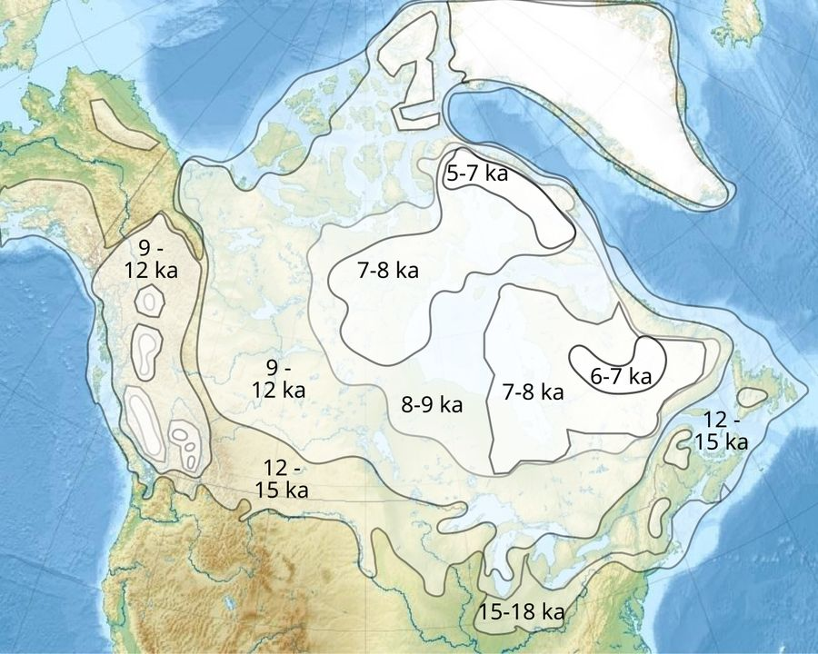

```{=html}
<style>
@import url('https://fonts.googleapis.com/css2?family=Space+Grotesk:wght@700&family=Inter:wght@400;600;800&display=swap');

.engage-box { background: linear-gradient(135deg, #0f5e6e 0%, #134e4a 100%); color: white; padding: 25px; margin: 20px 0; border-radius: 15px; box-shadow: 0 10px 30px rgba(15, 94, 110, 0.3); }
.explore-box { background: linear-gradient(135deg, #0b5394 0%, #075985 100%); color: white; padding: 25px; margin: 20px 0; border-radius: 15px; box-shadow: 0 10px 30px rgba(11, 83, 148, 0.3); }
.explain-box { background: linear-gradient(135deg, #3730a3 0%, #4c1d95 100%); color: white; padding: 25px; margin: 20px 0; border-radius: 15px; box-shadow: 0 10px 30px rgba(55, 48, 163, 0.3); }
.elaborate-box { background: linear-gradient(135deg, #9a3412 0%, #7c2d12 100%); color: white; padding: 25px; margin: 20px 0; border-radius: 15px; box-shadow: 0 10px 30px rgba(154, 52, 18, 0.3); }
.evaluate-box { background: linear-gradient(135deg, #9f1239 0%, #831843 100%); color: white; padding: 25px; margin: 20px 0; border-radius: 15px; box-shadow: 0 10px 30px rgba(159, 18, 57, 0.3); }
.engage-box h2, .explore-box h2, .explain-box h2, .elaborate-box h2, .evaluate-box h2 { font-family: 'Space Grotesk', sans-serif; font-size: 1.8em; margin-top: 0; color: white !important; }
.engage-box a, .explore-box a, .explain-box a, .elaborate-box a, .evaluate-box a { color: #fde68a; }
.pe-badge { display: inline-block; background: linear-gradient(135deg, #0e7490 0%, #155e75 100%); color: white; padding: 8px 16px; border-radius: 20px; font-size: 13px; font-weight: 800; margin: 5px; box-shadow: 0 4px 15px rgba(14, 116, 144, 0.35); text-transform: uppercase; letter-spacing: 1px; }
.big-question { font-family: 'Space Grotesk', sans-serif; font-size: 2.2em; font-weight: 800; background: linear-gradient(135deg, #0e7490 0%, #b45309 100%); -webkit-background-clip: text; background-clip: text; -webkit-text-fill-color: transparent; margin: 30px 0 20px 0; text-align: center; line-height: 1.2; }
.key-idea { background: linear-gradient(135deg, #e0f2fe 0%, #ccfbf1 100%); color: #0f172a; padding: 20px; margin: 20px 0; border-radius: 12px; border-left: 8px solid #0e7490; font-size: 1.05em; }
.key-idea h3, .key-idea h4, .student-task h3 { color: #0f172a !important; margin-top: 0; }
.key-idea a, .student-task a { color: #0b5394; }
.student-task { background: #fff7e6; color: #1a1a1a; border-left: 5px solid #f59e0b; padding: 20px; margin: 15px 0; border-radius: 0 10px 10px 0; }
.student-task table { color: #1a1a1a; }
h1 { font-family: 'Space Grotesk', sans-serif !important; font-weight: 800 !important; font-size: 2.3em !important; margin-top: 40px !important; }
h2 { font-family: 'Space Grotesk', sans-serif !important; font-weight: 700 !important; color: #0e7490 !important; }
body.quarto-dark h2 { color: #67e8f9 !important; }
.engage-box h2, .explore-box h2, .explain-box h2, .elaborate-box h2, .evaluate-box h2 { color: white !important; }
.pf-table { width: 100%; border-collapse: collapse; font-size: .9em; margin: 6px 0 16px; }
.pf-table th, .pf-table td { padding: 6px 8px; border-bottom: 1px solid rgba(128,128,128,.3); text-align: left; vertical-align: top; }
.pf-video { position: relative; width: 100%; max-width: 640px; aspect-ratio: 16 / 9; margin: 14px auto; border-radius: 12px; overflow: hidden; box-shadow: 0 6px 20px rgba(0,0,0,.25); }
.pf-video iframe { position: absolute; inset: 0; width: 100%; height: 100%; border: 0; }
.pf-chain { display: flex; flex-direction: column; gap: 6px; max-width: 560px; margin: 14px auto; }
.pf-chain div { background: #eef6ff; color: #0f172a; border: 2px solid #93c5fd; border-radius: 10px; padding: 9px 12px; font-size: .95em; }
.pf-chain div.hot { background: #fff1f0; border-color: #fca5a5; }
.pf-chain div.cold { background: #e0f2fe; border-color: #38bdf8; }
.pf-chain span.arrow { text-align: center; font-size: 1.3em; color: #64748b; line-height: 1; }
.pf-note { font-size: .8em; opacity: .8; }
.cell-output-display figure > h2 { font-family: 'Inter', sans-serif !important; font-size: 1.05em !important; font-weight: 800 !important; color: inherit !important; margin: 4px 0 2px !important; border: none !important; padding: 0 !important; }
.cell-output-display figure > h3 { font-family: 'Inter', sans-serif !important; font-size: .82em !important; font-weight: 400 !important; opacity: .8; margin: 0 0 6px !important; }
.pf-scroll { max-width: 100%; overflow-x: auto; }
.student-task table, .pf-scroll table { display: block; max-width: 100%; overflow-x: auto; }
.student-task { overflow-x: auto; }
</style>
```

<a class="quiz-jump-btn" href="#end-of-chapter-quiz">🧠 Quiz ↓</a>

<div class="big-question">🧊 What Can Past Climate Change Tell Us About Our Future? 🌊</div>

<span class="pe-badge">HS-ESS2-4</span> <span class="pe-badge">HS-ESS3-1</span> <span class="pe-badge">HS-ESS3-5</span>

::: {.key-idea}
**Investigative phenomenon:** When climate change has occurred in the past, human populations have been impacted. The current climate change event is predicted to affect populations in the future as well.
:::

::: {.callout-note collapse="true"}
## 📒 Using this chapter with your student packet

This chapter follows the same steps as your **The Past and the Future 5E** packet. Missed a class or need a refresher? Jump to the matching section:

| Packet section | In this chapter |
|---|---|
| Climate and Human Populations (migration map, Clovis culture, GISP2 temperature graph) | [Engage](#pf-climate-human-populations) |
| Melting Ice Investigation, Part 1: Sea Level | [Explore 1, Part 1](#pf-sea-level) |
| Melting Ice Investigation, Part 2: Ocean Circulation (plan, brainstorm, prediction, two models) | [Explore 1, Part 2](#pf-ocean-circulation) |
| Making Sense of the Melting Ice Investigation (See-Think-Wonder, Identify and Interpret) | [Making Sense 1](#pf-making-sense-1) |
| Melting Ice and Currents, Part 1: How changes in ocean currents occur | [Explain 1, Part 1](#pf-model-currents) |
| Melting Ice and Currents, Part 2: Surface Ocean Currents Model, Ocean Heat Storage and Transfer, Modeling How Ocean Currents Affect Climate | [Explain 1, Part 2](#pf-currents-climate) |
| Part 3. Impact on People (The End of the Clovis Population Cards) | [Explain 1, Part 3](#pf-impact-on-people) |
| Summary Task (questions 1–2) | [Summary Task 1](#pf-summary-1) |
| Forecasting the Future Investigation Part 1 (Sea Level Change Data Spreadsheet) | [Explore 2, Part 1](#pf-forecast-1) |
| Forecasting the Future Investigation Part 2 (IPCC Interactive Atlas, data table) | [Explore 2, Part 2](#pf-forecast-2) |
| Observing Sea Level Rise (Sea Level Projection Tool, sea level rise viewer) | [Observing Sea Level Rise](#pf-observing-slr) |
| Making Sense of the Forecasting the Future Investigation + Analysis Questions | [Making Sense 2](#pf-making-sense-2) |
| Impacts of Melting Ice (Texts 1–3: Glacial Lakes, Mountains, The Poles) | [Explain 2](#pf-impacts-melting-ice) |
| Summary Task (questions 5–6) | [Summary Task 2](#pf-summary-2) |
| Managing Other Climate Change Disruptions (two videos) | [Elaborate](#pf-managing-disruptions) |
| Human Displacement and Disaster Data + The Past and the Future Rubric | [Evaluate](#pf-disaster-data) |
:::

```{ojs}
//| echo: false
Plot = require("@observablehq/plot@0.6.16")
pfTopo = require("topojson-client@3.1.0")
```

```{ojs}
//| echo: false
pfCheck = function(id, title, questions) {
  const outer = html`<div id="${id}" style="margin:18px 0 24px 0;text-align:center;">
    <button style="display:inline-flex;align-items:center;gap:7px;background:linear-gradient(135deg,#0e7490 0%,#3730a3 100%);color:#fff;border:none;padding:10px 22px;min-height:44px;border-radius:50px;font-size:.95em;font-weight:700;cursor:pointer;box-shadow:0 3px 12px rgba(14,116,144,.4);">
      <span style="font-size:1.1em;">📝</span> ${title} <span class="chevron" style="transition:transform .3s;">▼</span>
    </button>
    <div class="quiz-body" style="max-height:0;opacity:0;overflow:hidden;transition:max-height .5s ease,opacity .4s ease,margin-top .3s ease;margin-top:0;text-align:left;">
      <button class="close-btn" style="display:block;margin:0 auto 10px auto;background:rgba(14,116,144,.12);color:#0e7490;border:none;padding:6px 18px;min-height:36px;border-radius:50px;font-size:.85em;font-weight:600;cursor:pointer;">Hide</button>
    </div>
  </div>`;
  const toggle = outer.querySelector("button");
  const chevron = toggle.querySelector(".chevron");
  const body = outer.querySelector(".quiz-body");
  const closeBtn = body.querySelector(".close-btn");
  function expand(){ body.style.maxHeight="4000px"; body.style.opacity="1"; body.style.marginTop="14px"; chevron.style.transform="rotate(180deg)"; }
  function collapse(){ body.style.maxHeight="0"; body.style.opacity="0"; body.style.marginTop="0"; chevron.style.transform="rotate(0)"; }
  toggle.onclick = () => (body.style.maxHeight === "0px" || body.style.maxHeight === "") ? expand() : collapse();
  closeBtn.onclick = collapse;
  questions.forEach((qq, qi) => {
    const card = document.createElement("div");
    card.style.cssText = "background:#fff;color:#1e1b4b;border-radius:12px;padding:16px 18px;margin-bottom:14px;box-shadow:0 2px 8px rgba(0,0,0,.1);";
    card.innerHTML = `<p style="font-weight:700;margin:0 0 10px;color:#1e1b4b;">${qi+1}. ${qq.q}</p>`;
    const fb = document.createElement("div");
    fb.style.cssText = "border-radius:8px;font-size:.9em;";
    qq.options.forEach((opt, oi) => {
      const btn = document.createElement("button");
      btn.textContent = opt;
      btn.style.cssText = "display:block;width:100%;min-height:44px;text-align:left;padding:10px 14px;margin:6px 0;border:2px solid #e2e8f0;border-radius:8px;background:#fff;color:#1e1b4b;cursor:pointer;font-size:.95em;";
      btn.onclick = () => {
        if (card.dataset.answered) return;
        card.dataset.answered = "true";
        card.querySelectorAll("button").forEach(b => b.style.cursor = "default");
        const right = card.querySelectorAll("button")[qq.correct];
        right.style.borderColor = "#48bb78"; right.style.background = "#f0fff4";
        if (oi === qq.correct) {
          fb.innerHTML = "✅ Correct! " + qq.explanation; fb.style.color = "#276749"; fb.style.background = "#f0fff4";
        } else {
          btn.style.borderColor = "#fc8181"; btn.style.background = "#fff5f5";
          fb.innerHTML = "❌ " + qq.explanation; fb.style.color = "#9b2c2c"; fb.style.background = "#fff5f5";
        }
        fb.style.padding = "10px 14px"; fb.style.marginTop = "8px";
      };
      card.appendChild(btn);
    });
    card.appendChild(fb);
    body.appendChild(card);
  });
  return outer;
}
```

# Engage: How Have Humans Been Impacted by Climate Change in the Past? {#pf-engage}

::: {.engage-box}
## 🌍 We Have Been Here Before

In the last two chapters you figured out **what** causes climate change: orbital factors and the Sun set the slow natural rhythm, and **CO₂ from human activities** is driving the warming today. A fair question is: **so what?** Why is climate change a big deal for people?

One way to find out is to look back. Humans have lived through **ice ages, warm periods, floods, droughts, and huge volcanic eruptions.** Our species survived, but that doesn't mean we came through unharmed.
:::

## Climate and Human Populations {#pf-climate-human-populations}

What the packet reading tells us:

| When | What happened to people | Climate connection |
|---|---|---|
| ~200,000 years ago | Modern humans evolve in Africa | Deserts grew, shrank, and turned to grassland and back; populations moved, grew, and shrank |
| ~120,000 years ago | First wave leaves Africa for the Middle East, then **dies off** | A **drought** caused by global glacial conditions |
| Same era | Population in Africa crashes to perhaps **10,000 mating pairs** | Orbital factors and suspected volcanic activity killed much of the plant life |
| ~60,000 years ago | Second wave leaves Africa across land bridges and **survives** | **Milder temperatures** |
| After that | Humans spread to new continents | Low sea level exposed **land bridges** |

Step through the packet's **Global Journey** map to see when people reached each region.

```{ojs}
//| echo: false
pfLand = {
  try {
    const w = await d3.json("../world-110m.json");
    return pfTopo.feature(w, w.objects.land);
  } catch (e) {
    return null;
  }
}
```

```{ojs}
//| echo: false
pfRoutes = [
  {n: 1, start: 200000, label: "200,000 years ago: modern humans in Africa", pts: [[36,3],[30,-10],[25,-28]]},
  {n: 1, start: 200000, label: "", pts: [[36,3],[15,8],[-8,10]]},
  {n: 2, start: 70000, label: "70,000–50,000 years ago: out of Africa", pts: [[36,3],[42,14],[45,28]]},
  {n: 3, start: 50000, label: "50,000 years ago: Australia", pts: [[45,28],[75,20],[100,12],[115,-5],[135,-22]]},
  {n: 4, start: 45000, label: "45,000–35,000 years ago: Europe", pts: [[45,28],[30,40],[10,47],[-2,50]]},
  {n: 5, start: 45000, label: "45,000–35,000 years ago: East Asia", pts: [[100,12],[112,28],[122,42],[135,58]]},
  {n: 6, start: 20000, label: "20,000–15,000 years ago: across Beringia to North America", pts: [[135,58],[165,66],[-165,66],[-140,62],[-120,50]]},
  {n: 7, start: 15000, label: "15,000–12,000 years ago: to the tip of South America", pts: [[-120,50],[-105,30],[-85,12],[-78,-10],[-72,-35],[-70,-52]]},
  {n: 8, start: 3500, label: "3,500 years ago: Taiwan to the Philippines and New Guinea", pts: [[121,23],[123,12],[140,-5]]},
  {n: 9, start: 2500, label: "2,500 years ago: into the Pacific islands", pts: [[150,-8],[178,-17],[-172,-14],[-150,-17]]}
]
```

```{ojs}
//| echo: false
viewof pfMigYear = Inputs.select([200000, 70000, 50000, 45000, 20000, 15000, 3500, 2500],
  {label: "Show routes started by (years ago):", value: 200000, format: d => d.toLocaleString()})
```

```{ojs}
//| echo: false
{
  const shown = pfRoutes.filter(r => r.start >= pfMigYear);
  const newest = shown.filter(r => r.start === pfMigYear && r.label);
  const caption = html`<p style="text-align:center;font-size:.92em;margin:6px auto;max-width:560px;"><strong>${newest.map(r => r.label).join(" · ")}</strong></p>`;
  if (!pfLand) return html`<div><p class="pf-note">🗺️ The map could not load. Routes in order: Africa (200,000) → Middle East (70,000–50,000) → Australia (50,000) → Europe and East Asia (45,000–35,000) → North America via the Bering Land Bridge (20,000–15,000) → South America (15,000–12,000) → Pacific islands (3,500–2,500).</p>${caption}</div>`;
  const lines = shown.flatMap((r, i) => r.pts.map(([lon, lat]) => ({lon, lat, id: r.n + "-" + i, start: r.start})));
  const heads = shown.map(r => ({lon: r.pts.at(-1)[0], lat: r.pts.at(-1)[1], n: r.n}));
  const chart = Plot.plot({
    width: Math.max(width, 320), height: Math.max(width, 320) * 0.52,
    projection: {type: "equal-earth", rotate: [-163, 0]},
    color: {type: "log", domain: [2500, 200000], range: ["#e11d48", "#0284c7"]},
    marks: [
      Plot.sphere({fill: "#dbeafe", stroke: "#94a3b8"}),
      Plot.geo(pfLand, {fill: "#f5f0e1", stroke: "#a8a29e", strokeWidth: 0.4}),
      Plot.line(lines, {x: "lon", y: "lat", z: "id", stroke: "start", strokeWidth: 3.5, strokeOpacity: 0.85, curve: "catmull-rom"}),
      Plot.dot(heads, {x: "lon", y: "lat", r: 9, fill: "#7f1d1d", stroke: "white", strokeWidth: 1.5}),
      Plot.text(heads, {x: "lon", y: "lat", text: "n", fill: "white", fontSize: 10, fontWeight: "bold"})
    ]
  });
  return html`<div>${chart}${caption}<p class="pf-note" style="text-align:center;">Routes and dates redrawn from the packet's "Global Journey" map. Paths are generalized. Blue = older, red = more recent.</p></div>`;
}
```

```{ojs}
//| echo: false
pfCheck("pf-check-migration", "Check: The Global Journey", [
  {q: "People reached North America 20,000–15,000 years ago by walking from Siberia. Why was that possible then but not today?",
   options: ["The continents were closer together", "Sea level was much lower during the ice age, so the Bering Land Bridge was dry land", "The Bering Strait was frozen solid all year", "People used large ships"],
   correct: 1,
   explanation: "So much water was locked up in ice sheets that sea level was about 120 m lower. The shallow sea floor between Siberia and Alaska (Beringia) was exposed as land. You'll see this sea level data in Explore 1."},
  {q: "The first wave out of Africa (~120,000 years ago) died off, but the second wave (~60,000 years ago) survived. What does the reading say made the difference?",
   options: ["Better tools", "Climate: the first wave hit a glacial drought; the second traveled when temperatures were milder", "The second wave was larger", "The first wave went the wrong way"],
   correct: 1,
   explanation: "The packet links both outcomes to climate. A drought from global glacial conditions wiped out the first population; milder temperatures let the second one survive and spread."}
])
```

### The Clovis culture

```{ojs}
//| echo: false
pfGisp = [
  [20,-48],[19.5,-47],[19,-48],[18.5,-47],[18,-48.5],[17.5,-46],[17,-47],[16.5,-45.5],[16,-46.5],[15.5,-45],[15,-46],[14.8,-45],
  [14.65,-36],[14.5,-33],[14.3,-35],[14.0,-37],[13.7,-36],[13.4,-38.5],[13.1,-38],[12.9,-42],[12.8,-47],[12.6,-49],[12.4,-50],[12.2,-49.5],[12.0,-50],[11.8,-48.5],
  [11.7,-41],[11.6,-35],[11.4,-33],[11.0,-34],[10.5,-31.5],[10.0,-31],[9.5,-30.5],[9.0,-30.5],[8.4,-31],[8.2,-32.5],[8.0,-31],[7.0,-30.2],[6.0,-30.5],[5.0,-30.4],[4.0,-30.7],[3.0,-31],[2.0,-31.2],[1.0,-31.4],[0.5,-31.8],[0.095,-31.6]
].map(([ka, t]) => ({ka, t}))
```

The packet reading continues: the **Clovis culture**, one of the earliest populations in North America, likely crossed the Bering Land Bridge from Siberia **15,000–20,000 years ago**. Their stone spear points appear across North America starting **13,500 years ago**, and then they **disappear from the record 12,750 years ago**. Many hypotheses exist, but their disappearance happened **at the same time as major changes to the climate.**

The packet's graph is a temperature record from the **GISP2 ice core** at the top of the Greenland ice sheet (Alley, 2000). Toggle the layers to compare the climate with the Clovis timeline.

```{ojs}
//| echo: false
viewof pfGispShow = Inputs.checkbox(["Bølling–Allerød warm period", "Younger Dryas cold period", "Clovis culture (13,500–12,750 years ago)"],
  {label: "Show:", value: ["Clovis culture (13,500–12,750 years ago)"]})
```

```{ojs}
//| echo: false
{
  const bands = [];
  if (pfGispShow.includes("Bølling–Allerød warm period")) bands.push({x1: 14.7, x2: 12.9, fill: "#fca5a5", label: "Bølling–Allerød"});
  if (pfGispShow.includes("Younger Dryas cold period")) bands.push({x1: 12.9, x2: 11.7, fill: "#93c5fd", label: "Younger Dryas"});
  const clovis = pfGispShow.includes("Clovis culture (13,500–12,750 years ago)");
  return Plot.plot({
    title: "Greenland temperature as Earth left the last glacial period",
    subtitle: "GISP2 ice core (Alley 2000); values read from the packet's graph, approximate",
    width, height: 330, marginLeft: 50, marginBottom: 42,
    x: {label: "Thousands of years ago →", domain: [20, 0], reverse: false},
    y: {label: "Temperature (°C)", domain: [-55, -25], grid: true},
    marks: [
      Plot.rectX(bands, {x1: "x1", x2: "x2", y1: -55, y2: -25, fill: "fill", fillOpacity: 0.35}),
      Plot.text(bands, {x: d => (d.x1 + d.x2) / 2, y: -26.5, text: "label", fontSize: 11, fontWeight: "bold"}),
      ...(clovis ? [
        Plot.link([{x1: 13.5, x2: 12.75}], {x1: "x1", x2: "x2", y1: -53, y2: -53, stroke: "#b45309", strokeWidth: 7}),
        Plot.text([{x: 13.1}], {x: "x", y: -51, text: () => "Clovis", fill: "#b45309", fontWeight: "bold", fontSize: 12})
      ] : []),
      Plot.line(pfGisp, {x: "ka", y: "t", stroke: "currentColor", strokeWidth: 2}),
      Plot.dot([{ka: 0.095, t: -31.6}], {x: "ka", y: "t", r: 4, fill: "#0e7490"}),
      Plot.text([{ka: 0.4, t: -33.5}], {x: "ka", y: "t", text: () => "1855", fontSize: 11, textAnchor: "end"}),
      Plot.ruleY([-30], {stroke: "#94a3b8", strokeDasharray: "4,4"}),
      Plot.tip(pfGisp, Plot.pointerX({x: "ka", y: "t", title: d => `${d.ka} thousand years ago: about ${d.t} °C`}))
    ]
  });
}
```

::: {.pf-note}
The full packet graph goes back 50,000 years and also shows rapid swings called **Dansgaard–Oeschger cycles** during the ice age. The **Holocene** (the last ~11,700 years) has been unusually stable, and it is the only climate in which farming and cities have existed.
:::

```{ojs}
//| echo: false
pfCheck("pf-check-gisp", "Check: Reading the ice core graph", [
  {q: "Around 14,700 years ago, Greenland temperature jumped from about −46 °C to about −33 °C. Then, at 12,900 years ago, it fell back to about −49 °C. What happened at the same time as the cold drop?",
   options: ["Humans first left Africa", "The Clovis culture disappeared from the record", "The Holocene began", "The Bering Land Bridge formed"],
   correct: 1,
   explanation: "The Clovis record ends 12,750 years ago, right as the Younger Dryas cold period begins. That's a correlation. Whether the climate caused it is what this chapter investigates."},
  {q: "How fast did Greenland warm at the END of the Younger Dryas (~11,700 years ago)?",
   options: ["About 15 °C over tens of thousands of years", "About 15 °C in a very short time, centuries or less", "It didn't warm; it kept cooling", "About 1 °C"],
   correct: 1,
   explanation: "On the graph the line jumps from about −49 °C to about −34 °C almost straight up. Ice-core studies show most of that warming took only decades. Orbital changes are far too slow to explain that, so something faster must be involved."},
  {q: "The temperature was rising ~15,000 years ago as Earth came out of the glacial period. Based on Unit 4 so far, what is the most likely cause of that long rise?",
   options: ["Orbital factors increasing summer sunlight in the north, amplified by feedbacks (CO₂ and melting ice)", "Factories", "A volcanic eruption", "The Clovis people"],
   correct: 0,
   explanation: "This is what you figured out in Earth-Sun Dynamics and Climate Feedbacks. The puzzle is the sudden drop and rebound in the middle."}
])
```

::: {.student-task}
### ✏️ In your packet: Climate and Human Populations

Read the text and study the map and the temperature graph, then think about:

- **How have humans been impacted by climate change in the past?**
- **What changes in temperature do you see on the graph?**
- **What causes can you think of for the changes you see in the graph?**
:::

::: {.callout-note collapse="true"}
## 🔑 Check your thinking (try it first!)

- Around **15,000 years ago** the climate is **warming**, probably because of **orbital factors** (with feedbacks).
- Suddenly, around **13,000 years ago**, temperatures **drop** (the **Younger Dryas**).
- Then, around **11,500 years ago**, temperatures **rise again**, very quickly.
- During that time, the **Clovis population disappeared**.
- Coming out of a glacial period, **ice should be melting**. So why would temperatures suddenly plunge and then shoot back up? To find out, we need to look closely at **what happens when ice melts**.
:::

# Explore 1: What Impact Does Melting or Freezing Ice Have on Ocean Currents? {#pf-explore1}

::: {.explore-box}
## 🧊 Where Does All That Meltwater Go?

Ice sheets are made of **fresh water**. When they melt, the water flows into the ocean. Two big questions:

1. What happens to **sea level**?
2. What happens to the **salt concentration** of the ocean, and to the **ocean currents** that depend on it?
:::

## Part 1. Sea Level {#pf-sea-level}

Watch **The Blue Marble** video up to **1:36**. Look for similarities between Earth coming out of the last ice age and the climate change happening now.

<div class="pf-video"><iframe src="https://www.youtube-nocookie.com/embed/C3Jwnp-Z3yE?end=96" title="Blue Marble 3000 video" loading="lazy" allow="accelerometer; encrypted-media; gyroscope; picture-in-picture" allowfullscreen></iframe></div>

{fig-alt="Map of North America showing the outline of the ice sheet that once covered Canada and the northern United States. Labeled zones show when the ice melted: the southern edge near the Great Lakes 15-18 thousand years ago, a band across the prairies 12-15 thousand years ago, central Canada 9-12 and 8-9 thousand years ago, Hudson Bay area 7-8 thousand years ago, and the last remnants in Quebec and Baffin Island 5-7 thousand years ago." width="100%"}

::: {.pf-note}
Map: "Retrait des glaces en Amérique," Wikimedia Commons (CC BY-SA), as used in the packet. ka = thousand years ago.
:::

Now combine the map with the packet's **Post-Glacial Sea Level Rise** graph. Drag the slider forward in time.

```{ojs}
//| echo: false
pfSea = [
  [22,-125],[21,-124],[20,-123],[19,-120],[18,-118],[17,-115],[16,-111],[15,-105],[14.7,-100],[14.3,-80],[14,-76],[13,-70],[12.5,-66],[12,-63],[11.5,-58],[11,-52],[10.5,-46],[10,-40],[9.5,-33],[9,-27],[8.5,-20],[8,-15],[7.5,-9],[7,-5],[6,-3],[5,-2],[4,-1],[2,-0.5],[0,0]
].map(([ka, m]) => ({ka, m}))
pfIceZones = [
  {from: 18, to: 15, zone: "15–18 ka: southern edge (Great Lakes, Ohio, Midwest)"},
  {from: 15, to: 12, zone: "12–15 ka: northern U.S. plains and Atlantic Canada"},
  {from: 12, to: 9, zone: "9–12 ka: Canadian prairies and the Rocky Mountain ice"},
  {from: 9, to: 8, zone: "8–9 ka: central Canada"},
  {from: 8, to: 7, zone: "7–8 ka: around Hudson Bay and Quebec"},
  {from: 7, to: 5, zone: "5–7 ka: last remnants (Quebec, Baffin Island)"}
]
```

```{ojs}
//| echo: false
viewof pfSeaKa = Inputs.range([0, 22], {label: "Thousands of years ago:", step: 0.5, value: 20})
```

```{ojs}
//| echo: false
{
  const interp = ka => {
    for (let i = 0; i < pfSea.length - 1; i++) {
      const a = pfSea[i], b = pfSea[i + 1];
      if (ka <= a.ka && ka >= b.ka) return a.m + (b.m - a.m) * (a.ka - ka) / (a.ka - b.ka);
    }
    return ka > 22 ? -125 : 0;
  };
  const m = interp(pfSeaKa);
  const gone = pfIceZones.filter(z => pfSeaKa <= z.to);
  const melting = pfIceZones.filter(z => pfSeaKa < z.from && pfSeaKa > z.to);
  const chart = Plot.plot({
    title: "Post-glacial sea level rise",
    subtitle: "Sea level compared to today (m); curve read from the packet's graph, approximate",
    width, height: 300, marginLeft: 50, marginBottom: 42,
    x: {label: "Thousands of years ago →", domain: [22, 0]},
    y: {label: "Change in sea level (m)", domain: [-135, 5], grid: true},
    marks: [
      Plot.rectX([{x1: 14.7, x2: 14.3}], {x1: "x1", x2: "x2", y1: -135, y2: 5, fill: "#f59e0b", fillOpacity: 0.25}),
      Plot.text([{x: 14.5}], {x: "x", y: -128, text: () => "Meltwater Pulse 1A", fontSize: 11, fill: "#b45309", fontWeight: "bold"}),
      Plot.ruleY([0]),
      Plot.line(pfSea, {x: "ka", y: "m", stroke: "#0b5394", strokeWidth: 2.5, curve: "monotone-x"}),
      Plot.ruleX([pfSeaKa], {stroke: "#e11d48", strokeDasharray: "4,3"}),
      Plot.dot([{ka: pfSeaKa, m}], {x: "ka", y: "m", r: 7, fill: "#e11d48", stroke: "white", strokeWidth: 2})
    ]
  });
  return html`<div>${chart}
    <div style="display:flex;flex-wrap:wrap;gap:10px;justify-content:center;margin:8px 0;">
      <div style="background:#e0f2fe;color:#0c4a6e;border-radius:10px;padding:10px 14px;min-width:150px;text-align:center;"><div style="font-size:.8em;">Sea level vs. today</div><div style="font-size:1.6em;font-weight:800;">${Math.round(m)} m</div></div>
      <div style="background:#f1f5f9;color:#0f172a;border-radius:10px;padding:10px 14px;max-width:420px;font-size:.9em;">
        <strong>North American ice sheet at ${pfSeaKa} ka:</strong><br>
        ${pfSeaKa >= 18 ? "Near its greatest size, covering most of Canada and the northern U.S." :
          gone.length === pfIceZones.length ? "Gone (except small mountain glaciers)." :
          `Already ice-free: ${gone.length ? gone.map(z => z.zone.split(":")[0]).join(", ") : "none yet"}.` + (melting.length ? `<br>Melting now: ${melting[0].zone}` : "")}
      </div>
    </div></div>`;
}
```

```{ojs}
//| echo: false
pfCheck("pf-check-sealevel", "Check: Ice and sea level", [
  {q: "About how much did sea level rise from the Last Glacial Maximum (~20,000 years ago) to today?",
   options: ["About 12 m", "About 120 m", "About 1,200 m", "It fell"],
   correct: 1,
   explanation: "The curve starts at about −120 to −125 m and climbs to 0. Water that had been stored as ice on land flowed back into the ocean."},
  {q: "During Meltwater Pulse 1A, sea level rose about 20 m in roughly 400–500 years. Today it rises about 3–4 mm per year. How does Meltwater Pulse 1A compare?",
   options: ["It was slower than today", "About the same", "About 10 times faster than today (around 4 m per century vs. about 0.4 m per century)", "1,000 times faster"],
   correct: 2,
   explanation: "20 m ÷ ~500 years ≈ 4 cm per year, or about 4 m per century. Today's ~3–4 mm per year is about 0.3–0.4 m per century. Ice sheets can lose ice very quickly once they start to collapse."},
  {q: "Compare the ice map and the sea level graph. Which statement is supported by BOTH?",
   options: ["The ice sheet grew while sea level rose", "As the ice sheet shrank (18,000 → 6,000 years ago), sea level rose; both level off around 6,000–7,000 years ago", "Sea level rose only after all the ice was gone", "The ice melted all at once"],
   correct: 1,
   explanation: "The ice disappeared zone by zone, mostly between 18 and 7 ka, and sea level rose steeply over the same time. After the last big ice melted (~6–7 ka), sea level levels off."}
])
```

::: {.student-task}
### ✏️ In your packet: Part 1 questions

1. How did **glacial levels** change over the past 20,000 years?
2. How did **sea level** change over the past 20,000 years?
:::

::: {.callout-note collapse="true"}
## 🔑 Check your thinking (try it first!)

1. About 20,000 years ago, a huge ice sheet covered most of Canada and the northern U.S. It **melted from the south and west edges inward**: 15–18 thousand years ago at the southern edge, and the last remnants were gone about **5–7 thousand years ago**.
2. Sea level **rose about 120 m**, from roughly −120 m to today's level. The rise was fastest during **Meltwater Pulse 1A (~14,500 years ago)** and leveled off around 6,000–7,000 years ago.
3. **Where did the meltwater go?** Into the ocean, raising sea level. But that water is **fresh**, which brings up the next question: what does fresh water do to the **salt concentration** and the **currents** of the ocean?
:::

## Part 2. Ocean Circulation {#pf-ocean-circulation}

You'll be investigating how melting Arctic ice affects one specific current: the **Atlantic Meridional Overturning Circulation (AMOC)**. It carries warm water north on the surface and **sinks toward the bottom of the ocean near Greenland**.

What you already know from middle school:

- **Cold** water sinks; **warm** water rises.
- **Saltier** water is **denser** than less salty water.
- Warm water comes from the **equator**; cold water comes from the **poles**.

::: {.callout-tip collapse="true"}
## 🎬 Need a refresher? Watch the AMOC Model video

<div class="pf-video"><iframe src="https://www.youtube-nocookie.com/embed/eZzpvLz4yAk" title="The Atlantic Meridional Overturning video" loading="lazy" allow="accelerometer; encrypted-media; gyroscope; picture-in-picture" allowfullscreen></iframe></div>
:::

### Plan for setting up the global ocean circulation model

In class, the model is a clear tank of water. One end is the **equator (0°)** and the other end is the **North Pole (90° N)**:

- At the equator end, pour **hot water dyed red**.
- At the North Pole end, pour **cold, very salty water dyed blue** (about 400 g of salt per liter).

**Brainstorm:** Glacial water is **fresh water**. To show glacial melt entering the ocean at the North Pole, make the cold water **less salty** by mixing it with fresh water (1 part salt water to 1, 2, or 3 parts fresh water).

### Make a prediction

```{ojs}
//| echo: false
viewof pfPredict = Inputs.radio(["Speed up", "Slow down", "Stay the same", "Reverse direction"],
  {label: "When you add glacial melt (less salty cold water), the current will:"})
```

### Run the virtual models

```{ojs}
//| echo: false
viewof pfDilution = Inputs.radio(new Map([
  ["1 : 1 (salt water : fresh water)", 1],
  ["1 : 2", 2],
  ["1 : 3", 3],
  ["All fresh water (the ice keeps melting)", 99]
]), {label: "\"After\" model: how much glacial melt?", value: 1})
```

```{ojs}
//| echo: false
viewof pfRun = Inputs.button("▶ Run both models")
```

```{ojs}
//| echo: false
pfTank = {
  pfRun;
  // Densities (g/mL): room-temperature tank water ≈ 0.998; cold brine (~400 g/L) ≈ 1.20.
  const ambient = 0.998, brine = 1.20, fresh = 1.000;
  const coldAfter = pfDilution === 99 ? fresh : (brine + pfDilution * fresh) / (1 + pfDilution);
  const dBefore = brine - ambient, dAfter = Math.max(coldAfter - ambient, 0.0005);
  const tBefore = 3; // seconds for the plume to reach the bottom in the "before" model
  const tAfter = Math.min(tBefore * dBefore / dAfter, 120);
  const uid = "pft" + Math.floor(Math.random() * 1e9);
  const tank = (label, dur, coldColor, note) => {
    const flow = Math.max(dur * 1.6, 1.5);
    return `<div style="flex:1 1 280px;max-width:420px;">
      <div style="font-weight:700;text-align:center;margin-bottom:4px;">${label}</div>
      <svg viewBox="0 0 320 190" style="width:100%;height:auto;display:block;" role="img" aria-label="${label} tank model">
        <rect x="0" y="0" width="320" height="190" rx="12" fill="#f8fafc"/>
        <path d="M20,30 L300,30 L285,170 L35,170 Z" fill="#dbeafe" stroke="#64748b" stroke-width="2"/>
        <text x="40" y="22" font-size="11" fill="#0f172a">Equator 0°</text>
        <text x="225" y="22" font-size="11" fill="#0f172a">North Pole 90° N</text>
        <rect x="24" y="32" width="120" height="14" fill="#ef4444" opacity=".85" class="${uid}-warm" style="animation:${uid}-spread ${flow}s ease-out forwards; transform-origin:24px 39px;"/>
        <rect x="262" y="32" width="24" height="0" fill="${coldColor}" class="${uid}-sink" style="animation:${uid}-sink-${label.length} ${dur}s ease-in forwards;"/>
        <rect x="140" y="152" width="146" height="16" fill="${coldColor}" opacity="0" style="animation:${uid}-floor ${flow}s ease-out ${dur}s forwards; transform-origin:286px 160px;"/>
        <path d="M60,60 C120,60 200,60 250,60" stroke="#b91c1c" stroke-width="3" fill="none" stroke-dasharray="8 8" style="animation:${uid}-dash ${Math.max(dur, 1) * 0.8}s linear infinite;" marker-end="url(#${uid}-arrR)"/>
        <path d="M255,140 C200,140 120,140 70,140" stroke="#1d4ed8" stroke-width="3" fill="none" stroke-dasharray="8 8" style="animation:${uid}-dash ${Math.max(dur, 1) * 0.8}s linear infinite;" marker-end="url(#${uid}-arrB)"/>
        <defs>
          <marker id="${uid}-arrR" viewBox="0 0 10 10" refX="8" refY="5" markerWidth="5" markerHeight="5" orient="auto"><path d="M0,0 L10,5 L0,10 z" fill="#b91c1c"/></marker>
          <marker id="${uid}-arrB" viewBox="0 0 10 10" refX="8" refY="5" markerWidth="5" markerHeight="5" orient="auto"><path d="M0,0 L10,5 L0,10 z" fill="#1d4ed8"/></marker>
        </defs>
      </svg>
      <div style="font-size:.85em;text-align:center;color:inherit;">${note}</div>
      <style>
        @keyframes ${uid}-sink-${label.length} { from { height: 0; } to { height: 136px; } }
      </style>
    </div>`;
  };
  const speedPct = Math.round(100 * dAfter / dBefore);
  const div = html`<div>
    <style>
      @keyframes ${uid}-spread { from { transform: scaleX(.2); } to { transform: scaleX(1.9); } }
      @keyframes ${uid}-floor { from { opacity: .9; transform: scaleX(.1); } to { opacity: .9; transform: scaleX(1); } }
      @keyframes ${uid}-dash { to { stroke-dashoffset: -32; } }
    </style>
    <div style="display:flex;flex-wrap:wrap;gap:14px;justify-content:center;background:rgba(148,163,184,.08);border-radius:12px;padding:10px;">
      ${tank("Before glacial melt", tBefore, "#1e3a8a", `Cold, very salty water (≈1.20 g/mL) sinks in about ${tBefore} s`)}
      ${tank("After glacial melt", tAfter, "#7c3aed", pfDilution === 99 ? "Cold fresh water (≈1.000 g/mL) barely sinks: the current almost stops" : `Diluted cold water (≈${coldAfter.toFixed(2)} g/mL) sinks in about ${Math.round(tAfter)} s`)}
    </div>
    <table class="pf-table" style="max-width:520px;margin:10px auto;">
      <tr><th></th><th>Before</th><th>After</th></tr>
      <tr><td>Density of the cold "polar" water</td><td>≈1.20 g/mL</td><td>≈${coldAfter.toFixed(3)} g/mL</td></tr>
      <tr><td>Extra density vs. tank water</td><td>${dBefore.toFixed(3)}</td><td>${dAfter.toFixed(3)}</td></tr>
      <tr><td>Relative sinking (current) speed</td><td>100%</td><td><strong>${speedPct}%</strong></td></tr>
    </table>
    <p class="pf-note" style="text-align:center;">Simplified model: sinking speed is set in proportion to how much denser the cold water is than the tank water. Real tanks also mix and warm, so times will differ.</p>
  </div>`;
  return div;
}
```

```{ojs}
//| echo: false
pfRun > 0 && pfPredict ? html`<div style="max-width:620px;margin:6px auto;padding:10px 14px;border-radius:10px;background:${pfPredict === "Slow down" ? "#f0fff4" : "#fff7ed"};color:#1a1a1a;font-size:.95em;">
  You predicted the current would <strong>${pfPredict.toLowerCase()}</strong>. ${pfPredict === "Slow down" ? "✅ Your prediction matches the model: less salty water is less dense, so it sinks more slowly and the whole loop slows." : "The model shows the current <strong>slows down</strong>. Fresher water is less dense, so it sinks more slowly, and the sinking is what pulls the whole loop along. Revise your prediction using this evidence."}
</div>` : html`<p class="pf-note" style="text-align:center;">Choose a prediction, then press Run to compare.</p>`
```

```{ojs}
//| echo: false
pfCheck("pf-check-tank", "Check: The two models", [
  {q: "In the \"before\" model, what makes the cold blue water sink at the North Pole end?",
   options: ["It is colder and saltier, so it is denser than the water around it", "It is warmer", "The food coloring is heavy", "Wind pushes it down"],
   correct: 0,
   explanation: "Cold, salty water has more mass in the same volume. Gravity pulls denser water down, and the sinking water pulls surface water toward the pole to replace it. That's the overturning loop."},
  {q: "Which change in the model represents glacial melt entering the ocean?",
   options: ["Making the cold water saltier", "Making the cold water less salty by mixing in fresh water", "Making the warm water hotter", "Adding more food coloring"],
   correct: 1,
   explanation: "Ice sheets are fresh water, so melting dilutes the salt concentration of the polar ocean. Changing only the salt concentration keeps it a fair test."},
  {q: "Switch the \"after\" model to all fresh water. What would happen to the AMOC if glaciers kept melting and diluting the North Atlantic?",
   options: ["It would get faster", "It would keep slowing and could nearly stop", "Nothing", "It would reverse and flow south on the surface"],
   correct: 1,
   explanation: "With almost no density difference, the polar water barely sinks, so the loop that brings warm water north weakens and can nearly shut down. That's the key idea for Explain 1."}
])
```

::: {.student-task}
### ✏️ In your packet: Part 2. Ocean Circulation

1. **Plan:** Draw how you'll set up the model in the tank (hot red water at the equator end, cold very salty blue water at the North Pole end).
2. **Brainstorm:** How is glacial water different from sea water? How can you change the model to show glacial melt entering at the North Pole?
3. **Make a prediction:** How will glacial water interact with the cold, very salty Arctic water? With warm salt water from the equator? Draw and describe what you expect.
4. **Conduct your experiment** with two models: "before" (no glacial melt) and "after" (glacial melt added).
5. **Record your observations** with words and diagrams for each model.
:::

## Making Sense of the Melting Ice Investigation {#pf-making-sense-1}

::: {.student-task}
### ✏️ In your packet: See-Think-Wonder + Identify and Interpret

| See | Think | Wonder |
|---|---|---|
| What did you notice about the relationship between **glacier size and sea level**? | How do you think these changes would have impacted **people living in the changing areas**? | What questions do you have? |
| When you **reduced the salt concentration** to model glaciers melting, how did the currents change? | What do you think would happen to the current if glaciers **kept melting** and diluting the salt concentration? | |

1. How do changes in the **cryosphere** (ice) induce changes in the **hydrosphere** (water)?
2. How is **energy moving** in this system, before and after the glacier melts? Where is the energy coming from, in the model and in the oceans?
3. How would ocean currents **slowing** because of melting glaciers affect the amount of **energy** carried from the equator to the Northern Hemisphere?
:::

::: {.callout-note collapse="true"}
## 🔑 Check your thinking (try it first!)

- **See:** As glaciers shrank, sea level rose (about 120 m). With less salt, the cold water sank **more slowly** and the current took longer to form and moved more slowly. With more salt, it formed faster.
- **Think:** Rising seas would have **flooded coastlines and land bridges** where people lived. If melting continued, the current could **keep slowing or even stop**.
- **Wonder:** *What did this mean for climate in the past? What does it mean for our climate in the future?*

1. **Cryosphere → hydrosphere:** Melting ice adds **fresh water** to the ocean. That **raises sea level** and **lowers the salt concentration** near the ice, which makes the water **less dense** and changes how it sinks and circulates.
2. **Energy:** In the model, energy comes from the **hot water** (heated on a stove or in a kettle). In the ocean, it comes from **sunlight absorbed near the equator**. The current carries that warm water **toward the pole**, where it gives off heat, cools, and sinks. After the melt, the loop is slower, so **less energy is moved**.
3. A slower AMOC carries **less heat from the equator to the Northern Hemisphere**, so the north should **cool**.
:::

# Explain 1: How Do Changing Ocean Currents Impact Earth's Climate System? {#pf-explain1}

::: {.explain-box}
## 🔄 From Melting Ice to a Sudden Freeze

Now use your evidence to build a **mechanism**: how could melting ice change ocean currents, and how could that have caused the **sudden cooling (the Younger Dryas)** while Earth was coming out of its last glacial period?
:::

## Part 1: Develop a Model for How Changes in Ocean Currents Occur {#pf-model-currents}

Your model should use **density, sinking, and rising**, and show how currents **move energy** and **over what timeframe**. Here is the chain of cause and effect the evidence supports:

<div class="pf-chain">
  <div class="hot">☀️ Sunlight warms surface water near the <strong>equator</strong>.</div><span class="arrow">↓</span>
  <div class="hot">🌊 The AMOC carries warm, salty surface water <strong>north</strong> (the Gulf Stream and North Atlantic Current). It gives off heat to the air on the way.</div><span class="arrow">↓</span>
  <div class="cold">❄️ Near Greenland, the water has cooled and is very <strong>salty</strong>, so it is <strong>dense</strong> and <strong>sinks</strong>.</div><span class="arrow">↓</span>
  <div class="cold">⬅️ Deep cold water flows back <strong>south</strong>; more warm water is pulled north to replace it. The loop takes roughly <strong>a thousand years</strong> for water to travel all the way around the global "conveyor belt."</div><span class="arrow">↓</span>
  <div>🧊 <strong>Change:</strong> Melting ice sheets pour <strong>fresh water</strong> into the North Atlantic → lower salt concentration → <strong>less dense</strong> → <strong>less sinking</strong> → the AMOC <strong>slows or stops</strong> within <strong>years to decades</strong>.</div>
</div>

As the ice sheet melted, huge lakes of meltwater formed at its edge. The biggest, **glacial Lake Agassiz**, was larger than all the Great Lakes combined. A leading hypothesis is that a massive release of its fresh water into the North Atlantic (or the Arctic) slowed the AMOC and triggered the Younger Dryas.

::: {.callout-tip collapse="true"}
## 🎬 Video: The Catastrophic Flood That Triggered an Ice Age (SciShow)

<div class="pf-video"><iframe src="https://www.youtube-nocookie.com/embed/qMVhR26NRsk" title="The Catastrophic Flood That Triggered an Ice Age video" loading="lazy" allow="accelerometer; encrypted-media; gyroscope; picture-in-picture" allowfullscreen></iframe></div>
:::

::: {.student-task}
### ✏️ In your packet: Melting Ice and Currents, Part 1

Using your experiment and ideas about density, sinking, and rising, **develop a model that shows how a change in ocean currents can occur.** Include how ocean currents distribute **energy** in Earth's system and **over what timeframe**.
:::

## Part 2: Develop a Model for How Changes in Ocean Currents Can Affect Climate {#pf-currents-climate}

### Surface Ocean Currents Model

This is a simplified version of the packet's map. Use the buttons to see the warm and cold currents separately.

```{ojs}
//| echo: false
pfCurrents = [
  {name: "Gulf Stream → N. Atlantic Current → Norwegian Current", type: "warm", pts: [[-80,25],[-79,31],[-72,37],[-55,41],[-38,46],[-22,51],[-10,57],[4,63],[14,70]]},
  {name: "Kuroshio → N. Pacific Current", type: "warm", pts: [[124,22],[130,30],[141,36],[155,40],[175,42],[-165,43],[-145,45]]},
  {name: "Alaska Current", type: "warm", pts: [[-140,50],[-142,57],[-155,58]]},
  {name: "Brazil Current", type: "warm", pts: [[-34,-9],[-39,-20],[-48,-32]]},
  {name: "Agulhas Current", type: "warm", pts: [[41,-15],[35,-27],[26,-36]]},
  {name: "East Australian Current", type: "warm", pts: [[154,-14],[155,-26],[154,-37]]},
  {name: "N. Equatorial Current (Atlantic)", type: "warm", pts: [[-18,15],[-40,15],[-60,15]]},
  {name: "N. Equatorial Current (Pacific)", type: "warm", pts: [[-110,13],[-150,13],[170,14],[135,14]]},
  {name: "Labrador Current", type: "cold", pts: [[-62,66],[-57,57],[-52,47]]},
  {name: "East Greenland Current", type: "cold", pts: [[-12,78],[-22,70],[-38,63]]},
  {name: "Canary Current", type: "cold", pts: [[-12,42],[-16,30],[-20,17]]},
  {name: "California Current", type: "cold", pts: [[-128,48],[-123,36],[-114,24]]},
  {name: "Oyashio Current", type: "cold", pts: [[163,56],[152,48],[145,41]]},
  {name: "Peru (Humboldt) Current", type: "cold", pts: [[-76,-45],[-76,-30],[-82,-8]]},
  {name: "Benguela Current", type: "cold", pts: [[17,-35],[12,-25],[9,-14]]},
  {name: "W. Australian Current", type: "cold", pts: [[113,-36],[112,-26],[108,-16]]},
  {name: "Antarctic Circumpolar Current", type: "cold", pts: [[-170,-57],[-120,-58],[-70,-58],[-20,-52],[30,-48],[80,-50],[130,-54],[175,-57]]}
]
```

```{ojs}
//| echo: false
viewof pfCurShow = Inputs.radio(["Both", "Warm currents", "Cold currents"], {label: "Show:", value: "Both"})
```

```{ojs}
//| echo: false
{
  const sel = pfCurrents.filter(c => pfCurShow === "Both" || (pfCurShow === "Warm currents" ? c.type === "warm" : c.type === "cold"));
  const rows = sel.flatMap(c => c.pts.map(([lon, lat]) => ({lon, lat, name: c.name, type: c.type})));
  const warm = rows.filter(r => r.type === "warm"), cold = rows.filter(r => r.type === "cold");
  const legend = html`<div style="display:flex;gap:16px;justify-content:center;font-size:.85em;margin-top:4px;">
    <span><svg width="34" height="10"><line x1="0" y1="5" x2="34" y2="5" stroke="#dc2626" stroke-width="3" stroke-dasharray="6 4"/></svg> Warm current</span>
    <span><svg width="34" height="10"><line x1="0" y1="5" x2="34" y2="5" stroke="#1d4ed8" stroke-width="3"/></svg> Cold current</span></div>`;
  if (!pfLand) return html`<p class="pf-note">The map could not load. Warm currents (Gulf Stream, Kuroshio, Brazil, Agulhas, East Australian) flow from the equator toward the poles along the EAST coasts of continents. Cold currents (Labrador, Canary, California, Peru, Benguela) flow toward the equator along WEST coasts.</p>`;
  const chart = Plot.plot({
    width: Math.max(width, 320), height: Math.max(width, 320) * 0.52,
    projection: {type: "equal-earth"},
    marks: [
      Plot.sphere({fill: "#e0f2fe", stroke: "#94a3b8"}),
      Plot.graticule({stroke: "#94a3b8", strokeOpacity: 0.25}),
      Plot.geo(pfLand, {fill: "#d6d3d1", stroke: "#a8a29e", strokeWidth: 0.4}),
      Plot.line(warm, {x: "lon", y: "lat", z: "name", stroke: "#dc2626", strokeWidth: 2.5, strokeDasharray: "6,4", markerEnd: "arrow", curve: "catmull-rom"}),
      Plot.line(cold, {x: "lon", y: "lat", z: "name", stroke: "#1d4ed8", strokeWidth: 2.5, markerEnd: "arrow", curve: "catmull-rom"}),
      Plot.tip(rows, Plot.pointer({x: "lon", y: "lat", title: d => `${d.name} (${d.type})`}))
    ]
  });
  return html`<div>${chart}${legend}<p class="pf-note" style="text-align:center;">Simplified from the packet's Surface Ocean Currents Model. Paths are approximate. Tap or hover near a line to see its name.</p></div>`;
}
```

```{ojs}
//| echo: false
pfCheck("pf-check-currents", "Check: Patterns in the currents", [
  {q: "What pattern do the WARM currents follow?",
   options: ["They flow from the poles toward the equator along west coasts", "They flow from the equator toward the poles, mostly along the east coasts of continents", "They only flow east to west", "They stay at the equator"],
   correct: 1,
   explanation: "The Gulf Stream, Kuroshio, Brazil, Agulhas, and East Australian currents all carry warm tropical water poleward along the eastern edges of continents."},
  {q: "Western Europe is warmed by which current, and why does that matter for the Younger Dryas?",
   options: ["The Labrador Current; it would warm Europe if it stopped", "The Gulf Stream / North Atlantic Current, part of the AMOC; if the AMOC slowed, that heat delivery would drop", "The Peru Current; it doesn't matter", "The California Current"],
   correct: 1,
   explanation: "The North Atlantic Current is the surface branch of the AMOC. Slow the AMOC and you cut the heat supply that keeps the North Atlantic region mild."}
])
```

### Ocean Heat Storage and Transfer

::: {.key-idea}
From the packet reading:

- **Water has a high heat capacity:** it can absorb and store large amounts of heat without a big rise in temperature.
- Warm currents like the **Gulf Stream** transfer heat to the air and land through **convection and conduction**. The warm water warms the air above it, creating **milder climates** along the coasts it passes.
- This is especially noticeable in **western Europe**, which is warmer than places at similar latitudes.
- **Cold currents** do the opposite: they cool the air and lead to cooler land temperatures.

**Extra detail:** Heat always moves from **hotter to colder**. Water is a poor conductor, so most heat moves into the air by **convection and evaporation**: the most energetic water molecules evaporate, carry energy into the air, and release it when they condense.
:::

Compare places at about the same latitude. The ocean next to them makes a huge difference.

```{ojs}
//| echo: false
pfCities = [
  {city: "Brest, France (48° N)", lat: 48.4, jan: 7, side: "Warmed by the North Atlantic Current"},
  {city: "St. John's, Canada (48° N)", lat: 47.6, jan: -4, side: "Cooled by the Labrador Current"},
  {city: "London, UK (52° N)", lat: 51.5, jan: 5, side: "Warmed by the North Atlantic Current"},
  {city: "Goose Bay, Canada (53° N)", lat: 53.3, jan: -17, side: "Cooled by the Labrador Current"}
]
```

```{ojs}
//| echo: false
Plot.plot({
  title: "Average January temperature at similar latitudes",
  subtitle: "Approximate long-term averages (°C)",
  width, height: 250, marginLeft: 150, marginRight: 20,
  x: {label: "January average temperature (°C)", domain: [-28, 12], grid: true},
  y: {label: null, domain: pfCities.map(d => d.city)},
  color: {domain: ["Warmed by the North Atlantic Current", "Cooled by the Labrador Current"], range: ["#dc2626", "#1d4ed8"], legend: true},
  marks: [
    Plot.ruleX([0]),
    Plot.barX(pfCities, {y: "city", x: "jan", fill: "side"}),
    Plot.text(pfCities.filter(d => d.jan >= 0), {y: "city", x: "jan", text: d => `+${d.jan} °C`, dx: 4, textAnchor: "start", fontSize: 11}),
    Plot.text(pfCities.filter(d => d.jan < 0), {y: "city", x: "jan", text: d => `${d.jan} °C`, dx: -4, textAnchor: "end", fontSize: 11})
  ]
})
```

```{ojs}
//| echo: false
pfCheck("pf-check-heat", "Check: Heat transfer", [
  {q: "London (51.5° N) averages about +5 °C in January; Goose Bay (53.3° N) averages about −17 °C. Same latitude, same sunlight. What best explains the difference?",
   options: ["London is closer to the Sun", "Warm North Atlantic water transfers heat to the air over Britain; cold Labrador Current water cools the air near Goose Bay", "London has more buildings", "Goose Bay is at a higher elevation"],
   correct: 1,
   explanation: "Both get about the same sunlight. The difference comes from the ocean next door: one coast is bathed in warm water carried north by the AMOC, the other by cold water flowing south from the Arctic. (Being inland or upwind also matters, but the currents are a big part.)"},
  {q: "Why can the ocean carry so much heat compared to the air?",
   options: ["Water has a high heat capacity, so it stores a lot of energy", "Water is transparent", "Water moves faster than air", "Water is lighter than air"],
   correct: 0,
   explanation: "Water's high heat capacity (and density) lets it store huge amounts of energy, which currents then deliver to other parts of the globe."}
])
```

### Modeling How Ocean Currents Affect Climate

::: {.student-task}
### ✏️ In your packet: See-Think-Wonder + model

| See | Think |
|---|---|
| What patterns do you notice about the movement of **warm currents**? | How do you think that movement impacts the climate? |
| What patterns do you notice about the movement of **cold currents**? | How do you think that movement impacts the climate? |

Then **develop a model that shows how a change in ocean currents can affect air temperature (climate).**
:::

::: {.callout-note collapse="true"}
## 🔑 Check your model (try it first!)

A strong model shows:

- **Warm currents** move from the equator toward the poles (mostly along east coasts) and **warm the air** above them. **Cold currents** move toward the equator (mostly along west coasts) and **cool the air**.
- **Ocean currents transport energy from the Sun**, absorbed by the ocean in the tropics, to other places around the globe.
- The **AMOC** carries warm water north, where it cools, becomes saltier and denser, and sinks.
- **If melting glaciers add fresh water** where the AMOC sinks, the water becomes less dense, sinking slows, and the AMOC slows. **Less heat reaches the northern latitudes**, so **air temperatures there drop**.
- **Timeframe:** the AMOC can weaken within **years to decades** after a big freshwater pulse. That is fast enough to explain the sudden drop at the start of the Younger Dryas.
:::

## Part 3. Impact on People {#pf-impact-on-people}

Arrange **The End of the Clovis Population Cards** to explain how climate factors affected that group of people. Tap the cards **in the order you think they happened**. Then check your sequence.

```{ojs}
//| echo: false
pfCards = [
  "Orbital factors shifted",
  "Increased solar radiation reaching the northern hemisphere in the summer",
  "Temperatures increased",
  "Positive feedback loops in the form of greenhouse gases and decreasing albedo amplified temperature increase",
  "Ice caps melted",
  "The AMOC slowed down or even stopped",
  "Energy circulation of the ocean stopped",
  "The northern hemisphere received less heat from the equator",
  "The northern hemisphere cooled quickly",
  "Warm air built up in the southern hemisphere",
  "Warm air eventually moved from the southern hemisphere to the northern hemisphere",
  "Temperatures increased dramatically",
  "Flooding increased on coastal regions as sea level rose from melted glaciers",
  "Food supply was impacted by dramatic climatic warming and cooling in quick succession",
  "The Clovis people as a population were not able to survive"
]
```

```{ojs}
//| echo: false
pfCardSort = {
  const n = pfCards.length;
  const order = d3.shuffle(d3.range(n));
  let seq = [];
  const wrap = html`<div style="background:rgba(148,163,184,.1);border-radius:14px;padding:12px;">
    <div style="font-weight:700;margin-bottom:6px;">🃏 Card pile (tap to add to your sequence)</div>
    <div class="pile" style="display:flex;flex-wrap:wrap;gap:8px;"></div>
    <div style="font-weight:700;margin:14px 0 6px;">🔗 Your sequence (tap a card to send it back)</div>
    <ol class="seq" style="padding-left:24px;margin:0;"></ol>
    <div style="display:flex;flex-wrap:wrap;gap:8px;margin-top:12px;">
      <button class="chk" style="min-height:44px;padding:8px 18px;border:none;border-radius:22px;background:#0e7490;color:#fff;font-weight:700;cursor:pointer;">Check my order</button>
      <button class="rst" style="min-height:44px;padding:8px 18px;border:2px solid #0e7490;border-radius:22px;background:transparent;color:inherit;font-weight:700;cursor:pointer;">Start over</button>
      <button class="ans" style="min-height:44px;padding:8px 18px;border:2px solid #64748b;border-radius:22px;background:transparent;color:inherit;font-weight:600;cursor:pointer;">Show the answer</button>
    </div>
    <div class="fb" style="margin-top:10px;font-size:.92em;"></div>
  </div>`;
  const pile = wrap.querySelector(".pile"), seqEl = wrap.querySelector(".seq"), fb = wrap.querySelector(".fb");
  const cardStyle = "min-height:44px;text-align:left;padding:8px 12px;border-radius:10px;border:2px solid #cbd5e1;background:#fff;color:#0f172a;cursor:pointer;font-size:.9em;";
  function render(marks) {
    pile.innerHTML = ""; seqEl.innerHTML = "";
    order.filter(i => !seq.includes(i)).forEach(i => {
      const b = document.createElement("button");
      b.textContent = pfCards[i]; b.style.cssText = cardStyle + "flex:1 1 220px;";
      b.onclick = () => { seq.push(i); fb.innerHTML = ""; render(); };
      pile.appendChild(b);
    });
    seq.forEach((i, k) => {
      const li = document.createElement("li"); li.style.margin = "5px 0";
      const b = document.createElement("button");
      b.textContent = pfCards[i];
      let st = cardStyle + "width:100%;";
      if (marks) st += marks[k] ? "border-color:#16a34a;background:#f0fdf4;" : "border-color:#dc2626;background:#fef2f2;";
      b.style.cssText = st;
      b.onclick = () => { seq = seq.filter(x => x !== i); fb.innerHTML = ""; render(); };
      li.appendChild(b); seqEl.appendChild(li);
    });
    if (!seq.length) seqEl.innerHTML = `<li style="list-style:none;opacity:.7;margin-left:-24px;">No cards yet.</li>`;
  }
  // Cards 13 and 14 (flooding, food supply) may go in either order.
  const okAt = (i, k) => i === k || (k === 12 && i === 13) || (k === 13 && i === 12);
  wrap.querySelector(".chk").onclick = () => {
    if (seq.length < n) { fb.innerHTML = `Place all ${n} cards first (${seq.length} placed).`; return; }
    const marks = seq.map((i, k) => okAt(i, k));
    const right = marks.filter(Boolean).length;
    render(marks);
    fb.innerHTML = right === n
      ? "✅ Perfect sequence! Warming → ice melt → AMOC slows → northern cooling → rapid rewarming → floods and food loss → the Clovis population could not survive."
      : `🟩 ${right} of ${n} cards are in the right spot. Hint: think in four stages: (1) orbital warming and feedbacks, (2) melting ice slows the AMOC and the north cools, (3) heat builds in the south and rushes back north, (4) impacts on people.`;
  };
  wrap.querySelector(".rst").onclick = () => { seq = []; fb.innerHTML = ""; render(); };
  wrap.querySelector(".ans").onclick = () => { seq = d3.range(n); render(seq.map(() => true)); fb.innerHTML = "Here is the packet's sequence. Flooding and food supply can go in either order."; };
  render();
  return wrap;
}
```

::: {.student-task}
### ✏️ In your packet: Part 3. Impact on People

1. Arrange **The End of the Clovis Population Cards** to explain how climate factors affected that group of people.
2. Use evidence from this learning sequence and the card sort to answer: **How did changes in climate influence the Clovis population?**
:::

::: {.callout-note collapse="true"}
## 🔑 Check your thinking: the class consensus (try it first!)

- **Ocean currents transport energy** from the Sun, absorbed in the ocean, to different places around the globe.
- The **AMOC** carries warm water north, where it cools and becomes saltier. **Colder, saltier water is denser** than warmer, less salty water, so it sinks.
- **Melting glaciers released fresh water** into the ocean where the AMOC sinks.
- Because salt concentration affects density and how fast water sinks, the **AMOC could have slowed because of melting glaciers**, so **less heat was transported to the northern latitudes**, and air temperatures dropped (the Younger Dryas).
- But **warm air built up in the Southern Hemisphere** and eventually moved north, so temperatures **rose very quickly**.
- The swing from **warm to cold to warm** caused **floods** and **impacted wildlife and food supplies**, contributing to the **loss of the Clovis population**.
- **Cause or correlation?** The timing lines up, and we have a **mechanism** supported by empirical evidence (the tank model, sea level data, ice-core temperatures). Scientists still debate other factors, which is why the packet says "many hypotheses exist."
:::

## Summary Task {#pf-summary-1}

::: {.student-task}
### ✏️ In your packet: Summary Task

1. How did the use of **models** help you determine the **mechanism** of rapid warming and cooling in the Northern Hemisphere **16,000–12,000 years ago**?
2. Explain how using **empirical evidence** helped you understand the **cause and effect** mechanisms of environmental factors and their impact on human populations.
:::

::: {.callout-note collapse="true"}
## 🔑 Check your Summary Task (try it first!)

1. The **tank model** let us change only one thing (salt concentration) and watch the result: less salt → less dense → slower sinking → slower current. The **current and heat model** showed that a slower AMOC means less heat reaches the north. Together they give a **step-by-step mechanism** for the sudden Younger Dryas cooling and the rapid rewarming after it.
2. The **ice-core temperatures**, **sea level curve**, **ice sheet map**, and **archaeological record** are all measured data. They show *when* things happened. The **model** shows *how* one change can cause another. Matching the timing **plus** a tested mechanism is what lets us go beyond "these happened at the same time" (correlation) to a **causal explanation**.
:::

# Explore 2: How Will Temperature Increases Affect Other Climate Variables? {#pf-explore2}

::: {.explore-box}
## 🔮 Forecasting the Future

We know how rapid climate change may have affected people in the past. Today, warming is again **melting ice and raising sea levels**. Now you'll use **real measurements** and **computer climate models** to predict how much, how fast, and where.
:::

## Forecasting the Future Investigation Part 1 {#pf-forecast-1}

### Predicting Climate Impacts

These are the values from the packet's **Sea Level Change Data Spreadsheet**: global sea level each **May** and **October** from 1993 to 2025, in mm, compared to the 1993 average (satellite measurements).

```{ojs}
//| echo: false
pfSLraw = [-5.6,7.6,-1.6,12.6,3.9,17.8,3.4,21.6,6.5,23.9,7.6,17.5,8.5,25.5,13.5,30.0,18.5,34.5,19.1,32.3,21.6,36.6,21.9,26.5,27.6,40.0,28.9,43.6,30.8,42.4,34.8,47.4,37.8,53.3,41.3,51.8,37.2,53.9,47.6,65.0,51.9,63.6,51.8,67.7,60.6,78.3,64.8,76.8,64.1,79.3,66.5,83.6,73.7,88.2,76.6,91.6,80.0,95.6,82.3,97.3,89.2,105.1,93.6,104.0,91.6]
pfSL = pfSLraw.map((mm, i) => {
  const year = 1993 + Math.floor(i / 2);
  const month = i % 2 === 0 ? "May" : "October";
  return {year, month, label: `${month} ${year}`, t: year + (i % 2 === 0 ? 4.5 / 12 : 9.5 / 12), mm};
})
pfSeasonal = d3.range(0, pfSL.length - 1, 2).map(i => ({year: pfSL[i].year, may: pfSL[i].mm, oct: pfSL[i + 1].mm, diff: +(pfSL[i + 1].mm - pfSL[i].mm).toFixed(1)}))
pfAvgSeasonal = d3.mean(pfSeasonal, d => d.diff)
pfAnnualRate = (pfSL.at(-1).mm - pfSL[0].mm) / (2025 - 1993)
```

```{ojs}
//| echo: false
viewof pfSLtrend = Inputs.toggle({label: "Show trend line", value: false})
```

```{ojs}
//| echo: false
Plot.plot({
  title: "Global sea level change, 1993–2025",
  subtitle: "May and October values from the packet's spreadsheet (mm vs. 1993 average)",
  width, height: 320, marginLeft: 50, marginBottom: 42,
  x: {label: "Year", tickFormat: d => String(d)},
  y: {label: "Sea level change (mm)", grid: true},
  color: {domain: ["May", "October"], range: ["#0b5394", "#f59e0b"], legend: true},
  marks: [
    Plot.ruleY([0]),
    Plot.line(pfSL, {x: "t", y: "mm", stroke: "#94a3b8", strokeWidth: 1.2}),
    Plot.dot(pfSL, {x: "t", y: "mm", fill: "month", r: 3.5}),
    ...(pfSLtrend ? [Plot.linearRegressionY(pfSL, {x: "t", y: "mm", stroke: "#e11d48", strokeWidth: 2})] : []),
    Plot.tip(pfSL, Plot.pointerX({x: "t", y: "mm", title: d => `${d.label}: ${d.mm} mm`}))
  ]
})
```

```{ojs}
//| echo: false
pfCheck("pf-check-sltrend", "Check: Reading the sea level data", [
  {q: "What is the overall trend in sea level over the 32 years?",
   options: ["Sea level went up and down with no overall change", "Sea level rose steadily, by about 97 mm (almost 10 cm)", "Sea level fell", "Sea level rose by about 1 m"],
   correct: 1,
   explanation: "May 1993 was −5.6 mm and May 2025 was 91.6 mm: an increase of 97.2 mm. The zigzags ride on top of a clear upward trend."},
  {q: "Every year, the October value is higher than the May value before it. What does that show?",
   options: ["A seasonal pattern: global sea level is higher in fall than in spring, every year", "A measurement error", "Sea level rises only in October", "The trend is reversing"],
   correct: 0,
   explanation: "That's the seasonal variation. It repeats each year (mostly from seasonal changes in how much water is stored on land and how warm the ocean is), while the long-term trend keeps climbing."}
])
```

Now do the calculations from the packet. The table finds **October − May** for every year, just like dragging the formula down column C.

```{ojs}
//| echo: false
{
  const tbl = Inputs.table(pfSeasonal, {
    columns: ["year", "may", "oct", "diff"],
    header: {year: "Year", may: "May (mm)", oct: "October (mm)", diff: "Seasonal variation = Oct − May (mm)"},
    format: {year: d => String(d)},
    rows: 8, maxWidth: 640, layout: "auto"
  });
  return html`<div class="pf-scroll">${tbl}</div>`;
}
```

```{ojs}
//| echo: false
viewof pfYearsAhead = Inputs.range([0, 100], {label: "Predict how many years ahead?", step: 5, value: 50})
```

```{ojs}
//| echo: false
{
  const monthly = pfAvgSeasonal / 7;
  const rise = pfAnnualRate * pfYearsAhead;
  const box = (label, val, sub) => `<div style="flex:1 1 180px;background:#f1f5f9;color:#0f172a;border-radius:12px;padding:12px 14px;"><div style="font-size:.8em;">${label}</div><div style="font-size:1.45em;font-weight:800;">${val}</div><div style="font-size:.78em;opacity:.85;">${sub}</div></div>`;
  return html`<div style="display:flex;flex-wrap:wrap;gap:10px;margin:8px 0;">
    ${box("6d. Average seasonal variation", pfAvgSeasonal.toFixed(2) + " mm", "mean of the 32 October − May values")}
    ${box("7. Average monthly rate of change", monthly.toFixed(2) + " mm/month", "average seasonal variation ÷ 7 months (packet formula)")}
    ${box("8. Annual rate of change", pfAnnualRate.toFixed(2) + " mm/yr", "(91.6 − (−5.6)) mm ÷ (2025 − 1993) yr")}
    ${box(`9. Predicted rise in ${pfYearsAhead} years`, Math.round(rise) + " mm", `≈ ${(rise / 25.4).toFixed(1)} inches, if the rate stays the same`)}
  </div>`;
}
```

::: {.callout-warning}
## ⚠️ The rate is not staying the same

A straight-line prediction assumes sea level keeps rising at about **3 mm per year**. But NASA reports that the yearly rate has **more than doubled since 1993**, from about **2.1 mm/yr** to about **4.5 mm/yr in 2024**, because melting ice sheets and glaciers and warming water are adding more each year. That's one reason scientists use **climate models** instead of only extending past trends.
:::

::: {.student-task}
### ✏️ In your packet: Forecasting the Future Investigation Part 1

1–3. Open the spreadsheet and make a chart of both columns.
4. Describe the **overall trend** in sea level over the 32 years.
5. Describe the **seasonal variation**.
6. Calculate the **average seasonal sea level change** (highlight cells C3 **and** C4 before dragging, or you'll get negative numbers).
7. Average monthly rate of change = average seasonal variation ÷ 7 months.
8. Annual rate of change = (Sea Level May 2025 − Sea Level May 1993) ÷ (2025 − 1993).
9. Predict sea level change over the next **50** and **100** years.
:::

::: {.callout-note collapse="true"}
## 🔑 Check your numbers (try it first!)

- **Trend:** sea level rose steadily, about **97 mm** from 1993 to 2025.
- **Seasonal variation:** every year sea level is higher in October than in May; the average difference is about **14.3 mm**.
- **Monthly rate (packet formula):** 14.27 ÷ 7 ≈ **2 mm/month** during the seasonal rise.
- **Annual rate:** 97.2 mm ÷ 32 yr ≈ **3.0 mm/yr**.
- **Predictions (straight line):** 50 years ≈ **150 mm (about 6 inches)**; 100 years ≈ **300 mm (about 12 inches)**. Because the rate is speeding up, real rise will likely be **more** than this (see the IPCC projections below).
:::

## Forecasting the Future Investigation Part 2 {#pf-forecast-2}

### Observing Climate Impacts

Global averages are important, but climate change is **not the same everywhere**. In the packet, you use the [IPCC WGI Interactive Atlas](https://interactive-atlas.ipcc.ch/) to look at a region you care about under different **warming scenarios**.

**What is a scenario?** Scientists can't know exactly how much fossil fuel people will burn, so they run climate models for several possible futures called **SSPs (Shared Socioeconomic Pathways)**. The first number describes society's path; the second (like 2.6 or 8.5) describes how much extra energy the greenhouse gases trap by 2100 (in W/m²). **Bigger number = more emissions = more warming.**

The explorer below uses the IPCC's **global** results (AR6, 2021). Pick a scenario and a time period.

```{ojs}
//| echo: false
pfSSP = [
  {ssp: "SSP1-1.9", desc: "Very low emissions: CO₂ cut to net zero around 2050", near: 1.5, mid: 1.6, long: 1.4, lo: 1.0, hi: 1.8, slr50: 0.18, slr100: 0.38, slrLo: 0.28, slrHi: 0.55},
  {ssp: "SSP1-2.6", desc: "Low emissions: CO₂ net zero after 2050", near: 1.5, mid: 1.7, long: 1.8, lo: 1.3, hi: 2.4, slr50: 0.19, slr100: 0.44, slrLo: 0.32, slrHi: 0.62},
  {ssp: "SSP2-4.5", desc: "Intermediate: emissions stay near today's level until about 2050", near: 1.5, mid: 2.0, long: 2.7, lo: 2.1, hi: 3.5, slr50: 0.20, slr100: 0.56, slrLo: 0.44, slrHi: 0.76},
  {ssp: "SSP3-7.0", desc: "High: emissions roughly double by 2100", near: 1.5, mid: 2.1, long: 3.6, lo: 2.8, hi: 4.6, slr50: 0.22, slr100: 0.68, slrLo: 0.55, slrHi: 0.90},
  {ssp: "SSP5-8.5", desc: "Very high: emissions roughly double by 2050", near: 1.6, mid: 2.4, long: 4.4, lo: 3.3, hi: 5.7, slr50: 0.23, slr100: 0.77, slrLo: 0.63, slrHi: 1.01}
]
pfExtremes = {
  return {
    "Extreme heat (a hot day that used to happen once every 10 years)": [[0,1],[1,2.8],[1.5,4.1],[2,5.6],[4,9.4]],
    "Heavy rain (a heavy rain day that used to happen once every 10 years)": [[0,1],[1,1.3],[1.5,1.5],[2,1.7],[4,2.7]],
    "Farm drought (a drought that used to happen once every 10 years in drying regions)": [[0,1],[1,1.7],[1.5,2.0],[2,2.4],[4,4.1]]
  };
}
```

```{ojs}
//| echo: false
viewof pfScen = Inputs.select(pfSSP.map(d => d.ssp), {label: "Warming scenario:", value: "SSP2-4.5"})
```

```{ojs}
//| echo: false
viewof pfPeriod = Inputs.radio(new Map([["Near term (2021–2040)", "near"], ["Mid term (2041–2060)", "mid"], ["Long term (2081–2100)", "long"]]), {label: "Period:", value: "long"})
```

```{ojs}
//| echo: false
{
  const s = pfSSP.find(d => d.ssp === pfScen);
  const rows = pfSSP.map(d => ({ssp: d.ssp, w: d[pfPeriod], lo: pfPeriod === "long" ? d.lo : null, hi: pfPeriod === "long" ? d.hi : null, sel: d.ssp === pfScen}));
  const chart = Plot.plot({
    title: "Global warming above 1850–1900 (°C)",
    subtitle: pfPeriod === "long" ? "Best estimate with very likely range (IPCC AR6)" : "Best estimates (IPCC AR6)",
    width, height: 250, marginLeft: 80, marginRight: 50,
    x: {label: "Warming (°C)", domain: [0, 6], grid: true},
    y: {label: null, domain: pfSSP.map(d => d.ssp)},
    marks: [
      Plot.ruleX([1.5, 2], {stroke: "#94a3b8", strokeDasharray: "4,3"}),
      Plot.barX(rows, {y: "ssp", x: "w", fill: d => d.sel ? "#e11d48" : "#fda4af"}),
      ...(pfPeriod === "long" ? [Plot.link(rows, {y: "ssp", x1: "lo", x2: "hi", stroke: "currentColor", strokeWidth: 1.5})] : []),
      Plot.text(rows, {y: "ssp", x: d => (d.hi ?? d.w), text: d => `${d.w} °C`, dx: 6, textAnchor: "start", fontSize: 11, fontWeight: d => d.sel ? "bold" : "normal"})
    ]
  });
  return html`<div>${chart}<p style="font-size:.92em;margin:4px 0;"><strong>${s.ssp}:</strong> ${s.desc}. Long-term best estimate <strong>${s.long} °C</strong> (very likely ${s.lo}–${s.hi} °C). Today we are at about 1.2–1.3 °C.</p></div>`;
}
```

As warming goes up, **other climate variables change too.** The vertical line shows where your scenario lands by 2081–2100.

```{ojs}
//| echo: false
viewof pfExtVar = Inputs.select(Object.keys(pfExtremes), {label: "Variable:"})
```

```{ojs}
//| echo: false
{
  const pts = pfExtremes[pfExtVar].map(([w, f]) => ({w, f}));
  const s = pfSSP.find(d => d.ssp === pfScen);
  const known = pts.filter(p => p.w > 0);
  return Plot.plot({
    title: "How often does a once-in-10-years event happen?",
    subtitle: "Times per 10 years, at each level of global warming (IPCC AR6 SPM). Before warming = 1.",
    width, height: 300, marginLeft: 50, marginBottom: 42,
    x: {label: "Global warming (°C above 1850–1900)", domain: [0, 4.6], grid: true},
    y: {label: "Times per 10 years", domain: [0, 10], grid: true},
    marks: [
      Plot.line(pts, {x: "w", y: "f", stroke: "#b45309", strokeWidth: 2.5}),
      Plot.dot(known, {x: "w", y: "f", r: 5, fill: "#b45309"}),
      Plot.text(known, {x: "w", y: "f", text: d => `${d.f}×`, dy: -12, fontSize: 11, fontWeight: "bold"}),
      Plot.ruleX([s.long], {stroke: "#e11d48", strokeWidth: 2, strokeDasharray: "5,3"}),
      Plot.text([s.long], {x: d => d, y: 0.6, text: () => `${s.ssp} (${s.long} °C)`, dx: -4, textAnchor: "end", fill: "#e11d48", fontSize: 11, fontWeight: "bold"})
    ]
  });
}
```

```{ojs}
//| echo: false
pfCheck("pf-check-ssp", "Check: Warming scenarios", [
  {q: "Under SSP1-2.6 the best estimate for 2081–2100 is 1.8 °C; under SSP5-8.5 it is 4.4 °C. What mainly causes the difference?",
   options: ["Different orbital factors", "How much greenhouse gas humans emit in each scenario", "Different amounts of sunlight", "Errors in the models"],
   correct: 1,
   explanation: "All scenarios use the same physics. What changes is the input: the amount of fossil fuel burned. That's why our choices matter."},
  {q: "A hot day that used to happen once every 10 years happens about 4.1 times per 10 years at 1.5 °C and about 9.4 times at 4 °C. What does that tell you about the RATE of change?",
   options: ["Each extra degree of warming makes heat extremes a lot more frequent", "Heat extremes stay the same", "Heat extremes become less common", "Only rain changes"],
   correct: 0,
   explanation: "Going from 1.5 °C to 4 °C more than doubles how often the extreme heat happens. Every bit of warming you prevent reduces the hazard."},
  {q: "In the first 20 years (2021–2040), all scenarios reach about 1.5 °C. Why do they spread apart only later?",
   options: ["Emissions choices take time to show up; the climate responds to the CO₂ that builds up over decades", "The models stop working", "The Sun changes after 2040", "They don't spread apart"],
   correct: 0,
   explanation: "Warming depends on the total CO₂ added over time. Cutting emissions now mostly shows up as a big difference later in the century."}
])
```

::: {.student-task}
### ✏️ In your packet: Data Table, Climate Outcomes under Different Warming

In the IPCC Atlas: choose a region, choose **sea level rise**, pick **long term** and **SSP1-2.6**, and describe the change in **2080** (increase or decrease, and does the rate of change increase over time?). Repeat for **SSP2-4.5, SSP3-7.0, SSP5-8.5**. Then do the same for **three more variables** from different categories (temperature, precipitation, wind, water temperature). You don't need exact numbers, just direction and rate.

| Variable of Interest | SSP1-2.6 | SSP2-4.5 | SSP3-7.0 | SSP5-8.5 |
|---|---|---|---|---|
| Sea Level Rise | | | | |
| | | | | |
:::

## Observing Sea Level Rise {#pf-observing-slr}

In the packet you use NASA's [IPCC AR6 Sea Level Projection Tool](https://sealevel.nasa.gov/ipcc-ar6-sea-level-projection-tool) for a U.S. coastal location in **2080**. Here are the **global** projections from the same IPCC report. The curves pass through the IPCC median values for 2050 and 2100; read 2080 off the curve.

```{ojs}
//| echo: false
pfSLRcurve = {
  // Quadratic through (2005, 0), (2050, slr50), (2100, slr100); baseline is the 1995–2014 average.
  return pfSSP.map(s => {
    const t1 = 45, t2 = 95;
    const b = (s.slr100 - s.slr50 * t2 / t1) / (t2 * t2 - t1 * t2);
    const a = (s.slr50 - b * t1 * t1) / t1;
    const f = y => { const t = y - 2005; return a * t + b * t * t; };
    return {ssp: s.ssp, f, pts: d3.range(2020, 2101, 5).map(y => ({ssp: s.ssp, year: y, m: f(y)})), s};
  });
}
```

```{ojs}
//| echo: false
{
  const all = pfSLRcurve.flatMap(c => c.pts);
  const ranges = pfSSP.map((s, i) => ({ssp: s.ssp, x: 2100 + (i - 2) * 1.6, lo: s.slrLo, hi: s.slrHi}));
  const at80 = pfSLRcurve.map(c => ({ssp: c.ssp, year: 2080, m: c.f(2080)}));
  return Plot.plot({
    title: "Projected global sea level rise (m)",
    subtitle: "Compared to the 1995–2014 average. Medians (lines) and likely ranges in 2100 (bars). IPCC AR6.",
    width, height: 340, marginLeft: 50, marginRight: 70, marginBottom: 42,
    x: {label: "Year", domain: [2020, 2106], tickFormat: d => String(d)},
    y: {label: "Sea level rise (m)", domain: [0, 1.05], grid: true},
    color: {domain: pfSSP.map(d => d.ssp), range: ["#0e7490", "#2563eb", "#f59e0b", "#ea580c", "#b91c1c"], legend: true},
    marks: [
      Plot.ruleX([2080], {stroke: "#94a3b8", strokeDasharray: "4,3"}),
      Plot.line(all, {x: "year", y: "m", stroke: "ssp", strokeWidth: d => d.ssp === pfScen ? 3.5 : 1.8}),
      Plot.link(ranges, {x: "x", y1: "lo", y2: "hi", stroke: "ssp", strokeWidth: 3}),
      Plot.dot(at80, {x: "year", y: "m", fill: "ssp", r: 4}),
      Plot.tip(all, Plot.pointer({x: "year", y: "m", stroke: "ssp", title: d => `${d.ssp}, ${d.year}: about ${d.m.toFixed(2)} m`}))
    ]
  });
}
```

```{ojs}
//| echo: false
{
  const rows = pfSLRcurve.map(c => {
    const m80 = c.f(2080), m20 = c.f(2020);
    return {Scenario: c.ssp, "Projected rise by 2080 (m)": m80.toFixed(2), "Rate 2020–2080 (m/yr)": ((m80 - m20) / 60).toFixed(4), "Same rate in mm/yr": ((m80 - m20) / 60 * 1000).toFixed(1)};
  }).filter(r => r.Scenario !== "SSP1-1.9");
  return html`<div class="pf-scroll"><table class="pf-table" style="max-width:640px;">
    <tr>${Object.keys(rows[0]).map(k => `<th>${k}</th>`).join("")}</tr>
    ${rows.map(r => `<tr>${Object.values(r).map(v => `<td>${v}</td>`).join("")}</tr>`).join("")}
    <tr><td>High-end (low-confidence) scenario</td><td colspan="3">Much higher: if ice sheets collapse faster than expected, global rise of about <strong>1.6 m by 2100</strong> is possible under very high emissions, and close to <strong>2 m</strong> can't be ruled out.</td></tr>
  </table><p class="pf-note">2080 values are read from the curves above (global median, approximate). The NASA tool gives values for one location, which can be higher or lower. Many U.S. East Coast and Gulf Coast places, including New York City, are projected to see more than the global average because the land is sinking and ocean currents are shifting.</p></div>`;
}
```

```{ojs}
//| echo: false
pfCheck("pf-check-slr", "Check: Sea level projections", [
  {q: "Compare the rate of sea level rise in each scenario. Which statement is true?",
   options: ["All scenarios rise at the same rate", "Higher-emission scenarios rise faster, and the curves get steeper over time (the rate increases)", "Sea level falls in SSP1-2.6", "The rate slows down after 2080 in every scenario"],
   correct: 1,
   explanation: "The curves bend upward: sea level rise accelerates, especially in SSP3-7.0 and SSP5-8.5. By 2100 the likely range is about 0.32–0.62 m for SSP1-2.6 but 0.63–1.01 m for SSP5-8.5."},
  {q: "Your straight-line prediction from Part 1 was about 0.3 m in 100 years. How does that compare to the IPCC projections for 2100?",
   options: ["It's higher than every scenario", "It's at or below even the lowest scenarios, because it ignores the speed-up", "It exactly matches SSP5-8.5", "There's no way to compare"],
   correct: 1,
   explanation: "Extending the 1993–2025 rate gives ~0.3 m. The IPCC medians are 0.38–0.77 m by 2100 because models include faster ice melt and ocean warming. Using only past trends underestimates the future."},
  {q: "Sea level will keep rising after 2100 even if emissions stop. Why?",
   options: ["The deep ocean keeps warming and expanding, and ice sheets keep responding, for centuries", "The Moon's gravity is increasing", "Rivers are getting bigger", "It won't; it stops immediately"],
   correct: 0,
   explanation: "The IPCC finds sea level is committed to rise for centuries to millennia. That's a change that is very hard to reverse on human timescales."}
])
```

Next, the packet sends you to a sea level rise viewer to **see** what that water does to real neighborhoods. Try the [Sea Level Rise Scenarios map (BRGM)](https://sealevelrise.brgm.fr/sea-level-scenarios/map_beginner.html) or NOAA's [Sea Level Rise Viewer](https://coast.noaa.gov/slr/) (switch units to meters, enter your 2080 number, and click a blue flag for a street-level picture).

To close the investigation, the class watches what the U.S. would look like if **all** of Earth's ice melted (about 70 m of sea level rise, which would take thousands of years):

<div class="pf-video"><iframe src="https://www.youtube-nocookie.com/embed/dW5e61XSMHk" title="What The US Would Look Like If All The Earth's Ice Melted video" loading="lazy" allow="accelerometer; encrypted-media; gyroscope; picture-in-picture" allowfullscreen></iframe></div>

::: {.student-task}
### ✏️ In your packet: Observing Sea Level Rise

1–2. Open the **Sea Level Projection Tool**, set the year to **2080**, and circle the U.S. coastal area you chose.
3. Record the projected sea level rise (m) and the rate (m/yr) for **SSP1-2.6, SSP2-4.5, SSP3-7.0, SSP5-8.5, and the High End Scenario**.
4–5. Open the **Sea Level Rise Scenarios** viewer, go to the same area, raise the water to your numbers, and describe what you see.
6. Click a **blue flag** and describe how the street picture changes at specific water levels.
:::

## Making Sense of the Forecasting the Future Investigation {#pf-making-sense-2}

::: {.student-task}
### ✏️ In your packet: See-Think-Wonder + Analysis Questions

| See | Think |
|---|---|
| What did you notice about the relationship between **temperature increase and climate factors**? | How might that impact people living in that area? |
| Were the **rates of change** for each climate factor the same, or did some change more quickly? | |
| What did you notice about the **projected changes in sea level**? | How might that impact people living in that area? |
| What did you notice about the **rate of sea level rise** in each warming scenario? | |

1. Do you think the changes could be **prevented or reversed**? Support your answer with evidence.
2. What **limitations** exist in using data from the past and present to predict the future?
3. If glacial melt and sea level rise continue, what impacts could that have on the **AMOC**?
:::

::: {.callout-note collapse="true"}
## 🔑 Check your thinking (try it first!)

- **See:** As temperatures rise, **precipitation patterns, extreme heat, sea ice, and sea level** all change. The bigger the warming, the bigger and **faster** the changes. Some (like heat extremes) change quickly; sea level rises slowly but **keeps accelerating**.
- **Think:** Coastal communities face **flooding and lost land**; others face **heat, drought, or heavy rain**.

1. **Prevent or reverse?** Lower-emission scenarios (SSP1-2.6) clearly produce **less** warming and sea level rise, so a lot of harm **can be prevented**. But some changes, like sea level rise from ice that has already melted and ocean warming, **continue for centuries** and can't be quickly reversed. Whether a change can be reversed depends on **how big it is and how fast it happens**.
2. **Limitations:** Predictions depend on **inputs we can't know for sure**, especially future greenhouse gas emissions. Past trends may not continue at the same rate (sea level rise is speeding up). Models can't capture everything, such as exactly how fast ice sheets might collapse, so projections come with **ranges**.
3. **AMOC:** More fresh water from melting Greenland ice makes the North Atlantic less salty and less dense, so the AMOC could **slow down or even stop**, just as it may have before the Younger Dryas. The IPCC finds the AMOC is **very likely to weaken this century** (with medium confidence it won't collapse abruptly before 2100).
:::

# Explain 2: How Will Melting Ice Impact Populations Around the World? {#pf-explain2}

::: {.explain-box}
## 🏔️ Beyond Rising Seas

Rising sea level is only one way melting ice affects people. The packet's three texts are excerpts from **"How Melting Ice Affects People and the Planet"** by Susan Cosier (NRDC, November 5, 2024). Each one looks at a different icy part of the world.
:::

## Impacts of Melting Ice {#pf-impacts-melting-ice}

::: {.panel-tabset}

### Text 1: Glacial Lakes

- In the Himalayas of **Bhutan**, **Thorthormi Lake** is held back by a **rock dam**. It rises **inch by inch** every year as the glacier feeding it melts.
- When a dam like this fails, it causes a **glacial lake outburst flood (GLOF)**. In **1994**, a dam failed near another lake in the same area, and the flood **killed 21 people**.
- Scientists estimate **15 million people** are vulnerable to sudden flooding from glacial lakes.
- Bhutan plans to **relocate nearly 80 families** from high-risk areas, an extreme last-resort adaptation.
- Melting ice also threatens **drinking water**, **agriculture and aquaculture**, coasts (rising seas), and **infrastructure in permafrost zones**.

### Text 2: Mountains

- Alpine glaciers in the **Himalayas, Andes, and East Africa** are melting at unprecedented rates, especially **tropical** glaciers, which don't get the heavy winter snow that rebuilds midlatitude glaciers.
- In **India (2021)**, an ice and rock avalanche from a receding glacier caused a landslide and flood that **killed about 200 people**, destroyed **two hydroelectric dams**, and forced villages to evacuate.
- In Peru's **Cordillera Blanca**, farmers who grew corn, wheat, and potatoes face **hotter, drier** conditions and are switching crops (like sugar snap peas) and relying on **glacial lake meltwater**.
- That has created conflict over **who controls the water**, as irrigation projects and power companies also compete for it. Local communities who depend on the ecosystem "feel the change... most acutely."

### Text 3: The Poles

- **Arctic sea ice** forms later and melts earlier. Less ice means **darker water absorbs more sunlight**, causing more warming and more melting (a **positive feedback**, from Climate Feedbacks).
- Sea ice used to block **waves**. Without it, waves erode the shore: some **Alaska** shorelines are shrinking **more than 3 feet a year**, and several villages have had to **relocate**.
- **Rain-on-snow** events create icy crusts that hurt **reindeer herds** and the people who rely on them. Inuit communities on Alaska's North Slope can no longer rely on **underground ice cellars** to store food.
- The **Bering Sea snow crab** fishery (about **$227 million a year**) **crashed in 2018–2019** and may never recover.
- In **Antarctica**, warming seas melt ice **from below**. West Antarctica's **Thwaites Glacier** is losing stability, which could raise global sea level and affect millions of people.

:::

```{ojs}
//| echo: false
pfCheck("pf-check-texts", "Check: Cause and effect in the texts", [
  {q: "Text 1: Why do glacial lake outburst floods become MORE likely as the climate warms?",
   options: ["Warmer air makes rock dams stronger", "Melting glaciers keep adding water to lakes held back by natural rock dams, until a dam fails", "There is less rain", "Lakes freeze solid"],
   correct: 1,
   explanation: "Cause: warming → glacier melt → lake level rises. Effect: more pressure on the rock dam → greater chance of sudden failure and a flood in the valley below."},
  {q: "Text 2: Farmers in Peru are switching crops and relying on glacial meltwater. Why is this a problem in the long run?",
   options: ["Meltwater is too salty", "Glaciers are shrinking, so once they are gone the extra meltwater will be gone too, and there is already conflict over who controls it", "Snap peas can't grow in mountains", "It isn't a problem"],
   correct: 1,
   explanation: "Melting glaciers give a temporary surplus of water. As they shrink, that supply runs out, which threatens farms, drinking water, and hydroelectric power."},
  {q: "Text 3: Why are some Alaska villages relocating?",
   options: ["Less sea ice lets waves crash directly into the shore, eroding the land by more than 3 feet a year", "The ground is getting colder", "Too many tourists", "Volcanoes"],
   correct: 0,
   explanation: "Coastal sea ice used to absorb wave energy. With less ice, more wave energy reaches the shore, eroding land and damaging infrastructure."},
  {q: "Which statement is supported by ALL three texts?",
   options: ["Melting ice only affects people who live on coasts", "Melting ice is already forcing people to change where they live, how they get food and water, or how they earn a living", "Melting ice only affects wildlife", "Melting ice is a problem only for the future"],
   correct: 1,
   explanation: "Flood relocations in Bhutan, crop and water conflicts in Peru, and village relocations and fishery collapses in Alaska are all happening now, not just in the future."}
])
```

::: {.student-task}
### ✏️ In your packet: Impacts of Melting Ice (Read-Generate-Sort-Solve)

In class, groups split up the three texts. Working on your own:

1. **Read** all three texts (or the summaries above). Mark ✔ ideas that confirm what you knew, ◯ ideas that answer a question, and **?** ideas you're unsure of.
2. **Generate** a list of ways climate change will affect populations worldwide.
3. **Sort:** star the one idea you think matters most.
4. **Solve:** Answer **How will climate change impact populations?** using specific data and evidence from the investigation and texts.
:::

::: {.callout-note collapse="true"}
## 🔑 Check your thinking: the class consensus (try it first!)

- **Floods are driving communities to relocate**, and not just on coasts (Bhutan's glacial lakes).
- Floods trigger **landslides** in hilly and mountain regions, which cause damage, kill people, and make populations move (India 2021).
- Changes in mountain conditions affect **agriculture and access to food and water** (Peru).
- **Higher waves** cause more coastal damage, shrinking coastlines from both **erosion and rising water** (Alaska).
- Changes in water conditions impact **seafood stocks** (snow crab).
- Globally, people are seeing **many impacts in different parts of life**: homes, food, water, energy, and jobs.
- **Cause vs. correlation:** each text gives a **mechanism** (melting → lake rises → dam fails; less ice → more wave energy → erosion), not just a coincidence in timing.
:::

## Summary Task {#pf-summary-2}

::: {.student-task}
### ✏️ In your packet: Summary Task

5. Some climate events are **temporary**, like a seasonal shift in precipitation, and the damage may be reversible. How are the situations you observed here **similar to or different from** those events?
6. How does the **rate of change** in climate factors, combined with our ability to use **data to make predictions**, help communities **adapt and respond**?
:::

::: {.callout-note collapse="true"}
## 🔑 Check your Summary Task (try it first!)

5. A seasonal shift comes and goes. Melting glaciers, rising seas, and lost sea ice are **long-term and mostly not reversible** on human timescales: once a glacier is gone or a shoreline erodes, it doesn't come back next season. Like seasonal events, they cause floods and food problems, but they **keep getting worse** as warming continues.
6. Because we can **measure the rate of change** (e.g., about 3 mm/yr of sea level rise and speeding up) and run **models for different scenarios**, communities can **plan ahead**: relocate families before a dam fails (Bhutan), build protections, change crops, or cut emissions. **Faster change gives less time to adapt**, so good predictions matter more.
:::

# Elaborate: How Else Will Climate Change Impact Humans, and How Can We Try to Mitigate It? {#pf-elaborate}

::: {.elaborate-box}
## 🌾 Climate Change on Your Plate

Melting ice isn't the only threat. Heat, drought, floods, and shifting seasons are already affecting the **food supply**, from the farm to the grocery store.
:::

## Managing Other Climate Change Disruptions {#pf-managing-disruptions}

Watch the two videos from the packet:

1. [These crops are suffering most from climate change](https://www.weforum.org/videos/these-crops-are-suffering-most-from-climate-change/) (World Economic Forum; opens in a new tab)
2. How Climate Extremes are Causing World Hunger (World Food Program USA):

<div class="pf-video"><iframe src="https://www.youtube-nocookie.com/embed/3nEeICjeIdU" title="How Climate Extremes are Causing World Hunger video" loading="lazy" allow="accelerometer; encrypted-media; gyroscope; picture-in-picture" allowfullscreen></iframe></div>

How big could the effect on crops be? A large study that combined many methods (Zhao et al., 2017) estimated how much **global yields** of the four biggest crops drop for **each 1 °C** of global warming, if farmers don't adapt.

```{ojs}
//| echo: false
viewof pfCropWarm = Inputs.range([0, 3], {label: "Extra global warming (°C):", step: 0.5, value: 1})
```

```{ojs}
//| echo: false
{
  const crops = [
    {crop: "Maize (corn)", per: -7.4},
    {crop: "Wheat", per: -6.0},
    {crop: "Rice", per: -3.2},
    {crop: "Soybean", per: -3.1}
  ].map(d => ({...d, change: +(d.per * pfCropWarm).toFixed(1)}));
  return Plot.plot({
    title: `Estimated change in global crop yield with ${pfCropWarm} °C more warming`,
    subtitle: "Zhao et al. 2017 (PNAS): about −7.4% maize, −6.0% wheat, −3.2% rice, −3.1% soybean per °C, without adaptation",
    width, height: 230, marginLeft: 110, marginRight: 60,
    x: {label: "Change in yield (%)", domain: [-27, 0], grid: true},
    y: {label: null, domain: crops.map(d => d.crop)},
    marks: [
      Plot.ruleX([0]),
      Plot.barX(crops, {y: "crop", x: "change", fill: "#b45309"}),
      Plot.text(crops, {y: "crop", x: "change", text: d => `${d.change}%`, dx: -4, textAnchor: "end", fontWeight: "bold", fontSize: 11})
    ]
  });
}
```

```{ojs}
//| echo: false
pfCheck("pf-check-crops", "Check: Food and climate", [
  {q: "Maize, wheat, rice, and soybeans supply about two-thirds of the calories people eat. Based on the chart, what happens to the world food supply with 2 °C more warming if farmers don't adapt?",
   options: ["Nothing changes", "Yields drop, about 15% for maize and 12% for wheat, making food scarcer and more expensive", "Yields double", "Only soybean yields change"],
   correct: 1,
   explanation: "2 × −7.4% ≈ −15% for maize and 2 × −6.0% = −12% for wheat. Lower harvests with a growing population raise prices and hunger, especially in poorer countries."},
  {q: "Which action is MITIGATION (preventing more harm by addressing the cause)?",
   options: ["Planting heat-tolerant crops", "Cutting greenhouse gas emissions by switching to clean energy", "Building food storage", "Moving a village uphill"],
   correct: 1,
   explanation: "Mitigation reduces the cause (emissions), keeping us on a lower scenario. Heat-tolerant crops, storage, and relocation are ADAPTATION: coping with changes that are already happening. Communities need both. (You'll study solutions more in Unit 6.)"}
])
```

::: {.student-task}
### ✏️ In your packet: Think-Talk-Open Exchange

1. After the two videos, write your own response: **How is climate change affecting populations, and what actions could be taken to prevent increasing harm?**
2. In class, you'd discuss with your group. On your own, compare your answer with the ideas in the check below.
3. **Reflection:** How would you change your original answer?
:::

::: {.callout-note collapse="true"}
## 🔑 Ideas to compare with (try it first!)

**How climate change is affecting populations:**

- **Heat and drought** lower crop yields (maize, wheat, rice, soybeans) and kill livestock; **floods and storms** destroy fields and roads.
- Crops like **coffee, cocoa, and grapes** are sensitive to temperature changes, so the places they can grow are shifting.
- Climate extremes are a major driver of **hunger**: when harvests fail, food prices rise and families who already spend most of their money on food go hungry. Some are forced to **move**.

**Actions to prevent increasing harm:**

- **Mitigation:** cut greenhouse gas emissions (clean energy, less waste) to stay on a lower-warming scenario.
- **Adaptation:** drought- and heat-tolerant crops, better irrigation and water storage, early warning systems, crop insurance, and food aid for regions hit by extremes.
:::

# Evaluate: How Can We Use What We Learned to Explain How Climate Change Is Likely to Impact Human Populations? {#pf-evaluate}

::: {.evaluate-box}
## 📊 Weighing the Evidence

Time to analyze data on how people have been affected **on large scales** by climate-related hazards and disasters, then pull together everything from this chapter into a claim.
:::

## Human Displacement and Disaster Data {#pf-disaster-data}

The packet's data come from NOAA's **Billion-Dollar Weather and Climate Disasters** database for the United States (costs adjusted for inflation). In **2024**, the U.S. had **27 separate billion-dollar disasters**, which together cost at least **$182.7 billion** and caused **568 deaths**.

```{ojs}
//| echo: false
pfMonths = ["Jan","Feb","Mar","Apr","May","Jun","Jul","Aug","Sep","Oct","Nov","Dec"]
pfBDD = ({
  "2023 (28)": [0,1,4,10,14,17,21,25,27,27,27,28],
  "2024 (27)": [3,5,6,9,15,19,22,23,25,26,26,27],
  "2020 (22)": [1,2,4,8,11,11,13,16,17,19,20,22],
  "2021 (20)": [1,2,3,6,8,10,12,14,16,16,16,20],
  "2017 (19)": [1,2,5,8,11,14,14,15,17,17,17,19],
  "2022 (18)": [1,1,2,4,8,10,12,12,14,14,16,18],
  "1980–2024 average (9)": [0.5,1,1.7,2.8,4,4.8,5.5,6.5,7.2,7.7,8.2,9]
})
```

```{ojs}
//| echo: false
viewof pfBDDyear = Inputs.select(Object.keys(pfBDD).filter(k => !k.startsWith("1980")), {label: "Highlight year:", value: "2024 (27)"})
```

```{ojs}
//| echo: false
{
  const rows = Object.entries(pfBDD).flatMap(([yr, v]) => v.map((n, i) => ({yr, m: i, month: pfMonths[i], n})));
  const others = rows.filter(r => r.yr !== pfBDDyear && !r.yr.startsWith("1980"));
  const avg = rows.filter(r => r.yr.startsWith("1980"));
  const sel = rows.filter(r => r.yr === pfBDDyear);
  return Plot.plot({
    title: "U.S. billion-dollar disasters, running count through the year",
    subtitle: "Top 6 years and the 1980–2024 average; values read from the packet's NOAA NCEI graph",
    width, height: 330, marginLeft: 44, marginBottom: 42,
    x: {label: null, domain: [0, 11], ticks: 12, tickFormat: i => pfMonths[i]},
    y: {label: "Number of events", domain: [0, 30], grid: true},
    marks: [
      Plot.line(others, {x: "m", y: "n", z: "yr", stroke: "#cbd5e1", strokeWidth: 1.5}),
      Plot.line(avg, {x: "m", y: "n", stroke: "currentColor", strokeWidth: 2.5, strokeDasharray: "6,4"}),
      Plot.text(avg.slice(-1), {x: "m", y: "n", text: () => "average", dy: -10, textAnchor: "end", fontSize: 11}),
      Plot.line(sel, {x: "m", y: "n", stroke: "#e11d48", strokeWidth: 3.5}),
      Plot.dot(sel, {x: "m", y: "n", fill: "#e11d48", r: 3.5}),
      Plot.text(sel.slice(-1), {x: "m", y: "n", text: () => pfBDDyear, dy: -12, textAnchor: "end", fill: "#e11d48", fontWeight: "bold"}),
      Plot.tip(sel, Plot.pointerX({x: "m", y: "n", title: d => `${pfBDDyear}: ${d.n} events by end of ${d.month}`}))
    ]
  });
}
```

```{ojs}
//| echo: false
Plot.plot({
  title: "The 27 billion-dollar disasters of 2024, by type",
  subtitle: "From the packet's NOAA map. Severe storms include tornado outbreaks, hail, and derechos.",
  width, height: 230, marginLeft: 120, marginRight: 30,
  x: {label: "Number of events", domain: [0, 18], grid: true},
  y: {label: null, domain: ["Severe storm", "Tropical cyclone", "Winter storm", "Flooding", "Wildfire", "Drought / heat wave"]},
  marks: [
    Plot.barX([
      {t: "Severe storm", n: 17}, {t: "Tropical cyclone", n: 5}, {t: "Winter storm", n: 2},
      {t: "Flooding", n: 1}, {t: "Wildfire", n: 1}, {t: "Drought / heat wave", n: 1}
    ], {y: "t", x: "n", fill: "#0e7490"}),
    Plot.text([
      {t: "Severe storm", n: 17}, {t: "Tropical cyclone", n: 5}, {t: "Winter storm", n: 2},
      {t: "Flooding", n: 1}, {t: "Wildfire", n: 1}, {t: "Drought / heat wave", n: 1}
    ], {y: "t", x: "n", text: "n", dx: 8, fontWeight: "bold"})
  ]
})
```

::: {.pf-note}
The tropical cyclones of 2024 were Hurricanes **Beryl, Debby, Francine, Helene, and Milton**. NOAA stopped updating this database in 2025, so 2024 is its final year.
:::

```{ojs}
//| echo: false
pfCheck("pf-check-disasters", "Check: Disaster data", [
  {q: "The 1980–2024 average is about 9 billion-dollar disasters per year. All six highlighted years are from 2017 to 2024 and have 18–28. What pattern does this show?",
   options: ["Costly disasters are becoming much more frequent in recent years", "Disasters are becoming rarer", "There is no pattern", "Disasters only happen in summer"],
   correct: 0,
   explanation: "The six worst years are all recent and have 2–3 times the long-term average. Part of the rise comes from more people and property in risky places, and part from climate change making some extremes (heat, heavy rain, strong hurricanes) more frequent or intense."},
  {q: "By the end of May 2024 there had already been about 15 billion-dollar disasters. How does that compare to the average for a WHOLE year?",
   options: ["Less than half", "About the same", "More than one-and-a-half times as many as an average full year (about 9)", "Exactly double"],
   correct: 2,
   explanation: "15 ÷ 9 ≈ 1.7. In five months, 2024 passed the number of events an average year has in twelve."},
  {q: "Which kind of evidence from this chapter best supports a claim that these hazards will likely affect MORE people in the future?",
   options: ["IPCC projections showing heat extremes, heavy rain, drought, and sea level rise increase with every degree of warming", "The Clovis spear points", "The color of the ocean currents map", "The seasonal variation in sea level"],
   correct: 0,
   explanation: "The disaster data show the trend so far; the climate model projections show these hazards keep growing as warming continues, especially under high-emission scenarios."}
])
```

::: {.student-task}
### ✏️ In your packet: Human Displacement and Disaster Data + Performance Task Organizer

Analyze the data to decide how human populations have been impacted on large scales by climate-related hazards and disasters. Then turn to your **Performance Task Organizer** and ask yourself:

- What evidence did you generate in this 5E sequence? Where did it come from?
- How well does that evidence support your claim?
- What ideas or contradictory evidence weaken your claim?
:::

## ✅ The Past and the Future Rubric Checklist {#pf-rubric}

::: {.evaluate-box}
Use this checklist (from **The Past and the Future Rubric**) before you turn in your work.

**Your explanation accurately describes how climate change has been and will continue to impact human populations, including:**

- How **rapid climate change has impacted populations in the past** (Younger Dryas, AMOC slowdown, the Clovis population; early migrations out of Africa)
- The **potential impacts on the AMOC** of ongoing climate change (Greenland meltwater → less dense water → weaker AMOC → less heat to the north)
- How climate change has **already impacted people through melting ice** (glacial lake floods, landslides, water conflicts, coastal erosion and relocation, fisheries)
- How climate change has **already affected food supplies** (crop yields, hunger from climate extremes)
- How climate change could continue to affect **displacements and human migration** (sea level rise, floods, disasters)
- **Evidence is linked to the explanation** using scientific reasoning and logic

**Cause and effect:** your answers clearly explain **whether there is a causal link** between **human activities → climate change → impacts on human populations**, not just a correlation.
:::

## 🔗 Connect to the Performance Task {#pf-connect-pt}

In your Performance Task Organizer, **Revisiting the Performance Task** for this lesson asks:

> *"Using the data about projected temperature changes, other projected climate changes, and information about their role in shaping human lives, make and support a claim about how human populations will likely be impacted by climate related hazards in the near future."*

| Evidence from this lesson | Where it comes from |
|---|---|
| Past rapid climate change (Younger Dryas, 12,900–11,700 years ago) matched the disappearance of the Clovis culture | GISP2 ice core + Clovis record (Engage) |
| Sea level rose ~120 m as ice sheets melted; land bridges were flooded | Sea level graph + ice sheet map (Explore 1) |
| Fresh meltwater lowers salt concentration → less dense → AMOC slows → less heat to the north | Tank model + currents model (Explore 1, Explain 1) |
| Sea level rose ~97 mm from 1993 to 2025 (about 3 mm/yr) and the rate is speeding up | Sea Level Change Data (Explore 2) |
| Warming of 1.8–4.4 °C by 2081–2100 and global sea level rise of ~0.3–1.0 m by 2100, depending on emissions | IPCC AR6 scenarios (Explore 2) |
| Heat extremes, heavy rain, and drought become more frequent with each degree of warming | IPCC AR6 (Explore 2) |
| Melting ice already causes floods, landslides, water and food loss, erosion, and relocation | Texts 1–3 (Explain 2) |
| Each 1 °C cuts global yields of major crops by ~3–7% without adaptation | Crop data (Elaborate) |
| U.S. billion-dollar disasters: ~9 per year on average, 18–28 in recent top years | NOAA data (Evaluate) |

**Final Performance Task:** You'll communicate to a skeptical community member (letter, PSA, pamphlet, etc.): **1)** how the data show human causes of climate change, **2)** ongoing and future impacts on the planet, and **3)** how these changes will likely affect people in **your community**. This lesson gives you parts 2 and 3. See the [Unit 4 Closing](unit4-closing.qmd).

# Chapter Summary

| Key Concept | Details |
|---|---|
| **Humans and past climate** | Climate shifts drove human migrations, die-offs, and population crashes; low sea level created land bridges (like Beringia) |
| **Clovis culture** | In North America from 13,500 years ago; disappeared 12,750 years ago, at the start of the Younger Dryas |
| **Younger Dryas** | Sudden return to near-glacial cold (12,900–11,700 years ago), then rapid warming of ~15 °C in Greenland, much of it within decades |
| **Ice sheets and sea level** | The North American ice sheet melted from ~18,000 to ~6,000 years ago; sea level rose ~120 m; Meltwater Pulse 1A ≈ 20 m in ~500 years |
| **AMOC** | Warm, salty water flows north, cools, becomes dense, and sinks near Greenland; it carries tropical heat to the North Atlantic |
| **Fresh water and density** | Meltwater lowers salt concentration → less dense → less sinking → weaker AMOC → less heat to the north → cooling |
| **Ocean heat transfer** | Water's high heat capacity stores lots of energy; warm currents warm coastal air (western Europe), cold currents cool it |
| **Today's sea level** | +97 mm from 1993 to 2025 (≈3 mm/yr), with the rate more than doubling since 1993 |
| **SSP scenarios (IPCC AR6)** | 2081–2100 warming best estimates: 1.4 °C (SSP1-1.9), 1.8 (SSP1-2.6), 2.7 (SSP2-4.5), 3.6 (SSP3-7.0), 4.4 (SSP5-8.5) |
| **Sea level by 2100** | Likely 0.28–0.55 m (SSP1-1.9) up to 0.63–1.01 m (SSP5-8.5); up to ~2 m can't be ruled out; keeps rising for centuries |
| **Melting ice impacts** | Glacial lake floods, landslides, water conflicts, coastal erosion, village relocation, fishery collapse |
| **Food** | Each 1 °C lowers global maize, wheat, rice, and soybean yields by ~3–7% without adaptation; extremes drive hunger |
| **Mitigation vs. adaptation** | Mitigation cuts emissions (the cause); adaptation copes with changes already happening |

---

# Myth or Fact?

```{=html}
<div id="pf-myths" style="background:linear-gradient(135deg,#0b1f2e 0%,#12344a 50%,#1f3b2e 100%); color:white; padding:26px; border-radius:16px; margin:30px 0; font-family:'Inter',sans-serif; box-shadow:0 20px 60px rgba(0,0,0,0.3);">
  <h2 style="font-family:'Space Grotesk',sans-serif; font-size:1.7em; margin:0 0 8px 0; color:#67e8f9 !important;">🧊 The Past and the Future: Myths vs. Facts</h2>
  <p style="color:#cbd5e1; margin:0 0 18px 0; font-size:0.95em;">Decide whether each statement is a MYTH or a FACT!</p>
  <div style="display:flex; justify-content:space-between; align-items:center; background:rgba(255,255,255,0.06); padding:12px 18px; border-radius:12px; margin-bottom:18px; flex-wrap:wrap; gap:6px;">
    <div id="pfmf-progress" style="color:#cbd5e1; font-size:0.9em;">Card 1 of 8</div>
    <div style="color:#cbd5e1; font-size:0.9em;">Score: <span id="pfmf-score" style="color:#fbbf24; font-weight:700;">0</span> / <span id="pfmf-total">0</span></div>
  </div>
  <div id="pfmf-card" style="background:rgba(255,255,255,0.09); border-radius:14px; padding:24px; min-height:100px; display:flex; align-items:center; justify-content:center; text-align:center; font-size:1.08em; font-weight:600; line-height:1.6; border:1.5px solid rgba(255,255,255,0.12);"></div>
  <div style="display:flex; gap:12px; margin-top:16px;">
    <button id="pfmf-myth" onclick="pfmfAnswer('Myth')" style="flex:1; min-height:44px; padding:14px; border:none; border-radius:10px; background:linear-gradient(135deg,#e11d48,#be123c); color:white; font-size:1em; font-weight:700; cursor:pointer;">❌ MYTH</button>
    <button id="pfmf-fact" onclick="pfmfAnswer('Fact')" style="flex:1; min-height:44px; padding:14px; border:none; border-radius:10px; background:linear-gradient(135deg,#059669,#047857); color:white; font-size:1em; font-weight:700; cursor:pointer;">✅ FACT</button>
  </div>
  <div id="pfmf-feedback" style="margin-top:16px; padding:16px; border-radius:10px; display:none; font-size:0.95em; line-height:1.6;"></div>
  <button id="pfmf-next" onclick="pfmfNext()" style="display:none; margin-top:12px; width:100%; min-height:44px; padding:12px; border:2px solid rgba(255,255,255,0.25); border-radius:10px; background:transparent; color:white; font-size:0.95em; font-weight:600; cursor:pointer;">Next Card →</button>
  <div id="pfmf-done" style="display:none; text-align:center; padding:20px;">
    <div style="font-size:2.5em; margin-bottom:10px;">🎉</div>
    <div style="font-size:1.3em; font-weight:700;">All cards complete!</div>
    <div style="color:#cbd5e1; margin:8px 0;">Final score: <span id="pfmf-final" style="color:#fbbf24; font-weight:700;"></span> / <span id="pfmf-count"></span></div>
    <button onclick="pfmfRestart()" style="margin-top:12px; min-height:44px; padding:10px 24px; border:2px solid #fbbf24; border-radius:20px; background:transparent; color:#fbbf24; font-size:0.9em; cursor:pointer; font-weight:600;">Play Again</button>
  </div>
</div>
<script>
(function() {
  var cards = [
    {text: "Humans have never lived through a major, rapid climate change before.", type: "Myth",
     explanation: "Humans lived through ice ages, droughts, and the Younger Dryas, when Greenland temperatures dropped and then jumped about 15 °C within decades. Populations migrated, shrank, and some, like the first wave out of Africa and possibly the Clovis culture, did not survive."},
    {text: "About 20,000 years ago, sea level was roughly 120 meters lower than today.", type: "Fact",
     explanation: "So much water was stored in ice sheets that coastlines were far out to sea and land bridges like Beringia were dry land. As the ice melted, sea level rose about 120 m."},
    {text: "Melting ice only matters because it raises sea level.", type: "Myth",
     explanation: "Melting ice is fresh water. It lowers the salt concentration and density of the North Atlantic, which can slow the AMOC and change how heat is spread around the planet. It also causes glacial lake floods and landslides, and threatens water supplies."},
    {text: "Adding fresh water to the North Atlantic can slow down the AMOC.", type: "Fact",
     explanation: "Less salty water is less dense, so it sinks more slowly. The sinking is what drives the overturning loop, so the whole current weakens. The tank model shows this, and the IPCC projects the AMOC will very likely weaken this century."},
    {text: "If the AMOC slowed down, the whole planet would instantly freeze into an ice age.", type: "Myth",
     explanation: "A slower AMOC moves heat around; it doesn't remove it. The North Atlantic region would cool, while heat builds up in the Southern Hemisphere. Today, greenhouse gases keep warming the planet overall."},
    {text: "Sea level rises by the same amount everywhere on Earth.", type: "Myth",
     explanation: "Sea level rise varies by place because of sinking or rising land, ocean currents, and gravity changes as ice sheets shrink. Parts of the U.S. East and Gulf Coasts, including New York City, are projected to see more than the global average."},
    {text: "Choosing a lower-emission scenario makes a real difference to how much warming and sea level rise happen by 2100.", type: "Fact",
     explanation: "Best estimates are about 1.8 °C for SSP1-2.6 vs 4.4 °C for SSP5-8.5, and roughly 0.44 m vs 0.77 m of median global sea level rise by 2100. The physics is the same; the difference is our emissions."},
    {text: "Climate projections are just guesses, so they aren't useful for planning.", type: "Myth",
     explanation: "Projections come from physics-based models tested against past climate and present-day measurements. They give ranges because future emissions are uncertain, and communities use them to plan, like Bhutan relocating families below a dangerous glacial lake."}
  ];
  var idx = 0, score = 0, answered = 0, cardAnswered = false;
  function el(id) { return document.getElementById(id); }
  function updateCard() {
    if (idx >= cards.length) {
      ['pfmf-card','pfmf-myth','pfmf-fact','pfmf-feedback','pfmf-next'].forEach(function(i){ el(i).style.display = 'none'; });
      el('pfmf-done').style.display = 'block';
      el('pfmf-final').textContent = score;
      el('pfmf-count').textContent = cards.length;
      return;
    }
    el('pfmf-card').textContent = cards[idx].text;
    el('pfmf-progress').textContent = 'Card ' + (idx + 1) + ' of ' + cards.length;
    el('pfmf-feedback').style.display = 'none';
    el('pfmf-next').style.display = 'none';
    el('pfmf-myth').disabled = false; el('pfmf-fact').disabled = false;
    el('pfmf-myth').style.opacity = '1'; el('pfmf-fact').style.opacity = '1';
    cardAnswered = false;
  }
  window.pfmfAnswer = function(choice) {
    if (cardAnswered) return;
    cardAnswered = true; answered++;
    var card = cards[idx], correct = (choice === card.type);
    if (correct) score++;
    el('pfmf-score').textContent = score; el('pfmf-total').textContent = answered;
    var fb = el('pfmf-feedback');
    fb.style.display = 'block';
    fb.style.background = correct ? 'rgba(5,150,105,0.25)' : 'rgba(225,29,72,0.25)';
    fb.style.border = '1px solid ' + (correct ? '#34d399' : '#fb7185');
    fb.innerHTML = '<strong>' + (correct ? '✅ Correct! ' : '❌ That\'s a ' + card.type + '! ') + '</strong>' + card.explanation;
    el('pfmf-myth').disabled = true; el('pfmf-fact').disabled = true;
    el('pfmf-myth').style.opacity = (choice === 'Myth') ? '1' : '0.5';
    el('pfmf-fact').style.opacity = (choice === 'Fact') ? '1' : '0.5';
    el('pfmf-next').style.display = 'block';
  };
  window.pfmfNext = function() { idx++; updateCard(); };
  window.pfmfRestart = function() {
    idx = 0; score = 0; answered = 0;
    el('pfmf-card').style.display = 'flex';
    el('pfmf-myth').style.display = 'block'; el('pfmf-fact').style.display = 'block';
    el('pfmf-done').style.display = 'none';
    el('pfmf-score').textContent = '0'; el('pfmf-total').textContent = '0';
    updateCard();
  };
  updateCard();
})();
</script>
```

---

# End-of-Chapter Quiz {#end-of-chapter-quiz}

```{ojs}
//| echo: false
function pfFinalQuiz(id, title, questions) {
  const outer = html`<div id="${id}" style="font-family:'Inter',sans-serif; max-width:720px; margin:18px auto;"></div>`;
  const header = html`<div style="background:linear-gradient(135deg,#0e7490 0%,#3730a3 100%);color:#fff;border-radius:14px 14px 0 0;padding:18px 22px;">
    <div style="font-size:1.1em;font-weight:700;">📝 ${title}</div>
    <div style="font-size:0.85em;opacity:0.9;margin-top:4px;">Select an answer for each question. Feedback appears right away.</div>
  </div>`;
  const body = html`<div style="border:1.5px solid #a5f3fc;border-top:none;border-radius:0 0 14px 14px;background:#f0fdff;padding:14px;"></div>`;
  questions.forEach((qq, qi) => {
    const card = document.createElement("div");
    card.style.cssText = "background:#fff;color:#1e1b4b;border-radius:12px;padding:16px 18px;margin-bottom:14px;box-shadow:0 2px 8px rgba(0,0,0,.08);";
    card.innerHTML = `<p style="font-weight:700;margin:0 0 10px;color:#1e1b4b;">${qi+1}. ${qq.q}</p>`;
    const fb = document.createElement("div");
    fb.style.cssText = "border-radius:8px;font-size:.9em;";
    qq.options.forEach((opt, oi) => {
      const btn = document.createElement("button");
      btn.textContent = opt;
      btn.style.cssText = "display:block;width:100%;min-height:44px;text-align:left;padding:10px 14px;margin:6px 0;border:2px solid #e2e8f0;border-radius:8px;background:#fff;color:#1e1b4b;cursor:pointer;font-size:.95em;";
      btn.onclick = () => {
        if (card.dataset.answered) return;
        card.dataset.answered = "true";
        card.querySelectorAll("button").forEach(b => { b.style.cursor = "default"; b.style.background = "#f8fafc"; b.style.color = "#475569"; });
        const right = card.querySelectorAll("button")[qq.correct];
        right.style.borderColor = "#48bb78"; right.style.background = "#f0fff4"; right.style.color = "#276749"; right.style.fontWeight = "700";
        if (oi === qq.correct) {
          fb.innerHTML = "✅ Correct! " + qq.explanation; fb.style.color = "#276749"; fb.style.background = "#f0fff4";
        } else {
          btn.style.borderColor = "#fc8181"; btn.style.background = "#fff5f5"; btn.style.color = "#9b2c2c"; btn.style.fontWeight = "700";
          fb.innerHTML = "❌ " + qq.explanation; fb.style.color = "#9b2c2c"; fb.style.background = "#fff5f5";
        }
        fb.style.padding = "10px 14px"; fb.style.marginTop = "8px";
      };
      card.appendChild(btn);
    });
    card.appendChild(fb);
    body.appendChild(card);
  });
  outer.appendChild(header);
  outer.appendChild(body);
  return outer;
}
```

```{ojs}
//| echo: false
pfFinalQuiz("pf-summative-quiz", "Summative Quiz: The Past and the Future", [
  {q: "On the GISP2 ice-core graph, Greenland warms around 14,700 years ago, drops sharply around 12,900 years ago, and jumps back up around 11,700 years ago. What is the name of the cold interval, and what happened to people at that time?",
   options: ["The Holocene; farming began", "The Younger Dryas; the Clovis culture disappeared from the record", "The Last Glacial Maximum; humans left Africa", "The Bølling–Allerød; the Bering Land Bridge formed"],
   correct: 1,
   explanation: "The Younger Dryas (12,900–11,700 years ago) lines up with the end of the Clovis record at 12,750 years ago."},
  {q: "In the tank model, the \"after\" model uses cold water mixed 1:3 with fresh water. Compared to the \"before\" model, the cold water:",
   options: ["Sinks faster because it's colder", "Sinks more slowly because it's less salty and less dense, so the circulation slows", "Floats on top of the warm water", "Behaves exactly the same"],
   correct: 1,
   explanation: "Diluting the salt lowers the density, so the cold water sinks more slowly, and the loop that pulls warm water toward the pole slows down."},
  {q: "Which sequence is the best mechanism for the Younger Dryas cooling?",
   options: ["Volcano → ash blocks sunlight → cooling", "Ice sheets melt → fresh water enters the North Atlantic → water less dense → AMOC slows → less heat carried north → Northern Hemisphere cools", "Orbit changes suddenly → less sunlight → cooling", "CO₂ increases → cooling"],
   correct: 1,
   explanation: "This is the chain from the tank model, the currents map, and the heat transfer reading. Orbital changes are too slow to explain a change over decades."},
  {q: "London is at 51.5° N and averages about +5 °C in January. Goose Bay, Labrador, at 53.3° N, averages about −17 °C. Which statement explains this using the Ocean Heat Storage and Transfer reading?",
   options: ["London gets more sunlight", "The warm North Atlantic Current transfers stored heat to the air over Britain, while the cold Labrador Current cools the air near Goose Bay", "Goose Bay is closer to the equator", "Water has a low heat capacity"],
   correct: 1,
   explanation: "Water's high heat capacity lets currents carry lots of energy. Warm currents warm the air above them; cold currents cool it."},
  {q: "From the spreadsheet, sea level was −5.6 mm in May 1993 and 91.6 mm in May 2025. What is the annual rate of change?",
   options: ["About 0.3 mm/yr", "About 3.0 mm/yr", "About 30 mm/yr", "About 97 mm/yr"],
   correct: 1,
   explanation: "(91.6 − (−5.6)) ÷ (2025 − 1993) = 97.2 ÷ 32 ≈ 3.0 mm per year."},
  {q: "Using that 3.0 mm/yr rate, a student predicts 30 cm of sea level rise in 100 years. Why is this probably an underestimate?",
   options: ["The rate of sea level rise is accelerating (it has more than doubled since 1993), so a straight line misses the speed-up", "Sea level will start falling", "The data are from the wrong ocean", "It's an overestimate, not an underestimate"],
   correct: 0,
   explanation: "IPCC median projections for 2100 range from about 0.38 to 0.77 m depending on emissions, all above 0.3 m, because ice melt and ocean warming are speeding up."},
  {q: "The IPCC's best estimate of warming by 2081–2100 is 1.8 °C under SSP1-2.6 and 4.4 °C under SSP5-8.5. A community wants to know how often extreme heat will occur. What should they conclude?",
   options: ["Heat extremes will be the same in both", "Heat extremes will be much more frequent under SSP5-8.5 (roughly 9 times per decade at 4 °C vs about 4–6 at 1.5–2 °C)", "Heat extremes will be less frequent under SSP5-8.5", "Only sea level depends on the scenario"],
   correct: 1,
   explanation: "Each extra degree makes heat extremes more frequent. A once-in-10-years hot day becomes about 4.1× at 1.5 °C, 5.6× at 2 °C, and 9.4× at 4 °C."},
  {q: "Text 1 describes Bhutan relocating nearly 80 families from below Thorthormi Lake. What hazard are they avoiding, and what causes it?",
   options: ["A hurricane caused by warm oceans", "A glacial lake outburst flood: melting glaciers fill a lake held by a rock dam until it can fail", "An earthquake caused by melting ice", "A drought caused by too much snow"],
   correct: 1,
   explanation: "As the glacier melts, the lake rises inch by inch. If the natural dam fails, a sudden flood can sweep the valley below, as one did nearby in 1994, killing 21 people."},
  {q: "Which pair correctly labels the two kinds of action?",
   options: ["Switching to clean energy = adaptation; heat-tolerant crops = mitigation", "Switching to clean energy = mitigation; heat-tolerant crops = adaptation", "Both are mitigation", "Both are adaptation"],
   correct: 1,
   explanation: "Mitigation reduces the cause (emissions). Adaptation helps people cope with changes that are already happening or can't be avoided."},
  {q: "NOAA's data show an average of about 9 U.S. billion-dollar disasters per year (1980–2024), but 27 in 2024 and 28 in 2023. Which claim is BEST supported by all the evidence in this chapter?",
   options: ["Climate change will not affect people", "Human-caused warming is increasing climate-related hazards like extreme heat, heavy rain, sea level rise, and floods, which will likely displace people, damage property, and threaten food and water supplies in the near future", "Disasters are random and can't be predicted", "Only coastal cities will ever be affected"],
   correct: 1,
   explanation: "That claim combines the past (Younger Dryas and the Clovis population), present measurements (sea level, disasters, melting-ice impacts), and model projections (IPCC scenarios), exactly what the Performance Task asks for."}
])
```
